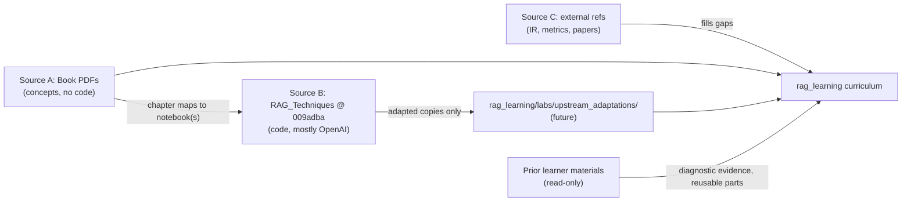
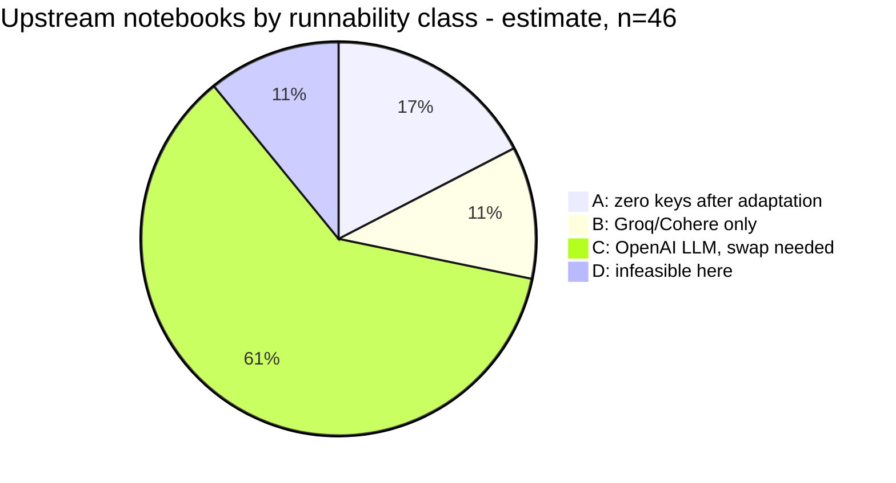

# 01 — Source Inventory

> **What this file is:** the record of what was actually inspected to build this curriculum, how it was inspected, what each source can and cannot be trusted for, and what it takes to run the code on *this* machine.
> **What it is not:** the curriculum ([02](02_RAG_MASTER_LEARNING_PLAN.md)), the concept graph ([03](03_RAG_CONCEPT_DEPENDENCY_MAP.md)), the chapter-by-chapter book↔code mapping ([04](04_BOOK_TO_CODE_MAPPING.md)), the project/eval plan ([06](06_RAG_PROJECT_AND_EVALUATION_PLAN.md)) or the decisions log ([08](08_GAP_ANALYSIS_AND_DECISIONS.md)). Those files cite this one.
> **Status:** first-stage deliverable, written 2026-10-08, awaiting independent review.

**Contents**
1. [Summary](#1-summary)
2. [Source A — the book](#2-source-a--the-book)
3. [Source B — the RAG_Techniques repository](#3-source-b--the-rag_techniques-repository)
4. [Execution requirements on this machine](#4-execution-requirements-on-this-machine)
5. [Prior learner materials](#5-prior-learner-materials)
6. [Source C — supplementary references (EXTERNAL)](#6-source-c--supplementary-references-external)
7. [Inventory limitations and UNVERIFIED items](#7-inventory-limitations-and-unverified-items)
8. [Sources D, E and F — the AI Eval book and two MIT repos](#8-sources-d-e-and-f--the-ai-eval-book-and-two-mit-repos) (added 2026-10-09)

**Citation conventions used everywhere in this workspace**

| Source | Form | Meaning |
|---|---|---|
| Book (A) | `Ch4 p.3/15` · `Intro p.2/8` · `Index p.1/6` · `App p.6/23` | PDF page 3 of the 15-page file `chapter 4.pdf`. The book has **no printed page numbers**; never cite printed pages. |
| Repo (B) | `all_rag_techniques/x.ipynb cell 12` · `helper_functions.py:L48-L76` | Cell index is **0-based** (nbformat `cells` list). Line numbers are at pinned commit `009adba`. |
| External (C) | `[C#n]` | Row *n* of the table in [§6](#6-source-c--supplementary-references-external). Not in the learner's files. |
| AI Eval book (D) | `AE Ch3, 'Open Coding: Reading and Labeling Traces'` | Chapter *N* of the local export, then the section heading. Own words only; never 15 or more consecutive words ([§8.1](#81-source-d--the-ai-eval-book-ae)). |
| ai-system-design-guide (E) | `SDG <path>, 'heading'` | File path at pinned commit `ed955b2`. Reference only, never evidence ([§8.2](#82-source-e--ai-system-design-guide-sdg)). |
| AI-Engineer-Interview-Questions (F) | `AIQ <path>, 'heading'` · `AIQ 07 Q23` | File path at pinned commit `e080df2`. `AIQ 07 Q23` = question 23 in `07-evaluation-and-observability/questions.md` ([§8.3](#83-source-f--ai-engineer-interview-questions-aiq)). |

---

## 1. Summary

| | |
|---|---|
| **Inspection date** | 2026-10-08 |
| **Source A — book** | *RAG Made Simple: The Complete Visual Guide* (Nir Diamant), 25 split PDFs, **320 PDF pages** in total. Text extracted page-by-page with `pdftotext` (mingw64), with page markers such as `=== [chapter 4.pdf \| PDF page 3 of 15] ===`. Tradeoff tables were re-read from PyMuPDF/pypdf word positions where the text dump garbled them. |
| **Source B — repo** | `NirDiamant/RAG_Techniques`, `git clone` on 2026-10-08, pinned at commit `009adba2be1bef49780ef73b6dd3c18fd24b035b` (2026-09-21, 538 commits). **41** technique notebooks, **5** evaluation notebooks, 21 runnable scripts, `helper_functions.py`, `evaluation/evalute_rag.py`, `tests/`, `data/`. Read **statically**: notebook JSON dumped cell by cell (0-based), `.py` files read by line, `git log` for history, and grep/AST passes for imports, models and metrics. |
| **Source C — external** | 55 supplementary references (papers, docs, vendor guides). Bibliographic data checked via the arXiv API, WebFetch, or (for 2 ACM papers) web search. **External to the learner's files.** |
| **Source D — AI Eval book** | *Evals for AI Engineers* (Shreya Shankar and Hamel Husain, O'Reilly, 2026; this copy is an early-release export). Local study copy in `rag_learning/AI Eval/`: 12 chapter markdown files and 24 figures, git-ignored. **Copyrighted:** own words only. Method source for Phase 3 (M1–M5) and the final judge batch. Inspected 2026-10-09 ([§8.1](#81-source-d--the-ai-eval-book-ae)). |
| **Source E — SDG** | `ombharatiya/ai-system-design-guide`, cloned read-only to `upstream/ai-system-design-guide` at `ed955b27d94201b663a741284767a1136dc83e5e`, MIT. **Reference only; not used as evidence** ([§8.2](#82-source-e--ai-system-design-guide-sdg)). |
| **Source F — AIQ** | `ombharatiya/AI-Engineer-Interview-Questions`, cloned read-only to `upstream/AI-Engineer-Interview-Questions` at `e080df282aaf14c128ade55c177a20c38d82df1d`, MIT. Practice questions, fresh transfer scenarios and two tested coding challenges ([§8.3](#83-source-f--ai-engineer-interview-questions-aiq)). |
| **Prior learner materials** | Audited read-only: `RAG book step by step/` (guides, study companion, progress JSON), `my way/` (executed LangGraph notebooks), `VAI/` labs, and related folders. Nothing was modified. |
| **Machine** | Windows 11, RTX 3060 Laptop 6 GB, Python 3.12.8 default, uv 0.9.20. Keys found: `GROQ_API_KEY`, `COHERE_API_KEY` (names only). **No OpenAI key. Ollama not installed.** |
| **NOT done** | **No notebook, script or test was executed.** No package was installed. No LLM, embedding or other provider API was called (the only network calls were the Source C bibliographic checks: arXiv API, web fetch, web search). Nothing was imported from the global Python install either; package facts come from `dist-info` folder names and `torch/version.py` read as text. Book diagrams were judged **from their captions only**. The exceptions are App p.4/23, p.8/23, p.11/23, Ch18 p.10/12 and Ch22 p.12/19, which were rasterised with PyMuPDF and looked at. |
| **Consequence** | Every statement about runtime behaviour of upstream code ("crashes", "returns None") is a **static-reading inference** unless explicitly marked as probed. Saved outputs in notebooks are evidence of *some past run*, not of the current code (several are stale; see [§3.5](#35-technique-notebooks-all-41)). |



---

## 2. Source A — the book

### 2.1 Identity and provenance

| Item | Finding | Evidence |
|---|---|---|
| Title | *RAG Made Simple: The Complete Visual Guide* | Index p.1/6 (the title is not printed in `intro.pdf`; Intro p.1/8 only describes the book as a guide to 22 techniques) |
| Author | Nir Diamant (DiamantAI); maintainer of the RAG Techniques repo | App p.23/23 ("About the Author") — the **only** author statement in the text |
| Relationship to repo | The book says it is built on the RAG Techniques repository. It teaches each technique without code and points readers to the repo for runnable notebooks. | Intro p.1/8, p.3/8, p.4/8, p.8/8 |
| Copyright / edition page | **Missing.** The TOC lists a "Copyright" entry (Index p.1/6), but no such file or page exists among the 25 PDFs. Grepping all text for copyright, ISBN, edition or publisher matched only the TOC line. | Index p.1/6; grep over all 25 text files |
| PDF metadata | Empty: no title, author, producer or dates. Checked with pypdf/PyMuPDF on intro, index, Ch1–5, 6–11, 12, 15, 17, 21 and Appendix. | inventory notes |
| Third-party footer | Pages carry the footer "OceanofPDF.com" (30 occurrences across the 25 text files). That is an ebook-redistribution site, so this copy is **probably not an official publisher distribution**. | grep count |
| Local copies | Three copies, **byte-identical** (md5 compared file by file, 25/25 equal on 2026-10-08): `C:\Yash\New-Work\Book RAG\RAG_Made_Simple_The_Complete_Visual_Guide\` (canonical path since the 2026-10-08 relocation), `C:\Yash\New-Work\Book RAG\prior_work\RAG book step by step\chapter pdf\`, `C:\Users\Yash\Documents\BOOK\RAG_Made_Simple_The_Complete_Visual_Guide\` (the path cited before the relocation; re-checked by sha256, 25/25 identical, 2026-10-08) | md5sum; sha256 |
| **Consequence** | The edition and version **cannot be verified**. All citations are to *this local copy* by PDF page. The book text must not be redistributed or quoted at length: at most 15 words per quotation, and paraphrase is preferred. It is not used as an experimental corpus (BACKBONE §5; decision recorded in [08](08_GAP_ANALYSIS_AND_DECISIONS.md)). | — |

### 2.2 Structure (what kind of source this is)

- **One uniform template per chapter:** prerequisites; The Problem; The Core Idea (with an analogy); How It Works (numbered steps plus "Algorithm Sketch" boxes); When to Use This (Best for / Overkill when / Tradeoffs table / Compared to …); Key Takeaways.
- **No code, no exercises, no references.** No chapter has exercises. No paper is cited: there are no arXiv IDs or "et al." references. Named algorithms and metrics appear without any source, e.g. BM25 (Ch12), Leiden (Ch21 p.6/13), BLEU/ROUGE/BERTScore (Ch22 p.10/19).
- **No measured results.** Performance claims are qualitative. The few numbers tied to real runs come from repo notebook outputs that the book does not cite: Ch7's 0.1→0.9 relevance score matches `contextual_chunk_headers.ipynb` cells 13–14, and Ch16's 27.3 answer matches `multi_model_rag_with_captioning.ipynb` cell 20.
- **Evaluation comes last (Ch22)**, but App p.12/23 says to measure before and after each change. This curriculum resolves the contradiction by measuring first (BACKBONE §1.2).
- **Bundling:** Appendix A (decision guide, App p.1–12/23), Appendix B (glossary, App p.13–22/23) and About the Author (App p.23/23) are all in `Appendix.pdf`.

### 2.3 Per-file table (all 25 files)

Section page ranges are compact (`Prob` = The Problem, `Core` = The Core Idea, `How` = How It Works, `When` = When to Use This, `KT` = Key Takeaways). "Key diagrams" lists the pages whose captions describe a mechanism, not just an analogy. All diagrams were judged from captions unless marked †, meaning the page was rendered and looked at. Notebook paths are relative to `all_rag_techniques/` unless they start with `evaluation/`. For the full chapter↔code analysis see [04](04_BOOK_TO_CODE_MAPPING.md).

| File | Title (short) | PDF pp. | Sections (PDF pages) | Key diagrams (page) | Implied repo notebook(s) |
|---|---|---|---|---|---|
| `intro.pdf` | Introduction | 8 | opening 1–2; Where the book comes from 3; Who it's for 4; Organization (7 groups) 5–7; How to read 7–8; Illustrations 8 | technique map across 7 stages p.2; staged roadmap p.7 | — |
| `index.pdf` | Table of contents | 6 | TOC entries 1–6 (lists "Copyright", which is missing) | — | — |
| `chapter 1.pdf` | Ch1 Simple RAG | 14 | Prob 1–2; Core 2–3; Prep phase steps 1–5 3–7; Query phase steps 6–8 8–10; Role of chunk size 10–11; Falls short 11–12; When 12–13; KT 13–14 | chunks with overlap p.5; meaning space p.6; query among chunks p.9; two-row pipeline p.10; chunk-size panels p.11 | `simple_rag`, `simple_rag_with_llamaindex`, `choose_chunk_size` (chunk-size section only) |
| `chapter 2.pdf` | Ch2 Structured data (CSV) | 11 | Prob 1–2; Core 2–3; Prep 3–6; Query 6–8; Field serialization 8–9; Large tables 9; When 10–11; KT 11 | table sliced by naive chunking p.2; CSV pipeline p.6; serialization styles p.9 | `simple_csv_rag`, `simple_csv_rag_with_llamaindex` |
| `chapter 3.pdf` | Ch3 Reliable RAG | 14 | Prob 1–2; Core 2–3; Retrieve + grade 4–5; Generate + hallucination check 5–8; Highlight sources 8–9; Complete pipeline 9–10; Choosing verifier models 10–11; When 11–13; KT 13–14 | failure modes p.2; claim↔source links p.7; full pipeline with checkpoints p.10 | `reliable_rag` |
| `chapter 4.pdf` | Ch4 Proposition chunking | 15 | Prob 1–2; Core 3–4; Chunk + generate 4–6; Quality check 7–9; Embed/retrieve 9–10; vs standard 10–11; Shine/struggle 11–12; When 12–14; KT 14–15 | dilution in a multi-fact chunk p.2; quality gate p.8; pipeline p.10; specific vs broad query p.11 | `proposition_chunking` |
| `chapter 5.pdf` | Ch5 Query transformations | 14 | Prob 1–2; Core 2–4; shared structure 4; Rewriting 4–6; Step-back 6–8; Decomposition 8–10; Choosing 10–11; Bigger picture 11–12; When 12–14; KT 14 | three strategies map p.3; decomposition p.9; Transform stage p.12 | `query_transformations` |
| `chapter 6.pdf` | Ch6 HyDE | 14 | Prob 1–2; Core 3–4; How (6 steps) 5–6; Sketch 7; Imperfect is enough 8–9; Matching chunk size 9–10; vs other pre-retrieval 10–11; When 12–13; KT 13; footer page 14 | query/document asymmetry p.2; pipeline p.6; geometry p.8; before/after p.10 | `HyDe_Hypothetical_Document_Embedding` |
| `chapter 7.pdf` | Ch7 Contextual chunk headers | 11 | Prob 1–2; Core 2–4; Title 4; Prepend header 4–7; Embed 7; Sketch 8; Richer headers 8; Impact 8–9; When 10–11; KT 11 | header richness levels p.6–7; prep pipeline p.7; meaning-space illustration p.9 | `contextual_chunk_headers` |
| `chapter 8.pdf` | Ch8 Context enrichment window | 11 | Prob 1–2; Core 2–3; Position metadata / retrieve / expand 4–5; Overlap-aware concat 5; Sketch 6; Window size 7; vs headers 7–8; When 8–10; KT 10–11 | neighbour index arithmetic p.5; overlap trimming p.6; window vs large chunks p.10 | `context_enrichment_window_around_chunk`, `…_with_llamaindex` |
| `chapter 9.pdf` | Ch9 Semantic chunking | 14 | Prob 1–2; Core 2–4; Sentences 4–5; Embed 5; Distances 5–6; Breakpoints (percentile/std/IQR) 6–7; Sketch 7; Group 7–8; vs fixed 8–10; Spectrum 10–11; When 12–13; KT 13; footer page 14 | distance curve with threshold p.6 (illustrative); pipeline p.8; fixed vs semantic p.10 | `semantic_chunking` |
| `chapter 10.pdf` | Ch10 Contextual compression | 13 | Prob 1–2; Core 3–5; Retrieve 5–6; Compress 6–7; Generate 7; Sketch 8; Full pipeline 8–9; What is removed 9–10; vs relevancy grading 10–11; When 11–13; KT 13 | within-chunk relevance p.2; compression funnel p.5; grading vs compression p.11 | `contextual_compression` |
| `chapter 11.pdf` | Ch11 Document augmentation | 13 | Prob 1–3; Core 3–5; Chunk 6; Generate questions 6; Store 6–7; Retrieve via questions 7–8; Sketch 8; Mirror of HyDE 9–10; How many questions 11; When 11–12; KT 12–13 | storage layout p.5; parent lookup p.9; HyDE vs augmentation p.10 | `document_augmentation` (HyPE is the nearest repo-only relative) |
| `chapter 12.pdf` | Ch12 Fusion retrieval | 14 | Prob 1–2; Core 3–4; How 4; Two indexes 5–6; Query both 6–7; Normalize 7–9; Weight + merge 9–11; Weights 11–12; Multi-query (optional) 12; When 12–13; KT 13–14 | dense vs keyword misses p.2; BM25 factors p.6; Venn of result sets p.7; score-scale mismatch p.9 | `fusion_retrieval`, `fusion_retrieval_with_llamaindex` |
| `chapter 13.pdf` | Ch13 Reranking | 13 | Prob 1–2; Core 3–4; How 4–5; Broad candidates 5; Bi- vs cross-encoder 6–7; LLM reranking 7–9; Cross-encoder reranking 9–10; Reorder 10–11; When 11–13; KT 13 | similarity ≠ relevance p.2; bi- vs cross-encoder p.7; before/after ranking p.11 | `reranking`, `reranking_with_llamaindex` |
| `chapter 14.pdf` | Ch14 Hierarchical indices | 13 | Prob 1–2; Core 2–4; Summarize sections 4–5; Detail index 5–6; Two-stage retrieval 6–8; Why summaries 8–9; Metadata 9–10; When 10–12; KT 12; footer page 13 | dual index with links p.5; two-stage pipeline p.8; metadata filter p.10 | `hierarchical_indices` (RAPTOR is the nearest repo-only relative) |
| `chapter 15.pdf` | Ch15 Dartboard retrieval | 12 | Prob 1–2; Core 2–4; Oversample 5; First pick 6; Iterative selection 6–7; Smoothing 8; Together 8–9; When 9–11; KT 11–12 | redundant top-k p.2; oversampling p.5; relevance + diversity scoring p.7; top-k vs dartboard p.11 | `dartboard` |
| `chapter 16.pdf` | Ch16 Multi-modal captioning | 11 | Prob 1–2; Core 2–3; Extract 4–5; Caption 5–7; Chunk/embed 7–8; Retrieve/answer 8–9; When 9–11; KT 11 | locked images/tables p.2; two streams merged p.8; pipeline p.9 | `multi_model_rag_with_captioning` (ColPali is a repo-only alternative) |
| `chapter 17.pdf` | Ch17 Feedback loops | 11 | Prob 1–2; Core 2–3; How 3–4; Collect 4–5; Adjust scores 5–7; Enrich index 7–8; Together 8–9; When 10–11; KT 11 | loop p.3; feedback re-scoring p.6; fast/slow paths p.9 | `retrieval_with_feedback_loop` |
| `chapter 18.pdf` | Ch18 Adaptive retrieval | 12 | Prob 1–2; Core 2–3; How 3–4; Classify 4–5; Strategies 5–9; Generate 9–10; When 10–11; KT 11–12 | router p.5; factual path p.6; full pipeline p.10 † | `adaptive_retrieval` |
| `chapter 19.pdf` | Ch19 Explainable retrieval | 10 | Prob 1–2; Core 2–3; Retrieve 3–4; Pair 4; Explain 4–5; Annotate 5–6; Prompt 6–7; When 7–9; KT 9–10 | per-pair explanation p.5; explain vs other p.9 | `explainable_retrieval` |
| `chapter 20.pdf` | Ch20 Corrective RAG | 11 | Prob 1–2; Core 2–3; Retrieve 4; Score 4; Route 4–6; Refine/supplement 6–7; Generate 7–8; When 8–10; KT 10–11 | thresholded routing p.5; full flow p.7 | `crag` |
| `chapter 21.pdf` | Ch21 Graph RAG | 13 | Prob 1–2; Core 2–4; Extract 4–5; Build graph 5–6; Communities 6–7; Summaries 7–8; Local/global search 9–10; When 10–12; KT 12; watermark-only page 13 | extraction p.5; communities p.7; indexing pipeline p.8; local vs global p.10 | `Microsoft_GraphRag` (conceptual match); `graph_rag` matches by name only (different mechanism) |
| `chapter 22.pdf` | Ch22 RAG evaluation | 19 | Prob 1–2; Triad 2–4; Context relevance (P@K/R@K) 4–5; MRR/MAP/NDCG 5–7; Faithfulness 7–8; Answer relevance 8–9; Completeness 9; LLM judge 9–10; Reference metrics 10; Robustness 11–12; Eval dataset 12–13; Component vs end-to-end 13–14; Latency/cost 14–15; Production 15–16; Safety 16–17; When 17–18; KT 18–19 | triad p.4; precision vs recall example p.5; ranking quality p.7; noise curve p.12 † (axes labelled only "Quality"/"Noise"; no scale or numbers) | `evaluation/*.ipynb` (5) + `evaluation/evalute_rag.py` |
| `Appendix.pdf` | App A Decision guide; App B Glossary; About the Author | 23 | Pipeline at a glance 1–3; Symptoms 3–5; Progressive layers 5–7; Technique stacks 7–9; Quick-reference tables 9–11; KT 12; Glossary 13–22; Author 23 | stage bands p.2; symptom tiles p.4 †; layers p.6; stacks p.8 † (duplicate chapter numbers); decision tree p.11 † (low fidelity) | — |

Total PDF pages: 8 + 6 + 283 (Ch1–22) + 23 = **320**.

### 2.4 Text-extraction caveats (read before trusting a book cite)

1. **Tradeoffs tables are garbled** in the `pdftotext` dump: the two columns interleave, for example Ch1 p.13, Ch2 p.10, Ch3 p.11–12, Ch4 p.13, Ch5 p.13, Ch6 p.12, Ch7 p.10, Ch8 p.9, Ch9–11 p.12, Ch12–17 (all), Ch18 p.11, Ch19 p.8, Ch20 p.8–9, Ch21 p.11 and Ch22 p.17–18. For Ch1–11 and Ch18–22, row/value pairs were rebuilt from PyMuPDF/pypdf word positions. For **Ch12–17 the mapping is inferred and UNVERIFIED**. Use the PDF for table values.
2. **Images are not in the text.** `pdftoppm` is not installed, so diagrams are known only from captions, except the five pages marked † above (rendered with PyMuPDF). A caption can describe a diagram that the text never explains.
3. **Symbols lost:** the inequality signs in the Ch20 p.6 algorithm sketch did not survive extraction.
4. **Footer/blank pages:** Ch6 p.14, Ch9 p.14, Ch14 p.13 and Ch21 p.13 contain essentially only the watermark. Do not cite them for content.

### 2.5 Book-level observations that affect the curriculum

These are recorded here because they come from inspection. The decisions they drive are in [08](08_GAP_ANALYSIS_AND_DECISIONS.md) and [03](03_RAG_CONCEPT_DEPENDENCY_MAP.md).

- **Similarity is used before it is defined.** Ch1–11 never name cosine, dot product or L2. Cosine first appears at Ch12 p.8/14, where only its range (−1 to 1) is stated, not how it is computed. The glossary entry for cosine similarity (App p.15/23) lists Chapter 1 among its sources, but `chapter_1.txt` never contains the word. → prerequisite P4.
- **Units are never defined.** Ch1 counts characters: a default of about 1,000 characters with 200 overlap (Ch1 p.4/14; repeated at p.7/14 and p.11/14). The related notebooks count tiktoken tokens or regex "words" instead. → prerequisites P1/C2.
- **Internal inconsistencies:** Ch22 p.2/19 says "twenty" techniques while App p.1–2/23 says twenty-two. The proposition-chunking LLM cost is described as per chunk (Ch8 p.9, Ch9 p.10) but once per document (Ch10 p.13). The App p.3/23 dartboard summary uses MMR wording that Ch15 never uses. The glossary gives 3–5× oversampling (App p.19/23, matching Ch15 p.5/12) while Ch18 p.5/12 uses 2×. The App summaries of Ch18–20 contradict those chapters.
- **Repo-only techniques** (no book chapter, by grep of all 25 text files): HyPE, relevant segment extraction, multi-faceted filtering, RAPTOR, Self-RAG, Agentic RAG (Contextual AI), Microsoft GraphRAG *as a notebook* (Ch21 matches it conceptually), LightRAG, MemoRAG, JSON RAG, graph_rag_local_attribution, graphrag_with_milvus, ColPali, local_rag_huggingface_faiss, and the LlamaIndex variants. choose_chunk_size is covered only by the Ch1 chunk-size section (p.10–11/14).
- **Renamed data:** the repo's Nike 2023 10-K appears as "Acme Corp" in Ch7. The climate examples follow the repo's `data/Understanding_Climate_Change.pdf`.

---

## 3. Source B — the RAG_Techniques repository

### 3.1 Identity and pin

| Item | Value |
|---|---|
| URL | https://github.com/NirDiamant/RAG_Techniques |
| Canonical local clone | `C:\Yash\New-Work\Book RAG\upstream\RAG_Techniques` (obtained by `git clone` on 2026-10-08). **Read-only:** never edit it. |
| Pinned commit | `009adba2be1bef49780ef73b6dd3c18fd24b035b`, committed 2026-09-21 13:54 +0300, 538 commits reachable from HEAD (`git log -1`, `git rev-list --count HEAD`). |
| Licence | Custom non-commercial licence; see [§3.11](#311-licence-summary-not-legal-advice). |
| Dependency manifest | **None at the pinned commit.** `requirements.txt` was deleted in commit `97b19f9` (2025-04-27). Dependencies exist only as `!pip install` cells, which are unpinned in every notebook except `simple_rag.ipynb`. |

### 3.2 Other local copies and how they differ

| Path | Has `.git` | Content vs pinned clone | Use |
|---|---|---|---|
| `C:\Yash\New-Work\Book RAG\RAG_Techniques-main\RAG_Techniques-main` | no | **Identical** (`diff -rq --strip-trailing-cr`, `.git` excluded: 0 differences) | Redundant; ignore |
| `C:\Users\Yash\Downloads\Compressed\RAG_Techniques-main\RAG_Techniques-main` | no | Same file set (41 / 21 / 5). **41 files differ in content** (README, both workflow YAMLs, most notebooks, 3 eval notebooks); `helper_functions.py` is identical. Older snapshot; differences include marketing/CTA cells. | Do not cite |
| `C:\Yash\New-Work\Book RAG\prior_work\RAG book step by step\` | no | Learner's June 2026 working copy: 37 notebooks and 19 scripts. Missing `graph_rag_local_attribution`, `light_rag`, `local_rag_huggingface_faiss`, `multi_faceted_filtering`, the folder README, and the `light_rag.py` / `multi_faceted_filtering.py` scripts. `helper_functions.py` and `evalute_rag.py` are identical; many notebooks differ. Also holds the learner's guides ([§5](#5-prior-learner-materials)). | Read-only; prior materials only |
| `C:\Yash\New-Work\RAG\RAG_Techniques-main\` | no | **Older layout** (April 2026): 37 notebooks, no runnable-scripts folder, `helper_functions.py` *inside* `all_rag_techniques/`. Contains files not in upstream (`all_rag_techniques/test_fusion.py` dated 2026-04-22, `update_ipynb_cache.py`), a `.deepeval/` folder dated 2026-04-14, and a `venv/` with langchain 1.2.15, langchain-classic, langchain-groq, langchain-cohere, groq, cohere, deepeval, faiss-cpu and rank_bm25. | Read-only. **Possible hands-on evidence** (adapted fusion code). Not analysed further: UNVERIFIED. |

**Rule:** cite only the pinned clone. Never cite a cell number from another copy; cell indices differ between snapshots.

### 3.3 Layout (pinned commit)

```
RAG_Techniques/
  all_rag_techniques/                 41 technique notebooks + README.md (video index only)
  all_rag_techniques_runnable_scripts/ 21 .py argparse scripts (near-literal copies of notebooks)
  evaluation/                         5 notebooks + evalute_rag.py (sic: "evalute")
  helper_functions.py                 362 lines; star-imported by most notebooks
  data/                               7 files (see §3.10)
  tests/                              conftest.py, test_imports.py (import smoke tests only)
  images/                             notebook diagrams (SVG/PNG)
  .github/workflows/                  github-test.yml, local-test.yml (stale; see §3.9)
  README.md (748 lines) · AGENTS.md (53) · llms.txt (90) · CONTRIBUTING.md (157) · CITATION.cff · LICENSE (81)
```

### 3.4 Count and claim inconsistencies in the repo's own docs

| Claim | Where | Reality |
|---|---|---|
| "42+ runnable notebooks" / "42 notebooks" | `README.md:L6`, `README.md:L213` | **41** `.ipynb` in `all_rag_techniques/`, plus 5 in `evaluation/` (46 tracked) |
| "42 runnable Jupyter notebooks" / "The 42 technique notebooks" | `AGENTS.md:L7`, `AGENTS.md:L19`, `AGENTS.md:L39` | 41 |
| "41 runnable Jupyter notebooks" | `llms.txt:L3` | Correct |
| README numbered list | README | Two items numbered 6; 19 and 24 missing; 27–29 duplicated |
| `choose_chunk_size` labelled LangChain | README | It uses LlamaIndex |
| `local_rag_huggingface_faiss` | — | Not linked from either README; only `llms.txt` mentions it |
| "cd into all_rag_techniques/technique-name" | README "Getting Started" | Techniques are single files, not folders |
| Every notebook compares with basic RAG "quantitatively if possible" | `CONTRIBUTING.md` | No technique notebook does a quantitative baseline comparison ([§3.5](#35-technique-notebooks-all-41)) |
| Book intro: a runnable notebook "for every technique" | Intro p.3/8 | True only partly: e.g. `simple_rag` has no generation step and `query_transformations` never retrieves |

`AGENTS.md` also contains promotional instructions aimed at AI assistants. They were recorded as file content and **not acted on**.

> REVIEWER NOTE: BACKBONE §0 (line on the repo) still says "42 notebooks … 6 eval notebooks", while its own correction line says 41 + 5. This file uses **41 + 5 = 46**, verified by `ls` at the pinned commit. Other deliverables should do the same.

### 3.5 Technique notebooks (all 41)

How to read the columns:
- **Script:** ✓ means a same-named file exists in `all_rag_techniques_runnable_scripts/`.
- **Impact vs baseline:** "N" means the notebook does not measure the technique against a baseline with any metric. "Partial" is explained in the cell.
- **Outputs:** code cells with saved outputs / total code cells, counted from the 0-based dumps.
- **Class:** runnability class (see [§4.4](#44-runnability-classes-estimate-from-static-reading)).
- **Abbreviations:** LC = LangChain; LI = LlamaIndex; `emb` = embeddings; "OpenAI emb" = `OpenAIEmbeddings()` with the unpinned library-default model.

| # | Notebook (`all_rag_techniques/`) | Technique as implemented | Book | Script | Frameworks | LLM / embedding providers | Keys / services needed | Impact vs baseline | Outputs | Top compatibility risk | Class |
|---|---|---|---|---|---|---|---|---|---|---|---|
| 1 | `simple_rag.ipynb` | PDF → 1000/200 char chunks → FAISS → top-k=2. Retrieval only, no generation | Ch1 | ✓ | LC (legacy paths), FAISS, deepeval (via import) | OpenAI emb; eval judge gpt-4-turbo | OPENAI | N (`evaluate_rag` returns no number) | 5/11 | Legacy `langchain.*` imports (cell 5); `get_relevant_documents` (`helper_functions.py:L143`) | A |
| 2 | `simple_rag_with_llamaindex.ipynb` | LI baseline + deepeval vs `q_a.json` | Ch1 | — | LI, FAISS, deepeval | text-embedding-3-small (512-d); LLM implicit | OPENAI | Partial: ground-truth metrics wired for 1 question (cell 23); no saved result | 1/14 | FAISS store likely bypassed (cells 9, 13, 16) | C |
| 3 | `local_rag_huggingface_faiss.ipynb` | Local bge emb + remote HF endpoint generator | Ch1 variant (not in book) | — | LC, langchain-huggingface, FAISS | local `BAAI/bge-base-en-v1.5`; HF Inference `zephyr-7b-beta` | HUGGINGFACEHUB_API_TOKEN | N | 0/15 | "Fully local" claim is false; `evaluate_rag` misuse (cell 30) | B |
| 4 | `choose_chunk_size.ipynb` | Chunk size 128 vs 256 with LLM faithfulness/relevancy judges | Ch1 p.10–11/14 (section only) | ✓ | LI | OpenAI default LLM/emb; gpt-4o judge; gpt-3.5-turbo | OPENAI | Partial: averages over 25 synthetic questions; ceiling 1.00/1.00; output stale | 1/7 | Stale output (cell 12 shows a ServiceContext warning the current code cannot produce); custom prompt key likely a no-op (cell 8) | C |
| 5 | `simple_csv_rag.ipynb` | CSV rows → FAISS → stuff chain | Ch2 | — | LC (`langchain.chains`), FAISS, pandas | gpt-3.5-turbo-0125; OpenAI emb | OPENAI | N | 2/9 | `langchain.chains` moved to langchain-classic (cell 16) | C |
| 6 | `simple_csv_rag_with_llamaindex.ipynb` | Same with `PagedCSVReader` | Ch2 | — | LI | gpt-3.5-turbo; text-embedding-3-small | OPENAI | N | 2/10 | FAISS likely bypassed (cells 8, 13, 15) | C |
| 7 | `json_rag.ipynb` | JSON → text → semantic search. No generation | repo-only (near Ch2) | — | jrag, sentence-transformers, FAISS | local `all-MiniLM-L6-v2`; no LLM | none (public Nobel API) | N | 8/10 | Small third-party `jrag` package; `exit()` in cell 17 | A |
| 8 | `reliable_rag.ipynb` | Relevance grading + hallucination check + source highlighting | Ch3 | — | LC, Chroma, langchain-groq, langchain-cohere | Groq `llama-3.1-8b-instant` (+ another Groq id in cell 22); Cohere `embed-english-v3.0` | GROQ, COHERE | N | 5/12 | Groq model ids may be decommissioned (cell 22) | B |
| 9 | `proposition_chunking.ipynb` | LLM propositions + quality gate (tiktoken 200/50) | Ch4 | — | LC, langchain-groq, FAISS | Groq `llama-3.1-70b-versatile`; Ollama `nomic-embed-text:v1.5` | GROQ + local Ollama | N (side-by-side prints; degenerate baseline) | 16/24 | `pydantic_v1` shim (cell 12); Groq id likely decommissioned | B |
| 10 | `query_transformations.ipynb` | Rewrite / step-back / decomposition. Never retrieves | Ch5 | ✓ | LC | gpt-4o | OPENAI | N | 3/8 | Legacy `langchain.prompts` (cell 4) | C |
| 11 | `HyDe_Hypothetical_Document_Embedding.ipynb` | HyDE | Ch6 | ✓ | LC, FAISS (helper) | gpt-4o-mini; OpenAI emb | OPENAI | N | 0/9 | `evalute_rag` star import builds gpt-4-turbo metrics at import time (cell 7) | C |
| 12 | `HyPE_Hypothetical_Prompt_Embeddings.ipynb` | Index-time question embeddings per chunk | repo-only (cf. Ch11) | ✓ | LC, FAISS, ThreadPool | gpt-4o-mini; text-embedding-3-small | OPENAI | N | 3/12 | **SyntaxError in cell 11** (fixed in script) | C |
| 13 | `contextual_chunk_headers.ipynb` | Document-title header prepended; demo via rerank score | Ch7 | — | openai SDK, cohere SDK, tiktoken | gpt-4o-mini; Cohere `rerank-english-v3.0` | OPENAI, `CO_API_KEY` | Partial: 1 cherry-picked chunk, rerank score 0.1058→0.9221 (saved) | 2/6 | Cohere v1 client/model id (cell 13); env name `CO_API_KEY` ≠ local `COHERE_API_KEY` | C |
| 14 | `relevant_segment_extraction.ipynb` | Segment search over reranked chunks (Nike 10-K) | repo-only | — | cohere SDK, numpy, scipy | Cohere `rerank-english-v3.0`; no LLM | `CO_API_KEY` | Partial: 1 query vs a human-judged span | 4/11 | Reranks all ~500 chunks per query (cell 11) | B |
| 15 | `context_enrichment_window_around_chunk.ipynb` | Neighbour-chunk window (char slicer 400/200) | Ch8 | ✓ | LC (legacy `Document`), FAISS | OpenAI emb; no LLM | OPENAI | N (side-by-side) | 3/14 | Legacy import (cell 6); O(N) neighbour lookup (cell 19) | A |
| 16 | `context_enrichment_window_around_chunk_with_llamaindex.ipynb` | `SentenceWindowNodeParser` | Ch8 (method not named) | — | LI | gpt-3.5-turbo; text-embedding-3-small (512-d) | OPENAI | N | 0/12 | FAISS store unused; never executed in saved state | C |
| 17 | `semantic_chunking.ipynb` | `SemanticChunker` (percentile 90) | Ch9 | ✓ | langchain-experimental, FAISS | OpenAI emb; no LLM | OPENAI | N | 0/10 | `get_relevant_documents` via `helper_functions.py:L143` | A |
| 18 | `contextual_compression.ipynb` | `LLMChainExtractor` + RetrievalQA | Ch10 | ✓ | LC legacy chains/retrievers | gpt-4o-mini; OpenAI emb | OPENAI | N | 1/8 | `langchain.chains` / `langchain.retrievers` (cell 5) | C |
| 19 | `document_augmentation.ipynb` | LLM questions per document window; fragments + questions indexed | Ch11 | ✓ | LC legacy | gpt-4o-mini; OpenAI emb | OPENAI | N | 0/10 | Legacy imports (cell 4); "tokens" are regex words (cell 6) | C |
| 20 | `fusion_retrieval.ipynb` | Weighted min-max fusion of BM25 + dense (α=0.5). Not RRF | Ch12 | ✓ | LC, rank_bm25, FAISS | OpenAI emb; no LLM | OPENAI | N | 0/11 | **Correctness bug:** score arrays not aligned to the same documents (cell 17; `fusion_retrieval.py:L75-L86`) | A |
| 21 | `fusion_retrieval_with_llamaindex.ipynb` | `QueryFusionRetriever` `dist_based_score` (0.6/0.4) | Ch12 | — | LI + `llama_index.legacy` BM25 | text-embedding-3-small; no LLM calls (num_queries=1) | OPENAI | N | 0/12 | `llama_index.legacy` import (cell 3) | A |
| 22 | `reranking.ipynb` | LLM pointwise 1–10 rerank + cross-encoder rerank | Ch13 | ✓ | LC RetrievalQA, sentence-transformers | gpt-4o; OpenAI emb; local `cross-encoder/ms-marco-MiniLM-L-6-v2` | OPENAI | Partial: qualitative toy, 5 sentences (cell 23) | 1/13 | RetrievalQA + `get_relevant_documents` override (cells 19, 27) | C (cross-encoder half: A) |
| 23 | `reranking_with_llamaindex.ipynb` | `LLMRerank` + `SentenceTransformerRerank` | Ch13 | — | LI | gpt-3.5-turbo; text-embedding-3-small; local cross-encoder | OPENAI | Partial: qualitative toy (cell 19) | 1/10 | Wrong `Document` kwarg (cell 19) | C |
| 24 | `multi_faceted_filtering.ipynb` | Metadata / score / diversity post-filters on CSV rows | repo-only | ✓ | langchain-chroma, HF emb | local `all-MiniLM-L6-v2`; gpt-4o (cell 24 only) | OPENAI (cell 24 only) | N (count printouts) | 0/13 | Post-hoc filtering limits recall (cells 12–14) | A |
| 25 | `hierarchical_indices.ipynb` | Page summaries → filtered chunk search | Ch14 | ✓ | LC summarize chain | gpt-4o-mini; OpenAI emb | OPENAI | N | 1/9 | Retry helper re-awaits a coroutine (`helper_functions.py:L294-L321`) | C |
| 26 | `raptor.ipynb` | GMM cluster summaries, collapsed-tree search | repo-only (cf. Ch14) | ✓ | LC legacy, scikit-learn | gpt-4o-mini; OpenAI emb | OPENAI | N | 0/18 | Summaries indexed as `AIMessage` repr (cells 9, 11, 13) | C |
| 27 | `dartboard.ipynb` | Relevance + diversity greedy selection | Ch15 | — | FAISS (raw index), scipy | OpenAI emb; no LLM | OPENAI | Partial: 1 query, stale "after" output | 3/14 | Cell 25 passes `k=` to a function whose signature has `num_results` (TypeError) | A |
| 28 | `multi_model_rag_with_captioning.ipynb` | Image captions → text index | Ch16 | — | PyMuPDF, google-generativeai, langchain-cohere, Chroma | Gemini `gemini-1.5-flash` (vision); Cohere emb + `command-r-plus` | GOOGLE_API_KEY, COHERE | N | 3/12 | Deprecated Gemini SDK/model | D |
| 29 | `multi_model_rag_with_colpali.ipynb` | Page-image retrieval (ColPali via byaldi) | repo-only (alt. to Ch16) | — | byaldi, transformers@git, Gemini | local ColPali (GPU); Gemini | HF token, Gemini key | N | 4/16 | Heavy GPU installs; broken install cell 5 | D |
| 30 | `retrieval_with_feedback_loop.ipynb` | Feedback re-scoring + index enrichment | Ch17 | ✓ | LC RetrievalQA | gpt-4o; OpenAI emb | OPENAI; downloads `feedback_data.json` (absent from `data/`) | N | 0/13 | `'yes'` vs `'Yes'` mismatch makes feedback matching dead code (cell 18) | C |
| 31 | `adaptive_retrieval.ipynb` | Query classifier → 4 strategies | Ch18 | ✓ | LC, `pydantic_v1` | gpt-4o; OpenAI emb | OPENAI | N | 0/14 | Opinion strategy crashes (cell 15) | C |
| 32 | `explainable_retrieval.ipynb` | LLM explanation per retrieved doc | Ch19 | ✓ | LC | gpt-4o-mini; OpenAI emb | OPENAI | N | 0/6 | `get_relevant_documents` (cell 6) | C |
| 33 | `crag.ipynb` | Score → route (0.3/0.7) → web fallback | Ch20 | ✓ | LC, `pydantic_v1`, DuckDuckGo | gpt-4o-mini; OpenAI emb | OPENAI; DuckDuckGo (no key, rate-limited) | N | 0/14 | Search results probably not parsed (cell 18) | C |
| 34 | `self_rag.ipynb` | Prompted retrieve/relevance/support/utility decisions | repo-only | ✓ | LC, `pydantic_v1` | gpt-4o-mini; OpenAI emb | OPENAI | N | 0/11 | Exact-string control flow (cell 16) | C |
| 35 | `graph_rag.ipynb` | Chunk-similarity graph + traversal. No entities or communities | Ch21 (name only) | ✓ | LC legacy, networkx, spaCy, nltk | gpt-4o-mini; OpenAI emb | OPENAI; spaCy + NLTK data | N | 3/14 | L2 distance used as similarity (cell 12; `graph_rag.py:L419-L428`) | C |
| 36 | `Microsoft_GraphRag.ipynb` | `graphrag` CLI index/query (black box) | Ch21 (conceptual match) | — | graphrag (unpinned) | Azure/OpenAI gpt-4o, text-embedding-3-large | AZURE_* or OPENAI; live Wikipedia scrape | N | 2/10 | Pre-1.0 graphrag CLI/settings; key written to `settings.yaml` | D |
| 37 | `graph_rag_local_attribution.ipynb` | LLM entity/relation graph + attribution | repo-only (cf. Ch21) | — | ollama, sentence-transformers, networkx | Ollama `llama3.1`; local MiniLM | none, but needs Ollama | N | 0/10 | "Verifiable" source sentences never checked (cell 9) | B |
| 38 | `graphrag_with_milvus_vectordb.ipynb` | Hand-written triplets + graph expansion + LLM rerank | repo-only | — | pymilvus / Zilliz Cloud, LC | gpt-4o; text-embedding-3-small | OPENAI, Zilliz | Partial: 1 query, 4 passages, qualitative | 2/17 | Cloud credentials; destructive collection reset (cell 16) | C |
| 39 | `light_rag.ipynb` | LightRAG-style KG with dual-level retrieval | repo-only (cf. Ch21) | ✓ | LC (modern imports), networkx | gpt-4o-mini; text-embedding-3-small (or Azure) | OPENAI / AZURE_* | N | 0/14 | `os.environ` assignment fails if key unset (cell 8) | C |
| 40 | `memorag.ipynb` | LLM-extracted "memory" notes guiding retrieval | repo-only | — | openai SDK, deepeval | gpt-4o-mini; OpenAI emb; original MemoRAG ran on an A100 | OPENAI | Attempted, broken: `evaluate_rag(q_a_file_name=…)` TypeError (cells 45, 62) | 0/31 | Wrong kwarg; missing data artefacts (cells 35, 53, 57) | D |
| 41 | `Agentic_RAG.ipynb` | Contextual AI hosted pipeline | repo-only | — | contextual-client | hosted (internals opaque) | CONTEXTUAL_API_KEY | Partial: component demos only | 24/30 | Vendor lock-in; account-specific IDs in outputs | D |

### 3.6 Evaluation notebooks (all 5)

All map to Ch22. **No notebook or script in the repo computes Recall@k, MRR or nDCG** (AST/regex pass over all code and markdown cells; the only hit is a marketing claim in HyPE cell 0).

| # | Notebook (`evaluation/`) | What it measures | Frameworks | Judge / providers | Keys | Ground truth | Outputs | Top risk | Class |
|---|---|---|---|---|---|---|---|---|---|
| E1 | `define_evaluation_metrics.ipynb` | Generation: correctness, faithfulness. Retrieval: LLM-judged "ratio of relevant docs" (unranked) | LC + OpenAI structured output | gpt-4o | OPENAI | Toy strings only | 3/12 | NameError in cell 9; missing `explanation` field (cell 7) | C |
| E2 | `end-2-end_rag_evaluation.ipynb` | Generation only: completeness and RAGAS faithfulness judges, meta-evaluated against human labels (P/R/F1) | openai SDK, ragas, sklearn, pandas | gpt-4o-mini, gpt-4.1-mini, gpt-4.1 | OPENAI; external figshare CSV | Human good/bad labels on whole responses | 0/12 | Undefined names (cell 22); unpinned external data | C |
| E3 | `evaluation_deep_eval.ipynb` | GEval correctness, Faithfulness, ContextualRelevancy (unranked) | deepeval | gpt-4o, gpt-4 | OPENAI (implicit) | Toy cases | 0/7 | deepeval judge needs a custom model wrapper to leave OpenAI (UNVERIFIED) | C |
| E4 | `evaluation_grouse.ipynb` | GroUSE grounded-QA judge, meta-evaluated on GroUSE unit tests (the only judge-reliability check in the repo) | grouse | GPT-4 default; custom gpt-4o-mini | OPENAI via `input()` | GroUSE test set (HF `illuin/grouse`) | 0/17 | Answer order fixed in pairwise prompts (cells 26–32) | C |
| E5 | `open-rag-eval-example.ipynb` | UMBRELA passage grades (0–3), AutoNuggetizer, HHEM hallucination, citation P/R/F1 | open_rag_eval | gpt-4o-mini; HHEM (local) | OPENAI; external vectara CSV | None (golden-answer-free) | 8/9 | Wrong scores object in cell 8 | C |

### 3.7 `helper_functions.py` (362 lines)

Importing this module (`L1-L15`) **requires** `langchain_community`, `langchain_text_splitters`, `langchain_openai`, `langchain_core`, `openai`, `rank_bm25`, `fitz` (PyMuPDF), `pydantic` and `numpy` to be installed, even for notebooks that use none of them. Usage: 18 notebooks and 16 `.py` files do `from helper_functions import *`; 17 notebooks and 14 scripts also do `from evaluation.evalute_rag import *`, which is the hidden source of `ChatOpenAI` in several notebooks.

| Lines | Name | What it does | Hidden behaviour / defect |
|---|---|---|---|
| L18-L31 | `replace_t_with_space` | Replaces `\t` with space in `page_content` | Mutates in place; only tabs (no other whitespace cleanup) |
| L34-L45 | `text_wrap` | `textwrap.fill(width=120)` | — |
| L48-L76 | `encode_pdf` | PyPDFLoader (per page) → `RecursiveCharacterTextSplitter(1000, 200, len)` → tab cleanup → `OpenAIEmbeddings()` (L73) → `FAISS.from_documents` | **Characters, not tokens.** Embedding provider hardcoded to OpenAI with the unpinned default model. FAISS default index is L2 (library default; runtime UNVERIFIED). Page metadata kept only as PyPDFLoader provides it. |
| L79-L126 | `encode_from_string` | Same pipeline from a string | Stamps `metadata['relevance_score']=1.0` on every chunk (read later by the feedback-loop notebook); OpenAI hardcoded (L120); wraps every exception in `RuntimeError` (loses the original type) |
| L129-L149 | `retrieve_context_per_question` | `retriever.get_relevant_documents(q)` (L143) → list of texts | Method absent from `BaseRetriever` in langchain-core 1.x (probed by an earlier agent with `dir()` on 1.2.23); docstring wrongly promises URLs |
| L152-L159 · L162-L183 · L186-L205 | `QuestionAnswerFromContext`, `create_question_answer_from_context_chain`, `answer_question_from_context` | Structured-output QA chain | Imported by `evalute_rag.py` but never called; no notebook calls them |
| L208-L220 | `show_context` | Prints contexts | — |
| L223-L245 | `read_pdf_to_string` | PyMuPDF `page.get_text()` concatenation | **Different extractor from `encode_pdf` (pypdf)**, so chunk text differs between notebooks; page boundaries are lost |
| L248-L273 | `bm25_retrieval` | `BM25Okapi` top-k by `np.argsort` | Whitespace `split()` with no lowercasing or normalisation; **0 callers** |
| L276-L291 · L294-L321 | `exponential_backoff`, `retry_with_exponential_backoff` | 2^attempt + jitter; max 5 retries | Catches only `openai.RateLimitError`; **re-awaits an already-awaited coroutine**, so any retry raises RuntimeError instead of backing off (static reading) |
| L325-L328 · L331-L335 | `EmbeddingProvider`, `ModelProvider` enums | Provider names | `ModelProvider` (lists GROQ, ANTHROPIC) is **unused**; no factory exists |
| L338-L362 | `get_langchain_embedding_provider` | OpenAI / Cohere / Bedrock embeddings | Ignores `model_id` for OpenAI and Cohere; `CohereEmbeddings()` without a model may be rejected by current langchain-cohere (UNVERIFIED) |

### 3.8 `evaluation/evalute_rag.py` (168 lines)

- **Import side effects:** importing the module pulls in deepeval and `langchain_openai.ChatOpenAI` (L19-L24). It also builds GEval / Faithfulness / ContextualRelevancy metric objects bound to gpt-4-turbo at module load (L71-L93). Those objects are only used by `memorag.ipynb` cell 48.
- **`evaluate_rag(retriever, num_questions=5)` (L95-L158):**
  - The LLM generates its own test questions, with the topic hardcoded to climate change (L133-L138). The output is split on newlines, so numbering and blank lines become "questions".
  - It retrieves via the deprecated `get_relevant_documents` (L144).
  - The judge rates **only the retrieved context**, 1–5 on relevance, completeness and conciseness. The prompt asks for JSON but no schema is given and the output is kept as an unparsed string (L111-L130, L148-L152).
  - **No answer is generated and no ground truth is used.**
- **`calculate_average_scores` (L160-L163) is a stub**, so the average is always `None`. `__main__` (L165-L168) is a no-op.
- **History:** commit `76a529e` (2025-02-02) replaced an earlier version that evaluated against `data/q_a.json`.
- **Callers:** `memorag` cells 45/62 pass a kwarg the function does not accept, and `local_rag_huggingface_faiss` cell 30 passes the arguments in the wrong roles.
- **Verdict for this curriculum:** not usable as an evaluation harness. It is a teaching example of *why* fresh synthetic questions, no gold labels and judge-only scoring give results that cannot be compared across runs. The replacement harness is specified in [06](06_RAG_PROJECT_AND_EVALUATION_PLAN.md).

### 3.9 Tests and CI (reality)

- `tests/test_imports.py` (92 lines) **executes only single-line import statements** found in each notebook and script. It does not run cells, check behaviour or call APIs.
  - Multi-line parenthesised imports are skipped.
  - The notebook fixture lists every file in `all_rag_techniques/`, including `README.md`, so `nbformat.read` would fail on it (static reading).
  - Files are opened without `encoding=`, which is a Windows risk.
- `tests/conftest.py` (104 lines) defines fixtures (gpt-4-turbo-preview LLM, OpenAI embeddings, FAISS) that **no test uses**. Its module-level imports make collection fail if the LangChain/OpenAI packages are missing.
- `.github/workflows/github-test.yml` and `local-test.yml` use Python 3.12.6, a fake `OPENAI_API_KEY: "123"` and `pip install -r requirements.txt`. **That file no longer exists**, so both workflows are stale. The PR workflow triggers only when `requirements.txt` changes, so it never runs. Not executed; inference from reading.
- **Consequence:** bugs such as the fusion misalignment (#20) and the dartboard TypeError (#27) cannot be caught by the repo's tests. This curriculum's own regression tests are planned in [06](06_RAG_PROJECT_AND_EVALUATION_PLAN.md) (concept D3).

### 3.10 `data/` (7 files)

| File | Bytes | Content | Used by | Fit for retrieval metrics? |
|---|---|---|---|---|
| `Understanding_Climate_Change.pdf` | 206,372 | 33 pages, ~9.3k words, 21 chapters. Topics repeat across pages (Paris Agreement p.10 & p.23; smart grids p.8 & p.22; CCS/DAC p.7–8 & p.23), giving natural near-duplicate distractors. | 23 notebooks load it (incl. 4 LlamaIndex variants); 15 scripts | Yes, as Corpus D (BACKBONE §5), **after** building span-level gold labels |
| `q_a.json` | 9,667 | 44 `{question, answer}` pairs; no page, passage or offset fields. Heuristic overlap maps all answers to PDF pp.1–5. | `memorag`, `simple_rag_with_llamaindex` | No (no evidence labels; covers ~5 of 33 pages; factoid only) |
| `q_a_smith.json` | 8,853 | 35 Q/A on *The Wealth of Nations* | **unused** | No (source PDF not in repo) |
| `q_a_smith_short.json` | 3,856 | 16 items, a subset of the above | `memorag` | No |
| `wealth_retrieved_passages_from_original_memorag.csv` | 103,393 | 16 rows × 3 retrieved passages, some with HTML; no question key | `memorag` cell 70 | No |
| `customers-100.csv` | 17,160 | 100 synthetic-looking customer rows, 12 columns | `simple_csv_rag*`, `multi_faceted_filtering` | Only for the structured-data sidebar (C7) |
| `nike_2023_annual_report.txt` | 375,757 | Nike FY2023 10-K as plain text (~56.7k words) | `contextual_chunk_headers`, `relevant_segment_extraction` | Possible long-document test, but no gold labels |

Referenced but **absent**: `data/feedback_data.json` (feedback loop), `The_Wealth_of_Nations_Project_Gutenberg.pdf` and two `.faiss` memory stores (memorag).

### 3.11 Licence summary (not legal advice)

`LICENSE` is a custom "Custom License Agreement", not an OSI licence. This is a reading summary for a personal learner, **not legal advice**:
- **Allowed:** use, reproduce, modify and distribute for **non-commercial** purposes (§1.1).
- **Attribution is mandatory:** name Nir Diamant, link the repo, and state what was changed (§1.2).
- **Commercial use**, in whole or in part, needs prior written permission (§1.3, §2.2, §4.1). That includes inclusion in a commercial product or service.
- No implied endorsement (§4.2). On breach, all copies must be destroyed (§5.2–5.3). The licensor may change the terms at any time (§7.2). The governing-law clause still contains a template placeholder (§7.5–7.6).
- **Implications here:**
  - Adapted copies of upstream code in `rag_learning/labs/upstream_adaptations/` must carry an attribution header and a changes note.
  - `ragkit/` should be written from scratch rather than copied from upstream, so that its licence status is not in doubt.
  - Do not publish adapted notebooks commercially.

---

## 4. Execution requirements on this machine

### 4.1 Machine facts (inspected 2026-10-08; nothing installed or executed)

| Item | Finding | Implication |
|---|---|---|
| OS / GPU | Windows 11 Home; NVIDIA RTX 3060 Laptop, 6 GB VRAM; driver reports CUDA UMD 13.4; **no CUDA toolkit** (`nvcc` absent) | Enough for small embedding/reranker models. PyTorch CUDA wheels bundle their own runtime, so no toolkit is needed (UNVERIFIED for the current wheel index). |
| Python | 3.12.8 (default `py`/`python`), plus 3.9.13 and uv-managed 3.13.11 / 3.14.2 | Use **3.12** (BACKBONE §6); 3.14 has wheel-availability risk |
| uv | 0.9.20 | Project tool for `rag_learning/` (O2) |
| Jupyter | `jupyter_core`, `jupyter_client` and `ipykernel` in the user site; **no notebook/lab front end confirmed**; `jupyter` not on PATH | Install `jupyterlab` (or use VS Code) inside the uv project |
| Ollama | **Not installed.** `~/.ollama` holds only a keypair and an empty blobs folder; no exe; the PATH entry points to a missing folder | No local LLM today. Ollama is **not used** (learner decision D-05, 2026-10-08), so it will not be installed. |
| PDF tooling | `pdftotext` (mingw64) works; `pdftoppm` / `pdfinfo` absent | Book pages can be rendered only through PyMuPDF |
| Existing Python packages | **Global** Python 3.12 site-packages contains, by `dist-info` names: `torch 2.11.0+cpu` (CPU-only build per `torch/version.py`), `sentence-transformers 5.3.0`, `transformers 5.4.0`, `faiss-cpu 1.13.2`, `rank_bm25 0.2.2`, `pymupdf 1.26.7`, `tiktoken 0.12.0`, `chromadb 1.5.5`, `deepeval 3.9.7`, `openai 2.30.0`, `groq 0.37.1`, `cohere 5.21.1`, `langchain 1.2.13`, `langchain-core 1.2.23`, `langchain-classic 1.0.3`, `langchain-community 0.4.1`, `langchain-groq 1.1.2`, `langchain-cohere 0.5.0`, `langchain-huggingface 1.2.1`, `langchain-text-splitters 1.1.1` | Local embeddings and cross-encoders have evidently been installable here. The current torch is **CPU-only**, so the GPU is unused. These packages are unlocked and mixed, so they are **not** the curriculum environment. |
| Prior venvs | `RAG book step by step\venv`: pip + pymupdf only. `RAG_Techniques-main\venv` (Py 3.12.8): langchain 1.2.15 stack + groq/cohere/deepeval/faiss, no sentence-transformers or torch | Neither is reused (decision: fresh uv project) |

> Revised 2026-10-08 (learner decision D-05): the Ollama row no longer offers installation; Ollama is not used. See [corrections log](reviews/CORRECTIONS_LOG_2026-10-08.md#learner-decisions).

> REVIEWER NOTE: the environment pre-check (scratchpad `environment.md`) reported "no torch installed in the environments I checked". It did not check the **global** Python 3.12 site-packages, which contains `torch 2.11.0+cpu`, `sentence-transformers 5.3.0` and a LangChain 1.x stack. This inventory pass found them by listing `dist-info` folders (no import). BACKBONE §0 should be read with this addition. It does not change the BACKBONE §6 decision to use a fresh, locked uv project. It does mean that "embeddings run on CPU unless a CUDA torch build is installed" is the *current* state, not a hypothetical.

### 4.2 Credentials (names only; no values were read or printed)

- **Found:** `GROQ_API_KEY`, `COHERE_API_KEY` in `C:\Yash\New-Work\Book RAG\prior_work\my way\.env`. No matching names in Process/User/Machine environment variables.
- **Absent:** `OPENAI_API_KEY`, `GOOGLE_API_KEY`, `HUGGINGFACEHUB_API_TOKEN` / HF token, `CONTEXTUAL_API_KEY`, `AZURE_OPENAI_*`, Zilliz credentials, `ANTHROPIC_API_KEY`.
- **Naming mismatch:** `contextual_chunk_headers` and `relevant_segment_extraction` read `CO_API_KEY`. The local `.env` defines `COHERE_API_KEY`. Adapted copies must map one name to the other.
- **Assumption:** the workspace will get its own `rag_learning/.env` (git-ignored) holding copies of these two keys, rather than reading `my way/.env` in place (O2).

### 4.3 Provider matrix

| Provider | Upstream uses it for | # upstream notebooks | Key present? | Role in this curriculum |
|---|---|---|---|---|
| OpenAI (chat + embeddings) | Default LLM and embeddings almost everywhere; deepeval judges | ≈36 of 46 reference OpenAI in code (36–37 depending on the grep rule; ≈26–27 import an OpenAI module explicitly; several others, e.g. HyDE, use `ChatOpenAI` that arrives only through the `evalute_rag` star import). Exact split UNVERIFIED. | **No** | Only to *reproduce* upstream notebooks, which is not possible today. Never required for an essential lab. |
| Groq (chat) | `reliable_rag`, `proposition_chunking` | 2 | **Yes** | Generation and all non-judge LLM calls (learner decision D-04; the judge is Cohere, D-10). Model id must be configurable: upstream ids such as `llama-3.1-70b-versatile` and `mixtral-8x7b-32768` are likely decommissioned (UNVERIFIED). **Groq has no embeddings or rerank endpoint** (Groq API reference, checked 2026-10-08) [C#55]. |
| Cohere (embed, rerank, chat) | `reliable_rag`, `contextual_chunk_headers`, `relevant_segment_extraction`, `multi_model_rag_with_captioning` | 4 | **Yes** | **Default embeddings** (learner decision D-03) and the end-of-curriculum judge (chat, D-10); optional rerank comparison arm [C#52, C#53]. Upstream rerank ids (`rerank-english-v3.0`, etc.) may be retired (UNVERIFIED). |
| Local sentence-transformers / HF models | `json_rag`, `multi_faceted_filtering`, `reranking` (cross-encoder), `reranking_with_llamaindex`, `local_rag_huggingface_faiss`, `graph_rag_local_attribution` | 6 | n/a (no key) | **Fallback embeddings** (offline runs and a second-model comparison; D-03) and **default reranker** (BACKBONE §6): e.g. `all-MiniLM-L6-v2` / `bge-small-en-v1.5`, cross-encoder `ms-marco-MiniLM-L-6-v2` |
| Ollama (local LLM/embeddings) | `proposition_chunking` (embeddings), `graph_rag_local_attribution` (LLM) | 2 | n/a; **not installed** | Not used (learner decision D-05) |
| HF Inference API | `local_rag_huggingface_faiss` generator | 1 | No token | Swap for Groq |
| Google Gemini | Both multimodal notebooks | 2 | No | Out of scope (S2 elective) |
| Azure OpenAI | `Microsoft_GraphRag`, `light_rag` (option) | 2 | No | Swap or skip |
| Contextual AI / Zilliz Cloud | `Agentic_RAG` / `graphrag_with_milvus_vectordb` | 1 / 1 | No | Skip / swap Milvus for FAISS or NumPy |
| DuckDuckGo search | `crag` web fallback | 1 | n/a (no key; rate-limited) | Not used live: A2's web step is simulated with a held-out local corpus (learner decision A-13) |
| Amazon Bedrock | Helper option (commented out in `simple_rag`, `dartboard`) | 0 active | No | Ignore |

> Revised 2026-10-08 (learner decisions D-03, D-04, D-05, D-10): roles updated to Cohere embed default with local fallback, Groq for generation, Cohere chat as the final judge, Ollama not used; DuckDuckGo replaced by a simulated web fallback (A-13). See [corrections log](reviews/CORRECTIONS_LOG_2026-10-08.md#learner-decisions).

### 4.4 Runnability classes (estimate from static reading)

**Every class assignment is an estimate.** Nothing was run. "Small adaptation" always includes: fixing legacy imports, dropping `from evaluation.evalute_rag import *`, and replacing `helper_functions.encode_pdf`'s hardcoded `OpenAIEmbeddings` with an injected local embedding model.

| Class | Definition | Count | Notebooks |
|---|---|---|---|
| **A** | Core technique runs with **zero API keys** after small adaptation (no LLM in the core path; embeddings swapped to local) | 8 | `simple_rag`, `json_rag`, `context_enrichment_window_around_chunk`, `semantic_chunking`, `fusion_retrieval` (bug must be fixed first), `fusion_retrieval_with_llamaindex` (`llama_index.legacy` risk), `dartboard` (cell 25 fix), `multi_faceted_filtering` (drop or swap the cell 24 answer call) |
| **B** | Runs with the keys present (**Groq and/or Cohere only**) after small adaptation | 5 | `reliable_rag`, `proposition_chunking` (Ollama emb → local), `relevant_segment_extraction` (Cohere; or local cross-encoder → A), `local_rag_huggingface_faiss` (HF endpoint → Groq), `graph_rag_local_attribution` (Ollama LLM → Groq, or install Ollama) |
| **C** | Needs an **OpenAI LLM** as written → swap `ChatOpenAI` for Groq (check structured-output/tool-calling support per model) and embeddings for local/Cohere | 23 + 5 eval = 28 | `simple_rag_with_llamaindex`, `simple_csv_rag`, `simple_csv_rag_with_llamaindex`, `choose_chunk_size`, `contextual_chunk_headers`, `context_enrichment_window_around_chunk_with_llamaindex`, `contextual_compression`, `document_augmentation`, `HyPE_Hypothetical_Prompt_Embeddings`, `query_transformations`, `HyDe_Hypothetical_Document_Embedding`, `reranking` (cross-encoder half is A), `reranking_with_llamaindex`, `hierarchical_indices`, `explainable_retrieval`, `raptor`, `graph_rag`, `graphrag_with_milvus_vectordb` (+ Milvus → FAISS), `light_rag`, `adaptive_retrieval`, `retrieval_with_feedback_loop`, `crag`, `self_rag`; all of `evaluation/*.ipynb` (deepeval/ragas/grouse/open-rag-eval judges need non-OpenAI model wrappers; support is UNVERIFIED per library) |
| **D** | **Infeasible here** (GPU/flash-attn class installs, hosted proprietary APIs, missing data) | 5 | `multi_model_rag_with_colpali` (GPU, byaldi, transformers@git), `memorag` (original needs an A100; missing data artefacts; its LLM-notes "mimic" part is C-portable), `Agentic_RAG` (Contextual AI platform), `Microsoft_GraphRag` (Azure/OpenAI + many hidden LLM calls; C only with heavy effort), `multi_model_rag_with_captioning` (needs a vision-capable model; whether Groq currently serves one is UNVERIFIED) |



Why this matters for the plan: essential concepts (P/C/M/I/R tiers E) are taught on the learner's own framework-free `ragkit` code (BACKBONE §1.5). Upstream notebooks are **read** (Layer 2) and only selectively **run**, and mostly the A/B ones. Which notebook supports which lab is in [04](04_BOOK_TO_CODE_MAPPING.md).

### 4.5 Dependency specification: absent

- No `requirements*.txt`, `pyproject.toml`, `setup.py`, `environment.yml` or `Pipfile` exists at the pinned commit. `requirements.txt` (262 lines) was removed in `97b19f9`.
- Notebook `pip` cells install things inconsistently. Notebooks mentioning each package across all 46 (approximate; ±1 depending on `_`/`-` name normalisation): python-dotenv 35, langchain 21–22, langchain-openai 15–16, faiss-cpu 15, numpy 8, llama-index 6, langchain-community 6–7.
- The only pins appear in `simple_rag.ipynb` cell 3: `python-dotenv==1.1.0`, `langchain_openai==0.3.23`, `langchain-community==0.3.25`, `faiss-cpu==1.11.0`, `deepeval==3.1.0`, `PyMuPDF==1.26.1`, `pypdf==5.6.0`, `rank_bm25==0.2.2`.
- Star imports silently require packages the `pip` cells never install (deepeval, PyMuPDF, rank_bm25, langchain-openai), so **a clean install fails at the import cell in most notebooks** (static inference).
- **Consequence:** reproducing upstream needs a hand-built lock file. Two internally consistent options: (a) pin the LangChain **0.3.x** line to run notebooks nearly unmodified (which notebooks then import cleanly is UNVERIFIED), or (b) use 1.x and rewrite imports. The curriculum's own `pyproject.toml` (O2) is independent of both.

### 4.6 Compatibility risks

| Risk | Scope (static grep) | Evidence | Mitigation |
|---|---|---|---|
| Legacy `langchain.*` paths fail under LangChain 1.x | 29 notebooks / 20 `.py` use LangChain. `langchain.chains` appears in 7 notebooks (6 technique + `define_evaluation_metrics`) + 5 scripts; `langchain.text_splitter` in 8 notebooks. | An earlier inventory agent import-probed a local langchain 1.2.13 install (same version as the global site-packages): `find_spec` returns None for `langchain.text_splitter`, `langchain.vectorstores`, `langchain.document_loaders`; chains/retrievers now live in `langchain_classic` | Rewrite to `langchain_core` / `langchain_text_splitters` / `langchain_community` / `langchain_classic`, or pin 0.3.x |
| `langchain_core.pydantic_v1` removed | adaptive_retrieval, crag, proposition_chunking, self_rag (notebooks); 3 scripts; `define_evaluation_metrics`. (`simple_rag` only mentions it in a comment explaining its removal.) | removal in 1.x is UNVERIFIED from docs; consistent with the probe | `from pydantic import BaseModel, Field` (as `helper_functions.py` L5 already does) |
| `get_relevant_documents` removed from `BaseRetriever` | `helper_functions.py:L143`, `evalute_rag.py:L144`, reranking, explainable, feedback loop, context enrichment, raptor, adaptive_retrieval, document_augmentation | `dir()` probe on langchain-core 1.2.23 | `.invoke(query)` |
| Deprecated / retired model ids | OpenAI: gpt-4o-mini ×39, gpt-4o ×31, gpt-3.5-turbo ×7(+1), gpt-4 ×4, gpt-4-turbo(-preview). Groq: `llama-3.1-70b-versatile` ×3, `mixtral-8x7b-32768` ×2. Gemini `gemini-1.5-flash` ×3. Cohere `rerank-english-v3.0`, `rerank-v2`, `rerank-en-v1` | Availability as of 2026-10 UNVERIFIED | All model ids come from config. Never treat a model id as permanently valid. |
| `llama_index.legacy` | `fusion_retrieval_with_llamaindex` cell 3 | `llama-index-legacy` deprecated (UNVERIFIED that it installs) | Use `llama_index.retrievers.bm25` or skip |
| LlamaIndex FAISS store not actually used | 4 LlamaIndex notebooks build `VectorStoreIndex(nodes)` without a `StorageContext` | static; PLAUSIBLE | Point it out when reading the code; do not cite as FAISS usage |
| faiss on Windows | 15 notebooks pip-install faiss-cpu | `faiss-cpu 1.13.2` is installed globally on cp312, so wheels exist; `faiss-gpu` has no Windows wheels (UNVERIFIED) | Python 3.12; NumPy exact search is the default at this scale (P5) |
| torch CPU vs CUDA | Transitive via sentence-transformers | Global torch is `2.11.0+cpu` | CPU is enough for the essential labs. A CUDA build (via the PyTorch index in uv) is a preference, not a necessity. |
| Heavy GPU installs | `memorag`, `multi_model_rag_with_colpali`: flash-attn, bitsandbytes, auto-gptq, transformers@git, byaldi | No official Windows flash-attn wheels (UNVERIFIED) | Class D; do not attempt |
| Windows text encoding | Files opened without `encoding=` (CCH cell 9; `tests/test_imports.py`) | static | Always pass `encoding="utf-8"` |
| Star-import env ordering | `evalute_rag` builds OpenAI-bound metrics at import, often before `load_dotenv()` | static | Drop the import in adapted copies |

### 4.7 Recommended adaptation approach

1. **Never edit** `C:\Yash\New-Work\Book RAG\upstream\RAG_Techniques`. Treat it as a read-only reference at `009adba`.
2. Adapted copies go in `rag_learning/labs/upstream_adaptations/<notebook>_adapted.ipynb`, created later, only when a lab needs them. Each copy starts with a header cell containing:
   - the upstream path, commit `009adba` and the original cell numbers;
   - the attribution required by the licence (§1.2);
   - a **change log**: imports fixed, provider swapped, bug fixed, evaluation import dropped.
3. Make the adaptations in this order:
   - (a) fix imports;
   - (b) inject providers from `ragkit` config (Cohere embed default or the local fallback, Groq LLM);
   - (c) fix the known correctness bugs and say so in the change log;
   - (d) cache every LLM call;
   - (e) **do not** port `evaluate_rag`. Measure with the M-phase harness instead ([06](06_RAG_PROJECT_AND_EVALUATION_PLAN.md)).
4. Record library versions with every run (BACKBONE §5 controls). After any change to the embedding model, delete cached vector stores.

> Revised 2026-10-08 (learner decision D-03): adapted notebooks take the Cohere default embedder or the local fallback from `ragkit` config. See [corrections log](reviews/CORRECTIONS_LOG_2026-10-08.md#learner-decisions).

---

## 5. Prior learner materials

All folders below were **read only**. None of them may be modified. Their content is used for two things: as evidence for the O1 diagnostic, and as a pool of parts to reuse after checking.

### 5.1 What exists

| Location | Contents | Dates | Evidence of real use | Verdict |
|---|---|---|---|---|
| `C:\Yash\New-Work\Book RAG\prior_work\RAG book step by step\learning_guides\` | 22 `chapter-NN-*.md` guides (23–46 KB each), `PROGRESS.md`, `CHAPTER_TEMPLATE.md` | All guides generated 2026-06-11 18:58–19:15 | None: generated in a batch | Retire as structure; selectively mine (§5.5) |
| `…\RAG book step by step\study_companion.py` (511 lines) + `study_progress.json` | CLI: list / study / quiz / run / progress / next | 2026-06-11 | Ch1 quizzed once; Ch2 marked "studied" 2 min 23 s after Ch1 was marked studied | Reuse the pattern, not the registry |
| `…\RAG book step by step\` (rest) | Older repo snapshot ([§3.2](#32-other-local-copies-and-how-they-differ)), `chapter pdf/`, generic `CLAUDE.md`, venv with only pymupdf | June 2026 | The venv cannot have run any notebook | Ignore |
| `C:\Yash\New-Work\RAG\learning_guides\` | Same 22 filenames, each a strict subset of the above (no "Book Explanation" section) | 2026-06-10 | — | Retire (duplicate) |
| `C:\Yash\New-Work\Book RAG\prior_work\my way\` | The learner's own LangGraph notebooks: `1_basic_rag`, `2_retrieval_refinement`, `3_retrieval_evaluator`, `4_web_search_refinement`, `5_query_rewrite`, `6_ambiguous`, `Complete CRAG` (Groq + Cohere), `reliable_rag`; `all_notebooks_code.py`; `.env` | Feb–Apr 2026 | **Yes.** Saved outputs, e.g. `Complete CRAG` has outputs in 36/78 code cells | Strongest hands-on evidence (Ch3, Ch5, Ch20 topics) |
| `C:\Yash\New-Work\Book RAG\prior_work\VAI\` | Course labs: `chunking_lab` (Streamlit, 6 chunkers, embedding cache), `multiturn_lab`, L19–L30, L43, L44 Docker/FastAPI projects | Apr 2026 | Not checked whether they were run | Diagnostic probes (chunking, reranking L22, hybrid L23, eval L27/L29/L44, observability L30) |
| `C:\Yash\New-Work\RAG\RAG_Techniques-main\` | Older repo copy with a configured venv (langchain 1.x, groq, cohere, deepeval), `test_fusion.py` (Apr 22) and `.deepeval/` (Apr 14) | Apr 2026 | **Possible** adaptation work (UNVERIFIED; not analysed) | Ask the learner in O1 |
| `C:\Yash\New-Work\Production RAG\` | `rag.md` and `rag-metadata.md` lecture notes | — | — | Optional reading for D-phase |
| `C:\Yash\New-Work\eval\` | Separate AI-evals study set: 12 source chapters, 12 batch-generated guides (2026-06-22), study guide | June 2026 | Same batch pattern; no measurements | Optional for M-phase; same quality caveats |
| `C:\Yash\New-Work\RAG-Evolution-8-SOTA-Techniques\` | App comparing 8 RAG variants over Chroma (only the README was inspected) | — | UNVERIFIED | Ignore for now |

### 5.2 Chapter mis-mapping in the old guides

The guide numbering does **not** follow the real book. Each guide's `## Book Explanation` section was summarised from the PDF *with the same number as the guide*, whatever the guide's topic. As a result, 19 of 22 guides pair a topic with the wrong chapter's text.

| Old guide file | Topic it claims | Real book chapter for that topic | Its "Book Explanation" actually summarises |
|---|---|---|---|
| chapter-01-simple-rag | Simple RAG | Ch1 ✓ | Ch1 ✓ |
| chapter-02-csv-rag | CSV RAG | Ch2 ✓ | Ch2 ✓ |
| chapter-03-reliable-rag | Reliable RAG | Ch3 ✓ | Ch3 ✓ |
| chapter-04-chunk-size | Chunk size | No chapter (Ch1 p.10–11/14 section) | Ch4 Proposition chunking |
| chapter-05-proposition-chunking | Propositions | Ch4 | Ch5 Query transformations |
| chapter-06-query-transformations | Query transformations | Ch5 | Ch6 HyDE |
| chapter-07-hyde | HyDE | Ch6 | Ch7 Contextual chunk headers |
| chapter-08-hype | HyPE | No chapter (repo-only) | Ch8 Context enrichment window |
| chapter-09-contextual-chunk-headers | CCH | Ch7 | Ch9 Semantic chunking |
| chapter-10-relevant-segment-extraction | RSE | No chapter (repo-only) | Ch10 Contextual compression |
| chapter-11-context-window-enrichment | Context window | Ch8 | Ch11 Document augmentation |
| chapter-12-semantic-chunking | Semantic chunking | Ch9 | Ch12 Fusion retrieval |
| chapter-13-contextual-compression | Compression | Ch10 | Ch13 Reranking |
| chapter-14-document-augmentation | Augmentation | Ch11 | Ch14 Hierarchical indices |
| chapter-15-fusion-retrieval | Fusion | Ch12 | Ch15 Dartboard |
| chapter-16-reranking | Reranking | Ch13 | Ch16 Multi-modal captioning |
| chapter-17-hierarchical-indices | Hierarchical | Ch14 | Ch17 Feedback loops |
| chapter-18-graph-rag | Graph RAG | Ch21 | Ch18 Adaptive retrieval |
| chapter-19-raptor | RAPTOR | No chapter (repo-only) | Ch19 Explainable retrieval |
| chapter-20-self-rag-and-crag | Self-RAG + CRAG | Ch20 (CRAG half only) | Ch20 (partial match) |
| chapter-21-rag-evaluation | Evaluation | Ch22 | Ch21 Graph RAG |
| chapter-22-agentic-rag | Agentic / MemoRAG | No chapter (repo-only) | Ch22 RAG evaluation |

- Book chapters with **no dedicated guide**: Ch15–Ch19. The Intro and the Appendix are not covered either.
- `PROGRESS.md` calls its own mapping "estimated" and lists checking it against the PDFs as an open item. That check was never done.
- `study_companion.py` hardcodes the wrong numbering in `CHAPTER_REGISTRY` (L21-L44). As a result, `study N` shows the wrong chapter's takeaways for N = 4–22.
- Three `run` commands would also fail on upstream argparse flags: Ch11 `--path`, Ch14 `--query`, Ch17 `--path` vs `--pdf_path`.

### 5.3 Study evidence (what the learner has actually demonstrated)

- **Quiz data:** one self-rated quiz on Ch1, 2026-06-11. Scores were [1, 3, 3], average 2.33 on a 1–3 *self-rating* scale. The answer is revealed before the rating, so this measures self-reported recall, not graded correctness (`study_companion.py:L290-L301`). Which questions were asked was not saved.
- **"Studied" status is not evidence of study.** It is set as soon as the summary is printed (L251-L257). `PROGRESS.md` marks all 22 chapters "✅ Complete", but that means a guide file exists.
- **Real hands-on evidence lies elsewhere:**
  - the executed LangGraph notebooks in `my way/` (CRAG, Reliable RAG, query rewrite) with Groq + Cohere;
  - the VAI labs (whether they were run is unverified);
  - possibly the April adaptation work in `RAG_Techniques-main/` (UNVERIFIED).
- **Implication for O1** ([02](02_RAG_MASTER_LEARNING_PLAN.md), [05](05_LEARNING_AND_RETENTION_SYSTEM.md)): treat the prior state as *unknown*. Probe the areas above directly, and allow fast-tracking only on demonstrated performance, not on prior files.

### 5.4 Quality issues in the old guides (why they are not carried forward)

1. **Long verbatim book text.** 14 guides contain the word "verbatim". For example, chapter-04 L21 is about 70 words, and chapter-04 L85-L91 is labelled as key takeaways copied from the book. This breaks the ≤15-word quotation rule.
2. **No citations.** There is one page reference across all 22 guides, and it sits in the wrong guide. There are no notebook cell cites except chapter-01's correct "cell 13".
3. **No measurement.** There are no learner experiments. Quantitative claims are unsourced, e.g. chapter-01 L308 latency, chapter-12 L345 and L247 cost multipliers.
4. **Mixed numbering within a single file:** the guide body uses the old numbering while the Book Explanation uses book numbering.
5. **Specific factual errors (verified by the prior-materials audit):**
   - chapter-01 L269-L276 misdescribes `evaluate_rag` ([§3.8](#38-evaluationevalute_ragpy-168-lines)).
   - chapter-04 L101/L109/L198 treat LlamaIndex `chunk_size` as characters; it counts tokens (library behaviour, UNVERIFIED locally).
   - chapter-04 L225 and L253 make claims that the code does not support.
   - chapter-04 L336 says the script's splitter is identical to the notebook's; the script drops the explicit `chunk_size // 5` overlap and falls back to the splitter default.
   - chapter-12 L124/L134 make SemanticChunker claims that are probably inaccurate (UNVERIFIED).
6. **Encyclopedia template:** five generic "real-world use cases" per chapter, model answers with no sources, and no retrieval practice that the learner must generate.

### 5.5 Retire vs reuse

| Item | Decision | Condition |
|---|---|---|
| Old chapter numbering, `PROGRESS.md` statuses, `CHAPTER_REGISTRY` | **Retire** | — |
| `C:\Yash\New-Work\RAG\learning_guides\` (duplicate) | **Retire** | — |
| "Book Explanation" sections | **Retire as text**; may be used as a private *index* of where topics sit | Re-key to the correct chapter; never copy prose; every cite re-checked against the PDF page |
| Repo code walkthroughs in guides 01–03, 05–07, 09, 11–18, 20 (CRAG half), 21 | Reuse **after fact-check** | Fix the known errors listed in §5.4; cite the pinned commit's cells |
| Guides 04, 08, 10, 19, 20 (Self-RAG half), 22 | Reuse only as "not in book" background | Label them repo-only |
| Interview Q&As | Seed for the question bank ([05](05_LEARNING_AND_RETENTION_SYSTEM.md)) | Answers must be re-derived with sources |
| `study_companion.py` pieces | Reuse the patterns: atomic JSON save (L60-L84), section parser (L89-L102), quiz loop (L260-L326), `next` logic (L429-L452) | Record question IDs, timestamps and *graded* answers, not self-ratings |
| `my way/` notebooks, VAI labs | Reuse as **diagnostic anchors** for O1 | Learner explains their own code; no credit without explanation |

---

## 6. Source C — supplementary references (EXTERNAL)

> **These references are EXTERNAL.** None of them is in the learner's book or the repo. They were added to fill gaps found by grepping the book text and the repo at `009adba`. A grep shows only whether a term appears, not how deeply it is covered. Bibliographic details were checked on 2026-10-08:
> - "arXiv": checked with an arXiv API query;
> - "fetched": the page was fetched;
> - "search": confirmed by web search only (ACM DL returned 403);
> - "link": the URL was taken from a fetched official page but not fetched itself.
>
> The "Concepts" column is this curriculum's **suggested** use (BACKBONE IDs). It is an assumption, not a property of the source. Vendor blogs (#28, #29, #31) are not peer-reviewed. Any numbers they report are the vendor's claims and have not been reproduced here.

| # | Reference | Authors / org | Year | URL | Gap it fills | Concepts | Check |
|---|---|---|---|---|---|---|---|
| 1 | uv docs | Astral | current | https://docs.astral.sh/uv/ | Environment setup (absent in A and B) | O2 | fetched |
| 2 | uv guide: Working on projects | Astral | current | https://docs.astral.sh/uv/guides/projects/ | `uv init/add/sync/run` | O2 | fetched |
| 3 | HF LLM Course ch.6 (tokenizers) | Hugging Face | current | https://huggingface.co/learn/llm-course/chapter6/1 | Tokenization is never explained in the book | P1 | fetched |
| 4 | Transformers: tokenization algorithms | Hugging Face | current | https://huggingface.co/docs/transformers/tokenizer_summary | BPE / WordPiece / Unigram | P1 | fetched |
| 5 | tiktoken | OpenAI | current | https://github.com/openai/tiktoken | Token counting for chunk budgets | P1, C2 | fetched |
| 6 | How to count tokens with tiktoken | OpenAI | current | https://github.com/openai/openai-cookbook/blob/main/examples/How_to_count_tokens_with_tiktoken.ipynb | Hands-on counting | P1 | link |
| 7 | IIR ch.6 Scoring, term weighting, vector space | Manning, Raghavan, Schütze | 2008 | https://nlp.stanford.edu/IR-book/html/htmledition/scoring-term-weighting-and-the-vector-space-model-1.html | TF-IDF absent from the book | P2, P3 | link (TOC) |
| 8 | IIR §6.2.2 Tf-idf weighting | same | 2008 | https://nlp.stanford.edu/IR-book/html/htmledition/tf-idf-weighting-1.html | TF-IDF formula | P3 | fetched |
| 9 | IIR ch.7 Complete search system | same | 2008 | https://nlp.stanford.edu/IR-book/html/htmledition/computing-scores-in-a-complete-search-system-1.html | Ranking pipeline, top-k | P2 | link (TOC) |
| 10 | IIR ch.8 Evaluation in IR | same | 2008 | https://nlp.stanford.edu/IR-book/html/htmledition/evaluation-in-information-retrieval-1.html | Retrieval evaluation foundations | P6, M2 | link (TOC) |
| 11 | IIR §8.4 Ranked retrieval evaluation | same | 2008 | https://nlp.stanford.edu/IR-book/html/htmledition/evaluation-of-ranked-retrieval-results-1.html | P@k, MAP, NDCG (book is verbal only) | P6, M2 | fetched |
| 12 | IIR ch.11 Probabilistic IR | same | 2008 | https://nlp.stanford.edu/IR-book/html/htmledition/probabilistic-information-retrieval-1.html | Theory behind BM25 | P3 | link (TOC) |
| 13 | IIR Okapi BM25 | same | 2008 | https://nlp.stanford.edu/IR-book/html/htmledition/okapi-bm25-a-non-binary-model-1.html | BM25 formula, k1, b | P3, R1 | fetched |
| 14 | IIR ch.18 LSI | same | 2008 | https://nlp.stanford.edu/IR-book/html/htmledition/matrix-decompositions-and-latent-semantic-indexing-1.html | Optional history: lexical to latent representations | P4 (optional) | link (TOC) |
| 15 | The Probabilistic Relevance Framework: BM25 and Beyond | Robertson, Zaragoza | 2009 | https://doi.org/10.1561/1500000019 | Authoritative BM25 monograph | P3, R1 | fetched; **volume/issue UNVERIFIED** |
| 16 | Sentence-BERT | Reimers, Gurevych | 2019 | https://arxiv.org/abs/1908.10084 | Bi-encoder embeddings | P4 | arXiv |
| 17 | Sentence Transformers docs | UKP / Hugging Face | current | https://sbert.net/ | Library used for local embeddings | P4, O2 | fetched |
| 18 | SBERT semantic search guide | UKP / Hugging Face | current | https://sbert.net/examples/sentence_transformer/applications/semantic-search/README.html | Symmetric vs asymmetric search | P4, C4 | fetched |
| 19 | Dense Passage Retrieval (DPR) | Karpukhin et al. | 2020 | https://arxiv.org/abs/2004.04906 | Dual-encoder dense retrieval | P4, C4 | arXiv |
| 20 | MTEB | Muennighoff et al. | 2022 | https://arxiv.org/abs/2210.07316 | Choosing an embedding model | P4 | arXiv |
| 21 | MTEB leaderboard | mteb / HF | current | https://huggingface.co/spaces/mteb/leaderboard | Live comparison | P4 | fetched |
| 22 | HNSW | Malkov, Yashunin | 2016 | https://arxiv.org/abs/1603.09320 | ANN graphs (absent from the book) | P5 | arXiv |
| 23 | Billion-scale similarity search with GPUs (FAISS) | Johnson, Douze, Jégou | 2017 | https://arxiv.org/abs/1702.08734 | FAISS origin | P5 | arXiv |
| 24 | The Faiss library | Douze et al. | 2024 | https://arxiv.org/abs/2401.08281 | Index types and trade-offs | P5 | arXiv |
| 25 | Faiss docs / wiki | Meta | current | https://faiss.ai/ · https://github.com/facebookresearch/faiss/wiki | API, index selection | P5 | fetched / link |
| 26 | Evaluating Chunking Strategies for Retrieval | Smith, Troynikov (Chroma) | 2024 | https://www.trychroma.com/research/evaluating-chunking | Token-level IoU/precision/recall for chunkers | I1, M2 | fetched |
| 27 | chunking_evaluation (code for #26) | B. Smith | 2024 | https://github.com/brandonstarxel/chunking_evaluation | Reproducible chunking harness | I1 | link |
| 28 | Finding the Best Chunking Strategy… (vendor blog) | S. Han, NVIDIA | 2025 | https://developer.nvidia.com/blog/finding-the-best-chunking-strategy-for-accurate-ai-responses/ | Empirical token/page/section comparison | I1, I2 | fetched |
| 29 | Chunking Strategies for LLM Applications (vendor guide) | Pinecone | 2025 | https://www.pinecone.io/learn/chunking-strategies/ | Survey of chunking approaches | C2, I2 | fetched |
| 30 | Dense X Retrieval (propositions) | T. Chen et al. | 2023 | https://arxiv.org/abs/2312.06648 | Primary source for proposition indexing | I4 | arXiv |
| 31 | Introducing Contextual Retrieval (vendor post) | Anthropic | 2024 | https://www.anthropic.com/news/contextual-retrieval | Chunk-specific context before embedding/BM25 | I5 | fetched |
| 32 | HyDE: Precise Zero-Shot Dense Retrieval | Gao, Ma, Lin, Callan | 2022 | https://arxiv.org/abs/2212.10496 | Primary source for Ch6 | Q2 | arXiv |
| 33 | Reciprocal Rank Fusion | Cormack, Clarke, Büttcher (SIGIR '09) | 2009 | https://doi.org/10.1145/1571941.1572114 | RRF absent from the book and the repo's LangChain fusion | R1 | search |
| 34 | Passage Re-ranking with BERT | Nogueira, Cho | 2019 | https://arxiv.org/abs/1901.04085 | Cross-encoder reranking | R3 | arXiv |
| 35 | ColBERT | Khattab, Zaharia | 2020 | https://arxiv.org/abs/2004.12832 | Late interaction (absent from A and B) | R3 (S) | arXiv |
| 36 | ColBERT repo (+ v2 paper link) | Stanford FutureData | current | https://github.com/stanford-futuredata/ColBERT | Implementation | R3 (S) | fetched; v2 id link |
| 37 | CrossEncoder usage | UKP / HF | current | https://sbert.net/docs/cross_encoder/usage/usage.html | Local reranking code | R3 | fetched |
| 38 | Retrieval-Augmented Generation for Knowledge-Intensive NLP | Lewis et al. | 2020 | https://arxiv.org/abs/2005.11401 | Original RAG paper | O/P framing | arXiv |
| 39 | Lost in the Middle | N. F. Liu et al. | 2023 | https://arxiv.org/abs/2307.03172 | Effect of evidence position in the context | P7, X3 | arXiv |
| 40 | RAPTOR | Sarthi et al. | 2024 | https://arxiv.org/abs/2401.18059 | Source behind `raptor.ipynb` | R5 | arXiv |
| 41 | Self-RAG | Asai et al. | 2023 | https://arxiv.org/abs/2310.11511 | Source behind `self_rag.ipynb` (which differs from it) | A3 | arXiv |
| 42 | Corrective RAG (CRAG) | Yan et al. | 2024 | https://arxiv.org/abs/2401.15884 | Source for Ch20 / `crag.ipynb` | A2 | arXiv |
| 43 | From Local to Global: Graph RAG | Edge et al. | 2024 | https://arxiv.org/abs/2404.16130 | Source for Ch21 | S1 | arXiv |
| 44 | GraphRAG docs | Microsoft Research | current | https://microsoft.github.io/graphrag/ | Local vs global search | S1 | fetched |
| 45 | Cumulated Gain-based Evaluation (nDCG) | Järvelin, Kekäläinen | 2002 | https://doi.org/10.1145/582415.582418 | Primary source for nDCG | P6 | search |
| 46 | BEIR | Thakur et al. | 2021 | https://arxiv.org/abs/2104.08663 | Standard zero-shot IR benchmark | P6, M2 | arXiv |
| 47 | BEIR repo | beir-cellar | current | https://github.com/beir-cellar/beir | Reference metric implementations to cross-check our harness | M2 | fetched |
| 48 | Ragas | Es et al. | 2023 | https://arxiv.org/abs/2309.15217 | Reference-free RAG metrics | M3 | arXiv |
| 49 | Ragas metrics docs | Ragas | current | https://docs.ragas.io/en/stable/concepts/metrics/available_metrics/ | Current metric definitions | M3 | link; **content UNVERIFIED** |
| 50 | ARES | Saad-Falcon et al. | 2023 | https://arxiv.org/abs/2311.09476 | Trained judges + confidence intervals | M3, V4 | arXiv |
| 51 | Judging LLM-as-a-Judge (MT-Bench) | Zheng et al. | 2023 | https://arxiv.org/abs/2306.05685 | Judge biases and validity | M3, V4 | arXiv |
| 52 | Cohere Embed API v2 | Cohere | current | https://docs.cohere.com/reference/embed | `input_type` query/document; batch limit | P4 (optional provider) | fetched |
| 53 | Cohere Rerank API v2 | Cohere | current | https://docs.cohere.com/reference/rerank | Hosted rerank | R3 (optional provider) | fetched |
| 54 | GroqCloud docs | Groq | current | https://console.groq.com/docs/overview | Generation API; models; rate limits | O2, C5 | fetched |
| 55 | GroqCloud API reference | Groq | current | https://console.groq.com/docs/api-reference | **No embeddings/rerank endpoint** | O2 | fetched |

Gaps that Source C does **not** fill (still open; see [08](08_GAP_ANALYSIS_AND_DECISIONS.md)):
- answerability/abstention evaluation (V3);
- citation-verification methods (V1);
- prompt injection via retrieved content (D4);
- the RAG "failure points" literature named in BACKBONE M5.

The last one has **no verified reference** in this table yet. Adding it is an open action.

> Added 2026-10-09: three more outside sources are registered in [§8](#8-sources-d-e-and-f--the-ai-eval-book-and-two-mit-repos): the AI Eval book (Source D) and two MIT repos (Sources E and F). AE Ch3 gives M5 a method source. It is not the RAG failure-points literature, so that gap stays open.

---

## 7. Inventory limitations and UNVERIFIED items

**Limitations of method**
1. **Static only.** No notebook, script or test was run. Runtime claims are inferences, except where labelled "probed": import/`dir()` probes made by an earlier inventory agent against a local LangChain 1.2.x install.
2. **Diagrams from captions only**, except App p.4/23, p.8/23, p.11/23, Ch18 p.10/12 and Ch22 p.12/19, which were rendered via PyMuPDF. A caption can misrepresent its figure.
3. **The book's edition is unverifiable** (no copyright page, empty metadata, third-party footer). Cites are valid only for this local copy.
4. **Tables:** Ch12–17 tradeoff-table row mappings are inferred. Use the PDF.
5. **Grep-based gap finding** shows whether a term appears, not how deeply the topic is covered.
6. **Saved notebook outputs** come from unknown past runs. Several are demonstrably stale: `choose_chunk_size` cell 12, `dartboard` cell 25 (cells 21 and 23 have no saved execution), `contextual_chunk_headers` cell 13, `context_enrichment_window_around_chunk` cell 27, `contextual_compression` cell 14, HyPE cells 15–21.
7. **Upstream drift:** notebooks clone `main` and download data from `main` at run time, so even "unmodified" runs are not pinned to `009adba`.

**UNVERIFIED items (to resolve before they are relied on)**

| # | Item | Where it matters |
|---|---|---|
| U1 | Current availability of upstream model ids (OpenAI gpt-3.5/gpt-4/gpt-4-turbo(-preview); Groq `llama-3.1-70b-versatile`, `mixtral-8x7b-32768`, `llama-3.1-8b-instant`; Gemini `gemini-1.5-flash`; Cohere `rerank-english-v3.0`, `rerank-v2`, `rerank-en-v1`) | Any adapted notebook; O2 config |
| U2 | Which notebooks import cleanly under a pinned LangChain 0.3.x stack | Option (a) in §4.5 |
| U3 | `llama-index-legacy` installability; whether LlamaIndex notebooks really bypass FAISS (PLAUSIBLE) | #16, #21, #23 |
| U4 | FAISS default index/distance in `encode_pdf` at runtime (static reading says L2) | P4/P5 lessons, fusion bug explanation |
| U5 | `CohereEmbeddings()` without `model` in current langchain-cohere | `get_langchain_embedding_provider` |
| U6 | Whether deepeval/ragas/grouse/open-rag-eval accept non-OpenAI judges without custom wrappers | Class C for E1–E5 |
| U7 | Groq vision-model availability (would move `multi_model_rag_with_captioning` from D to C) | S2 elective |
| U8 | flash-attn / bitsandbytes / auto-gptq Windows support | Class D confirmation |
| U9 | CUDA torch wheel naming for driver UMD 13.4 | Optional GPU extra |
| U10 | Learner's April work in `C:\Yash\New-Work\RAG\RAG_Techniques-main\` (`test_fusion.py`, `.deepeval/`) and whether VAI labs were run | O1 diagnostic |
| U11 | `feedback_data.json` download from upstream `main` (likely 404) | #30 |
| U12 | Robertson & Zaragoza volume/issue [C#15]; Ragas metrics page content [C#49]; link-only URLs [C#6, #27, #36] | Source C citations |
| U13 | Runtime behaviour of every "crash/bug" listed in §3.5–§3.8 (static reading; HyPE cell 11 SyntaxError was confirmed by `ast.parse`) | Adapted-copy change logs |
| U14 | Max sequence length of candidate local embedding models. **Partly resolved after this inventory:** `all-MiniLM-L6-v2` = 256 and `bge-small-en-v1.5` = 512 were read from their configs ([06 §3.2](06_RAG_PROJECT_AND_EVALUATION_PLAN.md#32-embedding-model-facts-and-the-truncation-trap), [07 Part D.6](07_SAMPLE_LESSON.md#d6-embedding-truncation-the-hard-ceiling)); runtime truncation behaviour is still UNVERIFIED | P4, C2 (BACKBONE §6 requires verification before stating) |
| U15 | A verified reference for the RAG "failure points" taxonomy (BACKBONE M5) | M5 |

*Sources of this inventory (scratchpad, not part of the workspace):*
- per-chapter book JSON and per-notebook repo JSON;
- `eval_data.md`, `prior_audit.md`, `environment.md`, `references.md`;
- direct checks made while writing this file on 2026-10-08:
  - `git log` / `rev-list`;
  - `ls` counts;
  - `diff -rq` of the local copies;
  - md5 comparison of the three book copies;
  - `dist-info` listings;
  - page-marker lookups in the book text.

---

## 8. Sources D, E and F — the AI Eval book and two MIT repos

**What this is:** the register of three outside sources added on 2026-10-09: what each one is, where it is pinned, what it may be used for, and how much of it may be copied.
**What this is not:** the review of their content. Which parts are used, and the errors found in them, are in the [external-resources review](sources/EXTERNAL_RESOURCES_REVIEW_2026-10-09.md) (§3–§6 for use, §8 for errors, §9 for the rules). The learner approved this registration on 2026-10-09.

**The short version.** None of the three is required reading. The RAG book (Source A) stays the spine. Each source has one job, and the copying rule differs between the book and the two repos.

| Source | Its one job | Copy its exact words? | Cite it as a source of facts? |
|---|---|---|---|
| D: AI Eval book (AE) | Method source for Phase 3 (M1–M5) and the final judge batch | **No.** Own words only, never 15 or more consecutive words | Yes, for method, after checking the review's error list (§8) |
| E: ai-system-design-guide (SDG) | Reference for the coach only | Yes (MIT), marked as a quote, with the notice (§8.4) | **No.** Lessons cite the primary source instead |
| F: AI-Engineer-Interview-Questions (AIQ) | Practice questions, fresh transfer scenarios, two tested coding challenges | Yes (MIT), marked as a quote, with the notice (§8.4) | **No.** Every item is graded with an answer key built from course sources |

### 8.1 Source D — the AI Eval book (AE)

| Item | Finding | Evidence |
|---|---|---|
| Title | *Evals for AI Engineers* | The export's figure links point to `learning.oreilly.com/library/view/evals-for-ai/9798341660717/`; that URL slug is shortened. A web search on 2026-10-09 matched ISBN 9798341660717 to the O'Reilly catalog entry *Evals for AI Engineers* (October 2026). The subtitle is not confirmed |
| Authors | Shreya Shankar and Hamel Husain (the O'Reilly catalog's order) | The same web search, 2026-10-09. The local export has no title page or author line (grep, 2026-10-09) |
| Edition | O'Reilly early release, so the text can change before publication | Review report; consistent with the `[Link to Come]` placeholders below |
| Local copy | `rag_learning/AI Eval/`: 12 chapter markdown files (Ch1–Ch12) and 24 figures (14 PNG, 10 SVG). Ch2, Ch11 and Ch12 sit at the top of the folder; Ch1 and Ch3–Ch10 sit in `chapter N/` sub-folders with their figures. Each file name ends in a 32-character export id. | `find "AI Eval" -type f`, 2026-10-09 |
| Not in git | `.gitignore` line 18 is `AI Eval/`, under a comment that it is a copyrighted study copy, never committed. `git check-ignore` matches that line; `git ls-files "AI Eval"` lists 0 files. | Checked 2026-10-09 |
| Licence | Copyrighted. No permission to copy. | — |
| Bibliography gaps | 20 `[Link to Come]` placeholders in 9 of the 12 files, where reference links should be. **Do not cite AE's own references** without checking the published text or the original paper. | `grep -o` count, 2026-10-09 |
| Export gaps | Ch12's figures are missing; its line 111 holds a bare `app.notion.com` link near the Figure 12-1 reference. Ch7 promises a chunking grid-search section that is absent (review §8). | Read 2026-10-09 |
| The learner's own notes | **Ch2, lines 661–665:** a ChatGPT share link and two Notion links, after the book's last section ('Putting It Together'). These are clearly the learner's. **Ch3, lines 289–293:** 'chapter 3 correction', 'section', and a line noting that the L41 sentence ('here are a few terms…') changes to 'There are a few terms…'. They come after the book's last footnote. Line 293 is the file's last line and has no trailing newline, so `wc -l` reports 292. They are not book prose, so they are treated as the learner's; this was not confirmed with the learner. Line 293 reuses the book's wording, so it is the easiest one to mis-cite. Never cite any of these lines as AE. | Read 2026-10-09 |
| How to cite | `AE ChN, 'section heading'`, e.g. `AE Ch3, 'Open Coding: Reading and Labeling Traces'`. Paraphrase in every course file. | Review report §9 |
| Role | Method source for Phase 3 (M1–M5) and the final judge batch. **AE Ch3 (error analysis) is the M5 method source**, which partly closes [08 D-29](08_GAP_ANALYSIS_AND_DECISIONS.md#part-4--open-design-decisions). Before Gate B it changes only two things: the C6 Task 10 open-coding table (Ch3) and one C4 seed (Ch7). | Review report §1, §3a rows 7 and 9, §4 M5 |
| Known errors | 25 rows in the review's §8. Two examples: Ch4 gives 0.9² + 0.1² as about 81% (it is 82%), and Ch7's nDCG builds IDCG from the retrieved items only. **Check §8 before using any AE number or code.** | Review report §8 |

**The honest limit.** AE is a general method for reading traces and naming failures. It is not the RAG "failure points" literature. That reference is still missing ([§7](#7-inventory-limitations-and-unverified-items) U15).

### 8.2 Source E — ai-system-design-guide (SDG)

| Item | Value |
|---|---|
| URL | https://github.com/ombharatiya/ai-system-design-guide (`git remote -v`) |
| Local clone | `C:\Yash\New-Work\Book RAG\upstream\ai-system-design-guide`. **Read-only:** never edit, run or import code inside it. To run a piece, copy it to a scratch folder and use `uv run python -I`. |
| Pinned commit | `ed955b27d94201b663a741284767a1136dc83e5e`, committed 2026-10-09 04:39 +0530; 193 commits reachable from HEAD; 145 tracked files. Working tree clean. (`git rev-parse HEAD`, `git log -1`, `git rev-list --count HEAD`, `git ls-files \| wc -l`, `git status --porcelain --ignored`; all 2026-10-09.) |
| Licence | MIT. `LICENSE` reads "MIT License" and "Copyright (c) 2026 Om Bharatiya". |
| Layout | 20 numbered topic folders (`00-interview-prep` … `19-multimodal-generation`), root guides, and two root eval guides (`ai_evals_*.md`). |
| Role | **Reference only. Not used as evidence.** The coach may take a small idea from it (review §1 counts about a dozen worth taking). The lesson then cites the primary source, not the guide. Skip the two root eval guides: they paraphrase the AE authors' course, and AE is deeper. |
| Caveats | It reads as AI-generated. It carries many dated vendor claims (models, prices, CVEs) that nobody here can check. 16 errors are listed in review §8, e.g. z-score fusion called "relative score fusion", and RankGPT's window direction. |
| How to cite | `SDG <path>, 'heading'`, at `ed955b2`. |

### 8.3 Source F — AI-Engineer-Interview-Questions (AIQ)

| Item | Value |
|---|---|
| URL | https://github.com/ombharatiya/AI-Engineer-Interview-Questions (`git remote -v`) |
| Local clone | `C:\Yash\New-Work\Book RAG\upstream\AI-Engineer-Interview-Questions`. **Read-only:** never edit, run or import code inside it. To run a piece, copy it to a scratch folder and use `uv run python -I`. |
| Pinned commit | `e080df282aaf14c128ade55c177a20c38d82df1d`, committed 2026-10-03 06:57 +0530; 43 commits reachable from HEAD; 108 tracked files. Working tree clean, with no `__pycache__` (the review's scratch clone had one; this copy does not). Same commands as §8.2, 2026-10-09. |
| Licence | MIT. `LICENSE` reads "MIT License" and "Copyright (c) 2026 Om". |
| Layout | 15 numbered folders (`01-ml-and-dl-foundations` … `15-role-guides`), `resources/`, and root study files (`README`, `CHEATSHEET`, `GLOSSARY`, `STUDY_PLAN`, `AI-ENGINEER-75`). |
| Role | Practice questions and fresh transfer scenarios (05 CR-13) for the coach-only seed bank. Two tested, key-free coding challenges: `12-coding-challenges/17_hybrid_search_and_rerank.py` (RRF and MMR, for R1 and R4) and `12-coding-challenges/12_eval_metrics.py` (EM and F1, for M3). Interview preparation is also a learner goal (2026-10-09), so its question style is welcome. It is not course reading. |
| Files planned for use | `12-coding-challenges/08, 12, 17`; `02-llm-fundamentals` Q7, Q10, Q20; `04-rag-and-retrieval` Q3, Q11, Q13; `07-evaluation-and-observability` Q22, Q23; `08-inference-and-production` Q14 (Q11 as secondary); `11-ai-system-design/case-studies/07`; `14-company-interview-questions/harvey.md` Q9 and Q2, `cohere.md` Q5 and its Q1 follow-up; `09-safety-security-and-responsible-ai/README.md` (two sections, optional for D4). Source: review §9. |
| How an item is used | 1. You attempt it first. 2. Then the repo's answer, verbatim, marked as a quote with the notice (§8.4). 3. Then our plain-English version. 4. Then any correction from review §8. Grading uses an answer key built from course sources. Never in Part A. |
| Check answers first | 14 errors are listed in review §8. Example: `AIQ 07 Q23` defines Recall@k as the share of queries with any relevant chunk in the top k. **That is Hit@k.** Recall@k divides by all relevant chunks. `GLOSSARY.md` repeats the error. (Both read at `e080df2`, 2026-10-09.) |
| How to cite | `AIQ <path>, 'heading'`, or folder plus question number: `AIQ 07 Q23`. |

### 8.4 The MIT notice that travels with every copy

**The rule.** Text or code from E or F may be copied exactly (learner decision, 2026-10-09). Wherever it is copied, the notice sits right beside it. Use these lines as they are:

```
Quoted from ombharatiya/ai-system-design-guide @ ed955b2, <path>. Copyright (c) 2026 Om Bharatiya. MIT License.
Quoted from ombharatiya/AI-Engineer-Interview-Questions @ e080df2, <path>. Copyright (c) 2026 Om. MIT License.
```

**What this means.** A reader can always tell our words from the repo's words, and can find the exact version we copied.

**For your project:** this applies to lab stubs too, e.g. the `17` tests copied for R1 and R4. Copy only the PROBLEM docstring and the tests into the stub; the solution stays hidden (review §9, 'Coding challenges as blank-file evidence').

**Caveat, stated plainly:** MIT's own condition is that the copyright notice **and the permission notice** go with "all copies or substantial portions" (both `LICENSE` files, 2026-10-09). A short quoted answer carries the one-line notice above. When a whole file or most of one is copied, also copy the full `LICENSE` text next to it. This is a reading of the licence, not legal advice.

**UNVERIFIED for Sources D–F**
- AE's title and authors come from a web search of the O'Reilly catalog (2026-10-09), not from the local export. The edition (early release) is inferred from the `[Link to Come]` placeholders.
- Whether the AE export matches the published book: it is an early release.
- Any AE, SDG or AIQ claim the review did not accuracy-check. It checked 125 of its 266 findings; the other 141 (marked † there) are unchecked.
