# 02 · RAG Master Learning Plan

This is the full learning path for one learner, ordered by what each concept depends on. It covers **what** to learn, **in what order**, **why it comes in that order**, and **what evidence proves you have learned it**.

The authoritative IDs, phases and project versions come from the curriculum backbone. This file expands them and does not rename them.

| You need | Go to |
|---|---|
| Where every source lives | [01_SOURCE_INVENTORY.md](01_SOURCE_INVENTORY.md) |
| The dependency graph between concepts | [03_RAG_CONCEPT_DEPENDENCY_MAP.md](03_RAG_CONCEPT_DEPENDENCY_MAP.md) |
| Book page ↔ notebook cell detail | [04_BOOK_TO_CODE_MAPPING.md](04_BOOK_TO_CODE_MAPPING.md) |
| How review and retention work | [05_LEARNING_AND_RETENTION_SYSTEM.md](05_LEARNING_AND_RETENTION_SYSTEM.md) |
| Project versions and the evaluation design | [06_RAG_PROJECT_AND_EVALUATION_PLAN.md](06_RAG_PROJECT_AND_EVALUATION_PLAN.md) |
| An example of a finished concept lesson (C2) | [07_SAMPLE_LESSON.md](07_SAMPLE_LESSON.md) |
| Open decisions and known gaps | [08_GAP_ANALYSIS_AND_DECISIONS.md](08_GAP_ANALYSIS_AND_DECISIONS.md) |

---

## 1. How to read this plan

### 1.1 Design principles (short form)

1. **Order by problem, not by source.** Concepts are sequenced by engineering dependency. The book's chapter order and the repo's folder order are both ignored where they conflict with that (see [§6](#6-book-order-vs-curriculum-order)).
2. **Measure before improving.** Evaluation is Phase 3, straight after the v0 baseline. The book puts it last, in Ch22. Its own Appendix A key takeaways (App p.12/23) say to measure before and after every change, so this plan follows that advice instead of the chapter order.
3. **Retrieval quality ≠ answer quality.** Every experiment reports retrieval metrics (Complete-Evidence@k as the primary sufficiency metric; Hit@k, MRR, nDCG@k and Span-Coverage@k as diagnostics) separately from generation metrics (correctness, faithfulness, citation precision/recall, abstention).
4. **No technique without a named failure.** Each technique follows the same path:
   - a failure observed in your own baseline,
   - a hypothesis,
   - one intervention,
   - a controlled experiment,
   - an adopt/reject decision.
5. **Mechanism before framework.** Every concept is learned in three layers:
   - L1: plain Python/NumPy.
   - L2: reading the upstream repo code critically.
   - L3: a reusable module in `ragkit/`.
6. **No fabricated numbers.** Every result table stays empty until you run the experiment. A toy number is allowed only if it was computed and is labelled "toy illustration".
7. **A free/local path exists for every Essential lab.** That path uses local embeddings, BM25 and a local cross-encoder. An LLM is needed only for generation and judging (Groq for generation; a Cohere chat judge in the end-of-curriculum batch; Ollama is not used, learner decision D-05). The default embedder is Cohere embed (D-03); the local sentence-transformers fallback keeps retrieval runnable offline.
8. **Priority tiers:**
   - **E** = Essential (on the critical path).
   - **U** = Useful (do it when *your* eval shows the failure it targets, or when a comparative lesson needs it).
   - **S** = Specialized (elective).

   Advanced and agentic content is never on the critical path.

> Revised 2026-10-08 (Codex M-02; learner decisions D-03, D-05): principle 3 names CE@k as the primary retrieval metric with diagnostics; principle 7 drops Ollama and names the Cohere default embedder with local fallback. See [corrections log](reviews/CORRECTIONS_LOG_2026-10-08.md#m-02) and [learner decisions](reviews/CORRECTIONS_LOG_2026-10-08.md#learner-decisions).

### 1.2 Card legend (used in §3)

| Field | Meaning |
|---|---|
| **Pre** | Prerequisite concept IDs. Hard prerequisites only; [03](03_RAG_CONCEPT_DEPENDENCY_MAP.md) has the full graph. Cards with a gate or an alternative use typed notation: `all{…}` = every listed concept; `any{A1 \| A2}` = at least one of the group (zero never satisfies it); `gate{3→4}` = that learner gate in [§4](#4-mastery-gates) is passed; `exposure{…}` = mechanism exposure (read + trace or demo), not full implementation. Advice outside these fields is optional. Every Phase 4–11 card also requires `gate{3→4}`, whether or not its Pre line says so. **Authority:** the typed registry in [03 §2.1](03_RAG_CONCEPT_DEPENDENCY_MAP.md#21-edge-list-authoritative-the-diagram-is-generated-from-it) is the single unlock rule. A Pre line lists the key direct prerequisites, and every concept it names is validated to be an ancestor in that registry (`sources/verification/corrections/contracts_check.py`). Where 03 is stricter, 03 applies. |
| **Failure** | The RAG failure this concept lets you see, measure or fix. |
| **Outcomes** | Observable things you can do afterwards. Each starts with a verb such as compute, implement, diagnose or decide. |
| **Book** | *RAG Made Simple*, cited as `Ch4 p.3/15`: PDF page 3 of the 15-page file `chapter 4.pdf`. `App` = Appendix.pdf, `Intro` = intro.pdf. "Not in book" means it is not in the book. |
| **Repo** | Pinned clone `RAG_Techniques` @ `009adba`. Notebook cells are **0-based**. ⚠ marks a known defect: read the cell as a critique target, not a model to copy. |
| **Ext** | **Source C, external supplementary material, not in your files.** `C#n` = row *n* of the verified reference list in [01 §6](01_SOURCE_INVENTORY.md#6-source-c--supplementary-references-external) (same numbering as 04 and 08). |
| **Lab** | Future notebook path (not created yet). The lab id equals the concept id. |
| **Proj** | Project version touched (backbone §4; details in [06](06_RAG_PROJECT_AND_EVALUATION_PLAN.md)). |
| **Evidence** | What counts as mastery. **A completed or executed notebook is never evidence on its own.** |
| **FT** | Fast-track candidate given your prior hands-on work (see [§5](#5-fast-track-rules-from-the-o1-diagnostic)). |

Each card has an HTML anchor (`#o1`, `#c2`, `#i-cmp`, …), so other files can link to it, for example [C2](#c2).

> Revised 2026-10-08 (Codex M-07): Pre lines that name a gate or an alternative now use typed notation (all / any / gate / exposure), matching the 03 registry. See [corrections log](reviews/CORRECTIONS_LOG_2026-10-08.md#m-07).

### 1.3 Phase flow

```mermaid
flowchart LR
  P0["Phase 0 Orientation (O)"] --> P1["Phase 1 Prerequisites (P)"]
  P1 --> P2["Phase 2 Core baseline (C) → v0"]
  P2 --> P3["Phase 3 Measurement (M) → v0.1"]
  P3 --> P4["Phase 4 Indexing (I) → v1.x"]
  P4 --> P5["Phase 5 Retrieval (R) → v2.x"]
  P5 --> P6["Phase 6 Query side (Q) → v3.x"]
  P6 --> P7["Phase 7 Context (X) → v4.x"]
  P7 --> P8["Phase 8 Reliability (V) → v5.x"]
  P8 --> P9["Phase 9 Production (D) → v6"]
  P9 --> P10["Phase 10 Adaptive/corrective (A) → v7"]
  P10 --> P12["Phase 12 Capstone (K)"]
  P9 -.->|"elective, only if eval shows multi-hop/global failures"| P11["Phase 11 Specialized (S) → v8 optional"]
  P11 -.-> P12
```

Phases 4 to 7 contain mostly U items. Within those phases you choose what to run based on the **failure buckets** from M5. A U item whose failure does not appear in your data is studied at mechanism level only (recall plus one transfer question). You do not run a full experiment for it.

---

## 2. Phase overview

> **Assumption (effort):** these hours are planning estimates for this learner: prior Python/ML/NLP exposure, a working Groq key, local CPU/GPU embeddings. They are not measured. They include lab and experiment time but **exclude** consolidation weeks and fast-track savings. Re-estimate after Phase 2, using your logged hours (see [05](05_LEARNING_AND_RETENTION_SYSTEM.md)).

| Phase | Goal (one line) | Concept IDs | Project version reached | Priority mix | Est. effort (h) — Assumption |
|---|---|---|---|---|---|
| 0 Orientation | Find out what you actually know; get a working, reproducible environment | O1, O2, O3 | env smoke test (pre-v0) | 3E | 4–6 |
| 1 Prerequisites | Hand-level mechanics: tokens, lexical and dense similarity, vector search, IR metrics, grounded prompts | P1–P7 | — (toy data only) | 7E (P5 ANN internals U) | 14–22 |
| 2 Core baseline | Build a fully traceable naive RAG from scratch | C1–C6, C7 | **v0** | 6E, 1S | 16–24 (+2–3 if C7) |
| 3 Measurement | Span-level gold eval set, retrieval and generation harness, failure buckets | M1–M5 | **v0.1** (pipeline unchanged) | 5E | 16–24 |
| 4 Indexing | Fix boundary and context-loss failures through chunk granularity and representation | I1–I6, I-CMP | **v1.0–v1.4** | 2E, 3U, 1S/U, 1S | 18–28 |
| 5 Retrieval | Fix exact-term misses, rank errors, scope and redundancy | R1–R5 | **v2.0–v2.3** | 2E, 2U, 1S | 14–22 |
| 6 Query side | Fix vocabulary-mismatch and multi-part questions, only in the categories that still fail | Q1, Q2 | **v3.0–v3.1** | 2U | 6–10 |
| 7 Context | Decide what the LLM actually sees: windows, compression, dedup, ordering, budget | X1, X2, X3 | **v4.0–v4.1** | 1E, 2U | 8–12 |
| 8 Reliability | Verified citations, groundedness checks, calibrated abstention | V1–V4 | **v5.0** | 3E, 1U | 10–16 |
| 9 Production | Traces, latency and cost budgets, regression tests, security | D1–D4 | **v6.0** | 2E, 2U | 10–16 |
| 10 Adaptive/corrective | ONE control-flow technique, justified by residual failure buckets | A1–A5 (pick one of A1/A2) | **v7.0** | 2U, 3S | 8–14 (one technique) |
| 11 Specialized | Elective architecture, only if the eval shows global or multi-hop failures | S1–S3 | v8 (optional) | 3S | 0 (elective; 10–20 if taken) |
| 12 Capstone | Defend an architecture with your own evidence; transfer to an unseen corpus | K1 | Capstone | 1E | 8–12 |
| **Total** | | 56 concept cards | | | **≈132–206 h** core (Assumption) |

---

## 3. Concept cards

### Phase 0 — Orientation & Recovery

#### O1 — Prior-knowledge diagnostic · E
- **Pre:** none · **Failure:** You overestimate what you know. You have prior exposure, but your only recorded study evidence is one self-rated quiz (Ch1, 2.33 on a 1–3 self-rating scale), so neither "studied" nor "familiar" can be trusted.
- **Outcomes:**
  - reconstruct a RAG pipeline on a blank page (stages, artifacts, parameters);
  - answer 12 diagnostic questions closed-book;
  - **decide** fast-track eligibility per concept from graded (not self-rated) results.
- **Book:** Intro p.1/8 (the failure families that motivate the techniques), Intro p.5–6/8 (the seven chapter groups, as a recall prompt). The diagnostic itself is not in the book.
- **Repo:** none. Your own prior work is probed instead: `my way/` notebooks, VAI labs (see §5).
- **Ext:** none.
- **Lab:** `labs/O1_diagnostic.ipynb` (future) · **Proj:** — · **FT:** n/a (O1 *is* the fast-track gate).
- **Evidence:** a dated blank-page diagram and graded answers saved in `progress/`. The diagram is kept unchanged so it can be compared at K1.

#### O2 — Environment setup lab · E
- **Pre:** none · **Failure:** An unreproducible environment. About 36 of the 46 upstream notebooks need OpenAI and no key exists. Legacy `langchain.*` imports fail under langchain 1.x. Ollama is not installed.
- **Outcomes:**
  - **implement** a uv project (Python 3.12), with `.env` loading of `GROQ_API_KEY`/`COHERE_API_KEY` (names only);
  - **implement** a provider-agnostic config;
  - **verify** that a local embedding model loads and produces a cosine score with zero API calls;
  - **record** library versions.
- **Book:** not in book (the book is explicitly code-free, Intro p.4/8).
- **Repo:**
  - read-only lessons in fragility: `helper_functions.py:L1-L15` (importing it requires langchain_openai, openai, rank_bm25, PyMuPDF);
  - no dependency manifest at the pinned commit;
  - `tests/test_imports.py` is import smoke tests only.
- **Ext:** C#1, C#2 (uv docs).
- **Lab:** `labs/O2_environment_lab.ipynb` (future) · **Proj:** env smoke test · **FT:** no.
- **Evidence:** from a clean clone, `uv sync` followed by one smoke command passes. The lock file is committed.
- **Approval gates:** O2 needs only approval gate A (design approval). The environment items E-1…E-4 in [08 Part 7](08_GAP_ANALYSIS_AND_DECISIONS.md#part-7--implementation-readiness-criteria) are *outputs* of this lab; they form the environment part of approval gate B and must exist before any lab that depends on the environment, not before O2 starts.

> Revised 2026-10-08 (Codex B-01): O2 is no longer blocked by its own outputs; its exit supplies approval gate B's environment items. See [corrections log](reviews/CORRECTIONS_LOG_2026-10-08.md#b-01).

#### O3 — How to use this system · E
- **Pre:** O1 · **Failure:** Generating guides instead of learning. Your earlier 22 guides were generated in about 20 minutes, mis-numbered against the real book, and never studied.
- **Outcomes:**
  - **explain** the coaching protocol and the review cadence;
  - **log** evidence (not status) in `progress/`;
  - **decide** when a gate is passed.
- **Book:** Intro p.7–8/8 (how to read; Ch1 is mandatory).
- **Repo:** none.
- **Ext:** none.
- **Lab:** — (protocol document in [05](05_LEARNING_AND_RETENTION_SYSTEM.md)) · **Proj:** — · **FT:** no.
- **Evidence:** the first weekly review is completed and logged with question IDs and graded answers.

### Phase 1 — Prerequisites

#### P1 — LLM fundamentals for RAG · E
- **Pre:** O2 · **Failure:** Sizing chunks, contexts and costs in the wrong unit. The repo mixes characters (`len`), tiktoken BPE tokens and regex "words" under the same name `chunk_size`.
- **Outcomes:**
  - **compute** token counts for a passage with a real tokenizer, and **explain** why chars ÷ 4 is only a heuristic (it varies with language, code and numbers);
  - **compute** prompt cost from the token counts and a price sheet (look the prices up; do not memorise them);
  - **explain** context window limits and temperature/sampling, and why judges and graders use temperature 0.
- **Book:** not in book. The term is used without definition: "context window" at Ch1 p.12/14, and per-token embedding cost at Ch2 p.9/11.
- **Repo:**
  - `proposition_chunking.ipynb` cell 9 (`from_tiktoken_encoder`, 200 *tokens*);
  - `simple_rag.ipynb` cell 10 (1000 *characters*);
  - `document_augmentation.ipynb` cell 6 (regex words mislabelled "tokens").
- **Ext:** C#3–#6 (HF tokenizers, tiktoken).
- **Lab:** `labs/P1_tokens_lab.ipynb` · **Proj:** — · **FT:** possible (§5).
- **Evidence:** you measure the token count of three of the repo's chunks under two tokenizers, explain the gap, and predict the cost of 100 queries before computing it.

#### P2 — Information-retrieval framing · E
- **Pre:** none · **Failure:** "Closest" is not the same as "relevant". If you cannot state what relevance means, you cannot measure retrieval at all.
- **Outcomes:**
  - **define** documents, queries, relevance judgments and ranking;
  - **implement** an inverted index over 10 toy docs;
  - **explain** why ranking quality and set quality are different questions.
- **Book:**
  - Ch3 p.1/14 (closest ≠ relevant);
  - Ch13 p.1–2/13 (similarity is a rough proxy for relevance);
  - Ch1 p.8–9/14 (top-K);
  - App p.22/23 (Top-K glossary).

  The book has no inverted index and no IR framing.
- **Repo:** none (no IR framing anywhere).
- **Ext:** C#7, C#9 (IIR Ch6–7).
- **Lab:** `labs/P2_ir_framing_lab.ipynb` · **Proj:** — · **FT:** possible.
- **Evidence:** you build an inverted index from memory, and write relevance labels for 5 toy queries with a justification for each label.

#### P3 — Lexical retrieval: TF-IDF & BM25 · E
- **Pre:** P2 · **Failure:** Exact-term misses. Acronyms, function names and numbers that dense retrieval blurs.
- **Outcomes:**
  - **compute** one BM25 term score by hand (idf, tf saturation through k1, length normalisation through b);
  - **implement** BM25 in NumPy and match `rank_bm25` on toy data;
  - **diagnose** tokenization effects (case, punctuation, stemming).
- **Book:**
  - Ch12 p.5–6/14 (BM25 scoring factors, in words; no formula, no k1 or b);
  - App p.14/23, p.17/23, p.18/23, p.22/23 (glossary: BM25, IDF, length normalisation, term frequency).
- **Repo:**
  - `helper_functions.py:L248-L273` `bm25_retrieval`: whitespace split, no lowercasing; never called anywhere;
  - `fusion_retrieval.ipynb` cell 14 (`create_bm25_index`).
- **Ext:** C#8, #12, #13, #15 (IIR TF-IDF/BM25; Robertson & Zaragoza).
- **Lab:** `labs/P3_bm25_lab.ipynb` · **Proj:** — (used from v2.0) · **FT:** possible.
- **Evidence:** a hand computation that matches your code to 1e-6; you explain what happens to the score as tf → ∞ and as b → 0.

#### P4 — Embeddings & similarity · E
- **Pre:** P1, P2 · **Failure:** Silent semantic errors. Examples:
  - truncated chunks (beyond the model's max sequence length);
  - an L2 distance treated as a similarity;
  - asymmetric query/document embedding ignored.
- **Outcomes:**
  - **compute** dot, cosine and L2 on 3-d vectors, and **prove** that for unit vectors L2 ranking equals cosine ranking;
  - **diagnose** truncation by comparing chunk token length with the model card's max length (look it up yourself; all-MiniLM-L6-v2 = 256 and bge-small-en-v1.5 = 512 were read from their configs in [06 §3.2](06_RAG_PROJECT_AND_EVALUATION_PLAN.md#32-embedding-model-facts-and-the-truncation-trap) and [07 Part D.6](07_SAMPLE_LESSON.md#d6-embedding-truncation-the-hard-ceiling); any other model is UNVERIFIED until checked);
  - **explain** bi-encoder versus cross-encoder;
  - **explain** why query and document embeddings are asymmetric (instruction/prefix models).
- **Book:**
  - Ch1 p.5–6/14 (embeddings as coordinates; the metric is never named);
  - Ch1 p.8/14 (same embedding space for the query);
  - Ch6 p.1–2/14 (query–document asymmetry);
  - Ch13 p.6–7/13 (bi- vs cross-encoder);
  - App p.15/23 (cosine glossary), App p.16/23 (embedding glossary).
- **Repo:**
  - `helper_functions.py:L48-L76` `encode_pdf` (OpenAI embeddings hardcoded at L73; FAISS default L2);
  - `json_rag.ipynb` cell 19 (local all-MiniLM-L6-v2);
  - `local_rag_huggingface_faiss.ipynb` cells 13–14 (bge-base, `normalize_embeddings=True`) and cell 16 (`encode_to_faiss`);
  - ⚠ `graph_rag.ipynb` cell 12 (L2 distance used as similarity).
- **Ext:** C#16–#21 (SBERT, DPR, MTEB).
- **Lab:** `labs/P4_embeddings_lab.ipynb` · **Proj:** — · **FT:** possible.
- **Evidence:**
  - hand computations, done without notes;
  - a short write-up explaining the graph_rag inversion;
  - the max sequence length of your chosen model, recorded *with its source*.

#### P5 — Vector search · E (ANN internals U)
- **Pre:** P4 · **Failure:** You trust a vector store you cannot reproduce. Hidden defaults decide distance and k.
- **Outcomes:**
  - **implement** exact k-NN in NumPy (matrix multiply plus argpartition) and verify it against brute force;
  - **explain** HNSW/IVF trade-offs (recall vs latency vs memory) and when exact search is enough (book scale is small);
  - **implement** metadata stored alongside the vectors.
- **Book:**
  - Ch1 p.6–7/14 (vector store, FAISS);
  - App p.16/23 (FAISS glossary), App p.22/23 (vector store glossary).

  ANN is not in the book.
- **Repo:**
  - `dartboard.ipynb` cell 23 (raw FAISS internals);
  - `simple_csv_rag.ipynb` cell 12 (builds `faiss.IndexFlatL2`).
- **Ext:** C#22–#25 (HNSW, FAISS papers and docs).
- **Lab:** `labs/P5_vector_search_lab.ipynb` · **Proj:** used in v0 (NumPy exact) · **FT:** likely (VAI L20).
- **Evidence:**
  - your NumPy top-k returns the same IDs as a reference implementation;
  - you can state why v0 does not need ANN.

#### P6 — Retrieval evaluation basics · E
- **Pre:** P2 · **Failure:** "It looks better" with no number to back it. The repo computes **no** Recall@k, MRR or nDCG anywhere.
- **Outcomes:**
  - **compute** Precision@k, Recall@k, Hit@k, MRR and nDCG@k by hand for a toy ranking with qrels;
  - **implement** these metrics as pure functions with unit tests;
  - **explain** which metric answers which question (any hit? all evidence? how early?).
- **Book:**
  - Ch22 p.4–5/19 (Precision/Recall@K);
  - Ch22 p.5–7/19 (MRR, MAP, nDCG; described verbally, no formulas; only MRR gets a one-number example);
  - App p.18–20/23 (glossary).
- **Repo:** none. The nearest is a keyword "hit rate" over *answers* in `local_rag_huggingface_faiss.ipynb` cell 30; that is not retrieval.
- **Ext:** C#10, #11, #45, #47 (IIR Ch8, Järvelin & Kekäläinen, BEIR).
- **Lab:** `labs/P6_ir_metrics_lab.ipynb` · **Proj:** feeds v0.1 · **FT:** no (no prior evidence).
- **Evidence:** hand values equal code values; you explain why nDCG and MRR disagree on a ranking you construct.

#### P7 — Prompting for grounded generation · E
- **Pre:** P1 · **Failure:** The model answers from memory, ignores the context, or misses evidence placed in the middle of a long context.
- **Outcomes:**
  - **implement** a prompt that numbers the sources and requires `[doc:page]` citations;
  - **explain** the "lost in the middle" finding and what it implies for ordering and k;
  - **compute** the context budget (system prompt + chunks + question + answer reserve).
- **Book:**
  - Ch1 p.9/14 (grounded generation);
  - Ch3 p.5/14 (generate step).

  Position effects are not in the book.
- **Repo:**
  - ⚠ `reliable_rag.ipynb` cell 18 (Groq answer prompt; its system line says to answer "based upon your knowledge", so grounding is not actually enforced);
  - ⚠ `multi_model_rag_with_captioning.ipynb` cell 20 (the same system prompt, so it also invites parametric answers).
- **Ext:** C#39 (Lost in the Middle).
- **Lab:** `labs/P7_grounded_prompt_lab.ipynb` · **Proj:** used in v0 · **FT:** possible.
- **Evidence:** you write the prompt from memory; you explain one failure the captioning prompt allows.

### Phase 2 — Core RAG baseline → v0

#### C1 — Document loading & parsing · E
- **Pre:** O2 · **Failure:** Garbage in. Typical problems:
  - repeated header/footer lines;
  - hyphenation breaks and merged columns;
  - tables flattened into word soup;
  - lost page numbers, so citations become impossible.
- **Outcomes:**
  - **implement** PyMuPDF page-level extraction that keeps `doc_id` and `page`;
  - **diagnose** extraction artifacts on one two-column technical PDF;
  - **decide** cleaning rules and log what they remove.
- **Book:**
  - Ch1 p.5/14 (text cleaning, briefly);
  - Ch16 p.4–5/11 (extract text and images separately).

  PDF parsing pitfalls are largely not in the book (a gap; see [08](08_GAP_ANALYSIS_AND_DECISIONS.md)).
- **Repo:**
  - `helper_functions.py:L48-L76` (PyPDFLoader) versus `helper_functions.py:L223-L245` `read_pdf_to_string` (PyMuPDF): two extractors, so chunk text differs between notebooks;
  - `helper_functions.py:L18-L31` (replaces only `\t`).
- **Ext:** none verified for PDF parsing (gap).
- **Lab:** `labs/C1_parsing_lab.ipynb` · **Proj:** v0 · **FT:** no.
- **Evidence:** an artifact log for Corpus T, with before/after snippets and page provenance preserved for every character.

#### C2 — Chunking fundamentals · E (sample lesson: [07](07_SAMPLE_LESSON.md))
- **Pre:** C1, P1 · **Failure:** Dilution (chunk too big) versus fragmentation (chunk too small). An overlap that is set in the wrong unit.
- **Outcomes:**
  - **implement** fixed-size and recursive splitting with overlap, plus char offsets that map back to the source exactly;
  - **compute** chunk counts and token lengths for given parameters;
  - **diagnose** a boundary cut through a gold span;
  - **explain** chars vs tokens.
- **Book:**
  - Ch1 p.4–5/14 (chunking with overlap; about 1,000/200 characters);
  - Ch1 p.10–11/14 (the role of chunk size; 100 vs 5,000 char examples);
  - App p.14/23 (chunk overlap glossary).
- **Repo:**
  - `simple_rag.ipynb` cell 10 (local `encode_pdf`, 1000/200 chars);
  - `context_enrichment_window_around_chunk.ipynb` cell 13 (raw char slicer that cuts mid-word);
  - `proposition_chunking.ipynb` cell 9 (tokens).
- **Ext:** C#26, #27, #29.
- **Lab:** `labs/C2_chunking_lab.ipynb` · **Proj:** v0 · **FT:** possible (VAI chunking_lab).
- **Evidence:** the chunker is written from memory and passes the offset round-trip unit tests; the learner explains one boundary failure found in their own data.

#### C3 — Embedding & indexing with metadata · E
- **Pre:** C2, P4, P5 · **Failure:** You cannot trace a retrieved chunk back to its source, or tell whether two indexes were built with the same parameters.
- **Outcomes:**
  - **implement** an index storing `doc_id, snapshot_id, chunk_id, char_start/end` (document offsets) with `page_segments`, `text_sha256` and `params_hash`;
  - **implement** cached and persisted embeddings, keyed by content (provider, model id, revision, `input_type`, preprocessing version, text), never by chunk id;
  - **decide** when the index must be rebuilt (model, chunker, parameter or snapshot change).
- **Book:**
  - Ch1 p.5–7/14 (embed and store);
  - Ch8 p.4/11 (store position metadata);
  - Ch14 p.9–10/13 (the role of metadata).
- **Repo:**
  - `local_rag_huggingface_faiss.ipynb` cell 16 (`encode_to_faiss`);
  - `context_enrichment_window_around_chunk.ipynb` cell 13 (chunks carry indices);
  - ⚠ the same notebook stores the full document in every chunk's metadata (cell 13, `metadata={"index": ..., "text": text}`).
- **Ext:** C#17.
- **Lab:** `labs/C3_indexing_lab.ipynb` · **Proj:** v0 · **FT:** possible.
- **Evidence:** the same inputs give the same `params_hash` and the same chunk IDs; any parameter change produces a different hash.

> Revised 2026-10-08 (Codex M-01, M-04): C3's index fields follow the canonical Chunk (document offsets, `snapshot_id`, `page_segments`, `text_sha256`); embedding caches are content-addressed, not keyed by chunk id. See [corrections log](reviews/CORRECTIONS_LOG_2026-10-08.md#m-04).

#### C4 — Dense retrieval · E
- **Pre:** C3, P5 · **Failure:** The right chunk is not in the top-k, or it is there but with a near-tie score, and you never look at the scores.
- **Outcomes:**
  - **implement** top-k cosine retrieval that returns scores;
  - **diagnose** score distributions (gaps, ties, near-duplicate distractors such as Paris Agreement on climate p.10 and p.23);
  - **decide** k (v0 fixes k = 4).
- **Book:**
  - Ch1 p.8–9/14 (top-K, typically 2–5).
- **Repo:**
  - `simple_rag.ipynb` cells 13, 15 (k=2; the retrieval cell shows no scores);
  - `helper_functions.py:L129-L149` (⚠ `get_relevant_documents` was removed in langchain-core 1.x).
- **Ext:** C#18, #19.
- **Lab:** `labs/C4_dense_retrieval_lab.ipynb` · **Proj:** v0 · **FT:** likely (my way `1_basic_rag`).
- **Evidence:** for 5 queries, a score table with a written diagnosis of each case where a near-duplicate distractor beat the relevant chunk.

#### C5 — Context construction & answer generation with citations · E
- **Pre:** C4, P7 · **Failure:** Answers carry no citations, the wrong citations, or citations to chunks that were never retrieved.
- **Outcomes:**
  - **implement** numbered context blocks with `[doc:page]` labels and a generation call through a configurable provider;
  - **diagnose** cited-but-not-retrieved and retrieved-but-not-used sources.
- **Book:**
  - Ch1 p.9/14 (grounded generation);
  - Ch3 p.8–9/14 (source highlighting).
- **Repo:**
  - `reliable_rag.ipynb` cells 18, 22 (generation, ⚠ ungrounded system prompt, see [P7](#p7); highlighting with `PydanticOutputParser`);
  - `local_rag_huggingface_faiss.ipynb` cell 26 (`ask`; ⚠ generation is remote despite the "local" claim).
- **Ext:** C#54 (Groq docs; model IDs change, never hardcode them).
- **Lab:** `labs/C5_generation_lab.ipynb` · **Proj:** v0 · **FT:** possible.
- **Evidence:** a citation sanity check script (cited IDs ⊆ retrieved IDs) passes on 10 queries.

#### C6 — Baseline pipeline v0 end-to-end + provenance trace · E
- **Pre:** C1–C5 · **Failure:** A black-box pipeline. When an answer is wrong, you cannot say which stage failed.
- **Outcomes:**
  - **implement** v0 exactly as specified (PyMuPDF → recursive 1000/200 chars → Cohere embed (local sentence-transformers fallback; D-03) → NumPy cosine k=4 → Groq prompt with `[doc:page]`; D-04, D-05);
  - **trace** one query through every intermediate artifact;
  - **diagnose** which stage caused a wrong answer.
- **Book:**
  - Ch1 p.3–10/14 (the full pipeline);
  - Ch1 p.11–12/14 (where simple RAG falls short);
  - App p.6–7/23 (Layer 1 of progressive enhancement).
- **Repo:**
  - `simple_rag.ipynb` (⚠ no generation step);
  - `simple_rag_with_llamaindex.ipynb` cell 13 (`SentenceSplitter`; ⚠ the FAISS store is likely bypassed);
  - `local_rag_huggingface_faiss.ipynb` (closest full pipeline).

  Read all three as contrasts, not templates.
- **Ext:** C#38 (Lewis et al. 2020).
- **Lab:** `labs/C6_v0_pipeline.ipynb` · **Proj:** **v0** · **FT:** no (the baseline must be your own code).
- **Evidence:** Gate 2→3 (§4).

> Revised 2026-10-08 (learner decisions D-03, D-04, D-05): v0 embeds with Cohere (local fallback) and prompts Groq; Ollama is not used. See [corrections log](reviews/CORRECTIONS_LOG_2026-10-08.md#learner-decisions).

#### C7 — Structured data RAG (CSV/JSON) · S (sidebar)
- **Pre:** C6 · **Failure:**
  - character chunking slices table rows;
  - semantic search is used where filtering or computation is needed ("how many customers in Chile?").
- **Outcomes:**
  - **implement** row-as-document serialisation;
  - **decide** between vector search, SQL and pandas for a given question type.
- **Book:**
  - Ch2 p.1–2/11 (why character chunking breaks tables);
  - Ch2 p.4–5/11, p.8–9/11 (field serialisation);
  - Ch2 p.10/11 (retrieval vs computation).
- **Repo:**
  - `simple_csv_rag.ipynb` cells 10, 16;
  - `simple_csv_rag_with_llamaindex.ipynb` cell 10;
  - `json_rag.ipynb` cells 13, 19 (⚠ semantic search only; no generation).
- **Ext:** none.
- **Lab:** `labs/C7_structured_rag_lab.ipynb` · **Proj:** none (side corpus `data/customers-100.csv`) · **FT:** n/a (elective).
- **Evidence:** for 5 question types, a written routing decision plus one demonstration where vector search fails and pandas succeeds.

### Phase 3 — Measurement first → v0.1

#### M1 — Building an evaluation set · E
- **Pre:** C6, P6 · **Failure:** You cannot measure because nothing is labelled. The repo's `data/q_a.json` has 44 Q/A with no evidence pages and covers roughly climate PDF pp.1–5 only (heuristic). `evalute_rag.py` generates fresh questions on every run.
- **Outcomes:**
  - **implement** the JSONL schema with **span-level** gold evidence as required `evidence_groups`: fact groups (AND), each with alternatives (OR), each alternative a complete minimal sufficient span made of segments `{doc_id, page, char_start, char_end}` plus a `quote` ≤25 words; unanswerable items have `evidence_groups: []` ([06 §6.1](06_RAG_PROJECT_AND_EVALUATION_PLAN.md#61-schema-jsonl-one-item-per-line-backbone-5));
  - **record** each item's `split` (dev / test / holdout) and `group` (a paraphrase shares its base item's group, so both stay in one split);
  - **design** the category mix (factual, multi-span, paraphrase, exact-term, table/numeric, multi-hop, unanswerable, ambiguous);
  - **diagnose** synthetic-question pitfalls (leakage, ceiling effects).
- **Book:**
  - Ch22 p.12–13/19 (building an evaluation dataset; 200–500 examples suggested, p.13/19).
- **Repo:**
  - `data/q_a.json` (no evidence spans);
  - ⚠ `evaluation/evalute_rag.py:L133-L138` (LLM-generated questions split on newlines);
  - ⚠ `choose_chunk_size.ipynb` cell 6 (25 auto-generated questions → ceiling 1.00 in cell 12).
- **Ext:** C#26 (token-level chunk eval), C#46 (BEIR qrels format).
- **Lab:** `labs/M1_eval_set_lab.ipynb` · **Proj:** v0.1 · **FT:** no.
- **Evidence:** Gate 3→4 dataset criteria (§4).

> Revised 2026-10-08 (Codex M-02, M-05): gold evidence is now `evidence_groups` (AND of facts, OR of alternatives), and each item records its split and group. See [corrections log](reviews/CORRECTIONS_LOG_2026-10-08.md#m-02) and [M-05](reviews/CORRECTIONS_LOG_2026-10-08.md#m-05).

#### M2 — Retrieval metrics harness · E
- **Pre:** M1, P6 · **Failure:** You cannot compare chunkers, because relevance was labelled per chunk and the labels break when you re-chunk.
- **Outcomes:**
  - **implement** the primary sufficiency metric **Complete-Evidence@k (CE@k)**: 1 iff every fact group has at least one alternative whose segments are fully covered (tolerance = whitespace-only) by the union of the retrieved chunks' character ranges; plus Group-Recall@k (diagnostic);
  - **implement** Span-Coverage@k as a continuous diagnostic (never pass/fail), and Hit@k, MRR, nDCG@k as first-evidence diagnostics using one chunk-relevance rule (any overlap with any gold segment), plus context tokens retrieved, on v0;
  - **verify** that a rerun gives identical results.
- **Book:**
  - Ch22 p.4–7/19 (context relevance and ranking metrics).
- **Repo:** none. This is a gap: the repo uses only LLM-judged, unranked relevance (`define_evaluation_metrics.ipynb` cells 9–11, ⚠ NameError in cell 9).
- **Ext:** C#47 (BEIR metric code, for cross-checking).
- **Lab:** `labs/M2_retrieval_harness_lab.ipynb` · **Proj:** v0.1 · **FT:** no.
- **Evidence:** the harness metrics on a hand-built 3-question fixture match hand computation, and two runs are bit-identical. The fixture includes the half-span counterexample (two half-covered spans ⇒ CE = 0) and a span split across two retrieved chunks whose union covers it (⇒ CE = 1).

> Revised 2026-10-08 (Codex M-02): CE@k replaces span-coverage Recall@k as the primary retrieval metric; the ≥50% coverage rule is removed; coverage and Hit/MRR/nDCG are diagnostics. See [corrections log](reviews/CORRECTIONS_LOG_2026-10-08.md#m-02).

#### M3 — Generation metrics & LLM-as-judge · E
- **Pre:** M1, C5 · **Failure:** "Faithfulness 0.9" taken at face value, from an uncalibrated judge that may share the generator's biases.
- **Outcomes:**
  - **implement** answer correctness vs gold, faithfulness (claim decomposition), citation precision/recall and abstention accuracy;
  - **label** a human generation pilot on v0 (≥30 answer-level labels: correct / partial / wrong), using the per-metric labelling units in [06 §8.4](06_RAG_PROJECT_AND_EVALUATION_PLAN.md#84-calibration-against-human-labels): claim-level for faithfulness, per citation for citation support, answer-level for correctness; abstentions are excluded from faithfulness and citation labels, and abstention itself is scored deterministically;
  - **explain** why the first 30 labelled units per metric are a rubric pilot, not a judge certification (certification needs a separate, untouched validation set with failure counts, the confusion matrix as raw counts, Wilson 95% intervals for binomial rates such as failure-class recall (cluster bootstrap over answers when units share an answer), and a bootstrap or κ-variance interval for Cohen's κ — never Wilson, since κ is not a proportion and can be negative; [06 §8.4](06_RAG_PROJECT_AND_EVALUATION_PLAN.md#84-calibration-against-human-labels));
  - **explain** judge biases (length, self-preference, order).

  Learner decision D-10 (2026-10-08): the automated judge (a Cohere chat model, a different family from the Groq generator) runs **once, at the end of the curriculum**, as a batch over the stored traces of every version. Until then, decisions use deterministic metrics plus your own reading of about 10 answers per version.
- **Book:**
  - Ch22 p.7–8/19 (faithfulness via claims);
  - Ch22 p.8–9/19 (answer relevance);
  - Ch22 p.9/19 (completeness);
  - Ch22 p.9–10/19 (judge best practices and biases).
- **Repo:**
  - `define_evaluation_metrics.ipynb` cells 3, 6–8;
  - `evaluation_deep_eval.ipynb` cells 2, 4, 6;
  - `end-2-end_rag_evaluation.ipynb` cells 12, 14, 19 (judge meta-evaluated against human labels);
  - `evaluation_grouse.ipynb` cells 36, 39 (judge vs labelled unit tests; ⚠ fixed answer order in cells 26–32).
- **Ext:** C#48–#51 (Ragas, ARES, MT-Bench judge paper).
- **Lab:** `labs/M3_generation_metrics_lab.ipynb` · **Proj:** v0.1 · **FT:** partial (VAI L27/L29/L44: library tour only).
- **Evidence:** the human-labelled v0 pilot (labels, units and counts per metric), the rubric it produced, and at least one written example where a deterministic metric and your label disagree. The judge-vs-human agreement table is produced in the end-of-curriculum judge batch, not at this gate.

> Revised 2026-10-08 (Codex M-06; learner decision D-10): judge calibration replaced by a human-labelled generation pilot; the first 30 units are a pilot, not certification; the judge is deferred to one end-of-curriculum batch. See [corrections log](reviews/CORRECTIONS_LOG_2026-10-08.md#m-06) and [learner decisions](reviews/CORRECTIONS_LOG_2026-10-08.md#learner-decisions).

> Revised 2026-10-08 (Codex re-review R-03): Wilson only for binomial rates; confusion matrix as counts; κ via bootstrap or κ variance. See [corrections log](reviews/CORRECTIONS_LOG_2026-10-08.md#r-03).

#### M4 — Experimental discipline · E
- **Pre:** M2, M3 · **Failure:** You "find" improvements that are noise, or that come from a changed variable you did not intend to change (k, token budget, model version).
- **Outcomes:**
  - **implement** experiment configs with frozen corpus hash, the comparison keys (`dataset_sha256`, `snapshot_id`, qid set, split, `scorer_version`), seeds, temperature 0, cached LLM calls and recorded library versions;
  - **compute** variance across reruns and a paired bootstrap interval over questions, aligned by qid and resampled by `group` ([06 §9.3](06_RAG_PROJECT_AND_EVALUATION_PLAN.md#93-paired-comparison-with-bootstrap-confidence-intervals));
  - **design** equal-k vs equal-token-budget comparisons and ablations;
  - **implement** the T1 retrieval regression test on a frozen regression set ([06 §9.6](06_RAG_PROJECT_AND_EVALUATION_PLAN.md#96-regression-set-and-ci-thresholds-pytest); "regression sets" is already in backbone M4) and show that an injected regression fails it;
  - **log** latency and cost.
- **Book:**
  - Ch22 p.13–14/19 (component vs end-to-end);
  - Ch22 p.14–15/19 (latency and cost);
  - App p.12/23 (measure before and after).
- **Repo:**
  - ⚠ `choose_chunk_size.ipynb` cells 6–12 (no baseline, ceiling effect, stale output, custom prompt key likely a no-op): the canonical anti-example.
- **Ext:** C#50 (ARES: confidence intervals via PPI).
- **Lab:** `labs/M4_experiment_discipline_lab.ipynb` · **Proj:** v0.1 · **FT:** no.
- **Evidence:** a written critique of `choose_chunk_size` listing every uncontrolled variable, plus your own config template that fixes each one.

> Revised 2026-10-08 (Codex M-07): the T1 retrieval regression test is named here as an M4 (E) outcome, because Gate 9→10 now requires it instead of D3 (U). See [corrections log](reviews/CORRECTIONS_LOG_2026-10-08.md#m-07).

> Revised 2026-10-08 (Codex M-05): "eval set version" → identical comparison keys; the bootstrap aligns by qid and resamples by group. See [corrections log](reviews/CORRECTIONS_LOG_2026-10-08.md#m-05).

#### M5 — Failure analysis taxonomy · E
- **Pre:** M2, M3 · **Failure:** You pick techniques by hype instead of by your own failures.
- **Outcomes:**
  - **classify** each v0 failure into buckets (parsing, boundary, vocabulary mismatch, exact-term, rank, context noise, unsupported claim, should-have-abstained);
  - **compute** bucket counts;
  - **decide** which Phase 4–7 cards are worth running.
- **Book:**
  - App p.3–5/23 (six symptom families: wrong documents, missing info, wrong order, made-up answers, unsupported content type, cannot measure).
- **Repo:** none.
- **Ext:** the "failure points" literature named in the backbone is **not yet in the verified Source C list**. Example: Barnett et al. 2024, "Seven Failure Points When Engineering a RAG System" — **UNVERIFIED**, verify before citing (see [08](08_GAP_ANALYSIS_AND_DECISIONS.md)).
- **Lab:** `labs/M5_failure_buckets_lab.ipynb` · **Proj:** v0.1 · **FT:** no.
- **Evidence:** a bucket table for v0, plus a ranked shortlist of next interventions, each linked to a bucket.

### Phase 4 — Indexing & representation → v1.x

#### I1 — Chunk size/overlap experiments · E
- **Pre:** M4, C2 · **Failure:** Dilution vs fragmentation, measured instead of guessed.
- **Outcomes:**
  - **run** a size × overlap grid on the `dev` split of the frozen eval set at equal k **and** at equal token budget, then confirm the chosen configuration once on `test`;
  - **decide** the size from retrieval metrics *and* generation metrics;
  - **explain** why a 1.00/1.00 result is a ceiling, not a win.
- **Book:**
  - Ch1 p.10–11/14 (chunk size trade-off);
  - Ch6 p.9–10/14 (matching chunk size matters).
- **Repo:**
  - ⚠ `choose_chunk_size.ipynb` cells 6, 8, 10, 12 and `all_rag_techniques_runnable_scripts/choose_chunk_size.py` (LlamaIndex token-based `chunk_size`; sizes [128, 256] only; stale saved output).
- **Ext:** C#26–#28.
- **Lab:** `labs/I1_chunk_grid_lab.ipynb` · **Proj:** **v1.0** · **FT:** no (the experiment is the point).
- **Evidence:** per-technique gate (§4).

> Revised 2026-10-08 (Codex M-05): grid selection happens on `dev`, with one logged confirmation on `test`. See [corrections log](reviews/CORRECTIONS_LOG_2026-10-08.md#m-05).

#### I2 — Structure-aware chunking · U
- **Pre:** I1, C1 · **Failure:** Chunks straddle section or page boundaries and lose their heading context (common in technical PDFs).
- **Outcomes:**
  - **implement** heading/section/page-aware splitting with recursive separators;
  - **compare** it against the I1 winner on boundary-bucket questions.
- **Book:** no dedicated chapter (a gap in both sources). Nearest:
  - Ch9 p.10–11/14 (where semantic chunking sits among strategies);
  - Ch14 p.4–5/13 (section-level summaries).
- **Repo:** none that is structure-aware. `RecursiveCharacterTextSplitter` defaults appear in many notebooks (e.g. `simple_rag.ipynb` cell 10).
- **Ext:** C#28 (NVIDIA page/section comparison; vendor blog), C#29.
- **Lab:** `labs/I2_structure_chunking_lab.ipynb` · **Proj:** **v1.1** · **FT:** no.
- **Evidence:** per-technique gate.

#### I3 — Semantic chunking · U
- **Pre:** I1, P4 · **Failure:** Fixed windows cut mid-topic.
- **Outcomes:**
  - **implement** sentence embedding → consecutive distance → percentile/std/IQR breakpoint in NumPy;
  - **plot** the distance curve and threshold;
  - **diagnose** an unbounded chunk-size distribution.
- **Book:** Ch9 p.4–8/14 (steps 1–5), p.6–7/14 (breakpoint methods), p.8–10/14 (vs fixed).
- **Repo:**
  - `semantic_chunking.ipynb` cells 12, 14 (⚠ uncapped size; the mechanism is hidden; no saved outputs);
  - `all_rag_techniques_runnable_scripts/semantic_chunking.py:L89-L91` (threshold choices).
- **Ext:** C#29.
- **Lab:** `labs/I3_semantic_chunking_lab.ipynb` · **Proj:** **v1.3** · **FT:** possible (VAI chunking_lab; mechanism recall only).
- **Evidence:** per-technique gate, plus a plot of the chunk length distribution.

#### I4 — Proposition chunking · S/U
- **Pre:** I1, I3, M3 · **Failure:** Facts are buried in multi-fact chunks. It costs an LLM call per chunk at index time.
- **Outcomes:**
  - **implement** proposition generation plus a quality grade on a **subset**;
  - **compute** index-time cost and tokens;
  - **decide** whether the gain (if any) justifies the cost.
- **Book:** Ch4 p.4–6/15 (generate), p.7–9/15 (quality check, 7/10 threshold), p.10–11/15 (vs standard), p.11–12/15 (shine/struggle).
- **Repo:**
  - `proposition_chunking.ipynb` cells 9, 12–13, 15 (⚠ the Groq model ID is likely decommissioned; the baseline is degenerate, k=4 over 3 chunks).
- **Ext:** C#30 (Dense X Retrieval).
- **Lab:** `labs/I4_proposition_lab.ipynb` · **Proj:** **v1.4** (subset) · **FT:** no.
- **Evidence:** per-technique gate, with the cost per 1k chunks reported.

#### I5 — Contextual chunk headers / contextual retrieval · U
- **Pre:** I1, C3 · **Failure:** "Contextually anonymous" chunks. Pronouns and implicit subjects make a chunk unmatchable.
- **Outcomes:**
  - **implement** header prepending (document title, section) for both embedding and BM25 text;
  - **decide** whether headers are kept or stripped at generation time;
  - **compare** against no-header on paraphrase/exact-term buckets.
- **Book:** Ch7 p.1–2/11 (problem), p.4–7/11 (steps), p.8/11 (richer headers), p.8–9/11 (impact claims; unmeasured in the book).
- **Repo:**
  - `contextual_chunk_headers.ipynb` cells 9, 11, 13 (⚠ one cherry-picked chunk, Cohere rerank 0.106 → 0.922 in the saved output; no index is ever built).
- **Ext:** C#31 (Anthropic contextual retrieval; vendor-reported numbers, not reproducible here).
- **Lab:** `labs/I5_chunk_headers_lab.ipynb` · **Proj:** **v1.2** · **FT:** no.
- **Evidence:** per-technique gate.

#### I6 — Document augmentation & HyPE · S
- **Pre:** I1, M3; pairs with Q2 · **Failure:** Question-shaped queries versus declarative text (shape mismatch), solved at index time.
- **Outcomes:**
  - **implement** per-chunk question generation and multi-vector indexing (question → parent chunk);
  - **compute** the index-size and cost multiplier;
  - **compare** against HyDE (Q2): index-time vs query-time.
- **Book:** Ch11 p.6–8/13 (steps), p.9–10/13 (mirror image of HyDE), p.11/13 (number of questions).
- **Repo:**
  - `document_augmentation.ipynb` cells 6, 10;
  - `HyPE_Hypothetical_Prompt_Embeddings.ipynb` cells 9, 11 (⚠ SyntaxError in cell 11; no baseline).
- **Ext:** C#32 (HyDE paper, for the contrast).
- **Lab:** `labs/I6_doc_augmentation_lab.ipynb` · **Proj:** experiment branch only (no version in backbone §4) · **FT:** no.
- **Evidence:** per-technique gate, or mechanism recall plus transfer only, if it is not run.

#### I-CMP — Comparative lesson: the granularity family · E
- **Pre:** `all{I1}; exposure{I2, I3, I4, I5, I6}; gate{3→4}` (exposure = read + trace or demo; only one or two of them need to have been run) · **Failure:** You choose a chunker by fashion and cannot say what each one trades.
- **Outcomes:**
  - **compare** fixed vs structure vs semantic vs proposition vs headers on unit, boundary logic, index cost, query cost and the failure each targets;
  - **decide** a chunker for a new corpus description and justify it with your v1.x evidence.
- **Book:**
  - Ch9 p.10–11/14 (positioning);
  - Ch4 p.10–11/15;
  - Ch8 p.8–10/11 (compared to propositions);
  - App p.10–11/23 (quick-reference cost tables; ratings with no stated scale).
- **Repo:** cross-cutting units summary (characters vs tiktoken tokens vs regex "words"); see [04](04_BOOK_TO_CODE_MAPPING.md).
- **Ext:** C#26, #29, #30, #31.
- **Lab:** `labs/I-CMP_granularity_comparison.ipynb` · **Proj:** v1.x summary · **FT:** no.
- **Evidence:** a filled comparison table (your numbers or "not run"), plus a transfer answer for an unseen corpus.

> Revised 2026-10-08 (Codex M-07): Pre line typed; mechanism exposure to I2–I6 is a required `exposure` field, not a soft edge. See [corrections log](reviews/CORRECTIONS_LOG_2026-10-08.md#m-07).

### Phase 5 — Retrieval improvements → v2.x

#### R1 — Sparse vs dense vs hybrid; fusion · E
- **Pre:** P3, P4, M4 · **Failure:** Exact-term and acronym misses (dense) and paraphrase misses (sparse).
- **Outcomes:**
  - **compute** RRF by hand for two ranked lists;
  - **implement** weighted score fusion (min-max and ±3σ) and RRF over **aligned** doc IDs;
  - **diagnose** the misalignment bug in the repo;
  - **decide** a fusion method from per-bucket metrics.
- **Book:** Ch12 p.1–2/14 (blind spots), p.5–6/14 (two indexes), p.7–9/14 (normalisation), p.9–12/14 (weights 0.6/0.4, 50/50–70/30). The book does not cover RRF.
- **Repo:**
  - ⚠ `fusion_retrieval.ipynb` cell 17 and `all_rag_techniques_runnable_scripts/fusion_retrieval.py:L75-L86` (score arrays not aligned to the same docs; embeds an empty string);
  - `fusion_retrieval_with_llamaindex.ipynb` cell 19 (`dist_based_score`) and cell 20 (rejects RRF on incorrect grounds: RRF uses ranks, so it needs no score normalisation).
- **Ext:** C#33 (Cormack et al. 2009, RRF k=60).
- **Lab:** `labs/R1_hybrid_fusion_lab.ipynb` · **Proj:** **v2.0** · **FT:** possible (VAI L23).
- **Evidence:** per-technique gate, plus a unit test that would have caught the fusion misalignment.

#### R2 — Metadata filtering · U
- **Pre:** C3, R1 · **Failure:** Retrieval goes out of scope (wrong document, version or section). Post-filtering can starve recall.
- **Outcomes:**
  - **implement** pre-filter vs post-filter;
  - **compute** the recall loss of post-filtering at a fixed k;
  - **decide** where filters come from (user, router, rules).
- **Book:** no chapter. Ch14 p.9–10/13 (role of metadata).
- **Repo:**
  - `multi_faceted_filtering.ipynb` cells 12, 14, 22, 24 (⚠ post-hoc filtering only; hand-specified filters; uncalibrated thresholds; data too thin);
  - `hierarchical_indices.ipynb` cell 15 (FAISS filter; fetch_k starvation).
- **Ext:** none specific.
- **Lab:** `labs/R2_metadata_filter_lab.ipynb` · **Proj:** **v2.2** · **FT:** possible (VAI L23).
- **Evidence:** per-technique gate.

#### R3 — Reranking · E
- **Pre:** `all{P4}; any{R1 | C4}; gate{3→4}` · **Failure:** The right document is retrieved but at the wrong rank (outside k after truncation).
- **Outcomes:**
  - **implement** a local cross-encoder reranker over a candidate pool;
  - **run** a sweep of pool size (e.g. 10/20/30) vs latency;
  - **compare** cross-encoder vs LLM pointwise reranking (cost, ties, calibration);
  - **decide** the pool size.
- **Book:** Ch13 p.5/13 (broad candidate set, 10–30), p.6–7/13 (bi vs cross), p.7–9/13 (LLM reranking), p.9–10/13 (cross-encoder), p.12–13/13 (vs Ch3 grading).
- **Repo:**
  - `reranking.ipynb` cells 15, 17 (LLM 1–10 scores), cell 23 (toy demo), cell 27 (`cross-encoder/ms-marco-MiniLM-L-6-v2`);
  - `reranking_with_llamaindex.ipynb` cells 16, 23.
- **Ext:** C#34, #37, #53 (Nogueira & Cho; CrossEncoder docs; Cohere rerank optional).
- **Lab:** `labs/R3_reranking_lab.ipynb` · **Proj:** **v2.1** · **FT:** possible (VAI L22).
- **Evidence:** per-technique gate.

> Revised 2026-10-08 (Codex M-07): "R1 (or C4)" written as a typed any-group. See [corrections log](reviews/CORRECTIONS_LOG_2026-10-08.md#m-07).

#### R4 — Diversity: MMR / Dartboard · U
- **Pre:** R3, P4 · **Failure:** Redundant top-k (near-duplicates crowd out complementary evidence). This is visible in the climate PDF's repeated topics.
- **Outcomes:**
  - **implement** MMR in NumPy;
  - **explain** Dartboard's relevance/diversity objective and the smoothing parameter;
  - **compute** a redundancy metric (distinct-source count, pairwise similarity) alongside recall.
- **Book:** Ch15 p.5/12 (oversample), p.6–7/12 (iterative selection), p.8/12 (smoothing); App p.19/23 (MMR glossary).
- **Repo:**
  - `dartboard.ipynb` cell 16 (plain top-3), cell 23 (function), ⚠ cell 25 (wrong kwarg, TypeError; stale output still contains a duplicate).

  The repo has no MMR notebook.
- **Ext:** none in Source C (gap; the MMR primary source is not yet verified).
- **Lab:** `labs/R4_diversity_lab.ipynb` · **Proj:** **v2.3** · **FT:** no.
- **Evidence:** per-technique gate, reported on multi-span questions.

#### R5 — Hierarchical retrieval (hierarchical indices, RAPTOR) · S
- **Pre:** R3, M5 (multi-span/global bucket non-empty) · **Failure:** Questions that need a section- or document-level view, where flat chunks are too local.
- **Outcomes:**
  - **implement** two-level summary → chunk retrieval;
  - **explain** RAPTOR's recursive clustering and how the repo diverges from the paper;
  - **compute** the indexing cost.
- **Book:** Ch14 p.4–8/13 (steps, two-stage retrieval), p.8–9/13 (why summaries). RAPTOR is not in the book.
- **Repo:**
  - `hierarchical_indices.ipynb` cells 11, 13, 15 (⚠ cell 11 uses the broken retry helper `helper_functions.py:L294-L321`; cell 13 loads pickled stores with `allow_dangerous_deserialization=True`);
  - `raptor.ipynb` cells 9, 11, 13, 19 (⚠ cell 13 indexes summaries as an `AIMessage` repr; broken parent links).
- **Ext:** C#40 (RAPTOR).
- **Lab:** `labs/R5_hierarchical_lab.ipynb` · **Proj:** v8 (optional, competes with S1) · **FT:** no.
- **Evidence:** per-technique gate, run only on the global/multi-span bucket.

### Phase 6 — Query-side improvements → v3.x

#### Q1 — Query transformations (rewrite, step-back, decomposition) · U
- **Pre:** R3, M5 · **Failure:** Vague or multi-part questions; vocabulary mismatch that is left over after hybrid search and reranking.
- **Outcomes:**
  - **implement** the three strategies;
  - **apply** them **only** to the failing categories;
  - **decide** how sub-query results are merged, and confirm that the original question drives the final answer;
  - **compute** the added latency and calls.
- **Book:** Ch5 p.4–6/14 (rewriting), p.6–8/14 (step-back), p.8–10/14 (decomposition), p.10–11/14 (choosing); Ch12 p.12/14 (multi-query expansion).
- **Repo:**
  - `query_transformations.ipynb` cells 6, 10, 14 (⚠ never retrieves; fragile sub-query parsing).
- **Ext:** none.
- **Lab:** `labs/Q1_query_transform_lab.ipynb` · **Proj:** **v3.0** · **FT:** likely (my way `5_query_rewrite`, `6_ambiguous`).
- **Evidence:** per-technique gate, reported per category.

#### Q2 — HyDE vs HyPE/document augmentation · U
- **Pre:** Q1, P4 (pairs with I6) · **Failure:** Query–document shape asymmetry, solved at query time.
- **Outcomes:**
  - **implement** HyDE (generate → embed the hypothetical document → search);
  - **diagnose** the domain-wrong hallucination that pulls in wrong chunks;
  - **compare** query-time vs index-time cost (I6).
- **Book:** Ch6 p.5–7/14 (steps, sketch), p.8–9/14 (why imperfect is enough), p.9–10/14 (match chunk size); Ch11 p.9–10/13.
- **Repo:**
  - `HyDe_Hypothetical_Document_Embedding.ipynb` cell 12 (⚠ no plain-query side-by-side).
- **Ext:** C#32 (Gao et al.).
- **Lab:** `labs/Q2_hyde_lab.ipynb` · **Proj:** **v3.1** · **FT:** no.
- **Evidence:** per-technique gate.

### Phase 7 — Context construction → v4.x

#### X1 — Context enrichment window & relevant segment extraction · U
- **Pre:** C3, X3 (concurrent) · **Failure:** The retrieved chunk is correct but truncated; the answer needs its neighbours.
- **Outcomes:**
  - **implement** ±n neighbour expansion with overlap-aware concatenation;
  - **explain** RSE's segment search;
  - **compute** the token growth vs the gain in CE on the final assembled context (Span-Coverage as a diagnostic).
- **Book:** Ch8 p.4–5/11 (steps), p.5/11 (concatenate with overlap awareness), p.7/11 (window size). RSE is not in the book.
- **Repo:**
  - `context_enrichment_window_around_chunk.ipynb` cells 13, 19, 25 (⚠ an O(N) neighbour lookup that embeds an empty query);
  - `context_enrichment_window_around_chunk_with_llamaindex.ipynb` cells 14, 22;
  - `relevant_segment_extraction.ipynb` cells 11, 19 (⚠ reranks the whole document per query; unexplained constants).
- **Ext:** none.
- **Lab:** `labs/X1_context_window_lab.ipynb` · **Proj:** **v4.0** · **FT:** no.
- **Evidence:** per-technique gate, compared at an equal token budget.

> Revised 2026-10-08 (Codex M-02): the X1 outcome measures CE on the final assembled context instead of span coverage. See [corrections log](reviews/CORRECTIONS_LOG_2026-10-08.md#m-02).

#### X2 — Contextual compression · U
- **Pre:** X3, M3 · **Failure:** Noise dilutes the context, or extraction drops the needed sentence.
- **Outcomes:**
  - **implement** query-focused extraction;
  - **measure** tokens saved vs faithfulness and correctness change;
  - **diagnose** compression that removes evidence.
- **Book:** Ch10 p.5–8/13 (steps, sketch), p.9–10/13 (what it removes), p.10–11/13 (vs relevancy grading).
- **Repo:**
  - `contextual_compression.ipynb` cell 12 (⚠ legacy `RetrievalQA`/`LLMChainExtractor`; one LLM call per chunk; no uncompressed baseline).
- **Ext:** none.
- **Lab:** `labs/X2_compression_lab.ipynb` · **Proj:** **v4.1** · **FT:** no.
- **Evidence:** per-technique gate.

#### X3 — Context assembly: dedup, ordering, token budgeting, citation formatting · E
- **Pre:** C5, P7, R3 · **Failure:**
  - duplicated overlap text;
  - evidence buried mid-context;
  - budget overflow that silently truncates;
  - citation labels that drift from the content.
- **Outcomes:**
  - **implement** a context assembler (dedup by span, ordering policy, hard token budget, stable `[doc:page]` labels);
  - **run** an ordering ablation;
  - **decide** k under a token budget.
- **Book:** not in book as a topic (gap). Fragments appear at Ch8 p.5/11 (overlap-aware concatenation) and Ch22 p.11/19 (noise sensitivity).
- **Repo:** none (gap). ⚠ Overlap plus window double-counting is undiscussed in the context-enrichment notebook.
- **Ext:** C#39.
- **Lab:** `labs/X3_context_assembly_lab.ipynb` · **Proj:** **v4.0** · **FT:** no.
- **Evidence:** per-technique gate, plus unit tests for budget and dedup.

### Phase 8 — Reliability & grounding → v5.x

#### V1 — Grounded answers & citation verification · E
- **Pre:** X3, M3 · **Failure:** Plausible citations that do not support the claim; "explanations" that rationalise after the fact.
- **Outcomes:**
  - **implement** claim → cited-span support checking (lexical and/or NLI/judge) and flag unsupported citations;
  - **explain** why an LLM explanation of a retrieval is not a faithful account of a vector-distance decision.
- **Book:** Ch19 p.3–6/10 (explanation steps), p.6–7/10 (prompt), p.7–9/10 (vs source attribution); Ch3 p.8–9/14 (source highlighting).
- **Repo:**
  - ⚠ `explainable_retrieval.ipynb` cell 6 (leading prompt → post-hoc rationalisation);
  - `reliable_rag.ipynb` cell 22 (segment highlighting);
  - ⚠ `graph_rag_local_attribution.ipynb` cell 9 ("verifiable" source sentences never checked; constant 0.9 confidence);
  - `open-rag-eval-example.ipynb` cells 13–14 (citation precision/recall).
- **Ext:** none specific.
- **Lab:** `labs/V1_citation_verification_lab.ipynb` · **Proj:** **v5.0** · **FT:** no.
- **Evidence:** Gate 8→9 citation criterion.

> **REVIEWER NOTE (V1 ↔ Ch19):** The backbone anchors V1 on Ch19 *Explainable Retrieval*. Ch19 is about explaining *why a result was retrieved*. It is not about verifying that an answer's claims are supported, and the book itself contrasts the two (Ch19 p.7–9/10). The closer book source for citation verification is Ch3 p.8–9/14. I keep Ch19 under V1 but teach it as a **critique target**: explanation ≠ attribution ≠ verification. Suggest that 04 and 08 record this mismatch.

#### V2 — Reliable RAG: relevance grading + groundedness check · E
- **Pre:** V1, M3 · **Failure:** Irrelevant chunks reach the generator; hallucination despite good context.
- **Outcomes:**
  - **implement** input-side relevance grading and output-side groundedness checking;
  - **measure** each grader's precision/recall against human labels;
  - **compute** the added calls and latency;
  - **decide** whether each checkpoint earns its cost.
- **Book:** Ch3 p.4–5/14 (relevancy grading), p.6–8/14 (hallucination check), p.9–10/14 (pipeline), p.10–11/14 (model choice), p.11/14 (2–4 extra calls).
- **Repo:**
  - `reliable_rag.ipynb` cells 6, 14, 16, 18, 20, 22 (Groq + Cohere; ⚠ the Groq model is likely decommissioned; no counts of filtered docs or rejected answers).
- **Ext:** C#51.
- **Lab:** `labs/V2_reliable_rag_lab.ipynb` · **Proj:** **v5.0** · **FT:** **likely** (my way `reliable_rag`, executed).
- **Evidence:** a grader confusion matrix on your labelled set, plus an adopt/reject decision per checkpoint.

#### V3 — Answerability & abstention · E
- **Pre:** V2, M1 (unanswerable set) · **Failure:** Confidently answering unanswerable questions, or over-refusing answerable ones.
- **Outcomes:**
  - **design** an "I don't know" policy (retrieval-score threshold, grader verdict, or both);
  - **calibrate** the threshold on a dev split and test it on held-out data, but make **no threshold claim until there are ≥ 15 unanswerable items with ≥ 5 in dev**. Even 6/6 correct has an exact 95% lower bound of only ≈ 0.54 ([06 §8.4](06_RAG_PROJECT_AND_EVALUATION_PLAN.md#84-calibration-against-human-labels));
  - **compute** abstention precision/recall and the cost to answerable accuracy.
- **Book:** Ch3 p.7/14 (handling ungrounded answers); Ch3 p.11/14 ("I don't know" as a best-for case); Ch22 p.11–12/19 (robustness/noise). There is no dedicated treatment (gap).
- **Repo:**
  - `evaluation_grouse.ipynb` cells 13–23 (positive acceptance / negative rejection metrics);
  - out-of-domain probes in `crag.ipynb` cell 26 and `self_rag.ipynb` cell 20 (single demo queries, no metric).
- **Ext:** none specific.
- **Lab:** `labs/V3_abstention_lab.ipynb` · **Proj:** **v5.0** · **FT:** no.
- **Evidence:** Gate 8→9 abstention criterion.

#### V4 — Hallucination detection limits & judge reliability · U
- **Pre:** V2, M3 · **Failure:** Trusting a detector or judge whose error rate you never measured.
- **Outcomes:**
  - **compute** the V2 grader's (detector's) agreement and error rate against your human labels and a labelled challenge set (fabricated claims, swapped citations, contradictions): error and recall rates with Wilson 95% intervals (cluster bootstrap over answers when units share an answer), Cohen's κ with a paired bootstrap or κ-variance interval (not Wilson), and the confusion matrix as raw counts. The automated **evaluation** judge (Cohere) is certified only in the final judge batch (D-10; [06 §8.4](06_RAG_PROJECT_AND_EVALUATION_PLAN.md#84-calibration-against-human-labels));
  - **explain** sampling-based consistency checks and their failure modes;
  - **decide** where a human spot-check is mandatory.
- **Book:** Ch22 p.7–8/19 (claim decomposition, consistency sampling), p.9–10/19 (judge biases; the "15+ points" CoT claim is unmeasured here).
- **Repo:**
  - `evaluation_grouse.ipynb` cells 36, 39;
  - `end-2-end_rag_evaluation.ipynb` cells 12, 14, 19 (⚠ an LLM pre-filters its own benchmark, cells 9, 17);
  - `open-rag-eval-example.ipynb` cells 11–12 (HHEM).
- **Ext:** C#50, #51.
- **Lab:** `labs/V4_judge_reliability_lab.ipynb` · **Proj:** v5.0 (validation) · **FT:** no.
- **Evidence:** an agreement report for the V2 grader with intervals and stated denominators, plus a list of its systematic errors.

> Revised 2026-10-08 (Codex M-06; learner decision D-10): V3 threshold claims need ≥ 15 unanswerables (≥ 5 in dev). V4 measures the in-pipeline grader against human labels in Phase 8; evaluation-judge certification moves to the final batch. See [corrections log](reviews/CORRECTIONS_LOG_2026-10-08.md#m-06).

> Revised 2026-10-08 (Codex re-review R-03): V4 agreement report uses Wilson only for error/recall rates, a bootstrap or κ-variance interval for κ, and counts for the confusion matrix. See [corrections log](reviews/CORRECTIONS_LOG_2026-10-08.md#r-03).

### Phase 9 — Production readiness → v6

#### D1 — Observability · E
- **Pre:** C6, M4 · **Failure:** Silent failures in production, where you cannot replay why an answer was wrong.
- **Outcomes:**
  - **implement** structured traces (query, candidates, scores, context, prompt, answer, citations, timings, versions);
  - **replay** a failing trace offline.
- **Book:** Ch22 p.15–16/19 (production evaluation & monitoring).
- **Repo:** none (graph_rag's `get_openai_callback` cost print is OpenAI-specific).
- **Ext:** none in Source C (gap).
- **Lab:** `labs/D1_tracing_lab.ipynb` · **Proj:** **v6.0** · **FT:** partial (VAI L30: tool tour only).
- **Evidence:** a replayed trace reproduces the same answer with cached calls.

#### D2 — Latency & cost budgets, caching · E
- **Pre:** D1, P1 · **Failure:** A technique "wins" on quality but blows the budget; LLM fan-out per query goes unseen (repo examples: CRAG 4/6/7 calls, Self-RAG 2–13, adaptive up to 11).
- **Outcomes:**
  - **compute** p50/p95 latency and tokens/cost per query per stage;
  - **implement** embedding and LLM caches;
  - **decide** budgets and enforce them.
- **Book:** Ch22 p.14–15/19 (latency and cost; p50/p95/p99).
- **Repo:**
  - ⚠ `helper_functions.py:L294-L321` (the retry re-awaits a coroutine);
  - per-notebook fan-out (see [04](04_BOOK_TO_CODE_MAPPING.md)).
- **Ext:** C#54 (Groq rate limits).
- **Lab:** `labs/D2_latency_cost_lab.ipynb` · **Proj:** **v6.0** · **FT:** no.
- **Evidence:** a budget table per version (v0 → v5); a cache hit test.

#### D3 — Regression eval in CI, index versioning, incremental re-indexing · U
- **Pre:** D1, M4 · **Failure:** A change silently degrades a frozen-set metric; a stale index is served after a corpus change.
- **Outcomes:**
  - **implement** pytest plus eval-threshold tests on a regression subset;
  - **implement** an index version keyed by corpus hash and params hash;
  - **implement** incremental add/remove.
- **Book:** Ch22 p.15/19 (production loop).
- **Repo:** ⚠ `tests/test_imports.py` (import smoke tests only; the workflows reference a deleted `requirements.txt`). This is how the fusion and dartboard bugs got in.
- **Ext:** none.
- **Lab:** `labs/D3_regression_ci_lab.ipynb` · **Proj:** **v6.0** · **FT:** no.
- **Evidence:** a deliberately injected regression fails the suite.

#### D4 — Security & safety · U
- **Pre:** X3, R2 · **Failure:**
  - prompt injection carried inside retrieved documents;
  - users retrieving documents they should not see;
  - PII leakage.
- **Outcomes:**
  - **demonstrate** an injection planted in the corpus;
  - **implement** a mitigation (delimiting, instruction hierarchy, output checks) and **measure** its effect;
  - **implement** metadata access control as a *pre*-filter.
- **Book:** Ch22 p.16–17/19 (safety evaluation; prompt injection named, p.16/19).
- **Repo:** none. ⚠ Plaintext keys appear in `Microsoft_GraphRag.ipynb` cell 14 and as a placeholder in `graphrag_with_milvus_vectordb.ipynb` (cell 5 per inventory).
- **Ext:** none in Source C (gap).
- **Lab:** `labs/D4_security_lab.ipynb` · **Proj:** v6.x hardening (not versioned in backbone §4) · **FT:** no.
- **Evidence:** an injection test case in the regression suite, with pass/fail recorded.

### Phase 10 — Adaptive & corrective control flow → v7 (choose ONE first)

#### A1 — Adaptive retrieval / query routing · U
- **Pre:** `all{Q1, M5}; gate{3→4, 9→10}` · **Failure:** One pipeline for all query types, when the residual failures concentrate in one category.
- **Outcomes:**
  - **implement** a classifier router with an enum-validated output;
  - **measure** routing accuracy **separately** from end-task metrics;
  - **decide** whether routing beats the best single pipeline.
- **Book:** Ch18 p.4–5/12 (classify), p.5–9/12 (four strategies), p.9–10/12 (generate).
- **Repo:**
  - `adaptive_retrieval.ipynb` cells 7, 9, 15, 19, 23 (⚠ the Opinion path crashes, cell 15; one-sentence demo corpus; unvalidated routing key).
- **Ext:** none.
- **Lab:** `labs/A1_routing_lab.ipynb` · **Proj:** **v7.0** (if chosen) · **FT:** no.
- **Evidence:** per-technique gate plus a router confusion matrix.

> Revised 2026-10-08 (Codex M-07): Pre line typed (gate written as a field). See [corrections log](reviews/CORRECTIONS_LOG_2026-10-08.md#m-07).

#### A2 — Corrective RAG · U
- **Pre:** `all{V2, V3}; gate{3→4, 9→10}` · **Failure:** Retrieval is judged insufficient and the system answers anyway.
- **Outcomes:**
  - **implement** the score → route (correct / ambiguous / incorrect) → refine/supplement flow;
  - **calibrate** the 0.3/0.7 bands on labels instead of accepting them;
  - **decide** whether web fallback is in scope (privacy, determinism).
- **Book:** Ch20 p.4–6/11 (route on confidence), p.6–7/11 (refine & supplement), p.8–10/11 (when to use).
- **Repo:**
  - `crag.ipynb` cell 16 (retrieval evaluator), cell 18 (⚠ `parse_search_results` applies `json.loads` to DuckDuckGo output that is probably not JSON; version-dependent, UNVERIFIED), cell 22 (`crag_process`; ⚠ uncalibrated thresholds; only the single best doc is used);
  - `all_rag_techniques_runnable_scripts/crag.py`.
- **Ext:** C#42 (Yan et al. 2024).
- **Lab:** `labs/A2_crag_lab.ipynb` · **Proj:** **v7.0** (if chosen) · **FT:** **likely** (my way `Complete CRAG`, executed; LangGraph).
- **Evidence:** per-technique gate with calibrated thresholds.

> Revised 2026-10-08 (Codex M-07): Pre line typed (gate written as a field). See [corrections log](reviews/CORRECTIONS_LOG_2026-10-08.md#m-07).

#### A3 — Self-RAG · S
- **Pre:** A2 · **Failure:** Retrieving when it is not needed; no self-critique of the answer.
- **Outcomes:**
  - **explain** the paper's trained reflection tokens vs the repo's prompt-based imitation;
  - **measure** the accuracy of the retrieval decision.
- **Book:** not in book.
- **Repo:**
  - `self_rag.ipynb` cells 14, 16 (⚠ brittle exact-string control flow; not the paper's mechanism).
- **Ext:** C#41.
- **Lab:** `labs/A3_self_rag_lab.ipynb` · **Proj:** experiment only · **FT:** no.
- **Evidence:** a written mechanism comparison, plus a retrieval-decision confusion matrix (if run).

#### A4 — Feedback loops · S
- **Pre:** `all{D1}; any{A1 | A2}; gate{3→4}` (D1 with real logged feedback) · **Failure:** Repeated failures that user feedback could correct, and the risk of feedback-induced drift.
- **Outcomes:**
  - **explain** query-time score adjustment vs periodic index enrichment;
  - **diagnose** the repo's dead-code bugs;
  - **decide** whether synthetic feedback can ever validate this (it cannot).
- **Book:** Ch17 p.4–5/11 (collect), p.5–7/11 (adjust; neutral-3 multiplier), p.7–8/11 (enrich).
- **Repo:**
  - `retrieval_with_feedback_loop.ipynb` cells 18, 20, 22 (⚠ the 'yes'/'Yes' case mismatch makes the adjustment dead code; adjusted docs are never used; synthetic 5/5 feedback).
- **Ext:** none.
- **Lab:** `labs/A4_feedback_lab.ipynb` · **Proj:** experiment only · **FT:** no.
- **Evidence:** a bug write-up with a failing unit test, plus a design for collecting real feedback.

> Revised 2026-10-08 (Codex M-07): "A1 or A2" written as a typed any-group. See [corrections log](reviews/CORRECTIONS_LOG_2026-10-08.md#m-07).

#### A5 — Agentic RAG · S (last; never before Phase 8 mastery)
- **Pre:** `all{D1, D2}; any{A1 | A2}; gate{3→4, 8→9}` · **Failure:** Multi-step tasks that need tool use or iterative retrieval, at an unbounded cost and with weak attribution.
- **Outcomes:**
  - **explain** the agent loop (plan → retrieve → reflect → stop);
  - **measure** steps, cost and success on a small task set;
  - **critique** a vendor black-box pipeline.
- **Book:** not in book.
- **Repo:**
  - `Agentic_RAG.ipynb` cell 21 (hosted `agents.query.create`), cell 46 (tiny reranker A/B) (⚠ vendor lock-in; mechanism not visible).
- **Ext:** none.
- **Lab:** `labs/A5_agentic_lab.ipynb` · **Proj:** none · **FT:** no (VAI L43/L44 are context only).
- **Evidence:** a cost/step trace on 5 tasks, plus a comparison with the v6/v7 pipeline.

> Revised 2026-10-08 (Codex M-07): A5 now cannot unlock without A1 or A2 (typed any-group). See [corrections log](reviews/CORRECTIONS_LOG_2026-10-08.md#m-07).

### Phase 11 — Specialized architectures (elective)

#### S1 — Graph RAG · S
- **Pre:** `all{M5}; gate{3→4, 9→10}`; run only if M5 shows multi-hop/global failures · **Failure:** Global "what are the main themes" and multi-hop entity questions that chunk retrieval cannot answer.
- **Outcomes:**
  - **explain** entity/relation extraction → graph → Leiden communities → community summaries → local/global search;
  - **distinguish** the repo's chunk-similarity "graph" from book Ch21;
  - **compute** the indexing-cost driver.
- **Book:** Ch21 p.4–5/13 (extract), p.5–6/13 (KG), p.6–7/13 (communities, Leiden), p.7–8/13 (summaries), p.9–10/13 (local/global); App p.10/23 (high prep cost).
- **Repo:**
  - ⚠ `graph_rag.ipynb` cells 9, 12 (no entities or communities; L2 used as similarity);
  - `Microsoft_GraphRag.ipynb` cells 14, 17 (black-box CLI; Azure/OpenAI);
  - `light_rag.ipynb` cells 16, 20, 24 (most portable);
  - `graphrag_with_milvus_vectordb.ipynb` cells 12, 36 (hand-written triplets);
  - `graph_rag_local_attribution.ipynb` cell 9.
- **Ext:** C#43, #44.
- **Lab:** `labs/S1_graph_rag_lab.ipynb` · **Proj:** v8 (optional) · **FT:** no.
- **Evidence:** per-technique gate on the global/multi-hop bucket only.

> Revised 2026-10-08 (Codex M-07): Pre line typed (gate written as a field). See [corrections log](reviews/CORRECTIONS_LOG_2026-10-08.md#m-07).

#### S2 — Multimodal RAG · S
- **Pre:** `all{C1}; gate{3→4}` · **Failure:** Answers live in figures or tables that text extraction misses.
- **Outcomes:**
  - **implement** image extraction + captioning + linking captions back to page/image;
  - **explain** page-image late interaction (ColPali);
  - **prove** that retrieval, not model memory, produced the answer.
- **Book:** Ch16 p.4–5/11 (extract), p.5–7/11 (caption), p.7–8/11 (two streams).
- **Repo:**
  - `multi_model_rag_with_captioning.ipynb` cells 9, 12, 15, 20 (⚠ tables not actually captioned; retrieved doc never printed);
  - `multi_model_rag_with_colpali.ipynb` cells 13, 16, 24 (⚠ heavy installs, infeasible on this machine: read-only).
- **Ext:** none.
- **Lab:** `labs/S2_multimodal_lab.ipynb` · **Proj:** none · **FT:** no.
- **Evidence:** a table/figure question bucket evaluated with and without captions.

> Revised 2026-10-08 (Codex M-07): Pre line typed; S2 cannot bypass Gate 3→4 (M3, M4, M5). See [corrections log](reviews/CORRECTIONS_LOG_2026-10-08.md#m-07).

#### S3 — MemoRAG · S
- **Pre:** `any{S1 | R5}; gate{3→4}` · **Failure:** Long-document global context.
- **Outcomes:**
  - **explain** the paper's KV-cache memory model vs the repo's LLM-note substitute;
  - **critique** the broken evaluation.
- **Book:** not in book.
- **Repo:**
  - `memorag.ipynb` cell 22 (`MemoryStore`) (⚠ `evaluate_rag` called with an unsupported kwarg in cells 45/62; data artifacts missing from `data/`).
- **Ext:** none verified.
- **Lab:** read-only critique (no lab planned) · **Proj:** none · **FT:** no.
- **Evidence:** a one-page critique listing why its results cannot be reproduced.

> Revised 2026-10-08 (Codex M-07): S3 now cannot unlock without S1 or R5 (typed any-group). See [corrections log](reviews/CORRECTIONS_LOG_2026-10-08.md#m-07).

### Phase 12 — Capstone

#### K1 — Architecture defence · E
- **Pre:** `all{I-CMP, V3, D2}; gate{3→4, 9→10}`. No A* or S* concept is required: v6 → K1 is allowed when residual failures do not justify a controller. D3 is advice, not required · **Failure:** You cannot transfer. You know techniques but cannot choose a stack for a new corpus with evidence.
- **Outcomes:**
  - **defend** a stack for Corpus H using only your own experiment evidence;
  - **reconstruct** the pipeline blank-page and compare it against O1;
  - **evaluate** the best configuration on an unseen corpus and **explain** the differences;
  - optional: a Streamlit UI.
- **Book:** App p.6–7/23 (layers), p.7–9/23 (technique stacks), p.11/23 (decision tree), used as a checklist to critique.
- **Repo:** none.
- **Ext:** as needed.
- **Lab:** `labs/K1_capstone.ipynb` · **Proj:** Capstone · **FT:** no.
- **Evidence:** the capstone gate (§4).

> Revised 2026-10-08 (Codex M-07): Pre line typed; K1 requires the core gate but no A*/S* elective. See [corrections log](reviews/CORRECTIONS_LOG_2026-10-08.md#m-07).

---

## 4. Mastery gates

**A completed, executed or "all cells green" notebook is never evidence.** The same goes for a generated guide or a self-rating. Evidence means work produced closed-book or by your own code, logged in `progress/` with a date. The coaching and grading protocol is in [05](05_LEARNING_AND_RETENTION_SYSTEM.md).

**Learner gates vs approval gates.** The gates below are *learner mastery* gates: they certify what you can do. [08 Part 7](08_GAP_ANALYSIS_AND_DECISIONS.md#part-7--implementation-readiness-criteria) defines three staged *build/approval* gates for the artifacts. They are not one up-front checklist:
- **Approval gate A — Design approval** is the precondition for Phase 0. It permits O1–O3, the P1–P7 labs and C1–C6 implementation (building v0). It requires only design-time artifacts plus decisions recorded in a **decision-only preflight** (a conversation in which no environment is created; explicitly allowed before Gate A). DEC-1a's decisions (D-03, D-04, D-05, D-10, D-14, D-16, D-19, D-20) were all recorded there by 2026-10-08. No Gate A item is produced by O2 or any later lab: starting O2's decision discussion (the preflight) is allowed now, while creating the environment (O2 itself) waits for Gate A. O2 **implements** these decisions; it does not make them.
- **Approval gate B — Environment & baseline exit** (O2 exit, then C6 exit) matches the environment part of Gate 0→1 plus Gate 2→3. Its environment items (E-1…E-4) are produced *by* O2 and are needed only before labs that depend on the environment; a working v0 is needed before Phase 3. It permits M1–M5.
- **Approval gate C — Measurement exit / optimization entry** is the same checkpoint as Gate 3→4. It permits Phase 4+ experiments (I1 onward).

> Revised 2026-10-08 (Codex B-01): learner gates linked to the three staged approval gates A/B/C that replace the single global readiness rule. See [corrections log](reviews/CORRECTIONS_LOG_2026-10-08.md#b-01).

> Revised 2026-10-08 (Codex re-review R-01): Gate A needs only design-time artifacts plus decisions from a decision-only preflight (allowed before Gate A); O2 implements DEC-1a, it does not make it. See [corrections log](reviews/CORRECTIONS_LOG_2026-10-08.md#r-01).

**Gate 0 → 1 (Orientation → Prerequisites)**
- [ ] O1 is done closed-book: the blank-page pipeline diagram and the 12 answers are saved and **graded against a rubric**, not self-rated.
- [ ] O2: `uv sync` and the smoke command pass from a clean clone. It embeds sentences with the local fallback and prints their cosine, makes one Cohere embed call, runs a BM25 top-1 and makes one Groq call with the configured model id (E-2 in [08 Part 7](08_GAP_ANALYSIS_AND_DECISIONS.md#part-7--implementation-readiness-criteria)). Library versions are locked.
- [ ] Fast-track decisions (§5) are recorded per concept, with the evidence for each.

> Revised 2026-10-08 (Codex B-01; learner decisions D-03, D-04): the O2 smoke test matches approval gate B's E-2 (local fallback + Cohere embed + BM25 + one Groq call) instead of "zero API calls". See [corrections log](reviews/CORRECTIONS_LOG_2026-10-08.md#b-01).

**Gate 1 → 2 (Prerequisites → Baseline)**: closed-book, toy data you have not seen before.
- [ ] Hand-compute cosine, dot and L2 for 3-d vectors. Show why ranking is identical for unit vectors.
- [ ] Hand-compute one BM25 term score from tf, df, N, dl, avgdl, k1 and b.
- [ ] Hand-compute Recall@k, Hit@k, MRR and nDCG@k for a ranked list with qrels; the values match your code.
- [ ] Explain chars vs tokens with a measured example. Explain embedding truncation and say where the model's max length is documented.
- [ ] Write NumPy exact top-k from memory; it matches a reference.
- [ ] Write a grounded, citing prompt from memory, and state one ordering implication of position effects.

**Gate 2 → 3 (Baseline → Measurement)**
- [ ] v0 runs end-to-end from a clean environment with one command, on Corpus D and on Corpus T.
- [ ] One query is traced through every artifact (page text → chunk + offsets → vector → scores → top-k → prompt → answer → citations), and you explain each artifact in writing.
- [ ] The chunker is rewritten from memory and passes the offset round-trip tests.
- [ ] Rebuilding gives an identical `params_hash` and chunk IDs.
- [ ] Notes on observed failures from 10 manual queries are written up. They become the seed for M5.

**Gate 3 → 4 (Measurement → Improvement phases)**
- [ ] The eval set has **≥ 40** questions with span-level gold evidence written as `evidence_groups` (fact groups AND, alternatives OR) and **≥ 6 unanswerable** (`evidence_groups: []`). This is a learning minimum: no abstention-threshold claims until ≥ 15 unanswerable items exist with ≥ 5 in dev (Assumption). The dataset header binds it to one text snapshot (`snapshot_id`). Every category in backbone §5 is either present or recorded as an explicit gap. Every LLM-drafted item is human-verified (`created_by` field).
- [ ] The dev / test / holdout split is recorded per item, paraphrases share their base item's `group` (and split), and the dataset hash is recorded. Selection happens on dev; test is touched once per selection round; holdout waits for K1.
- [ ] The harness reproduces **identical** retrieval metrics on rerun. The primary retrieval metric is **CE@k** (Complete-Evidence@k); Group-Recall@k, Span-Coverage@k and Hit@k/MRR/nDCG@k are reported as diagnostics.
- [ ] Generation quality is covered by a **human-labelled generation pilot** on v0: ≥ 30 answer-level labels, with the labelling units of [06 §8.4](06_RAG_PROJECT_AND_EVALUATION_PLAN.md#84-calibration-against-human-labels) and abstentions excluded from faithfulness/citation labels. Deterministic generation metrics (abstention, citation-excerpt existence, EM/F1 for short answers) are computed. A certified judge is **not** required here: by learner decision D-10 the automated judge runs once, at the end of the curriculum, over the stored traces of every version.
- [ ] v0 failure buckets are counted (M5), with trace IDs. The shortlist of Phase 4–7 interventions is derived from them.
- [ ] You explain, using your own data, why answer-quality scores (your human pilot labels now; judge scores in the final batch) ≠ retrieval metrics: an example where they disagree (e.g. CE@k = 1 but the answer is wrong), or why none appeared.
- [ ] Latency and cost per query are logged for v0.

> Revised 2026-10-08 (Codex M-02, M-05, M-06): CE@k is the primary retrieval metric; the split is recorded; a human-labelled generation pilot replaces judge calibration, and the judge is deferred to the end (learner decision D-10). This gate equals approval gate C. See [corrections log](reviews/CORRECTIONS_LOG_2026-10-08.md#m-06), [M-02](reviews/CORRECTIONS_LOG_2026-10-08.md#m-02), [M-05](reviews/CORRECTIONS_LOG_2026-10-08.md#m-05).

> **REVIEWER NOTE (eval-set size):** Book Ch22 p.13/19 suggests 200–500 golden examples. The backbone gate is ≥ 40. That is fine as a learning minimum, but per-category counts will be tiny (about 5). Most single-technique deltas will therefore be **inconclusive** unless M4's bootstrap intervals are reported. The per-technique gate below requires "inconclusive" as an allowed verdict. Growing the set during Phases 4–5 is an open decision for [08](08_GAP_ANALYSIS_AND_DECISIONS.md).

**Per-technique gate (Phases 4, 5, 6, 7; reused for A and S)**
- [ ] A write-up in `experiments/` follows the template in [06](06_RAG_PROJECT_AND_EVALUATION_PLAN.md):
  - the targeted failure bucket;
  - a hypothesis written **before** running;
  - one changed variable;
  - the controls you held fixed.
- [ ] Retrieval and generation metrics are reported **separately**, against v0 **and** the previous best, at equal k and (where relevant) equal token budget.
- [ ] The verdict is one of: supported / not supported / inconclusive, with an interval or rerun variance.
- [ ] Cost and latency delta: index build time, query p50/p95, tokens and estimated cost.
- [ ] "When NOT to use" is written, with at least one case from your own data.
- [ ] The transfer question is passed (a new corpus or scenario, closed-book).
- [ ] The adopt/reject decision is recorded, and v0 still runs.

**Gate 8 → 9 (Reliability → Production)**
- [ ] The abstention policy is evaluated on the unanswerable set, with ≥ 15 unanswerable items (≥ 5 in dev) before any threshold claim. Abstention precision/recall is reported with intervals, the threshold is chosen on dev and confirmed once on test, and the change in answerable accuracy (coverage and false abstention) is reported.
- [ ] Citation verification is implemented: every `[doc:page]` claim is checked against the retrieved spans, and unsupported ones are flagged and counted.
- [ ] V2 grader precision/recall is measured against human labels.

**Gate 9 → 10 (derived from backbone §2 A5 and §4 v7; not listed in backbone §3)**
- [ ] The T1 retrieval regression test from M4 ([06 §9.6](06_RAG_PROJECT_AND_EVALUATION_PLAN.md#96-regression-set-and-ci-thresholds-pytest)) runs under pytest with thresholds, and an injected regression fails it. CI wiring, index versioning and incremental re-indexing (D3, U) are recommended, not required.
- [ ] A trace exists for every query. p50/p95 latency and cost per query are reported for v0 through v6.
- [ ] Residual failure buckets after v6 are written down, and the choice between A1, A2 or none is justified by them.

> Revised 2026-10-08 (Codex M-07): the regression requirement is the M4 (E) T1 test, not D3 (U), so K1 never silently requires a U experiment. See [corrections log](reviews/CORRECTIONS_LOG_2026-10-08.md#m-07).

**Capstone gate**
- [ ] An architecture defence for Corpus H that uses only evidence from your own experiments.
- [ ] A blank-page reconstruction, diffed against the O1 diagram.
- [ ] Unseen-corpus transfer: a small eval subset for Corpus H, the best configuration run on it, and the differences explained.

---

## 5. Fast-track rules from the O1 diagnostic

Your real hands-on evidence is in `C:\Yash\New-Work\Book RAG\prior_work\my way\` and `C:\Yash\New-Work\Book RAG\prior_work\VAI\`:
- executed LangGraph CRAG, Reliable RAG and query-rewrite notebooks using Groq and Cohere (`Complete CRAG` has saved outputs in 36 of 78 code cells);
- VAI labs: `chunking_lab` with 6 chunkers, L22 reranking, L23 hybrid + filtering, L27/L29/L44 evaluation, L30 observability, L26 multi-turn.

Execution of the VAI apps is UNVERIFIED. None of this work used a gold-labelled eval set.

**Rules**
1. **Fast-track compresses instruction; it never skips evidence.** A tested-out concept skips the reading and the guided lab walkthrough. It does **not** skip:
   - blank-file code evidence where the concept has a lab ([05 §7.3](05_LEARNING_AND_RETENTION_SYSTEM.md#73-phase-advancement));
   - its project version;
   - its per-technique experiment;
   - its gate.
2. **Testing out requires three graded items, cold** (no notes, no re-reading first):
   - one *recall* item (explain the mechanism);
   - one *application* item (code it or compute it);
   - one *transfer* item (apply it to a corpus or scenario not seen before).

   All three must pass the rubric in [05](05_LEARNING_AND_RETENTION_SYSTEM.md).
3. **A delayed re-test is mandatory.** Every tested-out concept enters the review queue with a re-test after about 2 weeks (Assumption; the cadence is set in 05). This guards against fluency illusions. Failing the re-test reinstates the full card.
4. **Prior work earns no credit by itself:**
   - the old `learning_guides/` (mis-numbered and generated);
   - `study_progress.json` (one self-rated Ch1 quiz, 2.33/3);
   - having run a notebook.
5. **Never fast-tracked:**
   - Phase 3 (M1–M5): no prior work has span-level gold labels or ranked metrics;
   - P6 and the Gate 1→2 hand computations;
   - C6 (v0 must be your own code);
   - I1 and every per-technique experiment.
6. **Fast-track never reorders phases.** Familiarity with CRAG does not unlock Phase 10 before Gate 9→10.

**Candidate map (what O1 should probe)**

| Prior artifact | Concepts | O1 probe must show (cold) | If passed, compress to |
|---|---|---|---|
| `my way/1_basic_rag.ipynb`, VAI L19/L20 | P5, C4 (C3 partly) | Blank-page pipeline with the correct artifacts; NumPy top-k in about 15 min; L2 vs cosine for unit vectors | P5 ANN part as reading only; C4 straight to the score-diagnosis exercise |
| VAI `chunking_lab` (6 chunkers) | C2, I3, I-CMP (mechanism) | Overlap unit pitfalls; semantic breakpoint thresholds; recursive splitter written from memory | C2: offset tests plus the boundary diagnosis only; I3: experiment only |
| VAI L22 (cross-encoder reranking) | R3 | Bi vs cross-encoder cost (one forward pass per pair); pool-size trade-off | R3: straight to the v2.1 experiment |
| VAI L23 (hybrid + filtering) | R1, R2 | RRF by hand; why min-max fusion is fragile; spot the `fusion_retrieval.ipynb` cell 17 misalignment | R1/R2: straight to the experiments |
| `my way/reliable_rag.ipynb` | V2 (V1 partly) | What each checkpoint cannot catch; how to measure grader false negatives | V2: measurement and decision only |
| `my way/Complete CRAG.ipynb`, `2_retrieval_refinement`, `3_retrieval_evaluator`, `4_web_search_refinement` | A2 | Why 0.3/0.7 bands need calibration; how web fallback breaks determinism | A2 as the default v7 choice, lesson compressed (still after Gate 9→10) |
| `my way/5_query_rewrite.ipynb`, `6_ambiguous.ipynb`, VAI L26 | Q1 | When rewriting hurts; how sub-query results merge | Q1: experiment on failing categories only |
| VAI L27/L29/L44 | M3 (library tour only) | Judge biases; why reference-free metrics need calibration | Skip the framework tour; calibration work is still required |
| VAI L30 | D1 | What a trace must contain to replay an answer | D1: implement the `ragkit` tracing directly |

**Phases that may be compressed** (only after the evidence above):
- Phase 6 (Q): possibly to about 50% (Assumption).
- Phase 10 (A2 path) and parts of Phase 5.
- Phase 1, only if every Gate 1→2 item passes cold in O1.

Expected saving: about 15–35 h (Assumption).

> **REVIEWER NOTE (no concept ID for conversational RAG):** Your prior work includes multi-turn and ambiguity handling (`6_ambiguous`, VAI L26 `multiturn_lab`). The backbone has no concept ID for conversational query rewriting or history condensation. I folded it into Q1 as a fast-track probe. Whether to add an elective ID is an open decision for [08](08_GAP_ANALYSIS_AND_DECISIONS.md).

---

## 6. Book order vs curriculum order

The book's own grouping (Intro p.5–6/8) is:
- Foundations (Ch1–3);
- Smarter Chunking (Ch4, 7, 8, 9);
- Query Strategies (Ch5–6);
- Post-Retrieval (Ch10, 11, 13);
- Retrieval Strategies (Ch12, 14, 15);
- Advanced (Ch16–21);
- Measurement (Ch22).

The table shows where each part is actually taught in this plan and why it moved.

| Book part | Taught at | Phase | Why here |
|---|---|---|---|
| Intro | O1 (recall prompts), O3 | 0 | Its organisation and reading advice (Intro p.5–8/8) are orientation material. The rest is context. |
| Ch1 Simple RAG | P4/P5 vocabulary, then C1–C6. The chunk-size section (p.10–11/14) also goes to I1 | 1–2, 4 | The book makes Ch1 mandatory (Intro p.7/8). Here it is split. Its unnamed mechanics (the similarity metric, tokens) are taught first, in Phase 1. Its chunk-size intuition becomes a measured experiment only after Phase 3. |
| Ch2 Structured data | C7 (S sidebar) | 2 (elective) | A different retrieval problem. The book's own key point is retrieval vs computation (Ch2 p.10/11). It is not needed for the technical-PDF project, so it is not on the critical path. |
| Ch3 Reliable RAG | V2 (+ V1 highlighting p.8–9/14; the grader-as-judge ideas feed M3) | 8 | The graders are uncalibrated LLM judges. Without M3 you cannot tell whether they help or only add 2–4 calls (Ch3 p.11/14). Fast-track candidate (`my way/reliable_rag`). |
| Ch4 Proposition chunking | I4 | 4 (after I1–I3) | Costly: one LLM call per chunk at index time. The cheaper granularity fixes must fail first. |
| Ch5 Query transformations | Q1 | 6 | A query-side fix. It is applied only to the categories still failing after the index and retriever are fixed, which avoids misattributing gains. |
| Ch6 HyDE | Q2 | 6 | Taught alongside Ch11: both fix the same query/document shape mismatch, Ch6 at query time and Ch11 at index time. |
| Ch7 Contextual chunk headers | I5 | 4 | An index-time representation change. It needs the I1 winner as its control. |
| Ch8 Context enrichment window | X1 (the position metadata on p.4/11 is already stored in C3) | 7 | It changes what the LLM *sees*, not what is retrieved. Context construction is its own phase. |
| Ch9 Semantic chunking | I3 (+ I-CMP, p.10–11/14) | 4 | A granularity alternative, compared under equal conditions in I-CMP. |
| Ch10 Contextual compression | X2 | 7 | A context-side intervention. It needs faithfulness metrics (M3) to detect evidence removal. |
| Ch11 Document augmentation | I6 (S), compared in Q2 | 4 / 6 | It multiplies index size and cost. Taught as the mirror image of HyDE (Ch11 p.9–10/13). |
| Ch12 Fusion retrieval | P3 (BM25 factors p.5–6/14), then R1 | 1, 5 | BM25 is a prerequisite mechanism. Fusion is the first retrieval fix because exact-term misses (acronyms, numbers, identifiers) are expected in technical PDFs. Assumption: to be confirmed by the v0.1 failure buckets before v2.0 runs. |
| Ch13 Reranking | P4 (bi- vs cross-encoder p.6–7/13), then R3 | 1, 5 | A core E technique. Its bi-/cross-encoder distinction belongs with embeddings. |
| Ch14 Hierarchical indices | R5 (S); the metadata role (p.9–10/13) goes to C3/R2 | 5 | Only worth it when the eval shows section-level or global questions failing. |
| Ch15 Dartboard | R4 (with MMR) | 5 | Redundancy should be measurable on the climate corpus, which repeats topics across pages (whether near-duplicates actually crowd the top-k is UNVERIFIED until v0.1). The repo notebook is broken (cell 25), so MMR is the primary mechanism. |
| Ch16 Multi-modal captioning | S2 | 11 (elective) | Needs vision models. It targets a content type (figures) that the core project does not depend on. |
| Ch17 Feedback loops | A4 (S) | 10 | Needs real logged feedback (D1). The repo version runs on synthetic 5/5 feedback and has a dead-code bug. |
| Ch18 Adaptive retrieval | A1 | 10 | Routing only makes sense once two things exist: per-category failure evidence, and a stable best single pipeline to beat. |
| Ch19 Explainable retrieval | V1 (taught critically; see the REVIEWER NOTE under V1) | 8 | Explanations must be contrasted with verified attribution, which needs M3 and citation checks. |
| Ch20 Corrective RAG | A2 | 10 | This control flow hides upstream bugs if it is added early. Its thresholds need calibration data (V3). Fast-track candidate (`my way/Complete CRAG`). |
| Ch21 Graph RAG | S1 | 11 (elective) | High prep cost (App p.10/23). Justified only by multi-hop/global failure buckets. |
| Ch22 RAG evaluation | P6 (metric definitions p.4–7/19), M1–M4 (p.7–15/19), V4 (p.9–10/19), D1/D2/D4 (p.14–17/19) | **1, 3**, 8, 9 | **Moved from last to (nearly) first**, because measurement must come before improvement (App p.12/23). The book itself places measurement at "Layer 5" (App p.6–7/23). |
| Appendix A Decision guide | M5 (symptoms p.3–5/23), I-CMP (quick-reference p.10–11/23), K1 (stacks p.7–9/23, decision tree p.11/23) | 3, 4, 12 | The symptom families become the initial failure taxonomy. The stacks become a checklist to critique at the capstone. |
| Appendix B Glossary | Reference throughout (e.g. P3: p.14/17/18/22; P4: p.15–16; P6: p.18–20, all of 23) | all | Used for recall checks, not as a lesson. |

---

## 7. Repo-only notebooks and framework variants

The repo has **41** notebooks in `all_rag_techniques/` plus 5 in `evaluation/`. Of the 41:
- 21 map to a book chapter;
- 6 are framework or local variants of a book-mapped technique;
- **14 are repo-only** (no book chapter).

The per-notebook detail lives in [04](04_BOOK_TO_CODE_MAPPING.md).

**7.1 Repo-only notebooks**

| Notebook | Taught at | Mode | Reason |
|---|---|---|---|
| `choose_chunk_size.ipynb` | I1, M4 | Critique (anti-example) | The only foundational-group notebook that computes aggregate metrics (memorag attempts one, but its evaluation is broken), but it has a ceiling result (1.00/1.00), stale output, no baseline and a likely no-op prompt key. |
| `json_rag.ipynb` | C7 | Read | Already local (MiniLM). It is semantic search only, not RAG. |
| `relevant_segment_extraction.ipynb` | X1 | Read + mechanism | A useful idea: segment search over chunk relevance. It is Cohere-only and has unexplained constants. |
| `HyPE_Hypothetical_Prompt_Embeddings.ipynb` | I6 | Read; port with care | ⚠ SyntaxError in cell 11 (the script fixes it). Generates questions at index time, the mirror image of HyDE. |
| `multi_faceted_filtering.ipynb` | R2 | Read + port | Uses local embeddings. Post-filter only, which makes it a good case for teaching the recall cost of post-filtering. |
| `raptor.ipynb` | R5 | Read critically | Diverges from the RAPTOR paper and has several indexing bugs. |
| `self_rag.ipynb` | A3 | Read critically | A prompt-based imitation of a trained mechanism. |
| `Agentic_RAG.ipynb` | A5 | Critique only | A hosted vendor black box. It cannot be reproduced just by swapping in open components. |
| `graph_rag.ipynb` | S1 | Critique (naming) | A chunk-similarity graph, not the GraphRAG of book Ch21. It uses L2 distance as a similarity score. |
| `graph_rag_local_attribution.ipynb` | V1 (attribution ideas), S1 | Read | Ollama-based, and Ollama is not installed. Its "verifiable" attribution is never actually verified. |
| `light_rag.ipynb` | S1 | Port candidate | The most modern imports in the graph group. |
| `graphrag_with_milvus_vectordb.ipynb` | S1 | Read only | Hand-written triplets hide the main cost driver. Needs cloud credentials. |
| `memorag.ipynb` | S3 | **Deferred: read-only critique** | Broken evaluation, data artifacts missing from `data/`, and the original results came from an A100 GPU. |
| `multi_model_rag_with_colpali.ipynb` | S2 | **Deferred: read-only** | flash-attn, bitsandbytes and byaldi make it infeasible on Windows with 6 GB of VRAM (environment audit). |

**7.2 Framework and local variants (read for contrast, not as templates)**

| Notebook | Concept | Note |
|---|---|---|
| `simple_rag_with_llamaindex.ipynb` | C6 | The FAISS store is likely bypassed. `Settings` globals hide which models run. |
| `local_rag_huggingface_faiss.ipynb` | C6, O2 | Embeddings are local, but generation is **remote**, despite the "local" claim. |
| `simple_csv_rag_with_llamaindex.ipynb` | C7 | The default pipeline transformations are invisible. |
| `context_enrichment_window_around_chunk_with_llamaindex.ipynb` | X1 | `SentenceWindowNodeParser`. No saved outputs. |
| `fusion_retrieval_with_llamaindex.ipynb` | R1 | ⚠ `llama_index.legacy` import. Rejects RRF for an incorrect reason. |
| `reranking_with_llamaindex.ipynb` | R3 | LLMRerank vs SentenceTransformerRerank. |

**7.3 Evaluation folder**

| Notebook | Taught at | Note |
|---|---|---|
| `define_evaluation_metrics.ipynb` | M3 | Toy ground truth only. ⚠ NameError in cell 9. |
| `evaluation_deep_eval.ipynb` | M3 | Toy cases. Thresholds are asserted, not calibrated. |
| `end-2-end_rag_evaluation.ipynb` | M3, V4 | The only judge meta-evaluation against human labels. Uses external figshare data (UNVERIFIED offline). |
| `evaluation_grouse.ipynb` | M3, V3, V4 | Checks the judge against unit tests. Answer order is fixed. |
| `open-rag-eval-example.ipynb` | V1, V4 | Citation precision/recall and HHEM. The BEIR qrels exist upstream but are never loaded. |
| `evaluation/evalute_rag.py` | M1, M4 | **Anti-example:** questions are regenerated every run, there is no ground truth, and `calculate_average_scores` is a stub (L160–L163). |

**Omitted entirely:** none. Every notebook is assigned at least a critique role. The two **deferred** notebooks (memorag, colpali) are never run on this machine.

---

## 8. Suggested schedule

> **Learner decision (2026-10-08, A-01):** there is no time-based schedule. Progress is self-paced and gate-driven; the hour and week estimates in this section and in §2 are informational only. See [learner decisions](reviews/CORRECTIONS_LOG_2026-10-08.md#learner-decisions).

> **Assumption (time budget):** 6–10 h/week; the reference plan uses **8 h/week**.
> - The core path is Phases 0–10 + 12, with no electives and no fast-track.
> - At 8 h/week it takes about **26–28 weeks**, including three consolidation weeks.
> - At 10 h/week it takes about 20–22 weeks; at 6 h/week, about 34–38 weeks.
> - Fast-track (§5) may save about 2–4 weeks.
>
> Re-plan after Gate 2→3 using your logged hours.

**Weekly block template (about 8 h)**

| Block | Time | Content |
|---|---|---|
| A: Interleaved review | 45–60 min, **start of week** | Mixed retrieval practice from *earlier* phases, never only the current one. Includes 1 hand computation and 1 "spot the bug" item from a repo cell. The queue and intervals are in [05](05_LEARNING_AND_RETENTION_SYSTEM.md). |
| B: Mechanism (L1) | 2–2.5 h | The concept card outcomes, worked in NumPy or plain Python from scratch. |
| C: Code reading (L2) | 1–1.5 h | The upstream cells listed on the card, read as critique (the ⚠ items). |
| D: Project/experiment (L3) | 2.5–3 h | A `ragkit` module and project version, or a per-technique experiment. |
| E: Closed-book check | 30 min, **end of week** | Recall + application + transfer items for this week's cards. Results are logged and feed next week's Block A. |

**Reference week map (8 h/week; U items run only if M5 shows their failure)**

| Week | Focus | Gate / version |
|---|---|---|
| 1 | O1 diagnostic, O2 environment, O3 protocol; fast-track decisions | **Gate 0→1** |
| 2 | P1 tokens, P2 IR framing, P3 BM25 | |
| 3 | P4 embeddings & similarity, P5 vector search | |
| 4 | P6 IR metrics, P7 grounded prompts; Gate 1→2 check | **Gate 1→2** |
| 5 | C1 parsing, C2 chunking ([07](07_SAMPLE_LESSON.md)) | |
| 6 | C3 indexing, C4 dense retrieval, C5 generation | |
| 7 | C6 v0 end-to-end + provenance trace (C7 optional) | **v0**, **Gate 2→3** |
| 8 | **Consolidation 1:** interleaved P+C review, blank-page reconstruction, rewrite the chunker from memory | |
| 9 | M1 eval set (drafting + span labelling) | |
| 10 | M1 completion, M2 retrieval harness | |
| 11 | M3 generation metrics + human-labelled generation pilot (judge deferred, D-10), M4 experimental discipline | |
| 12 | M5 failure buckets; choose the Phase 4–7 shortlist | **v0.1**, **Gate 3→4** |
| 13 | I1 chunk grid | **v1.0** |
| 14 | I2 structure-aware chunking and/or I5 headers (per buckets) | v1.1 / v1.2 |
| 15 | I3 semantic chunking (I4 subset optional), I-CMP | v1.3 (/v1.4) |
| 16 | **Consolidation 2:** interleaved review of Phases 1–4; re-derive RRF, BM25 and nDCG closed-book | |
| 17 | R1 hybrid + RRF | **v2.0** |
| 18 | R3 reranking; R2/R4 if indicated | **v2.1** (v2.2/v2.3) |
| 19 | Q1/Q2 on failing categories only (often compressible) | v3.x |
| 20 | X3 context assembly, X1 window, X2 compression (per buckets) | **v4.0** (v4.1) |
| 21 | V1 citation verification, V2 graders | |
| 22 | V3 abstention, V4 judge reliability | **v5.0**, **Gate 8→9** |
| 23 | **Consolidation 3:** full-pipeline trace review; mixed bug-hunt across repo cells | |
| 24 | D1 tracing, D2 latency/cost/caching | |
| 25 | D3 regression CI, D4 security | **v6.0**, **Gate 9→10** |
| 26 | A2 or A1 (pick one), justified by residual buckets | **v7.0** |
| 27–28 | K1 capstone on Corpus H | **Capstone** |
| after | Optional S1/R5 (v8), S2, A3–A5 | elective |

> Revised 2026-10-08 (learner decisions; Codex M-06): hour estimates marked informational (self-paced, gate-driven); week 11 now names the human-labelled pilot instead of judge calibration. See [corrections log](reviews/CORRECTIONS_LOG_2026-10-08.md#learner-decisions).

---

## 9. What is deliberately NOT early, and why

This section covers agentic RAG (A5), Graph RAG (S1), multimodal (S2), MemoRAG (S3), RAPTOR (R5), and the adaptive, corrective, self-RAG and feedback control flows (A1–A4).

1. **Their effects cannot be attributed without a harness.** They multiply LLM calls and variance per query. Repo fan-out per query:
   - CRAG: 4, 6 or 7 calls, depending on branch;
   - Self-RAG: 2–13 calls;
   - adaptive: up to 11 calls;
   - feedback loop: grows with the amount of stored feedback.

   Before Phase 3 you cannot tell an improvement from noise. Before D2 you cannot see the cost.
2. **They mask upstream bugs.** A corrective loop or a web fallback can hide a parsing or chunking failure that a one-line fix would solve. Principle 4 applies: no technique without a named failure in *your* baseline. The book's Appendix A also layers the advanced techniques after basic retrieval (App p.6–7/23).
3. **The upstream implementations are unmeasured and often defective.** None of them is compared against a baseline with a metric. Several have logic bugs:
   - adaptive: the Opinion path crashes;
   - feedback loop: a case mismatch turns the score adjustment into dead code;
   - CRAG: the search output is probably not parsed;
   - graph_rag: L2 distance is used as similarity;
   - raptor: summaries are indexed as an `AIMessage` repr.

   Reading them critically needs the mechanisms from Phases 1–5.
4. **They need evidence the corpus may never produce.** Graph RAG and RAPTOR target global and multi-hop questions. If M5 shows no such failure bucket, the effort is wasted. The book itself rates Graph RAG prep cost as high (App p.10/23).
5. **Environment constraints.** Several cannot run here as written:
   - ColPali and MemoRAG are infeasible on Windows with 6 GB of VRAM;
   - Microsoft GraphRAG needs OpenAI or Azure endpoints;
   - Agentic_RAG is a hosted vendor service;
   - graph_rag_local_attribution needs Ollama, which is not installed.
6. **Learner-specific risk: framework fluency without fundamentals.** You have already run LangGraph CRAG and Reliable RAG pipelines, but nothing records evidence of hand-level mechanics or of measurement. Starting with agentic flows would strengthen the wiring skill and leave those gaps untouched: metrics, chunk provenance, calibration. Your CRAG experience is credited through fast-track (§5) **at its proper place**. Phase 10 does not move earlier.

What *is* early, deliberately:
- hand computations (Phase 1);
- a fully traceable baseline you wrote yourself (Phase 2);
- a span-labelled eval set with ranked metrics (Phase 3), which nothing in the repo provides.

---

*Maintenance:* when the backbone changes, update the cards first, then §2, §6 and §8. Cell indices refer to commit `009adba2be1bef49780ef73b6dd3c18fd24b035b` and must be re-verified if the pin changes.
