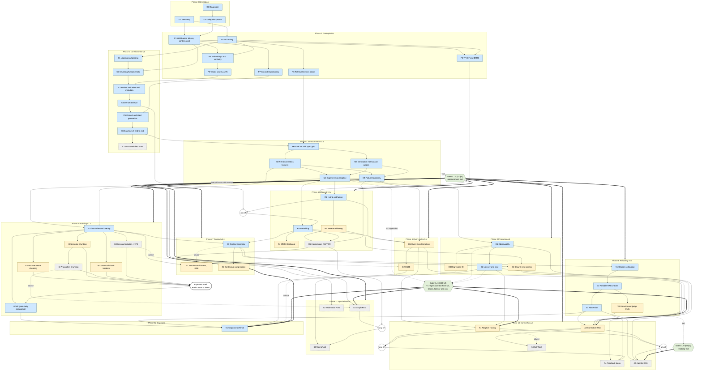
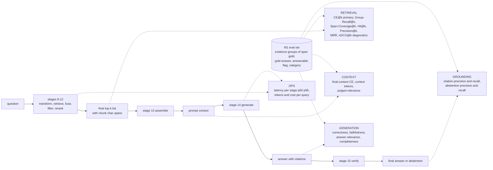

# 03 — RAG Concept Dependency Map

**Purpose.** This file shows how the curriculum's concepts connect. It answers four questions for any technique:

- Where in the pipeline does it act?
- What must I understand first?
- What does it change, and what does it leave alone?
- Which metric would show whether it helped?

The phase order and pacing are in [02](02_RAG_MASTER_LEARNING_PLAN.md). Cell-level book-to-notebook mapping is in [04](04_BOOK_TO_CODE_MAPPING.md). Experiment and metric design are in [06](06_RAG_PROJECT_AND_EVALUATION_PLAN.md). Decisions and gaps are in [08](08_GAP_ANALYSIS_AND_DECISIONS.md). This file links to those documents and does not repeat them.

**Conventions**

| Notation | Meaning |
|---|---|
| `C2`, `R3`, `I-CMP` | Concept IDs fixed by the curriculum backbone (phase letter + number). In Mermaid diagrams, `I-CMP` is written `ICMP` because node IDs cannot contain hyphens. |
| E / U / S | Priority tier: Essential / Useful / Specialized. |
| `Ch4 p.3/15` | Book *RAG Made Simple*: PDF page 3 of the 15-page file `chapter 4.pdf`. `App p.6/23` = `Appendix.pdf`; `Intro p.2/8` = `intro.pdf`. There are no printed page numbers. |
| `notebook.ipynb cell 12` | Repo `NirDiamant/RAG_Techniques` at pinned commit `009adba2`. Notebooks are in `all_rag_techniques/` unless another folder is given. Cell indices are 0-based. |
| "repo only" | The technique has a notebook but no book chapter. |
| "gap" | Neither source covers the topic. The curriculum adds it. |
| **Source C** | External reference (from the verified supplementary list). It is *not* in the learner's book or repo. |
| UNVERIFIED | Not checked against a primary source. Do not rely on it without checking. |

> Assumption: the stage boundaries below are a teaching convention, not a standard. Real systems merge or reorder stages; for example, metadata filtering can run inside the vector search (pre-filter) or after it (post-filter).

---

## 1. The canonical RAG pipeline

### 1.1 Stages, artifacts and failure signatures

Every stage takes one inspectable artifact and produces another. The project's trace logging (C6 provenance trace; D1 observability) records each artifact, so a failure can be traced to the stage that caused it.

| # | Stage | Input → output artifact | Typical failure if this stage is weak | Concept IDs acting here |
|---|---|---|---|---|
| 1 | Parse | file → page texts with `doc_id`, `page` | lost tables or figures, two-column interleaving, header/footer noise | C1, C7, S2 |
| 2 | Clean | page text → normalized text, char offsets kept | hyphenation splits terms; footer chunks pollute top-k | C1 |
| 3 | Chunk | text → chunks with `chunk_id`, char span | answer split across chunks (fragmentation) or buried in a large chunk (dilution) | C2, I1–I4 |
| 4 | Enrich | chunks → chunks + headers / questions / summaries / graph | chunk loses its document context ("it", "the company") | I5, I6, R5, S1, S3 |
| 5 | Embed | text → vectors (model + version fixed) | truncation past the model's max sequence length; query/document asymmetry | P4, C3 |
| 6 | Index | vectors + metadata → searchable store(s) | wrong metric (L2 vs cosine), unpersisted index, stale params | P3, P5, C3, R2 (metadata), X1 (sequential ids) |
| 7 | Query | user text | ambiguous, multi-part or out-of-scope question | — (input) |
| 8 | Transform / route | query → query variant(s) or a route decision | vocabulary mismatch; multi-hop needs several searches | Q1, Q2, A1, A3, S3 |
| 9 | Retrieve | query → candidate list with scores | exact-term or acronym misses (dense); paraphrase misses (sparse) | C4, P3, R1, R5, S1 |
| 10 | Fuse | several ranked lists → one list | incomparable score scales; misaligned arrays | R1, Q1 (merging) |
| 11 | Filter | candidates → allowed / relevant candidates | wrong scope (wrong product or version); irrelevant chunks reach the LLM | R2, D4, V2 (relevance grading), A2 |
| 12 | Rerank / diversify | candidates → final ordered top-k | right chunk at rank 9; five near-duplicates fill top-k | R3, R4, A4 |
| 13 | Assemble context | top-k → prompt context within a token budget | missing neighbouring sentences; noise; evidence placed mid-context | X1, X2, X3, P7 |
| 14 | Generate | prompt → answer with citations | ignores context, answers from memory, wrong citation | C5, P1, P7 |
| 15 | Verify / cite / abstain | answer + context → accepted, corrected or refused answer | unsupported claims shipped; unanswerable questions answered | V1–V4, A2 (loop) |
| × | Cross-cutting | traces, metrics, budgets | silent regressions; unknown cost | M1–M5, D1–D4, A4, A5 |

Concepts outside the pipeline: O1–O3 (orientation), P2 and P6 (framing and metrics used everywhere), I-CMP (a comparison lesson spanning stages 3–4) and K1 (capstone).

### 1.2 Pipeline flowchart with every technique pinned to its stage

Each node lists its techniques as `ID name · source`. Dotted arrows are optional control-flow loops that only adaptive or corrective systems add (Phase 10). The baseline v0 (C6) is the straight path with no loops.

```mermaid
flowchart TB
  subgraph OFF["OFFLINE: index time, once per corpus version"]
    direction LR
    parse["1 PARSE<br/>C1 loading, page provenance · Ch1<br/>C7 CSV/JSON row serialization · Ch2, repo json_rag<br/>S2 image captioning · Ch16<br/>S2 ColPali page images · repo only"]
    clean["2 CLEAN<br/>C1 tabs, whitespace, line breaks · Ch1 p.5/14<br/>C1 hyphens, footers · gap"]
    chunk["3 CHUNK<br/>C2 fixed-size 1000/200 · Ch1 p.4/14<br/>C2 recursive splitter · repo only<br/>I1 size and overlap grid · Ch1 p.10-11/14<br/>I2 structure-aware · gap<br/>I3 semantic · Ch9<br/>I4 propositions · Ch4"]
    enrich["4 ENRICH<br/>I5 contextual chunk headers · Ch7<br/>I6 question augmentation · Ch11<br/>I6 HyPE · repo only<br/>R5 section summaries · Ch14<br/>R5 RAPTOR tree · repo only<br/>S1 graph build · Ch21 and repo variants<br/>S3 MemoRAG memory · repo only"]
    embed["5 EMBED<br/>P4 bi-encoder, normalization, truncation<br/>C3 embed chunks, record model id"]
    index["6 INDEX<br/>P5 exact or ANN vector index<br/>P3 BM25 inverted index · Ch12<br/>C3 metadata and params hash<br/>X1 sequential chunk ids · Ch8"]
    parse --> clean --> chunk --> enrich --> embed --> index
  end

  subgraph ON["ONLINE: query time, every request"]
    direction LR
    query["7 QUERY<br/>user question"]
    transform["8 TRANSFORM or ROUTE<br/>Q1 rewrite, step-back, decompose · Ch5<br/>Q2 HyDE · Ch6<br/>A1 adaptive routing · Ch18<br/>A3 retrieve-or-not decision · repo only<br/>S3 clue generation · repo only"]
    retrieve["9 RETRIEVE<br/>C4 dense top-k · Ch1<br/>P3 sparse BM25 · Ch12<br/>R1 hybrid, two retrievers · Ch12<br/>R5 coarse-to-fine · Ch14<br/>S1 local or global graph search · Ch21"]
    fuse["10 FUSE<br/>R1 weighted score fusion · Ch12<br/>R1 RRF · not in book<br/>Q1 merge sub-query results · Ch5 p.10/14"]
    filter["11 FILTER<br/>R2 metadata facets · repo only<br/>D4 access control · gap<br/>V2 relevance grading · Ch3<br/>A2 CRAG evaluator · Ch20"]
    rerank["12 RERANK or DIVERSIFY<br/>R3 cross-encoder or LLM · Ch13<br/>R4 MMR, Dartboard · Ch15<br/>A4 feedback reweighting · Ch17"]
    assemble["13 ASSEMBLE CONTEXT<br/>X1 window, sentence window · Ch8<br/>X1 relevant segment extraction · repo only<br/>X2 compression · Ch10<br/>X3 dedup, order, budget · gap<br/>P7 prompt and citation format"]
    generate["14 GENERATE<br/>C5 answer with citations<br/>P1 sampling, temperature 0"]
    verify["15 VERIFY, CITE, ABSTAIN<br/>V1 citation verification · gap<br/>V1 retrieval explanations · Ch19<br/>V2 groundedness check · Ch3<br/>V3 abstention policy · gap<br/>V4 detector and judge limits · Ch22"]
    query --> transform --> retrieve --> fuse --> filter --> rerank --> assemble --> generate --> verify
  end

  index ==>|"read by"| retrieve
  filter -.->|"A2: all docs score low, rewrite and web search"| transform
  verify -.->|"V2: not grounded, regenerate or abstain"| generate
  transform -.->|"A1, A3: answer without retrieval"| generate

  subgraph XC["CROSS-CUTTING"]
    direction LR
    evalx["M1-M5 evaluation · Ch22, moved early"]
    obs["D1 observability, traces · gap"]
    cost["D2 latency and cost · Ch22 p.14/19"]
    ops["D3 regression CI · gap<br/>D4 injection, PII · Ch22 p.16-17/19"]
    agent["A4 feedback loops · Ch17<br/>A5 agentic orchestration · repo only"]
  end
  XC -.- ON
  XC -.- OFF
```

Reading notes:

- **Two stages, one concept.** Some IDs appear twice on purpose:
  - **R1** builds a BM25 index (stage 6), retrieves (stage 9) and fuses (stage 10).
  - **R5** writes summaries (stage 4) and searches coarse-to-fine (stage 9).
  - **S1** builds a graph (stage 4) and traverses it (stage 9).
  - **X1** needs sequential chunk ids at index time (stage 6) but only acts during assembly (stage 13).
  - **V2** has two halves. The relevance grader is a pre-generation filter (stage 11). The groundedness check is a post-generation verifier (stage 15).
- **Stage changed ≠ stage evaluated.** An indexing change (stage 3) is judged by retrieval metrics at stage 12 and generation metrics at stage 15. See [§6](#6-retrieval-quality-vs-generation-quality-which-metric-observes-which-stage).

### 1.3 The book's Appendix A pipeline vs ours

Appendix A (App p.2–3/23) maps the 22 chapters onto six bands:

- Index: Ch4, 7, 8, 9, 11, 14, 16, 21
- Query: Ch5, 6, 18
- Retrieve: Ch12, 15
- Refine (post-retrieval): Ch10, 13
- Verify: Ch3, 19, 20
- System: Ch17, 22

Ch1 and Ch2 form the foundation beneath all six. The map is a useful first overview. Our 15-stage version differs where the book's band hides a decision or misdescribes a chapter:

| Topic | Book Appendix A (App p.2–3/23) | Ours | Why |
|---|---|---|---|
| Parsing and cleaning | Not a stage. Ch1 covers cleaning briefly (Ch1 p.5/14). The repo only replaces tabs (`helper_functions.py:L18-L31`). | Explicit stages 1–2 (C1) | Page provenance and char offsets are prerequisites for span-level gold evidence (M1) and for citations (C5, V1). Parsing errors cannot be fixed downstream. |
| Ch8 context enrichment window | Index band | Stage 13 assemble (X1); stage 6 only stores sequential ids | Ch8 says the window needs no LLM calls and keeps standard chunking, fixing its output at retrieval time (Ch8 p.9/11). Its effect happens after retrieval. Ch9 p.11/14 also places it on a chunking spectrum, so the book is inconsistent about this. |
| Ch11 document augmentation | Index band. The Intro files it under post-retrieval (Intro p.5/8), which contradicts the Appendix. | Stage 4 enrich (I6) | Questions are generated before any query arrives. |
| Ch14, Ch21 | Index band only | Stages 4 + 9 | Both add query-time work too: coarse-to-fine search, graph traversal and global map-reduce. App p.10/23 rates Ch21's query cost Medium. |
| Ch18 adaptive retrieval | Query band | Stage 8 route; a Phase 10 control-flow concept (A1) | Routing chooses an entire downstream strategy (four separate indexes in `adaptive_retrieval.ipynb` cells 9, 19). It is not a query edit. |
| Retrieve vs fuse vs rerank | Retrieve band = Ch12 + Ch15 | Separate stages 9, 10, 12. Ch15 sits at stage 12. | Fusion has its own design choice (score fusion vs RRF, [§4.3](#43-hybrid-retrieval-and-fusion-weighted-score-fusion-vs-rrf)). Dartboard selects from an oversampled pool after scoring (Ch15 p.5/12, p.11/12). |
| Ch10 compression | Post-retrieval, listed under "good documents, wrong order" (App p.5/23) | Stage 13 assemble (X2) | Compression changes the context text, not the ranking. |
| Ch3 Reliable RAG | Verify band | Split: grading at stage 11, groundedness at stage 15 (V2) | The two halves run at different times and fail differently: false rejects vs missed hallucinations. |
| Ch19 explainable retrieval | Verify band, described as tracing each claim to its source (App p.3/23) | V1, retrieval explanations only | Ch19 itself says it explains why a document was retrieved, and says claim tracing is Ch3 attribution (Ch19 p.8/10). Claim-level citation verification is a gap we add to V1. |
| Ch20 CRAG | Verify band; the Appendix says it detects and repairs low-confidence answers (App p.3/23) | Stage 11 evaluator + corrective loop (A2, Phase 10) | Ch20 scores retrieved *documents* before generation and falls back to web search (Ch20 p.4–7/11). There is no answer-repair retry. |
| Ch17 feedback loops | System band | Stage 12 reweighting + offline index update (A4) | `retrieval_with_feedback_loop.ipynb` adjusts relevance scores per query (cell 18) and re-indexes (cell 20). |
| Ch22 evaluation | System band, layer 5 "Finally, add measurement" (App p.7/23) | Cross-cutting, taught in **Phase 3**, right after v0 | App p.12/23 itself says to measure before and after every change. We follow p.12. |
| Missing from the book | — | R1 RRF, R2 metadata filtering, X3 context assembly, V3 abstention, D1 observability, D4 access control | The book has no chapter for any of these. The repo has a notebook only for R2 (`multi_faceted_filtering.ipynb`). It offers RRF only as an unused LlamaIndex mode (`fusion_retrieval_with_llamaindex.ipynb` cells 19–20). The rest are gaps in both sources. See [08](08_GAP_ANALYSIS_AND_DECISIONS.md). |

---

## 2. Prerequisite DAG

**How to read it.** The typed registry in [§2.1](#21-edge-list-authoritative-the-diagram-is-generated-from-it) is authoritative; the diagram below is a view generated from it. Each concept has up to five kinds of requirement:

- **`requires_all`** (hard): every listed concept must be mastered first. Drawn `X --> Y`, meaning **Y requires X**: you must be able to explain X before Y's lesson makes sense.
- **`requires_any_groups`** (hard OR): for each bracketed group, at least one member must be mastered. A group with zero members satisfied blocks the concept. Drawn as members → a round **"any of"** junction node → Y.
- **`requires_gate`**: the named learner mastery gate in [02 §4](02_RAG_MASTER_LEARNING_PLAN.md#4-mastery-gates) must be passed. Drawn as a green hexagon gate node with thick arrows `==>`.
- **`requires_exposure`**: mechanism-level exposure to every listed concept (read + trace or demo), not a full implementation or a passed per-technique gate. Drawn `X --o` into an "exposure" junction node → Y.
- **`advice`**: truly optional. X is recommended or used for comparison, but Y can be learned at full depth without X, and advice never blocks unlocking. Drawn `X -.->|advice| Y`.
- **Project order is not a prerequisite.** Which project version is built first (v2.0 R1 → v2.1 R3 → …) is recorded in the project-order notes under §2.1, not as edges.
- Colours show tier: blue = E, yellow = U, grey dashed = S. Junction nodes are white; gate nodes are green.

The `requires_all` edges come from conceptual need, not book order; the few that exist because 02's Pre line names the lab baseline are marked in §2.1's project-order notes and in §2.2. They are the transitive reduction of the `requires_all` edges, so implied edges are not drawn. For example, C3 needs P4, but P4 reaches C3 through P5. Any-groups and exposure lists are written in full, as 02 states them, even when a member is also implied (C4 in R3's group is already an ancestor through M4).

**Checks** (run by script on the §2.1 registry, 2026-10-08):

- The graph is acyclic over **all** typed edges plus the gate nodes: 56 concepts; 78 `requires_all` edges; 4 any-groups with 8 member edges; 5 exposure edges; 5 advice edges. The former 17 soft edges became 7 any-group member edges, 5 exposure edges and 5 advice edges; C4 in R3's group is the eighth member, taken from 02's "R1 (or C4)".
- No edge points from a later phase to an earlier one, so the phase order in [02](02_RAG_MASTER_LEARNING_PLAN.md) is a topological order of this graph.
- No E-tier concept has a `requires_all` or any-group prerequisite of tier U or S, and no U concept has one of tier S. Exposure is the one exception: I-CMP (E) needs reading-level exposure to I2–I6, which include U and S concepts, but not their full lessons. Specialized material therefore never has to be *mastered* on the critical path.
- **Gates:** every Phase 4–11 concept (I\*, R\*, Q\*, X\*, V\*, D\*, A\*, S\*) has `requires_gate: Gate 3→4`, so S2 (whose concept prerequisite is only M2) can no longer bypass M3, M4 and M5. 02's stronger gates are also encoded: Gate 8→9 for A5; Gate 9→10 for A1, A2, S1 and K1.
- **OR groups cannot pass with zero members:** R3 needs R1 or C4; A4 needs A1 or A2; A5 needs A1 or A2; S3 needs S1 or R5.
- **K1 is reachable without any A\* or S\* concept.** K1's requirement closure (all `requires_all`, any-group and exposure ancestors) contains no Phase 10–11 concept, so v6 → K1 is allowed when residual failures do not justify a controller. The regression competence that Gate 9→10 needs is the **T1 retrieval regression test, an M4 outcome** (M4 covers regression sets). D3 (U: CI wiring, index versioning, incremental re-indexing) is advice for K1, not a requirement.
- **Consistent with [02](02_RAG_MASTER_LEARNING_PLAN.md):** every concept named in 02's per-concept **Pre** lines is an ancestor in this registry, directly or transitively, through `requires_all`, an any-group or `requires_exposure`. 02's either-or prerequisites are any-groups (R3, A4, A5, S3). 02's "I6 pairs with Q2" and X1's "X3 (concurrent)" are advice. 02's gate prerequisites are `requires_gate` entries. A5 keeps V3 and D2 in `requires_all` as well as Gate 8→9. Checked by script against 02 as read on 2026-10-08; the M-07 validator (`sources/verification/corrections/contracts_check.py`) re-checks this agreement.

> Revised 2026-10-08 (Codex M-07): soft edges no longer stand in for OR-prerequisites, gates or required exposure; typed registry, gate requirements and K1 path made explicit. See [corrections log](reviews/CORRECTIONS_LOG_2026-10-08.md#m-07).

### 2.1 Edge list (authoritative; the diagram is generated from it)

Legend: list cells are comma-separated IDs; each any-group is written `[A1 \| A2]` in the source, which renders as [A1 | A2] (one member suffices; several groups are comma-separated and all must hold); `—` = none; `unlocks` is derived (concepts that name this ID in `requires_all`, an any-group or `requires_exposure`; advice targets are not unlocks). `requires_all` and any-groups need **mastery**; `requires_exposure` is met by exposure **or** mastery (field note "Unlock rule" below).

| ID | Tier | requires_all | requires_any_groups | requires_gate | requires_exposure | advice | unlocks |
|---|---|---|---|---|---|---|---|
| O1 | E | — | — | — | — | — | O3 |
| O2 | E | — | — | — | — | — | P1, P2 |
| O3 | E | O1 | — | — | — | — | P1 |
| P1 | E | O2, O3 | — | — | — | — | P3, P4, P7, C2 |
| P2 | E | O2 | — | — | — | — | P3, P4, P6, C1 |
| P3 | E | P1, P2 | — | — | — | — | R1 |
| P4 | E | P1, P2 | — | — | — | — | P5 |
| P5 | E | P4 | — | — | — | — | C3 |
| P6 | E | P2 | — | — | — | — | M1 |
| P7 | E | P1 | — | — | — | — | C5 |
| C1 | E | P2 | — | — | — | — | C2 |
| C2 | E | C1, P1 | — | — | — | — | C3 |
| C3 | E | C2, P5 | — | — | — | — | C4 |
| C4 | E | C3 | — | — | — | — | C5, R3 |
| C5 | E | C4, P7 | — | — | — | — | C6 |
| C6 | E | C5 | — | — | — | — | C7, M1 |
| C7 | S | C6 | — | — | — | — | — |
| M1 | E | C6, P6 | — | — | — | — | M2, M3 |
| M2 | E | M1 | — | — | — | — | M4, M5, S2 |
| M3 | E | M1 | — | — | — | — | M4, M5 |
| M4 | E | M2, M3 | — | — | — | — | I1, R1, R3, D1 |
| M5 | E | M2, M3 | — | — | — | — | I1, R5, Q1 |
| I1 | E | M4, M5 | — | Gate 3→4 | — | — | I2, I3, I5, I6, I-CMP, X1, X3 |
| I2 | U | I1 | — | Gate 3→4 | — | — | I-CMP |
| I3 | U | I1 | — | Gate 3→4 | — | — | I4, I-CMP |
| I4 | S/U (drawn as S) | I3 | — | Gate 3→4 | — | — | I-CMP |
| I5 | U | I1 | — | Gate 3→4 | — | — | I-CMP |
| I6 | S | I1 | — | Gate 3→4 | — | — | I-CMP |
| I-CMP | E | I1 | — | Gate 3→4 | I2, I3, I4, I5, I6 | — | K1 |
| R1 | E | P3, M4 | — | Gate 3→4 | — | — | R2, R3, Q1 |
| R2 | U | R1 | — | Gate 3→4 | — | — | R5, D4 |
| R3 | E | M4 | [R1 \| C4] | Gate 3→4 | — | — | R4, R5, Q1, X3 |
| R4 | U | R3 | — | Gate 3→4 | — | — | — |
| R5 | S | R2, R3, M5 | — | Gate 3→4 | — | — | S1, S3 |
| Q1 | U | R1, R3, M5 | — | Gate 3→4 | — | — | Q2, A1, A2 |
| Q2 | U | Q1 | — | Gate 3→4 | — | I6 | S3 |
| X1 | U | I1 | — | Gate 3→4 | — | X3 | — |
| X3 | E | I1, R3 | — | Gate 3→4 | — | — | X2, V1, D4 |
| X2 | U | X3 | — | Gate 3→4 | — | — | — |
| V1 | E | X3 | — | Gate 3→4 | — | — | V2 |
| V2 | E | V1 | — | Gate 3→4 | — | — | V3, V4 |
| V3 | E | V2 | — | Gate 3→4 | — | — | A2, A5, K1 |
| V4 | U | V2 | — | Gate 3→4 | — | — | A4 |
| D1 | E | M4 | — | Gate 3→4 | — | — | D2, D3, A4 |
| D2 | E | D1 | — | Gate 3→4 | — | — | A1, A5, K1 |
| D3 | U | D1 | — | Gate 3→4 | — | — | — |
| D4 | U | R2, X3 | — | Gate 3→4 | — | — | A2 |
| A1 | U | Q1, D2 | — | Gate 3→4, Gate 9→10 | — | — | A4, A5 |
| A2 | U | V3, Q1, D4 | — | Gate 3→4, Gate 9→10 | — | — | A3, A4, A5 |
| A3 | S | A2 | — | Gate 3→4 | — | A1 | — |
| A4 | S | D1, V4 | [A1 \| A2] | Gate 3→4 | — | — | — |
| A5 | S | V3, D2 | [A1 \| A2] | Gate 3→4, Gate 8→9 | — | — | — |
| S1 | S | R5 | — | Gate 3→4, Gate 9→10 | — | I4 | S3 |
| S2 | S | M2 | — | Gate 3→4 | — | — | — |
| S3 | S | Q2 | [S1 \| R5] | Gate 3→4 | — | — | — |
| K1 | E | I-CMP, V3, D2 | — | Gate 3→4, Gate 9→10 | — | D3 | — |

**Field notes.**

- **Exposure (I-CMP).** "Exposure" means you have read the mechanism of each of I2–I6 and traced or demoed it on the project corpus; it does not require implementing them or passing their per-technique gates. 02's I-CMP card says only one or two of them need to have been *run*.
- **Unlock rule (exposure ≠ mastery).** Learner state has two sets: `mastered` (concepts at or above the required level) and `exposed` (mechanism exposure recorded: read + trace or demo; recorded in [05 §6.1](05_LEARNING_AND_RETENTION_SYSTEM.md#61-progressconcept_trackercsv) as `exposed_on`). A concept unlocks when every `requires_all` concept and at least one member of each `requires_any_groups` group is in `mastered`; every `requires_exposure` concept is in `exposed ∪ mastered`; and every `requires_gate` gate is passed. Exposure never substitutes for mastery of an all/any prerequisite. Example: Gate 3→4 passed, I1 mastered and I2–I6 exposed only ⇒ I-CMP unlocks; with one of I2–I6 neither exposed nor mastered, I-CMP stays blocked.
- **Gates** name the learner mastery gates in [02 §4](02_RAG_MASTER_LEARNING_PLAN.md#4-mastery-gates). Gates 0→1, 1→2 and 2→3 are not repeated per concept: they sit between the concepts already ordered by `requires_all` (O → P → C → M). A concept listing Gate 9→10 or Gate 8→9 also lists Gate 3→4, so a validator never has to infer gate order.
- **K1 and D3.** K1 needs Gate 9→10, whose regression item is met by the T1 retrieval regression test built in M4. D3 is advice only.

**Project-order notes (not prerequisites).** [06](06_RAG_PROJECT_AND_EVALUATION_PLAN.md) builds the project versions in this order: v1.0 I1 → v1.1 I2 → v1.2 I5 → v1.3 I3 → v1.4 I4; v2.0 R1 → v2.1 R3 → v2.2 R2 → v2.3 R4; v3.0 Q1 → v3.1 Q2; v4.0 X1 + X3 → v4.1 X2; v5.0 V1–V3; v6.0 D1–D3; v7.0 one of A2 or A1; v8 (optional) S1 or R5. This order decides lab sequencing only and is **not** encoded as edges: for example, I5 is built before I3 although neither requires the other, and v7/v8 are optional, so v6 → K1 is allowed. Four `requires_all` edges coincide with project order **and** are kept binding because 02's Pre line names them as the lab baseline (each experiment runs on top of the previous version's champion): **R2 ← R1, Q1 ← R3, R5 ← R3, X3 ← R3**. Their conceptual content does not need the earlier concept; see §2.2. Two more coincide with project order but have their own conceptual reason: **R4 ← R3** (diversification works on the oversampled candidate pool introduced in R3; Ch15 p.5/12, p.11/12) and **X2 ← X3** (compression is judged against an explicit context budget).

> Revised 2026-10-08 (Codex M-07): §2.1 columns replaced by the typed registry (requires_all / requires_any_groups / requires_gate / requires_exposure / advice / unlocks) for all 56 concepts; project order separated from prerequisites. K1's `requires_gate` also lists Gate 3→4, matching 02's `gate{3→4, 9→10}` and the gate field note (found by `sources/verification/corrections/contracts_check.py`). See [corrections log](reviews/CORRECTIONS_LOG_2026-10-08.md#m-07).

> Revised 2026-10-08 (Codex re-review R-04): unlock rule states two learner-state sets — all/any checked against mastered, exposure against exposed ∪ mastered; exposure never substitutes for mastery. See [corrections log](reviews/CORRECTIONS_LOG_2026-10-08.md#r-04).

### 2.2 Why the non-obvious edges exist

- **I1, R1, R3, D1 ← M4 (R4 inherits it through R3); I1, Q1, R5 ← M5.** Every Phase 4–11 technique is taught as *failure → hypothesis → controlled experiment → decision*. It therefore needs the experimental discipline (M4) and a failure bucket that justifies it (M5). This edge is what "measure before improving" means in practice. The book teaches evaluation last (Ch22; App p.7/23). The concept edges alone are not enough, because some Phase 4–11 concepts reach measurement only partly (S2 needs only M2). So every Phase 4–11 concept also has `requires_gate: Gate 3→4`: nothing in Phases 4–11 starts before the measurement exit in [02 §4](02_RAG_MASTER_LEARNING_PLAN.md#4-mastery-gates).
- **Q1 ← R1.** Decomposition and step-back produce several result lists that must be merged and deduplicated (Ch5 p.8/14, p.10/14). Ch5 never says how. Merging is rank fusion, which R1 teaches first, including RRF, which is absent from the book.
- **Q1 ← R3; R5 ← R3, M5; X3 ← R3.** The R3 edges are **lab-baseline** edges, not conceptual ones: the mechanisms of Q1, R5 and X3 can be explained without R3. They stay in `requires_all` because 02's Pre lines name R3 for all three, not because of version numbering (project order alone is never an edge; see the project-order notes in §2.1). Query-side, hierarchical and context-assembly changes are tested on top of the best v2 retrieval configuration, which includes the reranker. That way a gain is not something a cheaper retrieval fix would already deliver. R5 also needs a non-empty multi-span or global failure bucket (M5).
- **R2 ← R1; R5 ← R2.** R2 ← R1 is a lab-baseline edge (02's Pre line names R1): filtering is tested on the hybrid baseline (v2.2 after v2.0), although metadata filtering itself does not need hybrid search. R5 ← R2 is conceptual. Hierarchical retrieval *is* a metadata filter on the chunk level: `hierarchical_indices.ipynb` cell 15 passes a callable `filter` to FAISS, and Ch14 calls the metadata link the mechanism that makes it work (Ch14 p.9/13).
- **D4 ← R2, X3.** Access control is metadata filtering that must not fail open. Injection defences act on the assembled context.
- **A2 ← D4, V3.** CRAG puts untrusted web text into the prompt (`crag.ipynb` cells 14, 20). Ch20 does not discuss prompt injection; Ch22 p.16/19 does. A corrective loop is only meaningful once there is an abstention policy to compare it against.
- **X3 ← I1; X1 advice ← X3 (taught concurrently, per 02).** Deduplication and budgeting only make sense once overlap and chunk size are understood. Overlap and windows can count the same text twice: `context_enrichment_window_around_chunk.ipynb` uses 400/200 chunks (cell 15) and then adds neighbour windows (cell 25).
- **X2 ← X3.** Compression is evaluated as a change to an explicit context budget. This coincides with project v4.0 (X1, X3), then v4.1 (X2), but the edge exists because of the budget, not the version order.
- **V2 ← V1.** The deterministic check comes first: does the cited span exist and overlap the claim? Then comes the LLM groundedness and relevance grader, which is a judge (M3, inherited through V1 → X3 → R3 → M4). A relevance grader is also a pointwise reranker that returns a binary label (Ch13 p.12/13 contrasts them); §3.5 lists this under "commonly confused with".
- **A3 ← A2; A4 ← V4, any of A1/A2.** Self-RAG generalises the corrective pattern. `retrieval_with_feedback_loop.ipynb` uses an LLM to decide whether stored feedback is relevant (cell 18), which is a V4 reliability question. A4's "A1 or A2" comes from 02's Pre line and is a required any-group, not a soft edge.
- **Any-groups: R3 ← any of R1, C4; A4 and A5 ← any of A1, A2; S3 ← any of S1, R5.** These are 02's either-or prerequisites. Before M-07 they were drawn as two soft edges, which let a learner start A5 or S3 with *neither* member. Now at least one member of each group must be mastered.
- **I-CMP ← exposure to I2–I6.** The granularity comparison needs mechanism-level exposure to every alternative (read + trace or demo), but not their full lessons. 02's I-CMP card names I2–I5 as mechanism-level prerequisites; the registry also lists I6 because I-CMP compares the representation axis (I5, I6) as well as boundaries (§4.1). This is why I-CMP stays E-tier while I4 and I6 are S-tier.
- **K1 ← I-CMP, V3, D2, Gate 9→10; D3 is advice.** K1 does not require any A\* or S\* concept. The regression competence that Gate 9→10 checks is the T1 retrieval regression test from M4. D3's CI wiring, index versioning and incremental re-indexing are useful for the defence but not required.
- **S1 advice ← I4.** Ch21 lists Ch4 as a prerequisite (Ch21 p.1/13) but never explains why. The shared idea is LLM extraction of atomic units at index time: propositions vs entities and relations.
- **Q2 advice ← I6.** HyDE (query time) and question augmentation or HyPE (index time) solve the same query–document asymmetry from opposite sides (Ch11 p.9–10/13). We teach I6 first, in Phase 4. The asymmetry itself is a P4 concept, so either order works.

> Revised 2026-10-08 (Codex M-07): bullets now distinguish conceptual, lab-baseline and project-order reasons; soft edges renamed advice; any-group, exposure, gate and K1 bullets added. See [corrections log](reviews/CORRECTIONS_LOG_2026-10-08.md#m-07).

> REVIEWER NOTE (ordering within Phase 7): the backbone lists X1, X2, X3. Both this DAG and 02's Pre lines need X3 before X2, with X1 taught concurrently with X3, which matches project v4.0 → v4.1. Recommend the backbone list Phase 7 as X1/X3 → X2.

> REVIEWER NOTE (02 vs 03 prerequisite mismatches; RESOLVED in the cross-document consistency pass): (1) R4 now hard-requires R3, matching 02 and the backbone's project order (v2.1 R3 before v2.3 R4); the M4 → R4 edge was dropped as implied. (2) A5 no longer requires both A1 and A2: it hard-requires V3 (Gate 8→9) and D2, with soft edges from A1 and A2, matching 02's "A1 *or* A2" and the backbone's single v7.0 choice. Edge counts and the diagram were updated accordingly. (Superseded 2026-10-08 by Codex M-07: A1/A2 are now a required any-group for A5, and Gate 8→9 is an explicit `requires_gate`; see §2.1.)

> REVIEWER NOTE (missing concept): structured LLM output is used by every LLM grader and router in the repo. That means schemas, enum/`Literal` labels, validation and retry-on-parse-failure (`reliable_rag.ipynb` cells 14, 20; `crag.ipynb` cell 16; `self_rag.ipynb` cell 14; `adaptive_retrieval.ipynb` cells 7, 19). Static reading finds failures caused by unvalidated labels and outputs (runtime UNVERIFIED): a routing `KeyError` risk in adaptive cell 19, and `.split()` called on a `List[int]` in adaptive cell 15. The backbone has no concept ID for this. Proposal: add it explicitly to M3 (judges) or P7, so V2, A1, A2 and A3 inherit it.

---

## 3. Relationship table per technique

Every row is a change relative to **baseline v0**. v0 is defined in [06](06_RAG_PROJECT_AND_EVALUATION_PLAN.md): page text, recursive 1000/200 character chunks, Cohere embeddings (local sentence-transformers fallback; learner decision D-03), exact cosine top-4, and a cited answer.

> Revised 2026-10-08 (learner decision D-03): v0's embedder is Cohere embed with a local fallback. See [corrections log](reviews/CORRECTIONS_LOG_2026-10-08.md#learner-decisions).

The "New problems / tradeoffs" column lists mechanisms and repo defects found by static reading. Runtime behaviour is UNVERIFIED unless a row says otherwise. The column does **not** list measured effects; nothing here has been measured yet. "Depends on" lists *conceptual* prerequisites, so it may include edges that §2 drops as implied.

### 3.1 Indexing and representation (Phase 4, plus C7)

| ID · technique (source) | Depends on | Improves / replaces | Stage changed | Stays unchanged | New problems / tradeoffs | Commonly confused with |
|---|---|---|---|---|---|---|
| **I1** chunk size/overlap grid (Ch1 p.10–11/14; `choose_chunk_size.ipynb`) | C2, M2, M4 | Tunes v0's 1000/200 | Chunk (forces re-embed and re-index) | Embedding model, retriever, prompt | Changes the number of chunks and the tokens per top-k, so compare at fixed k **and** at equal token budget. The notebook's saved result is a 1.00/1.00 ceiling on auto-generated questions (cells 10–12), so it cannot show how to choose. | Overlap (index-time duplication) vs window enrichment X1 (query-time expansion). Bigger chunks vs bigger k. |
| **I2** structure-aware chunking (gap; separators are only implicit in the repo's `RecursiveCharacterTextSplitter`, `helper_functions.py:L48-L76`; the book never names a splitter) | C1, I1 | Replaces blind windows with heading/section/page boundaries | Parse + chunk | Retrieval, generation | Only as good as the parser's layout recovery. Chunk sizes become uneven. PDFs rarely carry reliable heading markup. | I3: structure uses document markup, semantic uses embedding distance. |
| **I3** semantic chunking (Ch9; `semantic_chunking.ipynb` cell 12) | P4, I1 | Replaces fixed boundaries with embedding-distance breakpoints | Chunk (embeddings needed at index time) | Query path | No size cap (cell 12), so a chunk can exceed the embedder's max length. Threshold choice: percentile / std / IQR (Ch9 p.6–7/14). Sentence segmentation errors. Embedding cost per sentence. | "Semantic search" (dense retrieval). I2. |
| **I4** proposition chunking (Ch4; `proposition_chunking.ipynb` cells 9–16) | I1, I3 (02 order), P7, M3 (the grader is a judge) | Replaces chunks with atomic, self-contained facts | Chunk (LLM at index time) | Query phase (Ch4 wraps only preparation) | LLM calls scale with chunks **and** with propositions graded. Ch4 p.13/15 says one check per chunk, but the p.9/15 algorithm and cell 16 grade each proposition. Broad questions lose context. Near-duplicate propositions use up top-k slots (cells 28, 36). | I3. Ch21 entity extraction. Summaries (R5). |
| **I5** contextual chunk headers (Ch7; `contextual_chunk_headers.ipynb` cells 9–13) | I1 | Prepends document/section context to each chunk before embedding (and BM25) | Enrich | Chunk boundaries, retriever | Header tokens dilute short chunks. One LLM title call per document (cell 11). The chapter's 0.1 → 0.9 example is a **Cohere rerank score on one chunk** (cell 13), not a retrieval metric. | **Source C** #31, Anthropic "contextual retrieval": a per-chunk, LLM-written context with a different cost profile. X1 (Ch8 lists Ch7 as a prerequisite and calls the two complementary, Ch8 p.1/11, p.7/11). |
| **I6a** document augmentation (Ch11; `document_augmentation.ipynb` cells 4–10) | I1, P4 (query–document asymmetry) | Adds question vectors that point to a parent text | Enrich + index | Query path | Index grows by about N questions per unit. Duplicate parents in top-k. The repo's "parent" is the whole 4000-word window, not the fragment (cell 10), and its "tokens" are regex words (cell 6). | HyDE Q2, the mirror image (Ch11 p.9–10/13). HyPE. |
| **I6b** HyPE (repo only; `HyPE_Hypothetical_Prompt_Embeddings.ipynb` cells 9–11) | I6a | Replaces chunk vectors with question-only vectors mapped to chunk text | Enrich + index | Query path | Same issues as I6a, and the original chunk vector is dropped. Cell 11 as committed is a SyntaxError (missing comma). The precision gains quoted in cell 0 are a preprint claim, not reproduced. | HyDE (query time). I6a (keeps the original vectors). |
| **I-CMP** granularity comparison | I1; exposure to I2–I6 (required, mechanism level) | Not a technique; it is the comparative lesson | Chunk + enrich | — | Comparisons are valid only at equal token budget and with chunk-agnostic span gold (M1). | — |
| **C7** structured-data RAG (Ch2; `simple_csv_rag.ipynb` cells 8–18; `json_rag.ipynb`) | C6 | Replaces text chunking with row serialization | Parse + chunk | Dense retrieval | Top-k silently truncates "list all X" queries (retriever default k, cell 16). ID, phone and email columns add embedding noise. | Text-to-SQL (covered by neither source). Metadata filtering R2. |

> Revised 2026-10-08 (Codex M-07): I-CMP's "soft I2–I6" restated as required mechanism-level exposure, matching §2.1. See [corrections log](reviews/CORRECTIONS_LOG_2026-10-08.md#m-07).

### 3.2 Retrieval (Phase 5)

| ID · technique (source) | Depends on | Improves / replaces | Stage changed | Stays unchanged | New problems / tradeoffs | Commonly confused with |
|---|---|---|---|---|---|---|
| **R1** hybrid sparse + dense with fusion (Ch12; `fusion_retrieval.ipynb` cell 17; `fusion_retrieval_with_llamaindex.ipynb` cells 19–20) | P3, P4, C4, M2 | Adds BM25 next to dense, plus a fusion rule | Index (BM25) + retrieve + fuse | Chunks, embeddings, generation | Sensitive to weights and normalization ([§4.3](#43-hybrid-retrieval-and-fusion-weighted-score-fusion-vs-rrf)). BM25 tokenization choices are open (Ch12 p.6/14 only says "individual words"). **Cell 17 fuses misaligned arrays.** | Weighted score fusion vs RRF. Multi-query (Ch12 p.12/14 likens it to Ch5). |
| **R2** metadata filtering (repo only; `multi_faceted_filtering.ipynb` cells 12–24) | C3, R1 | Adds hard constraints (source, date, section, tenant) | Filter (pre- or post-search) | Ranking model | Post-filtering after top-k loses recall (cells 12–14). Facets are hand-specified, not extracted from the query (cells 22, 24). | R5 coarse-to-fine (which *uses* a filter). Reranking. |
| **R3** reranking, cross-encoder or LLM (Ch13; `reranking.ipynb` cells 15, 27) | C4, P4 (bi- vs cross-encoder, Ch13 p.6/13), M2 | Reorders an oversampled candidate pool | New rerank stage | Candidate generation: it cannot recover what was not retrieved | Latency grows with pool size. LLM pointwise 1–10 scores tie and are uncalibrated (cell 15). A cross-encoder score is not a probability. | V2 relevance grading (binary filter vs reorder, Ch13 p.12/13). Fusion. |
| **R4** MMR / Dartboard (Ch15; `dartboard.ipynb` cells 21, 25) | P4, C4, R3 | Replaces pure-relevance top-k with relevance + diversity selection | Rerank / diversify | Candidate pool, index | Needs oversampling (Ch15 p.5/12). Diversity can evict a second passage that is genuinely needed. Pairwise distances cost O(N²). Cell 25 calls the function with the wrong keyword (`k` instead of `num_results`). | **MMR ≠ Dartboard**: the repo implements a relevant-information-gain objective with log-normal densities and logsumexp (cell 21). App p.3/23 calls Ch15 MMR; Ch15 never does. Deduplication (X3). |
| **R5** hierarchical indices (Ch14; `hierarchical_indices.ipynb` cells 11, 15) and RAPTOR (repo only; `raptor.ipynb` cells 9–19) | R2, R3, M5 (global/multi-span bucket), P7 (summarization) | Adds a summary layer; search coarse, then fine | Enrich + retrieve | Chunk content | Picking the wrong section loses recall with no fallback (Ch14 gap). FAISS post-filtering can starve per-section search (cell 15). The RAPTOR notebook indexes `str(AIMessage)` reprs and drops top-level summaries (cells 9, 11, 13). | I5 headers (context *inside* the chunk vs a separate level). Graph RAG global search. RAPTOR ≠ Ch14: recursive clustering vs two fixed levels. |

### 3.3 Query side (Phase 6)

| ID · technique (source) | Depends on | Improves / replaces | Stage changed | Stays unchanged | New problems / tradeoffs | Commonly confused with |
|---|---|---|---|---|---|---|
| **Q1** rewrite / step-back / decomposition (Ch5; `query_transformations.ipynb` cells 6–16) | R1 (merging lists), R3 (tested on top of v2), M5 (vocabulary-mismatch and multi-part buckets), P7 | Replaces one literal query with one or more reformulations | Transform (+ fuse) | Index | Intent drift. Extra latency. The repo never retrieves with the transformed queries. The "Original query:" line leaks into the sub-query list (cell 16 output). | HyDE. Ch12 multi-query. A1 routing. |
| **Q2** HyDE (Ch6; `HyDe_Hypothetical_Document_Embedding.ipynb` cell 12) | Q1, P4 | Replaces the query vector with the vector of an LLM-written hypothetical passage | Transform | Index | A hallucinated, domain-wrong passage retrieves the wrong chunks. One LLM call per query. The prompt demands exactly `chunk_size` characters (cell 12), which an LLM cannot reliably count. | I6 / HyPE (index time). Query rewriting: HyDE's output is an answer-shaped passage, not a query. |

### 3.4 Context construction (Phase 7)

| ID · technique (source) | Depends on | Improves / replaces | Stage changed | Stays unchanged | New problems / tradeoffs | Commonly confused with |
|---|---|---|---|---|---|---|
| **X1** context enrichment window (Ch8; `context_enrichment_window_around_chunk.ipynb` cells 13–25); sentence window (`context_enrichment_window_around_chunk_with_llamaindex.ipynb` cells 14, 22); relevant segment extraction (repo only; `relevant_segment_extraction.ipynb` cells 11, 19) | C3 (sequential ids), I1; taught with X3 | Expands each hit with its neighbours, or picks the best contiguous segment | Assemble (ids stored at index time) | Ranking | Overlap at stitching must equal overlap at splitting (Ch8 gap). Neighbour lookup scans all vectors (cell 19). RSE needs zero overlap and reranks the whole document per query (cell 11). | Overlap (I1). Headers (I5). Parent-document return (I6a). The name: Ch8's "context window" collides with the LLM context window (App p.10/23 lists Ch8 as "Context Window"). |
| **X2** contextual compression (Ch10; `contextual_compression.ipynb` cell 12) | X3, M3 | Shrinks each retrieved chunk to its query-relevant sentences | Assemble | Retrieval | One LLM call per chunk. Can drop qualifiers, which risks faithfulness. Cannot deduplicate *across* chunks, because each chunk is compressed alone (Ch10 gap). | V2 grading (keeps or drops a whole chunk). Summarization. |
| **X3** context assembly: dedup, ordering, token budget, citation format (gap) | I1, R3, P1, P7 | Replaces "concatenate top-k" | Assemble | Retrieval | Ordering effects (**Source C** #39, Lost in the Middle). Budget truncation can cut the evidence. | Reranking: ordering for relevance vs ordering inside the prompt. |

### 3.5 Reliability and grounding (Phase 8)

| ID · technique (source) | Depends on | Improves / replaces | Stage changed | Stays unchanged | New problems / tradeoffs | Commonly confused with |
|---|---|---|---|---|---|---|
| **V1** citation verification (gap) + retrieval explanations (Ch19; `explainable_retrieval.ipynb` cell 6) | X3, M3, C5 | Adds a check that each cited span supports its claim | Verify | Retrieval, generation | Strict string matching rejects valid paraphrase, while NLI or judge checks cost extra calls. Ch19's explanations are post-hoc rationalizations of a vector-distance decision (cell 6). `graph_rag_local_attribution.ipynb` claims "verifiable" source sentences but never checks them (cell 9). The repo's only citation check is an offline eval metric (open-rag-eval, `evaluation/open-rag-eval-example.ipynb` cells 13–14), not a pipeline stage. | **Explanation ≠ attribution**: why a document was retrieved vs which source supports a claim (Ch19 p.8/10). App p.3/23 conflates the two. |
| **V2** Reliable RAG: relevance grading + groundedness check (Ch3; `reliable_rag.ipynb` cells 14, 20, 22) | V1, M3, C5 | Adds a filter before generation and a check after it | Filter + verify | Retriever, generator | One grading call per chunk: with k=4 that is 6 extra calls, while Ch3 p.11/14 says 2–4. The false-reject rate is never measured. The regenerate branch is not implemented (cell 20). The generation prompt allows "your knowledge" (cell 18). | R3 reranking. CRAG A2 (the same grader idea; Ch20 never draws the link). |
| **V3** answerability and abstention (gap; Ch3 p.11/14 only says "I don't know" is preferable; Ch22 p.13/19 says to test no-answer questions) | V2, M1 (unanswerable set), M3 | Adds a refuse decision | Verify (+ filter thresholds) | — | Tradeoff between over-abstaining and hallucinating. Thresholds need calibration. | "Low top-1 score means unanswerable": scores are not calibrated probabilities. |
| **V4** limits of hallucination detectors and judges (Ch22 p.10/19 judge biases; `evaluation/evaluation_grouse.ipynb` meta-evaluation) | V2, M3 | — (it evaluates the verifiers) | Evaluation of stage 15 | — | Judges prefer longer answers (Ch22 p.10/19). A detector's own precision and recall must be measured against human labels. | Treating a judge's score as ground truth. |

### 3.6 Production, control flow, specialized (Phases 9–11)

| ID · technique (source) | Depends on | Improves / replaces | Stage changed | Stays unchanged | New problems / tradeoffs | Commonly confused with |
|---|---|---|---|---|---|---|
| **D1–D3** traces, latency/cost budgets, regression CI (gap; Ch22 p.14–15/19 names latency, cost and monitoring) | M4 | Replaces ad-hoc printing | Cross-cutting | Pipeline logic | Traces store query text, which is a PII issue (D4). The repo's only tests are import smoke tests (`tests/test_imports.py`). | Monitoring vs offline evaluation (Ch22 p.15/19 separates them). |
| **D4** injection via retrieved docs, access control, PII (Ch22 p.16–17/19 names injection testing; otherwise gap) | R2, X3, P7 | Adds trust boundaries | Filter + assemble | — | Filters must fail closed. Web or other untrusted text (A2) widens the attack surface. | Safety refusals: V3 is about *answerability*, not policy. |
| **A1** adaptive retrieval / routing (Ch18; `adaptive_retrieval.ipynb` cells 7–19) | Q1, D2, M5 | Replaces one strategy with per-query-type strategies | Transform / route (+ per-strategy retrieve) | Corpus | The classifier can be wrong, and an unexpected label raises `KeyError` (cell 19). The Opinion path crashes (cell 15). Up to 11 LLM calls per query by static count. App p.10/23 rates query cost Low, but the chapter's own tradeoff table rates cost High (Ch18 p.11/12; the table is garbled in the text dump, so check the PDF). | A3's retrieve-or-not decision. Q1. |
| **A2** Corrective RAG (Ch20; `crag.ipynb` cells 16–22) | V2, V3, Q1, D4 | Adds a document evaluator with three branches: keep / web search / both | Filter → transform loop | Index | Thresholds 0.3/0.7 sit on an uncalibrated LLM score. Only the single best document is used (cell 22). DuckDuckGo output is probably not parsed (cell 18). | V2. Self-RAG. The Appendix's "repairs answers" description (App p.3/23). |
| **A3** Self-RAG (repo only; `self_rag.ipynb` cells 14–16) | A2, V3; soft A1 | Adds a retrieve-or-not decision and per-candidate support/utility selection | Transform + filter + verify | Index | 2–13 calls per query. Control flow depends on exact strings. This is a prompted imitation, not the trained reflection-token model of **Source C** #41. | A2. A1. |
| **A4** feedback loops (Ch17; `retrieval_with_feedback_loop.ipynb` cells 18–22) | D1, V4, R3; any of A1, A2 (required) | Adds persistent, feedback-driven score adjustment and re-indexing | Rerank + index | Retriever model | Feedback poisoning. A case mismatch (`'yes'` vs a prompt asking for `Yes`) probably makes the adjustment dead code (cell 18). Calls grow as docs × stored feedback. | R3, which is stateless; feedback carries memory (Ch17 p.10–11/11). |
| **A5** agentic RAG (repo only; `Agentic_RAG.ipynb`, hosted Contextual AI) | V3, D2; any of A1, A2 (required) | Replaces a fixed pipeline with a tool-using loop | All online stages | — | Opaque and vendor-locked (cells 7–23). Hard to evaluate. Never before Phase 8 mastery. | A1. |
| **S1** Graph RAG (Ch21; repo `graph_rag`, `Microsoft_GraphRag`, `light_rag`, `graphrag_with_milvus_vectordb`, `graph_rag_local_attribution`) | R5, M5; soft I4 | Adds a graph index and graph-based retrieval or global summaries | Enrich + retrieve | — | Very high index cost. Entity resolution. Staleness. `graph_rag.ipynb` treats L2 distance as similarity (cell 12). | **Five different designs share the name**; see [§4.6](#46-hierarchical-and-global-retrieval-family). |
| **S2** multimodal: captioning (Ch16; `multi_model_rag_with_captioning.ipynb` cell 12) / ColPali (repo only; `multi_model_rag_with_colpali.ipynb` cell 13) | C1, M2 | Adds images or page images as retrievable units | Parse + enrich + embed | — | Captions can hallucinate. Tables and vector-drawn figures are missed (cell 9). The captioning demo never prints the retrieved document, so it cannot show that retrieval produced the answer. | Captioning (image → text) vs ColPali (page image → multi-vector). |
| **S3** MemoRAG (repo only; `memorag.ipynb` cell 22) | Q2; any of R5, S1 (required) | Adds a global "memory" that generates retrieval clues | Enrich + transform | — | The notebook substitutes LLM-written notes for the paper's KV-cache memory. Its evaluation call passes an argument the function does not accept (cells 45, 62). | HyDE (both generate text to retrieve with). RAPTOR. |

> Revised 2026-10-08 (Codex M-07): A4's "soft A1 or A2" and S3's "soft R5 or S1" restated as required any-groups, matching §2.1; A5's "A1 or A2" written in the same any-group form (cross-document sweep). See [corrections log](reviews/CORRECTIONS_LOG_2026-10-08.md#m-07).

---

## 4. Technique families that need a comparative explanation

These families are where learners most often blur techniques together. Each table compares the members on the same axes.

**How the cells were filled:**

- **LLM-call counts** are design counts: from the book's algorithm, or from the repo code by static reading. They are not measurements.
- **"Book rating"** is Appendix A's unmeasured Low/Medium/High prep-cost / query-cost rating (App p.10–11/23). It is shown for contrast and is not evidence.
- **"Expected to win / lose"** columns are **hypotheses** for the learner's experiments ([06](06_RAG_PROJECT_AND_EVALUATION_PLAN.md)), not results.

### 4.1 Granularity family (what is the retrieval unit, and what vector points to it?)

Two independent axes are usually mixed up:

- **(a) Where boundaries go:** fixed, structure, semantic or proposition. This changes the *unit*.
- **(b) What extra text represents a unit:** headers, generated questions or HyPE. This changes the *pointer* to the unit.

Any choice on (a) can be combined with any on (b).

A third idea cuts across both: **retrieve small, return big**. The unit you retrieve need not be the unit you hand the LLM:

- I6a returns a parent text (`document_augmentation.ipynb` cell 10).
- Propositions keep a `chunk_id` back-link (`proposition_chunking.ipynb` cell 13), which the book never uses.
- X1 returns neighbours.

| Member | Axis | Stage | LLM calls, index time | LLM calls, query time | Failure targeted | Cost driver · book rating | Expected to win when | Expected to lose when |
|---|---|---|---|---|---|---|---|---|
| Fixed / recursive (C2, I1) | a | Chunk | 0 | 0 | — (baseline) | none · Ch1 Low/Low | uniform prose; strong baseline to beat | answer spans a boundary; mixed-topic chunks |
| Structure-aware (I2) | a | Parse + chunk | 0 | 0 | section-spanning chunks | parser quality · not rated (no chapter) | documents with clean headings or markup | PDFs whose layout extraction is poor |
| Semantic (I3) | a | Chunk | 0 (one embedding per sentence or sentence group) | 0 | topic shifts inside fixed windows | index-time embeddings · Ch9 Medium/Low | long, topic-shifting prose | short documents; tables and lists; no size cap |
| Proposition (I4) | a | Chunk | 1 generation call per chunk + 1 grading call per proposition (`proposition_chunking.ipynb` cells 12–16) | 0 | multiple facts entangled in one chunk; pronouns | LLM calls at index time · Ch4 High/Low | precise factoid questions | broad or synthesis questions; large corpora |
| Contextual headers (I5) | b | Enrich | 1 per document for a title (`contextual_chunk_headers.ipynb` cell 11). The per-chunk variant (**Source C** #31) costs 1 per chunk. | 0 | chunk lacks document context | LLM calls per document · Ch7 Medium/Low | many similar documents (reports, versions) | single-document corpora; tiny chunks dominated by the header |
| Document augmentation (I6a) | b | Enrich + index | 1 per document window (`document_augmentation.ipynb` cell 4 `DOCUMENT_LEVEL`) | 0 | query–document asymmetry | index size grows by questions per unit · Ch11 High/Low | FAQ-like question traffic | questions not anticipated by the generator |
| HyPE (I6b) | b | Enrich + index | 1 per chunk (`HyPE_Hypothetical_Prompt_Embeddings.ipynb` cell 9) | 0 | same as I6a | same as I6a · not rated (repo only) | same as I6a, with a smaller index than keeping both | keyword- or number-heavy queries that questions paraphrase away |

### 4.2 Query-side vs index-side fixes for query–document mismatch

All of these attack the same gap: a short question and a long expository passage embed differently. That gap is P4's asymmetric-embedding concept.

The difference is **when the LLM pays**:

- **Query-side** fixes cost LLM calls on every query, but they adapt to the actual question.
- **Index-side** fixes cost LLM calls once per corpus version, but they must anticipate questions.

A simple count shows the trade. With one LLM call per indexed unit, index-side spends about `N_units × rebuilds` calls in total. Query-side spends `Q_total` calls. Ignoring latency, index-side is cheaper in calls when `Q_total` exceeds `N_units × rebuilds`.

Latency follows a different rule: only query-side methods add an LLM call to every request's critical path.

| Member | Side | Stage | LLM calls, index time | LLM calls, query time | Extra retrievals per query | Failure targeted | Book rating | Expected to win when | Expected to lose when |
|---|---|---|---|---|---|---|---|---|---|
| Rewrite (Q1) | query | Transform | 0 | 1 (`query_transformations.ipynb` cell 6) | 0 (replaces the query) | vague or under-specified wording | Ch5 Low/Medium | conversational, sloppy queries | already precise queries (drift risk) |
| Step-back (Q1) | query | Transform | 0 | 1 (cell 10) | +1: original and step-back are both searched (Ch5 p.8/14 sketch; the repo never retrieves) | missing background context | Ch5 Low/Medium | specific questions needing principles | broad questions (Ch5's own example steps back from an already-broad query) |
| Decomposition (Q1) | query | Transform + fuse | 0 | 1 (cell 14) | 2–4 sub-queries, each searched (Ch5 p.10/14; cell 14 prompt) | multi-part / multi-hop questions | Ch5 Low/Medium | compound questions | single-fact questions; needs fusion and dedup (R1, X3) |
| HyDE (Q2) | query | Transform | 0 | 1, long output (`HyDe_Hypothetical_Document_Embedding.ipynb` cell 12) | 0 | question vs passage form mismatch | Ch6 Low/Medium | general-domain topics the LLM knows | specialised or private facts the LLM gets wrong |
| Document augmentation (I6a) | index | Enrich | 1 per document window | 0 | 0 | same mismatch, from the corpus side | Ch11 High/Low | stable corpus, high query volume | frequently changing corpus |
| HyPE (I6b) | index | Enrich | 1 per chunk | 0 | 0 | same | not rated | same | same; plus the notebook needs a fix (cell 11) |

### 4.3 Hybrid retrieval and fusion: weighted score fusion vs RRF

**Why fusion is a separate decision.** BM25 scores are unbounded and corpus-dependent. Dense scores may be cosine similarity in [−1, 1] or an L2 *distance*, where lower is better. FAISS `IndexFlatL2` returns distances, which is why the repo flips the vector score. The two lists cannot be added directly.

| Method | Uses | Formula (per document d) | Needs tuning | Behaviour |
|---|---|---|---|---|
| Weighted score fusion, min-max (`fusion_retrieval.ipynb` cell 17) | scores | `α·norm_dense(d) + (1−α)·norm_bm25(d)`, with `norm(x) = (x − min)/(max − min)` | α; candidate depth | Keeps magnitudes. **Sensitive to every score in the list**, including min and max outliers |
| Weighted score fusion, distribution-based (Ch12 p.8/14; `fusion_retrieval_with_llamaindex.ipynb` cells 19–20: weights 0.6/0.4, range mean ± 3σ) | scores | Same, with min/max replaced by mean ∓ 3σ | weights; candidate depth | Less outlier-sensitive than min-max. Still assumes roughly comparable distributions |
| Reciprocal Rank Fusion (**not in the book**; **Source C** #33, Cormack et al. 2009) | ranks only | `Σ_lists 1 / (k + rank_list(d))`, k = 60 conventionally; documents missing from a list contribute 0 | k; candidate depth | Ignores score scales entirely. Discards the *size* of a lead |

**Toy illustration** (computed by script, not a result). Four documents. Dense cosine: A 0.82, B 0.80, C 0.79, D 0.40. BM25: A 0.0, B 1.1, C 9.5, D 2.0.

- Min-max fusion with α = 0.5 ranks **C, B, A, D**: C 0.964, B 0.534, A 0.500, D 0.105.
- RRF (k = 60) ranks **C, A, B, D**.

Now change only **D's** dense score from 0.40 to 0.78. D is the last-ranked document either way.

- Min-max now ranks **C, A, B, D**. The A/B order flipped because D moved the dense minimum, which rescaled every other document.
- RRF is unchanged, because D's dense rank (4th) did not change.

The same toy shows RRF's cost. C's large BM25 lead (9.5 vs 2.0) is invisible to RRF: all RRF scores lie between 0.0317 and 0.0323.

**Repo defect: `fusion_retrieval.ipynb` cell 17 fuses misaligned arrays** (also `all_rag_techniques_runnable_scripts/fusion_retrieval.py:L75-L86`; verified by reading cell 17). The function builds three arrays in **three different document orders**:

1. `all_docs = vectorstore.similarity_search("", k=ntotal)`: every chunk, ordered by similarity to the **empty string**.
2. `bm25_scores = bm25.get_scores(query.split())`: ordered as the BM25 corpus was built (cell 14), i.e. corpus order.
3. `vector_results = vectorstore.similarity_search_with_score(query, k=len(all_docs))`: ordered by distance to the **query**.

It then adds arrays 2 and 3 position by position and returns `all_docs[i]` for the best positions. So position *i* combines the BM25 score of one chunk, the vector score of another, and returns a third.

Lesson for R1: **key every score by a stable `chunk_id`, and fuse dictionaries, not arrays**. The fusion function also needs a unit test with a hand-checked toy case. The repo's tests only check imports, so nothing caught this.

Minor issues in the same cell:

- The empty-string embedding is wasted work.
- `query.split()` does no lowercasing or punctuation handling, unlike the BM25 corpus preprocessing questions raised in P3.

The LlamaIndex variant offers RRF as a mode (`reciprocal_rerank`), but its markdown argues against it for lacking normalization (cells 19–20). Using ranks instead of scores is exactly why RRF needs no normalization.

### 4.4 Post-retrieval family (what each one changes: order, membership or text)

| Member | Stage | Changes | LLM calls, index | LLM calls, query | Failure targeted | Cost driver · book rating | Expected to win when | Expected to lose when |
|---|---|---|---|---|---|---|---|---|
| Cross-encoder rerank (R3) | Rerank | order (+ cut to top-k) | 0 | 0; one cross-encoder pass per candidate (`reranking.ipynb` cell 27, `cross-encoder/ms-marco-MiniLM-L-6-v2`) | right doc, wrong rank | pool size × model latency · Ch13 Low/High | relevant doc is in the pool but ranked low | relevant doc never retrieved (recall-limited) |
| LLM rerank (R3) | Rerank | order | 0 | 1 per candidate (`reranking.ipynb` cell 15; cell 17 scores 15 candidates) | same | LLM calls × pool · Ch13 Low/High | nuanced relevance a small cross-encoder misses | latency budgets; score ties |
| Contextual compression (X2) | Assemble | text | 0 | 1 per chunk (`contextual_compression.ipynb` cell 12) | noisy chunks dilute the prompt | LLM calls per chunk · Ch10 Low/Medium | small context budgets; long noisy chunks | answers needing surrounding qualifiers |
| Relevant segment extraction (X1, repo only) | Assemble | membership + text (contiguous span) | 0 | 0; one rerank over all chunks of the document (`relevant_segment_extraction.ipynb` cell 11) + segment search (cell 19) | answer spans several adjacent chunks | reranking the whole document per query · not rated | long, coherent sections | many small, scattered facts; requires zero overlap |
| Window enrichment (X1) | Assemble | text (adds neighbours) | 0 | 0 (`context_enrichment_window_around_chunk.ipynb` cell 19 neighbour lookup) | hit lacks its beginning or end | context tokens · Ch8 Low/Low | small chunks with cut-off thoughts | already-large chunks (token bloat, double counting with overlap) |
| MMR (R4) | Diversify | membership | 0 | 0; pairwise similarities in the pool | near-duplicate top-k | O(pool²) similarity · no chapter (named App p.3/23, Ch19 p.4/10; defined only in glossary App p.19/23) | redundant corpora (repeated topics) | a question needing two similar passages |
| Dartboard (R4) | Diversify | membership | 0 | 0; pairwise distance matrix, logsumexp (`dartboard.ipynb` cell 21) | same, framed as information gain | O(pool²) · Ch15 Low/Medium | same | same; notebook cell 25 does not run as committed |

**Order of composition** (book suggestions, not tested):

- Rerank, then diversify (Ch15 p.11/12).
- Grade after rerank as a final check (Ch13 p.13/13).

Our skeleton draws filtering (stage 11) before reranking (stage 12). That order suits cheap metadata filters (R2, D4). An LLM relevance grader (V2) costs one call per chunk, so whether to run it before or after the reranker has cut the pool is a configuration choice for the learner to test. Ch13 p.13/13 suggests after. Compression (stage 13) runs last because it rewrites text.

### 4.5 Verification family

| Member | When it runs | What it judges | LLM calls per query (k = retrieved) | Action on failure | Failure targeted | Book rating | Expected to win when | Expected to lose when |
|---|---|---|---|---|---|---|---|---|
| Reliable RAG (V2; Ch3; `reliable_rag.ipynb` cells 14, 20, 22) | before generation (grading) **and** after it (groundedness) | each chunk (binary relevance); the whole answer (binary grounded) | k + 1 + 1 highlight; 6 with k = 4. The book says 2–4 (Ch3 p.11/14). | drop the chunk; flag the answer (regenerate not implemented) | irrelevant context; ungrounded answer | Ch3 Low/High | high-stakes Q&A where "I don't know" is acceptable | latency-sensitive use; lenient graders pass noise |
| Corrective RAG (A2; Ch20; `crag.ipynb` cells 16–22) | before generation | each retrieved doc (0–1 score) | k evaluations, then a branch: about 4 / 6 / 7 total by branch (static count) | rewrite the query and web search, or combine | retrieval found nothing usable | Ch20 Low/High | open-domain questions where web fallback is allowed | private corpora; uncalibrated thresholds; untrusted web text |
| Self-RAG (A3; repo only; `self_rag.ipynb` cells 14–16) | before retrieval (retrieve?), after retrieval (relevant?), after generation (supported? useful?) | decision, docs, candidate answers | 2–13 (static count) | skip retrieval; pick the best-supported candidate | unnecessary retrieval; unsupported answers | not rated | mixed workloads with many no-retrieval questions | cost; brittle string-matched control flow |
| Explainable retrieval (V1 part; Ch19; `explainable_retrieval.ipynb` cell 6) | after retrieval | each doc: "why relevant", written by an LLM | 1 per retrieved doc | none; annotates only | user trust and auditability | Ch19 Low/Medium (App p.11/23; chapter says latency High) | human-in-the-loop review | anything needing *faithful* explanations: these are post-hoc |
| Citation verification (V1 core; gap, our design) | after generation | each claim → cited span | 0 for span/string checks; +1 per claim if NLI or judge is used | strip the claim, re-cite, or abstain (V3) | wrong or unsupported citations | — | answers with explicit citations to spans | paraphrase-heavy answers under strict matching |

Key distinctions:

- **Grading documents** (V2 grading, A2) is a *retrieval-quality* intervention.
- **Grading answers** (V2 groundedness, V1, A3 support) is a *generation-quality* intervention.

Report the effect of each with the matching metric family ([§6](#6-retrieval-quality-vs-generation-quality-which-metric-observes-which-stage)).

### 4.6 Hierarchical and global retrieval family

**"Graph RAG" names at least five different designs.** The book's Ch21 describes one of them (Microsoft GraphRAG). The repo notebook called `graph_rag.ipynb` implements a different one.

| Member | Unit / node | Index-time LLM calls | Query-time LLM calls | Question type targeted | Status in sources | Expected to win when | Expected to lose when |
|---|---|---|---|---|---|---|---|
| Hierarchical indices (R5; Ch14; `hierarchical_indices.ipynb` cells 11, 15) | page summaries → chunks (two levels) | about 2 per page (map-reduce summary, cell 11) | 0 (embeddings only) | "which section?" then details | Ch14; book rating High/Low | large documents with distinct sections | wrong-section choice; cross-section questions |
| RAPTOR (R5; repo only; `raptor.ipynb`) | recursive cluster summaries (tree) | 1 per cluster per level (about 17 on the 33-page climate PDF, static count) | compression calls per level + answer | multi-level, thematic questions | not in book; notebook diverges from the paper (**Source C** #40): no UMAP, fixed k | thematic or summary questions | exact-fact questions; notebook bugs (cells 9, 11, 13) |
| `graph_rag.ipynb` (S1; repo) | **text chunks**; edges = embedding similarity > 0.8, weighted by shared concepts (cell 9) | 1 per chunk (concept extraction, cell 9) | 1 check per traversed node + compression (cell 12) | multi-hop over related chunks | named Graph RAG but **not** an entity graph; L2 distance used as similarity (cell 12) | — (needs fixing first) | — |
| Microsoft GraphRAG (S1; Ch21 p.6–9/13; `Microsoft_GraphRag.ipynb` cells 14, 17) | entities + relations; Leiden communities; community reports | many: extraction per text unit, description summaries, one report per community (black-box CLI) | local: answer over assembled entity context; global: map-reduce over community reports (exact counts UNVERIFIED; the CLI hides them) | global "what are the themes" and entity-centric questions | what the book teaches; notebook only drives the CLI | corpus-wide sensemaking | small corpora; frequently changing data (re-index cost) |
| LightRAG (S1; repo only; `light_rag.ipynb`) | entity and relation profiles in two vector indexes | 1 per chunk (cells 10, 16) | 1 keyword extraction + answer (cell 22) | dual-level: specific + broad | not in book; incremental updates claimed (cell 0), not demonstrated | cheaper graph indexing | unbounded neighbour expansion (cell 24) |
| `graphrag_with_milvus_vectordb.ipynb` (S1; repo only) | triplets in vector collections | 0: triplets are **hand-supplied** (cell 12) | 1 LLM rerank (cells 32, 34) + answer | multi-hop via relation expansion | not in book; one-query demo | — | hides the real indexing cost |
| `graph_rag_local_attribution.ipynb` (S1; repo only) | LLM-extracted entities per document | 1 per whole document via local Ollama (cells 9, 11) | 1 answer | attribution demo | not in book; BFS follows outgoing edges only (cell 9) | fully local stack (if Ollama is installed) | Ollama is not installed on this machine |

**Assumption:** the learner reaches this family only if M5 failure buckets show that multi-hop or global questions fail, which is the condition for project v8 ([06](06_RAG_PROJECT_AND_EVALUATION_PLAN.md)).

---

## 5. "Taught before prerequisite" problems in the book, and how our ordering fixes them

The book says each chapter's prerequisites line allows non-linear reading (Intro p.7/8). In practice many concepts are *used* several chapters before they are *defined*, or are defined only in the glossary (Appendix B, App p.13–22/23).

**How the citations were found:**

- Term occurrences come from a case-insensitive search of the per-page book text, with line breaks joined so wrapped phrases are found.
- "No definition" means no chapter passage explains the term, and no glossary entry exists where stated.
- A term search shows where a word appears, not how deeply it is explained.

| # | Concept | Used before it is taught (citations) | Where it is finally defined | Consequence for a learner | How our ordering fixes it |
|---|---|---|---|---|---|
| 1 | **Similarity metric: cosine, dot product, L2** | Ch1 explains retrieval as vectors "close together" and nearest neighbours without naming a metric (Ch1 p.5–6/14). First named Ch12 p.8/14. Used again Ch13 p.6/13, Ch15 p.8/12 (cosine distance), Ch19 p.4/10, Ch20 p.1/11 and p.4/11, Ch21 p.2/13. | Glossary only (App p.15/23). The entry lists Chapter 1 among its chapters, but no "cosine" appears in Ch1's text. | The repo's FAISS stores return **L2 distances** (`simple_csv_rag.ipynb` cell 12 builds `IndexFlatL2`; `helper_functions.py:L48-L76` uses the default). Without the metric, learners cannot see why `graph_rag.ipynb` cell 12 inverts its ordering by treating a distance as a similarity, or why `fusion_retrieval.ipynb` cell 17 flips vector scores. | **P4** (Phase 1) hand-computes dot product, cosine and L2, normalization, and similarity vs distance direction before C3/C4. Gate 1→2 tests it. |
| 2 | **Tokens and tokenization** | Ch2 p.9/11 (embedding calls "charged per token"), Ch6 p.12/14, Ch7 p.10/11, Ch10 p.12/13, Ch19 p.10/10, Ch21 p.7/13, Ch22 p.14/19. | Never defined; no glossary entry for "token". | The repo measures chunk size in three different units under similar names: characters (`simple_rag.ipynb` cell 10), tiktoken tokens (`reliable_rag.ipynb` cell 6; `proposition_chunking.ipynb` cell 9), and regex words called "tokens" (`document_augmentation.ipynb` cell 6). The same `chunk_size` number therefore means different amounts of text. | **P1** (tokens, chars ≈ tokens as a heuristic only) comes before **C2**. The C2 sample lesson ([07](07_SAMPLE_LESSON.md)) makes units explicit. |
| 3 | **LLM context window** | Ch1 p.12/14, Ch4 p.5/15, Ch9 p.9/14, Ch10 p.2/13 and p.12/13, Ch21 p.11/13. | Never defined; no glossary entry. The name also collides: Ch8 calls its technique a "context window" (Ch8 p.3/11, p.6/11), and App p.10/23 lists Ch8 as "Context Window". | Learners confuse the model's input limit with Ch8's neighbour expansion, and cannot reason about context budgets (X3). | **P1** (context windows, cost per token) and **P7** (context budget) in Phase 1. We call Ch8's technique *window enrichment* (X1). |
| 4 | **Reranker / cross-encoder** | Ch1 p.12/14 (forward mention). Ch7 p.8/11 says to pass the augmented chunk to the reranker. Ch7's headline relevance gain is a Cohere rerank score, not embedding similarity (`contextual_chunk_headers.ipynb` cell 13). | Ch13 (bi- vs cross-encoder, Ch13 p.6/13); glossary App p.15/23. | The reader cannot interpret Ch7's evidence and may credit the gain to an embedding shift. | Our I5 (Phase 4) is still taught before R3 (Phase 5), but the dependency is **removed rather than reordered**. I5 is judged with M2 retrieval metrics (Recall@k, MRR), not a reranker score. **P4** introduces the bi-encoder idea, and the cross-encoder contrast is previewed there. |
| 5 | **LLM-as-a-judge** | Ch3 grades chunks and answers with an LLM (Ch3 p.4–7/14). Ch4's quality gate scores propositions (Ch4 p.7/15). Ch17 p.5–6/11, Ch18 p.6/12 and Ch20 p.4/11 (0–1 relevance score driving thresholds) also use one. | Ch22 p.9–10/19 (method, biases); glossary App p.18/23. | Graders and thresholds are trusted before the learner knows judges are biased and uncalibrated. Ch20's 0.3/0.7 thresholds on an LLM score are never calibrated (`crag.ipynb` cell 22). | **M3** (Phase 3) covers judge strengths and limits and calibration against a small human-labelled set, before *any* LLM grader (I4, V2, A1–A4). **V4** revisits judge limits. |
| 6 | **Precision and recall** | "Precision" is used informally from Ch4 p.11/15 onward. "Improvement in recall" appears at Ch12 p.13/14, and recall again at Ch21 p.12/13. | Ch22 p.4–5/19; glossary App p.19–20/23. | Claims about retrieval improvements cannot be checked or even stated precisely. | **P6** (Phase 1) teaches Precision@k, Recall@k, Hit@k, MRR and nDCG with numeric examples. **M2** implements them. |
| 7 | **Faithfulness / groundedness as a measurable quantity** | Ch3 p.3/14, p.6–7/14 (hallucination checker returns grounded or not grounded). | Ch22 p.7–8/19: supported claims ÷ total claims. | Ch3's binary answer-level check looks like a metric but is not one. | **M3** defines faithfulness as a metric before **V2** uses a groundedness check as an intervention. |
| 8 | **MMR** | App p.3/23 calls Ch15 "Dartboard retrieval with maximal marginal relevance". Ch19 p.4/10 names it as a retrieval option. | Glossary only (App p.19/23). Ch15 never mentions MMR. | Two different selection objectives get one label (see R4 in §3.2 and §4.4). | **R4** teaches MMR's greedy relevance-minus-redundancy rule first, then Dartboard as a different objective. |
| 9 | **BM25 and TF-IDF** | BM25 is introduced and used in the same chapter (index and query steps, Ch12 p.5–7/14) with no formula. TF-IDF, its ancestor, never appears in the book. | Ch12 p.5/14 describes the three factors verbally, with no formula and no k1/b. Glossary entries: App p.14/23 (BM25), p.17/23 (IDF), p.18/23 (length normalization), p.22/23 (TF). | Learners cannot tune or debug BM25 (tokenization, saturation, length normalization). The repo's `bm25_retrieval` helper only whitespace-splits the query (`helper_functions.py`, bm25_retrieval L248-L273). | **P3** (Phase 1) builds TF-IDF, then BM25, with a hand-computed term score, before **R1**. External formula reference: **Source C** #13. |
| 10 | **Merging and deduplicating several result lists** | Ch5's step-back and decomposition sketches merge and deduplicate results (Ch5 p.8/14, p.10/14), with no method and no forward reference. | Partly in Ch12 (score fusion). Rank fusion (RRF) appears nowhere in the book. | A naive merge concatenates lists or compares raw scores across different queries. | Edge **R1 → Q1**: hybrid fusion including RRF (Phase 5) comes before query transformations (Phase 6). |
| 11 | **Exact vs approximate nearest-neighbour search** | Ch1 p.6/14 describes FAISS only as fast. | Never explained. | Index choices (flat vs HNSW/IVF) and their recall cost stay invisible. | **P5** (exact k-NN in NumPy first, then ANN intuition) before **C3**. |
| 12 | **Metadata and filtering** | Ch8's algorithm needs lookup by chunk index (Ch8 p.6/11). Ch11 p.6–7/13 relies on a metadata pointer to the parent. Ch14 p.9/13 calls metadata the mechanism. | No chapter on metadata filtering. Pre- vs post-filtering is never discussed. The repo's FAISS callable filter post-filters (`hierarchical_indices.ipynb` cell 15). | Silent recall loss: a post-filter after top-k can leave nothing to return. | **C3** puts a metadata schema in v0 (`doc_id`, `page`, `chunk_id`, offsets). **R2** comes before **R5** and **D4**. |
| 13 | **Hallucination** | The Intro uses it, and even claims RAG means no hallucination (Intro p.1/8). | Ch1 p.1/14. Ch3 p.1–2/14 contradicts the Intro's claim. | The learner may carry the overclaim forward. | **O1** diagnostic probes the misconception. **P7** and **M3** separate retrieval failure from generation failure. |
| 14 | **Few-shot prompting and structured LLM output** | Ch4 p.6/15 mentions few-shot examples. Every grader and router in the repo depends on schema-constrained output (`reliable_rag.ipynb` cells 14, 20; `proposition_chunking.ipynb` cells 12, 15; `adaptive_retrieval.ipynb` cell 7). | Never explained in the book. | Unvalidated outputs break control flow (`adaptive_retrieval.ipynb` cells 15, 19; static reading, runtime UNVERIFIED). | No backbone ID yet; see the REVIEWER NOTE in §2.2 (proposed home: M3 or P7). |
| 15 | **Similarity vs distance direction in score arithmetic** | Ch17 multiplies a document's score by a feedback factor (Ch17 p.6–7/11) without saying whether the score is a similarity or a distance. | Never discussed. | If the score is a distance, a boost factor above 1 *demotes* the document. | **P4** (score direction) and **C4** (score inspection in v0). |
| 16 | **Statistics behind thresholds** | Ch9 p.6–7/14 (percentile, std, IQR breakpoints). Ch12 p.8/14 (mean and standard deviation normalization). | Assumed. | Minor for this learner. | **Assumption:** the learner's ML background covers these. I3 and R1 labs include a refresher, so there is no separate concept ID. |
| 17 | **Graph basics and community detection** | Ch21 uses nodes, edges, graph traversal and Leiden communities (Ch21 p.6–9/13). It lists Ch4 as a prerequisite without explaining why (Ch21 p.1/13). | Glossary has Leiden, Global/Local Search and Map-Reduce entries (App p.17–18/23), but no mechanism. | Graph RAG becomes a black box, and the repo's `Microsoft_GraphRag.ipynb` is a CLI wrapper (cells 14, 17). | **S1** is elective and requires R5 and M5. Graph basics are pre-reading from **Source C** #43–#44 (external). |
| 18 | **Evaluation itself** | Every chapter from Ch1 on makes improvement claims, and none reports a measurement. The book places evaluation last (Ch22) and calls it layer 5 (App p.7/23). | Ch22. The book's own takeaway is to measure before and after every change (App p.12/23). | Techniques get adopted on anecdote. The repo's `evaluation/evalute_rag.py` has no ground truth, and its `calculate_average_scores` is a stub (L160–L163). | **Phase 3 (M1–M5)** runs immediately after v0. Every later technique depends on M4/M5, directly or transitively (§2). |

---

## 6. Retrieval quality vs generation quality: which metric observes which stage

**Rule** (backbone principle 3): every experiment reports retrieval metrics and generation metrics **separately**.

A better answer does not prove better retrieval, and better retrieval does not guarantee a better answer. Ch22 makes the same split: context relevance isolates the retriever, and faithfulness isolates the generator (Ch22 p.3–4/19, p.13/19).

Metric definitions, thresholds and the harness are in [06](06_RAG_PROJECT_AND_EVALUATION_PLAN.md). This section only maps each metric to the stage it observes.

### 6.1 Where each metric family taps the pipeline

> Revised 2026-10-08 (Codex M-02): retrieval tap relabelled with CE@k as the primary metric and the rest as diagnostics; context tap now measures final-context CE. See [corrections log](reviews/CORRECTIONS_LOG_2026-10-08.md#m-02).

### 6.2 Metric → stage map

Evidence model (defined in [06](06_RAG_PROJECT_AND_EVALUATION_PLAN.md) §6.1 and §7.2–7.3): each answerable item has **evidence groups**, one per required fact. Groups are AND; the alternatives inside a group are OR, and each alternative is a complete minimal sufficient span. An alternative is *satisfied* at a stage when the union of that stage's chunk ranges covers every non-whitespace character of it (`tolerance = whitespace-only`). The same metric can be computed at three stages: the candidate pool, the final top-k, and the final assembled context.

| Metric | Family | Observes (stage output) | Needs | Blind to | Source |
|---|---|---|---|---|---|
| **Complete-Evidence@k (CE@k)**, primary | retrieval (sufficiency) | final top-k; also the candidate pool, and the final assembled context (see final-context CE below) | evidence groups (M1) | rank inside k; whether the LLM uses the evidence | ours ([06](06_RAG_PROJECT_AND_EVALUATION_PLAN.md) §7.2): 1 iff every group has ≥ 1 satisfied alternative; mean over answerable items |
| Group-Recall@k | retrieval (diagnostic) | final top-k | evidence groups | which alternative arrived; rank | ours: fraction of groups satisfied; shows *which* required fact is missing when CE@k = 0 |
| Hit@k | retrieval (first-evidence diagnostic) | final top-k (after stage 12) | evidence groups; chunk relevance = any overlap (≥ 1 non-whitespace character with any segment of any alternative) | rank inside k; **sufficiency**: Hit@k = 1 only means *some* evidence arrived | backbone §5; P6 |
| Span-Coverage@k (formerly "Recall@k as span coverage") | retrieval (continuous diagnostic, never pass/fail) | final top-k | evidence groups | whether the covered part is usable; a half-covered span still lacks its fact | Ch22 p.5/19 (document-level recall); span variant is ours (chunk-agnostic, so it survives re-chunking). Mean over groups of the best alternative's covered-character fraction. |
| Precision@k | retrieval (first-evidence diagnostic) | final top-k | evidence groups; same any-overlap chunk relevance | ranking; sufficiency; generation | Ch22 p.4/19 |
| MRR | retrieval (first-evidence diagnostic) | rank of first relevant chunk | evidence groups; same any-overlap chunk relevance | everything after the first hit; sufficiency | Ch22 p.6/19 |
| nDCG@k | retrieval (first-evidence diagnostic) | graded ranking | graded labels; binary any-overlap relevance works too | sufficiency; generation | Ch22 p.6/19 (verbal only); **Source C** #45 |
| Context relevance by LLM judge | retrieval (judged, unranked) | retrieved context | a judge, no labels | rank; judge bias | Ch22 p.4/19; `evaluation/evaluation_deep_eval.ipynb` (ContextualRelevancy); `evaluation/define_evaluation_metrics.ipynb` cells 9–11; UMBRELA in `evaluation/open-rag-eval-example.ipynb` cells 7–8 |
| Context tokens; **final-context CE** (CE computed on the final assembled context) | context | stage 13 output | evidence groups | answer quality | backbone §5 (tokens). Final-context CE is **required** for every context-assembly version (v4.x) alongside CE@k, because window expansion, dedup, budgeting or compression can change the evidence actually sent to the generator while CE@k stays unchanged (this also covers part of minor finding m-06). It isolates loss caused by X1–X3. |
| Answer correctness | generation | answer | gold answer; human labels (pilot) until the final judge batch, then the calibrated Cohere judge (D-10; 06 §8.4) | *why* it is right (could be parametric) | backbone §5; M3 |
| Faithfulness / groundedness | generation | answer vs **its own** context | claim split + judge or NLI | whether the context was the right one (faithful to wrong evidence still scores high) | Ch22 p.7–8/19; RAGAS faithfulness in `evaluation/end-2-end_rag_evaluation.ipynb` cell 19 |
| Answer relevance | generation | answer vs question | judge | correctness | Ch22 p.8/19 |
| Completeness | generation | answer vs sub-facts | gold sub-facts | faithfulness | Ch22 p.9/19; judged 1–5 completeness grade in `evaluation/evaluation_grouse.ipynb` cells 13, 28 (no gold sub-facts) |
| Citation precision / recall | grounding | answer + citations after stage 15 | span gold or support check | uncited correct claims | backbone §5; `evaluation/open-rag-eval-example.ipynb` cells 13–14 |
| Abstention precision / recall | grounding | final decision | `answerable` flag (≥ 6 unanswerable is the Gate 3→4 learning minimum; no threshold claim until ≥ 15 with ≥ 5 in dev) | quality of answered items | backbone §5; no metric in either source (Ch22 p.13/19 only says to include no-answer questions) |
| BLEU / ROUGE / BERTScore | generation (surface) | answer vs reference | reference answer | meaning and paraphrase (BLEU/ROUGE) | Ch22 p.10/19 |
| Noise sensitivity | generation robustness | answer under injected distractors | controlled context | real retrieval behaviour | Ch22 p.11–12/19 |
| Latency, tokens, cost | ops | every stage | tracing (D1) | quality | Ch22 p.14/19; D2 |

**LLM-judged context relevance is not a substitute for label-based CE@k or Hit@k.** The repo computes Recall@k, MRR and nDCG nowhere. Its only retrieval-side scores are unranked judge scores. A judged score cannot detect a relevant chunk that was *never retrieved*.

**First evidence ≠ sufficient evidence.** Hit@k, Precision@k, MRR and nDCG@k use one chunk-relevance rule (any overlap) and measure whether, and how early, *some* evidence arrived. Only CE@k says whether *all* required facts arrived. Example from the seed set ([06](06_RAG_PROJECT_AND_EVALUATION_PLAN.md) §6.7): if D-005's retrieved text contains only the fragments "Coal is the most carbon" and "Natural gas is the least carbon-intensive fos", Hit@k = 1 but CE@k = 0, because neither fact's span is fully covered.

> Revised 2026-10-08 (Codex M-02): CE@k is the primary retrieval metric; Hit@k, Precision@k, MRR, nDCG@k are first-evidence diagnostics; Span-Coverage@k replaces "Recall@k as span coverage" as a continuous diagnostic; the ≥ 50 % overlap rule is removed; final-context CE is required for v4.x. See [corrections log](reviews/CORRECTIONS_LOG_2026-10-08.md#m-02).

### 6.3 The 2×2 diagnosis (retrieval outcome × answer outcome)

"Retrieval succeeded" means **complete evidence retrieved: CE@k = 1** at the final top-k. Hit@k = 1 only means that *some* evidence arrived; an item with Hit@k = 1 and CE@k = 0 belongs in the bottom row (partial evidence), and Group-Recall@k shows which required fact is missing. Unanswerable items have no evidence groups, so they are not placed on this grid; they are scored by the abstention metrics (V3).

| | Answer correct and grounded | Answer wrong or ungrounded |
|---|---|---|
| **Complete evidence retrieved** (CE@k = 1) | Working as intended. | **Assembly or generation failure.** First check **final-context CE**: if it is 0, the evidence was lost in assembly (X1–X3: truncation, budget, compression), so this is an assembly failure. If it is 1, the generator had complete evidence: check ordering (**Source C** #39), the prompt (P7) and faithfulness. Fixes live in Phases 7–8 (X, V). |
| **Complete evidence not retrieved** (CE@k = 0, including Hit@k = 1 with partial evidence) | **Parametric knowledge or luck**: at least part of the answer did not come from retrieval. Citations will not fully verify (V1). | **Retrieval failure** (Phases 4–6: I, R, Q). Use Group-Recall@k and Span-Coverage@k to see whether a whole fact is missing or only part of a span. |

**Assumption** (UNVERIFIED until run): a modern LLM can answer many questions about Corpus D, `Understanding_Climate_Change.pdf`, from general knowledge. The bottom-left cell (CE@k = 0, answer correct) would then hide retrieval failures. (Corrected 2026-10-08 with the M-02 rewrite of this table; the earlier text named the wrong cell.) Mitigation:

- Run a **closed-book control**: the same questions with no context.
- Report the number of questions answered correctly closed-book next to every RAG result.
- Weight the evaluation toward corpus-specific and exact-term questions (M1 categories).

> Revised 2026-10-08 (Codex M-02): rows now split on CE@k (complete evidence), not Hit@k; final-context CE separates assembly from generation failures; unanswerable items moved to the abstention metrics. See [corrections log](reviews/CORRECTIONS_LOG_2026-10-08.md#m-02).

### 6.4 Which metric should detect a change at each stage

These are the **detectors to watch**, not predictions of improvement. "Guard" metrics must not degrade.

| Stage changed (concepts) | Primary detector | Secondary | Guard |
|---|---|---|---|
| Chunk / enrich (I1–I6) | CE@k **at equal context-token budget** | Span-Coverage@k and Group-Recall@k (diagnostics); correctness | index build time and cost; #chunks |
| Retrieve / fuse (R1) | CE@k on the exact-term and acronym category | Hit@k, MRR (first evidence) | CE@k on paraphrase questions |
| Filter (R2, D4) | CE@k and Precision@k on scoped questions | — | CE@k on unscoped questions; no leakage across scopes |
| Rerank (R3) | MRR, nDCG@k. CE@k changes only if the candidate pool is larger than k; CE on the candidate pool is the ceiling a reranker can reach. | correctness | p95 latency |
| Diversify (R4) | CE@k and Group-Recall@k on multi-group questions | — | MRR on single-group questions |
| Transform (Q1, Q2) | CE@k on vocabulary-mismatch and multi-hop categories | Group-Recall@k | CE@k on other categories (intent drift); cost per query |
| Assemble (X1–X3) | **final-context CE** (required for v4.x); context tokens | faithfulness, correctness | CE@k at the final top-k is unchanged (retrieval is held fixed) |
| Verify (V1–V3) | citation precision; abstention precision/recall | faithfulness | correctness on answerable questions (over-abstention) |
| Control flow (A1–A5) | per-category correctness | — | cost and latency per query |

Retrieval experiments report CE at the final top-k; context-assembly versions (v4.x) also report final-context CE. Hit@k, Precision@k, MRR and nDCG@k stay in every report as first-evidence diagnostics, never as evidence of sufficiency.

> Revised 2026-10-08 (Codex M-02): "Recall@k" detectors replaced by CE@k (sufficiency) with Group-Recall@k / Span-Coverage@k as diagnostics; assembly row uses final-context CE. See [corrections log](reviews/CORRECTIONS_LOG_2026-10-08.md#m-02).

---

*Generated for the first-stage review. The §2 edge list was checked for acyclicity, phase monotonicity and tier consistency by a script in the session scratchpad. All Mermaid blocks in this file passed `mermaid.parse` (mermaid 11, Node) before publication.*
