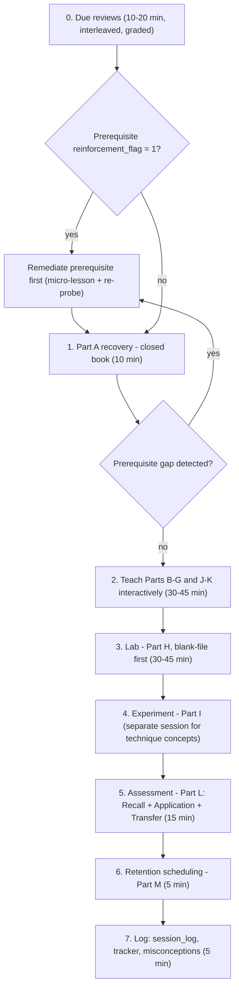
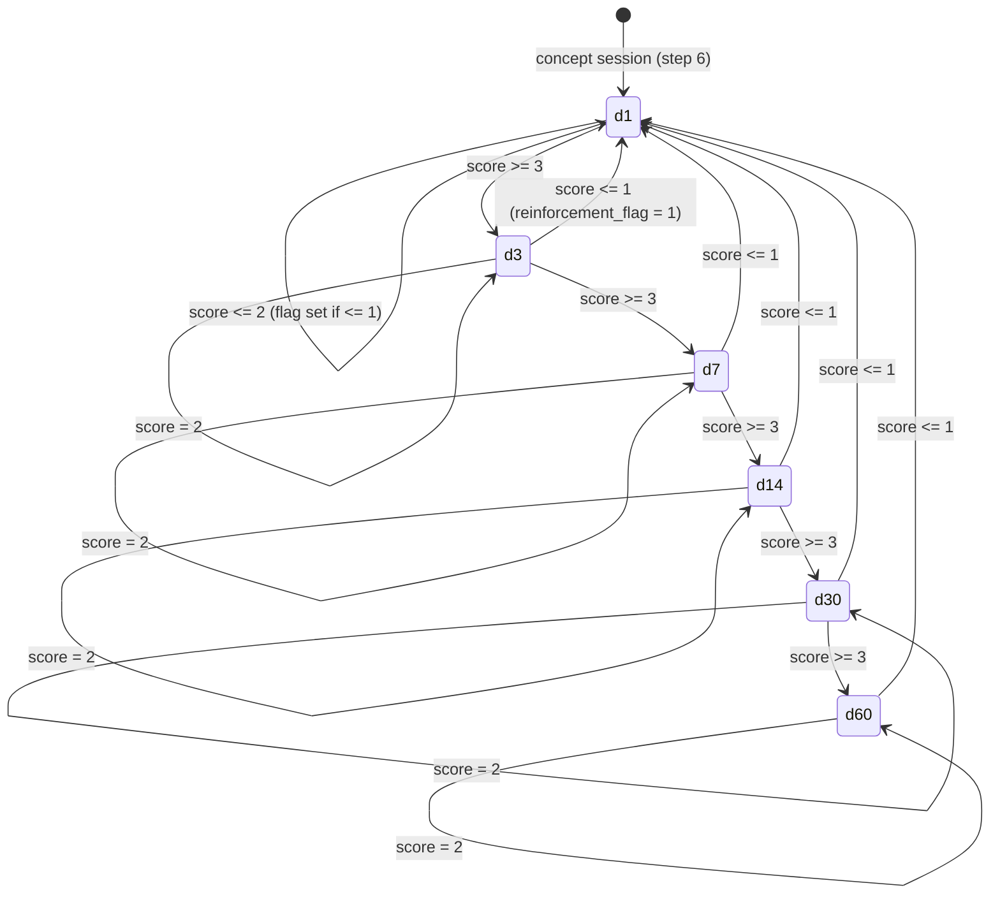

# 05 — Learning and Retention System

**What this file is for.** It sets out how every study session runs, how the AI tutor must behave, how answers are graded, how reviews are scheduled, and what counts as mastery. It also defines the files that record all of this in `progress/` and `reviews/`. It does not contain lesson content (see [07](07_SAMPLE_LESSON.md)), phase content (see [02](02_RAG_MASTER_LEARNING_PLAN.md)), concept prerequisites (see [03](03_RAG_CONCEPT_DEPENDENCY_MAP.md)) or project and experiment design (see [06](06_RAG_PROJECT_AND_EVALUATION_PLAN.md)).

**Concept IDs** (O1…K1), priority tiers (E/U/S) and phase gates come from the fixed curriculum backbone and are used unchanged here. This file covers concept **O3, "How to use this system"**.

**Who uses it.**
- The learner: Sections 2, 5 and 6.
- The AI tutor: Sections 3 and 4. These are binding rules.
- The reviewer: everything. Each rule is written so a session transcript can show whether it was followed.

> **Basis (external, Source C-type, not in the learner's files).** The design uses well-established learning-science practices:
> - retrieval practice (the testing effect)
> - spaced repetition
> - interleaving
> - generation before instruction
> - elaborative explanation (teach-back)
>
> The verified supplementary reference list (`inv/references.md`) has **no** learning-science entries, so no specific paper is cited here. UNVERIFIED: the exact interval values (1/3/7/14/30/60 days) and the ×2.5 multiplier are pragmatic defaults, not values taken from a study.
>
> **REVIEWER NOTE:** add 2–3 verified learning-science references to [01](01_SOURCE_INVENTORY.md) / Source C in a later stage.

---

## Contents

1. [Why the previous system failed → design responses](#1-why-the-previous-system-failed--design-responses)
2. [The study session protocol](#2-the-study-session-protocol)
3. [Coaching rules for the AI tutor](#3-coaching-rules-for-the-ai-tutor)
4. [Assessment framework: Recall / Application / Transfer](#4-assessment-framework-recall--application--transfer)
5. [Retention system](#5-retention-system)
6. [Progress system: file formats](#6-progress-system-file-formats)
7. [Mastery levels and advancement criteria](#7-mastery-levels-and-advancement-criteria)
8. [Migration from the old system](#8-migration-from-the-old-system)
9. [Optional future automation (design only)](#9-optional-future-automation-design-only)

---

## 1. Why the previous system failed → design responses

**Evidence base.** The audit of the learner's prior materials covers `C:\Yash\New-Work\Book RAG\prior_work\RAG book step by step\` (`learning_guides/`, `study_companion.py`, `study_progress.json`). Line references are to `study_companion.py` (511 lines). The cited ranges were re-read for this document on 2026-10-08. None of these files are modified.

| # | Observed failure (evidence) | Why it defeats learning | Design response in this system |
|---|---|---|---|
| F1 | **The quiz showed the answer before the learner rated themselves.** `cmd_quiz` prints the model answer, then asks "How well did you know this?" on a 1–3 scale (study_companion.py:L283-L301: reveal prompt L283, answer printed L285-L288, self-rating L290-L301). | It measures how familiar the answer *feels* after reading it, not whether the learner could recall it. Recognition inflates the score. | The learner must make an attempt before any answer is shown (rule CR-02). The tutor grades every answer against written criteria ([§4](#4-assessment-framework-recall--application--transfer)). Self-ratings are kept only as a *confidence* value for calibration and never drive scheduling or mastery. |
| F2 | **"Studied" was set just by displaying a chapter.** `cmd_study` sets `status="studied"` after printing the summary (L251-L257). Ch2 was marked "studied" 2 min 23 s after Ch1 (`study_progress.json`). | It records exposure as progress, so the tracker overstates what has been learned. | There is no "studied" status. The `status` column takes only mastery levels that need graded evidence ([§7](#7-mastery-levels-and-advancement-criteria)). Being taught a concept earns at most level L1 `exposed`. |
| F3 | **22 chapter guides were batch-generated on 2026-06-11 between 18:58 and 19:15** (file modification times; PROGRESS.md's own log says guides 3–22 were generated in a parallel batch). PROGRESS.md marks all 22 "✅ Complete". | Content production was mistaken for learning. Large encyclopedia-style guides (23–46 KB each) invite passive reading. | One concept per session. Lessons are interactive (Parts A–M, questions before answers). "Complete" applies only to a concept with evidence links. Content is produced one lesson at a time and reviewed. |
| F4 | **Chapters were mis-mapped.** Guide numbering differs from the real book for 19 of 22 guides (e.g. guide "chapter-04-chunk-size" vs real Ch4 Proposition Chunking). PROGRESS.md calls its mapping "estimated" and never checked it. The `## Book Explanation` sections summarise the wrong chapter for guides 4–19, 21 and 22 (guide 20 is a partial match: Ch20 CRAG only). | The learner studies one technique while reading book text about another, which plants confusions such as Proposition Chunking takeaways shown under "Chunk Size Optimization". | Everything is keyed to **concept IDs**, not chapter numbers. Book references always use the verified "Ch4 p.3/15" form. The concept-to-source mapping lives in [04](04_BOOK_TO_CODE_MAPPING.md) and must be checked against the PDFs. |
| F5 | **Nothing was measured.** No learner experiment, metric or result was recorded. The guides contain unsourced numbers (e.g. "~1.5–3s" latency). | The learner cannot tell whether a technique helps, and claims cannot be falsified. | Every technique concept from Phase 4 onward requires a controlled experiment (`experiment_status` column; [06](06_RAG_PROJECT_AND_EVALUATION_PLAN.md)). The tutor challenges unsourced numbers (CR-07). |
| F6 | **The quiz log was weak.** Which questions were asked is never saved. `quiz_avg` pools every score from every attempt (L319-L321). Each quiz is 3 random questions (L272). | Forgetting and improvement cannot be seen, and no item can be scheduled for review. | Every assessment item has an ID (e.g. `C2-A-03`). Each attempt is logged with date, hint level and score ([§6](#6-progress-system-file-formats)). Rolling accuracy uses the last 5 scheduled reviews only. |
| F7 | **The "next" logic chose new material over weak material.** `_print_next` suggests the first not-started chapter, then studied-but-unquizzed, and only then the weakest (L429-L452). | New content always pushed out reinforcement, so forgetting went unaddressed. | Due reviews and reinforcement items come **first** in every session (§2 step 0). A new concept is blocked while a prerequisite carries `reinforcement_flag=1` (§2 entry rules). |
| F8 | **The guides contained factual errors.** Examples: ch01 L269-L276 misdescribes `evaluate_rag`; ch04 L101 treats LlamaIndex `chunk_size` as characters; ch01 L154 says FAISS uses cosine. | Learners take in errors along with correct content, and those errors resurface later as misconceptions. | Section 8 seeds these errors as *candidate misconceptions* for the O1 diagnostic to probe. The tutor must cite a source or mark a claim UNVERIFIED (CR-12). |
| F9 | **Book text was copied verbatim.** 14 guides contain the word "verbatim"; examples include a quoted passage of about 70 words (ch04 L21) and a section labelled as verbatim key takeaways (ch04 L85-L91). | Copied text replaces understanding, and it raises copyright problems. | Paraphrase plus page citations. Quotations stay under 15 words. Learners explain in their own words (teach-back, §5.4). |

**Summary of the shift:** "content exists" → "evidence exists". In this system every status change must point to an evidence link: a graded item ID in the session log, code written from a blank file, an experiment write-up, or a reconstruction artifact.

---

## 2. The study session protocol

### 2.1 Session types

> **Assumption:** about 5 study days per week, 60–120 minutes per day. The cadence below scales linearly. If time is short, cut teaching time, never the assessment or the log.

| Session type | When | Length | Contents |
|---|---|---|---|
| **Concept session** | Introducing a new concept | 90–120 min (may be split across 2 days, see 2.4) | Steps 0–7 below |
| **Experiment session** | Technique concepts (Phases 4–8, 10) after the concept session | 60–120 min | Step 0, then Part I of the lesson, then steps 6–7 |
| **Review-only session** | Days with no new concept | 20–30 min | Step 0 plus one teach-back or cumulative exercise if one is due |
| **Phase-close session** | End of each phase | 60–90 min | Blank-page reconstruction (§5.5), phase gate check ([§7.3](#73-phase-advancement)), phase retrospective |

### 2.2 Concept-session flow



### 2.3 Steps in detail

The lesson parts named below (Part A … Part M) are those of the mandatory lesson template. [07_SAMPLE_LESSON.md](07_SAMPLE_LESSON.md) is the exemplar, for concept C2.

| Step | Time | What happens | Rules | Output |
|---|---|---|---|---|
| **0. Due reviews** | 10–20 min (at most 20 items) | The tutor reads `reviews/review_queue.md` and asks due items one at a time. Items are interleaved (§5.3). Each answer is graded 0–4. | Closed book. Items flagged for reinforcement go first, then the most overdue E items, then U, then S. If more than 20 items are due, defer S items before U items and log the deferral. | Scores in `session_log.md`. Tracker fields `last_reviewed`, `next_review`, `review_interval_days`, `recall_score_last`, `recall_accuracy_rolling` updated. |
| **1. Part A — Recovery** | 10 min | 4–8 diagnostic questions on the new concept and its prerequisites. Asked **before** any teaching, with no notes. | Wrong answers are not corrected in detail yet. The tutor notes them and routes the session. If any prerequisite answer scores ≤1, follow routing rule D3 (§3.3): probe the prerequisite and remediate it before teaching. | Part A scores (they count toward nothing except routing). Candidate misconceptions noted. |
| **2. Teach (Parts B–G, J, K)** | 30–45 min | Failure first (Part B), then intuition (C), mechanism (D), connections (E), a hand-worked example (F), the source connection with book and repo citations (G), failure scenarios (J) and engineering decisions (K). | Before each mechanism is revealed, the learner predicts it (CR-02). At most about 10 minutes of tutor exposition before the next learner question. Every claim has a source or is marked UNVERIFIED. | Notes written by the learner, in their own words, in the concept file's "My notes" area (future). |
| **3. Lab (Part H)** | 30–45 min | Layer 1: the learner writes the minimal implementation **from a blank file**. Layer 2: read the upstream repo code with a reading guide. Layer 3 (later): fold it into `ragkit/`. | The tutor may give hints (ladder, §3.2) but no complete code before an attempt. The learner runs the tests or asserts. | Code in `labs/` (future). Values for `coding_independence_0_3` and `debugging_0_3`. |
| **4. Experiment (Part I)** | 60–120 min, usually a separate session | Hypothesis written **before** running. Controlled comparison on the frozen eval set ([06](06_RAG_PROJECT_AND_EVALUATION_PLAN.md)). | Retrieval metrics and answer metrics are reported separately (CR-11). Empty result tables are filled only from actual runs. | Write-up in `experiments/`. `experiment_status` advanced. |
| **5. Assessment (Part L)** | 15 min | At least 1 Recall, 1 Application and 1 Transfer item ([§4](#4-assessment-framework-recall--application--transfer)), graded against the rubric. | Same-session recall counts only toward L1 (§7.1). An MCQ answer never counts alone (CR-10). | Scores in the session log. Tracker updated. |
| **6. Retention scheduling (Part M)** | 5 min | Flashcard and review items for the concept are added to the queue with `next_review = today + 1`. New misconceptions are logged. | Every item must have an ID and a rubric reference. No item without an expected-answer criterion. | `reviews/review_queue.md` and `progress/misconception_log.md` updated. |
| **7. Log** | 5 min | Append a session entry. The tutor states what changed in the tracker and why, with evidence links. | No status change without an evidence link (§7.4). | `progress/session_log.md`, `progress/concept_tracker.csv`. |

### 2.4 Entry and exit rules

- **No new concept** while:
  - more than 15 review items are overdue, or
  - any **direct prerequisite** (per [03](03_RAG_CONCEPT_DEPENDENCY_MAP.md)) has `reinforcement_flag=1`, or
  - any **high**-severity misconception is open on a direct prerequisite.

  Do a review-only session or remediation instead.
- **At most one new E concept per day.** Two small U concepts are allowed if both are in the same phase.
- **Splitting a concept across days is allowed.** Day 1 is steps 0–2 plus a short end-of-session recall check, logged as `exposed`. Day 2 opens with step 1 (Part A) re-run on Day-1 content, closed book, then steps 3–7. The Day-2 recovery doubles as the first delayed-recall evidence.
- **Never end a session without step 5 (even a reduced one) and step 7.**
- **First-ever session = O1 diagnostic.** It covers the blank-page pipeline reconstruction plus 12 diagnostic questions (content defined in [02](02_RAG_MASTER_LEARNING_PLAN.md)), graded by the rubrics in §4 and §5.5. The tracker is seeded from it (§8.3).

---

## 3. Coaching rules for the AI tutor

These rules bind the AI tutor in every session. Each rule has a **test**: the observable behaviour a reviewer checks in the transcript or log. Lessons mark coach instructions with `> 🧭 Coach:`. Those instructions add to these rules and cannot override them.

### 3.1 Core rules

| ID | Rule | Test (what a transcript must show) |
|---|---|---|
| CR-01 | **One question at a time.** Each tutor turn ends with at most one question for the learner. | No tutor turn contains two learner-directed questions. A multi-part task is split across turns. |
| CR-02 | **Wait for an attempt.** For any question with a gradable answer, the tutor gives no answer, worked solution or decisive hint until the learner has made an attempt. "I don't know" counts as an attempt only after the tutor has prompted once ("Give your best guess and your reasoning"). | Between a question and its answer there is always a learner turn with content. |
| CR-03 | **Hint ladder.** Hints are given in order H0 → H1 → H2 → H3 (§3.2), one level per learner attempt. Levels are never skipped unless the learner explicitly asks for a bigger hint (logged). | The log records `hint_level_max` for every item. |
| CR-04 | **No full solution before an attempt plus at least one hint.** The full solution is shown only after (a) an attempt, (b) at least H1, and (c) another failed attempt or the learner explicitly gives up ("I give up / show me"). An item that ends with the solution shown is marked **assisted** (`A`) and scored 0 for mastery purposes. | Every revealed solution is preceded by an attempt and at least one hint, or by explicit give-up wording. The item is logged with flag `A`. |
| CR-05 | **Score caps by hint level.** Max score 4 after H0, 3 after H1, 2 after H2, 1 after H3, 0 when assisted. | Logged score ≤ the cap for the logged hint level. |
| CR-06 | **Correct clearly when wrong.** The tutor says "That is incorrect" (or "partly correct: X is right, Y is wrong"), names the specific error, gives the correct statement with evidence (a computation, source citation or code run), then asks the learner to restate it in their own words. No vague praise for wrong answers. | After an incorrect answer, the next tutor turn names the error explicitly. The learner then restates. Conceptual errors produce a misconception-log entry. |
| CR-07 | **Challenge unsupported claims.** When the learner (or a source) asserts that a technique is better, faster or more accurate, the tutor asks: "Measured on what corpus, with what metric, against what baseline?" This applies to book claims too. Example: Appendix A p.6/23 calls semantic chunking and reranking the highest-leverage quick wins, which is a recommendation to test, not a measured result for our corpus. | Every comparative claim in the transcript is followed by a measurement question or tagged "hypothesis, to test in v1.x/v2.x". |
| CR-08 | **"What if parameter X doubles?" probes.** At least once per concept session, the tutor asks the learner to predict the effect of doubling or halving one parameter: chunk size, overlap, k, candidate-pool size, temperature, threshold, RRF constant. The prediction must name the direction and the mechanism, and where possible a number. | At least 1 counterfactual probe per concept session, logged as an Application item. |
| CR-09 | **Compare-designs probes.** At least once per technique concept, the learner must compare two designs that solve similar problems. Examples: semantic vs proposition chunking, HyDE vs HyPE, RRF vs weighted score fusion, cross-encoder vs LLM reranker, window enrichment vs larger chunks. The comparison covers what each changes (index time vs query time), its cost, its failure mode, and how to decide by measurement. | At least 1 compare item per technique concept, logged as a Transfer item. |
| CR-10 | **An MCQ never counts alone.** A correct multiple-choice answer must be followed by "Why is each other option wrong?" or "Explain the mechanism". Without that justification an MCQ scores at most 2. | MCQ items with score ≥3 have a logged justification. |
| CR-11 | **Separate retrieval quality from answer quality.** Whenever a failure, metric or improvement is discussed, the tutor asks: "Is this a retrieval problem (the right evidence was not in the top-k) or a generation problem (evidence present, answer wrong or ungrounded)?" Retrieval metrics (Hit@k, Recall@k, MRR, nDCG) and answer metrics (correctness, faithfulness, citation precision/recall, abstention) are never merged into one claim. | The transcript classifies every discussed failure as retrieval, generation, or both. |
| CR-12 | **Cite or flag.** Tutor statements about the book cite "ChN p.k/total". Statements about repo code cite a cell or line. Library behaviour that has not been run is marked UNVERIFIED. The tutor never invents experiment results. If asked "does X improve accuracy?", the answer is "unknown for our corpus until experiment vN; here is how we would test it." | Factual claims carry a citation or UNVERIFIED. No result numbers appear unless they come from a logged run or are labelled "toy illustration". |
| CR-13 | **Novel-scenario transfer checks.** Every assessment (step 5) contains at least one item whose scenario did not appear in the lesson: a different document type, domain, scale or constraint. | The transfer item's scenario text does not appear in the lesson file. |
| CR-14 | **Adapt difficulty** by rules D1–D4 (§3.3). Each change of difficulty level is announced in one line ("Raising to transfer level because…"). | Level changes are logged with their trigger. |
| CR-15 | **Grade against criteria, out loud.** Every score names the rubric criteria met and missed, e.g. "Score 2: core idea correct; missing the stride term; no boundary condition." The learner may contest a score. The tutor then re-grades by quoting the criteria, and a contested score is logged as `contested`. | Each logged score has a one-line rationale. |
| CR-16 | **Record learner confidence before revealing.** For review items the learner states confidence 1–3 *before* grading. It is used only for calibration (§5.6) and never for scheduling. | The confidence value is logged before the score. |
| CR-17 | **No encyclopedia dumps.** At most about 150 words of tutor exposition between learner interactions during teaching. | Tutor turns during teaching stay under about 150 words, or end in a question. |

### 3.2 Hint ladder (levels 0–3)

Running example: "With fixed windows of S=1000 characters and overlap O=200, is a 500-character explanation guaranteed to lie wholly inside one chunk?"

| Level | Purpose | Gives away | Example |
|---|---|---|---|
| **H0 — Prompt to attempt** | Get any attempt and the reasoning behind it | Nothing | "Give your best answer and one sentence of reasoning, even if unsure." |
| **H1 — Direction** | Point to the relevant concept or a test case | Which idea or case to examine | "Try a concrete case: the explanation starts 300 characters before chunk *i* ends. Which chunk contains all of it?" |
| **H2 — Structure** | Give the method skeleton or partial formula | The approach, not the result | "Chunk *i* covers [i·s, i·s+S) with stride s = S−O = 800. Write the condition for a span [p, p+F) to fit inside chunk *i*." |
| **H3 — Worked step** | Do all but the last step | Most of the solution | "The condition reduces to u ≤ S−F, where u = p − i·s ranges over 0…s−1. For which F does every u satisfy it?" |
| **Solution** | Only after H3 plus a failed attempt, or explicit give-up | Everything | The full derivation. The item is logged as `A` (assisted) and re-queued for tomorrow. |

### 3.3 Difficulty adaptation rules

Item difficulty levels:
- **R**: Recall
- **A**: Application
- **T**: Transfer

"Strong" means a score ≥3 with hint level ≤ H1. "Weak" means a score ≤1.

| Rule | Trigger | Action |
|---|---|---|
| D1 | 2 consecutive strong answers at the same level on the same concept | Raise one level (R→A→T). At T, switch to a compare-designs or "what if" item (CR-08/09). |
| D2 | 1 answer scoring 2 | Stay at the same level and ask a *different* item on the same sub-idea. |
| D3 | 2 consecutive weak answers | Drop to the **prerequisite** concept named in [03](03_RAG_CONCEPT_DEPENDENCY_MAP.md) and ask a Recall item there. If that also scores ≤1: set `reinforcement_flag=1` on the prerequisite, log a misconception or gap, and pause the current concept until a prerequisite micro-lesson is done. If the prerequisite scores ≥3: return to the current concept at level R with a re-explanation of the specific gap. |
| D4 | Contradictory pattern (strong on Transfer, weak on Recall of terms) | Do not drop the level. Log a "vocabulary gap" and schedule terminology flashcards only. |

### 3.4 Example dialogue — chunk overlap (concept C2)

> Toy numbers below were checked by brute-force enumeration in Python on 2026-10-08. The model is a fixed-window chunker at interior positions with a uniformly random span start. The recursive splitter actually used by the repo cuts at separators, so its overlap varies (see [07](07_SAMPLE_LESSON.md) Part D).

1. **Tutor:** The book's default is 1,000-character chunks with 200 characters of overlap (Ch1 p.4/14). It presents overlap as the protection for content at chunk boundaries. Assume plain fixed windows: is a 500-character explanation *guaranteed* to land wholly inside at least one chunk?
2. **Learner:** Yes. The overlap repeats the boundary text, so nothing gets split.
3. **Tutor:** That is incorrect. Overlap reduces boundary splits but does not guarantee containment here. *(H1)* Try a concrete case: the explanation starts 300 characters before chunk *i* ends. Which chunk contains all of it?
4. **Learner:** Chunk *i* holds only the first 300 characters. Chunk *i+1* starts 200 before chunk *i* ends, so it misses the first 100. Neither chunk has all of it. It's split.
5. **Tutor:** Correct. Then what is the longest span that is guaranteed to fit whole, whatever its starting position?
6. **Learner:** It has to fit inside the overlap, so 200 characters?
7. **Tutor:** Partly correct: the reasoning is right, but the exact bound with integer positions is F ≤ O + 1 = 201. *Scores: first item, Application 3 (correct after H1, so capped at 3). This item, Application 3 (off-by-one slip that does not change the conclusion).* What-if probe: if the overlap doubles to 400, what fraction of start positions keeps the 500-character span whole?
8. **Learner:** The stride becomes 600. The span fits when its offset within the stride is ≤ S − F = 500, so 501 of 600 positions, about 0.835. At overlap 200 it was 501/800, about 0.626.
9. **Tutor:** Correct, and you checked the baseline. *Score: Application 4.* Here is a claim to challenge: "so we should always use overlap 400." What does it cost? Give a number.
10. **Learner:** The index-size multiplier is S/(S−O): 1000/600 ≈ 1.67 versus 1.25, so about a third more chunks and embeddings than at 200. Top-k also fills up with more duplicated text. And whether it actually helps retrieval on our corpus is unknown until the I1 experiment measures Recall@k.

*Next turn (transfer, CR-13):* "`encode_pdf` in `helper_functions.py:L48-L76` splits the per-page Documents returned by `PyPDFLoader`. A key sentence crosses a page break. Does raising the overlap to 400 help? And is this failure visible in retrieval metrics or in answer metrics?"

Expected: no. Chunks never cross pages, assuming the per-page loader default (library behaviour, UNVERIFIED locally). The failure shows in retrieval metrics: span coverage on gold spans that cross a page.

---

## 4. Assessment framework: Recall / Application / Transfer

### 4.1 Definitions and item types

| Type | Definition | Item types | Item ID pattern |
|---|---|---|---|
| **Recall (R)** | Retrieve a fact, definition, formula, component list or mechanism from memory, without cues beyond the prompt | Free recall ("Explain X in 3–5 sentences"); cued flashcard; derive a formula; list pipeline stages and their artifacts; define in own words; "what problem does X solve?" | `<concept_id>-R-<nn>` e.g. `C2-R-04` |
| **Application (A)** | Use the concept on a concrete, familiar-type task | Hand computation (cosine, BM25 term score, Recall@k, MRR, nDCG, P(contained)); code trace by hand; write a function from a blank file; debug a snippet; read a trace and locate the failing stage; choose parameters with justification; "what if X doubles" (CR-08) | `<concept_id>-A-<nn>` |
| **Transfer (T)** | Apply to a **novel** scenario, or reason across concepts | New-domain design (legal contracts, API docs, scanned tables); compare two designs (CR-09); diagnose from a symptom with several plausible causes; critique a book or repo claim; design an experiment that would decide a question; say when *not* to use a technique | `<concept_id>-T-<nn>`; cross-concept items `X-T-<nn>` with a list of concepts |

Items live in each concept lesson's Parts L and M. For C2 that is [07](07_SAMPLE_LESSON.md). Every item states its **expected-answer criteria** (what a 4 must contain) at the time it is written. An item without criteria cannot be graded and must not be asked.

### 4.2 Graded rubrics (0–4)

The tutor grades against the criteria. Learner self-ratings are never a score.

**Recall rubric**

| Score | Criteria |
|---|---|
| 0 | No answer, or entirely wrong |
| 1 | Fragments only, or contains a major misconception (e.g. "overlap guarantees no split", "FAISS default is cosine") |
| 2 | Core idea correct, but a key element is missing (e.g. names stride but not its formula) or terms are imprecise (chars vs tokens confused) |
| 3 | Correct and complete for the item's criteria. Minor imprecision that does not change meaning |
| 4 | As 3, plus the mechanism (*why*) and at least one boundary condition or limitation, stated precisely |

**Application rubric**

| Score | Criteria |
|---|---|
| 0 | Cannot start, or no relevant method |
| 1 | Wrong method (e.g. uses L2 distance as a similarity without sign or normalization reasoning) |
| 2 | Right method, but execution errors change the result (arithmetic, off-by-one, wrong unit) |
| 3 | Correct result. Any slip does not affect the conclusion |
| 4 | Correct result, justified, **and self-checked** (sanity bound, unit check, re-computation, or test/assert) |

**Transfer rubric**

| Score | Criteria |
|---|---|
| 0 | No relevant answer |
| 1 | Recites the lesson answer without adapting to the new scenario's constraints |
| 2 | Identifies the relevant concept but misapplies it, or misses a key constraint of the new scenario |
| 3 | Adapts correctly to the scenario and names the main trade-off (quality vs cost/latency/index size) |
| 4 | As 3, plus says **how to verify by measurement** (which metric, which eval questions, which baseline) **and** when *not* to use the approach. Keeps retrieval vs answer effects separate |

**Code-specific scales** (tracker columns, assessed in labs):

| Value | `coding_independence_0_3` | `debugging_0_3` |
|---|---|---|
| 0 | Cannot produce working code without copying a solution | Cannot locate the fault even with hints |
| 1 | Writes it with heavy hints (H2/H3) or by adapting shown code | Locates the fault with H1/H2 hints but cannot fix it unaided |
| 2 | Writes it from a blank file with API/doc lookups only; tests pass after self-fixes | Diagnoses unaided; fix needs one hint |
| 3 | Writes it from a blank file without lookups of solution code, adds tests/asserts, explains every line | **Predicts** the failure before running, diagnoses and fixes it, and adds a regression test or assert |

### 4.3 Scores required per mastery level

Summary only. The full criteria are in [§7.1](#71-concept-mastery-levels-l0l5).

| Mastery level | Recall | Application | Transfer | Code |
|---|---|---|---|---|
| L1 exposed | any attempt logged | — | — | — |
| L2 recall | ≥3 on 2 different days, one ≥24 h after teaching | — | — | — |
| L3 applied | (L2) | ≥3 on 2 different items | — | coding_independence ≥2 (if the concept has a lab) |
| L4 transfer | (L2) | (L3) | ≥3 on a novel item | debugging ≥2 (if lab); experiment `decided` (technique concepts) |
| L5 retained | ≥3 at a review with interval ≥30 days; rolling ≥0.75 | — | — | — |

All scores count only if they are not assisted. Caps apply (CR-05).

---

## 5. Retention system

### 5.1 Active recall: what a review item looks like

Every review is closed-book active recall. Re-reading notes or the lesson does **not** count as a review.

Each review item records:
- the item ID
- the concept
- the type (R/A/T)
- the prompt
- the expected-answer criteria (where they live in the lesson)
- the learner's confidence (1–3)
- the hint level
- the score (0–4)
- a one-line rationale

From Phase 2 onward, at least 1 item in 3 in each review session must be Application or Transfer. Pure flashcard recall decays into recognition practice.

### 5.2 Spaced-repetition schedule

**Interval ladder (days):** `1 → 3 → 7 → 14 → 30 → 60`, then maintenance at 60.

The first review is scheduled for 1 day after the concept session (step 6). After each scheduled review, the **scheduling score** for the concept is the **lowest** score among that concept's items in the session. A conservative rule is used so that one easy flashcard cannot hide a weak application item.

| Scheduling score | New `review_interval_days` | Other effects |
|---|---|---|
| **≥3** (not assisted) | `current × 2.5`, snapped to the nearest ladder value. Checked by computation: 1→3, 3→7, 7→14, 14→30, 30→60, 60→60. | `reinforcement_flag` stays 0. If it was 1 and this is the 2nd consecutive ≥3, clear it to 0. |
| **2** | Same interval as before (repeat) | Add one different item on the weak sub-idea to the next review. |
| **≤1** or assisted | Reset to **1 day** | Set `reinforcement_flag=1`. Add a reinforcement task (re-teach the gap via the lesson's Part D/F, then 1 new Application item). Log a misconception if the cause is conceptual. Run D3 (§3.3) on the next attempt if it is weak again. |

Rules:
- `next_review = last_reviewed + review_interval_days`. Dates are ISO `YYYY-MM-DD`.
- **Overdue items** are reviewed as soon as possible. The interval rule applies to the interval as *scheduled*. The extra delay is not credited, because there is no bonus for lateness.
- **S-tier concepts** stop at 30 days, then go to maintenance at 60 only if they are used in the project.
- **Unscheduled recall** (e.g. Part A of a later lesson touching this concept) is logged as evidence but does not change the schedule. The exception is a score ≤1, which triggers the ≤1 row above.



### 5.3 Interleaving rules

| Rule | Applies | Requirement |
|---|---|---|
| IL-1 | Always | No more than 2 consecutive items from the same concept |
| IL-2 | Phases 0–2 | Each review session mixes at least 2 concepts |
| IL-3 | **After Phase 2 is complete** | Each review session contains items from **at least 2 phases**. From Phase 5 onward, items come from at least 3 phases when that many have due items. |
| IL-4 | After Phase 3 | At least 1 **discrimination** item per session: given a symptom, choose between confusable interventions and justify the choice. Example: "Recall@5 is fine but answers cite the wrong page." Is the fix chunking, reranking, context assembly or citation verification? |
| IL-5 | When a confusable pair is due | Ask the pair back-to-back as a compare item. Confusable pairs come from the "confused with" lists in each lesson's Part E and from the "Commonly confused with" column of the per-technique tables in [03 §3](03_RAG_CONCEPT_DEPENDENCY_MAP.md#3-relationship-table-per-technique) (plus the family comparisons in 03 §4). Examples: C2 vs X1 (chunk size vs retrieval-time window); I3 vs I4 vs I5; Q2 vs I6 (HyDE vs HyPE: query time vs index time); R1 weighted fusion vs RRF; R3 vs R4; M2 vs M3 (retrieval vs generation metrics); V2 vs A2. |

### 5.4 Teach-back protocol

**When:**
- once per E concept, at the day-7 review, or when moving from L3 to L4
- once per phase-close session, for a concept the tutor chooses

**Procedure (about 10 minutes):**
1. The learner explains the concept to a "junior engineer", played by the tutor, in 3–5 minutes with no notes. The explanation must cover:
   - the failure it addresses
   - the mechanism
   - one number or formula
   - one trade-off
   - one failure mode
   - where it sits in the pipeline
2. The tutor asks 2 questions in character: one naive ("Why not just use a bigger context window?") and one adversarial ("Your colleague says overlap guarantees no splits. Convince them otherwise.").
3. The tutor grades the teach-back out of 4: one point each for mechanism, why, trade-off and failure mode. Source citation is a pass/fail check and is noted.
4. Scoring: a teach-back ≥3 counts as a Recall item. It also counts as an Application item if the explanation included a correct computation or a code sketch.

### 5.5 Blank-page architecture reconstruction

**Cadence:**
- in O1 (the baseline)
- at the end of every phase (phase-close session)
- at the capstone (K1)

**Task (20 minutes, no notes).** Draw the full pipeline as it stands after the current phase, as a Mermaid diagram or on paper. For each stage, write:
- inputs and outputs
- the intermediate artifacts and their metadata (e.g. chunk: `doc_id, page, char_start, char_end, chunk_id, params hash`)
- where each concept learned so far plugs in
- where measurement happens

Then answer 2 tutor questions of the form "trace this query through your diagram".

**Rubric (5 criteria, each 0–2, total 0–10):**

| Criterion | 0 | 1 | 2 |
|---|---|---|---|
| Components | Major stages missing | All stages, some misordered or merged | All stages in correct order, including index-time vs query-time split |
| Data & artifacts | No artifacts named | Artifacts named, metadata missing | Artifacts with the metadata needed for provenance and citations |
| Failure points | None | Some failure points, not tied to stages | At least 1 concrete failure per stage, tied to its stage, retrieval vs generation separated |
| Measurement | None | Metrics named, not placed | Retrieval and answer metrics placed at the right stages, with the eval set and baseline shown |
| Trade-offs/knobs | None | Knobs listed | Knobs with their direction of effect and cost (k, chunk size, candidate pool, budget) |

**Pass:** ≥8/10 with no criterion at 0. Below pass: the weak criteria become reinforcement items, and the phase gate stays closed. Reconstructions are saved as `reviews/reconstructions/<YYYY-MM-DD>_phase<N>.md` and linked from the tracker (`evidence_links` of the phase's E concepts).

### 5.6 Cumulative exercises and calibration

- **Cumulative exercise every 5 concepts** that reach L3. It is one novel problem that combines at least 3 completed concepts from at least 2 phases. Examples:
  - "A user reports that answers about the Paris Agreement cite the wrong page. Trace it through loading (C1), chunking (C2) and retrieval (C4). Say which metric would have caught it (M2)."
  - "Design an eval subset that would show whether hybrid retrieval helps acronyms (M1 + R1)."

  Graded with the Transfer rubric. Logged as `X-T-<nn>` with its concept list. A score ≤1 sets `reinforcement_flag` on the concept that caused the failure.
- **Calibration.** Over the last 20 review items, compare confidence (1–3) with the score. If confidence 3 goes with a score ≤2 in more than 25% of cases, the learner is **overconfident**. The tutor then raises the share of Application/Transfer items and announces this. The threshold is an assumption, to be tuned after the first month.

---

## 6. Progress system: file formats

All files below are created later, when the progress system is set up. Their **formats** are fixed here.

Conventions:
- Dates are ISO `YYYY-MM-DD`.
- Lists inside a CSV cell are separated by `;` with no spaces.
- Paths are relative to `rag_learning/`.
- The CSV is UTF-8 with a header row, one row per concept ID from the backbone (O1 … K1, including I-CMP).

### 6.1 `progress/concept_tracker.csv`

Exact header (in this order):

```csv
concept_id,title,phase,priority,status,first_studied,exposed_on,last_reviewed,next_review,review_interval_days,recall_score_last,recall_accuracy_rolling,application_score,transfer_score,coding_independence_0_3,debugging_0_3,experiment_status,misconceptions_open,reinforcement_flag,evidence_links
```

| Column | Meaning | Allowed values / format | Updated by |
|---|---|---|---|
| `concept_id` | Fixed backbone ID | `O1`…`O3`, `P1`…`P7`, `C1`…`C7`, `M1`…`M5`, `I1`…`I6`, `I-CMP`, `R1`…`R5`, `Q1`,`Q2`, `X1`…`X3`, `V1`…`V4`, `D1`…`D4`, `A1`…`A5`, `S1`…`S3`, `K1` | Seed only |
| `title` | Short concept title from the backbone | Text, no commas (or quoted) | Seed only |
| `phase` | Curriculum phase number | Integer `0`–`12` | Seed only |
| `priority` | Tier | `E`, `U`, `S` (P5 = `E`; its ANN-internals sub-part is U and noted in the lesson) | Seed only (changes need a decision in [08](08_GAP_ANALYSIS_AND_DECISIONS.md)) |
| `status` | Current mastery level (§7.1) | `not_started`, `exposed`, `recall`, `applied`, `transfer`, `retained`, `deferred` (S-tier or elective, deliberately postponed, with the reason in the session log), `regressed` (was ≥`applied`, then a scheduled review scored ≤1; returns to its previous level after 2 consecutive reviews ≥3) | Step 7, by evidence only |
| `first_studied` | Date of the first concept session (L1) | Date or empty | Step 7 |
| `exposed_on` | Date **mechanism exposure** was first demonstrated: the learner read the mechanism and traced or demoed it (e.g. on the project corpus). This is what a `requires_exposure` prerequisite checks ([03 §2.1](03_RAG_CONCEPT_DEPENDENCY_MAP.md#21-edge-list-authoritative-the-diagram-is-generated-from-it)). It is **not mastery**: it never satisfies a `requires_all` or any-group prerequisite, and it does not change `status`. The trace or demo must appear in `evidence_links`. | Date or empty | Step 7, by evidence only |
| `last_reviewed` | Date of the last *scheduled* review | Date or empty | Step 0 |
| `next_review` | Due date | Date, or empty if `not_started`/`deferred` | Step 0 / step 6 |
| `review_interval_days` | Current ladder interval | `1`,`3`,`7`,`14`,`30`,`60`, or empty | Step 0 / step 6 |
| `recall_score_last` | Scheduling score of the last scheduled review (§5.2) | `0`–`4`, or empty | Step 0 |
| `recall_accuracy_rolling` | Mean of the last 5 scheduling scores ÷ 4 (fewer if fewer exist) | `0.00`–`1.00`, 2 decimals, or empty | Step 0 |
| `application_score` | Best unassisted Application score in the last 30 days. It falls back to the most recent if the best is older than 30 days. | `0`–`4`, or empty | Steps 0/5 |
| `transfer_score` | Same rule, for Transfer items | `0`–`4`, or empty | Steps 0/5 |
| `coding_independence_0_3` | Lab code-writing independence (§4.2) | `0`–`3`, `na` (no lab for this concept), or empty | Step 3 |
| `debugging_0_3` | Debugging ability on this concept's code (§4.2) | `0`–`3`, `na`, or empty | Steps 3/5 |
| `experiment_status` | State of the concept's controlled experiment (§6.5) | See §6.5 | Step 4 |
| `misconceptions_open` | IDs of open misconceptions for this concept | `;`-separated `MC-###`, or empty | Steps 1–7 |
| `reinforcement_flag` | Concept needs remediation before dependants advance | `0` or `1` | §5.2 / §3.3 D3 |
| `evidence_links` | Pointers to evidence supporting the current status | `;`-separated items: `log:<YYYY-MM-DD>#<item_id>`, a relative file path (`labs/…`, `experiments/…`, `reviews/reconstructions/…`), or `legacy:<note>` (weak, informational only) | Step 7 |

FORMAT EXAMPLE. The values are fictional and show syntax only. They are not learner data.

```csv
C2,Chunking fundamentals,2,E,applied,2026-11-02,,2026-11-09,2026-11-23,14,3,0.75,3,2,2,1,planned,MC-004,0,log:2026-11-02#C2-A-03;log:2026-11-09#C2-R-02;labs/C2_chunking_lab.ipynb
```

**Exposure vs mastery in the tracker.** Exposure is a separate date column, not a `status` value, because `status` is the mastery ladder (§7.1), and its L1 value `exposed` has a different, weaker meaning (a session reached step 5, or the O1 diagnostic placed the concept) that does not require a trace or demo. For unlocking ([03 §2.1](03_RAG_CONCEPT_DEPENDENCY_MAP.md#21-edge-list-authoritative-the-diagram-is-generated-from-it)) the tracker gives two sets: **mastered** = rows whose `status` is at or above the level §7.2 requires; **exposed** = rows with a non-empty `exposed_on`. `requires_all` and any-groups are checked against mastered; `requires_exposure` against exposed ∪ mastered. Example: I-CMP needs I2–I6 each with `exposed_on` set (or mastered); I2–I6 do not need any particular `status`.

> Revised 2026-10-08 (Codex re-review R-04): `exposed_on` column added to record mechanism exposure (trace or demo, evidence in `evidence_links`), separate from mastery; exposure never substitutes for mastery. See [corrections log](reviews/CORRECTIONS_LOG_2026-10-08.md#r-04).

### 6.2 `progress/session_log.md` template

Append-only, newest last. One block per session.

```markdown
## Session <YYYY-MM-DD> #<n> — <type: concept | experiment | review | phase-close | diagnostic>
- Concept(s): <IDs>        - Duration: <min>        - Tutor: <model/agent id>
- Plan vs actual: <one line>

### Items
| item_id | type (R/A/T/X) | scheduled? (Y/N) | confidence 1-3 | hint_max (H0-H3) | assisted (A/-) | score 0-4 | rationale (criteria met / missed) | contested |
|---|---|---|---|---|---|---|---|---|
| C2-A-03 | A | N | 2 | H1 | - | 3 | right condition; off-by-one on bound | N |

### Difficulty changes
- <time/turn>: <D1|D2|D3|D4> → <new level / prerequisite probed> because <trigger>

### Tracker changes (each with evidence)
- <concept_id>.<column>: <old> → <new> — evidence: <log/item or file>

### Misconceptions
- New: MC-### … | Resolved: MC-### …

### Lab / experiment
- Lab: <path>, coding_independence <0-3>, debugging <0-3>, notes
- Experiment: <experiments/... path>, status <old → new>

### Next session
- Due reviews: <count>; next concept: <ID> (allowed? entry rules §2.4: Y/N + reason)
```

### 6.3 `progress/misconception_log.md` template

```markdown
## MC-### — <short label>
- Concept: <concept_id> (prerequisite involved: <ID or none>)
- Opened: <YYYY-MM-DD>, detected by item <item_id> (session <date #n>)
- Learner's statement (paraphrased): "<what the learner believed>"
- Correct model: <one–three sentences, with source citation (ChN p.k/total, repo cell/line) or computation>
- Root-cause type: prerequisite-gap | over-generalisation | unit-confusion | source-error (old guide / repo / book) | terminology | other
- Severity: high (blocks dependants; wrong decisions in project) | medium | low
- Remediation: <micro-lesson / lesson Part / exercise>
- Check items: <2+ item IDs, different from the detecting item>
- Status: open | resolved
- Resolved: <YYYY-MM-DD> — evidence: <two check items scored ≥3, on different days, unassisted>
```

A misconception closes only with that evidence. High-severity open misconceptions block the entry rules (§2.4) and the gates (§7.3).

### 6.4 `reviews/review_queue.md` template

Regenerated from the tracker before each session, by the tutor now and later by the script in §9.

```markdown
# Review queue — generated <YYYY-MM-DD> (from progress/concept_tracker.csv @ <file mtime or git hash>)
Cap today: 20 items. Overdue: <n>. Reinforcement: <n>. Deferred (over cap): <list>.

## 1. Reinforcement (reinforcement_flag = 1)
| concept_id | due | interval | last score | open MCs | items to ask |
|---|---|---|---|---|---|

## 2. Due / overdue (ordered: most overdue E → U → S)
| concept_id | phase | due | days overdue | interval | last score | suggested items (R/A/T) |
|---|---|---|---|---|---|---|

## 3. Interleaving plan
- Phases represented: <list> (IL-3 satisfied: Y/N)
- Discrimination item: <item id or "write one: symptom → choose intervention">
- Confusable pair(s): <pair>

## 4. Due checkpoints
- Teach-backs due: <concepts>   - Cumulative exercise due: <Y/N, concepts>   - Phase reconstruction due: <Y/N>
```

### 6.5 Experiment status values

| Value | Meaning | Required artifact |
|---|---|---|
| `na` | The concept has no experiment (most P/O concepts, conceptual-only items) | — |
| `not_planned` | An experiment is expected but has not been designed yet | — |
| `planned` | Hypothesis, variables, controls, metrics and decision rule written **before** running | Pre-registration section of `experiments/<run_id>/summary.md` + `config.yaml` (layout in [06 §9.1](06_RAG_PROJECT_AND_EVALUATION_PLAN.md#91-run-registry-layout)) |
| `running` | Runs in progress | Config files, cache |
| `results_recorded` | Raw results recorded from actual runs, with retrieval and generation metrics in separate tables | `results.jsonl`, `metrics.json`, `env.json`, `inputs.json` (06 §9.1) |
| `analysed` | Hypothesis verdict written, variance/CI considered, failure buckets inspected | Results and failure-analysis sections of `summary.md` |
| `decided` | Decision logged (adopt / reject / adopt for category X only), with cost/latency delta and "when NOT to use" | Decision section of `summary.md` + a row in `experiments/REGISTRY.md` ([06 §9.1](06_RAG_PROJECT_AND_EVALUATION_PLAN.md#91-run-registry-layout)) |
| `invalid` | A control was broken (eval set changed, unseeded, cache mismatch, confounded k). Results must not be cited. A re-run is needed | Note explaining the invalidation |

---

## 7. Mastery levels and advancement criteria

### 7.1 Concept mastery levels (L0–L5)

| Level | `status` value | Criteria (all required, all unassisted, caps per CR-05) |
|---|---|---|
| L0 | `not_started` | — |
| L1 | `exposed` | The concept session ran through step 5. At least one R item was attempted and logged (any score). |
| L2 | `recall` | Recall ≥3 on **2 different days**, at least one of them **≥24 h after teaching**. No high-severity misconception open on this concept. |
| L3 | `applied` | L2, plus Application ≥3 on **2 different items** (at least one of them a computation, code trace or debugging item), plus `coding_independence_0_3 ≥2` if the concept has a lab. |
| L4 | `transfer` | L3, plus Transfer ≥3 on a **novel** item (CR-13). Plus `debugging_0_3 ≥2` if the concept has a lab. Plus `experiment_status = decided` for technique concepts (I1–I6, R1–R5, Q1–Q2, X1–X3, V1–V3, A1–A2 when chosen). Plus a teach-back ≥3 for E concepts. |
| L5 | `retained` | L4, plus a scheduled review ≥3 at an interval of **≥30 days**, plus `recall_accuracy_rolling ≥0.75`. |

**Downgrades:**
- A scheduled review scoring ≤1 on a concept at ≥L3 sets `status=regressed` and `reinforcement_flag=1`.
- The previous level is restored after 2 consecutive scheduled reviews scoring ≥3.

**L1 `exposed` is not mechanism exposure.** Mechanism exposure (read + trace or demo) is recorded only in the `exposed_on` column (§6.1); it is not a mastery level and never counts as mastery.

> Revised 2026-10-08 (Codex re-review R-04): L1 `exposed` distinguished from mechanism exposure (`exposed_on`). See [corrections log](reviews/CORRECTIONS_LOG_2026-10-08.md#r-04).

### 7.2 Required level by priority tier

| Tier | To count as "done" in its phase | Before capstone (K1) |
|---|---|---|
| **E** | L3 to advance (with the phase gate); L4 to close the phase | L5 for every E concept in Phases 1–3. L4 for all other E concepts. |
| **U** | L3 if studied (U concepts are studied only when their target failure appears in the project's failure buckets, see [06](06_RAG_PROJECT_AND_EVALUATION_PLAN.md)) | L4 for any U technique adopted into the final configuration |
| **S** | Elective; `deferred` is acceptable | L4 only if used in v8 / capstone |

### 7.3 Phase advancement

A phase may be **left** for the next phase when all of the following hold:
1. Every E concept in the phase is at L3 or higher.
2. The phase's **gate criteria** are met. Gates are defined in the curriculum backbone and detailed per phase in [02](02_RAG_MASTER_LEARNING_PLAN.md). They are not duplicated here. Examples: Gate 1→2 requires hand-computing cosine, a BM25 term score and Recall@k/MRR/nDCG without notes. Gate 3→4 requires at least 40 labelled questions with span-level gold evidence.
3. The phase-close **blank-page reconstruction** scores ≥8/10 (§5.5).
4. No **high**-severity misconception is open for any concept in the phase or its prerequisites.
5. No E concept in the phase has `reinforcement_flag=1`.

A phase is **closed** when every E concept reaches L4. Closing can lag behind leaving, because L4 often needs the delayed transfer check or an experiment run in the next phase. Unclosed phases are listed at the top of every phase-close session.

**Fast-track (from the O1 diagnostic or later evidence).** The eligibility rules are owned by [02 §5](02_RAG_MASTER_LEARNING_PLAN.md#5-fast-track-rules-from-the-o1-diagnostic): three cold items (Recall + Application + Transfer, each ≥3 on the §4.2 rubrics), a delayed re-test after about 2 weeks, and a never-fast-tracked list. This file adds only the evidence rules:
- A tested-out concept skips the teaching steps (Parts B–G) and the guided lab walkthrough, but **never** the blank-file coding evidence (if the concept has a lab), the experiment, the delayed recall (L2 still needs a second day) or the phase gate.
- A single diagnostic session can place a concept at **L1 `exposed` at most** (§8.3). L2 needs the second-day recall.

> **REVIEWER NOTE (RESOLVED in the cross-document consistency pass):** this section previously used a weaker test-out rule (Part A + 1 Application item) than [02 §5](02_RAG_MASTER_LEARNING_PLAN.md#5-fast-track-rules-from-the-o1-diagnostic). It now defers to 02's three-item test and exclusion list, and 02 rule 1 now keeps this section's blank-file code-evidence requirement.

### 7.4 What counts as evidence (and what does not)

| Counts | Does not count |
|---|---|
| A graded item in `session_log.md` (ID, hint level, score, rationale) | Reading a lesson, a guide or a book chapter |
| Code written from a blank file in `labs/` or `ragkit/`, with passing tests/asserts, and the learner able to explain it | **Running a completed notebook top to bottom.** Running an upstream notebook is a reading exercise, not mastery evidence. |
| An experiment write-up with status `analysed`/`decided` | Self-ratings and confidence values |
| A reconstruction artifact scoring ≥8/10 | MCQ answers without justification (CR-10) |
| A teach-back scored against the rubric | Assisted items (solution shown) |
| A resolved misconception with 2 check items | Same-session recall immediately after teaching (counts for L1 only) |
| | Legacy data (`study_progress.json`, PROGRESS.md "✅ Complete"), which is recorded as `legacy:` notes only |

---

## 8. Migration from the old system

### 8.1 Retire (do not use; do not modify the files)

| Item | Reason |
|---|---|
| Chapter numbering in all 22 old guides, PROGRESS.md's chapter map and "✅ Complete" statuses, `CHAPTER_REGISTRY` (study_companion.py:L21-L44) | Wrong for 19 of 22. "Complete" meant the file existed |
| `## Book Explanation` sections as they stand | Placed in the wrong guides for chapters 4–19, 21 and 22 (20 is a partial match), and contain long verbatim book text |
| `study_companion.py` commands `study` (it sets "studied" just by displaying, and shows the wrong chapter's takeaways) and `quiz` (answer shown before the self-rating) | See F1, F2 |
| `C:\Yash\New-Work\RAG\learning_guides\` (earlier duplicate) | A strict subset of the later copy, so it adds nothing |
| `study_progress.json` as a baseline | Only "Ch1 self-rated 2.33/3 once" is kept, as a legacy note |

### 8.2 Salvage (future; re-keyed to concept IDs, not chapters)

| Piece | Location | Reuse | Required change |
|---|---|---|---|
| Atomic JSON save (write to tmp, then `os.replace`) | study_companion.py:L60-L84 (load L60-L77; atomic save L80-L84) | The pattern for any script that writes tracker or queue files (§9) | Target the CSV/MD formats in §6. Keep the atomic replace. |
| `## ` section parser | study_companion.py:L89-L102 | Extract Part L/M items (with IDs and criteria) from concept lesson files | Parse `Part L`/`Part M` headings and item IDs. Reject items that have no criteria. |
| Quiz loop structure | study_companion.py:L260-L326 | Skeleton of a future terminal review runner | Record the item ID, timestamp, confidence-before-reveal, the learner's typed attempt, the hint level, and the **tutor/AI-graded** score with its rationale. Never self-rate. Never reveal before the attempt. Do not pool averages across attempts (use the rolling-5 rule). |
| `next` recommendation | study_companion.py:L429-L452 | Idea only | Invert the priority: reinforcement and due reviews first, then a new concept only if the entry rules in §2.4 pass |
| Q&A extractor (interview questions) | study_companion.py:L105-L130 | Seed candidate items for an item bank | Each harvested question must be re-verified, re-keyed to a concept ID, given expected-answer criteria, and stripped of unsourced model answers |

### 8.3 Seeding the tracker

1. **Create one row per backbone concept**, all `not_started`, with empty dates. Put `experiment_status=not_planned` for technique concepts and `na` for the others. Set `reinforcement_flag=0`.
2. **Run O1** (the diagnostic: blank-page reconstruction plus 12 questions, defined in [02](02_RAG_MASTER_LEARNING_PLAN.md)). Grade each question with the §4.2 rubrics and the reconstruction with §5.5.
3. **Map the O1 results to concepts.** Each diagnostic question is tagged with the concept IDs it probes.

   | O1 result for a concept | Tracker update |
   |---|---|
   | ≥3 (unassisted) | `status=exposed`, `next_review = O1 date + 3`, interval 3. Fast-track eligible (§7.3). |
   | 2 | `status=exposed`, interval 1 |
   | ≤1 | Stays `not_started`. If the concept is a P-concept, flag it as a Phase 1 priority. |

   O1 alone never sets a status above `exposed`. The L2 rule requires 2 days, so the first follow-up review can raise the concept to `recall`.
4. **Legacy evidence.** It is recorded and never scored.

   | Legacy evidence | Recorded in `evidence_links` of | Effect |
   |---|---|---|
   | Ch1 self-rated 2.33/3 (2026-06-11, one quiz, 3 random unlogged questions, answer shown before rating) | C1–C6 (`legacy:ch1-selfrated-2.33-weak`) | **Weak evidence; no score fields set.** It shows only that Ch1 material was seen once. |
   | Ch2 "studied" (set by display) | C7 | None |
   | Executed `my way/` notebooks (Feb–Apr 2026): CRAG, Reliable RAG, query rewrite, with Groq + Cohere | A2, V2, Q1 (`legacy:my-way-executed`) | Prior *exposure* only. O1 should include a probe for these, and they are fast-track candidates |
   | VAI labs: chunking_lab (C2/I3), L22 reranking (R3), L23 hybrid (R1), L27/L29/L44 evaluation (M2/M3), L30 observability (D1) | Those concepts (`legacy:vai-<lesson>`) | Exposure only. The audit did not check whether the VAI lessons were run (UNVERIFIED) |

5. **Candidate misconceptions to probe in O1.** These are known errors in the old guides that the learner may have absorbed. Each is logged as an `MC-###` only if O1 actually shows it.

   | Candidate | Old-guide source (audit) | Correct model / status |
   |---|---|---|
   | "FAISS in the repo ranks by cosine" | ch01 L154, L227 | No distance strategy is set, so the library default applies (L2 per the audit; UNVERIFIED locally). For normalized vectors the ranking is equivalent. |
   | "`evaluate_rag` generates questions from the document and grades answers" | ch01 L269-L276 | It generates generic climate-change questions with no document input and judges retrieved context only. `calculate_average_scores` is a stub (`evaluation/evalute_rag.py:L160-L163`) |
   | "LlamaIndex `chunk_size` is in characters" | ch04 L101, L109, L198 | Tokens (library behaviour; UNVERIFIED locally) |
   | "The custom faithfulness prompt tightens scoring" | ch04 L253 | It is registered under the placeholder key `your_prompt_key`, so it is likely a no-op (UNVERIFIED) |
   | "Overlap guarantees no information is lost at boundaries" | Plausible reading of the book's overlap rationale (Ch1 p.4/14) | Containment is guaranteed only for spans ≤ O+1 under fixed windows. Per-page splitting cannot bridge page breaks (§3.4) |
   | Old guide numbering ("Chapter 11 = context window enrichment") | All guides 4–22 | Use concept IDs plus verified book chapters ([04](04_BOOK_TO_CODE_MAPPING.md)) |

---

## 9. Optional future automation (design only)

No code is created in this stage. This is the design for a small, dependency-free script that removes bookkeeping effort. It never grades and never changes scores.

> **REVIEWER NOTE:** the fixed workspace layout has no `tools/` folder. The proposed location is `progress/due_reviews.py`. An alternative is a new `tools/` folder, which would be a layout decision for [08](08_GAP_ANALYSIS_AND_DECISIONS.md).

**Purpose:** read `progress/concept_tracker.csv`, validate it, and write `reviews/review_queue.md` (§6.4) for a given date.

**Interface:**
- Command: `uv run python progress/due_reviews.py [--date YYYY-MM-DD] [--cap 20] [--check]`.
- Python 3.12, standard library only (`csv`, `datetime`, `pathlib`, `argparse`).
- `--check` validates without writing.

**Algorithm:**
1. Load the CSV. Check that the header **exactly** equals the §6.1 column list (order included). Validate every cell against the allowed values in §6.1 and §6.5. On any violation, exit non-zero and list each offending row and column.
2. Due set: rows with `next_review ≤ date`, plus every row with `reinforcement_flag=1`. Exclude `not_started`/`deferred`.
3. Order: reinforcement first, then E/U/S tier, then days overdue (descending), then phase (ascending).
4. Apply the cap. Record the overflow as "deferred (over cap)", starting with S then U, and never deferring reinforcement items.
5. Interleaving check (IL-3): if the latest phase with any status ≥`exposed` is >2 and the capped set covers fewer than 2 phases, swap in the most-overdue due item from another phase. If none is due, pull the next-due item from another phase within 3 days early, and mark it "early".
6. Checkpoints:
   - Teach-back due: E concepts at L3 with an interval ≥7 and no teach-back evidence link.
   - Cumulative exercise due: concepts reaching L3 since the last `X-T` item, counted ≥5.
   - Phase reconstruction due: all E concepts in the current phase are at ≥L3 and no reconstruction file exists for that phase.
7. Write the queue file atomically (tmp then `os.replace`, the salvaged pattern from study_companion.py:L80-L84).

**Separate pure helper:** `next_interval(current, score, assisted) -> (interval, reinforcement_flag)` implementing §5.2. The ladder snap uses nearest-value on `[1,3,7,14,30,60]`, capped at 60.

**Tests (pytest, future):**
- The ladder snap reproduces 1→3→7→14→30→60→60.
- Score 2 keeps the interval.
- Score ≤1 or assisted gives (1, 1).
- A header mismatch fails.
- An invalid `status` fails.
- The cap never drops reinforcement rows.
- Same input gives the same output (deterministic ordering and tie-breaks by `concept_id`).

**Non-goals:**
- No grading, no LLM calls, no editing of scores or statuses.
- The tutor or learner still applies session results by hand (step 7), so every change keeps an evidence link.
