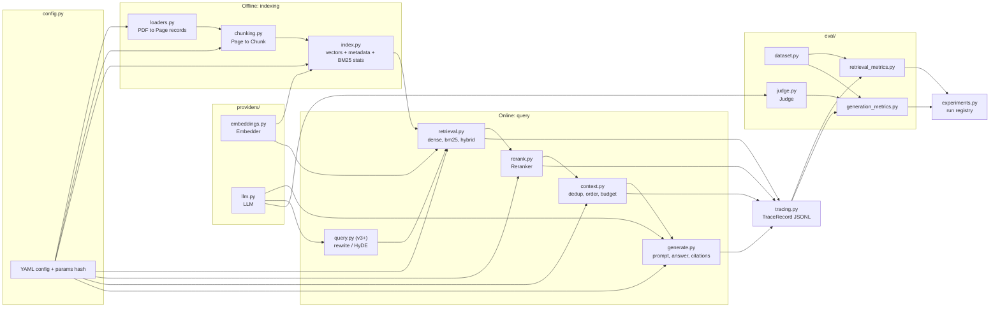
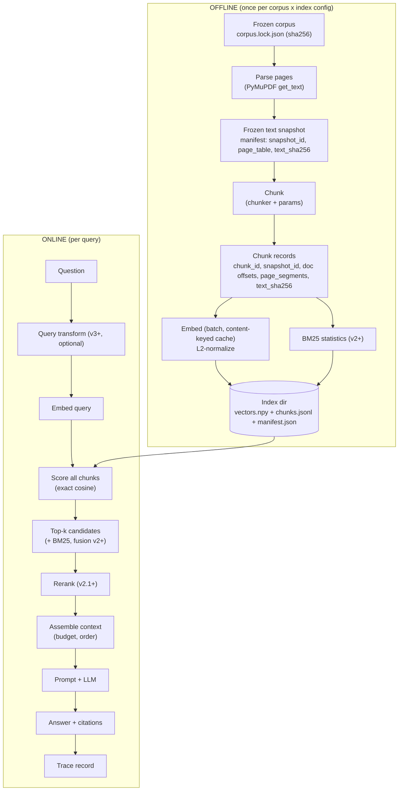

# 06 — Project & Evaluation Plan: "Ask My Technical PDFs"

> **Status:** first-stage design document. Nothing described here has been built or run yet. Every results table is an **empty template** marked *(not yet run)*.
> **Conforms to:** BACKBONE §4 (versions), §5 (corpus & eval design), §6 (environment, `ragkit/` layout). Deviations appear only as `> REVIEWER NOTE:` blocks.
> **Related deliverables:** concept IDs and phases → [02](02_RAG_MASTER_LEARNING_PLAN.md) · dependency graph → [03](03_RAG_CONCEPT_DEPENDENCY_MAP.md) · book↔repo mapping → [04](04_BOOK_TO_CODE_MAPPING.md) · review cadence and progress files → [05](05_LEARNING_AND_RETENTION_SYSTEM.md) · the C2/I1 chunking lesson and experiment → [07](07_SAMPLE_LESSON.md) · open decisions and gaps → [08](08_GAP_ANALYSIS_AND_DECISIONS.md) · source registry → [01](01_SOURCE_INVENTORY.md).

**Conventions used in this file**

| Marker | Meaning |
|---|---|
| `Ch4 p.3/15` | PDF page 3 of the 15-page file `chapter 4.pdf` (book). `App p.12/23` = `Appendix.pdf`. |
| `all_rag_techniques/x.ipynb cell 12` | 0-based cell index at pinned commit `009adba2`. `helper_functions.py:L48-L76` = line range. |
| `climate p.10` | PDF page 10 (1-based) of `data/Understanding_Climate_Change.pdf` (Corpus D). |
| **[N]** | *Necessary*: the design is wrong or unmeasurable without it. |
| **[P]** | *Preference*: a reasonable default; swap freely if you record the change. |
| **UNVERIFIED** | Not checked against a primary source or by running code. |
| **Assumption:** | A design premise that the learner should confirm or overturn. |
| **Source C** | External supplementary reference (not in the learner's files); numbers refer to the Source C reference list in [01](01_SOURCE_INVENTORY.md). |
| *toy illustration* | Numbers computed by hand/code for teaching only. Never a measured result. |

## Contents

1. [Goals and non-goals](#1-goals-and-non-goals)
2. [Architecture](#2-architecture)
3. [v0 baseline: exact specification](#3-v0-baseline-exact-specification)
4. [Version roadmap](#4-version-roadmap)
5. [Corpora](#5-corpora)
6. [Evaluation dataset](#6-evaluation-dataset)
7. [Metrics](#7-metrics)
8. [LLM-as-a-judge protocol](#8-llm-as-a-judge-protocol)
9. [Experiment protocol](#9-experiment-protocol)
10. [Implementation sequence and milestones](#10-implementation-sequence-and-milestones)
11. [Risks](#11-risks)
12. [Reviewer notes and open items](#12-reviewer-notes-and-open-items)

---

## 1. Goals and non-goals

**What the project is.** One evolving codebase, `rag_learning/ragkit/`, that answers questions over a small set of technical PDFs with page-level citations. Each curriculum phase adds one change (BACKBONE §4) and must prove its value on a frozen evaluation set against v0 and the previous best version. The project is how concepts become skills: every concept lesson ends in a change to this system or a measurement of it.

### Goals

| # | Goal | Evidence that it is met |
|---|---|---|
| G1 | A framework-free, readable pipeline whose every intermediate is inspectable (query → candidates → scores → context → prompt → answer → citations). | A trace record (§2.5) exists for every query; the learner can narrate one trace end to end (Gate 2→3). |
| G2 | **Measure before improving.** An evaluation harness exists before any technique is added. | v0.1 produces identical retrieval metrics on rerun (Gate 3→4). |
| G3 | Retrieval quality and answer quality are always reported **separately**. | Every `summary.md` has two metric blocks plus an ops block (§9.1). |
| G4 | Each technique is adopted or rejected on evidence from a controlled experiment that changes one variable. | Each version card in §4 has a filled hypothesis verdict, cost/latency delta and "when NOT to use". |
| G5 | Retrieval work stays cheap and can always run offline: the default Cohere embed calls (learner decision D-03) are cached by content (§2.4), and the local sentence-transformers fallback needs no key. LLM calls (Groq, D-04) only for generation; the automated judge runs once, at the end (D-10, §8). | Phases 1–3 and most of Phases 4–5 can run with no API key via the local embedding fallback (BACKBONE §6). |
| G6 | Ends with an evidence-backed architecture the learner can defend and transfer to an unseen corpus (K1). | Capstone defence on Corpus H. |

> Revised 2026-10-08 (learner decisions §L: D-03, D-04, D-10): G5 now names Cohere embed (default, cached) with a local no-key fallback, Groq for generation, and a single end-of-curriculum judge batch. See [corrections log](reviews/CORRECTIONS_LOG_2026-10-08.md#learner-decisions).

### Non-goals (explicit)

- **No UI before the capstone.** The interface is the Python API, the CLI and Jupyter. An optional Streamlit app is built only at K1 over the best evidence-backed configuration. A UI adds no learning about retrieval and hides intermediates.
- **No framework-first build.** LangChain/LlamaIndex are used only to *read* upstream code or as a parity reference (for example, comparing our recursive splitter with `RecursiveCharacterTextSplitter`). `ragkit` has no dependency on them.
- **No leaderboard chasing.** We do not claim any technique "improves accuracy" until our own experiment shows it on our data, with a confidence interval.
- **No scale engineering.** Corpora are a few hundred pages. ANN indexes, distributed stores, streaming ingestion and multi-tenant access control are discussed (P5, D4) but not built.
- **No agentic or specialized architecture on the critical path.** v7 picks exactly one control-flow technique; v8 is optional and gated by observed failures.
- **No reproduction of every upstream notebook.** About 36 of 46 upstream notebooks need an OpenAI key the learner does not have (BACKBONE §0). We port *ideas*, not notebooks.

---

## 2. Architecture

### 2.1 Component diagram (`ragkit/` modules, BACKBONE §6)



> REVIEWER NOTE: BACKBONE §6 lists no home for query transformations (v3) or grounding checks (v5). This plan adds `query.py` (v3.x) and puts citation verification, groundedness and abstention in `generate.py` plus `eval/judge.py`. A separate `grounding.py` may be cleaner once v5 grows. Adding modules does not rename any BACKBONE ID.

### 2.2 Data flow: offline vs online



Two rules follow from this split. **[N]** The index directory carries a `manifest.json` with the corpus hash, the text `snapshot_id` (§5.3), parser version, chunker name and parameters, embedding model id and revision, and a params hash. The online path refuses to load an index whose manifest does not match the run config. This prevents the classic silent bug of querying an index built with another chunker. Upstream `hierarchical_indices.ipynb` (and its runnable script) caches FAISS indexes under `../vector_stores` (the only files at the pinned commit that do, by grep), and the repo inventory notes that this cache must be deleted by hand whenever the embedding model changes. **[N]** Offline index directories are named by `snapshot_id` + params hash, so a grid experiment never overwrites another configuration's index and changed extracted text never reuses an old index. A config/params hash alone is **not** content addressing: chunk and artifact IDs are for joins and traces, never cache keys; the embedding cache is keyed by the embedded text itself (§2.4).

> Revised 2026-10-08 (Codex M-01, M-04): the offline flow now passes through a frozen text snapshot; index directories are namespaced by `snapshot_id`; content identity, not IDs or config hashes, keys caches. See [corrections log](reviews/CORRECTIONS_LOG_2026-10-08.md#m-01) and [M-04](reviews/CORRECTIONS_LOG_2026-10-08.md#m-04).

### 2.3 Provider-agnostic interfaces

All components are typed `Protocol`s, so a test can swap a provider for a fake and an experiment can swap one implementation without touching the rest. These are design sketches for Phase 2–3 (not code to paste today).

```python
# ragkit/types.py (sketch)
from dataclasses import dataclass, field
from typing import Protocol, Sequence, Literal, Any
import numpy as np

@dataclass(frozen=True)
class PageSegment:
    page: int                # 1-based PDF page
    char_start: int          # PAGE-relative offsets: a derived view of the document range
    char_end: int

@dataclass(frozen=True)
class Chunk:
    doc_id: str
    snapshot_id: str         # frozen-text snapshot (§5.3); changes whenever extracted text changes
    chunk_id: str            # f"{doc_id}:{snapshot_id}:{params_hash}:{seq:05d}"; for joins/traces, never a cache key
    seq: int                 # 0-based position in the document's chunk sequence
    char_start: int          # DOCUMENT offsets into doc_text (pages joined with "\n"); the canonical coordinates
    char_end: int
    page_segments: tuple[PageSegment, ...]   # one per page touched; a per-page chunk has exactly one
    text: str                # invariant: doc_text[char_start:char_end] == text
    text_sha256: str         # content identity; part of the embedding cache key (§2.4)
    chunker: str
    params_hash: str
    meta: dict = field(default_factory=dict)   # e.g. section heading

@dataclass
class Candidate:
    chunk: Chunk
    score: float
    rank: int                # 1-based, within the producing stage
    source: str              # "dense" | "bm25" | "fused" | "reranked"

class Embedder(Protocol):
    model_id: str
    dim: int
    max_seq_length: int | None                       # tokens; None if unknown
    def embed_documents(self, texts: Sequence[str]) -> np.ndarray: ...   # (n, dim), L2-normalized
    def embed_query(self, text: str) -> np.ndarray: ...                   # (dim,), L2-normalized
    def count_tokens(self, text: str) -> int: ...                         # the model's own tokenizer

class LLM(Protocol):
    model_id: str
    def complete(self, messages: list[dict], *, temperature: float = 0.0,
                 max_tokens: int = 512, seed: int | None = None) -> "LLMResult": ...
    # LLMResult: text, input_tokens, output_tokens, latency_ms, raw (provider response), cache_hit

class Retriever(Protocol):
    name: str
    def retrieve(self, query: str, k: int) -> list[Candidate]: ...

class Reranker(Protocol):
    name: str
    def rerank(self, query: str, candidates: list[Candidate], top_n: int) -> list[Candidate]: ...

class Judge(Protocol):
    name: str              # includes judge model id and prompt version
    def judge(self, task: Literal["correctness", "faithfulness", "citation"],   # abstention is deterministic, never judged (§8.4)
              *, question: str, answer: str, context: list[Chunk] | None = None,
              reference: str | None = None) -> "JudgeResult": ...
    # JudgeResult: label (e.g. 0/1 or 0/1/2), rationale, claims (list), raw, cache_key
```

Design choices worth defending (each a review question in [05](05_LEARNING_AND_RETENTION_SYSTEM.md)):

- `Embedder` has **separate** `embed_query` / `embed_documents` **[N]**. Asymmetric models need different prefixes or input types (Cohere's API takes an `input_type`; Source C #52), and hiding this in one `embed()` method causes silent quality loss.
- `Embedder.count_tokens` uses the **model's own tokenizer** **[N]**. It is what detects truncation. Character counts and tiktoken counts are only proxies (P1).
- `Candidate.rank` is **per stage**. Fusion (v2.0) consumes ranks, not raw scores, so ranks are first-class.
- `LLMResult` carries token counts and latency **[N]**. Cost and latency are metrics (§7.4), not afterthoughts.
- `Judge.name` includes the prompt version **[N]**. A judge prompt change is a change of measuring instrument and invalidates comparisons.
- `Chunk` uses **one canonical coordinate system**, document offsets into the snapshot's `doc_text` **[N]**; `page_segments` is the derived page view used for citations. Tests: `doc_text[char_start:char_end] == text`, and the segments convert back to the same document range (§9.6).
- **Two page→document decoders, one stated rule [N].** Authored **gold** segments (§6.4) must lie inside the physical page text, `0 ≤ char_start < char_end ≤ len(page_text)`, and are decoded with `gold_to_doc(page, start, end)`. **Chunk-derived** `page_segments` ([07 H.3](07_SAMPLE_LESSON.md)) may include the **virtual page-join character**, which is assigned to the preceding page, so a segment on any page before the last may end at `len(page_text) + 1`; they are decoded with `chunk_segment_to_doc(...)`, which permits exactly that one extra position. Coverage is always computed in **document offsets**, so the two decoders never need to agree on page-relative form. Example: pages `["abc","def"]` (`doc_text = "abc\ndef"`): a whole-document chunk gives page-1 segment [0,4), which `chunk_segment_to_doc` accepts; `gold_to_doc` rejects [0,4) on page 1 and accepts [0,3). Round-trip tests go **through these public decoders**, not raw offset arithmetic.
- `chunk_id` is namespaced by `snapshot_id` but is still **not** a cache key **[N]**. Same document and position with changed text must never hit an old embedding; the cache key includes `text` itself (§2.4).

> Revised 2026-10-08 (Codex M-01, M-04, M-06): `Chunk` now carries `snapshot_id`, `seq`, document offsets, `page_segments`, `text_sha256`, `chunker` and `params_hash` (replacing page-relative offsets and a hash-only id); the judge no longer handles abstention. See [corrections log](reviews/CORRECTIONS_LOG_2026-10-08.md#m-01), [M-04](reviews/CORRECTIONS_LOG_2026-10-08.md#m-04) and [M-06](reviews/CORRECTIONS_LOG_2026-10-08.md#m-06).

> Revised 2026-10-08 (Codex re-review R-05): gold segments (`gold_to_doc`, physical page text only) and chunk-derived page segments (`chunk_segment_to_doc`, may include the virtual page join) now have separate decoders; coverage is computed in document offsets. See [corrections log](reviews/CORRECTIONS_LOG_2026-10-08.md#r-05).

### 2.4 Configuration (YAML example)

One file fully determines a run. The `experiments.py` runner copies it into the run directory (§9.1) and hashes it.

```yaml
# experiments/E000_v0_baseline/config.yaml  (example; values are v0 defaults)
run:
  id: E000_v0_baseline
  version: v0
  seed: 0
  notes: "Baseline. No technique."
corpus:
  name: D
  lock_file: corpora/D/corpus.lock.json      # sha256 per file, see §5.4
  snapshot_manifest: evaluation/snapshots/D_<snapshot_id>.json   # frozen extracted text, §5.3  [N]
parsing:
  backend: pymupdf                            # [P] fitz page.get_text("text")
  mode: text
  record_version: true                        # pymupdf version goes into manifest  [N]
  cleaning: none                              # v0: offsets refer to raw extracted text; any cleaning step = new snapshot
chunking:
  name: recursive_char
  unit: chars                                 # chars | tokens  [N] always explicit
  chunk_size: 1000
  chunk_overlap: 200
  separators: ["\n\n", "\n", " ", ""]
  scope: per_page                             # per_page | cross_page
embedding:
  provider: cohere                            # learner decision D-03: Cohere embed is the default
  model_id: "${COHERE_EMBED_MODEL_ID}"        # set in .env; id and input limit UNVERIFIED until checked at O2 (E-3)
  revision: null                              # API model: record model id + date used in the manifest
  input_type: {documents: search_document, queries: search_query}   # [N] asymmetric inputs
  normalize: true
  batch_size: 64                              # [P]; check the provider's batch limit at O2
  fallback:                                   # local, no key: offline runs and second-model comparison
    provider: sentence_transformers
    model_id: sentence-transformers/all-MiniLM-L6-v2
    revision: 1110a243fdf4706b3f48f1d95db1a4f5529b4d41   # pin the HF snapshot  [N]
    device: auto                              # cpu | cuda | auto
retrieval:
  method: dense                               # dense | bm25 | hybrid
  similarity: cosine_exact                    # NumPy matrix product on normalized vectors
  k: 4
rerank: null                                  # v2.1: {name: cross_encoder, model_id: cross-encoder/ms-marco-MiniLM-L-6-v2, pool: 20}
context:
  max_context_tokens: null                    # v4.0 sets a budget
  order: rank                                 # rank | doc_order
generation:
  provider: groq                              # learner decision D-04: Groq for generation and all non-judge LLM calls
  model_id: "${GROQ_MODEL_ID}"                # set in .env; check https://console.groq.com/docs/models  [N] never hardcode
  temperature: 0.0
  max_tokens: 512
  reasoning_effort: low                       # gpt-oss: low | medium | high; always sent (omitted = Groq's server default, medium)
  prompt_template: prompts/answer_v1.txt
  prompt_version: answer_v1
cache:
  llm: .cache/llm                             # keyed by sha256(model_id|messages|params); params = temperature, max_tokens, reasoning_effort
  embeddings: .cache/emb  # keyed by sha256(provider|model_id|revision|input_type|preproc_version|text)
eval:
  dataset: evaluation/datasets/D_eval_v1.0.jsonl
  dataset_sha256: "<filled by runner>"        # comparison key (§6.6)
  snapshot_id: "<filled by runner>"           # must equal the index's snapshot_id, else scoring stops (§5.3)
  split: dev                                  # dev = selection; test touched once per selection round (§9.4)
  scoring: {scorer_version: "s1", chunk_relevance: "any_overlap", sufficiency: "complete_evidence", tolerance: "whitespace-only"}   # §7.2
  ks: [1, 3, 4, 5, 10]
  judge:                                      # learner decision D-10: NOT run per experiment
    provider: cohere                          # Cohere chat model: different family from the Groq generator (§8)
    model_id: "${COHERE_JUDGE_MODEL_ID}"      # UNVERIFIED; set at use
    prompt_version: judge_v1
    temperature: 0.0
    schedule: final_batch                     # once, at the end, over the stored traces of every version
```

> Revised 2026-10-08 (Codex M-01, M-02, M-04, M-05, M-06; learner decisions D-03, D-04, D-10): the config records the snapshot and `cleaning: none`; Cohere embed is the default with a pinned local fallback; the embedding cache key includes provider, input type, preprocessing version and text; the ambiguous `relevance_rule` is replaced by one `scoring` block; `snapshot_id` and `split` are comparison keys; the Cohere judge runs only in the final batch. See [corrections log](reviews/CORRECTIONS_LOG_2026-10-08.md#m-02), [M-01](reviews/CORRECTIONS_LOG_2026-10-08.md#m-01), [M-04](reviews/CORRECTIONS_LOG_2026-10-08.md#m-04), [M-05](reviews/CORRECTIONS_LOG_2026-10-08.md#m-05), [M-06](reviews/CORRECTIONS_LOG_2026-10-08.md#m-06), [learner decisions](reviews/CORRECTIONS_LOG_2026-10-08.md#learner-decisions).

> Revised 2026-10-09 (external-resources review §3a row 4): records C5's existing decision. `reasoning_effort: low` is now in the generation block and in the LLM cache key's params; the §2.5 `llm` object gains `max_tokens`, `reasoning_effort` and `finish_reason` (as C5 IA-6); §3.1 Generate, the §9.2 generator control and the §8.4 re-calibration triggers name the reasoning setting. Why: if the field is omitted, Groq's server applies its documented default `medium` (Groq API reference, read 2026-10-09; not measured), and §9.2 would still pass the run. See [review report](sources/EXTERNAL_RESOURCES_REVIEW_2026-10-09.md#3a-changes).

**Interface decisions (2026-10-08, Phase 2 lesson batch).** These were fixed when the C1–C6 lessons were written, so that every lab's output feeds the next lab:

| Item | Decision | Corpus D v0 value |
|---|---|---|
| `params_hash` | `sha256(json.dumps(chunking_block, sort_keys=True).encode("utf-8")).hexdigest()[:12]`. `chunking_block` is the `chunking:` mapping above, exactly as written, with these key names (not 07 H.3's `size`/`overlap`/`recursive`). | `1ca9c5a3b548` |
| `chunk_id` | `f"{doc_id}:{snapshot_id}:{params_hash}:{seq:05d}"` (§2.3) | `climate:ea07572562ac:1ca9c5a3b548:00000` … `00096` (97 chunks) |
| `embed_hash` | 12 hex of the sha256 of `json.dumps({provider, model_id, revision, input_type, normalize, preproc_version}, sort_keys=True)`; recorded in `manifest.json` | depends on the embedder |
| Index folder | `index/<snapshot_id>/<params_hash>/<embed_hash>/`, so two embedders never share a folder | — |
| Row alignment | `vectors.npy` row i ↔ line i of `chunks.jsonl`. `seq` restarts per document, so no code assumes `seq == i` | — |
| `.env` name | `COHERE_EMBED_MODEL_ID` (the older `COHERE_EMBED_MODEL` is kept with the same value) | — |

Lessons: [C2 lab](sources/verification/C2lab/C2LAB_FACTS.md), [C3](concepts/C3_embedding_indexing.md) Part H.4, [C4](concepts/C4_dense_retrieval.md), [C6](concepts/C6_v0_pipeline.md).

### 2.5 Trace record schema (one JSON object per query, appended to `results.jsonl`)

The example shows the **shape** only. All numbers are placeholders, not results.

> Revised 2026-10-08 (Codex M-01, M-04): the short `chunk_id` strings below are placeholders for the §2.3 format `{doc_id}:{snapshot_id}:{params_hash}:{seq:05d}`; candidate `char_start`/`char_end` are document offsets (§2.3) and `page` is the first page segment. A real trace also records the run's `snapshot_id`. See [corrections log](reviews/CORRECTIONS_LOG_2026-10-08.md#m-01).

```json
{
  "trace_version": "1.0",
  "run_id": "E020_v2.0_hybrid_rrf",
  "qid": "D-002",
  "timestamp_utc": "2026-10-08T12:00:00Z",
  "config_hash": "sha256:<...>",
  "index_manifest_hash": "sha256:<...>",
  "query": {
    "original": "In what year was the Paris Agreement adopted?",
    "transformed": [
      {"method": "none", "text": "In what year was the Paris Agreement adopted?"}
    ]
  },
  "candidates": {
    "dense": [
      {"rank": 1, "chunk_id": "a1b2c3d4e5f6", "doc_id": "climate", "page": 23, "char_start": 1900, "char_end": 2900, "score": 0.5},
      {"rank": 2, "chunk_id": "0f9e8d7c6b5a", "doc_id": "climate", "page": 10, "char_start": 200, "char_end": 1180, "score": 0.5}
    ],
    "bm25": [
      {"rank": 1, "chunk_id": "0f9e8d7c6b5a", "doc_id": "climate", "page": 10, "score": 0.0}
    ]
  },
  "fused": [
    {"rank": 1, "chunk_id": "0f9e8d7c6b5a", "rrf_score": 0.0, "ranks_by_source": {"dense": 2, "bm25": 1}}
  ],
  "reranked": [
    {"rank": 1, "chunk_id": "0f9e8d7c6b5a", "score": 0.0, "prev_rank": 1}
  ],
  "context": {
    "chunk_ids": ["0f9e8d7c6b5a", "a1b2c3d4e5f6"],
    "context_tokens": 0,
    "tokenizer": "model-tokenizer-or-tiktoken-name",
    "truncated_chunks": 0
  },
  "prompt": {"template_version": "answer_v1", "sha256": "<...>", "input_tokens": 0},
  "answer": {
    "text": "<model output>",
    "abstained": false,
    "citations": [{"marker": "[climate:10]", "doc_id": "climate", "page": 10, "resolved_chunk_ids": ["0f9e8d7c6b5a"]}],
    "output_tokens": 0
  },
  "latency_ms": {"query_transform": 0, "embed_query": 0, "dense": 0, "bm25": 0, "fusion": 0, "rerank": 0, "context": 0, "llm": 0, "total": 0},
  "cost_usd_estimate": {"llm": 0.0, "judge": 0.0, "price_table_version": "<date checked>"},
  "llm": {"provider": "groq", "model_id": "<...>", "cache_hit": false, "temperature": 0.0,
          "max_tokens": 512, "reasoning_effort": "low", "finish_reason": "stop"},
  "errors": []
}
```

Fields marked by role:

| Field | [N]/[P] | Why |
|---|---|---|
| `qid`, `config_hash`, `index_manifest_hash` | [N] | Joins the trace to the gold labels and to an exact configuration. |
| `query.transformed` | [N] from v3 | Without it, a query-side failure looks like a retriever failure. |
| per-retriever `candidates` with scores **and** ranks | [N] | Enables fusion diagnosis and "right doc, wrong rank" analysis (v2.1). |
| `fused.ranks_by_source` | [N] from v2 | Explains *why* a chunk was promoted. |
| `context.context_tokens`, `truncated_chunks` | [N] | Equal-budget comparisons and truncation audits. |
| `prompt.sha256` | [N] | Detects silent prompt drift between runs. |
| `llm.max_tokens`, `llm.reasoning_effort`, `llm.finish_reason` | [N] | Both settings change the answer. `finish_reason` "length" marks an answer cut at the cap, which otherwise looks like a citation failure (C5 D.6). |
| full prompt text | [P] | Store only for failing items or in debug mode; it is large. |
| `latency_ms` per stage | [N] | p50/p95 per stage (§7.4). |
| `cost_usd_estimate` | [N] | Price table version must be recorded; prices change. |

---

## 3. v0 baseline: exact specification

v0 is deliberately simple. Its job is to be **correct, traceable and measurable**, not good. Each later version is compared against it.

### 3.1 Stage-by-stage specification

| Stage | v0 specification | [N]/[P] | Source / rationale |
|---|---|---|---|
| Load | PyMuPDF `page.get_text("text")` per page → `Page(doc_id, page=1-based, text, parser="pymupdf <version>")`; pages joined with `"\n"` into `doc_text` and frozen as a snapshot (§5.3). **Cleaning: none**, so offsets refer to the raw extracted text. Upstream replaces only tabs (`helper_functions.py:L18-L31`); adopting that, or any cleaning step, is recorded in the snapshot manifest and creates a new snapshot. | Parser choice [P]; page provenance [N] | Book: parsing quality limits retrieval quality (Ch1 p.4/14). Repo `encode_pdf` uses `PyPDFLoader` (`helper_functions.py:L48-L76`), while `read_pdf_to_string` uses `fitz` but concatenates pages and **loses page numbers** (`helper_functions.py:L223-L245`). v0 keeps pages. |
| Chunk | Recursive character splitter, separators `["\n\n", "\n", " ", ""]`, `chunk_size=1000`, `chunk_overlap=200`, **unit = characters**, `scope=per_page` (a chunk never crosses a page boundary). Chunk ids deterministic. | Values [P]; explicit unit and offsets [N] | Book gives about 1,000 characters with 200 overlap as a common default (Ch1 p.4/14). Repo default `encode_pdf(path, chunk_size=1000, chunk_overlap=200)` with `length_function=len` (`helper_functions.py:L48`, `L66-L68`), applied to per-page documents. Per-page scope makes `[doc:page]` citations exact; its cost (facts cut at page breaks) is studied in I1/I2. See [07](07_SAMPLE_LESSON.md). |
| Embed | Default **Cohere embed** (learner decision D-03), model id from `.env` (`COHERE_EMBED_MODEL_ID`), `input_type` = `search_document` for chunks and `search_query` for questions, normalized; cached by content (§2.4). **Fallback:** local `sentence-transformers/all-MiniLM-L6-v2` (offline runs, second-model comparison); `BAAI/bge-small-en-v1.5` is another local option. | Model [P] (learner decision); input type and normalization [N] | See §3.2 for limits; Cohere input types: Source C #52. |
| Index | `vectors.npy` (float32, n×d), `chunks.jsonl`, `manifest.json`. | [N] manifest | §2.2. |
| Retrieve | Exact cosine: `scores = V @ q` with V and q L2-normalized; `argpartition` then sort; **k = 4**. Ties broken by `chunk_id` for determinism. | Exact search [P] at this scale; deterministic ties [N] | Repo `simple_rag.ipynb` cell 13 uses `k=2`; BACKBONE fixes k=4 for v0. A corpus of ~100–1,000 chunks needs no ANN index. |
| Generate | Groq chat model (learner decision D-04), id from `.env` (`GROQ_MODEL_ID`), `temperature=0`, `max_tokens=512`, `reasoning_effort="low"`, prompt below. | Provider [P]; temperature 0 [N] for repeatability | Groq deprecates models (environment inventory, risk 4), so the id is configuration, never code. |
| Log | Full trace record (§2.5) for every query. | [N] | D1 starts at v0, not v6. |

> Revised 2026-10-08 (Codex M-01; learner decisions D-03, D-04): Load now freezes a snapshot with no cleaning (the tab replacement became an optional, recorded cleaning step); Embed names Cohere embed as default with a local fallback; Generate records the Groq decision. See [corrections log](reviews/CORRECTIONS_LOG_2026-10-08.md#m-01) and [learner decisions](reviews/CORRECTIONS_LOG_2026-10-08.md#learner-decisions).

### 3.2 Embedding model facts and the truncation trap

| Model | Max sequence length | Dim | Status |
|---|---|---|---|
| Cohere embed (default, D-03; id from `COHERE_EMBED_MODEL_ID`) | **UNVERIFIED**: read from Cohere's documentation/API at O2 and recorded (E-3) | UNVERIFIED | Not yet checked. Truncation behaviour and rate are re-measured for this model at O2/C3. |
| `sentence-transformers/all-MiniLM-L6-v2` (local fallback) | **256 tokens** (`max_seq_length` in `sentence_bert_config.json`; the underlying BERT has `max_position_embeddings` 512) | 384 (mean pooling) | **Verified 2026-10-08** by reading the local Hugging Face cache, snapshot `1110a243fdf4706b3f48f1d95db1a4f5529b4d41` (`~/.cache/huggingface/hub/models--sentence-transformers--all-MiniLM-L6-v2/`). This fact is not in the inventory files. |
| `BAAI/bge-small-en-v1.5` | **512 tokens** (CLS pooling, normalized) | 384 | Read from the fetched config and model card (revision `5c38ec7c…`) in the C2 lesson lab, 2026-10-08; see [07 Part D.6](07_SAMPLE_LESSON.md#d6-embedding-truncation-the-hard-ceiling). The model card recommends a query instruction prefix for short queries. Runtime truncation was not executed. |
| `cross-encoder/ms-marco-MiniLM-L-6-v2` (v2.1 reranker) | Underlying `max_position_embeddings` 512 (local cache, verified); effective max length used by `CrossEncoder` UNVERIFIED | — | Model used by the repo (`reranking.ipynb` cell 27). |

**Why this matters for v0 and v1.0.** Text past the limit is **silently ignored** when a chunk is embedded. Measured on Corpus D with MiniLM's own WordPiece tokenizer (per-page split, PyPDFLoader text; [07 Part D.6](07_SAMPLE_LESSON.md#d6-embedding-truncation-the-hard-ceiling)): at 1000/200 the longest chunk is 182 tokens, so v0 truncates nothing; at 1500/300, 4 of 65 chunks exceed 256; at 2000/400, 32 of 65 do. In the v1.0 chunk-size grid, 1,500- and 2,000-character chunks would therefore be compared partly on *truncated* text, which confounds "bigger chunk" with "chunk the model could not fully read". Corpus T may differ, so re-measure there. These MiniLM numbers describe the local fallback and upstream parity; they are **not** the default model's numbers.

- **[N]** v0.1 logs `truncated_chunks` (count of chunks whose model-token count exceeds `max_seq_length`) and v1.0 reports the truncation rate per configuration.
- **Learner decision D-03 (2026-10-08):** Cohere embed is the default; local sentence-transformers is the fallback (offline runs and a second-model comparison). The Cohere model's input limit and its truncation rate at 1,000 characters are re-measured at O2/C3 (E-3) and recorded in [08](08_GAP_ANALYSIS_AND_DECISIONS.md); if truncation is non-trivial, decide the chunk-size ceiling or the model **before** v1.0. Never switch the embedding model inside one experiment.

> Revised 2026-10-08 (learner decision D-03): Cohere embed added as the default model with UNVERIFIED limits to be measured at O2/C3; MiniLM/bge rows kept as fallback and illustration; the "MiniLM stays the default" assumption is replaced. See [corrections log](reviews/CORRECTIONS_LOG_2026-10-08.md#learner-decisions).

### 3.3 v0 prompt template (`prompts/answer_v1.txt`)

```text
SYSTEM:
You answer questions using ONLY the numbered sources below.
Rules:
1. Every factual sentence must end with one or more citations in the form [doc_id:page],
   copied exactly from the source headers, e.g. [climate:10].
2. If the sources do not contain the answer, reply exactly:
   "I cannot answer this from the provided documents."
   Do not use outside knowledge.
3. Do not cite a source that does not support the sentence.
4. Be concise: at most 5 sentences.

USER:
Sources:
[1] (climate:10)
<chunk text>

[2] (climate:23)
<chunk text>
...

Question: <question>
Answer:
```

Design notes:

- Sources are **numbered for the reader** and **cited by `[doc_id:page]`**, so a citation resolves to a page a human can open without a lookup table. If two retrieved chunks share a page, the citation resolves to both chunk ids (`resolved_chunk_ids` in the trace). Citation *verification* is v5.0's job; v0 only records citations.
- The fixed abstention string makes abstention **machine-detectable** (exact match after normalization), so abstention metrics can be computed from v0.1 onward. That gives v5.0 (V3) a baseline to beat. The string is v0's only abstention policy: no thresholds, no grader.
- The prompt does not ask for chain-of-thought. It costs tokens and complicates claim extraction. Revisit only with evidence.

### 3.4 What v0 deliberately does **not** do

These are known weaknesses, each owned by a later version. Fixing them in v0 would remove the baseline needed to show improvement.

| Not in v0 | Owned by |
|---|---|
| Header/footer stripping, de-hyphenation, two-column handling | C1 lab analysis; v1.1 (structure-aware) |
| Lexical (BM25) matching for exact terms | v2.0 |
| Reranking | v2.1 |
| Context budget, dedup, neighbour expansion | v4.0 |
| Groundedness check, citation verification, score-threshold abstention | v5.0 |

---

## 4. Version roadmap

### 4.1 Overview (from BACKBONE §4; failure buckets map to App p.4/23 symptom families and M5)

```mermaid
flowchart LR
    v0["v0 baseline"] --> v01["v0.1 eval harness"]
    v01 --> v1["v1.x indexing<br/>(chunking)"]
    v1 --> v2["v2.x retrieval<br/>(hybrid, rerank, filter, MMR)"]
    v2 --> v3["v3.x query-side<br/>(rewrite, HyDE)"]
    v3 --> v4["v4.x context<br/>(window, budget, compression)"]
    v4 --> v5["v5.0 grounding<br/>(citations, abstention)"]
    v5 --> v6["v6.0 observability, CI"]
    v6 --> v7["v7.0 ONE of CRAG or routing"]
    v7 -.->|"only if multi-hop or global questions fail"| v8["v8 optional<br/>Graph RAG or RAPTOR"]
    v7 --> K["Capstone<br/>optional Streamlit UI"]
    v8 -.-> K
```



**Rules that apply to every card below**

1. **Baselines:** compare against **v0** *and* the **previous best** (the "champion"), on the same frozen corpus and with **identical comparison keys**: `dataset_sha256`, `snapshot_id`, qid set, labels, split and `scorer_version` (§6.6). The runner rejects anything else.
2. **One variable.** If a change unavoidably moves two things (for example, a smaller chunk size also changes context tokens at fixed k), add a second comparison that holds the other one fixed (equal-token-budget comparison).
3. **Report** retrieval metrics, generation metrics and ops metrics in separate blocks, overall and per category.
4. **Decide with a pre-registered rule.** Write the hypothesis, primary metric and decision threshold in `summary.md` **before** running. Adopt only if the paired 95% bootstrap CI of the primary metric's difference excludes 0 in the predicted direction **and** no guard metric regresses beyond its tolerance (§9.4). Candidates are **selected on dev**; the chosen one is confirmed **once on test** per selection round, and the touch is logged (§9.4).
5. A version that fails its experiment is still a successful lesson. The champion simply stays.
6. **Retrieval primary metric = CE@k** (Complete-Evidence@k, §7.3); Hit@k, MRR and nDCG are first-evidence diagnostics. **Generation metrics before the final judge batch** come from deterministic checks plus human reading of ~10 answers per version (and human labels where a card needs them); generation-dependent adoptions in Phases 7–8 are provisional and may be revised by the final judge batch (§8, D-10).

> Revised 2026-10-08 (Codex M-02, M-05, M-06): comparability is defined by identical comparison keys, selection is on dev with a single logged test confirmation, CE@k is the retrieval primary metric, and per-version judge metrics are replaced by human reading until the final judge batch. See [corrections log](reviews/CORRECTIONS_LOG_2026-10-08.md#m-05), [M-02](reviews/CORRECTIONS_LOG_2026-10-08.md#m-02) and [M-06](reviews/CORRECTIONS_LOG_2026-10-08.md#m-06).

Card fields: **Problem** (observable failure bucket) · **Hypothesis** · **Change** (single variable) · **Experiment** · **Cost/latency/complexity** · **When NOT to use** · **Results** · **Verdict**. Results and Verdict (supported / not supported / inconclusive, by the pre-registered rule) stay placeholders until the run's `summary.md` exists ([§9.1](#91-run-registry-layout)). v0 has no hypothesis: it is the reference point (§3).

### 4.2 Version cards

#### v0.1 — Evaluation harness (M1–M5). No pipeline change.

- **Problem:** "can't measure". Upstream evaluation generates fresh LLM questions each run, has no ground truth, and its averaging function is a stub (`evaluation/evalute_rag.py:L133-L138`, `L160-L163`). No repo code computes Recall@k, MRR or nDCG (BACKBONE §0; details in [01](01_SOURCE_INVENTORY.md)).
- **Hypothesis:** the harness is deterministic. Two runs of v0 give bit-identical retrieval metrics (CE@k, Hit@k, MRR) against the same snapshot and dataset hash.
- **Change:** add `eval/` modules, the snapshot manifest (§5.3), the frozen dataset with its dev/test/holdout split recorded (§6) and run registry (§9). The pipeline is untouched.
- **Experiment:** run v0 twice from a clean cache. Retrieval metrics must be identical. Generation quality is covered by a **human-labelled pilot** on v0 outputs (≥ 30 answer-level labels, §8.4); the automated judge, and its repeat variance, run only in the final batch (D-10). Error-bucket every v0 failure with the M5 taxonomy.
- **Cost:** retrieval evaluation is cheap (cached Cohere embeddings, or free with the local fallback). One generation pass is about 50–60 LLM calls; no judge calls at this stage (§8.6).
- **When NOT to use:** never skip it. A prototype "spot check" is acceptable only before v0 is finished (Ch22 p.17/19 lists proof-of-concept prototypes and very small, manually checkable knowledge bases as cases where formal evaluation can be overkill; Corpus D is small, but this project evaluates anyway because learning to measure is its purpose).
- **Deliverable:** `experiments/E001_v0.1_harness/summary.md` with the v0 failure-bucket table, which then **selects** which v1–v3 cards are worth running.
- **Results:** *(not yet run)*
- **Verdict:** *(pending)*

> Revised 2026-10-08 (Codex M-06; M-01, M-05): v0.1 no longer certifies or repeats a judge; it delivers a human-labelled generation pilot, a snapshot-bound dataset and a recorded split. See [corrections log](reviews/CORRECTIONS_LOG_2026-10-08.md#m-06).

#### v1.0 — Chunk size / overlap grid (I1). Detailed lesson: [07](07_SAMPLE_LESSON.md).

- **Problem:** *dilution* (one small fact inside a large chunk ranks low) vs *fragmentation* (evidence split across chunks, each incomplete).
- **Hypothesis (examples to pre-register):** H1: on factual-single-span questions, 400-character chunks raise MRR vs 1,000. H2: on multi-span questions, small chunks lower CE@k at fixed k but not at equal context-token budget. H3: overlap 200 vs 0 changes CE@4 by less than a pre-set margin on this corpus.
- **Change:** `chunk_size ∈ {200, 400, 800, 1000, 1500, 2000}` chars × `overlap ∈ {0, 10%, 20%}`, plus per-page vs cross-page, plus one token-unit configuration. Everything else is fixed.
- **Experiment:** primary metric CE@4 (Complete-Evidence@4, §7.3); Span-Coverage@4 as a continuous diagnostic. Guard metrics: MRR, nDCG@10, mean context tokens. Grid selection on dev; the chosen configuration is confirmed once on test (§9.4). Two comparison modes: **fixed k** and **equal context-token budget** (choose k per configuration so mean context tokens are equal). Report the truncation rate (§3.2), number of chunks and index build time. Categories that matter: factual-single-span, multi-span, table/numeric. Generation metrics only for the top 2–3 configurations (cost).
- **Cost/latency:** indexing only. Smaller chunks mean more vectors and longer build; query latency is roughly unchanged at this scale.
- **When NOT to use (a grid):** when the corpus is tiny and pages are already the natural unit (page-level retrieval may be enough; the Source C #28 vendor blog reports page-level chunking strong on its datasets, an external claim we have not tested).
- **Results:** *(not yet run)*
- **Verdict:** *(pending)*

> Revised 2026-10-08 (Codex M-02, M-05): primary metric "Recall@4 (span coverage)" → CE@4 with Span-Coverage@4 as a diagnostic, here and in the v1.1–v3.1 cards below; grid selection on dev, one test confirmation. See [corrections log](reviews/CORRECTIONS_LOG_2026-10-08.md#m-02).

#### v1.1 — Structure-aware chunking (I2)

- **Problem:** chunks that start mid-section or mix two headings; facts cut at page breaks (per-page scope).
- **Hypothesis:** splitting on detected headings (font-size/bold spans from PyMuPDF `get_text("dict")`) with cross-page continuation raises CE@k on multi-span and section-scoped questions without hurting factual-single-span.
- **Change:** chunker only (`structure_aware`), with size cap = champion size from v1.0.
- **Experiment:** vs v0 and v1.0 champion at fixed k and equal budget. Watch the two-column layouts in Corpus T. Inspect 10 random chunks by eye before measuring, since parsing errors create false negatives.
- **Cost:** offline only; implementation complexity moderate (layout heuristics are corpus-specific).
- **When NOT to use:** documents without reliable typographic structure (scans, flat text); heuristics tuned on one corpus may not transfer (test on H at capstone).
- **Results:** *(not yet run)*
- **Verdict:** *(pending)*

#### v1.2 — Contextual chunk headers (I5; book Ch7; repo `contextual_chunk_headers.ipynb`)

- **Problem:** a chunk that is ambiguous out of context ("it", "this protocol") does not match a question that names the subject.
- **Hypothesis:** prepending `doc title > section heading` (deterministic, no LLM) to the text that is **embedded** (not to the text shown to the LLM) raises CE@k on vocabulary-mismatch and near-duplicate-distractor items. An LLM-written context header (Source C #31, external) is a second arm only if the deterministic arm helps.
- **Change:** embedding input only.
- **Experiment:** primary CE@4; check precision on near-duplicate pages (climate p.10 vs p.23): headers could *help* (different chapter titles) or *hurt* (same subheading "Paris Agreement" on both).
- **Cost:** deterministic arm is almost free; LLM arm costs one call per chunk at index time.
- **When NOT to use:** when chunks are already self-contained, or headings are missing or noisy.
- **Results:** *(not yet run)*
- **Verdict:** *(pending)*

#### v1.3 — Semantic chunking (I3; book Ch9; repo `semantic_chunking.ipynb`)

- **Problem:** fixed windows cut through ideas.
- **Hypothesis:** breakpoints at embedding-distance peaks (the repo uses `SemanticChunker` with a percentile threshold of 90, `semantic_chunking.ipynb` cell 12) raise CE@k at **equal context-token budget** vs the v1.0 champion. Appendix A recommends semantic chunking as a high-leverage addition (App p.12/23); this is a claim to test, not to assume.
- **Change:** chunker only. Chunk-size distribution is reported because semantic chunks vary widely in size (and can exceed the embedder limit).
- **Cost:** one embedding per sentence at index time; no query-time cost.
- **When NOT to use:** if the equal-budget comparison shows no gain, the extra index cost and size variance are not justified.
- **Experiment:** vs the v1.0 champion at fixed k **and** at equal context-token budget. Primary CE@4 (Span-Coverage@4 as a diagnostic); guards MRR@10, mean context tokens, truncation rate. Record which embedder computes the breakpoints. Sweep the percentile threshold only if the first arm is promising (each extra arm adds a multiple comparison, §9.4).
- **Results:** *(not yet run)*
- **Verdict:** *(pending)*

#### v1.4 — Proposition chunking on a subset (I4; book Ch4; repo `proposition_chunking.ipynb`)

- **Problem:** dense paragraphs where each sentence carries several facts; exact factual lookups miss.
- **Hypothesis:** indexing LLM-extracted atomic propositions (pointing back to the source span) raises MRR on factual-single-span items for the chosen subset.
- **Change:** index unit only, on a **subset** (for example, 5 pages) to cap cost; the eval subset is restricted to questions whose gold is on those pages.
- **Cost:** high. One structured LLM call per chunk to generate propositions (`proposition_chunking.ipynb` cells 12-13) plus an LLM grader that scores propositions on four 1-10 criteria (cell 15 defines it; cell 16 calls it once per proposition, static reading). Propositions can be wrong; measure proposition faithfulness on a sample.
- **When NOT to use:** large or frequently changing corpora; synthesis questions (atomic facts lose relations).
- **Experiment:** on the subset only. Arms: v1.0 champion chunks vs propositions (each pointing to its source span). Primary MRR@10 on factual-single-span; guards CE@4 on multi-span, proposition faithfulness on a hand-checked sample, index-time LLM calls. Query latency is unchanged per query; the index grows.
- **Results:** *(not yet run)*
- **Verdict:** *(pending)*

#### v2.0 — BM25 + dense hybrid with Reciprocal Rank Fusion (R1; book Ch12; repo `fusion_retrieval.ipynb`)

- **Problem:** exact-term misses: acronyms (DAC, HFCs, NDCs), numbers, function names, rare proper nouns that embeddings blur.
- **Hypothesis:** RRF over dense and BM25 top-50 lists raises CE@4 on exact-term and table/numeric items without lowering it on vocabulary-mismatch items.
- **Change:** retrieval only. `RRF(d) = Σ_s 1 / (k_rrf + rank_s(d))`, `k_rrf = 60` (Cormack et al. 2009, Source C #33). Weighted score fusion is a second arm.
- **Experiment:** three arms (dense, BM25 alone, hybrid). Per-category reporting is essential. Note that the upstream weighted fusion in `fusion_retrieval.ipynb` cell 17 combines score arrays that are not aligned to the same documents (BACKBONE §0, static reading; runtime UNVERIFIED). Do not port it; write a unit test that fusion preserves chunk identity.
- **Cost:** BM25 is local and cheap; tokenization choices (lowercasing, punctuation, stemming) are a hidden variable to record.
- **When NOT to use:** if the question set has no exact-term needs, or when BM25 tokenization fails on the language or domain (code, formulas).
- **Results:** *(not yet run)*
- **Verdict:** *(pending)*

#### v2.1 — Cross-encoder reranking (R3; book Ch13; repo `reranking.ipynb`)

- **Problem:** "right document, wrong rank". Gold is in the top 20 but not in the top 4 (diagnosed from Hit@20 vs Hit@4 in v0.1 traces).
- **Hypothesis:** reranking a pool of 20 with `cross-encoder/ms-marco-MiniLM-L-6-v2` (local; the repo's model, `reranking.ipynb` cell 27) raises MRR and Hit@4. **Ceiling:** reranking cannot help when the gold chunk is outside the pool, so report pool sufficiency (CE@20 on the candidate pool) next to it.
- **Change:** add a reranker; pool size as a secondary sweep `{10, 20, 50}`.
- **Experiment:** arms: champion vs champion + reranker at each pool size, at fixed k = 4. Primary MRR@10; guards Hit@4, CE@4, CE@pool (the ceiling), p95 latency. Report generation metrics only for the chosen pool size.
- **Cost:** about one cross-encoder forward pass per (query, candidate); a latency increase, larger on CPU. Measure p95. Optional Cohere rerank (API; Source C #53) as a second arm only if the key and budget allow.
- **When NOT to use:** latency-critical paths where Hit@4 is already near Hit@pool; domains far from MS MARCO (test before trusting).
- **Results:** *(not yet run)*
- **Verdict:** *(pending)*

#### v2.2 — Metadata filtering (R2; repo `multi_faceted_filtering.ipynb`; no book chapter)

- **Problem:** wrong-scope retrieval: the question names a document, section or year, but chunks from other documents rank higher (expected, not yet observed, in multi-document Corpus T).
- **Hypothesis:** a rule-based filter (doc_id or section extracted from the question) raises Precision@4 on scope-specified questions with no loss elsewhere.
- **Change:** pre-filter on metadata before scoring. Report how often the filter removes the gold chunk (a filter error is a hard failure).
- **When NOT to use:** single-document corpora (Corpus D), or when metadata is unreliable.
- **Experiment:** Corpus T only (Corpus D is a single document). Arms: no filter, rule-based filter, and an oracle filter (gold doc_id supplied) as an upper bound. Primary Precision@4 on scope-specified items; guards CE@4 on all items and the filter-removed-gold rate.
- **Cost/latency/complexity:** negligible query-time cost; the complexity is in reliable metadata at index time and in parsing scope out of the question.
- **Results:** *(not yet run)*
- **Verdict:** *(pending)*

#### v2.3 — MMR diversity (R4; book Ch15 Dartboard; repo `dartboard.ipynb`)

- **Problem:** redundancy: the top-4 holds near-duplicates (climate p.8 vs p.22–23 smart grids; p.10 vs p.23 Paris Agreement), wasting context on repeats and crowding out complementary evidence.
- **Hypothesis:** MMR (λ swept over `{0.5, 0.7, 0.9}`) raises CE@4 on multi-span items and reduces a redundancy measure (mean pairwise cosine within the top-4).
- **When NOT to use:** single-span lookups, where diversity can push the best chunk out.
- **Change:** re-select the final top-4 from a dense top-20 pool; scoring model unchanged.
- **Experiment:** arms: champion vs MMR at each λ. A Dartboard-style arm is optional and must be reimplemented (upstream `dartboard.ipynb` cell 25 passes a wrong keyword, BACKBONE §0). Primary CE@4 on multi-span; guards MRR@10 on factual-single-span and the redundancy measure. Hit@4 and CE@4 can move in opposite directions here; report both.
- **Cost/latency/complexity:** extra pairwise similarity computations over the pool per query (needs stored chunk vectors); expected to be small at this corpus size, but measure p95.
- **Results:** *(not yet run)*
- **Verdict:** *(pending)*

#### v3.0 — Query rewriting / decomposition (Q1; book Ch5; repo `query_transformations.ipynb`)

- **Problem:** vocabulary mismatch and multi-part questions that **still fail after v2** (applied only to those categories, per BACKBONE §4).
- **Hypothesis:** an LLM rewrite (or decomposition into sub-queries whose candidate lists are merged with RRF) raises CE@4 on vocabulary-mismatch and multi-hop items.
- **Change:** query-side only (`query.py`); the transformed queries are logged in the trace.
- **Cost:** +1 LLM call per query (+n retrievals for n sub-queries); added latency on the critical path.
- **When NOT to use:** questions that already succeed (rewrites can drift from intent); exact-term queries (rewrites may paraphrase away the key term). Measure regression on those categories.
- **Experiment:** arms: champion vs rewrite vs decomposition (sub-query lists merged with RRF). Run on the failing categories **and** on all categories as a regression guard. Temperature 0 and cached LLM calls so reruns are identical. Primary CE@4 on vocabulary-mismatch and multi-hop; guards CE@4 on exact-term, p95 latency, LLM cost per query.
- **Results:** *(not yet run)*
- **Verdict:** *(pending)*

#### v3.1 — HyDE (Q2; book Ch6; repo `HyDe_Hypothetical_Document_Embedding.ipynb`)

- **Problem:** short, abstract questions far from the document's phrasing.
- **Hypothesis:** embedding an LLM-written hypothetical answer passage (Gao et al. 2022, Source C #32) instead of the question raises CE@4 on vocabulary-mismatch items.
- **Experiment:** also compare with index-time question generation (I6/HyPE), which moves the same idea from query time to index time; that compares *where cost is paid*.
- **When NOT to use:** questions about facts the LLM does not know or will confidently fabricate (the hypothetical document misleads retrieval), and strict latency budgets.
- **Change:** query-embedding input only: the hypothetical passage replaces (or is averaged with) the question embedding; record which.
- **Cost/latency/complexity:** +1 LLM generation per query **before** retrieval (on the critical path); p95 latency and cost per query are guard metrics.
- **Results:** *(not yet run)*
- **Verdict:** *(pending)*

#### v4.0 — Context assembly: window enrichment, dedup, budget (X1, X3; book Ch8; repo `context_enrichment_window_around_chunk.ipynb`)

- **Problem:** the retrieved chunk is right but lacks surrounding sentences ("missing surrounding context"); duplicate or overlapping chunks waste budget; context order may matter (Lost in the Middle, Source C #39).
- **Hypothesis:** expanding each hit by ±1 neighbour chunk and merging overlaps, under a fixed token budget, raises answer correctness and faithfulness at equal context tokens. Top-k retrieval metrics are unchanged by construction, but **CE on the final assembled context** can change (budgeting and dedup can drop evidence), so it is reported too.
- **Change:** `context.py` only. This version mainly moves **generation** metrics, a good place to show why retrieval and answer quality are separate.
- **Experiment:** arms: champion context vs ±1 neighbour window vs window + dedup, all at **equal context-token budget**. Primary answer correctness and faithfulness, measured by **human labels** on the changed answers until the final judge batch (D-10; the adoption is provisional until then); guard citation precision and **CE on the final assembled context**. Report top-k retrieval metrics only to confirm they did not change.
- **Cost/latency/complexity:** no extra LLM calls; prompt tokens grow unless the budget is held fixed; low implementation complexity (needs sequential chunk ids).
- **When NOT to use:** when chunks are already large relative to the budget, or when neighbours are usually unrelated (lists, tables of unrelated rows), where expansion only adds noise.
- **Results:** *(not yet run)*
- **Verdict:** *(pending)*

> Revised 2026-10-08 (Codex M-02, M-06): context-assembly versions also report CE on the final assembled context (this also covers part of minor m-06); generation metrics use human labels until the final judge batch, so the adoption is provisional. See [corrections log](reviews/CORRECTIONS_LOG_2026-10-08.md#m-02) and [M-06](reviews/CORRECTIONS_LOG_2026-10-08.md#m-06).

#### v4.1 — Contextual compression (X2; book Ch10; repo `contextual_compression.ipynb`)

- **Problem:** noisy context: long chunks where only one sentence is relevant.
- **Hypothesis:** LLM extraction of relevant sentences cuts context tokens substantially with no drop in answer correctness.
- **Cost:** +1 LLM call per retrieved chunk (or one batched call); risk that compression drops evidence. Measure the evidence-retention rate as **CE on the final (compressed) context** versus CE before compression (§7.2).
- **When NOT to use:** when context tokens are not a binding cost; when exact wording matters (legal, numeric).
- **Change:** post-retrieval, pre-prompt text transformation only (`context.py`); retrieval unchanged.
- **Experiment:** arms: v4.0 champion vs compression. Primary: mean context tokens and answer correctness (a two-sided claim, so both are pre-registered); guards: evidence-retention rate (CE on the final context), faithfulness (human labels until the final judge batch, D-10), p95 latency.
- **Results:** *(not yet run)*
- **Verdict:** *(pending)*

> Revised 2026-10-08 (Codex M-02, M-06): evidence retention is defined as CE on the final compressed context; faithfulness is human-labelled until the final judge batch. See [corrections log](reviews/CORRECTIONS_LOG_2026-10-08.md#m-02).

#### v5.0 — Grounding: citation verification, groundedness check, abstention (V1–V3; book Ch3, Ch19; repo `reliable_rag.ipynb`, `explainable_retrieval.ipynb`)

- **Problem:** unsupported claims; wrong or decorative citations; answering unanswerable questions.
- **Hypothesis:** (a) a post-generation check that each cited chunk supports its sentence, with unsupported sentences removed or flagged, raises citation precision and faithfulness. (b) An abstention policy (retrieval-score threshold calibrated on a dev split, plus an LLM relevance grade as in Ch3) raises abstention F1 without cutting answerable-question correctness by more than a pre-set tolerance.
- **Experiment:** abstention is a trade-off: report the precision–recall curve over thresholds on unanswerable vs answerable items, not a single point. Calibrate on a **dev split** and report on the **test split** to avoid tuning on the test set. **No abstention-threshold claim** until the set has ≥ 15 unanswerable items with ≥ 5 in dev (Assumption/[P], §8.4); below that, report the curve as exploratory. Citation precision and faithfulness are human-labelled until the final judge batch (D-10), so (a) is provisional until then.
- **Cost:** +1–2 LLM calls per query for verification; thresholds are free.
- **When NOT to use:** never fully, in a production-facing system; but avoid strict verification for creative or synthesis tasks where paraphrase is expected.
- **Change:** a pre-generation abstention gate and a post-generation verification step (generation stage only); retrieval unchanged.
- **Results:** *(not yet run)*
- **Verdict:** *(pending)*

> Revised 2026-10-08 (Codex M-06): abstention-threshold claims need ≥ 15 unanswerable items (≥ 5 in dev); judge-based metrics are human-labelled until the final batch. See [corrections log](reviews/CORRECTIONS_LOG_2026-10-08.md#m-06).

#### v6.0 — Observability, budgets, regression tests in CI (D1–D3)

- **Problem:** silent regressions after a dependency, prompt or model change.
- **Change:** trace viewer (notebook or CLI), p50/p95 latency and cost budgets per stage, and a pytest regression suite run on every change (§9.6). Index versioning with incremental re-indexing of changed files.
- **Experiment:** inject a known regression (for example, set `normalize: false`, or swap the prompt) and verify that the suite fails. A test that never fails catches nothing.
- **Hypothesis:** the regression suite fails on an injected regression of a pre-set size on the frozen eval set, and tracing adds a latency overhead below a pre-set tolerance (measured, not assumed).
- **Cost/latency/complexity:** trace storage per query; a cheap retrieval-only suite runs on every change. Judge-based metrics are not run per change: they run once in the final batch (D-10), so T2 uses deterministic generation checks until then (§9.6).
- **When NOT to use:** not optional for anything other people depend on; a throwaway solo prototype may defer CI, but not tracing (D1 starts at v0).
- **Results:** *(not yet run)*
- **Verdict:** *(pending)*

> Revised 2026-10-08 (Codex M-06): judged metrics removed from per-change CI; they run in the final judge batch. See [corrections log](reviews/CORRECTIONS_LOG_2026-10-08.md#m-06).

#### v7.0 — ONE of Corrective RAG (A2; Ch20; repo `crag.ipynb`) or Adaptive routing (A1; Ch18; repo `adaptive_retrieval.ipynb`)

- **Problem:** residual failure buckets after v5. Choose CRAG if the dominant bucket is "retrieved context irrelevant, answer exists elsewhere or nowhere". Choose routing if different question categories clearly need different pipelines (for example, exact-term → BM25-heavy; synthesis → larger budget).
- **Hypothesis:** stated per choice; the primary metric is the failing category's correctness, and the guard is latency p95 and cost.
- **Note:** CRAG's web-search fallback uses an external service (`crag.ipynb`, DuckDuckGo) and breaks corpus freezing. Restrict it to the corpus (re-retrieve with a rewritten query) or record the web results in the trace.
- **When NOT to use:** when failures are concentrated in retrieval recall that v1–v3 can fix more cheaply.
- **Change:** control flow only (a grader or router before or after retrieval); champion components unchanged.
- **Experiment:** champion vs champion + the chosen controller. Primary: correctness on the targeted failure bucket; guards: overall correctness, p95 latency, LLM calls per query, and the grader/router's own accuracy against hand labels (controller errors compound downstream).
- **Cost/latency/complexity:** +1 to n LLM calls per query, variable latency because of branching, harder debugging; every branch must appear in the trace.
- **Results:** *(not yet run)*
- **Verdict:** *(pending)*

#### v8 (optional) — One specialized architecture (S1 Graph RAG or R5 RAPTOR / hierarchical)

- **Gate:** only if multi-hop or "global" (whole-corpus summary) questions remain the dominant failure after v7, with at least 8 such items in the eval set.
- **Problem:** multi-hop or whole-corpus ("global") questions that chunk-level retrieval cannot answer.
- **Hypothesis:** the chosen architecture raises correctness on the multi-hop/global items without lowering single-span correctness beyond a pre-set tolerance.
- **Change:** a second index (entity graph or summary tree) alongside the champion; compared on the target category, with the full set as a regression guard.
- **Experiment:** target items (≥ 8) plus the full eval set; report index-build LLM calls, storage, rebuild cost on corpus change, and query latency.
- **Cost/latency/complexity:** high: LLM calls at index time for entity extraction or summarisation, plus rebuilds when the corpus changes.
- **When NOT to use:** when few questions are multi-hop/global, or when v1–v7 already answer them; a small single-document corpus rarely justifies it.
- **Results:** *(not yet run)*
- **Verdict:** *(pending)*

#### Capstone (K1)

Optional Streamlit UI over the champion configuration; architecture defence using *this* file's filled result tables; transfer test on Corpus H (§5.3).

### 4.3 Roll-up results template *(not yet run)*

| Version | CE@4 | MRR | nDCG@10 | Answer correctness | Faithfulness | Citation P/R | Abstention F1 | p95 latency (ms) | Cost/query (USD) | Decision |
|---|---|---|---|---|---|---|---|---|---|---|
| v0 | | | | | | | | | | baseline |
| v1.0 | | | | | | | | | | |
| … | | | | | | | | | | |

Judge-based columns (answer correctness on free-form answers, faithfulness, citation P/R) hold human-pilot values until the final judge batch fills them for every version from stored traces (D-10). Each row also records its `dataset_sha256`, `snapshot_id` and split.

> Revised 2026-10-08 (Codex M-02, M-05, M-06): roll-up primary column Recall@4 → CE@4; judge columns deferred to the final batch; comparison keys recorded per row. See [corrections log](reviews/CORRECTIONS_LOG_2026-10-08.md#m-02).

---

## 5. Corpora

### 5.1 The three corpora

| Corpus | Content | Role | Eval set | Phase first used |
|---|---|---|---|---|
| **D** (dev / parity) | `data/Understanding_Climate_Change.pdf` from the pinned repo: 33 pages, about 9.3k words, 21 chapters (eval inventory); single column and no tables (checked 2026-10-08 with PyMuPDF: every text block starts at x=72, `find_tables` finds none). | Smoke tests, the first frozen eval set, and direct comparison with upstream notebooks that load the same PDF. Its repeated topics give natural near-duplicate distractors: Paris Agreement p.6, p.10, p.23, p.24; smart grids p.8, p.12, p.22, p.23; DAC p.8, p.23, p.30 (page lists checked by grep on extracted text, 2026-10-08). | `D_eval_v1.x` (≥ 40 answerable + ≥ 8 unanswerable) | Phase 2–3 |
| **T** (main "technical PDFs") | 5–6 technical PDFs. **Learner decision (2026-10-08, D-01/D-02):** the coach's suggested mix: 3–4 RAG papers from Source C (candidates: RAG (Lewis et al. 2020, #38), DPR (#19), HyDE (#32), Lost in the Middle (#39), RAPTOR (#40)) **plus 2 non-RAG technical papers**. The concrete list is proposed at C1, and the learner may swap any file. | The realistic target: two-column layout, equations, tables, references, cross-paper near-duplicates ("retrieval", "dense"), acronyms. Main corpus for Phases 4–10. | `T_eval_v1.x` (≥ 40 + ≥ 8) | PDFs chosen and parsed in Phase 2 (C1 artifact analysis; v0 runs on T at Gate 2→3 in [02](02_RAG_MASTER_LEARNING_PLAN.md#4-mastery-gates)); `T_eval` frozen by v1.1 at the latest |
| **H** (held-out transfer) | One different-domain technical PDF the learner owns (BACKBONE §5 suggests the *Effective XGBoost* PDF in `C:\Users\Yash\Documents\`). | Used **only** at the capstone to test whether the champion configuration transfers. It is never looked at during tuning. | `H_eval_v1.0` (~20 items, built by the learner *after* the champion is frozen) | Phase 12 |

**Why not the *RAG Made Simple* PDFs?** BACKBONE §5 excludes them: redistribution and copyright concerns, and testing on your own study material conflates "I learned this" with "the system retrieved this". This is an open decision listed in [08](08_GAP_ANALYSIS_AND_DECISIONS.md).

> **OPEN DECISION (→ [08](08_GAP_ANALYSIS_AND_DECISIONS.md)):** final composition of Corpus T. Criteria: (1) the learner cares about the content, which keeps question writing honest; (2) at least one two-column paper and one with real tables; (3) at least two documents that discuss overlapping topics (cross-document distractors); (4) total ≤ ~150 pages so a full re-index stays under a few minutes on CPU (**Assumption**, measure in v0.1); (5) a licence that permits local personal use.

**Assumption:** experiments in Phases 4–5 report results on **both** D and T when T exists. D results stay comparable with upstream notebooks; T results drive decisions. If they disagree, that is a finding worth writing up (corpus dependence), not noise to hide.

### 5.2 Licence and copyright notes

| Item | Status | Practice |
|---|---|---|
| Corpus D climate PDF | Part of the RAG_Techniques repo, under its custom **non-commercial** LICENSE (BACKBONE §0). | Personal learning use only. Do not republish the PDF; refer to it by repo path + commit. |
| arXiv papers (Corpus T default) | Licence varies per paper (arXiv's default distribution licence or a Creative Commons licence chosen by the authors). Per-paper licence UNVERIFIED until checked on each abstract page. | Download locally; record URL, version (`v1`, `v2` …) and licence in the lock file; **do not commit PDFs** to any public repository; commit only hashes and URLs. |
| Corpus H | Learner-owned copy. | Never redistribute; keep outside version control. |
| Eval-set evidence quotes | Short excerpts (schema cap ≤ 25 words; seeds below use ≤ 25 since the M-03 span extensions, revised 2026-10-08). | Keep quotes minimal; they anchor labels and are not content. |
| Book (*RAG Made Simple*) | Not a corpus. | Cite pages only; never paste passages into datasets or prompts. |

### 5.3 Corpus freezing

**[N]** Every corpus has a lock file. An experiment config references the lock file, and the runner refuses to run if any file hash differs.

```json
{
  "corpus": "D",
  "corpus_version": "1.0",
  "frozen_utc": "2026-10-08",
  "files": [
    {
      "doc_id": "climate",
      "path": "C:/Yash/New-Work/Book RAG/upstream/RAG_Techniques/data/Understanding_Climate_Change.pdf",
      "source": "NirDiamant/RAG_Techniques@009adba2be1bef49780ef73b6dd3c18fd24b035b:data/Understanding_Climate_Change.pdf",
      "sha256": "1d58a0fac2435c2ce4129ff84906b93118d731e4a004e7a26f8ab8f749a92669",
      "bytes": 206372,
      "pages": 33,
      "licence": "RAG_Techniques repo LICENSE (non-commercial)"
    }
  ],
  "parser_reference": {"backend": "pymupdf", "version": "1.26.7", "note": "version used to compute seed char offsets in section 6.7"}
}
```

The sha256 and page count above were computed on 2026-10-08 from the pinned clone with PyMuPDF 1.26.7 under the system Python 3.12; the byte count is from the eval inventory.

**Frozen-text snapshot manifest [N]** (one per corpus × parser/cleaning configuration; path `evaluation/snapshots/<corpus>_<snapshot_id>.json`). The PDF lock freezes bytes; the snapshot freezes the **extracted text** that gold labels and chunks point into. The snapshot text itself is stored next to the manifest (`<snapshot_id>/<doc_id>.txt`), git-ignored if the PDF licence is unclear. Values below are real for Corpus D (PyMuPDF 1.26.7, no cleaning, pages joined with `"\n"`); only the first three `page_table` rows are shown.

```json
{
  "snapshot_id": "ea07572562ac",
  "corpus": "D",
  "corpus_version": "1.0",
  "created_utc": "<filled by the snapshot tool>",
  "parser": {"backend": "pymupdf", "version": "1.26.7", "call": "page.get_text()", "options": {}},
  "cleaning": {"version": "none", "steps": []},
  "encoding": "utf-8",
  "newline": "\n",
  "page_join": "\n",
  "docs": [
    {
      "doc_id": "climate",
      "pdf_sha256": "1d58a0fac2435c2ce4129ff84906b93118d731e4a004e7a26f8ab8f749a92669",
      "bytes": 206372,
      "pages": 33,
      "doc_text_sha256": "5106772efa77003b0d6c79bc1a429b8dacf244d9556f412bae1c4fe6bc7368c6",
      "page_table": [
        {"page": 1, "doc_char_start": 0, "doc_char_end": 2424, "text_sha256": "73533984cff86c8a0a20d852bb2fd0fce36f607d5842441977109c2c222fc029"},
        {"page": 2, "doc_char_start": 2425, "doc_char_end": 4835, "text_sha256": "c6c14ed16a4d36979110e27802f47b851fde2f801161816d4910530190cf1ea9"},
        {"page": 3, "doc_char_start": 4836, "doc_char_end": 7019, "text_sha256": "e74d6990381b8873386ef20642880b59988d630080fecc61b7b21936abe2cacb"}
      ]
    }
  ]
}
```

**Exact `snapshot_id` formula [N]** (so anyone recomputing it gets the same id):

```python
parts = ["snapshot-v1", f"parser={backend}@{version}", "options=" + json.dumps(options, sort_keys=True),
         f"cleaning={cleaning_version}", "page_join=\\n"]   # literal backslash + "n" (2 characters), NOT a newline
parts += [f"{doc_id}:{doc_text_sha256[doc_id]}" for doc_id in sorted(doc_text_sha256)]
snapshot_id = hashlib.sha256("|".join(parts).encode("utf-8")).hexdigest()[:12]
```

Any change to the parser, its version or options, the cleaning version, or any document's text therefore gives a new id. For Corpus D (PyMuPDF 1.26.7, options `{}`, cleaning `none`) the recipe gives **`ea07572562ac`**; computed 2026-10-08 by `sources/verification/corrections/contracts_check.py`, which executes this exact block. Reading `\\n` as a real newline gives a different id, which is why the comment above fixes it.

**Snapshot text storage [N].** `<snapshot_id>/<doc_id>.txt` holds the document text, pages joined with `page_join`. Each page text is the slice `doc_text[doc_char_start:doc_char_end]` of the page table, and its `text_sha256` is checked on that slice. A shifted table therefore cannot keep a page's hash, and the structural checks in rule 4 reject it in any case.

> Revised 2026-10-08 (Codex re-review R-02): real Corpus D snapshot_id, unambiguous recipe, page-text storage stated. See [corrections log](reviews/CORRECTIONS_LOG_2026-10-08.md#r-02).

The `snap()` helper in [07 H.3](07_SAMPLE_LESSON.md) is a labelled test stand-in, not this formula.

> Revised 2026-10-08 (Codex M-01): the snapshot_id hash input is now fixed exactly. See [corrections log](reviews/CORRECTIONS_LOG_2026-10-08.md#m-01).

The whole document text is 72,593 characters. Other page starts used in §6.7: p.8 = 16,074; p.10 = 20,555; p.23 = 49,209; p.29 = 62,565 (computed 2026-10-08 by `sources/verification/corrections/m03_seed_spans.py`). `doc_char_end` = start + page length; the next page starts one character later because of the `"\n"` join.

Freezing rules:

1. **Hash the bytes, not the name.** Re-downloading "the same" arXiv paper can yield a new version.
2. **The extracted text is part of the frozen state.** There is **one canonical coordinate system**: document offsets into `doc_text`; page-relative offsets are a derived view converted through `page_table` (§6.4). Any parser, parser-version, option or cleaning change ⇒ **new snapshot ⇒ new dataset version**. Quote search may *propose* migrated offsets, but every migrated span must be re-validated by the learner; quote uniqueness alone never authorises reuse of old labels.
3. **Any corpus change creates a new corpus version** and forces re-validation of every gold quote. Results across corpus versions are not comparable.
4. **Fail closed.** Before scoring, the loader recomputes each page's `text_sha256` (or reads the stored snapshot text) and compares it with the manifest. Any mismatch, or a dataset whose `snapshot_id` differs from the index's, **stops scoring** (tests in §9.6). **Normative loader contract [N]:** the loader validates the dataset's binding **before translating any gold label** and **rejects** (scoring stops) on any failure:
   1. **Required binding fields present.** Dataset header: `snapshot_id`, `snapshot_manifest_sha256`, `scorer_version`, `evidence_logic_version`. Manifest: every field listed in the manifest above.
   2. **`snapshot_manifest_sha256` equals the sha256 of the exact manifest file bytes**, as stored (UTF-8, as written; no re-serialisation). The dataset records the digest of the bytes it was labelled against.
   3. **Page-table structural integrity**, per document: pages are numbered 1..n in order with no gaps; `page_table[0].doc_char_start == 0`; for each i, `doc_char_end_i − doc_char_start_i == len(page_text_i)`; `doc_char_start_{i+1} == doc_char_end_i + len(page_join)`; the last `doc_char_end` equals `len(doc_text)`; each page's `text_sha256` matches; `doc_text_sha256` matches the join of the pages (`page_join.join(page_texts)`).
   4. **`snapshot_id` recomputed** with the exact formula above equals both the manifest's and the dataset's `snapshot_id`.
   5. **Negative acceptance cases** (tests, §9.6): a wrong `snapshot_manifest_sha256` is rejected; a page table with page 2's start **and** end both shifted by +1 (text hash and length unchanged) is rejected. Example: pages `["abc","def"]`, `doc_text = "abc\ndef"` (7 characters); the valid table has page 1 = [0,3) and page 2 = [4,7), so page-2 [0,1) maps to document [4,5) = "d". The shifted page 2 = [5,8) fails check 3 (`5 ≠ 3 + 1`, and last end `8 ≠ 7`) and must not silently map that label to [5,6) = "e".

> Revised 2026-10-08 (Codex M-01): added the snapshot manifest with real Corpus D values and the fail-closed rule; rule 2 "offsets are re-resolved automatically" replaced by "new snapshot ⇒ new dataset version; migrated spans are re-validated by the learner". See [corrections log](reviews/CORRECTIONS_LOG_2026-10-08.md#m-01).

> Revised 2026-10-08 (Codex re-review R-02): rule 4 now states the normative fail-closed loader contract (required binding fields, manifest digest over exact bytes, page-table structural integrity, recomputed `snapshot_id`, two negative cases). See [corrections log](reviews/CORRECTIONS_LOG_2026-10-08.md#r-02).

---

## 6. Evaluation dataset

### 6.1 Schema (JSONL, one item per line; BACKBONE §5)

Required fields (BACKBONE §5 as revised by M-02/M-05): `qid, question, category, answerable, gold_answer, evidence_groups, difficulty, created_by, split, group, notes`. **`evidence_groups` replaces the flat `gold_evidence` list** and is required for every scored answerable item:

- **Groups are AND** (each group = one required fact); **alternatives inside a group are OR** (any one sufficient source of that fact).
- Each alternative is a **complete minimal sufficient span**: a reader shown only it can supply that fact without outside knowledge. It has one or more page-relative `segments` `{doc_id, page, char_start, char_end}` (cross-page evidence = two consecutive segments forming one alternative) and a `quote` (≤ 25 words; if the span is longer, its first ≤ 25 words while `char_end` keeps the true end).
- Unanswerable items have `evidence_groups: []`.

**Dataset header** (one header record stored with each dataset file; its exact form is [P]): `dataset_version`, `snapshot_id`, `snapshot_manifest_sha256`, `scorer_version`, `evidence_logic_version`, and the split assignment. `snapshot_manifest_sha256` is the **sha256 of the exact manifest file bytes** (UTF-8, as written) that the dataset was labelled against.

**Loader validation (normative [N]; full conditions in §5.3 rule 4).** Before translating any gold label, the loader rejects the dataset unless: (1) the header fields `snapshot_id`, `snapshot_manifest_sha256`, `scorer_version`, `evidence_logic_version` and every manifest field are present; (2) `snapshot_manifest_sha256` equals the sha256 of the exact stored manifest bytes; (3) each document's page table is structurally intact (pages 1..n in order, no gaps; first start 0; `end − start == len(page_text)`; next start = end + `len(page_join)`; last end = `len(doc_text)`; page and document hashes match); (4) the recomputed `snapshot_id` (§5.3 formula) equals the manifest's and the dataset's. (5) Negative cases that must be rejected: a wrong `snapshot_manifest_sha256`; and, for pages `["abc","def"]`, page 2 shifted from [4,7) to [5,8) (hash and length unchanged), which would otherwise map page-2 [0,1) to [5,6) = "e" instead of [4,5) = "d".

```json
{"qid": "D-002", "question": "In what year was the Paris Agreement adopted?", "category": "factual-single-span", "answerable": true, "gold_answer": "2015", "evidence_groups": [{"group_id": "g1", "fact": "The Paris Agreement was adopted in 2015", "alternatives": [{"alt_id": "g1a", "segments": [{"doc_id": "climate", "page": 10, "char_start": 438, "char_end": 537}], "quote": "The Paris Agreement, adopted in 2015, aims to limit global warming to well below 2 degrees Celsius"}]}], "difficulty": "medium", "created_by": "llm-draft", "notes": "draft - learner must verify", "tags": ["near-duplicate-distractor"], "distractor_pages": [6, 23, 24], "split": "test", "group": "D-002", "dataset_version": "D_eval_v0.1-draft"}
```

> REVIEWER NOTE: this plan adds fields to the BACKBONE schema. As revised on 2026-10-08, `evidence_groups`, `split` and `group` are **required**; the rest stay optional:
> - `evidence_mode` is **removed**: the flat `all`/`any` switch could not express "fact A AND fact B, each with alternative sources"; that logic now lives in `evidence_groups` (M-02).
> - `tags` and `distractor_pages`, for slicing results on near-duplicate items.
> - `paraphrase_of` (qid of the base question), for paraphrase-robustness analysis.
> - `split` (`dev`/`test`/`holdout`) and `group` (the base item's qid, shared by its paraphrase variants); splitting and bootstrap resampling are done **by group** (M-05, §6.3). Unverified draft items (§6.7) carry `split: "unassigned"` until the set is frozen; the loader rejects that value in scored runs.
> - `gold_answer_aliases` (accepted surface forms, e.g. `["COP", "Conference of the Parties"]`).
> - an optional per-alternative `grade` (2 = sufficient, 1 = partial), for graded nDCG.
> - `dataset_version`, recorded per item for traceability.
>
> If the reviewer prefers, the optional fields can move into `notes` as `key=value` pairs, but typed fields are safer to parse.

> Revised 2026-10-08 (Codex M-02, M-01, M-05): flat `gold_evidence` + optional `evidence_mode` → required `evidence_groups` (AND of OR-alternatives, page-relative segments converted to document offsets via the snapshot); dataset header binds the snapshot and scorer; `split` (with `holdout`) and `group` are required. See [corrections log](reviews/CORRECTIONS_LOG_2026-10-08.md#m-02).

> Revised 2026-10-08 (Codex re-review R-02): `snapshot_manifest_sha256` is defined as the digest of the exact manifest bytes, and the loader's fail-closed binding validation (§5.3 rule 4) is stated normatively. See [corrections log](reviews/CORRECTIONS_LOG_2026-10-08.md#r-02).

### 6.2 Categories and target counts (per corpus eval set)

| Category (BACKBONE §5) | Target (min) | What it stresses | Typical failing stage |
|---|---|---|---|
| factual-single-span | 10 | Basic retrieval and extraction | chunking (dilution), ranking |
| multi-span / synthesis | 6 | Evidence spread over several spans; needs several chunks in the top-k | k too small, fragmentation, context budget |
| vocabulary-mismatch / paraphrase | 6 | Question words differ from document words | dense vs lexical; query-side (v3) |
| exact-term (acronyms, names, numbers) | 6 | Rare tokens that embeddings blur | dense-only retrieval (v2.0 target) |
| table / numeric | 4 (D has no real tables, so use numbers in prose; T must include real tables) | Parsing of tables; numeric precision | parsing (C1), chunking |
| multi-hop | 4 | Chain through a bridging entity, often across pages | single-shot retrieval (v3.0 decomposition, v8) |
| ambiguous | 4 | Several valid readings; good behaviour = state the ambiguity or cover both readings | generation policy |
| **answerable subtotal** | **≥ 40** | | |
| unanswerable | **≥ 8**: 4 *tempting* (topic present, answer absent), 2 *false-premise*, 2 out-of-domain | Abstention | generation policy, v5.0 thresholds |
| paraphrase variants | +1 variant for ≥ 10 base items (`paraphrase_of`) | Robustness to wording; variants are scored separately and never pooled into the headline mean | dense retrieval stability |

Cross-cutting tag: at least **6 items tagged `near-duplicate-distractor`** (for D: Paris Agreement, smart grids, DAC/CCS, youth engagement, marine ecosystems). BACKBONE's Gate 3→4 needs ≥ 6 unanswerable; this plan targets ≥ 8 to leave room for a dev/test split. 40 answerable + 6 unanswerable is a **learning minimum** only: no abstention-threshold claim is made until there are ≥ 15 unanswerable items with ≥ 5 in dev (Assumption/[P]; even 6/6 correct has an exact two-sided 95% lower bound of only about 0.54).

> Revised 2026-10-08 (Codex M-06): unanswerable counts are a learning minimum; threshold claims need ≥ 15 unanswerable (≥ 5 in dev). See [corrections log](reviews/CORRECTIONS_LOG_2026-10-08.md#m-06).

### 6.3 Creation protocol

1. **Human-first.** Read a page range, then write the question **from a reader's need**, not by turning a sentence into a question. Draft the gold answer, *then* locate the evidence span.
2. **LLM-draft-then-human-verify is allowed but flagged.** An LLM may propose questions from **whole pages or sections** of the frozen parsed text (never from chunks). A draft is accepted only after the learner checks answerability, rewrites wording copied from the source, and labels spans by hand. Such items carry `created_by: "llm-draft-human-verified"`, and results are also reported on the human-only subset. If the two subsets disagree, the LLM drafts are suspect. (Ch22 p.12/19 likewise recommends promoting synthetic drafts into a golden set only after expert review.)
3. **Leakage rules [N]:**
   - **Never generate questions from the chunks of a specific chunker.** Questions written from 1,000-character chunks are biased toward content that fits inside one such chunk, so the eval set would favour that chunker. The repo's `choose_chunk_size.ipynb` generates questions from nodes (cell 6), and its saved output shows faithfulness and relevancy of 1.00/1.00 for both chunk sizes, a ceiling (cell 12; that output is stale relative to the current code, BACKBONE §0).
   - **Limit lexical copying.** For each item, compute the fraction of question content words that occur in the gold span. Keep vocabulary-mismatch items below a set overlap (for example ≤ 0.3, [P]) and report the overlap distribution per category, since high overlap silently favours BM25.
   - **Freeze before experimenting.** No item is added or edited after seeing a technique's results on it. New items go into the next dataset version.
4. **Write unanswerables deliberately.**
   - *Tempting*: the topic appears but the asked fact does not. Verify by grep plus reading every page that mentions the topic.
   - *False-premise*: the question presupposes something the document contradicts or never states.
   - *Out-of-domain*: a short control. Upstream uses a Harry Potter probe in `crag.ipynb` cell 26. These are easy, so do not let them dominate the abstention score.
5. **Difficulty** (`easy`/`medium`/`hard`) is assigned before any system is run, from the item's properties (distractors, hops, mismatch), not from system performance.
6. **Dev/test/holdout split.** `dev` is for selection (grid search, thresholds, λ, pool sizes); `test` is **locked** and touched once per selection round to confirm the chosen candidate; `holdout` stays untouched until the K1 architecture defence (together with Corpus H). Splits are stratified by category and assigned **by group**, so a paraphrase variant never lands in a different split from its base item. **Assumption/[P]:** keep about 30% dev as before and divide the rest between test and holdout; record the exact assignment in the dataset header. With ~50 items the dev split is small; threshold cross-validation must be **nested** or use an outer holdout, never cross-validation over the full set reported as a test result. Every test touch is logged (§9.1); test items inspected repeatedly become regression data, and a fresh final set (holdout + Corpus H) is reserved for K1.

> Revised 2026-10-08 (Codex M-05): dev/test → dev/test/holdout with group-level assignment, a single logged test touch per selection round and nested cross-validation for thresholds. See [corrections log](reviews/CORRECTIONS_LOG_2026-10-08.md#m-05).

### 6.4 Span-level gold labelling procedure

Gold evidence is **character spans on the frozen text snapshot** (§5.3), never chunk ids. This is what keeps labels valid when chunking changes (BACKBONE §5). Spans are **authored page-relative** (human-friendly) and converted to document offsets by the loader through the snapshot `page_table`; this conversion is explicit and tested (§9.6). Gold segments must lie inside the **physical page text**, `0 ≤ char_start < char_end ≤ len(page_text)` (never the virtual page-join character), and are decoded with `gold_to_doc(page, start, end)` (the `snapshot.to_doc` call in the §9.6 sketch); chunk-derived `page_segments` use the separate `chunk_segment_to_doc` decoder, which also permits the virtual join assigned to the preceding page (§2.3). Coverage is always computed in **document offsets**.

1. Open the page in the **frozen snapshot text** (a small `ragkit` CLI that prints a page with character offsets), not in the PDF viewer. The system only ever sees this text. If the evidence is mangled there (columns interleaved, a table flattened), record a *parsing* failure in `notes`.
2. Select a **complete minimal sufficient span** for each needed fact: the shortest text from which a reader shown **only that span** can state the fact without outside knowledge (no unresolved "It", no truncated names).
3. Build `evidence_groups`: **one group per required fact (AND)**; inside a group, **one alternative per sufficient source of that fact (OR)**, for example the same fact on two pages. Evidence that crosses a page break is one alternative with two consecutive segments.
4. Paste the `quote` (≤ 25 words). If the needed span is longer, quote its first ≤ 25 words and keep the true `char_end`.
5. **Resolve offsets by code**, not by hand: normalize whitespace, find the quote in the snapshot page text, map back to raw offsets, and **assert that the quote occurs exactly once** on that page (extend the quote if not). The seed items in §6.7 were resolved this way. A unique quote anchors the start of a span; it never proves the span is sufficient (step 2) and never authorises reuse after a snapshot change (§5.3).
6. Optionally assign a `grade` (2 sufficient, 1 partial) per alternative for graded nDCG.
7. **Scoring is fixed by `scorer_version`** (§7.2), not chosen per run: first-evidence metrics use one chunk-relevance rule (`any_overlap`: the chunk overlaps ≥ 1 non-whitespace character of any segment of any alternative); sufficiency uses **complete evidence** (every non-whitespace character of an alternative covered, `tolerance = whitespace-only`).

> Revised 2026-10-08 (Codex M-01, M-02): labels point into the frozen snapshot and are converted from page to document offsets by a tested loader; steps 2, 3 and 7 replace `evidence_mode` and the configurable 50% rule with evidence groups and one fixed scorer. See [corrections log](reviews/CORRECTIONS_LOG_2026-10-08.md#m-01) and [M-02](reviews/CORRECTIONS_LOG_2026-10-08.md#m-02).

> Revised 2026-10-08 (Codex re-review R-05): gold segments are bounded by the physical page text and decoded with `gold_to_doc`; chunk-derived segments use `chunk_segment_to_doc`; coverage is in document offsets. See [corrections log](reviews/CORRECTIONS_LOG_2026-10-08.md#r-05).

### 6.5 Self-agreement check (single-annotator reliability)

The learner is the only annotator, so reliability is measured **over time**:

- After ≥ 7 days, re-label a random 20% of items (at least 10), **blind** to the earlier labels (a script hides them).
- Compare four things:
  - answerable agreement (Cohen's κ on the binary label);
  - page agreement (% of items with the same gold page set);
  - span overlap (mean character IoU between old and new spans);
  - gold-answer equivalence (manual).
- Thresholds ([P]): page agreement ≥ 0.9 and mean span IoU ≥ 0.6. Below these, the labelling guideline is unclear: fix the guideline, re-label the affected category and bump the dataset version.
- Log every disagreement and its resolution in `evaluation/datasets/ADJUDICATION.md`. These are often the most instructive items.
- Optional: ask a second person, or a different-family LLM as a *weak* second annotator (flagged as such), to label 10 items, and report agreement with it separately.

### 6.6 Versioning

- Files: `evaluation/datasets/D_eval_v<MAJOR>.<MINOR>.jsonl` plus `CHANGELOG.md`. MINOR = items added. MAJOR = any gold change, removal, or scorer change. These names are **human labels only**.
- **Any** addition, edit, removal, relabel, split change, snapshot change or scorer change produces a **new dataset file and hash**. A **frozen** version is never edited. The experiment config records the file's sha256, and the runner verifies it.
- **Comparability is defined by hash, not by MAJOR version.** Paired comparisons require identical comparison keys: `dataset_sha256`, `snapshot_id`, qid set, labels, split and `scorer_version`. The runner aligns per-question values **by qid** (never by position) and **rejects** inputs whose qid sets differ (§9.3).
- After items are added (even a MINOR version), rerun v0, the champion and the candidate on the new version, or explicitly compare only on the declared unchanged-qid intersection.
- The draft seeds below are version `D_eval_v0.1-draft` and **must not be used for decisions** until the learner verifies them and they enter `v1.0`.

> Revised 2026-10-08 (Codex M-05): "comparable within one MAJOR version" → comparable only with identical dataset hash, snapshot, qid set, labels, split and scorer; additions force reruns or an explicit unchanged-qid intersection. See [corrections log](reviews/CORRECTIONS_LOG_2026-10-08.md#m-05).

### 6.7 Draft seed items for Corpus D (draft — learner must verify)

**How these were checked (2026-10-08):**
- **Quotes:** every quote was found verbatim (after whitespace normalization) on the stated page of the PyMuPDF 1.26.7 `page.get_text("text")` output, and on **no other page**.
- **Offsets:** character offsets were computed by code on that output. They are **page-relative segments in the Corpus D snapshot** (§5.3) and are converted to document offsets by the loader; a parser or cleaning change creates a new snapshot, and every span must then be re-validated by the learner.
- **Sufficiency (revised 2026-10-08, Codex M-03):** a correct, unique quote does not make a span sufficient. Two seeds needed longer spans: D-004's p.23 alternative now starts at the "Direct Air Capture (DAC)" heading, **[1437, 1566)** (was [1463, 1566)); D-007's p.10 span now names the UNFCCC, **[137, 339)** (was [211, 339); 30 words, so the quote is its first 25 words), and its p.29 span now ends with the full convention name and acronym, **[963, 1106)** (was [963, 1078)). Recomputed with `sources/verification/corrections/m03_seed_spans.py`.
- **Not human-verified:** all seeds stay `created_by: "llm-draft"`. Codex's independent check is **not** human verification. `split` is `"unassigned"` until the learner assigns splits by group when the set is frozen (§6.3); `group` is the item's own qid.
- **Unanswerable items:** checked by grep over all 33 pages of `pdftotext -layout` output for the key terms. There is no "1988", no "aviation", no "%" and no "percent"; "IPCC" appears only on p.1.
- **Questions and categories** are proposals. The learner must re-read each page and accept, edit or reject every item.

| qid | Category | Question | Gold answer | Gold page(s) / evidence groups | Evidence quote (verified) | Why it is useful |
|---|---|---|---|---|---|---|
| D-001 | exact-term (number) | According to the document, by how much have global temperatures risen since the late 19th century? | About 1.2 °C (2.2 °F). | p.3 | "Global temperatures have risen by about 1.2 degrees Celsius (2.2 degrees Fahrenheit) since the late 19th century." | Numeric distractors: the 1.5 °C and 2 °C targets on p.10 and p.23. |
| D-002 | factual-single-span | In what year was the Paris Agreement adopted? | 2015 | p.10 | "The Paris Agreement, adopted in 2015, aims to limit global warming to well below 2 degrees Celsius" | Near-duplicate distractors: p.6, p.23 and p.24 discuss the agreement without the year. |
| D-003 | factual-single-span | According to the document, what is essential regarding countries' nationally determined contributions (NDCs) for meeting the Paris Agreement's goals? | Regular reviews and updates of the NDCs. | p.23 | "Regular reviews and updates of NDCs are essential for meeting the agreement's goals." | Mirror image of D-002: p.10 has a near-identical paragraph *without* this sentence, and p.6 offers a competing "cooperation and commitment" statement. |
| D-004 | exact-term (acronym) | What does DAC stand for, and what does it do? | Direct air capture; it removes CO2 directly from the atmosphere (enabling negative emissions). | p.8, p.23 / **1 group, 2 alternatives (OR)** | p.8: "Direct air capture (DAC) technology involves removing CO2 directly from the atmosphere." · p.23: "Direct Air Capture (DAC) DAC technology removes CO2 directly from the atmosphere, offering a way to achieve negative emissions." | Tests OR alternatives inside one group: either page alone is sufficient. p.30 mentions direct air capture without defining it (partial distractor). |
| D-005 | multi-span | How does the document contrast coal and natural gas in terms of carbon intensity? | Coal is the most carbon-intensive fossil fuel; natural gas is the least carbon-intensive and is seen as a "bridge fuel". | p.2 / **2 groups (AND)** | "Coal is the most carbon-intensive fossil fuel" · "Natural gas is the least carbon-intensive fossil fuel and is often seen as a "bridge fuel"" | Both spans are on one page but about 700 characters apart, so small chunks split them. |
| D-006 | vocabulary-mismatch | What are the advantages of putting solar panels on lakes or reservoirs? | Solar power without using valuable land; less evaporation; higher panel efficiency from water cooling. | p.8 / **2 groups (AND)** | "Floating solar farms, installed on water bodies, offer a way to generate solar power without using valuable land space." · "reduce evaporation from water bodies and improve solar panel efficiency due to the cooling effect of water" | The question avoids "floating" and "water bodies". Lexical traps: "reservoirs" (pumped hydro, same page), "lakes" (p.14), "floating wind turbines" (p.22). |
| D-007 | multi-hop | What is the supreme decision-making body of the convention that provides the framework for negotiating the Kyoto Protocol and the Paris Agreement? | The Conference of the Parties (COP) of the UNFCCC. | p.10 + p.29 / **2 groups (AND)** | p.10: "The UNFCCC is an international treaty aimed at addressing climate change. It provides a framework for negotiating specific protocols and agreements, such as the" (first 25 of 30 words) · p.29: "The Conference of the Parties (COP) is the supreme decision-making body of the United Nations Framework Convention on Climate Change (UNFCCC)." | The bridging entity (UNFCCC) is never named in the question. A system can answer from p.29 alone only if it already knows which convention is meant, so check the citations, not just the answer. |
| D-008 | exact-term | What does the Kigali Amendment target? | Hydrofluorocarbons (HFCs). | p.24 | "The Kigali Amendment to the protocol targets hydrofluorocarbons (HFCs), potent greenhouse gases" | Rare term with a single occurrence: a likely dense-retrieval miss for v2.0 to target. |
| D-009 | unanswerable (tempting) | In what year was the IPCC established? | — (not stated; expected: abstain) | none (IPCC is mentioned on p.1 without a date) | — | The topic is present, so retrieval scores look "confident". Tests abstention, not retrieval. |
| D-010 | unanswerable (tempting) | What share of global greenhouse gas emissions comes from aviation? | — (not stated; expected: abstain) | none (no "aviation" and no percentages anywhere) | — | Transport-efficiency text (p.6) and emissions text invite a fabricated percentage. |

Machine-readable form (offsets: PyMuPDF 1.26.7, `get_text("text")`, 1-based pages):

```jsonl
{"qid":"D-001","question":"According to the document, by how much have global temperatures risen since the late 19th century?","category":"exact-term","answerable":true,"gold_answer":"About 1.2 degrees Celsius (2.2 degrees Fahrenheit)","gold_answer_aliases":["1.2 degrees Celsius","1.2 °C"],"evidence_groups":[{"group_id":"g1","fact":"Global temperatures have risen by about 1.2 degrees Celsius since the late 19th century","alternatives":[{"alt_id":"g1a","segments":[{"doc_id":"climate","page":3,"char_start":1089,"char_end":1203}],"quote":"Global temperatures have risen by about 1.2 degrees Celsius (2.2 degrees Fahrenheit) since the late 19th century."}]}],"difficulty":"easy","created_by":"llm-draft","tags":["numeric"],"distractor_pages":[10,23],"split":"unassigned","group":"D-001","notes":"draft - learner must verify"}
{"qid":"D-002","question":"In what year was the Paris Agreement adopted?","category":"factual-single-span","answerable":true,"gold_answer":"2015","evidence_groups":[{"group_id":"g1","fact":"The Paris Agreement was adopted in 2015","alternatives":[{"alt_id":"g1a","segments":[{"doc_id":"climate","page":10,"char_start":438,"char_end":537}],"quote":"The Paris Agreement, adopted in 2015, aims to limit global warming to well below 2 degrees Celsius"}]}],"difficulty":"medium","created_by":"llm-draft","tags":["near-duplicate-distractor"],"distractor_pages":[6,23,24],"split":"unassigned","group":"D-002","notes":"draft - learner must verify"}
{"qid":"D-003","question":"According to the document, what is essential regarding countries' nationally determined contributions (NDCs) for meeting the Paris Agreement's goals?","category":"factual-single-span","answerable":true,"gold_answer":"Regular reviews and updates of the NDCs","evidence_groups":[{"group_id":"g1","fact":"Regular reviews and updates of NDCs are essential for meeting the agreement's goals","alternatives":[{"alt_id":"g1a","segments":[{"doc_id":"climate","page":23,"char_start":2117,"char_end":2202}],"quote":"Regular reviews and updates of NDCs are essential for meeting the agreement's goals."}]}],"difficulty":"hard","created_by":"llm-draft","tags":["near-duplicate-distractor"],"distractor_pages":[6,10],"split":"unassigned","group":"D-003","notes":"draft - learner must verify"}
{"qid":"D-004","question":"What does DAC stand for, and what does it do?","category":"exact-term","answerable":true,"gold_answer":"Direct air capture; it removes CO2 directly from the atmosphere","evidence_groups":[{"group_id":"g1","fact":"DAC stands for direct air capture, which removes CO2 directly from the atmosphere","alternatives":[{"alt_id":"g1a","segments":[{"doc_id":"climate","page":8,"char_start":1920,"char_end":2007}],"quote":"Direct air capture (DAC) technology involves removing CO2 directly from the atmosphere."},{"alt_id":"g1b","segments":[{"doc_id":"climate","page":23,"char_start":1437,"char_end":1566}],"quote":"Direct Air Capture (DAC) DAC technology removes CO2 directly from the atmosphere, offering a way to achieve negative emissions."}]}],"difficulty":"easy","created_by":"llm-draft","tags":["acronym","near-duplicate-distractor"],"distractor_pages":[30],"split":"unassigned","group":"D-004","notes":"draft - learner must verify; p.23 alternative extended to include the DAC heading (M-03)"}
{"qid":"D-005","question":"How does the document contrast coal and natural gas in terms of carbon intensity?","category":"multi-span","answerable":true,"gold_answer":"Coal is the most carbon-intensive fossil fuel; natural gas is the least carbon-intensive and is seen as a bridge fuel","evidence_groups":[{"group_id":"g1","fact":"Coal is the most carbon-intensive fossil fuel","alternatives":[{"alt_id":"g1a","segments":[{"doc_id":"climate","page":2,"char_start":0,"char_end":45}],"quote":"Coal is the most carbon-intensive fossil fuel"}]},{"group_id":"g2","fact":"Natural gas is the least carbon-intensive fossil fuel (a bridge fuel)","alternatives":[{"alt_id":"g2a","segments":[{"doc_id":"climate","page":2,"char_start":746,"char_end":836}],"quote":"Natural gas is the least carbon-intensive fossil fuel and is often seen as a \"bridge fuel\""}]}],"difficulty":"medium","created_by":"llm-draft","tags":[],"distractor_pages":[],"split":"unassigned","group":"D-005","notes":"draft - learner must verify; spans ~700 chars apart"}
{"qid":"D-006","question":"What are the advantages of putting solar panels on lakes or reservoirs?","category":"vocabulary-mismatch","answerable":true,"gold_answer":"Solar power without using valuable land; reduced evaporation; higher panel efficiency from water cooling","evidence_groups":[{"group_id":"g1","fact":"Floating solar generates power without using valuable land","alternatives":[{"alt_id":"g1a","segments":[{"doc_id":"climate","page":8,"char_start":364,"char_end":484}],"quote":"Floating solar farms, installed on water bodies, offer a way to generate solar power without using valuable land space."}]},{"group_id":"g2","fact":"Floating solar reduces evaporation and improves panel efficiency through water cooling","alternatives":[{"alt_id":"g2a","segments":[{"doc_id":"climate","page":8,"char_start":508,"char_end":615}],"quote":"reduce evaporation from water bodies and improve solar panel efficiency due to the cooling effect of water"}]}],"difficulty":"medium","created_by":"llm-draft","tags":["lexical-trap"],"distractor_pages":[14,22],"split":"unassigned","group":"D-006","notes":"draft - learner must verify; 'reservoirs' also appears in pumped-hydro text on p.8"}
{"qid":"D-007","question":"What is the supreme decision-making body of the convention that provides the framework for negotiating the Kyoto Protocol and the Paris Agreement?","category":"multi-hop","answerable":true,"gold_answer":"The Conference of the Parties (COP) of the UNFCCC","gold_answer_aliases":["COP","Conference of the Parties"],"evidence_groups":[{"group_id":"g1","fact":"The UNFCCC provides the framework for negotiating the Kyoto Protocol and the Paris Agreement","alternatives":[{"alt_id":"g1a","segments":[{"doc_id":"climate","page":10,"char_start":137,"char_end":339}],"quote":"The UNFCCC is an international treaty aimed at addressing climate change. It provides a framework for negotiating specific protocols and agreements, such as the"}]},{"group_id":"g2","fact":"The COP is the supreme decision-making body of the UNFCCC","alternatives":[{"alt_id":"g2a","segments":[{"doc_id":"climate","page":29,"char_start":963,"char_end":1106}],"quote":"The Conference of the Parties (COP) is the supreme decision-making body of the United Nations Framework Convention on Climate Change (UNFCCC)."}]}],"difficulty":"hard","created_by":"llm-draft","tags":["bridging-entity"],"distractor_pages":[6,24],"split":"unassigned","group":"D-007","notes":"draft - learner must verify; p.10 span extended to name the UNFCCC, p.29 span extended to the full convention name (M-03); p.10 span is 30 words, quote = first 25"}
{"qid":"D-008","question":"What does the Kigali Amendment target?","category":"exact-term","answerable":true,"gold_answer":"Hydrofluorocarbons (HFCs)","gold_answer_aliases":["HFCs","hydrofluorocarbons"],"evidence_groups":[{"group_id":"g1","fact":"The Kigali Amendment targets hydrofluorocarbons (HFCs)","alternatives":[{"alt_id":"g1a","segments":[{"doc_id":"climate","page":24,"char_start":468,"char_end":564}],"quote":"The Kigali Amendment to the protocol targets hydrofluorocarbons (HFCs), potent greenhouse gases"}]}],"difficulty":"easy","created_by":"llm-draft","tags":["rare-term"],"distractor_pages":[],"split":"unassigned","group":"D-008","notes":"draft - learner must verify"}
{"qid":"D-009","question":"In what year was the IPCC established?","category":"unanswerable","answerable":false,"gold_answer":null,"evidence_groups":[],"difficulty":"medium","created_by":"llm-draft","tags":["tempting"],"distractor_pages":[1],"split":"unassigned","group":"D-009","notes":"draft - learner must verify; IPCC appears only on p.1, no date"}
{"qid":"D-010","question":"What share of global greenhouse gas emissions comes from aviation?","category":"unanswerable","answerable":false,"gold_answer":null,"evidence_groups":[],"difficulty":"medium","created_by":"llm-draft","tags":["tempting"],"distractor_pages":[6],"split":"unassigned","group":"D-010","notes":"draft - learner must verify; no 'aviation' and no percentages in the PDF"}
```

> Revised 2026-10-08 (Codex M-03, M-02, M-05): all 10 seeds converted from `gold_evidence` + `evidence_mode` to `evidence_groups` (D-004: 1 group, 2 alternatives; D-005/D-006/D-007: 2 groups; D-009/D-010: `[]`); D-004 p.23 and D-007 p.10/p.29 spans extended to be sufficient; `split` and `group` added; every other field unchanged. See [corrections log](reviews/CORRECTIONS_LOG_2026-10-08.md#m-03).

Example **paraphrase variant** (not counted among the 10 seeds): `D-002-P1`, "When did countries adopt the Paris climate accord?", with `paraphrase_of: "D-002"`, `group: "D-002"` (so it always shares D-002's split, M-05) and the same gold. It replaces "Agreement" with "accord" to probe lexical sensitivity.

> REVIEWER NOTE (resolved 2026-10-08): these seeds were drafted by an AI assistant from whole-page reading (not from chunks), so they carry `created_by: "llm-draft"`. Allowed values are `human`, `llm-draft` (not yet checked — excluded from scored runs) and `llm-draft-human-verified`. After you check an item (answerability, span offsets, wording), relabel it `llm-draft-human-verified`. See [08](08_GAP_ANALYSIS_AND_DECISIONS.md) D-24.

### 6.8 Why the repo's `data/q_a.json` is not reused as the eval set

It has 44 question/answer pairs **with no evidence pages or offsets**. By a heuristic mapping it covers only climate pp.1–5, all short factoids, with no unanswerable or multi-hop items (eval inventory). It can serve as a **secondary smoke set for answer correctness** (reference-based judge), clearly reported as such, but never for retrieval metrics.

---

## 7. Metrics

### 7.1 Retrieval metrics vs generation metrics, and why they disagree

Retrieval metrics judge the **ranked list of chunks** against gold spans. They are deterministic, free and exact. Generation metrics judge the **answer text** against the gold answer and against the retrieved context. They need a judge or a human and are noisy. Neither one substitutes for the other (BACKBONE principle 3; Ch22 p.13/19 contrasts component-level and end-to-end evaluation).

| | Answer good | Answer bad |
|---|---|---|
| **Retrieval good** (gold in top-k) | Expected case. | **Generator failure:** the model ignores, misreads or under-uses the context; evidence is buried among distractors or in the middle of a long context (Source C #39); the model over-abstains; a multi-span answer is incomplete. Fix: v4.x/v5.0, not retrieval. |
| **Retrieval bad** (gold not in top-k) | **Danger zone:** (1) the model answered from **parametric knowledge**. Corpus D is general knowledge, so a model may "know" that the Paris Agreement dates from 2015 without any context. (2) The evidence exists in an **unlabelled** place, an incomplete gold label, and the retrieval metric is wrong. (3) A lucky guess. | Retrieval failure. Fix: v1–v3. |

Consequences built into the harness:

- **[N] Closed-book control.** In v0.1, run the generator once with **no context** on all items. Answers that are correct closed-book cannot show that retrieval works; report answer correctness on the "closed-book-wrong" subset as well. Expect this to be large on Corpus D and smaller on Corpus T. That is one reason T drives decisions.
- **[N] Faithfulness is checked against the *retrieved* context, correctness against the *gold* answer.** An answer can be correct but unfaithful (parametric), or faithful but incorrect (faithfully summarizes a distractor chunk, e.g. p.6 instead of p.23 for D-003).
- **Every "retrieval bad / answer good" item is reviewed by hand** in M5 failure analysis. If the evidence really is elsewhere, fix the gold label in the next dataset version.

### 7.2 Relevance from spans

Notation: an item has evidence groups `G_1..G_m` (AND); each group has alternatives (OR); each alternative has segments `s = (doc, a, b)` in **document offsets**. Retrieved list `R_k = (c_1..c_k)`, each chunk `(doc, x, y)` in document offsets. Overlap `|c ∩ s| = max(0, min(y, b) − max(x, a))` when the doc matches, else 0 (counted in non-whitespace characters for the rules below).

- **Chunk relevance (binary; first-evidence metrics only):** `rel(c) = 1` iff `c` overlaps ≥ 1 non-whitespace character of any segment of any alternative (`chunk_relevance: any_overlap`). There is no τ and no second rule.
- **Coverage** is computed over the **union** of the character ranges of the chunks in a stage's set `U` (candidate pool, final top-k, or final assembled context), so two chunks can jointly cover a span cut by a chunk boundary.
- **Alternative satisfied:** every non-whitespace character of all its segments is covered by `U` (`tolerance = whitespace-only`). **Group satisfied:** at least one of its alternatives is satisfied.
- **Complete-Evidence `CE(U)`** = 1 iff every group is satisfied. **Group-Recall(U)** = satisfied groups / groups. **Span-Coverage(U)** = mean over groups of the best alternative's covered non-whitespace-character fraction (a continuous **diagnostic**, never pass/fail).
- Graded relevance (optional): `g(c) = max grade of the alternatives it overlaps`, using the per-alternative `grade` field (2 sufficient, 1 partial).

All of this is computed in **document coordinates** (§2.3, §5.3): gold segments are converted from page-relative to document offsets through the snapshot `page_table`, so per-page and cross-page chunkers are scored identically. Retrieval experiments report CE at the final top-k; context-assembly versions (v4.x) also report CE on the final assembled context. Config: `scoring: {scorer_version: "s1", chunk_relevance: "any_overlap", sufficiency: "complete_evidence", tolerance: "whitespace-only"}`.

Why sufficiency needs its own rule (Codex counterexample, D-005): under the old 50% rule, retrieved fragments "Coal is the most carbon" and "Natural gas is the least carbon-intensive fos" counted as full recall; under complete evidence they give CE = 0.

> Revised 2026-10-08 (Codex M-02, M-01): the τ/`min_span_coverage` threshold is removed; relevance (first evidence) and sufficiency (complete evidence over AND-groups of OR-alternatives) are separate rules in document coordinates, with Span-Coverage kept only as a diagnostic. See [corrections log](reviews/CORRECTIONS_LOG_2026-10-08.md#m-02).

### 7.3 Retrieval metrics (computed only over answerable items)

| Metric | Definition | Answers the question |
|---|---|---|
| **Hit@k** | `1[∃ i ≤ k: rel(c_i) = 1]` | Did *any* evidence reach the top-k? (First evidence only, not sufficiency.) |
| **CE@k (Complete-Evidence@k)** | `CE(R_k)` (§7.2): 1 iff every group has ≥ 1 satisfied alternative in the top-k; mean over answerable items | Did the top-k contain *all the evidence needed*? **The primary metric for most experiments.** |
| **Group-Recall@k** | `Group-Recall(R_k)`: fraction of groups satisfied | Which share of the required facts arrived? (Diagnostic.) |
| **Span-Coverage@k** | `Span-Coverage(R_k)`: mean over groups of the best alternative's covered fraction | How close did partial evidence come? (Continuous diagnostic; never pass/fail.) |
| **Precision@k** | `\|{i ≤ k: rel(c_i) = 1}\| / k` | How much of the context is noise? (Ch22 p.4/19) |
| **MRR** | mean over items of `1 / rank of first relevant chunk`, 0 if none within the cutoff (state it, e.g. 10) | How early does the first evidence appear? (Ch22 p.6/19) |
| **nDCG@k** | `DCG@k = Σ_{i=1..k} (2^{g_i} − 1) / log2(i + 1)`; `nDCG@k = DCG@k / IDCG@k`, where IDCG uses the ideal ordering of **all relevant chunks in the index**. Binary case: `g_i ∈ {0,1}`, gain 1. | Is the ranking good overall? (Ch22 p.6/19; Järvelin & Kekäläinen 2002, Source C #45) |
| **Context precision@k** (rank-aware) | `Σ_{i=1..k} P@i · rel(c_i) / \|{i ≤ k: rel(c_i)=1}\|` (0 if no relevant chunk) | Are relevant chunks ranked above irrelevant ones? (Ch22 p.5/19 describes a rank-aware context precision verbally; this formula is the average-precision form.) |
| **Mean context tokens** | mean over items of the token count of the assembled context, with the tokenizer named | The cost side of retrieval; needed for equal-budget comparisons. |

**Toy illustration** (computed by hand and checked by code, not a result). An item has two evidence groups (AND), each with one alternative: G1's span lies wholly inside chunk `c3` and G2's span wholly inside chunk `c7`. The retriever returns `[c5, c3, c9, c7, c1]`.

| Metric | Computation | Value |
|---|---|---|
| Hit@1 / Hit@3 / Hit@5 | c5 irrelevant; c3 at rank 2 | 0 / 1 / 1 |
| Precision@3 / Precision@5 | 1/3; 2/5 | 0.333 / 0.400 |
| **CE@3 / CE@5** | top-3 satisfies G1 but not G2, so not every group is satisfied; top-5 satisfies both | **0 / 1** |
| Group-Recall@3 / Group-Recall@5 | G1 satisfied by rank 3, G2 not yet: 1/2; both satisfied by rank 5: 2/2 | 0.5 / 1.0 |
| Span-Coverage@3 / Span-Coverage@5 | (1.0 for G1 + 0.0 for G2) / 2; (1.0 + 1.0) / 2 | 0.5 / 1.0 |
| Reciprocal rank | first relevant at rank 2 | 0.5 |
| nDCG@5 (binary) | DCG = 1/log2(3) + 1/log2(5) = 0.6309 + 0.4307 = 1.0616; IDCG = 1/log2(2) + 1/log2(3) = 1.6309 | 0.651 |
| nDCG@5 (graded: c3 grade 2, c7 grade 1) | DCG = 3/log2(3) + 1/log2(5) = 1.8928 + 0.4307 = 2.3235; IDCG = 3/1 + 1/log2(3) = 3.6309 | 0.640 |
| Context precision@5 | (P@2·1 + P@4·1) / 2 = (0.5 + 0.5) / 2 | 0.5 |
| MRR over 3 items with RR = 0.5, 1, 0 | (0.5 + 1 + 0) / 3 | 0.5 |

**Traps to teach and to test for:**

- Overlapping chunks (overlap = 200) mean **two chunks can be relevant to the same span**. Precision@k and nDCG then reward *redundancy*; CE@k does not. That is why CE@k, not Precision@k, is the primary metric for chunking experiments.
- In the toy, Hit@3 = 1 while CE@3 = 0: **Hit@k = 1 only means some evidence arrived**, not that the answer is supported. Hit, MRR, Precision and nDCG measure first evidence; CE measures sufficiency.
- IDCG depends on how many relevant chunks exist **in the index**, which changes with chunk size. nDCG is therefore not perfectly comparable across chunkers. Compare chunkers on CE@k and MRR first.
- Report `n` per category. A category with 4 items gives anecdotes, not estimates (§9.4).

> Revised 2026-10-08 (Codex M-02): "Recall@k (span coverage)" replaced by CE@k as the primary metric, with Group-Recall@k and Span-Coverage@k as diagnostics; the toy example gains CE@3 = 0, CE@5 = 1 and Group-Recall@3 = 0.5 rows (Hit/Precision/MRR/nDCG values unchanged). See [corrections log](reviews/CORRECTIONS_LOG_2026-10-08.md#m-02).

### 7.4 Generation metrics

| Metric | Definition | Method | [N]/[P] |
|---|---|---|---|
| **Answer correctness (short answers)** | Normalized exact match against `gold_answer` or any alias (lowercase, strip punctuation and articles, normalize numbers and units) and SQuAD-style token F1 | Deterministic | [N] for exact-term/numeric items |
| **Answer correctness (all answerable)** | Judge label ∈ {0 wrong, 1 partially correct, 2 correct} vs the reference answer (question + reference + answer; **no context**); score = label / 2 | Judge (§8), calibrated | [N] |
| **Answer completeness** | Fraction of reference claims present in the answer (Ch22 p.9/19 describes this claim-level recall) | Judge | [P]; useful for multi-span |
| **Faithfulness / groundedness** | Decompose the answer into atomic claims, then mark each supported/unsupported by the **retrieved context**; score = supported / total (Ch22 p.7–8/19) | Judge (two steps, or one structured call) | [N] |
| **Citation precision** | `# citations whose cited chunk(s) support the sentence they are attached to / # citations` | Judge or human; deterministic proxy below | [N] from v5.0, measured from v0.1 |
| **Citation recall** | `# factual sentences with ≥ 1 supporting citation / # factual sentences` | Judge or human | [N] from v5.0 |
| **Citation page-hit** (cheap proxy) | `1[cited pages ∩ gold pages ≠ ∅]` | Deterministic | [P] |
| **Abstention precision / recall / F1** | Positive class = "should abstain" (`answerable = false`). P = abstained∧unanswerable / abstained; R = abstained∧unanswerable / unanswerable | Deterministic (fixed abstention string, §3.3) | [N] |
| **False-abstention rate** | abstained∧answerable / answerable | Deterministic | [N] guard metric for v5.0 |

Rules: faithfulness and citation metrics are computed **only on non-abstained answers** (report `n`). Correctness on unanswerable items is defined as "abstained" (counted in abstention metrics, not averaged into correctness). Until the final judge batch (§8, D-10), the rows whose method is "Judge" are filled by human labels on a sample plus the deterministic rows.

> Revised 2026-10-08 (Codex M-06): judge-method rows are human-labelled until the final judge batch. See [corrections log](reviews/CORRECTIONS_LOG_2026-10-08.md#m-06).

**Toy illustrations** (by hand, checked by code):

- *Token F1:* gold "2015", answer "It was adopted in 2015." → EM = 0. Prediction tokens {it, was, adopted, in, 2015}, overlap 1 → P = 1/5, R = 1/1, F1 = 2·0.2·1/1.2 = **0.333**. A correct but verbose answer scores low, so token F1 is reported only for short-answer categories, and "normalized gold contained in answer" is added as a lenient variant.
- *Faithfulness:* the answer decomposes into 4 claims; 3 are supported by retrieved chunks → **0.75**.
- *Citations:* 3 factual sentences carry 4 citations; 3 of the 4 citations support their sentence; 2 of the 3 sentences have at least one supporting citation → citation precision **0.75**, citation recall **0.667**.
- *Abstention:* 50 answerable + 10 unanswerable. The system abstains on 7 unanswerable and 4 answerable items → P = 7/11 = **0.636**, R = 7/10 = **0.700**, F1 = **0.667**, false-abstention rate = 4/50 = **0.08**.

### 7.5 Operational metrics

| Metric | Definition | Note |
|---|---|---|
| Index build time; #chunks; #embeddings; index size on disk | Per index configuration | From the manifest; cached embeddings make rebuilds cheap, so report cold-build time separately. |
| Latency per stage | `latency_ms` fields of the trace (§2.5) | Report **p50 and p95**, per stage and total (Ch22 p.14/19 recommends percentiles over averages). Exclude cache hits, or report them separately. |
| Tokens per query | LLM input and output tokens (from the provider response) | Plus judge tokens, reported separately. |
| Estimated cost per query | `in_tokens × price_in + out_tokens × price_out` (+ API embedding/rerank fees if used) | Prices change. Record the price table and the date checked; Groq pricing is UNVERIFIED here. |

**Toy illustration: percentiles depend on the method.** Ten total latencies (ms): 120, 135, 140, 150, 160, 170, 180, 200, 450, 900. *Nearest-rank*: p50 = 160, p95 = 900. *Linear interpolation* (NumPy's default `np.percentile`): p50 = 165, p95 = 697.5. **[N]** Name the method; with small n, p95 is essentially the maximum and very unstable.

**Toy illustration: cost.** With *hypothetical* prices of $0.10 per million input tokens and $0.20 per million output tokens, 1,500 input + 200 output tokens cost 1,500 × 0.10/10⁶ + 200 × 0.20/10⁶ = **$0.00019** per query. These are not Groq prices.

### 7.6 Aggregation and reporting rules

- Macro-average over items (each question counts once). Report overall, **per category**, and on the `near-duplicate-distractor` tag.
- Retrieval metrics over answerable items only; abstention metrics over all items; faithfulness and citation metrics over non-abstained answers. Always print `n` beside each number.
- Paraphrase variants are reported as a separate "paraphrase robustness" row: the metric difference between a base item and its variant.
- Every summary shows **v0**, **champion** and **candidate**, with paired differences and 95% CIs (§9.3), computed only when all three share identical comparison keys (`dataset_sha256`, `snapshot_id`, qid set, labels, split, `scorer_version`; §6.6). The retrieval primary metric is CE@k; Hit@k, MRR, nDCG and Span-Coverage@k are diagnostics.
- Selection results are reported on **dev**; the test split is reported once per selection round for the chosen candidate (logged, §9.4); the holdout split is not reported before K1. Paraphrase variants share their base item's `group` and are resampled together (§9.3).

> Revised 2026-10-08 (Codex M-05, M-02): reporting requires identical comparison keys, names CE@k as primary, and separates dev/test/holdout reporting. See [corrections log](reviews/CORRECTIONS_LOG_2026-10-08.md#m-05).

---

## 8. LLM-as-a-judge protocol

### 8.1 Use a judge only where needed

Prefer deterministic checks: exact match and F1 for short answers, citation page-hit, the abstention string, and all retrieval metrics. Use a judge for answer correctness on free-form answers, faithfulness (claim support) and citation support. Ch22 p.9–10/19 justifies judges because judging is a narrower task than generating; that justification holds only for **focused, single-dimension** questions.

**Learner decision D-10 (2026-10-08).** The automated judge is a **Cohere chat model** (a different family from the Groq generator). **Codex** is an independent calibration labeller on a fixed sample: it is not programmatic, not the per-run judge, and its labels are not "human". **All judge-based metrics run once, at the end of the curriculum, in one batch over the stored traces of every version** (identical inputs). Until then, decisions use deterministic metrics (CE@k etc., abstention, citation-excerpt existence, EM/F1 for short answers) plus human reading of about 10 answers per version. Generation-dependent choices in Phases 7–8 are provisional and may be revised by the final judge batch. **Human evaluation is the essential fallback.**

> Revised 2026-10-08 (Codex M-06; learner decision D-10): judge identity, Codex's role and the single end-of-curriculum judge batch recorded. See [corrections log](reviews/CORRECTIONS_LOG_2026-10-08.md#m-06) and [learner decisions](reviews/CORRECTIONS_LOG_2026-10-08.md#learner-decisions).

### 8.2 Known weaknesses

| Bias / limit | Evidence | Effect on this project |
|---|---|---|
| **Position bias**: preference depends on the order in which answers are shown | Zheng et al. 2023, *Judging LLM-as-a-Judge with MT-Bench and Chatbot Arena* (Source C #51, external); the book names order effects (Ch22 p.10/19) | Matters for pairwise A/B comparisons. Upstream GroUSE prompts always place the expected output first (`evaluation/evaluation_grouse.ipynb` cells 26-32, eval inventory). |
| **Verbosity / length bias**: longer answers are preferred | Zheng et al. 2023 (Source C #51, external); the book also names a preference for longer answers (Ch22 p.10/19) | A technique that makes answers longer (v4.0 enrichment) could "win" on judge scores alone. |
| **Self-preference**: a judge favours outputs of its own model or family | Zheng et al. 2023 (Source C #51, external); the book also says judges may favour their own outputs (Ch22 p.10/19) | Never judge Groq-model answers with the same model, and avoid the same family where possible. Upstream judges are mostly OpenAI models judging OpenAI-generated answers (eval inventory). |
| **Scale miscalibration**: fine-grained 1–10 scales are inconsistent | Ch22 p.10/19 recommends binary or low-granularity scoring | Use binary or 3-level labels only. |
| **Nondeterminism and drift**: the same prompt can yield a different label; providers update or retire models | Environment inventory, risk 4 (Groq deprecations) | Freeze the model id and prompt version; cache outputs; re-calibrate on any change. |
| **Shared blind spots**: a judge can share the generator's misconceptions | General limitation (Assumption) | Calibration against human labels (§8.4) is the only real check. |

### 8.3 Mitigations (all [N] unless marked)

1. **Different family** from the generator: a **Cohere chat model** (learner decision D-10; the generator is Groq). The exact model id is UNVERIFIED and must be checked at use; record it in the config.
2. **One dimension per call**, with a written rubric containing an explicit instruction that length and style are irrelevant.
3. **Binary or 3-level labels**, with a **short rationale before the label** (the book reports that reasoning before scoring improves agreement with humans, Ch22 p.10/19; the magnitude quoted there is not verified by us).
4. **Temperature 0**, structured JSON output validated against a schema, and one retry on a parse failure (logged).
5. **Randomized order** for any pairwise comparison: run **both orders** and count a win only if the two orders agree; otherwise record a tie.
6. **Length audit:** report the correlation between judge score and answer length per run. A strong correlation is a warning sign.
7. **Judge sees only what it needs:** correctness = question + reference + answer (no context); faithfulness = context + answer (no reference). Mixing them turns faithfulness into correctness.

> Revised 2026-10-08 (learner decision D-10): mitigation 1 now names the Cohere chat judge instead of listing candidates. See [corrections log](reviews/CORRECTIONS_LOG_2026-10-08.md#learner-decisions).

Judge prompt sketch (faithfulness; versioned as `judge_faithfulness_v1`):

```text
You check whether claims are supported by the provided context. Ignore answer length and style.
Context:
<numbered chunks>
Answer:
<answer text>
Step 1: List the atomic factual claims in the answer (one per line).
Step 2: For each claim, write one short reason, then a label: SUPPORTED or NOT_SUPPORTED.
A claim is SUPPORTED only if it can be inferred from the context alone.
Return JSON: {"claims": [{"claim": str, "reason": str, "label": "SUPPORTED" | "NOT_SUPPORTED"}]}
```

### 8.4 Calibration against human labels

- **[N] Labelling unit per metric:** faithfulness = **claim** (each atomic claim: supported / unsupported / contradicted); citation = **per citation** (does the cited excerpt support its sentence?); correctness = **answer** (correct / partial / wrong); abstention = deterministic (no judge). **Abstentions are excluded** from faithfulness and citation calibration.
- **[N] Pilot.** The first 30 labelled units per metric are a **pilot**, used only to draft and fix the rubric. Gate 3→4 needs a **human-labelled generation pilot on v0 (≥ 30 answer-level labels)**, not a certified judge.
- **[N] Certification** (in the final batch, D-10) uses a **separate, untouched validation set** with **≥ 30 failure-class units and ≥ 30 non-failure units per metric** (Assumption/[P] counts). Every statistic is reported with its denominator; there is **no pass on an undefined or tiny denominator**. Interval method **by statistic**:
  - **Confusion matrix:** report the raw **counts**, with no interval.
  - **Binomial rates** (failure-class recall, precision, abstention precision and recall, false-abstention rate): a **Wilson 95% interval** when the units are independent. When several units come from one answer (claims or citations of the same answer), use a **cluster bootstrap over answers** instead (resample whole answers with all their units). Wilson example: 8 of 10 failures caught gives recall 0.8, but the Wilson 95% CI is about 0.49–0.94, too wide to certify.
  - **Cohen's κ** is **not** a proportion and can be negative, so Wilson does not apply. Use a **paired bootstrap over labelled units** (each human/judge label pair is resampled together; resample clusters, i.e. answers, when units are clustered), or the large-sample κ variance (statsmodels `cohens_kappa` is the reference implementation). Example: two raters on 4 balanced items (each rater labels 2 positive, 2 negative) who always disagree have observed agreement p_o = 0 and expected agreement p_e = 0.5 × 0.5 + 0.5 × 0.5 = 0.5, so κ = (0 − 0.5)/(1 − 0.5) = **−1**; a Wilson interval, which lives in [0, 1], would be meaningless here.
  - **Decision rule (Assumption: provisional operating preference).** A judge is certified for a metric only if, on the untouched validation set, the **lower 95% bound** of failure-class recall is **≥ 0.70** and the **lower 95% bound** of κ is **≥ 0.40**. Otherwise human scoring continues for that metric. The previous point targets (κ ≥ 0.6, failure recall ≥ 0.8) are still reported, as **aspirational** targets, not as the pass rule.
- **Challenge set.** If natural outputs contain too few failures, add a labelled challenge set (fabricated claims, swapped citations, contradictions), kept separate from natural outputs; report both.
- **Disjoint sets.** Rubric-tuning units and validation units never overlap. Codex labels a fixed calibration sample as an independent labeller; its labels are reported separately and never counted as human.
- Re-calibrate whenever the judge model, the judge prompt, or the generator family or its reasoning setting (`reasoning_effort`) changes. Store calibration results in `evaluation/judge_calibration/<judge_name>.md`.
- Upstream contrast: only `evaluation_grouse.ipynb` and `end-2-end_rag_evaluation.ipynb` meta-evaluate their judges against labels, and neither on this corpus (eval inventory).
- **Unanswerables:** 40 answerable + 6 unanswerable is a learning minimum for Gate 3→4. No abstention-threshold claim until ≥ 15 unanswerable items exist with ≥ 5 in dev (Assumption/[P]); 6/6 correct still has an exact two-sided 95% lower bound of about 0.54.

> Revised 2026-10-08 (Codex M-06): "≥ 30 items, κ ≥ 0.6, recall ≥ 0.8" is now a pilot; certification needs unit definitions, disjoint validation data with ≥ 30 failure and ≥ 30 non-failure units, Wilson intervals and denominators; abstentions are excluded from support metrics. See [corrections log](reviews/CORRECTIONS_LOG_2026-10-08.md#m-06).

> Revised 2026-10-08 (Codex re-review R-03): the blanket Wilson rule is replaced by interval methods per statistic (counts for the confusion matrix; Wilson or a cluster bootstrap over answers for binomial rates; bootstrap or large-sample variance for κ, with a κ = −1 example) and a lower-bound decision rule (Assumption). See [corrections log](reviews/CORRECTIONS_LOG_2026-10-08.md#r-03).

### 8.5 Judge variance

In the final batch (D-10), run the judge **twice** on the full set, with caching disabled for the second run, and report the label flip rate. This **judge repeat variance** is a property of the instrument; it is kept separate from **paired metric-effect uncertainty**, which comes from the bootstrap over questions (§9.3). A flip rate above ~5% ([P]) is a warning that small judge-based differences may be instrument noise; it is not by itself a minimum detectable effect for every metric.

> Revised 2026-10-08 (Codex M-06): the repeat-variance run moves from v0.1 to the final batch and is separated from paired bootstrap uncertainty. See [corrections log](reviews/CORRECTIONS_LOG_2026-10-08.md#m-06).

### 8.6 Cost control and caching

- **Cache key:** `sha256(judge_model_id | judge_prompt_version | canonical JSON of inputs)`. At temperature 0, an unchanged answer yields a cache hit, so re-running an experiment that does not change answers (most retrieval experiments) costs nothing to judge.
- **Call budget** (estimate, not measured): no judge calls during Phases 3–11 (D-10). The final batch costs about 55 items × (1 correctness + 1 faithfulness + 1 citation) ≈ 165 judge calls **per judged version's stored traces**, plus the repeat-variance run (§8.5); generation itself is about 55 calls per run. Batch all claims of an answer into one call.
- **Judge only what matters:** retrieval-only experiments (v1.x, v2.x) report retrieval metrics on every config; only the stored traces of the top 2–3 configs enter the final judge batch.

> Revised 2026-10-08 (Codex M-06; learner decision D-10): call budget moved from per-run judging to one final batch over stored traces. See [corrections log](reviews/CORRECTIONS_LOG_2026-10-08.md#m-06).
- **Rate limits:** Groq documents its rate limits (https://console.groq.com/docs/rate-limits, Source C #54, external); the actual limits for the learner's account are UNVERIFIED. Use client-side rate limiting, exponential backoff with jitter, and resumable runs that skip items already in `results.jsonl`. Do not port upstream `retry_with_exponential_backoff`, which re-awaits a coroutine (BACKBONE §0).

---

## 9. Experiment protocol

### 9.1 Run registry layout

```text
experiments/
  REGISTRY.md                      # one row per run: id, date, version, hypothesis, primary metric, decision, link
  TEST_LOG.md                      # one row per test-split touch: selection round, candidate, number of configurations tried
  E000_v0_baseline/
    config.yaml                    # exact copy of the run config (section 2.4)
    env.json                       # python, OS, package versions (uv.lock hash), GPU/CPU, ragkit git commit
    inputs.json                    # corpus lock sha256, snapshot_id + manifest sha256, dataset file + sha256, split, scorer_version, index manifest hash, prompt + judge versions
    results.jsonl                  # one TraceRecord + per-item metrics per question
    metrics.json                   # aggregates per category, with n and bootstrap CIs
    summary.md                     # pre-registered hypothesis, results tables, decision, "when NOT to use"
  E010_v1.0_chunk_grid/
    grid/<params_hash>/...         # one sub-run per configuration, same layout
    summary.md
```

`summary.md` template:

```markdown
# E0xx — <version>: <one-line change>
## Pre-registration (written BEFORE running; commit timestamp is the proof)
- Failure targeted (bucket + example qids):
- Hypothesis (direction + categories):
- Primary metric / guard metrics + tolerances:
- Decision rule:
## Setup
- Baselines: v0 = E000, champion = E0yy
- Single variable changed:
- Controls verified: [link to checklist]
## Results (not yet run)
| Metric | v0 | champion | candidate | Δ vs champion [95% CI] |
## Per-category results (not yet run)
## Cost / latency delta (not yet run)
## Failure analysis (5 items that got better, 5 that got worse, with trace links)
## Decision and "when NOT to use"
```

> Revised 2026-10-08 (Codex M-05, M-01): the registry logs every test-split touch, and `inputs.json` records the comparison keys (snapshot, dataset hash, split, scorer version). See [corrections log](reviews/CORRECTIONS_LOG_2026-10-08.md#m-05).

### 9.2 Controls checklist (tick in every `summary.md`)

- [ ] Corpus lock hashes match, and every page `text_sha256` matches the snapshot manifest (runner check; mismatch stops scoring).
- [ ] Comparison keys are identical for all arms: `dataset_sha256`, `snapshot_id`, qid set, labels, split, `scorer_version` (runner check; per-question values aligned by qid).
- [ ] Selection was done on dev; if test was touched, the touch is logged in `TEST_LOG.md` with the number of configurations tried.
- [ ] Exactly one variable differs from the champion config (show the config diff).
- [ ] Embedding model id **and revision** are pinned; same device class, or a test that CPU and GPU embeddings agree within tolerance.
- [ ] Same k; **plus** an equal-context-token-budget comparison when the change alters chunk size or context size.
- [ ] Generator model id, temperature 0, max_tokens, reasoning_effort (always sent; never left to the server default), prompt version are identical (unless the prompt is the variable).
- [ ] No judge ran per experiment (D-10); generation evidence is deterministic metrics plus human reading/labels. (Final batch only: judge model id and prompt version identical across versions; certification on file, §8.4.)
- [ ] Seeds are fixed (sampling, bootstrap, any random split).
- [ ] Caches are keyed by content: embedding key = `sha256(provider|model_id|revision|input_type|preproc_version|text)`; no chunk/artifact ID or config hash is used as a cache key.
- [ ] Library versions are recorded (`uv.lock`).
- [ ] v0 was re-run, or its cached results were reused **only** if the corpus, snapshot, dataset hash, scorer version and code commit of the scoring path are unchanged.
- [ ] The hypothesis and decision rule were committed before the run.

> Revised 2026-10-08 (Codex M-05, M-01, M-04, M-06): checklist now checks snapshot hashes, full comparison keys, the dev/test discipline, content-keyed caches and the deferred judge. See [corrections log](reviews/CORRECTIONS_LOG_2026-10-08.md#m-05).

### 9.3 Paired comparison with bootstrap confidence intervals

All arms answer the **same** questions, so compare them **per question** (paired). That removes between-question difficulty variance, which is the largest variance source with ~50 items.

```python
import numpy as np

def paired_bootstrap(a: dict[str, float], b: dict[str, float], groups: dict[str, str] | None = None,
                     n_boot: int = 10_000, seed: int = 0):
    """a, b: {qid: per-question metric} for baseline and candidate.
    groups: {qid: group}; paraphrase variants share their base item's group. None = one group per qid.
    Returns mean difference (b - a) and a 95% percentile CI from a cluster bootstrap over groups."""
    if set(a) != set(b):                                  # never compare different question sets
        raise ValueError(f"qid sets differ: {sorted(set(a) ^ set(b))[:5]}")
    qids = sorted(a)                                      # align by qid, never by position
    d = np.array([b[q] - a[q] for q in qids], dtype=float)
    labels, inv = np.unique([groups[q] for q in qids] if groups else qids, return_inverse=True)
    sums = np.bincount(inv, weights=d, minlength=len(labels))    # per-group sum of differences
    sizes = np.bincount(inv, minlength=len(labels))              # per-group item count
    rng = np.random.default_rng(seed)
    idx = rng.integers(0, len(labels), size=(n_boot, len(labels)))   # resample whole groups
    boot_means = sums[idx].sum(axis=1) / sizes[idx].sum(axis=1)
    return d.mean(), np.percentile(boot_means, [2.5, 97.5])
```

The sketch was executed on 2026-10-08 with synthetic values (not results): it rejects a candidate missing one qid, returns identical output when the candidate's qids are shuffled, and resamples a paraphrase variant together with its base item. The runner calls it only after checking that all comparison keys match (§6.6). In that comparison metadata, qids are stored as a **canonical sorted list** (enforced at construction) and compared as **sets**, so the same qids in a different order are accepted while different qid sets are still rejected.

> Revised 2026-10-08 (Codex M-05): the bootstrap takes `{qid: value}` maps, rejects different qid sets, aligns by qid and resamples by group (cluster bootstrap). See [corrections log](reviews/CORRECTIONS_LOG_2026-10-08.md#m-05).

> Revised 2026-10-08 (Codex re-review R-07): comparison metadata stores qids as a canonical sorted list and the guard compares sets, so qid order never causes a rejection. See [corrections log](reviews/CORRECTIONS_LOG_2026-10-08.md#r-07).

Also report, for binary per-question metrics (Hit@k, abstention correct), the counts of **discordant pairs** (improved vs worsened questions) and an exact sign/McNemar test. The discordant counts *are* the story: "+6 questions fixed, −2 broken" is more informative than a mean.

### 9.4 How large a difference can ~50 questions detect?

**Toy calculation** (formula-based, not measured). For a binary per-question metric with n = 50 paired items, the standard error of the difference is about `sqrt(b + c) / n` when `b ≈ c`, where b and c are the discordant counts.

- If 10 questions change outcome (b + c = 10): SE ≈ √10 / 50 ≈ 0.063. The 95% CI half-width is ≈ 1.96 × 0.063 ≈ **±0.12**.
- Detecting a true difference with 80% power needs roughly 2.8 × SE ≈ **0.18** (18 percentage points).
- Unpaired comparison of two proportions near 0.7 would give a CI half-width of about ±0.18. Pairing helps substantially.

Implications ([N]):

1. With ~50 items, only **large** effects are detectable. Differences of a few points are "no evidence either way", not "no effect". The book suggests 200–500 validated examples for statistical significance (Ch22 p.13/19). This plan accepts lower power in exchange for hand-verified span labels, and **grows the set over time** (new items arrive as MINOR versions; each is a new dataset hash, so arms are rerun on it, §6.6).
2. **Per-category numbers** (n = 4–10) are for diagnosis and hypothesis generation, not decisions.
3. **Multiple comparisons and test reuse:** a grid of 36+ configurations (v1.0) will produce a "winner" by chance. **Select on dev**; confirm the chosen configuration **once on the locked test split** per selection round before it becomes champion; log the touch and the number of configurations tried in `TEST_LOG.md`. Never retune after seeing test results. Test items inspected repeatedly become regression data; the holdout split and Corpus H are reserved, untouched, for the K1 architecture defence. Threshold cross-validation must be nested or use an outer holdout.
4. Report continuous per-question diagnostics (reciprocal rank, Span-Coverage@k) beside the binary primary CE@k; they carry more information per item but never replace the sufficiency decision.

> Revised 2026-10-08 (Codex M-05, M-02): item 3 now separates dev selection, one logged test confirmation per round and a reserved holdout; item 4 keeps span coverage as a diagnostic beside CE@k. See [corrections log](reviews/CORRECTIONS_LOG_2026-10-08.md#m-05).

### 9.5 Ablation template

Use this when a version bundles components (for example, v5.0 = citation verification + groundedness check + threshold abstention). Remove one component at a time from the full system.

| Arm | Component removed | Primary metric | Δ vs full [95% CI] | Guard metric | Cost/query | Latency p95 |
|---|---|---|---|---|---|---|
| full | — | *(not yet run)* | — | | | |
| −A | citation verification | | | | | |
| −B | groundedness check | | | | | |
| −C | threshold abstention | | | | | |
| v0 | all | | | | | |

### 9.6 Regression set and CI thresholds (pytest)

Two tiers, so CI never depends on an API key:

| Tier | Runs | Contents | Needs API |
|---|---|---|---|
| **T1** (every commit; v6.0 wires it into CI) | `pytest -m "not llm"` | metric unit tests against the hand-computed toy values in §7.3/§7.4 (including CE@3 = 0, CE@5 = 1); **snapshot tests** (page hashes match the manifest, a changed hash or a different `snapshot_id` stops scoring; page↔document offset conversion round-trips); chunker property tests (`doc_text[char_start:char_end] == text`; segments convert back to the same range; full coverage; no chunk over the size limit); gold-quote resolution against the frozen snapshot; **sufficiency tests** (below); cache-key tests (changed text ⇒ different embedding key); index manifest/config mismatch is refused; **retrieval regression** on the frozen D eval set (CE@4 and MRR ≥ champion − tolerance, using cached embeddings or the local fallback); determinism (two runs give identical rankings) | No |
| **T2** (manual or nightly) | `pytest -m llm` | generation regression on a ~20-item regression subset (abstention F1, citation page-hit, EM/F1 for short answers); judge-based checks only after the final judge batch exists (D-10) | Yes |

```python
# tests/test_regression_retrieval.py (sketch; the ragkit names below do not exist yet)
import json, pytest
from ragkit.experiments import run_retrieval_eval
from ragkit.eval.dataset import load_dataset, SnapshotMismatch
from ragkit.eval.retrieval_metrics import complete_evidence      # CE over doc-offset ranges, whitespace-only tolerance

BASELINE = json.load(open("experiments/CHAMPION/metrics.json"))
TOL = {"ce@4": 0.02, "mrr": 0.02}              # [P] set after the first frozen champion
P2, P8, P23 = 2425, 16074, 49209               # Corpus D doc_char_start of pages 2, 8, 23 (snapshot page_table, §5.3)

def test_gold_quotes_resolve(eval_items, snapshot):
    for item in eval_items:
        for group in item["evidence_groups"]:
            for alt in group["alternatives"]:
                seg = alt["segments"][0]
                assert snapshot.page_text(seg["doc_id"], seg["page"]).count_normalized(alt["quote"]) == 1, item["qid"]

def test_page_to_doc_conversion(snapshot):     # D-002: page 10 [438, 537) -> doc [20993, 21092)
    a, b = snapshot.to_doc("climate", 10, 438, 537)
    assert (a, b) == (20993, 21092) and snapshot.doc_text("climate")[a:b] == snapshot.page_text("climate", 10)[438:537]

def test_changed_page_hash_stops_scoring(eval_path, tampered_snapshot):
    with pytest.raises(SnapshotMismatch):      # one page's text_sha256 differs from the manifest
        load_dataset(eval_path, snapshot=tampered_snapshot)

def test_extraction_change_cannot_reuse_gold(eval_path, snapshot_from_other_parser):
    with pytest.raises(SnapshotMismatch):      # dataset snapshot_id != index snapshot_id: no silent reuse
        load_dataset(eval_path, snapshot=snapshot_from_other_parser)

def test_wrong_manifest_digest_is_rejected(eval_header, manifest_bytes, page_texts):   # R-02
    with pytest.raises(SnapshotMismatch):
        validate_binding({**eval_header, "snapshot_manifest_sha256": "deliberately-wrong"}, manifest_bytes, page_texts)

def test_shifted_page_table_is_rejected():                                            # R-02
    pages = ["abc", "def"]                                       # doc text "abc\ndef"; page 2 = [4, 7)
    header, manifest_bytes = make_binding(pages, shift_page2_by=+1)  # page 2 claimed as [5, 8): hash and length unchanged
    with pytest.raises(SnapshotMismatch):
        validate_binding(header, manifest_bytes, pages)          # valid table maps page-2 [0,1) -> [4,5) = "d"

def test_per_page_and_cross_page_chunks_score_identically(p2_item, p12_13_item, per_page_run, cross_page_run):
    for item in (p2_item, p12_13_item):        # page-2 span; cross-page span = 2 segments (pp.12-13)
        assert per_page_run.ce(item) == cross_page_run.ce(item)   # fixtures retrieve the same evidence text

def test_sufficiency_contract(doc_text):       # groups = AND list; each group = OR list of alternatives (ranges)
    d005 = [[[(P2 + 0, P2 + 45)]], [[(P2 + 746, P2 + 836)]]]
    fragments = [(P2 + 0, P2 + 23), (P2 + 746, P2 + 791)]   # "Coal is the most carbon", "Natural gas ... fos"
    assert complete_evidence(d005, fragments, doc_text) == 0
    assert complete_evidence(d005, [(P2 + 0, P2 + 45)], doc_text) == 0          # one of two groups
    d004 = [[[(P8 + 1920, P8 + 2007)], [(P23 + 1437, P23 + 1566)]]]
    assert complete_evidence(d004, [(P8 + 1900, P8 + 2100)], doc_text) == 1     # either alternative
    assert complete_evidence(d004, [(P23 + 1400, P23 + 1600)], doc_text) == 1
    a, b = P2 + 746, P2 + 836
    assert complete_evidence(d005[1:], [(a - 10, a + 40), (a + 40, b + 5)], doc_text) == 1   # union of two chunks

def test_retrieval_does_not_regress():
    current = run_retrieval_eval(config="configs/champion.yaml")    # local only, no API
    for metric, tol in TOL.items():
        assert current[metric] >= BASELINE[metric] - tol, f"{metric} regressed"

@pytest.mark.llm
def test_abstention_does_not_regress():
    ...
```

The offsets and expected values in `test_page_to_doc_conversion` and `test_sufficiency_contract` were checked on 2026-10-08 against the real Corpus D text (PyMuPDF 1.26.7) with a small reference implementation of the §7.2 rules; the ragkit functions themselves are not built yet.

Tolerances are deliberately small for T1, because retrieval is deterministic: any change at all should be explained. Once the final judge batch exists, T2 tolerances for judge-based checks must exceed the judge flip rate (§8.5). v6.0's acceptance test is to **inject a known regression** and see the suite fail.

> Revised 2026-10-08 (Codex M-01, M-02, M-04, M-06): T1 gains snapshot, coordinate-conversion, sufficiency and cache-key tests and regresses on CE@4; the sketch encodes the M-01/M-02 acceptance cases; judge checks leave T2 until the final batch. See [corrections log](reviews/CORRECTIONS_LOG_2026-10-08.md#m-01) and [M-02](reviews/CORRECTIONS_LOG_2026-10-08.md#m-02).

---

## 10. Implementation sequence and milestones

| Phase (concept IDs) | Modules built or changed | Project version | Definition of done |
|---|---|---|---|
| 0 Orientation (O2) | `pyproject.toml` (uv, Python 3.12), `config.py` skeleton, `providers/embeddings.py` (Cohere default + local fallback), `.env` loading | — | `uv run python -m ragkit.smoke` passes from a clean shell: local-fallback embedding of 3 sentences with cosine scores, one Cohere embed call, a BM25 top-1 and one Groq call with the configured model id; the Cohere embed model's input limit is recorded (E-3). |
| 1 Prerequisites (P3–P6) | Toy implementations in labs; first `eval/retrieval_metrics.py` with unit tests that reproduce §7.3's toy table | — | The tests pass; the learner hand-computes the same numbers (Gate 1→2). |
| 2 Core baseline (C1–C6) | `loaders.py`, `chunking.py`, `index.py` (+ manifest), `retrieval.py` (dense), `context.py` (plain concatenation), `generate.py`, `providers/llm.py`, `tracing.py` | **v0** | v0 runs end to end from a clean env on Corpus D (plus a smoke run on Corpus T, per Gate 2→3 in [02](02_RAG_MASTER_LEARNING_PLAN.md#4-mastery-gates)); every query writes a complete trace; chunker property tests pass; the learner narrates one trace (Gate 2→3). |
| 3 Measurement (M1–M5) | snapshot manifest tool, `eval/dataset.py` (schema validation, `evidence_groups`, page→document conversion, fail-closed snapshot check, quote resolution), `eval/retrieval_metrics.py` (CE@k first), `eval/generation_metrics.py`, `eval/judge.py` (+ cache; built now, run only in the final batch), `experiments.py` (registry, qid-aligned group bootstrap, test-touch log), closed-book control | **v0.1** | D eval set ≥ 40 + ≥ 8, human-verified, bound to a snapshot, with evidence groups and a recorded dev/test/holdout split; two v0 runs give identical retrieval metrics; human-labelled generation pilot on v0 (≥ 30 answer-level labels); failure-bucket table with trace IDs and counts (Gate 3→4). |
| 4 Indexing (I1–I6) | `chunking.py` variants (grid, structure-aware, semantic, propositions), header injection at embed time | **v1.0–v1.4** | Each card has a filled `summary.md`; Corpus T frozen with its own eval set by v1.1. |
| 5 Retrieval (R1–R5) | `retrieval.py` (BM25, RRF, filters, MMR), `rerank.py` | **v2.0–v2.3** | Fusion unit test (chunk identity preserved); pool sufficiency (CE@pool) reported for reranking; summaries filled. |
| 6 Query side (Q1–Q2) | `query.py` (rewrite, decomposition, HyDE) | **v3.0–v3.1** | Applied only to categories failing after v2; regressions on other categories reported. |
| 7 Context (X1–X3) | `context.py` (window expansion, dedup, token budget, ordering, compression) | **v4.0–v4.1** | Equal-budget comparisons; evidence-retention rate for compression. |
| 8 Reliability (V1–V4) | `generate.py` (citation parsing and verification, abstention policy), `eval/judge.py` (groundedness) | **v5.0** | Abstention evaluated on unanswerable items with a threshold curve (threshold claims only with ≥ 15 unanswerable, ≥ 5 in dev); citation verification implemented (Gate 8→9). |
| 9 Production (D1–D4) | `tracing.py` (viewer, budgets), CI workflow, index versioning, prompt-injection test items | **v6.0** | T1 suite in CI; injected regression caught; p50/p95 and cost budgets enforced. |
| 10 Control flow (A1 or A2) | `control.py` (**proposed**, not in BACKBONE §6) | **v7.0** | Choice justified by the failure-bucket table; latency/cost delta reported. |
| 11 Specialized (S1/R5) | optional | **v8** | Only if gated in by failures (§4.2). |
| 12 Capstone (K1) | `app/streamlit_app.py` (optional, outside `ragkit`) | **Capstone** | Final judge batch run once over the stored traces of every version, with certification per §8.4 (D-10); provisional generation decisions confirmed or revised; architecture defence with filled tables, evaluated on the untouched holdout split; blank-page reconstruction; Corpus H transfer report. |

> Revised 2026-10-08 (Codex M-01, M-02, M-05, M-06; learner decisions D-03, D-04, D-10): Phase 0 smoke test covers the local fallback, Cohere embed, BM25 and Groq; Phase 3 builds the snapshot/evidence-group/split machinery and replaces "judge calibrated" with a human-labelled pilot; v5.0 threshold claims need enough unanswerables; the judge batch and holdout evaluation happen at K1. See [corrections log](reviews/CORRECTIONS_LOG_2026-10-08.md#m-06) and [learner decisions](reviews/CORRECTIONS_LOG_2026-10-08.md#learner-decisions).

---

## 11. Risks

| Risk | Likelihood / impact | Early signal | Mitigation |
|---|---|---|---|
| **Groq rate limits / quotas** (HTTP 429, daily caps) | High / medium | Bursts of retries; long run times | Client-side rate limiter; exponential backoff with jitter (not the buggy upstream helper); resumable runs; caching; no judge calls on Groq (the Cohere judge runs once, in the final batch, D-10); run long jobs overnight. |
| **Model deprecation** (the Groq generator or judge id disappears; Cohere model ids change) | High over months / high | API error "model not found"; changed outputs | Model id lives in config/env only; the trace records the id; on change, re-run v0 and the champion and re-calibrate the judge; never compare runs across generator or judge ids. Upstream already references Groq ids the inventory flags as likely retired (environment inventory, risk 4). |
| **Judge drift / unreliability** | Medium / high | Calibration κ falls or its interval is wide; flip rate rises | Judge runs once, in a final batch over stored traces (D-10), so drift cannot creep in between versions; frozen judge id and prompt version; stored raw outputs; certification with disjoint validation data, denominators, per-statistic intervals (Wilson or cluster bootstrap for rates, bootstrap or large-sample variance for κ) and a lower-bound pass rule (§8.4); deterministic metrics and human labels carry decisions until then. |
| **Small-eval-set variance** | Certain / high | Wide CIs; per-category flips between runs | Paired tests, CIs, pre-registration, growing the dataset in new versions (each addition is a new dataset hash: rerun baseline, champion and candidate, or compare only on the declared unchanged-qid intersection, §6.6), confirming grid winners once on `test` (§9.4). |
| **Parametric-knowledge leakage** (Corpus D is general knowledge) | High on D / medium | Closed-book correctness is high | Closed-book control (§7.1); decisions on Corpus T; faithfulness reported alongside correctness. |
| **PDF parsing of two-column layouts, tables, equations** (Corpus T) | High / high | Interleaved sentences in page text; tables flattened; hyphenation splits | Inspect parsed text before labelling (§6.4); log parsing failures as their own bucket; compare PyMuPDF block ordering with `pdftotext -layout` on 2–3 pages; I2 structure-aware parsing; never fix parsing silently inside a retrieval experiment. |
| **Embedding truncation** (Cohere default limit UNVERIFIED; MiniLM fallback 256 tokens) | Medium / medium | `truncated_chunks` > 0 | §3.2: record the Cohere limit and re-measure truncation at O2/C3 (E-3); settle the chunk-size ceiling or model before v1.0. |
| **Gold-label errors / incompleteness** | Medium / high | "Retrieval bad, answer good" items | Hand review in M5; self-agreement check (§6.5); MAJOR version bump (new dataset file and hash) on fixes, so earlier results are not compared with later ones. |
| **Overfitting to the eval set** | Medium / high | Gains on dev that vanish on test or on H | Dev/test/holdout split by group; selection on dev, one logged test touch per round (§9.4); holdout and Corpus H untouched until the capstone. |
| **Index-time LLM cost creep** (v1.2 LLM headers, v1.4 propositions, I6 HyPE) | Medium / medium | Token counters during indexing | Subset first; per-experiment budget in config; caching by chunk hash. |
| **Windows / torch install friction** | Medium / low | `sentence-transformers` install or CUDA issues | CPU is sufficient for small models; `fastembed` (ONNX) as a fallback **[P]**; Python 3.12 only (environment inventory). |
| **Licence / redistribution slip** | Low / medium | PDFs appear in git status | `.gitignore` for corpora; lock files store URLs and hashes only (§5.2). |

> Revised 2026-10-08 (Codex M-05, M-06; learner decision D-03): judge, truncation and overfitting rows updated for the final judge batch, the Cohere default embedder and the dev/test/holdout discipline; the Groq, small-eval-set and gold-label rows aligned with the final judge batch and hash-based comparability (cross-document sweep). See [corrections log](reviews/CORRECTIONS_LOG_2026-10-08.md#m-06).

> Revised 2026-10-08 (Codex re-review R-03): the judge-drift mitigation now cites per-statistic intervals and the lower-bound pass rule instead of Wilson intervals for everything. See [corrections log](reviews/CORRECTIONS_LOG_2026-10-08.md#r-03).

---

## 12. Reviewer notes and open items

**REVIEWER NOTEs in this file**

1. §2.1: adds `query.py` (v3.x) and proposes `control.py` (v7, §10), neither of which is in the BACKBONE §6 module list; grounding lives in `generate.py` + `eval/judge.py`.
2. §6.1: adds schema fields. Revised 2026-10-08: `evidence_groups` (replacing `gold_evidence`; M-02), `split` (dev/test/holdout) and `group` (M-05) are required; `evidence_mode` is removed; `tags`, `distractor_pages`, `paraphrase_of`, `gold_answer_aliases`, per-alternative `grade` and `dataset_version` stay optional.
3. §6.7: the seed items were AI-drafted; they are now labelled `created_by: "llm-draft"` and become `llm-draft-human-verified` only after the learner checks them (resolved 2026-10-08).

**Deliberate choices that a reviewer may challenge**

- The abstention string is in the v0 prompt (§3.3), so abstention is measurable from v0.1; v5.0 adds policy and thresholds on top.
- Cohere embed is the default (learner decision D-03) with local MiniLM (256-token limit, cached and verified) as the fallback; the default's limit is measured at O2/C3 and interacts with the v1.0 grid (§3.2).
- The eval-set target is ≥ 8 unanswerable items (BACKBONE gate: ≥ 6); abstention-threshold claims need ≥ 15 (§8.4).
- A closed-book control is added to v0.1 (§7.1).
- All judge-based metrics run once, at the end, over stored traces (learner decision D-10); until then decisions rest on deterministic metrics and human labels (§8.1).

**UNVERIFIED items in this file**

- Runtime truncation behaviour of `BAAI/bge-small-en-v1.5` (its 512 limit, dimension and query prefix were read from config and model card in [07 Part D.6](07_SAMPLE_LESSON.md#d6-embedding-truncation-the-hard-ceiling), not executed).
- The effective max length used by `CrossEncoder` for `ms-marco-MiniLM-L-6-v2`.
- Groq model ids, pricing and the account's rate limits; Cohere chat model ids for a different-family judge.
- The Cohere embed model id, its input limit, dimension, batch limit and truncation behaviour (default embedder, D-03; checked at O2, E-3).
- Per-paper licences of the default Corpus T arXiv papers.
- All runtime behaviour of upstream code cited here (static reading only), and every "Assumption:" line.

**Decided 2026-10-08 (learner, recorded in [08](08_GAP_ANALYSIS_AND_DECISIONS.md#part-4--open-design-decisions)):** embedding model = Cohere embed default with local fallback (D-03); Groq for generation (D-04); Cohere chat judge, run once at the end, with Codex as calibration labeller (D-10).

**Open decisions (owned by [08](08_GAP_ANALYSIS_AND_DECISIONS.md#part-4--open-design-decisions)):** composition of Corpus T (D-02); the chunk-size ceiling if the Cohere model truncates at O2/C3 (follows from D-03); v7 choice, CRAG vs routing (D-23); whether eval items move to `llm-draft-human-verified` (D-24, D-09); module additions to `ragkit` (D-25).

> Revised 2026-10-08 (learner decisions §L: D-03, D-04, D-10; Codex M-02, M-05): reviewer-note 2, deliberate choices, UNVERIFIED items and open decisions updated to match. See [corrections log](reviews/CORRECTIONS_LOG_2026-10-08.md#learner-decisions).
