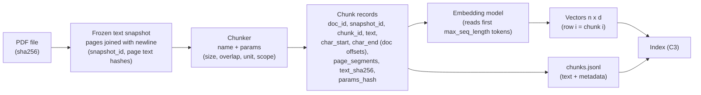
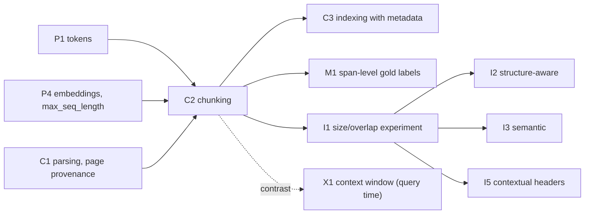

# 07 — Sample Lesson: C2 Chunking fundamentals (+ I1 experiment): how chunking affects retrieval

> **What this file is.** It is the first complete lesson, and every later lesson should meet its standard. It covers concept **C2** and designs the controlled experiment **I1**. It follows the mandatory Parts A–M template.
> **How to use it.** Answers are hidden in collapsible blocks. Attempt each question first (write your answer down), then open the block. Lines marked `> 🧭 Coach:` are instructions for the AI tutor; they add to the coaching rules in [05 §3](05_LEARNING_AND_RETENTION_SYSTEM.md#3-coaching-rules-for-the-ai-tutor) and cannot override them.
> **Labels.**
> - **UNVERIFIED**: not checked by running code or reading the primary source.
> - **Assumption:** a stated premise.
> - **Toy illustration**: numbers computed by code on made-up data, never a result about a real system.
> - **Source C (external)**: material that is not in the learner's book or repo.
>
> Every number in this lesson comes from the lab verification run of 2026-10-08 (see the [Verification log](#verification-log)), from a derivation shown in the text, or carries a label.

## Lesson header

| Field | Value |
|---|---|
| Concept | **C2 Chunking fundamentals**: fixed-size and recursive splitting, overlap, units (characters vs tokens), provenance metadata. Includes the design of experiment **I1** (chunk size and overlap grid). |
| Phase / tier | Phase 2, Core RAG baseline → Project v0. Priority **E** (essential). |
| Prerequisites | Hard (as in [02](02_RAG_MASTER_LEARNING_PLAN.md#c2) and [03](03_RAG_CONCEPT_DEPENDENCY_MAP.md)): **C1** PDF parsing and page provenance · **P1** tokens and tokenization. Also used in this lesson (earlier Phase 1 concepts): **P4** embeddings, cosine, max sequence length and truncation · **P6** Recall@k, MRR. |
| Comes next | **C3** embedding and indexing with metadata · **M1** span-level eval set · **I1** run of the experiment (Phase 4, v1.0) · **I2–I5** alternative chunkers · **X1** context enrichment window. |
| Time | Parts A–C: 45 min · D: 75 min · E–G: 60 min · H: 90 min (lab) · J–L: 60 min · M: 20 min. **Part I runs later**, in Phase 4 after Gate 3→4. It needs 3–5 h, because it requires the M1 eval set and the M2 harness. In Phase 2 you only *draft* the pre-registration. |
| Mastery (C2 → `applied`, per [05 §7.1](05_LEARNING_AND_RETENTION_SYSTEM.md#71-concept-mastery-levels-l0l5)) | Without notes, you can: (1) derive the chunk count and P(contained) for fixed windows; (2) explain why overlap does not guarantee containment and name the exact bound; (3) state the unit of `chunk_size` in each repo code path; (4) write `fixed_window_chunks` from a blank file with property asserts; (5) explain why gold labels must be character spans, not chunk ids. |
| Mastery (C2 → `transfer`) | You also pass a novel-scenario item (Part L.5) and score debugging ≥2 in the lab. I1 counts towards `decided` only after it has been run in Phase 4. |

### Source map

| Source | Where | What it contributes |
|---|---|---|
| Book (A) | Ch1 p.4/14 (default 1,000 chars / 200 overlap, overlap rationale), p.5/14 (overlap diagram, cleaning step), p.10–11/14 (role of chunk size), p.12/14 (limits; when RAG is overkill), p.13/14 (key takeaways) | Intuition and the defaults. It has no mechanism-level account of boundaries. |
| Book (A), forward links | Ch4 p.1–2/15 (propositions; "blurry" mixed chunks), Ch7 p.1–2/11 (chunks lose their headings), Ch8 p.1/11 (overlap is only a partial fix), Ch9 p.1–2/14 (fixed windows ignore meaning), App p.6/23 (Layer 2 recommends semantic chunking), App p.12/23 (measure before and after every change), App p.14/23 (glossary: Chunk Overlap) | Claims that this lesson turns into testable hypotheses |
| Repo (B) | `helper_functions.py:L18-L31`, `L48-L76`; `simple_rag.ipynb` cells 10–15; `choose_chunk_size.ipynb` cells 2–12; `all_rag_techniques_runnable_scripts/choose_chunk_size.py`; units in `reliable_rag.ipynb` cell 6, `proposition_chunking.ipynb` cell 9, `document_augmentation.ipynb` cells 4 and 6 | The code you will trace and critique |
| Lab verification | Scripts and saved outputs in [`sources/verification/`](sources/verification/) (`labscripts/`, `verify07/`, `LAB_FACTS.md`), run 2026-10-08 | Every library behaviour and corpus number in this lesson |
| Source C (external) | #10/#11, #26, #28–#31 and #39 in [01 §6](01_SOURCE_INVENTORY.md#6-source-c--supplementary-references-external); model cards | Further reading only; nothing here depends on it |

### Contents

[Part A](#part-a--prior-knowledge-recovery) · [B](#part-b--why-chunking-exists) · [C](#part-c--intuition-and-analogy) · [D](#part-d--technical-mechanism) · [E](#part-e--connections) · [F](#part-f--worked-example-by-hand) · [G](#part-g--source-connection) · [H](#part-h--implementation-progression) · [I](#part-i--controlled-experiment-i1) · [J](#part-j--failure-and-debugging) · [K](#part-k--engineering-decisions) · [L](#part-l--assessment) · [M](#part-m--retention) · [References](#source-references) · [Verification log](#verification-log)

---

## Part A — Prior knowledge recovery

Answer all eight questions **before** reading further: on paper, 2–4 sentences each, no notes. They test what you remember of P1, P4, P6 and C1, and what you believe about chunking. Wrong answers here are useful: they show what this lesson must fix.

> 🧭 Coach: Ask one question at a time (CR-01). Record a confidence of 1–3 before revealing each answer (CR-16). Score with the Recall rubric ([05 §4.2](05_LEARNING_AND_RETENTION_SYSTEM.md#42-graded-rubrics-04)). These are unscheduled recall items: log them, but do not change the review schedule. Routing is in the table after PK-8.

**PK-1.** Context windows of 128k+ tokens exist. Why chunk at all instead of putting the whole document in the prompt?

<details><summary>What a strong answer contains</summary>

- **Retrieval needs units.** Retrieval ranks *units*. If the unit is the whole document, a 33-page PDF becomes a single vector that cannot say *where* the answer is.
- **Embedding inputs have a length cap.** Each embedding model has a maximum input length (256 WordPiece tokens for all-MiniLM-L6-v2; Part D.6). Text past the cap is dropped.
- **Cost and latency.** Every prompt token is paid for at every query.
- **Citations.** Answers should cite a page or passage, and a small unit makes that possible.
- **Boundary condition.** The book itself says RAG is overkill when the documents fit in the model's context window (Ch1 p.12/14). "Do not chunk" is sometimes the right answer.
- ⚠️ Misconception flag: "Long context makes retrieval obsolete." This ignores cost per query and multi-document corpora, and it ignores that models use long contexts unevenly (Source C #39, external).

</details>

**PK-2.** In `helper_functions.encode_pdf`, `chunk_size=1000`. Is that 1,000 characters, tokens or words?

<details><summary>What a strong answer contains</summary>

- **Characters.** The splitter is built with `length_function=len` (`helper_functions.py:L66-L68`), and Python's `len` on a string counts characters.
- The same name means **tokens** elsewhere in the repo, so units must always be stated (Part D.5).
- ⚠️ Misconception flag: "chunk_size is always tokens." Route to P1 if the learner also cannot say roughly how many characters a token is.

</details>

**PK-3.** What happens to the text of a chunk that is longer than the embedding model's maximum sequence length?

<details><summary>What a strong answer contains</summary>

- **It is truncated silently.** Sentence-transformers keeps the first `max_seq_length` tokens and ignores the rest: no error, no warning.
- The chunk *text* still contains the tail, so the LLM sees it if the chunk is retrieved. But the tail had **no influence on the vector**, so it cannot help the chunk get retrieved.
- ⚠️ Misconception flags: "it raises an error" or "it is averaged in." Route to P4.

</details>

**PK-4.** With chunk_size 1000 and chunk_overlap 200, does overlap guarantee that a 500-character explanation is never split?

<details><summary>What a strong answer contains</summary>

- **No.** Overlap guarantees containment only for spans of length ≤ overlap + 1 (fixed windows; derived in Part D.3).
- For a 500-character span and a uniformly random start position, the containment probability is 501/800 ≈ 0.626.
- ⚠️ Misconception flag: "overlap means nothing is lost at boundaries." The book's key takeaway at Ch1 p.13/14 and its glossary (App p.14/23) suggest this. Ch8 p.1/11 corrects it by calling overlap a partial fix.

</details>

**PK-5.** Cosine similarity between a query and a chunk: what happens to a chunk's vector when the chunk mixes three topics?

<details><summary>What a strong answer contains</summary>

- The chunk embedding is pooled over all of its tokens. Mean pooling for MiniLM and the CLS token for bge (Part D.6). So a mixed chunk lands *between* its topics.
- Its cosine with a query about one topic drops. A chunk that is entirely about a *related* topic can then outrank it (toy model in Part D.7).
- Book: Ch4 p.2/15 describes such chunks as a blend of topics.
- ⚠️ Misconception flag: "cosine finds the relevant sentence inside the chunk." It compares whole-chunk vectors. Route to P4.

</details>

**PK-6.** You change the chunk size from 1000 to 400 and keep k = 4. Name two things that change other than the chunk boundaries.

<details><summary>What a strong answer contains</summary>

- The **context size** sent to the LLM. Four small chunks carry far fewer tokens than four large ones.
- The **number of chunks** (index size, embedding time).
- **Chunk-id-based labels** become invalid.
- The comparison is **confounded** unless you also compare at an equal context-token budget (Part I).

</details>

**PK-7.** Recall@k and MRR: which one tells you that the evidence was *somewhere* in the top-k, and which one tells you *how early*?

<details><summary>What a strong answer contains</summary>

- Recall@k or Hit@k tells you the evidence was somewhere in the top-k. MRR tells you how early.
- Both are **retrieval** metrics. Neither says whether the generated answer was correct.
- Route to P6 if Recall@k and Precision@k are confused.
- In this course, "somewhere" is not "enough": sufficiency is scored as Complete-Evidence@k (CE@k, Part I.3). Hit@k = 1 only means some evidence arrived.

> Revised 2026-10-08 (Codex M-02): "Recall@k (span coverage)" no longer stands in for sufficiency; CE@k is named as the sufficiency metric. See [corrections log](reviews/CORRECTIONS_LOG_2026-10-08.md#m-02).

</details>

**PK-8.** `PyPDFLoader(...).load()` returns one `Document` per page. What does `metadata["page"]` equal on the first page?

<details><summary>What a strong answer contains</summary>

- **0.** The `page` value is 0-based. `page_label` is `'1'` on the climate PDF (verified 2026-10-08).
- Citations to a human use 1-based page numbers, so convert, and record which convention you store.
- Route to C1 if the learner has never inspected loader metadata.

</details>

> 🧭 Coach: **Routing.**
>
> | Weak answers (score ≤ 1) | Action |
> |---|---|
> | PK-2 and PK-3 together | Run a P1 micro-review on tokens vs characters, then a P4 micro-review on max_seq_length, before Part D. |
> | PK-5 | Run P4 (cosine, pooling) before Part D.7. |
> | PK-7 | Run P6 before Part I. |
> | PK-8 | Run C1 (loader metadata) before Part D.8. |
> | PK-4 and PK-6 only | No routing. These are exactly what this lesson teaches. |
>
> If 6 or more items score ≥3 with confidence 3, offer the fast track ([02 §5](02_RAG_MASTER_LEARNING_PLAN.md#5-fast-track-rules-from-the-o1-diagnostic)): skim B–C, then do D.3, F, H.1 and L.

---

## Part B — Why chunking exists

### B.1 A real boundary failure in the repo's own pipeline (climate PDF)

The repo's `encode_pdf` loads `data/Understanding_Climate_Change.pdf` with `PyPDFLoader`, one `Document` per page, and splits **each page separately** (`helper_functions.py:L62-L69`). The lab ran exactly this splitting step (no embeddings). The result is 97 chunks. Look at chunks 35 and 36, numbered by 0-based list index:

| Chunk | PDF page (1-based) | Length | Ends / starts with |
|---|---|---|---|
| 35 | 12 (`page`=11) | 669 chars | ends `…Public-\nprivate partnerships (PPPs) can leverage resources, expertise, and innovation to implement` |
| 36 | 13 (`page`=12) | 977 chars | starts `large-scale climate solutions. PPPs are particularly effective in areas such as infrastructure…` |

The sentence "Public-private partnerships (PPPs) can leverage … to implement large-scale climate solutions." crosses the page break. **No per-page chunk contains it whole**, whatever the overlap, because chunks never cross pages (the lab checked all 97 LangChain chunks; Part D.8).

Now take the question *"According to the report, what do public-private partnerships help implement?"*

**Predict before opening:** which chunk(s) would a dense retriever return, and what would the answer look like?

<details><summary>Analysis (a prediction, not a measured result)</summary>

- **Chunk 35** contains the question's key phrase "public-private partnerships" (split as "Public-\nprivate") and the verb "implement", but **not the object** "large-scale climate solutions".
- **Chunk 36** contains the object, but names the subject only by the acronym "PPPs".
- Whether a given embedding model ranks chunk 36 high for this query is **UNVERIFIED**. That is an empirical question for M2/I1.
- The plausible outcomes split cleanly into retrieval vs generation failures:
  - **Only chunk 35 retrieved.** This is a retrieval failure. The gold evidence group has no satisfied alternative, so **Complete-Evidence@4 (CE@4) = 0**. Hit@4 = 1 only says that *some* evidence arrived, and Span-Coverage@4 lies between 0 and 1 (a diagnostic, not a pass). The answer will be incomplete or invented ("…to implement *policies*"), which is a hallucination *caused by* retrieval.
  - **Both chunks retrieved.** Retrieval succeeded: the union of the two chunks covers every non-whitespace character of the gold span, so CE@4 = 1. The generator must now stitch two passages that the prompt may not present as adjacent.
  - **Neither retrieved.** Clear retrieval failure (CE@4 = 0 and Hit@4 = 0).
- **How to measure this.** It is why [06 §7.2](06_RAG_PROJECT_AND_EVALUATION_PLAN.md#72-relevance-from-spans) computes coverage in document coordinates over the *union* of the top-k chunks' character ranges, rather than asking "does one chunk contain the span?". The primary metric is CE@k: every evidence group needs one fully covered alternative (tolerance = whitespace-only). Span-Coverage@k and Hit@k are diagnostics.

> Revised 2026-10-08 (Codex M-02): outcomes restated as Complete-Evidence@4 (primary) vs Hit@4 / Span-Coverage@4 (diagnostics). See [corrections log](reviews/CORRECTIONS_LOG_2026-10-08.md#m-02).

</details>

### B.2 A dilution candidate on page 1

Per-page chunk 0 (PDF page 1, 947 chars) holds:
- the document title;
- the "Chapter 1" heading;
- the definition of climate change;
- the "Historical Context" heading;
- the sentence about seven glacial cycles in the past 650,000 years;
- an orbital-variation sentence;
- the start of a Holocene sentence, which is **cut mid-sentence at the chunk's end** (it ends "During the Holocene epoch, which").

A question like *"How many glacial cycles occurred over the past 650,000 years?"* is answered by **one sentence**: about 225 of the chunk's 947 characters, roughly a quarter (counted on the sentence text; the PDF's line breaks add a character or two). The chunk vector also encodes the definition and the orbit material.

**Prediction to test later (UNVERIFIED):** this chunk could rank below a chunk that is entirely about ice ages or past climate, if the corpus has one. Part D.7 shows the mechanism with a toy model. M2/I1 measures whether it happens.

### B.3 The forces that make chunking necessary, and the force against tiny chunks

| Force | Mechanism | Pushes chunk size | Evidence in this lesson |
|---|---|---|---|
| 1. Encoder input cap | The embedding model reads at most `max_seq_length` tokens; the rest is silently ignored | **Down** (below the cap) | MiniLM 256 / bge 512 WordPiece tokens (D.6) |
| 2. Dilution | One vector per chunk is pooled over all of its content; a mixed chunk sits between topics | **Down** | Toy model D.7; book Ch4 p.2/15 |
| 3. Generation budget and cost | k chunks × chunk tokens = prompt tokens per query | **Down** (or smaller k) | Part I, equal-budget comparison |
| 4. Citation granularity | A citation can be no finer than the retrieved unit | **Down** | v0 cites `[doc:page]` ([06 §3](06_RAG_PROJECT_AND_EVALUATION_PLAN.md#3-v0-baseline-exact-specification)) |
| 5. Fragmentation | A chunk too small loses the sentence that names its subject ("it", "this protocol"), and evidence spreads over many chunks | **Up** | B.1; book Ch1 p.10/14 ("too small"), Ch7 p.2/11 |

**Why not one sentence per chunk?**
- Sentences lean on their neighbours: pronouns, acronyms defined earlier, and headings that set the topic.
- Multi-span questions then need many chunks, which competes with k.
- Every sentence becomes a vector, so index size grows.

Proposition chunking (Ch4) is the principled version of "small units": it **rewrites** each fact to be self-contained, at the cost of an LLM call per chunk. That is I4, not C2.

> 🧭 Coach: Ask the learner to classify each force as a property of the **embedding stage**, the **retrieval stage** or the **generation stage**. Expected: 1 and 2 → embedding/retrieval; 3 → generation; 4 → generation and output; 5 → retrieval and generation. This feeds CR-11 (retrieval vs answer quality).

---

## Part C — Intuition and analogy

**The book's image.** The book compares loading a PDF to a librarian "transcribing a book onto index cards" for a catalogue (Ch1 p.4/14). Chunking decides **how much text goes on each card**. Two failure modes follow:
- A card that holds a whole chapter cannot be filed under one subject.
- A card that holds half a sentence cannot be understood on its own.

**Our analogy: photographs at a zoom level.** You photograph a large mural so that people can later find "the fox" by looking at thumbnails.

- **Zoomed out (large chunks).** Each photo shows the fox as a tiny part of a busy scene. The thumbnail mostly looks like "busy scene", so a search for "fox" ranks it low. This is **dilution**.
- **Zoomed in (small chunks).** One photo shows only the fox's ear. You cannot tell it is a fox, or what it is next to. This is **fragmentation** and loss of context.
- **Overlap.** Consecutive photos share a strip at the edges, so an object that is narrower than the shared strip always appears whole in some photo. A wider object may still be cut (Part D.3).
- **Page boundaries.** The mural is painted across separate panels, and you photograph each panel separately. Nothing that spans two panels appears whole in any photo, however much the photos overlap (Part D.8).

**Where the analogy breaks.** A photo's thumbnail is a downscaled image. A chunk's embedding is not an average of sentence vectors (it is pooled over *contextual* token states), and it **drops everything past the token cap** (a camera that crops the bottom of every tall photo). Keep the mechanism (Part D), not the picture.

<details><summary>Quick check: which photo problem is "chunk_size in tokens vs characters"?</summary>

None of the above. It is a **ruler problem**: you asked for "1000 units" of zoom, and the camera read the number in a different unit. On this corpus, 1,000 cl100k tokens is about 5.6× as much text as 1,000 characters (Part D.5).

</details>

---

## Part D — Technical mechanism

### D.1 The objects involved



Chunking changes **only the indexing stage**: what each vector stands for. The retriever, k and the prompt are unchanged (Part E). But every downstream number changes, because the units changed.

### D.2 Fixed windows: stride, count, storage

Notation:
- **L** = text length;
- **S** = window size;
- **O** = overlap, with 0 ≤ O < S;
- **stride** s = S − O.

Chunk *k* covers the characters `[k·s, k·s + S)`, and the last window is cut at L.

- **Count.** For L ≤ S there is 1 chunk. For L > S there are `ceil((L − O) / (S − O))` chunks.
  - *Why:* window k is the last one when `k·s + S ≥ L`, i.e. `k ≥ (L − S)/s`. So the count is `ceil((L − S)/s) + 1 = ceil((L − S + s)/s) = ceil((L − O)/s)`.
- **Storage / embedding multiplier.** The stored characters divided by L approach **S/(S − O)** from below. For 1000/200 that is 1.25, i.e. up to 25% more vectors and text than with no overlap.

**Verified (lab §2).**
- The formula matched the reference implementation with **0 mismatches** for every L from S+1 to 20S−1, at four (S, O) settings.
- On the climate text concatenated (72,523 characters), fixed 1000/200 windows give `ceil(72,323/800) = ceil(90.4) = 91` chunks. The lab's `fixed_window_chunks` produced exactly 91.
- Storage ratio at L = 73,536: 1.247, against the asymptote 1.25. For short documents the ratio is lower (1.111 at L = 1,800).

<details><summary>Check yourself: 1000/400 on the same 72,523 characters, without a calculator first</summary>

- stride = 600, so `ceil((72,523 − 400)/600) = ceil(72,123/600) = ceil(120.2) = 121` chunks.
- The multiplier tends to 1000/600 ≈ 1.67, against 1.25 at overlap 200. That is about a third more vectors (derived; not run).

</details>

### D.3 Boundary math: when does overlap *guarantee* a fact stays whole?

A "fact" is a span `[p, p + F)` with F ≤ S. It lies wholly inside chunk k iff `k·s ≤ p` and `p + F ≤ k·s + S`, i.e. `0 ≤ p − k·s ≤ S − F`.

Write `r = p mod s`, the fact's offset within one stride. The chunk that starts just before p contains the fact iff `r ≤ S − F`. Assume r is uniform over `0 … s−1`. That holds for interior positions, away from the document edges. Then:

```text
P(contained) = #{ r in [0, s) : r <= S - F } / s  =  min(1, (S - F + 1) / (S - O))
Guaranteed (P = 1 for every p)  iff  S - F + 1 >= S - O  iff  F <= O + 1
```

**Worked (S = 1000, F = 500)**, verified by brute force over every start position (lab §1):

| Overlap O | stride | (S − F + 1)/stride | P(contained), interior | Whole finite doc, L = 20,000 |
|---|---|---|---|---|
| 0 | 1000 | 501/1000 | **0.501** | 0.5138 |
| 200 | 800 | 501/800 | **0.626** | 0.6320 |
| 400 | 600 | 501/600 | **0.835** | 0.8375 |

The guarantee threshold at S = 1000, O = 200 is F ≤ 201:

| F | 200 | 201 | 202 | 250 |
|---|---|---|---|---|
| P(contained) | 1.000 | 1.000 | 0.99875 | 0.93875 |

**Reading the result.**
- **Overlap buys probability, not certainty.** It guarantees containment only for spans of at most O + 1 characters. A 200-character overlap protects about one or two sentences; it does not protect a paragraph.
- **Raising O costs storage linearly.** The multiplier is S/(S − O). Moving O from 200 to 400 raises P(contained) for F = 500 from 0.626 to 0.835, and raises the vector count by about 33%.
- **Whole-document rates are slightly higher** (last column). The final, shorter window adds coverage near the end of the text.
- ⚠️ **Scope of the model.** It describes *fixed character windows*. Recursive splitters (D.4) put boundaries at separators and carry whole pieces as overlap, so the formula only approximates them. The *direction* of each effect holds; the exact numbers do not.

**The book's claim, checked.** The book presents overlap as preserving information at the boundaries, so that "no thought is lost at the seams" (Ch1 p.4/14). Its takeaways (Ch1 p.13/14) and its glossary (App p.14/23) repeat this. The derivation shows the claim holds only for thoughts no longer than the overlap. The book itself later calls overlap "a partial fix" (Ch8 p.1/11). Use the formula, not the slogan.

> 🧭 Coach: Use the hint ladder in [05 §3.2](05_LEARNING_AND_RETENTION_SYSTEM.md#32-hint-ladder-levels-03), which is built on this derivation. Do not show the formula before the learner has tried a concrete position (H1).

### D.4 Recursive character splitting (what the repo actually uses)

`RecursiveCharacterTextSplitter` (langchain-text-splitters 1.1.3, verified) works in two phases.

1. **Split.** Try the separators in order: `["\n\n", "\n", " ", ""]` (paragraph → line → word → character). Split on the first separator present. Any piece still longer than `chunk_size` is split again with the *next* separator. The final `""` cuts single characters, so no piece ever exceeds `chunk_size`. Verified: `split_text("short " + "x"*25 + " tail")` at chunk_size=10, overlap 0 gave `['short', 'xxxxxxxxx', 'xxxxxxxxxx', 'xxxxxx', 'tail']`. The 25-character word was cut into pieces of 9, 10 and 6. The first piece is 9, not 10, because `keep_separator=True` attaches the preceding space to the word, the space counts towards the 10, and `strip_whitespace` then removes it. Verified: the same call with `strip_whitespace=False` returns `['short', ' xxxxxxxxx', 'xxxxxxxxxx', 'xxxxxx', ' tail']` (verifier run, 2026-10-08).
2. **Merge.** Greedily join consecutive pieces while the total length stays ≤ `chunk_size`. When the next piece does not fit, emit the chunk. Then drop pieces from the *front* of the current chunk until what remains is ≤ `chunk_overlap` and the next piece fits. What remains is the overlap carried into the next chunk.

**Consequence:** the overlap consists of **whole trailing pieces** (usually whole words), so the overlap you actually get is **≤ `chunk_overlap`** and **varies** from chunk to chunk.

**Verified run** on a 388-character original paragraph, `chunk_size=120, chunk_overlap=40, length_function=len, add_start_index=True`:

| Chunk | Span | Length | Actual overlap with the previous chunk |
|---|---|---|---|
| 0 | [0, 116) | 116 | — |
| 1 | [77, 195) | 118 | 39 |
| 2 | [156, 274) | 118 | 39 |
| 3 | [246, 363) | 117 | 28 |
| 4 | [324, 388) | 64 | 39 |

The requested overlap was 40; the achieved overlaps were 39, 39, 28 and 39. They fall short because the overlap is built from whole words, and the joining space is stripped (`strip_whitespace=True` by default).

**Defaults and validation** (verified by running, and by reading the installed source):

| Setting | Default | Note |
|---|---|---|
| `separators` | `["\n\n", "\n", " ", ""]` | — |
| `chunk_size` / `chunk_overlap` | 4000 / 200 | The repo always passes 1000/200 explicitly (`helper_functions.py:L66-L68`) |
| `length_function` | `len` | Characters |
| `keep_separator` | `True` (recursive splitter) | The separator attaches to the **start** of the next piece |
| `strip_whitespace` | `True` | Chunk edges lose spaces and newlines, so `len(chunk)` can be < the raw span |
| `chunk_overlap > chunk_size` | `ValueError: Got a larger chunk overlap (150) than chunk size (100), should be smaller.` | — |
| `chunk_overlap < 0` | `ValueError: chunk_overlap must be >= 0, got -1` | — |
| `chunk_overlap == chunk_size` | **Accepted** | Produces near-duplicate chunks that advance one piece at a time: 56 chunks for a 60-word text at 40/40 |

### D.5 Units: characters, tokens and "tokens"

The same parameter name means different amounts of text in different places in the repo:

| Code path | Unit of `chunk_size` | Cite |
|---|---|---|
| `encode_pdf` | **characters** (`length_function=len`) | `helper_functions.py:L66-L68`; local copy in `simple_rag.ipynb` cell 10 |
| `RecursiveCharacterTextSplitter.from_tiktoken_encoder(chunk_size=500, chunk_overlap=0)` | **tiktoken tokens**, default encoding `gpt2` | `reliable_rag.ipynb` cell 6. The default `encoding_name="gpt2"` is STATIC, from the installed `langchain_text_splitters/base.py` |
| `from_tiktoken_encoder(chunk_size=200, chunk_overlap=50)` | tiktoken `gpt2` tokens | `proposition_chunking.ipynb` cell 9 |
| LlamaIndex `Settings.chunk_size` / `SentenceSplitter` | **tiktoken `cl100k_base` tokens** (the default `get_tokenizer()`, verified) | `choose_chunk_size.ipynb` cell 10; `choose_chunk_size.py:L48` |
| `split_document(document, chunk_size, chunk_overlap)` | **regex words** `\b\w+\b` (called "tokens"). Punctuation is discarded and the words are re-joined with spaces | `document_augmentation.ipynb` cell 6 (constants 4000/100 and 128/16 in cell 4) |

**Measured on the climate PDF** (lab §7 and §10; 72,523 characters from PyPDFLoader):

| Tokenizer | Tokens | Characters per token |
|---|---|---|
| tiktoken `cl100k_base` | 13,016 | **5.57** |
| tiktoken `gpt2` | 14,305 | **5.07** |
| BERT WordPiece (MiniLM = bge vocabulary, 30,522) | 11,694 | **6.20** |

- **The common "≈ 4 characters per token" heuristic is wrong for this corpus.** The text averages 6.72 characters per word, i.e. long technical vocabulary. On this corpus, 1,000 cl100k tokens ≈ 5,570 characters, about **5.6× a 1,000-character chunk**.
- **The ratio depends on the corpus and the tokenizer.** Measure it for every new corpus; never assume it.
- **A token budget does not fix the text length.** At LlamaIndex `chunk_size=128` tokens, the chunks were 51–604 characters long (lab §5).

### D.6 Embedding truncation: the hard ceiling

Verified from each model's `sentence_bert_config.json`, pooling config and model card (Hugging Face, revisions in [Source references](#source-references)):

| Model | `max_seq_length` (WordPiece tokens) | Pooling | Normalized | Past the limit |
|---|---|---|---|---|
| `sentence-transformers/all-MiniLM-L6-v2` | **256** | mean | yes | truncated: only the first 256 tokens are encoded |
| `BAAI/bge-small-en-v1.5` | **512** | CLS | yes | truncated: only the first 512 tokens are encoded |

Both models have 384 dimensions and use the same uncased BERT vocabulary.
- **MiniLM trained on shorter inputs.** Its model card says training used sequences of at most 128 tokens. The sbert docs warn that models trained on short texts may represent long texts poorly. So "fits under 256" is not the same as "well represented".
- **bge expects a query instruction.** Its card recommends a prefix for short queries searching passages (`Represent this sentence for searching relevant passages: `), and none for passages. That belongs to C3/C4.
- UNVERIFIED (not executed): that `[CLS]`/`[SEP]` count towards `max_seq_length` inside sentence-transformers, and how sentence-transformers overrides the 128-token truncation stored in MiniLM's `tokenizer.json`.

**Is truncation a live problem for v0 on the climate PDF?** It was measured with the models' own tokenizers. Counts include `[CLS]`/`[SEP]`, and the splitting is per page, as in `encode_pdf`:

| Chunking (chars, per page) | Chunks | WordPiece tokens min / median / max | Over 256 (MiniLM) | Over 512 (bge) |
|---|---|---|---|---|
| 1000 / 200 (v0) | 97 | 59 / 149 / 182 | **0** | 0 |
| 1500 / 300 | 65 | 109 / 215 / 270 | **4** | 0 |
| 2000 / 400 | 65 | 59 / 160 / 365 | **32** | 0 |

- **Not at v0 settings.** At 1000/200, no chunk is truncated on this corpus.
- **Yes, and as a confound, in the I1 grid at ≥1,500 characters with MiniLM.** There, "bigger chunk" is partly "chunk the model could not fully read". I1 therefore reports a truncation rate for each configuration (Part I).
- **cl100k over-counts here.** It flags 18 chunks over 256 at 1500/300, where WordPiece flags 4. Count with the embedding model's own tokenizer.

> REVIEWER NOTE (RESOLVED in the cross-document consistency pass): [06 §3.2](06_RAG_PROJECT_AND_EVALUATION_PLAN.md#32-embedding-model-facts-and-the-truncation-trap) now takes bge-small's 512 limit and the measured WordPiece counts from this section. Corpus T (arXiv PDFs) may differ, so re-measure there.

### D.7 Dilution: a toy model (a simplification)

> **Toy illustration.** Real encoders do **not** average sentence vectors; they pool contextual token states. The toy shows the *geometry* of mixing, not the behaviour of MiniLM or bge.

Use 2-D vectors:
- the query `q = [1, 0]`;
- the answer sentence `r = [1, 0]`;
- an off-topic sentence `u = [0, 1]`;
- a competitor chunk that is *partly* on topic, `c = [0.6, 0.8]`, with cos(q, c) = 0.600.

A chunk made of the answer plus n off-topic sentences is their mean, `(1, n)/(n + 1)`. Cosine ignores scale, so cos(q, chunk) = 1/√(1 + n²).

```python
import math
import numpy as np

q = np.array([1.0, 0.0]); r = np.array([1.0, 0.0]); u = np.array([0.0, 1.0]); comp = np.array([0.6, 0.8])
cos = lambda a, b: float(a @ b / (np.linalg.norm(a) * np.linalg.norm(b)))
for n in range(0, 5):
    chunk = np.mean(np.vstack([r] + [u] * n), axis=0)   # rows: 1 relevant + n off-topic
    print(n, chunk, round(cos(q, chunk), 3), round(1 / math.sqrt(1 + n * n), 3), cos(q, chunk) > cos(q, comp))
```

Line by line:
- **`np.vstack([r] + [u] * n)`** builds an (n+1)×2 matrix with one row per sentence vector.
- **`np.mean(..., axis=0)`** averages the rows, giving the "chunk vector".
- **`cos`** is the dot product over the product of norms.
- The last column asks whether the chunk *containing the answer* still beats the competitor.

Verified output (lab §3):

| n off-topic sentences | Chunk vector | cos(q, chunk) | Beats competitor (0.600)? |
|---|---|---|---|
| 0 | [1.0, 0.0] | 1.000 | yes |
| 1 | [0.5, 0.5] | 0.707 | yes |
| 2 | [0.333, 0.667] | 0.447 | **no** |
| 3 | [0.25, 0.75] | 0.316 | no |
| 4 | [0.2, 0.8] | 0.243 | no |

**Lesson of the toy.** The chunk that contains the answer can rank *below* a chunk that only resembles the topic once it holds enough unrelated material. Smaller chunks reduce n, but they increase fragmentation (B.3). The real trade-off on our corpus is an empirical question for I1.

### D.8 The page-boundary effect in the repo pipeline

`encode_pdf` calls `split_documents(documents)` on the **per-page** `Document`s from `PyPDFLoader` (`helper_functions.py:L62-L69`). The splitter never sees two pages at once, so **no chunk crosses a page break**, and overlap cannot rescue text that a page break cuts.

Verified on the climate PDF (33 pages; lab §7 and §9):

| Fact | Value |
|---|---|
| `metadata["page"]` of the first page | `0` (0-based); `page_label` = `'1'` |
| Per-page split at 1000/200 (as `encode_pdf`) | **97** chunks, lengths 391 / 933 / 999 (min / median / max) |
| Same splitter on the concatenated text | **92** chunks; **39** of them span a page break |
| Page breaks where page N does not end in terminal punctuation | **24 of 32** |
| … of which real mid-sentence cuts (next page starts lowercase) | **8**, at PDF pages 12→13, 14→15, 15→16, 16→17, 21→22, 22→23, 24→25, 28→29 |
| … of which **orphaned headings** (a heading at the bottom of page N, its body on N+1) | **16** (e.g. the heading "Coal" ends page 1; its paragraph starts page 2) |
| Per-page chunks containing the whole PPP sentence (B.1) | **0 of 97** |
| Page-aware chunks (the H.1 code: chunk across pages, record the page span) containing it | chunk 34, pages 12–13 |
| Tabs in any chunk (what `replace_t_with_space` would change) | **0**, so the repo's cleaning step is a no-op on this PDF |
| Lines repeated on ≥3 pages (header/footer boilerplate) | none |

- **Two kinds of damage.** A mid-sentence cut splits a fact. An orphaned heading strips the context that tells the embedding what a paragraph is about. Ch7 p.2/11 describes the same heading loss for chunking in general.
- **Per-page scope also has a benefit.** Every chunk has exactly one page, so `[doc:page]` citations are exact. v0 keeps per-page scope for that reason ([06 §3.1](06_RAG_PROJECT_AND_EVALUATION_PLAN.md#31-stage-by-stage-specification)), and I1 measures the cost (per-page vs cross-page arm).
- **Assumption:** v0 extracts with PyMuPDF, while these counts come from PyPDFLoader. On this PDF the two extractors give nearly the same text length (72,593 vs 72,523 characters), and the PPP cut is confirmed by `pdftotext`. The exact chunk counts under PyMuPDF are UNVERIFIED.

### D.9 Provenance metadata every chunk must carry

| Field | Why |
|---|---|
| `doc_id` (+ corpus file sha256 in the manifest) | Which document; detects a silently changed file |
| `snapshot_id` (from the snapshot manifest: parser + version, cleaning version, per-page text hashes) | Names the frozen extracted text that every offset refers to. A parser or cleaning change creates a new snapshot, so offsets and gold labels from the old one can never be silently reused |
| `chunk_id`, deterministic: `doc_id:snapshot_id:params_hash:seq` | The same snapshot and config give the same ids, so joins and traces stay valid. An id is **not** a cache key (see `text_sha256`) |
| `text_sha256` | Content identity. Embedding caches are keyed by the text plus the model, its revision, `input_type` and the preprocessing version (H.3 `embedding_cache_key`), never by `chunk_id` |
| `char_start`, `char_end`: the **one canonical coordinate system**, document offsets into the snapshot text (pages joined with `"\n"`) | Lets **span-based gold labels** (M1) be matched to *any* chunking. Lets you highlight evidence. Lets you test that `text == doc[char_start:char_end]` |
| `page_segments` `[{page, char_start, char_end}]` (1-based page, page-relative offsets, one per page touched); `page_start`/`page_end` = first/last segment's page | A *derived* view of the document offsets, for citations and per-page vs cross-page analysis. Per-page chunks have exactly one segment |
| `chunker` name + `params_hash` (size, overlap, unit, tokenizer id, scope, separators) | Two indexes built with different parameters can never be confused; experiments are reproducible |

Without offsets, "is the gold evidence in this chunk?" can only be answered by string search, which fails on hyphenation (`"Public-\nprivate"`) and whitespace stripping.

> Revised 2026-10-08 (Codex M-01, M-04): one snapshot-bound document-offset system with `page_segments` as a derived view; ids are for joins/traces, cache keys address content. See [corrections log](reviews/CORRECTIONS_LOG_2026-10-08.md#m-01).

---

## Part E — Connections



| Relation | Details |
|---|---|
| **Depends on** | P1 (what a token is; chars/token is corpus-specific) · P4 (pooling, cosine, max_seq_length) · C1 (page texts, 0- vs 1-based pages, extraction artifacts such as `Public-\nprivate`) |
| **Pipeline stage it changes** | **Indexing only**: what text each vector represents |
| **Held fixed in a chunking experiment** | Embedding model and revision, normalization, retriever (exact cosine), k (*plus* an equal-token-budget arm), prompt, generator, eval set |
| **Trade-offs it creates** | Index size (× S/(S−O)) · k-vs-budget coupling (k × chunk tokens = context tokens) · truncation risk at large sizes · citation granularity · **eval-label invalidation**: gold labels stored as chunk ids break on re-chunking, so labels must be character spans (M1; [06 §6.4](06_RAG_PROJECT_AND_EVALUATION_PLAN.md#64-span-level-gold-labelling-procedure)) |
| **Often confused with** | See the next table |

| Technique | Stage and time | What it changes | How it differs from C2 tuning |
|---|---|---|---|
| Semantic chunking (I3; Ch9 p.1–2/14) | Index time | **Where** boundaries fall: at embedding-similarity drops between sentences | Variable sizes; costs one embedding per sentence |
| Proposition chunking (I4; Ch4 p.1–2/15) | Index time, LLM | **What text** is indexed: rewritten atomic facts | Not a split of the original text, so offsets need mapping back |
| Contextual chunk headers (I5; Ch7 p.1–2/11) | Index time | **What is embedded**: header + chunk | The boundaries stay the same; it repairs orphaned headings and pronoun context |
| Context enrichment window (X1; Ch8 p.1–2/11) | **Query time** | **What is shown to the LLM**: neighbours of retrieved chunks | Retrieval still uses small chunks; overlap duplicates at index time, while windowing expands at query time |
| Parent–child / small-to-big (no dedicated notebook; related: `hierarchical_indices` and `raptor` in the R5 family, and the parent text stored in `document_augmentation.ipynb` cell 10 metadata) | Index + query | Retrieve small units, return a larger parent | Two granularities instead of one |

The comparative lesson is I-CMP ([03 §4.1](03_RAG_CONCEPT_DEPENDENCY_MAP.md#41-granularity-family-what-is-the-retrieval-unit-and-what-vector-points-to-it)).

---

## Part F — Worked example by hand

The paragraph below is **original text written for this lesson** (not from the book). It is 785 characters long. The fact we care about, `FACT` = "Tokens beyond the cap are silently dropped before the transformer runs.", occupies the span **[558, 629)**, so F = 71.

```text
A bi-encoder turns a passage into one vector in three steps. First, a WordPiece tokenizer splits the text into
subword tokens and adds the special [CLS] and [SEP] markers. Second, a small transformer reads the token sequence
and produces one contextual vector per token. Third, a pooling layer averages those token vectors into a single
fixed-size embedding, which is then scaled to unit length. Two passages are later compared by the cosine of their
vectors. Because the model was trained on short inputs, its configuration caps the sequence at 256 tokens. Tokens
beyond the cap are silently dropped before the transformer runs. A sentence placed at the end of a long chunk can
therefore have no influence at all on the chunk's embedding, even though the chunk text still contains it.
```

(The line breaks above are for display only; the real string is one line, with single spaces.)

Query: *"What happens to tokens past an embedding model's sequence limit?"*

**Step 1: predict, by hand.** Use fixed windows with S = 300.
- (a) With O = 0, list the chunk spans. Does any chunk contain [558, 629)?
- (b) With O = 60, the same questions.
- (c) Use D.3 to compute the probability that a 71-character fact is contained at O = 60.

<details><summary>Step 1 answers (hand-derived, then confirmed by code)</summary>

- **(a)** stride 300 gives `ceil(785/300) = 3` chunks: [0,300), [300,600), [600,785). Position check: r = 558 mod 300 = 258 > S − F = 229, so **not contained**. The cut is at offset 600, inside the fact.
- **(b)** stride 240 gives `ceil((785−60)/240) = ceil(3.02) = 4` chunks: [0,300), [240,540), [480,780), [720,785). Position check: r = 558 mod 240 = 78 ≤ 229, so **contained**, in chunk 2 = [480,780).
- **(c)** P = (300 − 71 + 1)/240 = 230/240 ≈ **0.958**. Since F = 71 > O + 1 = 61, containment here is likely but **not guaranteed**. This placement happened to be lucky.

</details>

**Step 2: the verified output** (`fixed_window_chunks` from Part H.1; lab §8, exact):

```text
--- fixed_window_chunks(size=300, overlap=0): 3 chunks
[0]   0-300 (same text as chunk 0 of the overlap-60 run below)
[1] 300-600 '…its configuration caps the sequence at 256 tokens. Tokens beyond the cap are silently dropped'
[2] 600-785 " before the transformer runs. A sentence placed at the end of a long chunk can therefore have …"
chunks wholly containing FACT: []

--- fixed_window_chunks(size=300, overlap=60): 4 chunks
[0]   0-300 'A bi-encoder turns a passage into one vector in three steps. … Third, a pooling layer averag'
[1] 240-540 'e contextual vector per token. Third, a pooling layer averages … its configuration caps the sequen'
[2] 480-780 "s trained on short inputs, its configuration caps the sequence at 256 tokens. Tokens beyond the cap are silently dropped before the transformer runs. A sentence placed at the end … still contain"
[3] 720-785 " chunk's embedding, even though the chunk text still contains it."
chunks wholly containing FACT: [2]
```

The `…` marks elisions made for this page; the full strings are in the lab output. Notice that fixed windows cut **inside words** ("averag|es", "sequen|ce"). A recursive splitter avoids this.

**Step 3: the same text through recursive splitters (300/60).**

| Chunker | Spans | Actual overlaps | Chunk with the whole FACT |
|---|---|---|---|
| Our simplified `recursive_chunks` (H.1) | [0,294) [238,534) [478,773) [714,785) | 56, 56, 59 (derived from the spans) | 2 |
| LangChain `RecursiveCharacterTextSplitter` | [0,293) [238,533) [478,772) [714,785) | 55, 55, 58 | 2 |

The two chunkers implement the same idea but give **different boundaries**: LangChain strips trailing spaces, and ours keeps them. That is a second reason gold labels must be spans: even "the same" chunker in two libraries gives different chunk ids.

**Step 4: what does the retriever see?** Be honest about the damage at O = 0.
- Chunk 1 still ends with "Tokens beyond the cap are silently dropped". So it **carries the core answer** and loses only "before the transformer runs".
- A boundary earlier in the sentence (say right after "Tokens beyond") would have removed the answer from both chunks.
- The cost of a cut depends on **where** it falls, and that is exactly what the probability in D.3 averages over.

**Step 5: a hand calculation for the toy model.** For n = 2 off-topic sentences, compute the chunk vector and its cosine with q = [1, 0] by hand.

<details><summary>Answer</summary>

- The mean of [1,0], [0,1] and [0,1] is [1/3, 2/3]. Its norm is √(1/9 + 4/9) = √5/3.
- cos = (1/3)/(√5/3) = 1/√5 ≈ **0.447**. That is below the competitor's 0.600, matching D.7.

</details>

> 🧭 Coach: Run a CR-08 probe here. "Double the overlap to 120 (stride 180). Predict how many chunks there are and P(contained) for F = 71." Expected: `ceil((785−120)/180) = ceil(3.69) = 4` chunks; F = 71 ≤ 121, so P = 1, a guarantee. Derived; not run.

---

## Part G — Source connection

### G.1 Book (Source A): what it says, and what we do with it

| Cite | Book point (paraphrased) | Our assessment |
|---|---|---|
| Ch1 p.4/14 | A common default is about 1,000 characters with 200 of overlap. Overlap keeps a thought that spans two paragraphs intact | The default is adopted for v0. The overlap rationale is **only true for spans ≤ O+1** (D.3) |
| Ch1 p.5/14 | A figure of three chunks with shared overlap bands; a cleaning step removes tabs, extra whitespace and broken line endings | The repo's cleaning replaces **only tabs** (`helper_functions.py:L18-L31`). On the climate PDF it changes nothing (D.8) |
| Ch1 p.10/14 | Chunk size is called "the most important configuration decision" in simple RAG; too small (~100 chars) loses context | **Asserted, not measured.** This becomes a hypothesis for I1 (CR-07) |
| Ch1 p.11/14 | Too large (~5,000 chars) buries the signal; about 1,000/200 is "just right" | "Just right" is corpus-, model- and question-dependent; I1 tests it. Note that 5,000 characters would exceed MiniLM's 256-token cap on this corpus (D.6 shows truncation already at 1,500–2,000) |
| Ch1 p.12/14 | Questions needing material from many sections expose the limits of retrieving a few fixed chunks; RAG is overkill when documents fit in the context window | This motivates the multi-span category and H2 in Part I |
| Ch1 p.13/14 | A key takeaway presents overlap as preventing any loss of information where one chunk meets the next | **Overclaim**; contradicted by D.3, D.8 and the book's own Ch8 p.1/11 |
| Ch4 p.1–2/15; Ch9 p.1–2/14 | Fixed character chunks blend several facts or topics into one blurry vector | This matches the dilution mechanism (D.7). Forward links to I4 and I3 |
| App p.6/23 | Layer 2 "quick wins" recommends semantic chunking (and reranking) | A recommendation to **test** (v1.3), not a result |
| App p.12/23 | Measure before and after every change | Why measurement (Phase 3) precedes I1 |
| App p.14/23 | The glossary entry for Chunk Overlap: text repeated in neighbouring chunks (usually ~200 characters), credited with preventing boundary information loss | Same overclaim as p.13/14 |

**No book chapter is dedicated to chunk size or overlap.** The topic gets two pages in Ch1. Units (characters vs tokens) and truncation are never discussed ([03 §5](03_RAG_CONCEPT_DEPENDENCY_MAP.md#5-taught-before-prerequisite-problems-in-the-book-and-how-our-ordering-fixes-them), row 2).

### G.2 Repo: `helper_functions.py:L48-L76` `encode_pdf`, block by block

| Lines | Code (abridged) | What happens | Data after this step |
|---|---|---|---|
| L48 | `def encode_pdf(path, chunk_size=1000, chunk_overlap=200):` | Defaults match the book | — |
| L62–L63 | `loader = PyPDFLoader(path)`; `documents = loader.load()` | One `Document` per page | `list[Document]`, 33 items for the climate PDF; `metadata` has `source`, `page` (**0-based**), `page_label`, `total_pages` and PDF producer fields |
| L66–L68 | `RecursiveCharacterTextSplitter(chunk_size=…, chunk_overlap=…, length_function=len)` | **Character** units; default separators `["\n\n","\n"," ",""]` | splitter object |
| L69 | `texts = text_splitter.split_documents(documents)` | Splits **each page separately**. Each chunk copies its page's metadata | `list[Document]`: 97 chunks; no char offsets (`add_start_index` is not set) |
| L70 | `cleaned_texts = replace_t_with_space(texts)` | L18–L31: `page_content.replace('\t', ' ')`, **in place**, only tabs | Same list, mutated |
| L73 | `embeddings = OpenAIEmbeddings()` | Model unpinned; needs `OPENAI_API_KEY` (not present on this machine) | — |
| L74 | `FAISS.from_documents(cleaned_texts, embeddings)` | In langchain-community 0.4.2 the default distance is Euclidean, giving `faiss.IndexFlatL2` (STATIC: installed `faiss.py`, default at L993, index built at L1001) | In-memory vector store; scores are L2 distances, not cosines |

**What is missing for our purposes:** character offsets, a document id (`source` is a path), chunk ids, chunker parameters, and a stored record of what was cleaned. v0 adds all of these (D.9).

### G.3 Repo: `simple_rag.ipynb` cells 10–15

- **Cell 10** redefines `encode_pdf` locally, with the same splitting code. The embedding provider comes from `get_langchain_embedding_provider(EmbeddingProvider.OPENAI)`.
- **Cell 11** calls it with `chunk_size=1000, chunk_overlap=200`.
- **Cell 13** sets the retriever with `search_kwargs={"k": 2}`, i.e. **k = 2**. BACKBONE fixes k = 4 for v0.
- **Cell 15** prints the retrieved contexts for "What is the main cause of climate change?". The saved output starts with the page-1 text "Chapter 2: Causes of Climate Change…".
- **No scores and no metadata are shown anywhere**, so the learner cannot see *why* a chunk was chosen.

### G.4 Repo: `choose_chunk_size` (notebook cells 2–12, and the runnable script)

What the notebook does:

| Cell | Step | Issue (verified unless marked) |
|---|---|---|
| 2 | Imports LlamaIndex, `DatasetGenerator`, `FaithfulnessEvaluator`, `RelevancyEvaluator` | `DatasetGenerator` is deprecated (STATIC: `@deprecated` decorators in llama-index-core 0.14.25), but still imports |
| 4 | `SimpleDirectoryReader("../data").load_data()` | Loads **all 7 files** in `data/`, not only the climate PDF |
| 6 | `eval_documents = documents[0:20]`; questions from `DatasetGenerator`; `random.sample(eval_questions, 25)` | On Windows, `documents[0:20]` = a customers CSV, the full Nike annual report, 3 Q/A JSON files and climate pages 1–15. On POSIX the order differs: climate pages 1–20 (inferred from path sorting; not run on Linux). **No seed.** Questions are generated from the same documents that are indexed. The question-generation LLM is whatever `Settings.llm` defaulted to (UNVERIFIED model) |
| 8 | `Settings.llm = gpt-4o`; `FaithfulnessEvaluator()`; `update_prompts({"your_prompt_key": …})` | The custom prompt is a **silent no-op**. The valid keys are `eval_template` and `refine_template`. No exception was raised and no template changed (lab §6) |
| 10 | `Settings.chunk_size = chunk_size`; `Settings.chunk_overlap = chunk_size // 5`; `similarity_top_k=5`; answers by `gpt-3.5-turbo`; binary `passing` for faithfulness and relevancy | Units are **cl100k tokens**. **k is fixed at 5 while the chunk size changes**, so context size is confounded. **No retrieval metric** at all |
| 12 | `chunk_sizes = [128, 256]`; saved output: faithfulness 1.00 and relevancy 1.00 for both sizes | The saved output also shows a `ServiceContext` deprecation warning that the current cell code cannot produce, so the **output is stale** |

The script `all_rag_techniques_runnable_scripts/choose_chunk_size.py` differs in ways that matter:
- **L48** builds `SentenceSplitter(chunk_size=chunk_size)` *without* an overlap. The default overlap is 200 tokens, so with the default sizes `[128, 256]` (L133) the **first run crashes**: `ValueError: Got a larger chunk overlap (200) than chunk size (128), should be smaller.` (lab §5, ran).
- Even at 256, the overlap would be 200 (78% of the chunk). The verified node count was 2,123, against 610 in the notebook path with overlap 51.
- **L107** registers the prompt under the same no-op key.

**Critique: what the notebook claims to show vs what it can actually show**

| It appears to show | What it can actually show | Why |
|---|---|---|
| Which chunk size is better | Nothing about ranking. Both sizes score 1.00/1.00 | **Ceiling effect.** 25 binary judgments of questions generated from the indexed text are nearly always "passing" |
| Retrieval quality per chunk size | Nothing | Only answer-level judges are used; there is no Recall@k or MRR and no gold evidence |
| A controlled comparison | Confounded | k = 5 is fixed while chunk tokens double; the corpus mixes 5 unrelated files and depends on the OS |
| A faithfulness judge tuned to "explicit support" | The default prompt | The `your_prompt_key` registration is ignored |
| A reproducible result | Not reproducible | No seed; LLM question generation; a stale saved output; the script crashes on its defaults |
| Response time per size | Mostly the network latency of API calls (an inference; not measured) | Remote LLM time is likely to dominate, not chunking |

> 🧭 Coach: Ask a CR-07 probe: "The saved output says both sizes are perfect. What would you need to see before believing chunk size does not matter?" Expected: span-gold questions written independently of the chunking, retrieval metrics, an equal-budget arm, n large enough for a CI (Part I), and a seeded, recorded run.

### G.5 One concept, several units: reading list

Read these cells side by side and write each one's unit in the margin: `reliable_rag.ipynb` cell 6, `proposition_chunking.ipynb` cell 9, `document_augmentation.ipynb` cells 4 and 6, `choose_chunk_size.ipynb` cell 10. (The answers are in the D.5 table; check yourself only after writing.)

`document_augmentation.ipynb` cell 6 has a further surprise. Its `split_document` keeps only `\b\w+\b` matches and re-joins them with spaces, so the chunks **lose all punctuation** (including the decimal points in numbers). It is a lossy chunker, which matters for exact-term and numeric questions.

---

## Part H — Implementation progression

Three layers, as in BACKBONE principle 5:
- **H.1** is plain Python you can write from memory.
- **H.2** is reading the upstream code.
- **H.3** is the reusable design for `ragkit/`.

The code is shown here; **no files are created at this stage**. The future lab is `labs/C2_chunking_lab.ipynb`.

### H.1 Minimal implementation (pure Python 3.12, stdlib only)

The module below is the exact lab-verified file (`labscripts/chunklib.py`, minus its 4-line docstring). It ran on the climate text and passed every property check on 120 random (chunker, size, overlap) settings with seed 0 (lab §9).

```python
from __future__ import annotations

import bisect
from dataclasses import dataclass


@dataclass(frozen=True)
class Chunk:
    chunk_id: int
    text: str
    char_start: int  # inclusive offset into the source text
    char_end: int    # exclusive offset
    page_start: int | None = None  # 1-based page of char_start (page-aware chunker only)
    page_end: int | None = None    # 1-based page of char_end - 1


def fixed_window_chunks(text: str, size: int, overlap: int = 0) -> list[Chunk]:
    """Windows of `size` chars, each starting `size - overlap` chars after the previous one."""
    if size <= 0:
        raise ValueError("size must be > 0")
    if not 0 <= overlap < size:
        raise ValueError(f"need 0 <= overlap < size, got overlap={overlap}, size={size}")
    stride = size - overlap
    chunks: list[Chunk] = []
    start = 0
    while start < len(text):
        end = min(start + size, len(text))
        chunks.append(Chunk(len(chunks), text[start:end], start, end))
        if end == len(text):
            break
        start += stride
    return chunks


DEFAULT_SEPARATORS = ("\n\n", "\n", " ")


def _split_spans(text: str, start: int, end: int, seps: tuple[str, ...], size: int) -> list[tuple[int, int]]:
    """Recursively cut [start, end) into contiguous pieces of <= size chars, preferring early separators.
    A separator stays attached to the END of the piece before it, so pieces tile the text exactly."""
    if end - start <= size:
        return [(start, end)]
    if not seps:  # last resort (like LangChain's "" separator): single characters, merged later
        return [(s, s + 1) for s in range(start, end)]
    sep, rest = seps[0], seps[1:]
    pieces, i = [], start
    while i < end:
        j = text.find(sep, i, end)
        if j == -1:
            pieces.append((i, end))
            break
        pieces.append((i, j + len(sep)))
        i = j + len(sep)
    out: list[tuple[int, int]] = []
    for a, b in pieces:
        out.extend([(a, b)] if b - a <= size else _split_spans(text, a, b, rest, size))
    return out


def recursive_chunks(text: str, size: int, overlap: int = 0,
                     separators: tuple[str, ...] = DEFAULT_SEPARATORS) -> list[Chunk]:
    """Simplified recursive splitter: split on the coarsest separator that works, then greedily merge
    pieces up to `size`; the next chunk re-starts with whole trailing pieces totalling <= `overlap`.
    Unlike LangChain it never strips whitespace, so offsets stay exact."""
    if not 0 <= overlap < size:
        raise ValueError(f"need 0 <= overlap < size, got overlap={overlap}, size={size}")
    if not text:
        return []
    pieces = _split_spans(text, 0, len(text), separators, size)
    spans: list[tuple[int, int]] = []
    cur: list[tuple[int, int]] = []
    for p in pieces:
        if cur and p[1] - cur[0][0] > size:  # adding p would overflow: emit current chunk
            spans.append((cur[0][0], cur[-1][1]))
            keep = []
            for q in reversed(cur):  # whole trailing pieces that fit in the overlap budget
                if cur[-1][1] - q[0] <= overlap:
                    keep.insert(0, q)
                else:
                    break
            cur = keep
            while cur and p[1] - cur[0][0] > size:  # make room for p
                cur.pop(0)
        cur.append(p)
    if cur:
        spans.append((cur[0][0], cur[-1][1]))
    return [Chunk(i, text[a:b], a, b) for i, (a, b) in enumerate(spans)]


def join_pages(pages: list[str], sep: str = "\n") -> tuple[str, list[int]]:
    """Concatenate page texts; return the full text and the start offset of each page."""
    starts, parts, pos = [], [], 0
    for i, p in enumerate(pages):
        if i:
            parts.append(sep)
            pos += len(sep)
        starts.append(pos)
        parts.append(p)
        pos += len(p)
    return "".join(parts), starts


def page_of(offset: int, page_starts: list[int]) -> int:
    """1-based page number containing character `offset`."""
    return bisect.bisect_right(page_starts, offset)


def page_aware_chunks(pages: list[str], size: int, overlap: int, chunker=recursive_chunks) -> list[Chunk]:
    """Chunk ACROSS page breaks (so a sentence cut by a page break can still land in one chunk)
    while recording which pages each chunk spans."""
    full, starts = join_pages(pages)
    out = []
    for c in chunker(full, size, overlap):
        out.append(Chunk(c.chunk_id, c.text, c.char_start, c.char_end,
                         page_of(c.char_start, starts), page_of(c.char_end - 1, starts)))
    return out


def check_chunks(text: str, chunks: list[Chunk], size: int) -> None:
    """Property checks: offsets reproduce text, size limit, full coverage, no gaps, non-negative overlap."""
    assert chunks, "no chunks"
    assert chunks[0].char_start == 0 and chunks[-1].char_end == len(text), "must start at 0 and end at len"
    for c in chunks:
        assert text[c.char_start:c.char_end] == c.text, f"offsets wrong for chunk {c.chunk_id}"
        assert 0 < len(c.text) <= size, f"chunk {c.chunk_id} has length {len(c.text)}"
    for a, b in zip(chunks, chunks[1:]):
        assert b.char_start <= a.char_end, f"gap between chunk {a.chunk_id} and {b.chunk_id}"
        assert b.char_start > a.char_start, "no forward progress"
    # rebuild the document by dropping each chunk's overlap with its predecessor
    rebuilt = chunks[0].text + "".join(b.text[a.char_end - b.char_start:] for a, b in zip(chunks, chunks[1:]))
    assert rebuilt == text, "overlap-removed concatenation must reproduce the document"


def chunks_containing(chunks: list[Chunk], start: int, end: int) -> list[int]:
    """ids of chunks that wholly contain the span [start, end)."""
    return [c.chunk_id for c in chunks if c.char_start <= start and end <= c.char_end]
```

**Reading it block by block.**

1. **`Chunk` (frozen dataclass).**
   - Offsets are **half-open**, `[char_start, char_end)`, so `text == doc[char_start:char_end]` and the length is `char_end - char_start`.
   - `page_start`/`page_end` are filled only by the page-aware wrapper.
   - `frozen=True` makes chunks hashable and stops accidental mutation. Compare the repo's in-place `replace_t_with_space`.
2. **`fixed_window_chunks`.**
   - It validates `0 <= overlap < size`. That is stricter than LangChain, which accepts `overlap == size` (D.4). With overlap == size the stride would be 0 and the loop would never advance.
   - The `while` loop emits `[start, min(start+size, L))` and stops once a window reaches the end. That is exactly the model behind the count formula in D.2.
3. **`_split_spans`** (the *split* phase of the recursive splitter).
   - It works on **offset pairs, not strings**, so every piece knows where it came from.
   - Each separator stays attached to the *end* of the piece before it (`(i, j + len(sep))`), so the pieces tile the text with no gaps.
   - A piece that is still too long recurses with the next separator. When no separators are left, it falls back to single characters, like LangChain's `""`.
4. **`recursive_chunks`** (the *merge* phase).
   - `cur` holds the pieces of the chunk being built.
   - When adding piece `p` would make the chunk longer than `size`, the chunk is emitted. Then `keep` collects whole trailing pieces whose combined length is ≤ `overlap`; that is the overlap carried forward.
   - The `while` loop drops pieces from the front if `p` still would not fit.
   - The returned chunks satisfy `text == doc[a:b]` by construction.
5. **`join_pages` / `page_of` / `page_aware_chunks`.**
   - The pages are concatenated with `"\n"`, and each page's start offset is recorded.
   - `bisect_right(starts, offset)` returns the 1-based page that contains `offset`.
   - The chunker then runs on the **whole** text, so chunks may cross page breaks, and each chunk records `page_start`/`page_end`. On the climate PDF this gives 92 chunks, 39 of them spanning 2 pages, and chunk 34 holds the PPP sentence whole (D.8).
6. **`check_chunks`** encodes the properties every chunker must satisfy:
   - the offsets reproduce the text;
   - every chunk has 0 < length ≤ size;
   - the chunks start at 0 and end at L;
   - there are no gaps and the start always moves forward;
   - dropping each chunk's overlap with its predecessor and concatenating rebuilds the document exactly.
7. **`chunks_containing`** answers the question that M1/M2 need: "which chunks wholly contain this gold span?"

**Verified behaviour worth remembering** (lab §9):

| Call | Result |
|---|---|
| `fixed_window_chunks(full, 1000, 200)` on the 72,523-char climate text | 91 chunks (= `ceil(72,323/800)`), lengths 523 / 1000 / 1000 |
| `recursive_chunks(full, 1000, 200)` | 92 chunks, the same count as LangChain on the same text (92) |
| `recursive_chunks` per page | 97 chunks, again the same count as LangChain per page (97) |
| `fixed_window_chunks('abc', size=10, overlap=10)` | `ValueError: need 0 <= overlap < size, got overlap=10, size=10` |
| `fixed_window_chunks('', 5, 2)` / `recursive_chunks('', 5, 2)` | `[]` |

Same counts do **not** mean same boundaries. On `"the cat sat on the mat"` at 10/4, ours gives 4 chunks and LangChain gives 5 (Part L, item C2-A-03).

> 🧭 Coach: The blank-file target for `coding_independence = 2` is `fixed_window_chunks` + `Chunk` + the first three asserts of `check_chunks`. Do not expect `recursive_chunks` from memory at C2. Expect the learner to *explain* it line by line.

### H.2 Repo reading guide: what to trace and what to print

**Goal:** see what `encode_pdf` produces before any embedding call, with **zero API keys**. The snippet below reproduces `helper_functions.py:L62-L69`, adds `add_start_index=True` so that offsets are visible, and stops before `OpenAIEmbeddings()` (L73).

```python
import sys
from langchain_community.document_loaders import PyPDFLoader
from langchain_text_splitters import RecursiveCharacterTextSplitter

PDF = sys.argv[1]
docs = PyPDFLoader(PDF).load()                                    # helper_functions.py:L62-L63
splitter = RecursiveCharacterTextSplitter(chunk_size=1000, chunk_overlap=200,
                                          length_function=len, add_start_index=True)  # L66-L68 + offsets
chunks = splitter.split_documents(docs)                           # L69: splits page by page
print(len(docs), len(chunks), docs[0].metadata["page"], docs[0].metadata["page_label"])
prev = None                                                       # (page, end offset) of the previous chunk
for c in chunks[:6]:
    page, s = c.metadata["page"], c.metadata["start_index"]
    e = s + len(c.page_content)
    overlap = prev[1] - s if prev and prev[0] == page else None   # None at a page start
    print(f"page={page} span=[{s},{e}) len={len(c.page_content)} overlap_with_prev={overlap}")
    prev = (page, e)
```

Verified output on the climate PDF (writer run 2026-10-08, same lab environment):

```text
33 97 0 1
page=0 span=[0,947) len=947 overlap_with_prev=None
page=0 span=[767,1761) len=994 overlap_with_prev=180
page=0 span=[1621,2422) len=801 overlap_with_prev=140
page=1 span=[0,930) len=930 overlap_with_prev=None
page=1 span=[733,1640) len=907 overlap_with_prev=197
page=1 span=[1463,2408) len=945 overlap_with_prev=177
```

**What to notice.**
- **Page metadata is 0-based.** The first line shows `page` 0 with `page_label` 1.
- **The requested overlap is 200, but the achieved overlaps are 180, 140, 197 and 177.** Whole-piece overlap (D.4).
- **Every page restarts at offset 0 with no overlap.** That is per-page scope, visible directly.
- **Some chunks are much shorter than 1000.** The last chunk on PDF page 1 (`page=0`) is 801 characters, because a page simply runs out of text.

**Checklist for any chunking code you read (upstream or future):**

| Question | Where to look |
|---|---|
| What is the unit of `chunk_size`? | `length_function`, `from_tiktoken_encoder`, tokenizer settings |
| What is the overlap default, and is overlap > size possible? | Constructor defaults; test with the real values |
| Is splitting per page, per document or per corpus? | What is passed to `split_documents` / `from_documents` |
| Are offsets or ids stored? | `add_start_index`, `metadata` keys |
| Does any config change actually take effect? | **Read it back**. The `your_prompt_key` case (G.4) is the warning |
| Can any chunk exceed the embedder's `max_seq_length`? | Count tokens with the embedding model's own tokenizer (D.6) |

### H.3 Reusable design: `ragkit/chunking.py` (future stage)

> These files are **not created now**. They are created in Phase 2 (v0), in `rag_learning/ragkit/`. The first version of the sketch passed its 10 tests on 2026-10-08 (Python 3.12.8, pytest 9.1.1). The revised sketch and tests below (snapshot-bound ids, `page_segments`, content-addressed cache keys) were re-run in a scratch copy on 2026-10-08: **13 passed**, under both Python 3.12.8 + pytest 8.4.2 and Python 3.14.2 + pytest 9.1.1 (see the [Verification log](#verification-log)). The H.1 functions live in `ragkit/_core.py`.

```python
"""ragkit/chunking.py — design sketch (the H.1 functions live in ragkit/_core.py)."""
from __future__ import annotations

import hashlib
import json
from dataclasses import asdict, dataclass
from typing import Callable, Protocol

from ragkit._core import join_pages, page_of, recursive_chunks, fixed_window_chunks


def sha256_hex(s: str) -> str:
    return hashlib.sha256(s.encode("utf-8")).hexdigest()


@dataclass(frozen=True)
class ChunkerConfig:
    name: str                      # registry key: "fixed" | "recursive"
    size: int
    overlap: int
    unit: str = "chars"            # this sketch supports only "chars"
    scope: str = "per_page"        # "per_page" | "cross_page"
    separators: tuple[str, ...] = ("\n\n", "\n", " ")

    def params_hash(self) -> str:
        blob = json.dumps(asdict(self), sort_keys=True)
        return hashlib.sha256(blob.encode("utf-8")).hexdigest()[:12]


@dataclass(frozen=True)
class PageSegment:
    page: int                      # 1-based
    char_start: int                # page-relative offsets: a DERIVED view of the document offsets
    char_end: int


@dataclass(frozen=True)
class DocChunk:
    doc_id: str
    snapshot_id: str               # frozen-text snapshot that every offset below refers to
    chunk_id: str                  # f"{doc_id}:{snapshot_id}:{params_hash}:{seq:05d}" — join/trace key, never a cache key
    seq: int
    char_start: int                # CANONICAL: offsets into the document text = pages joined with "\n"
    char_end: int
    page_segments: tuple[PageSegment, ...]  # one per page touched (per-page chunks: exactly one)
    text: str
    text_sha256: str               # content identity; feeds embedding_cache_key
    chunker: str
    params_hash: str

    @property
    def page_start(self) -> int:
        return self.page_segments[0].page

    @property
    def page_end(self) -> int:
        return self.page_segments[-1].page


def to_page_segments(a: int, b: int, starts: list[int], doc_len: int) -> tuple[PageSegment, ...]:
    """Split the document range [a, b) into page-relative segments. Page p owns [starts[p-1], starts[p]):
    its text plus the joining "\\n" after it (the same rule as page_of), so the segments tile [a, b) exactly."""
    segs = []
    for p in range(page_of(a, starts), page_of(b - 1, starts) + 1):
        lo = starts[p - 1]
        hi = starts[p] if p < len(starts) else doc_len
        segs.append(PageSegment(p, max(a, lo) - lo, min(b, hi) - lo))
    return tuple(segs)


class Chunker(Protocol):
    def __call__(self, text: str, size: int, overlap: int) -> list: ...


REGISTRY: dict[str, Callable[[ChunkerConfig], Chunker]] = {
    "fixed": lambda cfg: fixed_window_chunks,
    "recursive": lambda cfg: (lambda t, s, o: recursive_chunks(t, s, o, cfg.separators)),
}


def chunk_document(doc_id: str, snapshot_id: str, pages: list[str], cfg: ChunkerConfig) -> list[DocChunk]:
    """`pages` must be the snapshot's page texts; the caller has already checked their hashes (fail closed)."""
    if cfg.unit != "chars":
        raise NotImplementedError("token units arrive with I1 (length measured by a named tokenizer)")
    split = REGISTRY[cfg.name](cfg)
    full, starts = join_pages(pages)
    if cfg.scope == "cross_page":
        spans = [(c.char_start, c.char_end) for c in split(full, cfg.size, cfg.overlap)]
    elif cfg.scope == "per_page":
        spans = [(starts[i] + c.char_start, starts[i] + c.char_end)
                 for i, page in enumerate(pages) for c in split(page, cfg.size, cfg.overlap)]
    else:
        raise ValueError(f"unknown scope {cfg.scope!r}")
    h = cfg.params_hash()
    return [DocChunk(doc_id, snapshot_id, f"{doc_id}:{snapshot_id}:{h}:{seq:05d}", seq, a, b,
                     to_page_segments(a, b, starts, len(full)), full[a:b], sha256_hex(full[a:b]),
                     cfg.name, h)
            for seq, (a, b) in enumerate(spans)]


def embedding_cache_key(text: str, *, provider: str, model_id: str, model_revision: str,
                        input_type: str, preprocessing_version: str) -> str:
    """sha256(provider|model_id|model_revision|input_type|preprocessing_version|text).
    input_type: "search_document" / "search_query" for Cohere, "none" otherwise."""
    meta = [provider, model_id, model_revision, input_type, preprocessing_version]
    if any("|" in f for f in meta):
        raise ValueError("'|' is reserved as the field separator")  # text is last, so it may contain '|'
    return sha256_hex("|".join(meta + [text]))
```

**Design decisions.**
- **`ChunkerConfig` is the single source of truth for the parameters.** `params_hash()` hashes all of its fields, including `unit` and `scope`, so changing *any* of them gives new chunk ids and a new index directory. That prevents mixing two indexes.
- **Chunk ids are deterministic and namespaced by snapshot** (`doc_id:snapshot_id:params_hash:seq`). The same snapshot and config always give the same ids, so joins and traces are reproducible. A config hash alone is not content addressing: ids are for joins and traces, **never cache keys**.
- **Embedding caches are content-addressed.** `embedding_cache_key` hashes the provider, model id, model revision, `input_type` (`search_document` / `search_query` for Cohere, `none` otherwise), preprocessing version and the text itself. Changed text, a new model revision, or query vs document mode each give a new key. Each chunk also carries `text_sha256`. (LLM-call caches keep `sha256(model_id|messages|params)`.)
- **Counterexample this fixes** (Codex M-04, reproduced 2026-10-08). With the previous sketch, `doc_id="doc1"`, fixed 40/10, page texts `"AAAA"` and `"BBBB"` both received the id `doc1:c5c8dfd3d707:00000`: the text changed, the id did not. With the revised sketch the two snapshot ids differ, so the ids differ (`doc1:65232ca1fd98:c5c8dfd3d707:00000` vs `doc1:656cee243439:c5c8dfd3d707:00000`; snapshot ids from the tests' stand-in `snap()`), and the embedding cache keys differ. Even when a caller wrongly reuses the old `snapshot_id`, the cache key still follows the text (tested below).
- **One coordinate system.** Offsets always refer to the joined document text of one snapshot, even for per-page chunking, so that gold spans (M1) are matched the same way in both scopes. `page_segments` are a derived, page-relative view (page *p* owns its text plus the joining `"\n"` after it, as in `page_of`), and they convert back to exactly `[char_start, char_end)`. Gold evidence is authored page-relative and converted to document offsets by the loader with the snapshot's page table.
- **Two decoders, one rule** (06 [§2.3](06_RAG_PROJECT_AND_EVALUATION_PLAN.md#23-provider-agnostic-interfaces), [§6.4](06_RAG_PROJECT_AND_EVALUATION_PLAN.md#64-span-level-gold-labelling-procedure)). Chunk-derived `page_segments` may include the virtual page-join character, which is assigned to the preceding page. So for any page except the last, a segment may end at `len(page_text) + 1`. They are decoded with `chunk_segment_to_doc`. Authored gold segments must lie inside the physical page text (`0 ≤ char_start < char_end ≤ len(page_text)`) and are decoded with `gold_to_doc`. Coverage is always computed in document offsets, so the two page-relative forms never need to agree. Example: pages `["abc","def"]`, a whole-document chunk has page-1 segment [0,4); `chunk_segment_to_doc` accepts it, `gold_to_doc` rejects it (it accepts [0,3)). The code above is unchanged.
- **Fail closed.** `chunk_document` trusts that `pages` are the snapshot's texts. Before chunking or scoring, the loader recomputes each page's `text_sha256` and compares it to the snapshot manifest; any mismatch, or a dataset whose `snapshot_id` differs from the index's, stops the run. The full binding checks, run before any gold label is translated (exact-bytes `snapshot_manifest_sha256`, page-table structural integrity, recomputed `snapshot_id`), are in [06 §5.3](06_RAG_PROJECT_AND_EVALUATION_PLAN.md#53-corpus-freezing) rule 4. A parser or cleaning change means a new snapshot and a re-validated dataset.
- **A registry**, not if/else chains. New chunkers (I2 structure-aware, I3 semantic) register under a name, and the experiment runner selects them by config.
- **Token units are deliberately not implemented** in the sketch. They arrive with I1 as a `length_function` bound to a *named* tokenizer, recorded in the hash.

> Revised 2026-10-08 (Codex re-review R-05): design note added: chunk-derived `page_segments` may include the page-join character and use `chunk_segment_to_doc`; gold segments stay within page text and use `gold_to_doc`; code unchanged. See [corrections log](reviews/CORRECTIONS_LOG_2026-10-08.md#r-05).

> Revised 2026-10-08 (Codex re-review R-02): the fail-closed note points to the full binding checks in 06 §5.3 rule 4; code unchanged. See [corrections log](reviews/CORRECTIONS_LOG_2026-10-08.md#r-02).

**Tests (pytest; property-style):**

```python
import random

import pytest

from ragkit._core import join_pages
from ragkit.chunking import ChunkerConfig, chunk_document, embedding_cache_key, sha256_hex

PAGES = ["Heading\n\nFirst page text that ends mid-sentence because the page",
         "break came here. Second page continues.\n\nNew paragraph on page two."]
CUT = "because the page\nbreak came here."
EMB = dict(provider="cohere", model_id="embed-model", model_revision="r1",
           input_type="search_document", preprocessing_version="p1")   # placeholder model names


def snap(pages: list[str]) -> str:
    """Stand-in for the snapshot manifest's id: 12 hex of a hash over the text + parser/cleaning ids."""
    return sha256_hex("|".join(["\n".join(pages), "parser=pymupdf", "cleaning=none"]))[:12]


SNAP = snap(PAGES)


def check_segments(full, starts, c):
    """page_segments are a derived view: they convert back to exactly [char_start, char_end)."""
    back = [(starts[s.page - 1] + s.char_start, starts[s.page - 1] + s.char_end) for s in c.page_segments]
    assert back[0][0] == c.char_start and back[-1][1] == c.char_end
    assert all(x[1] == y[0] for x, y in zip(back, back[1:]))   # contiguous, no gaps
    assert "".join(full[a:b] for a, b in back) == c.text


@pytest.mark.parametrize("scope", ["per_page", "cross_page"])
@pytest.mark.parametrize("name", ["fixed", "recursive"])
def test_offsets_size_and_pages(name, scope):
    cfg = ChunkerConfig(name=name, size=40, overlap=10, scope=scope)
    full, starts = join_pages(PAGES)
    chunks = chunk_document("doc1", SNAP, PAGES, cfg)
    for c in chunks:
        assert full[c.char_start:c.char_end] == c.text          # offsets reproduce the text
        assert c.text_sha256 == sha256_hex(c.text)
        assert 0 < len(c.text) <= cfg.size                       # size limit in the chosen unit
        assert 1 <= c.page_start <= c.page_end <= len(PAGES)
        check_segments(full, starts, c)
        if scope == "per_page":
            assert len(c.page_segments) == 1                     # per-page never crosses


def test_cross_page_rebuilds_document_and_keeps_cut_sentence():
    # fixed windows guarantee containment when len(CUT) <= overlap + 1 (Part D.3): 33 <= 41
    cfg = ChunkerConfig(name="fixed", size=80, overlap=40, scope="cross_page")
    full, _ = join_pages(PAGES)
    chunks = chunk_document("doc1", SNAP, PAGES, cfg)
    rebuilt = chunks[0].text + "".join(b.text[a.char_end - b.char_start:] for a, b in zip(chunks, chunks[1:]))
    assert rebuilt == full                                       # every char covered, no gaps
    assert any(CUT in c.text for c in chunks)
    per_page = chunk_document("doc1", SNAP, PAGES, ChunkerConfig(name="fixed", size=80, overlap=40))
    assert not any(CUT in c.text for c in per_page)


def test_deterministic_ids_and_params_hash():
    cfg = ChunkerConfig(name="recursive", size=40, overlap=10)
    a = chunk_document("doc1", SNAP, PAGES, cfg)
    b = chunk_document("doc1", SNAP, PAGES, cfg)
    assert [c.chunk_id for c in a] == [c.chunk_id for c in b]
    assert cfg.params_hash() != ChunkerConfig(name="recursive", size=40, overlap=0).params_hash()


@pytest.mark.parametrize("overlap", [40, 41, -1])
def test_invalid_overlap_rejected(overlap):
    with pytest.raises(ValueError):
        chunk_document("doc1", SNAP, PAGES, ChunkerConfig(name="fixed", size=40, overlap=overlap))


def test_random_property_sweep():
    rng = random.Random(0)
    words = "alpha beta gamma delta\n\nepsilon zeta\neta theta iota".split(" ")
    pages = [" ".join(rng.choice(words) for _ in range(rng.randint(5, 80))) for _ in range(4)]
    full, starts = join_pages(pages)
    for _ in range(50):
        size = rng.randint(5, 120)
        cfg = ChunkerConfig(name=rng.choice(["fixed", "recursive"]), size=size,
                            overlap=rng.randint(0, size - 1), scope="cross_page")
        chunks = chunk_document("d", snap(pages), pages, cfg)
        assert chunks[0].char_start == 0 and chunks[-1].char_end == len(full)
        assert all(len(c.text) <= size for c in chunks)
        for c in chunks:
            check_segments(full, starts, c)


# --- content identity (M-04): ids are for joins and traces; cache keys address content ---

def test_same_content_and_config_reproduce_ids_and_cache_keys():
    cfg = ChunkerConfig(name="fixed", size=40, overlap=10)
    a = chunk_document("doc1", snap(PAGES), PAGES, cfg)
    b = chunk_document("doc1", snap(list(PAGES)), list(PAGES), cfg)
    assert [c.chunk_id for c in a] == [c.chunk_id for c in b]
    assert [embedding_cache_key(c.text, **EMB) for c in a] == [embedding_cache_key(c.text, **EMB) for c in b]


def test_changed_text_changes_snapshot_chunk_id_and_cache_key():
    # Codex counterexample: same doc_id, same position, same config, different text
    cfg = ChunkerConfig(name="fixed", size=40, overlap=10)
    a = chunk_document("doc1", snap(["AAAA"]), ["AAAA"], cfg)[0]
    b = chunk_document("doc1", snap(["BBBB"]), ["BBBB"], cfg)[0]
    assert a.snapshot_id != b.snapshot_id and a.chunk_id != b.chunk_id
    assert a.text_sha256 != b.text_sha256
    assert embedding_cache_key(a.text, **EMB) != embedding_cache_key(b.text, **EMB)
    # even if a caller wrongly reuses the old snapshot_id, the cache key still follows the text
    stale = chunk_document("doc1", a.snapshot_id, ["BBBB"], cfg)[0]
    assert stale.chunk_id == a.chunk_id                                    # ids are not content identity...
    assert embedding_cache_key(stale.text, **EMB) != embedding_cache_key(a.text, **EMB)   # ...cache keys are


def test_query_and_document_input_types_get_different_keys():
    text = "What is direct air capture?"
    doc = embedding_cache_key(text, **EMB)
    query = embedding_cache_key(text, **{**EMB, "input_type": "search_query"})
    assert doc != query
```

**A failure that taught something.** The first draft of the cross-page test used the *recursive* chunker at 60/30. It asserted that the 33-character cut sentence lands whole in some chunk, and it **failed**. Cross-page scope makes containment *possible*, not certain. The guarantee needs F ≤ O + 1 with fixed windows (D.3), which is what the final test uses (33 ≤ 41).

> Revised 2026-10-08 (Codex M-01, M-04): `DocChunk` gains `snapshot_id`, `text_sha256` and `page_segments`; `chunk_document(doc_id, snapshot_id, pages, cfg)`; new `embedding_cache_key`; the claim that id-keyed caches stay valid is removed; three content-identity tests added (13 passed). See [corrections log](reviews/CORRECTIONS_LOG_2026-10-08.md#m-04).

---

## Part I — Controlled experiment (I1)

> **No results are reported here because none have been run.** This part is the pre-registration design. It runs in Phase 4 as `experiments/E010_v1.0_chunk_grid/` ([06 §9.1](06_RAG_PROJECT_AND_EVALUATION_PLAN.md#91-run-registry-layout)), after the M1 eval set and the M2 harness exist. Draft the hypotheses now, in Phase 2, and commit them before running.

> REVIEWER NOTE (RESOLVED in the cross-document consistency pass): [05 §6.5](05_LEARNING_AND_RETENTION_SYSTEM.md#65-experiment-status-values) now uses the same artefacts as [06 §9.1](06_RAG_PROJECT_AND_EVALUATION_PLAN.md#91-run-registry-layout): one `summary.md` per run, with a pre-registration section.

### I.1 Question, baseline, hypotheses (written before running)

- **Question:** on Corpus D (then Corpus T), how do chunk size, overlap and page scope change **retrieval** quality, at fixed k *and* at an equal context-token budget?
- **Baseline:** v0 = recursive, 1000/200 characters, per page, Cohere embed (learner decision D-03), exact cosine, k = 4 ([06 §3.1](06_RAG_PROJECT_AND_EVALUATION_PLAN.md#31-stage-by-stage-specification)). The local MiniLM fallback is the offline / second-model arm; the MiniLM truncation counts in this lesson (D.6, I.3, H5) are measured illustrations, and truncation is re-measured for the Cohere model at O2/C3 (E-3).
- **Hypotheses.** Fill in the blanks *before* the run; the margins are your pre-set tolerances.

| ID | Hypothesis | Primary metric | Categories |
|---|---|---|---|
| H1 | On factual-single-span questions, 400-character chunks raise MRR vs 1000 (dilution ↓) | MRR@10 (first-evidence rank); CE@4 reported alongside | factual-single-span |
| H2 | On multi-span questions, small chunks (≤400) **lower** CE@4 at fixed k, but not at equal token budget | **CE@4** (Complete-Evidence@4); Span-Coverage@4 as diagnostic | multi-span/synthesis |
| H3 | Overlap 200 vs 0 at size 1000 changes CE@4 by less than ____ (margin) on this corpus | **CE@4**; Span-Coverage@4 as diagnostic | all answerable |
| H4 | Cross-page scope raises CE@4 on gold evidence that crosses a page break, and changes nothing elsewhere | **CE@4** on the "crosses page" subset; Span-Coverage@4 as diagnostic | items flagged in M1 |
| H5 (guard) | With MiniLM, configurations with a truncation rate > 0 underperform their untruncated neighbours | **CE@4**, by truncation rate | all |

CE@4 = 1 for an item iff every evidence group has at least one alternative whose segments are fully covered (whitespace-only tolerance) by the union of the top-4 chunks; it is the pass/fail sufficiency metric. Span-Coverage@4 (covered-character fraction) and Hit@4 / MRR (first evidence) are diagnostics, never decision thresholds ([06 §7.2–7.3](06_RAG_PROJECT_AND_EVALUATION_PLAN.md#73-retrieval-metrics-computed-only-over-answerable-items)).

**Decision rule (pre-registered).**
- **Select on `dev`.** Run the 37-configuration grid on the `dev` split only, and choose one candidate there with the three conditions below.
- **Confirm once on the locked `test` split.** Score that one candidate and v0 on `test` a single time. Adopt it as the new champion only if all three hold on `test`:
  - its paired CE@4 improvement over v0 has a 95% bootstrap CI that excludes 0 (per-question values aligned by qid; resampling by item group, so paraphrases move with their base item);
  - MRR does not drop by more than ____;
  - mean context tokens grow by at most ____% at fixed k.
- Otherwise keep v0 and record "no evidence of improvement", which is not the same as "no effect". Do not retune on `test` after seeing it; a new attempt is a new selection round on `dev`.
- **Same comparison keys.** v0 and the candidate must share `dataset_sha256`, `snapshot_id`, qid set, labels, split and `scorer_version`; the runner rejects differing qid sets.
- **Record every test touch** in `summary.md`: selection round, date, number of configurations tried on `dev` (37 here), the one candidate confirmed. The `holdout` split and Corpus H stay untouched until K1 ([06 §9.4](06_RAG_PROJECT_AND_EVALUATION_PLAN.md#94-how-large-a-difference-can-50-questions-detect)).

> Revised 2026-10-08 (Codex M-02, M-05): primary metric Recall@4 → CE@4 with Span-Coverage@4 as diagnostic; decision rule now selects on dev, confirms once on locked test, aligns by qid and logs test touches. See [corrections log](reviews/CORRECTIONS_LOG_2026-10-08.md#m-05).

> Revised 2026-10-08 (learner decision D-03): the v0 baseline embedder is Cohere embed; MiniLM is the local fallback and its measured numbers stay as illustrations. See [corrections log](reviews/CORRECTIONS_LOG_2026-10-08.md#learner-decisions).

### I.2 Variables and controls

| Kind | Setting |
|---|---|
| Independent | Size ∈ {200, 400, 800, 1000, 1500, 2000} characters × overlap ∈ {0, 10%, 20%} of size × scope ∈ {per_page, cross_page}, i.e. 36 configurations. Plus **1 token-unit configuration**: 200 WordPiece tokens with overlap 40 tokens, per page (≈1,240 characters at the measured 6.2 characters/token; derived, not run) |
| Fixed | Corpus file sha256 · comparison keys (`dataset_sha256`, `snapshot_id`, qid set, labels, split, `scorer_version`; evidence-group gold, M1) · embedding model id **and revision** · normalization · exact cosine · k = 4 · tie-break by chunk_id · tokenizer used for budget counts (named) · library versions (`uv.lock`) |
| Comparison modes | (a) **fixed k = 4**; (b) **equal context budget B tokens**: take chunks in rank order while the running total ≤ B (code below). Set B from v0's mean context tokens at k = 4, measured in v0.1. B must be ≥ the largest chunk in any configuration, or that configuration returns empty contexts |
| Caching | Embeddings cached by content: `embedding_cache_key` (H.3) = sha256 of provider, model id, model revision, `input_type`, preprocessing version and text. A chunk text shared by two configurations is embedded once; chunk ids are never cache keys. *(Revised 2026-10-08, Codex M-04; see [corrections log](reviews/CORRECTIONS_LOG_2026-10-08.md#m-04).)* |
| Determinism | Seeded bootstrap; no LLM in the retrieval arm |

```python
def take_within_budget(ranked_ids: list[str], n_tokens: dict[str, int], budget: int) -> tuple[list[str], int]:
    """Walk the ranked list; keep chunks while the running token total stays within `budget`."""
    kept, used = [], 0
    for cid in ranked_ids:
        if used + n_tokens[cid] > budget:
            break
        kept.append(cid)
        used += n_tokens[cid]
    return kept, used
```

Verified on toy input: with tokens a=160, b=170, c=150, d=40 and budget 640 it keeps `['a','b','c','d']` (520 used). A single 700-token chunk with budget 640 gives `[]`, which is why B must exceed the largest chunk.

> Revised 2026-10-08 (Codex M-05): the "Fixed" row names the identical comparison keys instead of an eval-set version. See [corrections log](reviews/CORRECTIONS_LOG_2026-10-08.md#m-05).

> 🧭 Coach: Ask, "Overlapping chunks retrieved together spend the budget twice on the same text. Is that a bug in the comparison or a real cost of overlap?" Expected: it is a real cost, and it should be visible. Also report "unique characters in context" as a diagnostic.

### I.3 Metrics

| Family | Metrics | Notes |
|---|---|---|
| Retrieval (primary) | **CE@4** (Complete-Evidence@4) | Definitions in [06 §7.2–7.3](06_RAG_PROJECT_AND_EVALUATION_PLAN.md#73-retrieval-metrics-computed-only-over-answerable-items). 1 iff every evidence group has one fully covered alternative in the union of the top-4 chunks (whitespace-only tolerance); mean over answerable items. Adoption is decided on CE@4; MRR enters the I.1 rule only as a no-regression guard |
| Retrieval (diagnostic) | Group-Recall@4, Span-Coverage@4, Hit@4, MRR@10, nDCG@10 | Group-Recall = fraction of groups satisfied; Span-Coverage = covered-character fraction of the best alternative. Hit/MRR/nDCG use one relevance rule (a chunk overlaps any gold segment by ≥1 non-whitespace character) and measure *first* evidence, not sufficiency. nDCG's IDCG depends on how many relevant chunks exist, which changes with chunking. Rank by CE@4 first, then MRR |
| Context cost | Mean context tokens (named tokenizer) and mean unique characters | Needed for the equal-budget comparison |
| Index / ops | #chunks, index build time, embedding time, **% chunks over the embedder's `max_seq_length`** (truncation rate) | Count with the embedder's own tokenizer |
| Generation (optional) | Answer correctness, faithfulness, citation precision | Only for v0 + the top 2–3 retrieval configurations (cost). Reported in a **separate table**, never merged with retrieval. Until the end-of-curriculum judge batch (D-10), these cells hold deterministic checks and human labels; judge values are filled later from stored traces |

> Revised 2026-10-08 (Codex M-02): retrieval row split into CE@4 (primary) and diagnostics (Group-Recall, Span-Coverage, Hit, MRR, nDCG); "Recall@4 (span coverage)" removed as a primary metric. See [corrections log](reviews/CORRECTIONS_LOG_2026-10-08.md#m-02).

**Corpus properties already measured** (these are not results; lab §7 and §10, PyPDFLoader text, per page):

| Config (chars) | #chunks | Max WordPiece tokens | Truncated for MiniLM (>256) | Truncated for bge (>512) |
|---|---|---|---|---|
| 1000/200 | 97 | 182 | 0 | 0 |
| 1500/300 | 65 | 270 | 4 | 0 |
| 2000/400 | 65 | 365 | 32 | 0 |

Notice that 1500 and 2000 give **the same number of chunks** per page. The climate pages average about 2,200 characters ((72,523 − 32)/33 ≈ 2,197; derived), so at both sizes most pages split into 2 chunks. At large sizes **page length, not chunk_size, controls granularity** under per-page scope. That is one more reason the cross-page arm exists.

### I.4 Results templates (empty until run)

Retrieval, fixed k = 4, `dev` split (one row per configuration; 37 rows in the real table):

| Config (size/overlap/scope) | #chunks | Trunc. % | **CE@4** [95% CI] | Δ CE@4 vs v0 [CI] | Span-Cov@4 (diag.) | Hit@4 | MRR@10 | nDCG@10 | Mean ctx tokens |
|---|---|---|---|---|---|---|---|---|---|
| v0: 1000/200/per_page | | | | — | | | | | |
| 400/40/per_page | | | | | | | | | |
| … | | | | | | | | | |

Retrieval at equal budget B = ____ tokens, `dev` split:

| Config | Mean chunks used | **CE** [CI] | Span-Cov (diag.) | MRR@10 | Δ CE vs v0 [CI] |
|---|---|---|---|---|---|
| v0 | | | | | — |
| … | | | | | |

Test confirmation log (one row per selection round; the only place `test` numbers appear):

| Round | Date | Configs tried on `dev` | Candidate | `dataset_sha256` / `snapshot_id` / `scorer_version` | Δ CE@4 vs v0 on `test` [CI] | MRR guard met? | Adopted? |
|---|---|---|---|---|---|---|---|
| 1 | | 37 | | | | | |

Per category, CE@4 (n per category stated; diagnosis only, not for decisions):

| Config | factual-single-span (n=) | multi-span (n=) | exact-term (n=) | table/numeric (n=) | crosses-page subset (n=) |
|---|---|---|---|---|---|
| v0 | | | | | |

Generation (top 2–3 configurations only; a separate table; human labels now, judge columns filled by the final batch from stored traces, D-10):

| Config | Answer correctness | Faithfulness | Citation precision | Judge model / prompt version |
|---|---|---|---|---|
| v0 | | | | |

> Revised 2026-10-08 (Codex M-02, M-05): templates report CE@4 (primary) with Span-Coverage as a diagnostic, mark the `dev` split, and add a test-confirmation log. See [corrections log](reviews/CORRECTIONS_LOG_2026-10-08.md#m-02).

> Revised 2026-10-08 (Codex M-06; learner decision D-10): generation metrics (I.3 row and I.4 template) use human labels until the end-of-curriculum judge batch over stored traces. See [corrections log](reviews/CORRECTIONS_LOG_2026-10-08.md#m-06).

### I.5 How to interpret the results

- **Paired comparisons only.** Use the per-question differences and a bootstrap CI ([06 §9.3](06_RAG_PROJECT_AND_EVALUATION_PLAN.md#93-paired-comparison-with-bootstrap-confidence-intervals)). With about 40–50 questions, only differences of roughly 0.12–0.18 in a binary metric are detectable ([06 §9.4](06_RAG_PROJECT_AND_EVALUATION_PLAN.md#94-how-large-a-difference-can-50-questions-detect)). Smaller gaps mean "no evidence either way".
- **Read interactions, not only main effects.** "Small chunks help at fixed k" can be produced entirely by H1 items, while multi-span items get worse. Read each category's direction, then check whether the equal-budget arm removes the effect. If it does, the "gain" was really *more context*, not *better units*.
- **Separate the confounds:**
  - truncation (H5);
  - page length capping size (I.3);
  - overlap's duplicate context (I.2 coach note).
- **Retrieval ≠ answer.** A configuration can raise CE@4 while answer correctness stays flat; the generator may not use the extra evidence. Report both tables and diagnose with the 2×2 in [06 §7.1](06_RAG_PROJECT_AND_EVALUATION_PLAN.md#71-retrieval-metrics-vs-generation-metrics-and-why-they-disagree).
- **Write the decision with costs:** #chunks, build time, mean context tokens, and "when NOT to use this configuration".

> Revised 2026-10-08 (Codex M-02): "Recall@4" → CE@4 in the retrieval-vs-answer check. See [corrections log](reviews/CORRECTIONS_LOG_2026-10-08.md#m-02).

---

## Part J — Failure and debugging

For each scenario: read the symptom, **write your predicted cause and fix**, then open the diagnosis. Each diagnosis names the metric family that would reveal the failure (CR-11).

**J1. Silent truncation.** You raise chunk_size to 2000 characters with MiniLM. Recall drops on questions whose answers sit late in long chunks. Nothing errors.

<details><summary>Diagnosis</summary>

- **Cause.** On this corpus 32 of 65 chunks at 2000/400 exceed 256 WordPiece tokens (D.6). Only the first 256 are encoded, so a late answer sentence has no influence on the vector.
- **Detect.** Retrieval: CE@k (Span-Coverage@k as a diagnostic) on items whose gold span starts past the cap, plus the truncation-rate column.
- **Fix.** Keep chunks under the cap, counted with the model's own tokenizer. Or switch to a 512-token model *globally*, never inside one experiment.

</details>

**J2. Overlap vs size errors.** Predict the outcome of each:
- (a) `RecursiveCharacterTextSplitter(chunk_size=100, chunk_overlap=100)`;
- (b) the same with `chunk_overlap=150`;
- (c) `choose_chunk_size.py` run with its defaults.

<details><summary>Diagnosis (all verified by running)</summary>

- **(a)** No error. It produces near-duplicate chunks that advance one word at a time (56 chunks for a 60-word text at 40/40).
- **(b)** `ValueError: Got a larger chunk overlap (150) than chunk size (100), should be smaller.`
- **(c)** It crashes on the first size. `SentenceSplitter(chunk_size=128)` keeps its default overlap of 200 tokens (L48; the defaults are at L133). The error is `ValueError: Got a larger chunk overlap (200) than chunk size (128), should be smaller.`
- **Fix.** Always pass overlap explicitly, as a fraction of size, and validate `0 ≤ overlap < size` (H.1).

</details>

**J3. Unit confusion.** A colleague sets "1000" in a token-based splitter and expects the same chunks as `encode_pdf`.

<details><summary>Diagnosis</summary>

- 1000 cl100k tokens ≈ 5,570 characters on this corpus. That is about **5.6×** larger, not the folk "≈4×" (D.5).
- Chunks this size blow far past MiniLM's 256-token cap (J1).
- **Detect.** #chunks falls sharply and the truncation rate jumps.
- **Fix.** Name the unit in the config and in `params_hash`.

</details>

**J4. Repeated boilerplate.** Every page carries the same footer. The book's split PDFs are a real case: each page has a third-party "OceanofPDF.com" footer (BACKBONE §0; orchestrator fact, not re-run here). What happens with per-page chunking?

<details><summary>Diagnosis</summary>

- One chunk per page contains the footer. Identical tokens enter many vectors and likely pull them slightly together (UNVERIFIED for any specific model).
- Queries that match footer words get meaningless hits.
- **Detect.** Before chunking, scan for lines that repeat on 3 or more pages. The climate PDF has none (D.8), so build a test fixture.
- **Fix.** Strip repeated lines in C1 and record what was removed.

</details>

**J5. A page break cuts the evidence.** The gold evidence for "what do PPPs help implement?" crosses PDF pages 12→13. Raising overlap from 200 to 400 does not help.

<details><summary>Diagnosis</summary>

- **Cause.** Per-page splitting means chunks never cross pages, and overlap acts only within a page (D.8). 0 of 97 chunks contain the sentence.
- **Detect.** CE@4 on the crosses-page subset, with Span-Coverage@4 as a diagnostic (H4).
- **Fix.** Page-aware chunking that records `page_start`/`page_end` (H.1). The cost is citations that span two pages.

</details>

**J6. Table rows lose their header.** A 40-row table is split on `"\n"`. A question about row 31 retrieves a chunk with rows 25–38 but no column names.

<details><summary>Diagnosis</summary>

- **Cause.** The header line sits in an earlier chunk. The numbers arrive unlabelled, so the answer can misread columns even though retrieval "hit".
- **Detect.** This is the retrieval-good / answer-bad cell: answer correctness on table/numeric items is low while Hit@k is high.
- **Fix.** A table-aware chunker that repeats the header in each chunk (I2), or "column: value" serialization (C7).
- The scenario is hypothetical: the climate PDF has no tables.

</details>

**J7. A ceiling effect.** An evaluation reports 1.00 faithfulness and 1.00 relevancy for both chunk sizes.

<details><summary>Diagnosis</summary>

- **Cause.** This is `choose_chunk_size` cell 12 (G.4). The questions were generated from the indexed text, the judges are binary, there are only 25 items, and no retrieval metric is computed. The test cannot discriminate, so equal scores mean nothing.
- **Fix.** Independently written questions with span gold, hard categories, continuous metrics (reciprocal rank, coverage) and a reported n.

</details>

**J8. Gold labels stored as chunk ids.** Your 40-question eval set stores `gold_chunk_ids` from v0. After re-chunking to 400/40, CE@4 collapses to near zero. (This is a hypothetical symptom, not a measured result.)

<details><summary>Diagnosis</summary>

- **Cause.** Those ids do not exist in the new index. Even the same chunker in two libraries gives different boundaries (Part F, Step 3).
- **Fix.** Store gold as `(doc_id, page, char_start, char_end)` and compute relevance by overlap and sufficiency by CE@k, in snapshot document coordinates (M1; [06 §7.2](06_RAG_PROJECT_AND_EVALUATION_PLAN.md#72-relevance-from-spans)).
- **Lesson.** A suspiciously large drop is a measurement bug until proven otherwise.

</details>

**J9. A silent no-op configuration.** You "customise" an evaluator prompt with `update_prompts({"your_prompt_key": tmpl})`. No error appears.

<details><summary>Diagnosis</summary>

- **Verified.** `FaithfulnessEvaluator` acts only on `eval_template` and `refine_template`. The call returns `None` and no template changes (G.4).
- **Fix.** Read configuration back (`get_prompts()`) and assert that it changed. Do the same for `Settings.chunk_overlap`, splitter parameters and model ids.

</details>

**J10. A confounded comparison.** You compare 400 vs 1000 characters at k = 4 and conclude "400 is worse on multi-span questions".

<details><summary>Diagnosis</summary>

- **Cause.** At k = 4 the 400-character arm sends roughly 40% as much text (4 × ~400 vs 4 × ~1000 characters, ignoring overlap; derived). Two variables changed at once.
- **Fix.** Add the equal-budget arm (I.2). If the gap disappears, the cause was the context budget, not the unit.

</details>

> 🧭 Coach: For J1, J5 and J8, ask for a one-line **assert or log check** that would have caught the failure before any evaluation. Examples:
> - `max_tokens <= max_seq_length`
> - `any(c.page_start != c.page_end for c in chunks)` in cross-page mode
> - `set(gold_ids) <= set(index_ids)`
>
> The answers count as evidence for `debugging_0_3`.

> Revised 2026-10-08 (Codex M-02): J1, J5 and J8 detect with CE@k (Span-Coverage as a diagnostic) instead of Recall@k / span coverage. See [corrections log](reviews/CORRECTIONS_LOG_2026-10-08.md#m-02).

---

## Part K — Engineering decisions

**Starting points** (to be measured, not trusted; every row is a hypothesis for I1/I2):

| Document type | Starting chunker | Starting size (unit) | Scope / extras | Main risk |
|---|---|---|---|---|
| Uniform prose report (Corpus D) | Recursive | 1000/200 characters (v0) | Cross-page arm in I1 | Orphaned headings; page cuts |
| Technical papers, 2-column (Corpus T) | Recursive on clean text, then structure-aware (I2) | Keep under the embedder cap, measured in its tokenizer | Fix parsing first (C1): column order, hyphenation | Extraction order errors dwarf chunking effects |
| API reference docs | Structure-aware: one entry per function/class | Whole entry if under the cap; else split by section | Header = "module.function" (I5) | Signature separated from its description |
| Legal contracts | By clause number, with the hierarchy path in metadata | Whole clause if under the cap | Keep cross-references as metadata | Clause cut from its number/definitions |
| Tables / spreadsheets | Row-group chunks with the header repeated, or C7 structured RAG | Rows per chunk under the cap | — | Header loss (J6) |
| FAQ / Q&A pairs | One Q+A pair per chunk | Natural unit | — | Over-splitting a long answer |

**When NOT to tune chunk size:**
- **The corpus fits the generator's context budget** and the query volume is low. Consider no retrieval (Ch1 p.12/14).
- **Retrieval is already saturated.** CE@4 is near 1 on the eval set, so failures are in generation (M5 buckets say "evidence present, answer wrong").
- **The failure bucket points elsewhere:** vocabulary mismatch (R1 hybrid, Q1), wrong rank (R3 rerank), missing context around the hits (X1).
- **Parsing is broken.** Fix C1 first, because chunking garbage gives garbage.

> Revised 2026-10-08 (Codex M-02): saturation is judged on CE@4, not Recall@4. See [corrections log](reviews/CORRECTIONS_LOG_2026-10-08.md#m-02).

**Alternatives in one line each** (comparative lesson: I-CMP; [03 §4.1](03_RAG_CONCEPT_DEPENDENCY_MAP.md#41-granularity-family-what-is-the-retrieval-unit-and-what-vector-points-to-it)):

| Technique | Extra cost | Try it when the failure is |
|---|---|---|
| Structure-aware (I2) | Parsing heuristics; low compute | Chunks straddle sections; orphaned headings (16 on Corpus D) |
| Semantic (I3) | One embedding per sentence at index time | Topic blends inside fixed windows |
| Propositions (I4) | One LLM call per chunk at index time | Dense multi-fact paragraphs; precise factual questions |
| Contextual headers (I5) | Near zero (deterministic) to one LLM call per chunk | Chunks anonymous out of context |
| Context window (X1) | Query-time fetch of neighbours | Retrieval right, but the answer is missing the surrounding text |

**Production notes.**
- **Re-indexing cost.** Any chunker change means re-embedding the whole corpus. Track the embedding time per 1k chunks from v0 so that the cost is known before a change is proposed.
- **Version every index.** Use `index/<snapshot_id>/<params_hash>/` with a manifest (snapshot manifest hash, chunker config, library versions, embedding model and revision). Never overwrite in place; keep v0 runnable (BACKBONE §4).
- **Incremental updates.** Re-extract only changed documents (by file sha256). That produces a new snapshot, so their chunk ids change: delete the old ids and add the new ones. Embeddings are reused only through the content-keyed cache (`embedding_cache_key`), never by id. Cross-document chunking would break this, which is a reason to keep chunking per document.

> Revised 2026-10-08 (Codex M-01, M-04): the D.1 diagram and the index / incremental-update guidance now use the frozen snapshot, document offsets and content-keyed caching. See [corrections log](reviews/CORRECTIONS_LOG_2026-10-08.md#m-04).
- **Log the chunk ids in every trace** (D1). Without ids, a production complaint cannot be traced to the text that was retrieved.

---

## Part L — Assessment

Item IDs follow [05 §4.1](05_LEARNING_AND_RETENTION_SYSTEM.md#41-definitions-and-item-types). Each hidden block states what a score of 4 must contain. Score with the rubrics in [05 §4.2](05_LEARNING_AND_RETENTION_SYSTEM.md#42-graded-rubrics-04).

### L.1 Conceptual (Recall)

**C2-R-01.** Derive the number of fixed windows for length L > S, size S and overlap O. Then state the storage multiplier.

<details><summary>Criteria for 4</summary>

- `ceil((L − O)/(S − O))`, with the derivation from "the last window k satisfies k·s + S ≥ L".
- The multiplier → S/(S − O), approached from below. For L ≤ S there is 1 chunk.

</details>

**C2-R-02.** Why does overlap not guarantee that a fact stays whole? State the exact bound and the probability for a random start.

<details><summary>Criteria for 4</summary>

- The fact fits in some chunk iff its offset within the stride is r ≤ S − F. That holds for all r iff F ≤ O + 1.
- P = min(1, (S − F + 1)/(S − O)).
- Limitation: exact for fixed windows at interior positions; only approximate for recursive splitters; overlap never crosses a per-page boundary.

</details>

**C2-R-03.** Name the unit of `chunk_size` in `encode_pdf`, in `reliable_rag` cell 6, in `choose_chunk_size` and in `document_augmentation`. Why does it matter?

<details><summary>Criteria for 4</summary>

- Characters; tiktoken gpt2 tokens; cl100k tokens; regex words.
- Why it matters: the amount of text differs by a corpus-specific ratio (5.57 characters per cl100k token here), and the embedder cap is counted in *its own* tokens (D.5–D.6).

</details>

**C2-R-04.** Why must gold evidence be stored as character spans and not chunk ids?

<details><summary>Criteria for 4</summary>

- Chunk ids change with any chunker parameter, and even between libraries (Part F, Step 3).
- Spans let relevance be recomputed for any chunking by overlap, and let two chunks jointly cover a span.
- Also: the coordinate system (joined text, 1-based pages) must be stated.

</details>

**C2-R-05.** What exactly happens to a 300-WordPiece-token chunk embedded with all-MiniLM-L6-v2? And with bge-small-en-v1.5?

<details><summary>Criteria for 4</summary>

- MiniLM: the first 256 tokens are encoded, the rest is ignored silently, mean-pooled and normalized.
- bge: all 300 tokens are encoded (cap 512), CLS-pooled and normalized.
- Boundary condition: MiniLM was trained on ≤128 tokens (model card), so fitting under 256 does not mean it is well represented.

</details>

### L.2 Code tracing (Application). Trace by hand, then check

**C2-A-01.** `T = "abcdefghijklmnopqrstuvw"` (23 characters). Give the output of `fixed_window_chunks(T, 10, 3)` and `fixed_window_chunks(T, 8, 4)` as (start, end, text), and check the counts with the formula.

<details><summary>Answer (verified, lab §9)</summary>

- `(10, 3)`: `[(0,10,'abcdefghij'), (7,17,'hijklmnopq'), (14,23,'opqrstuvw')]`, i.e. ceil(20/7) = 3.
- `(8, 4)`: `[(0,8,'abcdefgh'), (4,12,'efghijkl'), (8,16,'ijklmnop'), (12,20,'mnopqrst'), (16,23,'qrstuvw')]`, i.e. ceil(19/4) = 5.
- A score of 4 requires the formula self-check.

</details>

**C2-A-02.** Same T: `fixed_window_chunks(T, 10, 0)`. Is the character `'k'` (offset 10) in more than one chunk? Which span of length 3 is guaranteed whole at (10, 3)?

<details><summary>Answer</summary>

- `[(0,10,'abcdefghij'), (10,20,'klmnopqrst'), (20,23,'uvw')]`. `'k'` is in exactly one chunk.
- At O = 3, every span with F ≤ 4 is guaranteed whole (F ≤ O + 1), so every length-3 span is.
- Check: the span [6, 9) = 'ghi' has r = 6 ≤ S − F = 7, so it is in chunk 0.

</details>

**C2-A-03.** `W = "the cat sat on the mat"` (22 characters). Trace `recursive_chunks(W, 10, 4)`: list the pieces, then the merge steps. Then explain why LangChain's `RecursiveCharacterTextSplitter(chunk_size=10, chunk_overlap=4).split_text(W)` returns a different list.

<details><summary>Answer (verified, lab §9)</summary>

- **Pieces.** No `"\n\n"` or `"\n"`, so split on `" "`, with the separator attached to the end: (0,4) "the ", (4,8) "cat ", (8,12) "sat ", (12,15) "on ", (15,19) "the ", (19,22) "mat".
- **Merge steps:**
  1. "the cat " = (0,8). Adding (8,12) would give 12 > 10, so emit (0,8).
  2. Keep the trailing pieces whose total is ≤ 4: (4,8) "cat ". Add (8,12), giving (4,12).
  3. Adding (12,15) gives 11 > 10, so emit (4,12). Keep (8,12), add (12,15), giving (8,15).
  4. Adding (15,19) gives 11 > 10, so emit (8,15). Keep (12,15) (length 3). Add (15,19), then (19,22): 22 − 12 = 10 ≤ 10.
  5. Emit (12,22).
- **Result:** `[(0,8,'the cat '), (4,12,'cat sat '), (8,15,'sat on '), (12,22,'on the mat')]`.
- **LangChain** gives `['the cat', 'cat sat', 'sat on', 'on the', 'the mat']`: 5 chunks. It attaches separators to the *start* of the next piece (`keep_separator=True`) and strips whitespace, so the pieces and their lengths differ, and so do the merge decisions.

</details>

### L.3 Debugging (Application)

**C2-A-04.** Find two defects in this function, then give a concrete input that exposes each one.

```python
def windows(text, size, overlap):
    out, start = [], 0
    while start < len(text):
        out.append(text[start:start + size])
        start += size - overlap
    return out
```

<details><summary>Answer (outputs verified by running)</summary>

- **(1) No validation.** `overlap == size` loops forever, because the stride is 0. A negative overlap skips text.
- **(2) Redundant tail chunks.** It does not stop when a window reaches the end. `windows(T, 10, 3)` returns `['abcdefghij', 'hijklmnopq', 'opqrstuvw', 'vw']`: 4 chunks where the formula says 3, and `'vw'` is already inside chunk 2.
- **Also:** it stores no offsets, so the chunks cannot be matched to gold spans.
- A score of 4 requires a fix plus an assert, e.g. `check_chunks` from H.1.

</details>

**C2-A-05.** Per-page chunks are stored with `char_start` relative to their **page**. Gold spans are stored relative to the **joined document**. CE@4 (and Hit@4) is 0 for every question except those on page 1. Diagnose the cause.

<details><summary>Answer</summary>

- **Coordinate-system mismatch.** Page 1 starts at offset 0 in both systems, so only page-1 items match.
- **Fix.** Add the page's start offset from `join_pages` (as `chunk_document` does in H.3), and add a test that `doc[c.char_start:c.char_end] == c.text` on the *joined* text. Document offsets are the one canonical system; page-relative offsets are a derived view ([06 §5.3](06_RAG_PROJECT_AND_EVALUATION_PLAN.md#53-corpus-freezing)).

</details>

> Revised 2026-10-08 (Codex M-01, M-02): symptom restated with CE@4; the answer names document offsets as the canonical coordinate system. See [corrections log](reviews/CORRECTIONS_LOG_2026-10-08.md#m-01).

**C2-A-06.** A teammate counts chunk lengths with tiktoken `cl100k_base` and reports "18 of 65 chunks at 1500/300 exceed MiniLM's 256-token limit, so we must switch models." Evaluate the claim.

<details><summary>Answer</summary>

- **Wrong tokenizer.** MiniLM's own WordPiece tokenizer flags **4** of 65 on this corpus (D.6).
- cl100k over-counts relative to WordPiece here. The decision should be based on the embedder's tokenizer, and on whether those 4 chunks hold gold evidence.

</details>

### L.4 Comparison (Transfer)

**C2-T-01.** Overlap (index time) vs a context enrichment window (X1, query time): both "add neighbouring text". Compare what each changes, its cost, its failure mode, and how to choose between them by measurement.

<details><summary>Criteria for 4</summary>

- **Overlap** changes the *vectors* and the index size (× S/(S−O)), and helps containment of short spans.
- **The window** leaves the vectors unchanged and adds context tokens at query time. It helps when retrieval is right but the answer needs the surrounding text.
- **Decide with:**
  - CE@k (Span-Coverage@k as a diagnostic) for overlap;
  - answer correctness at equal budget for the window;
  - the retrieval-good / answer-bad bucket rate.
- **When not to use each:**
  - overlap: when facts are longer than any affordable O;
  - the window: when retrieval itself misses.

</details>

**C2-T-02.** Dilution is suspected. Compare three fixes: smaller chunks, a larger k with the same chunks, and semantic chunking (I3).

<details><summary>Criteria for 4</summary>

- **Smaller chunks:** dilution ↓ but fragmentation ↑, and #vectors ↑.
- **Larger k:** retrieves the diluted chunk at a lower rank, but costs context tokens and noise. It does nothing for the ranking itself.
- **Semantic chunking:** aligns boundaries to topic shifts, at an index-time embedding cost and with variable sizes (watch the cap).
- **Measurement:** compare MRR and CE@4 at fixed k and at equal budget, per category. Each fix is a hypothesis.

</details>

> Revised 2026-10-08 (Codex M-02): C2-T-01 and C2-T-02 decide with CE@k instead of Recall@k / span coverage. See [corrections log](reviews/CORRECTIONS_LOG_2026-10-08.md#m-02).

### L.5 Real-world scenarios (Transfer; practice items)

> 🧭 Coach: These three are practice items. For the scored transfer check, CR-13 requires a scenario that does **not** appear in this lesson: generate a fresh one (a new domain, scale or constraint) and grade it with the Transfer rubric.

**C2-T-03. Legal contracts.** 80-page contracts with clause numbering (1, 1.1, 1.1(a)). Clauses refer to definitions ("as defined in Section 2.4"), and many clauses cross page breaks. Design the chunking and the metadata.

**C2-T-04. API reference docs.** HTML pages with a signature, a parameter table, a prose description and a code example per function. Users ask "what does parameter X default to?"

**C2-T-05. Scanned PDFs with tables.** Image-only PDFs: OCR text has no reliable line order inside tables, and page headers repeat.

<details><summary>Criteria for 4 (all three)</summary>

- **Legal (T-03):** chunk by clause, with cross-page scope. Store the clause path (`1.1(a)`) as metadata and in an embedded header (I5), and link or repeat definitions. Use span gold and measure on clause-scoped questions. **Not** fixed windows: they cut clause numbers away from the text.
- **API (T-04):** one entry per function or class, keeping the parameter table with the signature. Exact-term questions call for hybrid BM25 (R1); measure Hit@k on exact-term items.
- **Scanned (T-05):** parsing (C1/OCR) dominates, so inspect the text before chunking. Strip repeated headers and chunk tables as row groups with the header repeated (J6). Chunking cannot repair OCR order. Measure table/numeric items separately.
- **Every answer** names the trade-off, the verification metric, and when not to use the design.

</details>

### L.6 Exercises

| Level | Exercise | Done when |
|---|---|---|
| Basic | Write `fixed_window_chunks` + `Chunk` from a blank file. Reproduce the C2-A-01 outputs | The outputs match; `check_chunks` passes |
| Intermediate | Run the H.2 trace on the climate PDF. Then compute the achieved overlap for **all** 97 chunks and its distribution (min / median / max) | You can explain the minimum value by pointing at the chunk text |
| Advanced | Implement `page_aware_chunks` + `chunks_containing`. Find all 8 mid-sentence page cuts (D.8). For each, report whether the cross-page 1000/200 chunks contain the cut sentence whole | A table of 8 rows with spans and chunk ids; a one-paragraph interpretation using D.3 |

### L.7 Rubric: when is C2 "mastered"?

- **`applied` (L3):**
  - C2-R-01/R-02 ≥3 on two different days, at least one of them ≥24 h after teaching;
  - two Application items ≥3 (at least one a code trace or debugging item);
  - `coding_independence_0_3 ≥ 2` on the Basic exercise.
- **`transfer` (L4):**
  - a novel-scenario Transfer item ≥3;
  - `debugging_0_3 ≥ 2`;
  - a teach-back ≥3.
  - (C2 is not itself a technique concept; I1 reaches `decided` separately, in Phase 4.)
- **Blocking misconceptions** (high severity): "overlap guarantees no split", "chunk_size is always tokens", "gold = chunk ids". Any of these left open blocks Gate 2→3.

---

## Part M — Retention

### M.1 Flashcards (front → back)

| # | Front | Back |
|---|---|---|
| 1 | Stride of fixed windows | S − O |
| 2 | #chunks for L > S | ceil((L − O)/(S − O)) |
| 3 | Storage multiplier | → S/(S − O); 1.25 at 1000/200 |
| 4 | Longest span guaranteed whole (fixed windows) | F ≤ O + 1 |
| 5 | P(contained), S=1000, F=500, O=200 | 501/800 ≈ 0.626 (O=0: 0.501; O=400: 0.835) |
| 6 | Unit of `chunk_size` in `encode_pdf` | Characters (`length_function=len`, `helper_functions.py:L66-L68`) |
| 7 | LlamaIndex `SentenceSplitter` defaults and unit | 1024 / 200, cl100k_base tokens |
| 8 | LangChain: overlap == size? overlap > size? | Accepted (near-duplicates) / ValueError |
| 9 | Achieved overlap in a recursive splitter | ≤ chunk_overlap, varies (whole pieces) |
| 10 | max_seq_length: MiniLM-L6-v2 / bge-small-en-v1.5 | 256 (mean pooling) / 512 (CLS pooling), WordPiece tokens |
| 11 | Characters per token on the climate PDF (cl100k / gpt2 / WordPiece) | 5.57 / 5.07 / 6.20; corpus-specific |
| 12 | Why can't overlap fix the PPP sentence in `encode_pdf`? | Per-page splitting: chunks never cross pages |
| 13 | `PyPDFLoader` `page` on the first page | 0 (0-based); `page_label` '1' |
| 14 | Gold labels for chunking experiments | Character spans with doc_id + page, not chunk ids |
| 15 | Two comparison modes in I1 | Fixed k, and equal context-token budget |

### M.2 Retrieval practice (closed book; log per [05 §5.1](05_LEARNING_AND_RETENTION_SYSTEM.md#51-active-recall-what-a-review-item-looks-like))

| When | Prompt |
|---|---|
| Day 1 | Derive P(contained) from scratch for S = 600, O = 100, F = 250. Then verify it with the brute-force idea (D.3) in 10 lines of Python |
| Day 3 | Without notes, list the five metadata fields a chunk needs and the failure each one prevents |
| Day 3 | Explain to an imaginary colleague why `choose_chunk_size` cannot tell which size is better (≥4 reasons) |
| Day 7 | Write `fixed_window_chunks` and `check_chunks` from memory; run them on a 23-character string |
| Day 14 | Design the I1 pre-registration for a *new* corpus (e.g. Corpus T) in 10 minutes: hypotheses, both comparison modes, controls, decision rule |

<details><summary>Day-1 answer</summary>

stride = 500 and S − F + 1 = 351, so P = 351/500 = **0.702**. Guarantee only for F ≤ 101.

</details>

### M.3 Blank-page reconstruction ([05 §5.5](05_LEARNING_AND_RETENTION_SYSTEM.md#55-blank-page-architecture-reconstruction))

On a blank page, draw the indexing path **PDF → pages → chunker → chunk records → embedder → vectors + chunks.jsonl → index**. Annotate:
1. every metadata field and its coordinate system;
2. where truncation happens;
3. where per-page scope cuts facts;
4. which artefact a gold span is matched against.

Then derive the P(contained) formula beneath it. Compare with D.1, D.3 and D.9, and mark each omission in red.

### M.4 Interleaving links

Mix these into C2 review sessions (rule IL-1: no more than 2 consecutive items from one concept):
- **P4.** Compute a cosine by hand (connects to D.7).
- **M1.** Write one span-gold item for the PPP question, with offsets.
- **X1.** Explain how a ±1-neighbour window would answer the PPP question with per-page chunks.
- **I3.** Predict where semantic chunking would cut climate page 1.

### M.5 Teach-back prompt

"In 3 minutes, explain to a new teammate why our v0 uses 1000/200 characters per page. Cover what that choice guarantees, what it does not guarantee, and how we will find out whether to change it."

A score of 4 requires all of the following:
- F ≤ O + 1;
- the per-page cut;
- characters, not tokens;
- no truncation at v0 on Corpus D;
- I1 with an equal-budget arm;
- retrieval vs answer metrics kept separate.

### M.6 Misconception-log entries to add when observed ([05 §6.3](05_LEARNING_AND_RETENTION_SYSTEM.md#63-progressmisconception_logmd-template))

| Label | Correct model (short) | Root cause | Severity | Check items |
|---|---|---|---|---|
| "Overlap guarantees no split" | Only F ≤ O + 1; P = (S−F+1)/(S−O); never across pages | over-generalisation / source-error (Ch1 p.13/14) | high | C2-R-02, C2-A-02 |
| "chunk_size is tokens" | Depends on the code path; `encode_pdf` uses characters | unit-confusion | high | C2-R-03, C2-A-06 |
| "Gold = chunk ids" | Spans survive re-chunking; ids do not | prerequisite-gap (M1) | high | C2-R-04, J8 |
| "Too-long text raises an error" | Silently truncated | prerequisite-gap (P4) | medium | C2-R-05, J1 |

### M.7 Progress-tracker entry (format only; fictional values, per [05 §6.1](05_LEARNING_AND_RETENTION_SYSTEM.md#61-progressconcept_trackercsv))

```csv
C2,Chunking fundamentals,2,E,exposed,<YYYY-MM-DD>,,,<YYYY-MM-DD +1>,1,,,,,,,na,,0,log:<YYYY-MM-DD>#C2-R-01
I1,Chunk size/overlap experiments,4,E,not_started,,,,,,,,,,,,planned,,0,experiments/E010_v1.0_chunk_grid/summary.md
```

> Revised 2026-10-08 (Codex re-review R-04): rows padded with an empty `exposed_on` field to match the 20-column header in 05 §6.1 (L1 `exposed` is not mechanism exposure). See [corrections log](reviews/CORRECTIONS_LOG_2026-10-08.md#r-04).

---

## Source references

**Book (Source A).** *RAG Made Simple: The Complete Visual Guide*. Cited pages (convention "ChN p.k/total" = PDF page within the split chapter file):
- Ch1 p.4/14, p.5/14, p.10/14, p.11/14, p.12/14, p.13/14;
- Ch4 p.1–2/15; Ch7 p.1–2/11; Ch8 p.1–2/11; Ch9 p.1–2/14;
- App p.6/23, p.12/23, p.14/23.

All were checked against the extracted page text on 2026-10-08. Quotations are kept under 15 words.

**Repo (Source B)**, `NirDiamant/RAG_Techniques` @ `009adba2be1bef49780ef73b6dd3c18fd24b035b`:
- `helper_functions.py:L18-L31`, `L48-L76`;
- `all_rag_techniques/simple_rag.ipynb` cells 10, 11, 13, 15;
- `all_rag_techniques/choose_chunk_size.ipynb` cells 2, 4, 6, 8, 10, 12;
- `all_rag_techniques_runnable_scripts/choose_chunk_size.py:L44-L52`, `L93-L96`, `L99-L108`, `L133`;
- `all_rag_techniques/reliable_rag.ipynb` cell 6; `proposition_chunking.ipynb` cell 9; `document_augmentation.ipynb` cells 4, 6;
- `data/Understanding_Climate_Change.pdf` (sha256 `1d58a0fa…92669`).

Cell numbers are 0-based.

**Installed-library source read (STATIC), not the repo:**
- langchain-text-splitters 1.1.3 `base.py`: validation L88–L99; `_merge_splits` ≈L167–L210; `from_tiktoken_encoder` default `gpt2`.
- langchain-community 0.4.2 `vectorstores/faiss.py`: Euclidean default L993, `IndexFlatL2` L1001.
- llama-index-core 0.14.25: `evaluation/faithfulness.py` L125 and L152–L157; `prompts/mixin.py` L54–L79; `evaluation/dataset_generation.py` L48 and L113 (`@deprecated`); `readers/file/base.py` L422 (sorting).

**Supplementary (Source C, EXTERNAL; not in the learner's files; vendor posts are not peer-reviewed and their numbers have not been reproduced):**
- #26 Smith & Troynikov, "Evaluating Chunking Strategies for Retrieval" (Chroma technical report, 2024), https://www.trychroma.com/research/evaluating-chunking. Token-level IoU/recall for chunkers; the closest external analogue to span-based evaluation.
- #28 Han, "Finding the Best Chunking Strategy for Accurate AI Responses" (NVIDIA Developer Blog, 2025), https://developer.nvidia.com/blog/finding-the-best-chunking-strategy-for-accurate-ai-responses/.
- #29 Schwaber-Cohen & Patel, "Chunking Strategies for LLM Applications" (Pinecone, updated 2025), https://www.pinecone.io/learn/chunking-strategies/.
- #31 Anthropic, "Introducing Contextual Retrieval" (2024), https://www.anthropic.com/news/contextual-retrieval.
- #30 Chen et al., "Dense X Retrieval: What Retrieval Granularity Should We Use?" (2023), https://arxiv.org/abs/2312.06648.
- #39 Liu et al., "Lost in the Middle: How Language Models Use Long Contexts" (2023), https://arxiv.org/abs/2307.03172 (cited in PK-1).
- #10/#11 Manning, Raghavan, Schütze, *Introduction to Information Retrieval*, ch. 8 (evaluation), https://nlp.stanford.edu/IR-book/html/htmledition/evaluation-in-information-retrieval-1.html.
- Model cards and configs (fetched 2026-10-08): `sentence-transformers/all-MiniLM-L6-v2` @ `1110a243…`, `BAAI/bge-small-en-v1.5` @ `5c38ec7c…`. Also the sbert.net "Computing Embeddings → Input Sequence Length" section.

---

## Verification log

**Environment.** Lab run on 2026-10-08: CPython 3.12.8 on Windows 11, isolated venv, every script run with `python -I`, no API calls, no torch. Versions: langchain-text-splitters 1.1.3 · langchain-core 1.6.7 · langchain-community 0.4.2 · pypdf 6.19.0 · pymupdf 1.28.2 · tiktoken 0.14.0 · numpy 2.5.3 · llama-index-core 0.14.25 (MockLLM / MockEmbedding) · llama-index-readers-file 0.7.0 · tokenizers 0.23.2.

The scripts and their saved outputs (`labscripts/lab01_03_math.py` … `lab10_wordpiece.py`, `chunklib.py`, `out_*.txt`) were copied into [`sources/verification/labscripts/`](sources/verification/labscripts/) (verifier re-runs in [`sources/verification/verify07/`](sources/verification/verify07/); summary in [`LAB_FACTS.md`](sources/verification/LAB_FACTS.md)). Some scripts contain absolute paths from the original run; pass your own paths when re-running.

| Claim in this lesson | How verified |
|---|---|
| Chunk-count formula; storage ratio; P(contained) and the F ≤ O+1 threshold | **Ran**: exhaustive enumeration (lab §1–2) |
| Toy dilution cosines 1.000 / 0.707 / 0.447 / 0.316 / 0.243 | **Ran** (lab §3) |
| LangChain defaults, achieved overlaps 39/39/28/39, exception messages, equality accepted (56 chunks) | **Ran** + installed source (lab §4) |
| SentenceSplitter 1024/200 defaults; 128 raises; 256 → overlap 200, 2,123 nodes; notebook path 1,462 / 610 nodes; cl100k unit | **Ran** (lab §5) |
| `choose_chunk_size` loads all 7 data files; Windows order of `documents[0:20]` | **Ran** on Windows; the POSIX order is **inferred**, not run |
| `your_prompt_key` is a silent no-op | **Ran** with a positive control (lab §6) |
| Climate PDF: 33 pages, 0-based `page`, 97 vs 92 chunks, 39 cross-page, 24/8/16 page-break counts, no tabs, no repeated lines, chars/token | **Ran** (lab §7); the PPP cut was also confirmed with `pdftotext` |
| WordPiece counts and truncation counts at 1000/1500/2000 | **Ran** with the models' own `tokenizer.json` (lab §10) |
| max_seq_length 256 / 512, pooling, normalization | **Read** from the fetched configs and model cards (lab §10); runtime truncation **not executed** |
| Worked example offsets and chunk texts (Part F) | **Ran** (lab §8) |
| `chunklib.py` properties; climate counts 91/92/97; PPP in page-aware chunk 34; 23-character trace fixtures | **Ran** (lab §9) |
| Chunks 0, 35, 36 (B.1, B.2); H.2 trace output with overlaps 180/140/197/177 | **Ran by the lesson writer** on 2026-10-08, same lab venv, read-only on the repo |
| `ragkit/chunking.py` sketch + 10 pytest tests; `take_within_budget`; C2-A-04 buggy-function outputs | **Ran by the lesson writer** in a scratch copy (pytest 9.1.1): 10 passed |
| Book page cites | Checked against the extracted page text (`pdftotext`) |
| Repo cells and lines | Checked against the pinned clone and its notebook dumps |
| Independent verifier pass (2026-10-08) | Re-checked every book page cite, repo cell/line cite, installed-library line cite and in-file anchor link; **re-ran** all 7 Python blocks (H.1 is byte-identical to `chunklib.py` minus its docstring; H.3 tests: 10 passed under pytest 9.1.1), the H.2 trace, the Part F offsets, and chunks 0/35/36 |
| Codex P0/P1 correction run (2026-10-08): revised H.3 sketch (`snapshot_id`, `text_sha256`, `page_segments`, `embedding_cache_key`) + 13 tests (10 updated, 3 new) | **Ran** in a scratch copy, H.1 block re-checked identical to `chunklib.py` minus docstring (line endings aside). `uv run --no-project --with pytest --with numpy python -m pytest -q` (uv 0.9.20): **13 passed** under Python 3.14.2 + pytest 9.1.1 (numpy 2.5.3), and **13 passed** under Python 3.12.8 + pytest 8.4.2 (`--python 3.12`). Codex counterexample reproduced: the previous sketch gives `doc1:c5c8dfd3d707:00000` for both `"AAAA"` and `"BBBB"`; the revised sketch gives different ids and different cache keys |

> Revised 2026-10-08 (Codex M-04): row added for the correction run of the revised H.3 sketch and tests. See [corrections log](reviews/CORRECTIONS_LOG_2026-10-08.md#m-04).

**Still UNVERIFIED:**
- whether any embedding model ranks chunk 36 for the PPP question (B.1), and the dilution prediction (B.2);
- PyMuPDF chunk counts (v0 extractor);
- `[CLS]`/`[SEP]` counting and the 128-vs-256 override inside sentence-transformers;
- the question-generation model in `choose_chunk_size` cell 6;
- the POSIX file order;
- the effect of a repeated footer on vectors (J4).

**Reviewer notes in this file:**
1. D.6: resolved; [06 §3.2](06_RAG_PROJECT_AND_EVALUATION_PLAN.md#32-embedding-model-facts-and-the-truncation-trap) now carries the verified bge limit (512) and the measured WordPiece counts.
2. Part I: resolved; 05 and 06 now name the same experiment artefacts (`summary.md`).
3. The book's statement that overlap prevents information loss (Ch1 p.13/14, App p.14/23) is taught here as an overclaim, using the book's own Ch8 p.1/11.
