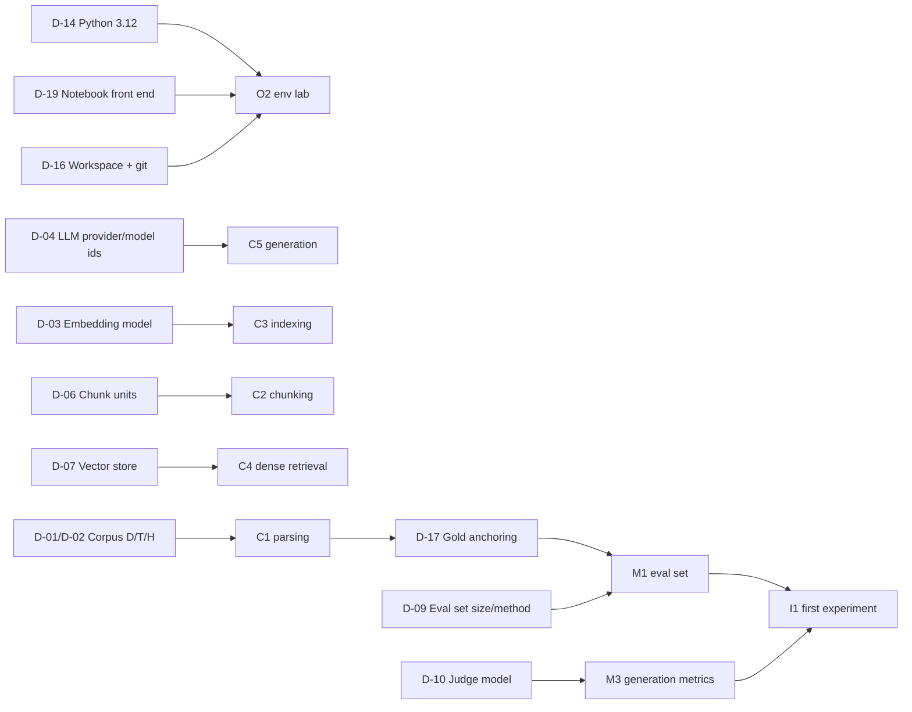

# 08 — Gap Analysis, Source Limitations, Open Decisions and Risks

**Purpose.** This file records what the two primary sources cover and what they leave out. It lists where they contradict themselves, what is still undecided, and what could break the curriculum. It ends with a checklist staged into three approval gates (A design approval, B environment and baseline exit, C measurement exit), each stating which work it permits ([Part 7](#part-7--implementation-readiness-criteria)).
**Status.** First-stage deliverable for review (Codex). No experiments have been run, so every claim about whether a technique "works" is cited to its source, not measured.
**Related files.** Source registry: [01](01_SOURCE_INVENTORY.md). Phase plan: [02](02_RAG_MASTER_LEARNING_PLAN.md). Concept graph: [03](03_RAG_CONCEPT_DEPENDENCY_MAP.md). Chapter↔notebook mapping: [04](04_BOOK_TO_CODE_MAPPING.md). Retention system: [05](05_LEARNING_AND_RETENTION_SYSTEM.md). Project and evaluation design: [06](06_RAG_PROJECT_AND_EVALUATION_PLAN.md). Exemplar lesson: [07](07_SAMPLE_LESSON.md).

> Revised 2026-10-08 (Codex B-01): purpose line now describes the staged approval gates of Part 7. See [corrections log](reviews/CORRECTIONS_LOG_2026-10-08.md#b-01).

### Conventions used here

| Tag | Meaning |
|---|---|
| **[B]** | Book *RAG Made Simple*. Cited as `Ch4 p.3/15`, meaning PDF page 3 of the 15-page `chapter 4.pdf`. `Intro p.x/8` and `App p.x/23` follow the same pattern. |
| **[R]** | Repo `NirDiamant/RAG_Techniques` at pinned commit `009adba2be1bef49780ef73b6dd3c18fd24b035b`. Cited as `all_rag_techniques/x.ipynb cell N` (0-based) or `file.py:Lx-Ly`. |
| **[C]** | **External supplementary material (Source C).** It is not in the learner's files. The `C#n` numbers point to rows in the verified reference list (see [01](01_SOURCE_INVENTORY.md)). |
| **[P]** | The learner's prior materials. They are read-only and never modified. |
| **[E]** | Environment facts about this machine. |
| UNVERIFIED | Not confirmed by direct inspection. Treat it as a hypothesis. |
| Assumption: | A premise the plan depends on. All of them are collected in [Part 6](#part-6--consolidated-assumptions). |

**How these claims were verified.** Most facts come from the per-chapter and per-notebook inventories, which were produced by reading the PDFs and the pinned repo. While writing this file I re-checked the following directly in the book text and the repo:
- Book pages: Intro p.1/8, Ch3 p.1–2/14, Ch8 p.9/11, Ch9 p.10/14, Ch10 p.13/13, Ch22 p.2/19 and p.14–16/19, App p.1/23, p.3/23, p.7/23 and p.12/23.
- Repo: the notebook count (41), the HEAD hash, `LICENSE` §1–3, `evaluation/evalute_rag.py:L155-L168` and `helper_functions.py:L294-L321`.

**Static reading only.** Repo "bugs" were found by reading the code; none was executed (see [Part 3](#part-3--source-limitations)). The one exception is that legacy-import failures were probed against a locally installed LangChain 1.2.13.

---

## Part 1 — Ten gap questions

### Q1. What does the book explain well?

The book is strongest on **intuition and decision criteria**. Every chapter uses the same template: problem, core idea, algorithm sketch, when to use it, tradeoffs (Intro p.8/8). The table below covers the parts that teach mechanism clearly enough to anchor a lesson. Paraphrases only.

| Strength | Where | Why it matters for this learner | Curriculum use |
|---|---|---|---|
| Two-phase mental model of RAG (paraphrase: prepare once, then query many times), with numbered algorithm sketches that later chapters modify | Ch1 p.7/14, p.10/14 | Gives a skeleton to hang every later technique on | C6 trace exercise; O1 blank-page reconstruction |
| Concrete defaults (1,000-character chunks, 200 overlap, top 2–5) that match the repo | Ch1 p.4/14 (sizes), p.8/14 (top 2–5); repo `simple_rag.ipynb` cells 10–13 | Lets the v0 baseline equal "book default" exactly | v0 config ([06](06_RAG_PROJECT_AND_EVALUATION_PLAN.md)) |
| Separates two failure modes: bad evidence and an unfaithful answer, each with its own check | Ch3 p.1–2/14, p.6/14 | This is the retrieval-quality vs answer-quality distinction this curriculum is built on | M3, V2 |
| Taxonomy of query transformations (sharpen, broaden, split), plus the rule that the *original* question drives the final answer | Ch5 p.4–5/14, p.10/14 | Prevents a common bug (answering the rewritten query) | Q1 |
| Query/document asymmetry as the motivation for HyDE; the hypothetical document is thrown away | Ch6 p.1–2/14, p.6/14 | Mechanism-level reason, not a recipe | Q2 |
| "Search unit vs reading unit" | Ch8 p.3/11, p.7/11 | One idea that unifies window enrichment, parent-child retrieval and RSE | X1, I-CMP |
| Semantic chunking: distance curve, then threshold, with three threshold methods | Ch9 p.5–7/14 | Turns an opaque library call into steps the learner can code | I3 |
| Document augmentation presented as the "mirror image" of HyDE, with a rule for when each one pays its cost | Ch11 p.9–10/13, p.12/13 | A ready-made comparative frame | Q2 vs I6 comparison |
| Why score normalisation is required before fusion, with concrete magnitudes | Ch12 p.8/14 | Sets up the misalignment bug discussion (Q6) | R1 |
| Bi-encoder vs cross-encoder, why precomputation matters, and K/N ranges | Ch13 p.6/13, p.9–10/13 (K = 10–30, N = 3–5), p.12/13 | Core mechanism for R3 | R3 |
| Honest rating of "accuracy gain: None" for explanation-only retrieval | Ch19 p.8/10 | Good model of critical self-assessment | V1 |
| Indexing-time vs query-time work in Graph RAG; local vs global search | Ch21 p.3–4/13, p.7/13 | Lets S1 be taught without running the full system | S1 |
| Evaluation triad; worked precision 0.6 / recall 0.3 / MRR ≈ 0.33; judge biases; p50/p95/p99 | Ch22 p.4–8/19, p.10/19, p.14/19 | The only quantitative worked examples in the book | P6, M2–M4 |
| Symptom → technique map, layered build order, quick-reference cost tables, glossary | App p.3–7/23, p.9–11/23, p.13–22/23 | A retrieval index for a learner who forgets | M5 failure taxonomy; review cards ([05](05_LEARNING_AND_RETENTION_SYSTEM.md)) |

**Systemic weakness.** The book contains essentially no measured result. Only two numbers come from a run, and the book cites neither notebook:
- Ch7 p.8–9/11, a 0.1 → 0.9 relevance score. This is a Cohere rerank score from `contextual_chunk_headers.ipynb` cell 13.
- Ch16 p.8–9/11, a BLEU 27.3 answer from `multi_model_rag_with_captioning.ipynb` cell 20.

Every "accuracy gain" rating in a tradeoff table is qualitative. Treat these ratings as **hypotheses to test**, never as facts.

### Q2. What does the repo implement well?

The repo is strongest on **breadth and concrete parameters**. It has 41 technique notebooks, 21 runnable scripts and 5 evaluation notebooks. "Implements well" here means it exposes the mechanism in readable code. It does **not** mean the code is correct (see Q6, Q8 and Part 2).

| Strength | Evidence | Why it is useful |
|---|---|---|
| One shared, inspectable baseline pipeline: PDF loader, then recursive splitter (1000/200, `len`), then tab cleanup, then embeddings, then FAISS | `helper_functions.py:L48-L76` | A concrete Layer-2 reading target for C1–C4. Its hidden defaults are themselves a lesson. |
| Local cross-encoder reranking with a model the learner can run for free | `reranking.ipynb` cell 27 (`cross-encoder/ms-marco-MiniLM-L-6-v2`); `reranking.py:L119` | Becomes the default R3 reranker with zero API calls |
| Toy reranking example with a saved before/after output | `reranking.ipynb` cell 23 | A small, inspectable case to reproduce by hand |
| Reliable RAG on Groq + Cohere: structured relevance grading, hallucination check and highlighting | `reliable_rag.ipynb` cells 6, 14–22 | Closest to the learner's available keys and prior `my way/` work [P] |
| Proposition generation with an explicit quality gate (four criteria, threshold 7) | `proposition_chunking.ipynb` cells 12–16 | Matches Ch4 one-to-one; the rubric is reusable for grading |
| Relevant Segment Extraction: chunk relevance values, then a segment search | `relevant_segment_extraction.ipynb` cells 11–19 | An algorithm the book does not cover; a strong X1 extension |
| Fusion normalisation written out in plain NumPy | `fusion_retrieval.ipynb` cell 17 | Exposes the maths. It also contains an alignment bug, which makes it an excellent debugging exercise. |
| Dartboard written against raw FAISS internals and log-sum-exp | `dartboard.ipynb` cells 13, 21–23 | The mechanism is visible, not hidden behind a framework |
| Fully local building blocks | `json_rag.ipynb` cell 19 (MiniLM); `local_rag_huggingface_faiss.ipynb` cells 14, 16 (bge-base, normalised); `graph_rag_local_attribution.ipynb` (Ollama + MiniLM) | Proof that the essential labs can run without OpenAI |
| Judge meta-evaluation against human labels | `evaluation/end-2-end_rag_evaluation.ipynb` cells 12–14 (`classification_report`); `evaluation/evaluation_grouse.ipynb` cells 36, 39 | The only places where judge reliability is measured. Direct input to M3/V4. |
| Citation precision/recall and graded passage relevance | `evaluation/open-rag-eval-example.ipynb` cells 7–14 | A concrete example of the citation metrics M3 needs |

**Systemic weaknesses.**
- The tests are import smoke tests only (`tests/test_imports.py`).
- There is no dependency manifest; `requirements.txt` was deleted in commit 97b19f9.
- No notebook computes Recall@k, MRR or nDCG (repo-wide grep; see `eval_data` inventory).

### Q3. Which concepts appear in both?

The book says each chapter is extracted from one repo implementation (Intro p.3/8). The full chapter↔notebook table is in [04](04_BOOK_TO_CODE_MAPPING.md). This section records only **whether the overlap is faithful**, because a divergent overlap is a trap for the learner.

| Book chapter | Repo counterpart(s) | Agreement | Divergence the learner must know |
|---|---|---|---|
| Ch1 Simple RAG | `simple_rag`, `simple_rag_with_llamaindex`, `local_rag_huggingface_faiss`; chunk-size section ↔ `choose_chunk_size` | Parameters match (Ch1 p.4/14) | Book step "generate the answer" is missing from `simple_rag.ipynb`, which stops at retrieval (cells 13–15). Book cleaning (p.5/14) is broader than the code, which only replaces tabs (`helper_functions.py:L18-L31`). |
| Ch2 Structured data | `simple_csv_rag`, `simple_csv_rag_with_llamaindex` | Serialization idea | The book's headline queries are never run. The retriever's default k silently truncates "list all X" answers (`simple_csv_rag.ipynb` cell 16). |
| Ch3 Reliable RAG | `reliable_rag` | Grade, verify, highlight | No regenerate/retry branch (cell 20 only prints). The generation prompt says "based upon your knowledge" (cell 18). Model-size advice is the reverse of Ch3 p.10–11/14. |
| Ch4 Propositions | `proposition_chunking` | Prompt and gate match | No answer generation. The book's cost statement contradicts its own algorithm (Part 2). |
| Ch5 Query transformations | `query_transformations` | Prompt taxonomy | The notebook **never retrieves** (cells 6–16). The decomposition prompt is primed with the demo query (cell 14). |
| Ch6 HyDE | `HyDe_Hypothetical_Document_Embedding` | Mechanism | No plain-query baseline; no generation. |
| Ch7 Contextual headers | `contextual_chunk_headers` | Title header | The book attributes 0.1 → 0.9 to an embedding shift (p.9/11), but it is a **reranker** score (cell 13). The book renames Nike to "Acme Corp". |
| Ch8 Window enrichment | `context_enrichment_window_around_chunk` (+ LlamaIndex) | Chunk-index window | The LlamaIndex variant uses **sentence** windows, which the book never mentions. The neighbour lookup scans every vector (cell 19), despite the book's claim of fast lookup (p.9/11). |
| Ch9 Semantic chunking | `semantic_chunking` | Threshold idea | The library's internals (buffered sentences, IQR formula) may differ from the book's p.7/14 description (UNVERIFIED). |
| Ch10 Compression | `contextual_compression` | Extractor | The book's "grade then compress" recipe is not implemented. The demo query does not exercise extraction (cell 14). |
| Ch11 Augmentation | `document_augmentation` (+ `HyPE`, not in book) | Question generation | The "parent" passed to the LLM is the whole 4,000-word document (cells 10, 17). "Tokens" are regex words (cell 6). |
| Ch12 Fusion | `fusion_retrieval`, `fusion_retrieval_with_llamaindex` | Weighted fusion | The book mixes the two notebooks' numbers. No RRF in the book. The LangChain version is buggy (Q6, Part 2). |
| Ch13 Reranking | `reranking`, `reranking_with_llamaindex` | Strong match | The book names no model. Pointwise vs listwise LLM reranking are not distinguished. |
| Ch14 Hierarchical | `hierarchical_indices` | Summary → chunk | The repo uses pages, not "logical sections". Its retry helper is broken (Part 2). |
| Ch15 Dartboard | `dartboard` | Relevance + diversity | The book's scoring paraphrase differs from the code's log-density formula (cell 21). The notebook does not run end to end (cell 25). |
| Ch16 Captioning | `multi_model_rag_with_captioning` | Caption, then embed | Tables are claimed but not captioned (cell 9). The answer may come from model memory (cell 20 prompt). |
| Ch17 Feedback loops | `retrieval_with_feedback_loop` | Numbers match (Ch17 vs cells 18, 20) | Feedback matching is probably dead code (case mismatch, cell 18). The adjusted ranking is never used (cell 22). |
| Ch18 Adaptive | `adaptive_retrieval` | Factual path matches cell 11 | The Opinion path crashes (cell 15). The demo corpus is one sentence (cell 25). |
| Ch19 Explainable | `explainable_retrieval` | Loop of one LLM call per document (cell 6) | LLM explanations are post-hoc rationalisations, not the retriever's actual reason. |
| Ch20 CRAG | `crag` | 0.7/0.3 bands match (cell 22) | Web results are probably unparsed (cell 18). Only the single best document is kept. |
| Ch21 Graph RAG | `Microsoft_GraphRag` (black-box CLI); **not** `graph_rag` | Concept only | `graph_rag.ipynb` builds a graph whose nodes are chunks; spaCy entities and LLM concepts are only node attributes used to weight similarity edges. There are no entity nodes and no communities (cells 9, 12). The name collision is misleading. |
| Ch22 Evaluation | `evaluation/*` | Faithfulness, judge, completeness | The repo implements **none** of the book's ranked retrieval metrics (Ch22 p.4–7/19). |

### Q4. Which topics are missing from either source?

**(a) In the repo but missing from the book (repo-only).** Book-text grep found no chapter for any of these:

| Repo-only topic | Notebook | Curriculum placement |
|---|---|---|
| HyPE (index-time hypothetical questions, question-only embeddings) | `HyPE_Hypothetical_Prompt_Embeddings` | I6 / Q2 comparison |
| Relevant Segment Extraction | `relevant_segment_extraction` | X1 |
| Metadata / multi-faceted filtering | `multi_faceted_filtering` | R2 |
| RAPTOR (recursive cluster summaries) | `raptor` | R5 |
| Self-RAG (prompted approximation) | `self_rag` | A3 |
| Agentic RAG (hosted vendor platform) | `Agentic_RAG` | A5 (read-only) |
| LightRAG, local-attribution graph, Milvus graph | `light_rag`, `graph_rag_local_attribution`, `graphrag_with_milvus_vectordb` | S1 |
| MemoRAG | `memorag` | S3 |
| JSON RAG | `json_rag` | C7 |
| ColPali page-image retrieval | `multi_model_rag_with_colpali` | S2 (read-only on this machine) |
| Local HF/FAISS pipeline | `local_rag_huggingface_faiss` | C6 reference |
| Chunk-size selection procedure | `choose_chunk_size` (book has only a section, Ch1 p.10–11/14) | I1 |
| LlamaIndex variants (6 notebooks) | `*_with_llamaindex`, `choose_chunk_size` | Framework comparison only |
| Eval frameworks: DeepEval, RAGAS, GroUSE, Open-RAG-Eval; judge meta-evaluation | `evaluation/*.ipynb` | M3, V4 |

**(b) In the book but missing from the repo (book-only, or described but not implemented).**
- Ch22 ranked and reference metrics: P@K, R@K, MRR, MAP, NDCG (p.4–7/19); BLEU, ROUGE, BERTScore (p.10/19); noise-robustness tests (p.11–12/19); latency and cost tracking (p.14–15/19); safety tests (p.16–17/19). The repo has no implementation of any of them (`eval_data` inventory, gap 1).
- Ch22 completeness by weighted sub-questions (p.9/19). The repo uses a holistic 0–2 judge instead (`end-2-end_rag_evaluation.ipynb` cell 14).
- Ch3 regenerate/retry branch (p.7–8/14).
- Ch5 retrieval, merging and deduplication across transformed queries (p.6–10/14).
- Ch7 summary and section-path header variants (p.8/11).
- Ch10 "grade then compress" two-stage pipeline (p.10–11/13).
- Ch1 answer generation (Step 8) inside `simple_rag.ipynb`.
- Ch14 multi-document demo (the repo uses one PDF).
- Ch21 internals: entity extraction, Leiden communities, community reports (p.5–9/13). The repo only drives the CLI (`Microsoft_GraphRag.ipynb` cells 14, 17).
- Appendix A decision guide: no repo counterpart.

**(c) Missing from both sources.** These are the gaps this curriculum must fill. Every filler is **external [C]** or newly written.

| Missing topic | Evidence of absence | Concept ID | External filler [C] |
|---|---|---|---|
| Tokens and tokenization; chars ≈ tokens heuristics | Book never defines a token although Ch2 p.9/11 prices "per token". Repo mixes three unit systems under one name (chunking inventory). | P1 | C#3–C#6 |
| TF-IDF/BM25 mathematics; BM25 tokenization | Ch12 has no formula and no k1/b (p.6/14). `helper_functions.py:L248-L273` `bm25_retrieval` is whitespace-split and **never called**. | P3 | C#7–C#15 |
| Similarity maths: cosine, dot product, L2, normalisation | Cosine first named in Ch12 p.8/14. The glossary says Ch1 explains it (App p.15/23); Ch1 does not. FAISS defaults to L2 while prose assumes cosine. | P4 | C#16–C#18 |
| Embedding model choice, max sequence length, truncation, query/document prefixes | No book coverage. Repo embeddings are unpinned `OpenAIEmbeddings()` defaults. | P4, C3 | C#17, C#20, C#21 |
| ANN internals (HNSW, IVF) | No book hits for HNSW (`references` inventory) | P5 | C#22–C#25 |
| Label-based retrieval evaluation with gold evidence | Repo computes no Recall@k/MRR/nDCG. `data/q_a.json` has no evidence locations. | P6, M1, M2 | C#10, C#11, C#45–C#47 |
| Reciprocal Rank Fusion | No "RRF" or reciprocal rank fusion in the book (the only "reciprocal" hits are MRR in Ch22 and the glossary). LlamaIndex notebook rejects it on mistaken grounds (`fusion_retrieval_with_llamaindex.ipynb` cells 19–20). | R1 | C#33 |
| Structure-aware chunking (headings, sections) | Ch7 mentions section paths only as a header variant (p.8/11) | I2 | C#28, C#29 |
| PDF parsing quality: multi-column, tables, OCR, page provenance | Book treats extraction as one step (Ch1 p.4/14); no "OCR" anywhere in the book. Repo mixes pypdf and PyMuPDF extractors (`helper_functions.py:L48-L76` vs `L223-L245`). | C1 | — (new lab) |
| Context assembly: ordering, dedup, token budget, "lost in the middle" | Ch5 p.10/14 requires dedup but never explains it; no "lost in the middle" hits. | P7, X3 | C#39 |
| Citation verification (does the quote exist in the source?) | Ch3 highlighting is "verbatim" by prompt only (`reliable_rag.ipynb` cell 22). `graph_rag_local_attribution` never checks its source sentences (cell 9). | V1 | — |
| Answerability and abstention policy | Ch3 p.11/14 prefers "I don't know" but gives no algorithm step | V3 | C#48 (concepts only) |
| Experimental design: controls, variance, sample size, paired comparisons | Ch22 p.13/19 gives an unsourced 200–500 example rule | M4 | C#50 (ARES confidence intervals) |
| Late interaction (ColBERT) | No hits in either source; ColPali is used as a black box | R3 (U), S2 | C#35, C#36 |
| Contextual retrieval (context prepended for both BM25 and embeddings) | No book hits | I5 | C#31 (vendor blog) |
| Production practices (Q10) | — | D1–D4 | see Q10 |
| Conversational / multi-turn RAG; long-context vs RAG decision; fine-tuning retrievers | Not covered by either source; only prior VAI L26 work [P] | Not scheduled (out of scope; noted for K1 discussion) | — |

### Q5. Which concepts are taught before their prerequisites?

**In the book:**

| Concept used | First used | Explained (if at all) | Consequence | Fix in this curriculum |
|---|---|---|---|---|
| Embeddings | Intro p.5/8 | Ch1 p.5/14 | Minor | P4 before C3 |
| Similarity / distance (cosine, L2) | Ch1 "close together" (p.5–6/14); Ch6–11 implicitly | Named only in Ch12 p.8/14; defined only in the glossary, App p.15/23 | Learner cannot reason about normalisation, FAISS L2, or the `graph_rag` inversion bug | P4 |
| Tokens / context window | Ch1 p.12/14, Ch2 p.9/11, Ch4 p.5/15 | Never | Unit confusion (chars vs tokens), silent embedding truncation | P1 |
| LLM-as-judge with structured yes/no output | Ch3 p.6–7/14; Ch4; Ch18 p.4/12 (LLM query classifier) | Judging only in Ch22 p.9–10/19; structured output never | Graders are trusted without calibration | M3 before V2/A* |
| Reranker | Ch7 p.8/11 | Ch13 | Ch7's measured gain cannot be interpreted | R3 linked from I5 |
| Precision / recall vocabulary | Ch12 p.13/14 ("recall") | Ch22 p.4–5/19 | Claims cannot be checked | P6 in Phase 1 |
| BLEU | Ch16 p.8–9/11 | Ch22 p.10/19 (n-grams never) | Misread as answer quality | M3 sidebar |
| Percentile, standard deviation, IQR | Ch9 p.6–7/14; Ch12 p.8/14 | Never | Threshold choice becomes cargo-cult | P1/P6 maths notes |
| MMR | Ch19 p.4/10; App p.3/23 | Glossary App p.19/23 only | Confused with dartboard | R4 comparison |
| HyDE before its mirror (augmentation) | Ch6 | Ch11, four chapters later | The comparison is lost | Q2 teaches both together |
| **Evaluation overall** | Every "accuracy gain" claim, Ch1–21 | Ch22 (last); the Appendix places measurement at "Layer 5" (App p.7/23) | No claim is checkable when it is read | **Phase 3 (M) immediately after the baseline** (BACKBONE principle 2) |

**In the repo:**
- `simple_rag.ipynb` cell 17 runs an LLM judge (`evaluate_rag`) in the very first notebook, before any evaluation concept. Its scores are also not meaningful (Part 2).
- README "Foundational" puts Reliable RAG and Proposition Chunking (LLM graders, structured output, tiktoken units) before any retrieval or evaluation basics (README technique table; repo inventory).
- Token-based splitters are used without introduction: `reliable_rag.ipynb` cell 6 (500 tokens), `proposition_chunking.ipynb` cell 9 (200/50 tokens, gpt2 encoding).

The phase order in [02](02_RAG_MASTER_LEARNING_PLAN.md) and the dependency graph in [03](03_RAG_CONCEPT_DEPENDENCY_MAP.md) resolve all of these. P1–P7 come before C, and M comes before any I/R/Q/X technique.

### Q6. Which notebooks hide important implementation details behind abstractions?

"Hidden" means the abstraction makes a choice that changes results, and the notebook never prints or explains that choice. Each row names the reading target in [04](04_BOOK_TO_CODE_MAPPING.md) and the Layer-1 replacement the learner will write.

| Abstraction | Where | What it hides | Why it matters | Exposed in |
|---|---|---|---|---|
| `from helper_functions import *` / `from evaluation.evalute_rag import *` | 18 notebooks and 16 scripts / 17 notebooks and 14 scripts (repo inventory) | Where `ChatOpenAI`, `FAISS`, `PromptTemplate`, `json` and others come from. `ChatOpenAI` reaches HyDE, HyPE, compression and explainable only through `evaluation/evalute_rag.py:L22`. Importing it also builds deepeval metrics bound to gpt-4-turbo at load time (`L71-L93`). | Import failures on a clean install; OpenAI is needed even when no OpenAI call is made | O2 env lab; ragkit has explicit imports |
| `encode_pdf` | `helper_functions.py:L48-L76` (used by HyDE, compression, crag, hierarchical, memorag, reranking, self_rag) | pypdf per-page loading, so chunks never cross pages. Character units. Tab-only cleaning. Unpinned embedding model. `FAISS.from_documents` uses the L2 index by default. | The page-boundary effect; units; L2 vs cosine; non-reproducible embeddings | C1–C4, [07](07_SAMPLE_LESSON.md) |
| LangChain `FAISS` / `as_retriever(k)` / `similarity_search_with_score` | Most LangChain notebooks | Score is an L2 **distance** (lower is better). It is not a similarity. | `graph_rag.ipynb` cell 12 uses the distance as if it were a similarity (Part 2) | P4, P5 |
| `RecursiveCharacterTextSplitter` | `simple_rag.ipynb` cell 10 | Separator hierarchy; actual overlap ≤ requested overlap | The book describes it as plain character slicing (Ch1) | C2 |
| `RecursiveCharacterTextSplitter.from_tiktoken_encoder` | `proposition_chunking.ipynb` cell 9; `reliable_rag.ipynb` cell 6; captioning cell 14 | Sizes are **tokens** (gpt2 encoding) | The same number means several times more text than the character setting (exact ratio corpus-specific; measured in 07) | P1, C2 |
| `SemanticChunker` | `semantic_chunking.ipynb` cells 12–14 | Sentence buffering, distance metric, threshold formula; no size cap | The book's p.7/14 formula may not match the library (UNVERIFIED) | I3 |
| `LLMChainExtractor` + `ContextualCompressionRetriever` + `RetrievalQA` | `contextual_compression.ipynb` cell 12 | Per-chunk LLM calls, prompt, empty-output sentinel | Cost and latency are invisible; before/after text is never shown | X2 |
| `QueryFusionRetriever(mode='dist_based_score')` | `fusion_retrieval_with_llamaindex.ipynb` cell 19 | Normalisation formula, per-retriever top-k | The book took its numbers from here without saying so | R1 |
| LlamaIndex `IngestionPipeline(vector_store=FAISS)` + `VectorStoreIndex(nodes)` | `simple_rag_with_llamaindex` cells 13–16; `fusion_retrieval_with_llamaindex` cells 8–17; `reranking_with_llamaindex` cells 10–16; `context_enrichment_window_around_chunk_with_llamaindex` cells 12–22 | FAISS is probably **never queried**: an in-memory index is built instead (PLAUSIBLE; LlamaIndex source not inspected) | The learner believes FAISS is in use | Framework-comparison sidebar |
| LlamaIndex `Settings` globals; `DatasetGenerator`; `FaithfulnessEvaluator` | `choose_chunk_size.ipynb` cells 6–10 | Which LLM generates questions (cell 6 runs before `Settings.llm` is set in cell 8). Token units. The custom prompt registered under `"your_prompt_key"` is probably ignored (cell 8; `choose_chunk_size.py:L107`). | The "experiment" may not measure what it claims | I1 critique ([07](07_SAMPLE_LESSON.md) Part G) |
| `CSVLoader.load_and_split` | `simple_csv_rag.ipynb` cell 10 | Row serialisation format; possible further splitting | Contradicts the book's claim that rows are already natural units needing no splitting (Ch2 p.4/11) | C7 |
| `with_structured_output(PydanticModel)` | 11 notebooks (repo inventory) | Tool-calling or JSON mode, provider support, failure behaviour | Breaks when moving to Groq or local models; graders silently mis-parse | M3, V2 |
| `HuggingFaceEndpoint` | `local_rag_huggingface_faiss.ipynb` cell 20 | Generation is **remote**, despite the "fully local" claim (cells 0, 5) | The privacy claim is false | D4 discussion |
| `graphrag` CLI and `settings.yaml` | `Microsoft_GraphRag.ipynb` cells 14, 17 | All of extraction, Leiden clustering and community reports | Nothing to learn from the code; also writes the API key into a file (cell 14) | S1 (book-led) |
| Contextual AI `agents.query.create` | `Agentic_RAG.ipynb` cell 21 | The entire pipeline is a hosted service | Cannot be reproduced or taught at mechanism level | A5 (read-only) |
| byaldi `RAGMultiModalModel` | `multi_model_rag_with_colpali.ipynb` cells 9, 13, 16 | Late-interaction (MaxSim) scoring | Mechanism is invisible | S2 + C#35 |
| deepeval `GEval`, `FaithfulnessMetric`, `ContextualRelevancyMetric` | `evaluation/evaluation_deep_eval.ipynb` cells 2–6; `evaluation/evalute_rag.py:L71-L93` | Number of judge calls, prompts, default OpenAI judge | Judge cost and bias are invisible | M3 |

### Q7. Which techniques solve similar problems and need comparative explanations?

Neither source compares techniques with measurements. The book's "Compared to …" paragraphs are qualitative, and the repo contains no comparison notebook. Each family below gets one comparative lesson or experiment, built on the single frozen eval set ([06](06_RAG_PROJECT_AND_EVALUATION_PLAN.md)).

| Family (shared failure) | Members | The distinction to teach | Where |
|---|---|---|---|
| **Granularity / boundary loss** | Fixed and recursive (C2), structure-aware (I2), semantic (I3), propositions (I4), contextual headers (I5), window enrichment (X1), RSE (X1), parent-child (I6), hierarchical (R5), RAPTOR (R5) | Index-time vs retrieval-time fixes; search unit vs reading unit (Ch8 p.3/11); LLM cost at indexing | **I-CMP** (E) |
| **Query/document vocabulary mismatch** | Rewriting, step-back, decomposition (Q1); HyDE (Q2); document augmentation and HyPE (I6); BM25 hybrid (R1) | Query-time vs index-time; who pays the LLM cost and when (Ch11 p.12/13); query-drift risk | Q2 comparison block |
| **Combining rankings** | Weighted min-max (`fusion_retrieval.ipynb` cell 17), distribution-based ±3σ (Ch12 p.8/14; `fusion_retrieval_with_llamaindex.ipynb` cell 20), RRF (C#33, external) | Score fusion needs comparable scales; rank fusion does not | R1 |
| **Re-ordering candidates** | Cross-encoder; LLM pointwise 1–10 (`reranking.ipynb` cell 15); LLM batch `LLMRerank`; Cohere rerank; CRAG evaluator; adaptive's LLM scoring (Ch18) | All are rerankers with different cost and calibration; LLM scores tie and drift | R3 (+ A1/A2 cross-links) |
| **Redundancy** | MMR, Dartboard (Ch15), the "fusion diversifies" claim (Ch15 p.10/12) | Different objectives; the Appendix wrongly equates them (Part 2) | R4 |
| **Filtering irrelevant evidence** | Relevance grading (Ch3), compression (Ch10), CRAG thresholds (Ch20), Self-RAG relevance (repo), metadata filters (R2), reranker cut-off | Binary filter vs graded vs sentence-level; recall lost to false rejects | V2 / X2 comparison |
| **Retrieval control flow** | Adaptive routing (A1), CRAG (A2), Self-RAG (A3), feedback loops (A4), agentic (A5) | When retrieval happens, how many LLM calls, failure handling; choose ONE (BACKBONE v7.0) | Phase 10 intro |
| **"Why this source?"** | Explainable retrieval (Ch19), Ch3 highlighting, citation verification (V1), local-attribution graph | Post-hoc rationalisation vs verifiable attribution | V1 |
| **Graph-shaped retrieval** | `graph_rag` (chunk graph), Microsoft GraphRAG (communities), LightRAG (dual-level), Milvus triplets, local-attribution KG, RAPTOR (tree) | Same word "graph", five different data structures | S1 |
| **Multimodal** | Captioning (Ch16) vs ColPali page images | Convert to text vs embed page images; OCR-free | S2 |
| **Evaluation tooling** | Label-based IR metrics (M2), RAGAS, DeepEval, GroUSE, Open-RAG-Eval/UMBRELA | Reference-based vs reference-free; who judges the judge | M2/M3 |

### Q8. Which examples demonstrate a technique without measuring its impact?

**All 41 technique notebooks do.** No notebook runs a controlled with/without comparison on a labelled question set. The table goes notebook by notebook, so each future lab knows what evidence its upstream example does and does not provide. Abbreviations:
- **Metric**: an aggregate number computed over more than one question.
- **Baseline**: the same queries run without the technique.
- Notes come from the per-notebook inventories; cells are 0-based.

| # | Notebook (`all_rag_techniques/`) | ID | What is shown | Metric | Baseline | Note |
|---|---|---|---|---|---|---|
| 1 | `simple_rag` | C4–C6 | Retrieved chunks for 1 query (cell 15) | No. Cell 17's judge has no ground truth, and its average is a stub. | — | No generation step |
| 2 | `simple_rag_with_llamaindex` | C6 | deepeval vs `q_a.json` | Wired for **1** question (cell 23); no saved output | No | — |
| 3 | `simple_csv_rag` | C7 | 1 hand-picked query (cell 18) | No | No | Default k truncates "list all" answers |
| 4 | `simple_csv_rag_with_llamaindex` | C7 | 1 query | No | No | — |
| 5 | `json_rag` | C7 | Timing prints only | No | No | No generation |
| 6 | `local_rag_huggingface_faiss` | C6 | Keyword "hit rate" on 2 questions (cell 30) | Broken `evaluate_rag` call; no saved output | No ("Compare with Basic RAG" heading only) | — |
| 7 | `reliable_rag` | V2 | Grader outputs for 1 question | No | No | Filter and reject counts never reported |
| 8 | `choose_chunk_size` | I1 | Faithfulness/relevancy pass rates for sizes 128 and 256 over 25 generated questions | **Yes**, but 1.00/1.00 ceiling and stale output (cell 12) | Two sizes only | The only aggregate metric in the repo; uninformative |
| 9 | `proposition_chunking` | I4 | Side-by-side for 4 queries (cells 19–37) | No (qualitative table, cell 38) | Degenerate (k=4 over 3 chunks) | — |
| 10 | `semantic_chunking` | I3 | 1 query | No | No | The script's `--experiment` records time only |
| 11 | `contextual_chunk_headers` | I5 | Rerank score for **one cherry-picked chunk** (cell 13) | n = 1 | With/without header on 1 chunk | KITE/FinanceBench numbers are external and not reproducible here |
| 12 | `relevant_segment_extraction` | X1 | 1 query vs a human-judged span | n = 1 | Qualitative | External benchmark numbers in markdown only |
| 13 | `context_enrichment_window_around_chunk` | X1 | Chunk vs window for 2 queries | No | Printed side by side | Cell 25 has no saved output |
| 14 | `context_enrichment_window_around_chunk_with_llamaindex` | X1 | Base vs windowed answer, 1 query | No | Printed | No saved outputs at all |
| 15 | `contextual_compression` | X2 | 1 answer | No | No | No token-saving number despite the efficiency claim |
| 16 | `document_augmentation` | I6 | Retrieved item and answer | No | No | No saved outputs |
| 17 | `HyPE_Hypothetical_Prompt_Embeddings` | I6/Q2 | `evaluate_rag` on HyPE only (cell 21) | No (average is None) | No | Paper's gain cited, not reproduced; cell 11 SyntaxError |
| 18 | `query_transformations` | Q1 | Transformed strings | No | No | **Never retrieves** |
| 19 | `HyDe_Hypothetical_Document_Embedding` | Q2 | HyDE-retrieved chunks, 1 query | No | No | — |
| 20 | `fusion_retrieval` | R1 | Fused top-5, 1 query | No | Dense-only and BM25-only never shown | Fusion bug (Part 2) |
| 21 | `fusion_retrieval_with_llamaindex` | R1 | Fused nodes, 1 query | No | No | — |
| 22 | `reranking` | R3 | Toy 5-sentence before/after (cell 23) | No | Qualitative | PDF case has no saved output |
| 23 | `reranking_with_llamaindex` | R3 | Toy before/after (cell 19) | No | Qualitative | — |
| 24 | `hierarchical_indices` | R5 | Chunks for 1 query | No | No flat baseline | Claimed efficiency never timed |
| 25 | `dartboard` | R4 | Top-3 vs dartboard (cells 16, 25) | No | Qualitative | Cell 25 cannot run; its output is stale |
| 26 | `multi_faceted_filtering` | R2 | Document counts per filter | No | Raw top-10 | No saved outputs |
| 27 | `explainable_retrieval` | V1 | Explanations, 1 query | No | No | Explanation faithfulness never assessed |
| 28 | `adaptive_retrieval` | A1 | — | No | No | Corpus is 1 sentence; no outputs |
| 29 | `retrieval_with_feedback_loop` | A4 | — | No | No | Synthetic 5/5 feedback; no outputs |
| 30 | `crag` | A2 | Branch choice for 2 queries | No | No | No outputs |
| 31 | `self_rag` | A3 | Per-query support/utility used to select an answer | No (selection scores are not evaluation) | No | No outputs |
| 32 | `Agentic_RAG` | A5 | Reranker with/without instruction on 3 synthetic docs (cells 42–46) | Component-level only | Partial | Vendor black box |
| 33 | `multi_model_rag_with_captioning` | S2 | One answer (27.3) | No | No | Retrieved source never printed |
| 34 | `multi_model_rag_with_colpali` | S2 | One answer | No | No comparison with #33 on the same query | — |
| 35 | `raptor` | R5 | 1 query | No | No | No outputs |
| 36 | `graph_rag` | S1 | Token/cost printout | No | No | — |
| 37 | `graph_rag_local_attribution` | S1 | — | No | Asserted only | Constant 0.9 "confidence" |
| 38 | `Microsoft_GraphRag` | S1 | 2 answers saved as object reprs | No | No | — |
| 39 | `graphrag_with_milvus_vectordb` | S1 | Naive vs graph on **1 query, 4 handcrafted passages** (cells 36–39) | No | Qualitative | Strong claims from n = 1 |
| 40 | `light_rag` | S1 | Comparison table asserted (cell 29) | No | No | Incremental-update advantage not shown |
| 41 | `memorag` | S3 | Intended 3-way deepeval comparison (cells 43–72) | Broken (`evaluate_rag` signature, cells 45/62) | Different question sets per arm | Original MemoRAG results pasted in |

The evaluation notebooks (`evaluation/`) measure **judges or metrics**, not techniques:

| Notebook | What is measured | Comment |
|---|---|---|
| `define_evaluation_metrics` | Toy strings only | NameError in cell 9 |
| `end-2-end_rag_evaluation` | Judge agreement with human labels (cells 12–14, 19) | Real meta-evaluation on external figshare data; cell 22 NameError |
| `evaluation_deep_eval` | Toy test cases | No dataset |
| `evaluation_grouse` | Judge vs GroUSE unit tests (cells 36, 39) | Answer order in pairwise prompts is fixed, never randomised (cells 26–32) |
| `open-rag-eval-example` | UMBRELA, nuggets, HHEM, citation P/R on an external FiQA CSV (cells 7–14) | Measures a pre-generated pipeline. FiQA qrels exist upstream but are never loaded. |

**Consequence.** Every technique lab in this curriculum must run its own controlled experiment: hypothesis, then frozen eval set, then retrieval and generation metrics reported separately, then a decision (BACKBONE principle 4). Upstream outputs are illustrations, never evidence.

### Q9. Which external services, API keys or dependencies complicate execution?

**Keys actually available [E].**
- `GROQ_API_KEY` and `COHERE_API_KEY`, both in `C:\Yash\New-Work\Book RAG\prior_work\my way\.env`. Only the key names were read.
- **No `OPENAI_API_KEY`.** 36 of 46 notebooks use OpenAI somewhere in code (repo inventory, DEPS).
- **Groq offers no embeddings or rerank endpoint** (Groq API reference, C#55, checked 2026-10-08).
- **Ollama is not installed.**

**Services and keys:**

| Service / key | Needed by (examples) | Status on this machine | Handling |
|---|---|---|---|
| OpenAI (`OPENAI_API_KEY`) | 36/46 notebooks, including every `encode_pdf` user, `evalute_rag.py` and deepeval defaults | **Absent** | Never on the critical path. Upstream notebooks are read, not run (D-15). |
| Azure OpenAI (5 env vars) | `Microsoft_GraphRag` cell 10 (default `AZURE=True`); `light_rag` cells 6, 8 option | Absent | Read-only |
| Groq | `proposition_chunking` cells 5, 12; `reliable_rag` cells 14–22 | Present | Default generator for generation and all non-judge LLM calls; not the judge (D-04, D-10). Model ids are configurable (D-04). |
| Cohere (`COHERE_API_KEY` / `CO_API_KEY`) | `contextual_chunk_headers` cell 13; `relevant_segment_extraction` cells 7, 11; `reliable_rag` cell 6; captioning cell 14 | Present (trial vs paid tier UNVERIFIED) | Default embedder (D-03) and the end-of-curriculum judge (D-10); rerank stays an optional comparison (D-11). The repo's `rerank-english-v3.0` id may be retired (UNVERIFIED). |
| Google Gemini (`GOOGLE_API_KEY`) | Both multimodal notebooks (`gemini-1.5-flash`, likely retired, UNVERIFIED) | Absent | S2 read-only |
| Hugging Face token | `local_rag_huggingface_faiss` cell 6 (remote inference); ColPali cell 8 | Not found | Local model downloads of public models usually work without a token (Assumption) |
| Ollama local server | `proposition_chunking` cell 9 (`nomic-embed-text:v1.5`); `graph_rag_local_attribution` cells 4–5 (`llama3.1`) | **Not installed** | Not used (D-05, learner decision) |
| Contextual AI | `Agentic_RAG` cell 7 | Absent | Read-only |
| Zilliz / Milvus cloud | `graphrag_with_milvus_vectordb` cell 10 (placeholders) | Absent | Read-only, or Milvus Lite/FAISS substitute (UNVERIFIED) |
| DuckDuckGo search (no key, rate-limited) | `crag` cell 14 | Package not installed | A2 lab uses a stubbed "web" corpus, not live search (Assumption) |
| Live web data | Wikipedia scrape (`Microsoft_GraphRag` cell 12); nobelprize.org API (`json_rag`); deeplearning.ai pages (`reliable_rag`); figshare CSV (`end-2-end` cell 4); vectara CSV (`open-rag-eval`); HF dataset `illuin/grouse` | Not pinned; content may change | Never used for frozen evaluation |
| GitHub `main` (unpinned clone/wget) | Most notebooks, cells 3–8; `data/feedback_data.json` is **absent** from the pinned `data/` (feedback-loop cell 7) | — | Use pinned local files only |
| Click-tracking redirects | README and `simple_rag.ipynb` markdown cells 0, 19, 20 | — | Ignore. Do not follow tracker links. |

**Dependency hazards** (from the environment inventory; items not probed locally are UNVERIFIED):
1. **No dependency manifest.** The repo ships no `requirements.txt` or `pyproject`. Both CI workflows reference the missing file (`.github/workflows/github-test.yml:L9`, `L31`; `.github/workflows/local-test.yml:L26`). Each notebook's own `pip` cell omits packages its star-imports need: deepeval, PyMuPDF, rank_bm25, langchain-community.
2. **LangChain 1.x breakage.** `langchain.chains`, `langchain.text_splitter`, `langchain.docstore`, `langchain.vectorstores` and `langchain_core.pydantic_v1` imports fail (probed against the local LangChain 1.2.13). `get_relevant_documents` is absent from langchain-core 1.2.23 (`helper_functions.py:L143`).
3. **`llama_index.legacy`.** `fusion_retrieval_with_llamaindex` cell 3 imports from it; it is likely uninstallable (UNVERIFIED).
4. **Windows wheels.**
   - faiss-cpu: cp312 wheels exist (UNVERIFIED for cp313/314); faiss-gpu has no Windows build.
   - torch: the default wheel is CPU-only; CUDA builds need the PyTorch index.
   - flash-attn, bitsandbytes and auto-gptq (`memorag`, ColPali): treat as **infeasible** on this machine.
5. **Python versions.** 3.12.8 is the system default and matches CI's 3.12.6. 3.14 is installed but risky for ML wheels.
6. **Jupyter.** Only `jupyter_core`, `jupyter_client` and `ipykernel` are installed; no notebook front end is confirmed.
7. **Hardcoded retired or legacy model ids** across the repo: gpt-3.5-turbo, gpt-4-turbo-preview (`tests/conftest.py:L58`), Groq `llama-3.1-70b-versatile` and `mixtral-8x7b-32768` (deprecation status UNVERIFIED against today's catalog).

> Revised 2026-10-08 (learner decisions): Groq/Cohere/Ollama "Handling" cells aligned with the learner's D-03, D-04, D-05 and D-10 decisions. See [corrections log](reviews/CORRECTIONS_LOG_2026-10-08.md#learner-decisions).

### Q10. Which modern production practices are missing or insufficiently covered?

Book coverage is concentrated in one section, Ch22 "Production Evaluation and Monitoring" and "Safety Evaluation" (p.15–17/19). Repo coverage is almost nil. Severity is relative to the learner's goal of eventually building production RAG.

| Practice | Book [B] | Repo [R] | Gap | Curriculum home |
|---|---|---|---|---|
| **Observability / tracing** of every intermediate | No "trace/tracing" in the observability sense; every hit means attribution (e.g. Ch3's "Trace" checkpoint is source highlighting, p.8/14, p.10/14). Ch22 p.14/19 recommends per-component latency. | `graph_rag` prints token cost (`get_openai_callback`, cell 12); no traces anywhere | **High** | D1 (from v0.1 onward: trace log is part of the eval harness) |
| **Eval-in-CI / regression gates** | Golden dataset gates deployment; flagged examples grow the set (Ch22 p.15/19) | `tests/` are import smoke tests only; CI workflows reference a deleted file and cannot run | **High** | M4 regression set → D3 pytest thresholds |
| **Index versioning & incremental updates** | Not covered. Ch1 omits re-indexing on document change; Ch21 has no update story. | `light_rag` claims incremental updates but does not demonstrate them; pickled indexes (`hierarchical_indices` cell 13) | **High** | C3 params hash → D3 |
| **Embedding model upgrades / re-indexing** | Not covered (same-model requirement only implied) | Unpinned `OpenAIEmbeddings()` defaults; cached `../vector_stores` reused across model changes (repo inventory) | **High** | C3, D3 (D-03 makes the first model swap a deliberate exercise) |
| **Caching** (embeddings, LLM responses, judge outputs) | Not covered ("caching" appears only inside an example query, Ch18 p.4/12) | No caching apart from memorag's saved JSON and GroUSE's internal cache | Medium | M4 (cache LLM calls for reproducibility), D2 |
| **Cost budgets** | Cost per query and per component (Ch22 p.14–15/19); Appendix cost ratings are qualitative (App p.9–11/23) | OpenAI-only cost callback in `graph_rag` | Medium | M4 logging → D2 budgets |
| **Latency SLOs** | p50/p95/p99 named (Ch22 p.14/19) | Wall-clock prints only (e.g. `choose_chunk_size` cell 12; `semantic_chunking.py` timing) | Medium | D2 |
| **Prompt injection via retrieved documents** | Only *query-side* injection (Ch22 p.16/19). Ch20 injects web text with no warning. | `crag` feeds raw web snippets into prompts (cells 18–22) | **High** | D4 (red-team set of poisoned chunks) |
| **Access control / multi-tenancy** via metadata filters | Not covered | `multi_faceted_filtering` filters **after** retrieval (cells 12–14), which cannot enforce access | **High** for production; U for learning | R2 (pre- vs post-filter), D4 |
| **PII handling** | "Information leakage" as a safety test (Ch22 p.16/19); Ch17 stores user queries with no PII discussion | `customers-100.csv` holds names, emails and phones (synthetic-looking) and is embedded wholesale (`simple_csv_rag` cells 7–12) | Medium | D4, A4 |
| **Structured-document parsing** (tables, multi-column, OCR, page provenance) | Extraction is a single step (Ch1 p.4/14). Images and tables are handled only by captioning (Ch16). No OCR. | Two different PDF extractors (`helper_functions.py:L48-L76` pypdf vs `L223-L245` PyMuPDF). Captioning does not caption tables (cell 9). ColPali avoids OCR as a black box. | **High** for Corpus T | C1 (E), S2 |
| **Guardrails** (input/output policies, refusal) | Guardrails behave differently with retrieved context; refusal rate (Ch22 p.17/19, unsourced) | None; the closest is the Reliable RAG hallucination grader | Medium | V2, V3 (abstention), D4 |
| **Feedback data governance** (poisoning, retention, consent) | Not covered in Ch17 (no poisoning, PII or retention discussion) | Feedback is synthetic and appended to JSON with no validation (feedback-loop cells 18–22) | Medium | A4 |
| **A/B testing** | Ch22 p.15/19; glossary App p.13/23 | None | Low for a single learner | M4 teaches **offline paired comparison** instead; online A/B stays conceptual |
| **Secrets hygiene** | — | API key written to `settings.yaml` (`Microsoft_GraphRag` cell 14); literal placeholder keys (`graphrag_with_milvus_vectordb` cell 5; ColPali cell 22) | Medium | O2 (`.env`, `.gitignore`) |
| **Rate limiting / retries** | Ch14 assumes async/batching without explaining it | Retry helper is broken (`helper_functions.py:L294-L321`, Part 2) | Medium (Groq limits) | M4, D2 |
| **Dependency pinning / reproducible environments** | — | No manifest (Q9) | **High** | O2 (`uv.lock`) |

---

## Part 2 — Internal inconsistencies and errors

### 2a. Book

| # | Inconsistency | Evidence (paraphrased, quotes ≤ 15 words) | Teaching action |
|---|---|---|---|
| B1 | **"No hallucination" overclaim** | Intro p.1/8: "No hallucination. No guesswork." Ch3 p.1/14 then explains that the model can still hallucinate with perfectly relevant chunks, and p.2/14 calls this arguably more dangerous because of false confidence. | O1 diagnostic misconception; anchors M3/V2 |
| B2 | **Appendix stacks diagram vs text** | App p.8/23 diagram (inspected via rasterised page): Enterprise column duplicates block 3; Support contains 12 but lacks 13 and 5; Tech Docs contains 5 and lacks 12 and 13. Only the Research column matches the stack text (App p.8–9/23). | Use the text, never the figure |
| B3 | **"Twenty" vs "twenty-two" techniques** | Ch22 p.2/19 says "the twenty techniques in this book". App p.1/23, p.2/23, p.6/23 and p.9/23 all say twenty-two. The book has 22 technique chapters. | Minor; note in [01](01_SOURCE_INVENTORY.md) |
| B4 | **Proposition-chunking cost** | Ch8 p.9/11 and Ch9 p.10/14: an LLM call **per chunk** during preparation. Ch10 p.13/13: "once per document". Ch4's own algorithm grades **each proposition** (p.9/15), so its p.13/15 tradeoff (one generation call plus one quality-check call per chunk) also understates cost. | I4 cost model: count calls from the code (`proposition_chunking.ipynb` cells 12–16) |
| B5 | **Appendix calls dartboard MMR** | App p.3/23 describes dartboard "with maximal marginal relevance". Ch15 never mentions MMR. The notebook attributes it to the Relevant Information Gain paper (`dartboard.ipynb` cell 0, arXiv 2407.12101). The glossary defines MMR separately (App p.19/23). | R4 teaches MMR and dartboard as distinct objectives |
| B6 | Appendix decision-tree flowchart | App p.11/23: "Data OK? Yes" and "Search OK? Yes" both route to "Fix Query"; there is no retrieval or refine node | Do not use |
| B7 | "Zero per-query overhead" for indexing techniques | App p.12/23 takeaway vs App p.10/23 table, which rates Ch16 and Ch21 query cost Medium | Cost lessons count calls per stage |
| B8 | Appendix summaries contradict chapters | Ch19 described as claim-to-source tracing (App p.3/23, p.5/23) vs Ch19 p.8/10. Ch20 as "repairs low-confidence answers" vs Ch20's document evaluation plus web fallback. Ch18 query cost "Low" (App p.10/23) vs Ch18 p.11/12 "High". | Cite chapters, not Appendix summaries |
| B9 | Oversampling factor | Glossary says 3–5× (App p.19/23); Ch18 uses 2× | Parameterise; measure |
| B10 | Cosine "explained in Chapter 1" | Glossary App p.15/23 points to Ch1; Ch1 never names cosine (grep) | P4 fills the gap |
| B11 | Ch3 extra-call count | Prose says 2–4 extra calls, table says 2–3 (p.11/14). With k=4 graders the count is 6 (4 + 1 + 1). | V2 counts calls in a trace |
| B12 | Ch9 spectrum diagram lists the context window as a chunking strategy | Ch9 p.11/14 vs Ch8, which leaves chunking unchanged | I-CMP |
| B13 | Ch7's measured gain attributed to embeddings | Ch7 p.9/11 vs `contextual_chunk_headers.ipynb` cell 13 (Cohere **rerank** score) | I5 re-measures with embeddings and a reranker separately |
| B14 | Ch21 "five-stage" pipeline after a seven-step sketch | Ch21 p.8/13 | Minor |
| B15 | Evaluation placed last vs "measure before and after every change" | App p.7/23 (Layer 5, "Finally, add measurement") vs App p.12/23 | Resolved by Phase 3 placement |
| B16 | Intro grouping vs chapter order; Ch11 filed as post-retrieval; Ch15 intro summary vs chapter | Intro p.5–7/8 vs chapters | [03](03_RAG_CONCEPT_DEPENDENCY_MAP.md) replaces book order |
| B17 | Small factual slips | Ch6 p.1/14 calls a six-word question "seven-word"; Ch6 p.8/14 gives an unsourced 93% ocean-heat figure | Practice for critical reading |
| B18 | Unsourced quantitative claims | Ch22 p.10/19 (+15 points with CoT judging), p.11/19 (≈50% noise cliff), p.13/19 (200–500 examples) | Label as unverified claims; do not teach as laws |

### 2b. Repo

**Count and documentation claims.**
- README and `AGENTS.md` claim 42 notebooks. There are **41** `.ipynb` in `all_rag_techniques/` plus 5 in `evaluation/` (verified: `ls … | wc -l` = 41). `llms.txt` says 41.
- The book says "over 20" (Intro p.3/8).
- README list numbering repeats and skips (two items numbered 6; 19 and 24 missing; 27–29 duplicated). `choose_chunk_size` is labelled LangChain, but it is LlamaIndex.
- `local_rag_huggingface_faiss` is absent from both READMEs.
- "Getting Started" refers to per-technique directories, which do not exist.
- `CONTRIBUTING.md` requires a quantitative comparison with basic RAG "if possible"; no notebook provides one (Q8).

**Stale or contradictory saved outputs.**
- `choose_chunk_size` cell 12 shows a ServiceContext warning that the current code cannot produce.
- `contextual_chunk_headers` cell 13.
- `context_enrichment_window_around_chunk` cell 27.
- `contextual_compression` cell 14.
- `HyPE` cells 15–21.
- `dartboard` cell 25: the output still shows a duplicate that cell 24 claims is removed.
- `query_transformations` cell 16: the echoed "Original query" line leaks into the sub-query list.
- `define_evaluation_metrics` cell 8: shows an `explanation` field that the schema in cell 2 comments out.
- `simple_rag` cell 5.

**Bugs found by static reading** (runtime UNVERIFIED unless noted). The severity column shows impact on learning:

| # | Bug | Location | Effect | Severity |
|---|---|---|---|---|
| RB1 | Score fusion adds arrays that are in **different document orders** | `fusion_retrieval.ipynb` cell 17; `fusion_retrieval.py:L75-L86` | Fused ranking is effectively arbitrary | **High** (core R1 technique) |
| RB2 | L2 distance used as similarity (priority = 1/score) | `graph_rag.ipynb` cell 12; `graph_rag.py:L419-L428` | Seed order inverted | High |
| RB3 | Retry helper re-awaits an already-awaited coroutine | `helper_functions.py:L294-L321` (verified by reading) | Any retry raises RuntimeError instead of backing off | Medium |
| RB4 | `evaluate_rag`: newline-split, LLM-generated generic climate questions; no ground truth; `calculate_average_scores` is `pass` | `evaluation/evalute_rag.py:L133-L138`, `L160-L163` (verified) | Every notebook "evaluation" yields no score | **High** (misleads about evaluation) |
| RB5 | Wrong `evaluate_rag` call signatures | `memorag.ipynb` cells 45, 62; `local_rag_huggingface_faiss.ipynb` cell 30 | TypeError / nonsense arguments | Medium |
| RB6 | SyntaxError (missing comma) | `HyPE_Hypothetical_Prompt_Embeddings.ipynb` cell 11 (the script fixes it at `L99`) | Notebook cannot run | Medium |
| RB7 | Wrong keyword (`k=` vs `num_results`) | `dartboard.ipynb` cell 25 vs cell 23 | TypeError; stale output | Medium |
| RB8 | Opinion path calls `.split()` on `List[int]`; raw label used as dict key | `adaptive_retrieval.ipynb` cells 15, 19; `adaptive_retrieval.py:L158` | Crash; KeyError on unexpected label | Medium |
| RB9 | `'yes'` compared against a prompt that asks for `'Yes'`; adjusted docs put in `search_kwargs['docs']` | `retrieval_with_feedback_loop.ipynb` cells 18, 22; script `L86`, `L121-L122` | Feedback loop probably never takes effect | High (A4) |
| RB10 | `json.loads` on DuckDuckGo string output | `crag.ipynb` cell 18; `crag.py:L113-L120` | Web sources probably empty (version-dependent) | Medium |
| RB11 | Summaries indexed as `str(AIMessage)`; broken parent links; top level dropped | `raptor.ipynb` cells 9, 11, 13; `raptor.py:L55-L63`, `L94`, `L131-L175` | Tree is corrupted | Medium |
| RB12 | Undefined names | `define_evaluation_metrics.ipynb` cell 9; `end-2-end_rag_evaluation.ipynb` cell 22 | NameError | Low |
| RB13 | Reads `scored_results[0]` instead of the current item | `open-rag-eval-example.ipynb` cell 8 | Wrong scores shown | Low |
| RB14 | `json` used before it is imported | `memorag.ipynb` cell 22 | NameError on a fresh kernel | Low |
| RB15 | Custom faithfulness prompt registered under a placeholder key; script drops the overlap setting | `choose_chunk_size.ipynb` cell 8; `choose_chunk_size.py:L48`, `L107` | Silent no-op; possible overlap ≥ size error at 128 (UNVERIFIED) | Medium (I1) |
| RB16 | `get_relevant_documents` removed in langchain-core 1.x | `helper_functions.py:L143`; `evalute_rag.py:L144` | Breaks on current LangChain (probed) | Medium |
| RB17 | Directed BFS follows successors only; "verifiable" source sentences never verified | `graph_rag_local_attribution.ipynb` cell 9 | Missed hops; attribution not checked | Medium |
| RB18 | Documents processed twice | `graph_rag.py:L810-L813` | Double cost | Low |
| RB19 | `is_string` branch crash | `hierarchical_indices.ipynb` cell 11; `hierarchical_indices.py:L34`, `L42` | Crash on string input | Low |
| RB20 | Generation prompt invites parametric answers | `reliable_rag.ipynb` cell 18 ("based upon your knowledge"); captioning cell 20 | Faithfulness undermined | Medium |
| RB21 | Test suite: README.md passed to `nbformat.read`; multi-line imports skipped; files opened without encoding | `tests/test_imports.py`; `tests/conftest.py` | Tests catch none of RB1–RB20 | High (process lesson) |

These bugs become **debugging exercises**: the learner reproduces each one on a tiny input in Layer 1, then fixes it. Bugs are never treated as tutorial truth (risk RK-15).

---

## Part 3 — Source limitations

1. **Book provenance and edition.**
   - Every chapter file carries the third-party footer "OceanofPDF.com" (Intro, every chapter's last page, App p.12/23, p.22/23, p.23/23).
   - The TOC lists a Copyright entry (Index p.1/6), but no copyright PDF exists in the folder.
   - PDF metadata is empty. There is no ISBN, edition, publisher or date.
   - The author is identified only on App p.23/23 (Nir Diamant).
   - Consequence: the edition cannot be verified, and page numbers may differ from an official copy. This copy is treated as **study-only**: no redistribution and no quotes over 15 words.
   - Three identical copies of the PDFs exist on disk; cite the fixed path in BACKBONE §0.
2. **Extraction caveats.**
   - Text was extracted with `pdftotext`. The book has no printed page numbers, so citations are PDF-page-within-file.
   - Two-column tradeoff tables are interleaved in the text dump (e.g. Ch1 p.13/14, Ch12–17 tables). Table values in the inventories were rebuilt from PyMuPDF word positions, and some Ch12–17 table mappings remain UNVERIFIED.
   - The Ch20 p.6/11 algorithm sketch lost its inequality symbols.
   - Diagrams could not be rendered with `pdftoppm`. A few pages (App p.8/23, p.11/23; Ch22 p.12/19) were rasterised with PyMuPDF for inspection; other diagram descriptions rely on captions (e.g. Intro p.2/8 stage labels UNVERIFIED).
3. **Static-only repo inspection.**
   - Nothing in the upstream repo was executed. The only runtime checks were import probes of LangChain 1.2.13 / langchain-core 1.2.23.
   - Every "bug", call count and "stale output" in this file comes from reading the code. RB1–RB21 must be confirmed by minimal reproductions in the relevant lab before they are taught as fact.
   - Library internals (SemanticChunker, LlamaIndex FAISS bypass, CSVLoader serialisation) are UNVERIFIED: `langchain_experimental` and `llama_index` are not installed locally.
4. **External datasets are unpinned.**
   - figshare and vectara CSVs, Wikipedia, the nobelprize API, deeplearning.ai pages and the HF `illuin/grouse` dataset are all fetched live.
   - `data/feedback_data.json` and `The_Wealth_of_Nations_Project_Gutenberg.pdf` are missing from `data/`, so the memorag Wealth experiments cannot be reproduced.
   - The only frozen local assets are the 7 files in `data/`.
5. **No OpenAI key.** About 36 of 46 upstream notebooks cannot run as written (Q9). Repo outputs therefore cannot be regenerated locally to settle the stale-output questions.
6. **Provider catalogs drift.** Groq and Cohere model availability, and Groq rate limits, were not checked against live catalogs (only the API reference, C#54/C#55). Any model id in this workspace is a configuration value, not a fact.
7. **Repo evaluation data is thin.**
   - `data/q_a.json` has 44 items with no evidence locations, and they map heuristically to PDF pp.1–5 only.
   - The climate PDF (33 pages, ~9.3k words) is easy and repetitive; near-duplicate topics appear on p.10 and p.23, p.8 and p.22, and pp.7–8 and p.23. That repetition is a useful distractor, and it is also a ceiling-effect risk.
8. **Prior learner evidence is weak** [P]. There is one self-rated quiz (Ch1, average 2.33 on a 1–3 self-rating). The guide numbering is wrong for 19 of 22 guides. Executed work exists in `my way/` and in the VAI labs (VAI run status UNVERIFIED).
9. **Source C is external.** References were verified on 2026-10-08 (title/author/year via the arXiv API, docs fetched). Open items: C#15 volume/issue and C#49 metric list are UNVERIFIED. Vendor blogs (C#28, C#29, C#31) are not peer-reviewed.
10. **Inventory provenance.** The per-chapter and per-notebook inventories were produced by sub-agents and spot-checked (see "How these claims were verified" at the top). Citations not re-checked here inherit the inventories' accuracy. The reviewer should sample-check them (Part 7, item S-4).

---

## Part 4 — Open design decisions

Each decision has an owner:
- **Learner** for preferences, money, licences and personal data.
- **Coach** (the AI tutor running the protocol in [05](05_LEARNING_AND_RETENTION_SYSTEM.md)) for pedagogy defaults.
- **Reviewer** (Codex) for anything that changes BACKBONE.

"Reversible?" estimates how expensive it is to change the decision after work has started. Rows marked *(BACKBONE default)* restate a fixed default. They stay listed so the reviewer can challenge them.

| ID | Decision | Options | Recommendation | Rationale | Who decides | Reversible? |
|---|---|---|---|---|---|---|
| D-01 | **Experimental corpus** | (a) D only: repo climate PDF; (b) D + T; (c) D + T + H; (d) the *RAG Made Simple* PDFs as corpus | **(c)**: D for smoke tests and parity with upstream notebooks; T as the main corpus; H held out until K1. **Reject (d).** *(BACKBONE default)* Structure accepted by the Reviewer (Codex 2026-10-08, review §10). **Decided 2026-10-08 — Learner:** Corpus T = the coach's suggested arXiv mix (see D-02); the concrete file list is proposed at C1 and the learner may swap files; Corpus H is chosen later. | D alone is small, easy and repetitive, so ceiling effects are likely (Part 3 §7). H tests transfer. (d) has provenance problems (Part 3 §1) and mixes study material with test data: the learner would be "evaluated" on text they are also memorising. | Learner (choice of T and H files); Reviewer (structure) | Corpus: yes, until the eval set is frozen. **After M1, changing the corpus invalidates the eval set** (expensive). |
| D-02 | **Composition of Corpus T** | (a) 4–6 arXiv RAG papers (BACKBONE proposal); (b) technical PDFs from a non-RAG domain the learner owns; (c) mixed | **Decided 2026-10-08 — Learner: (c) mixed**, the coach's suggested arXiv mix: 3–4 RAG papers + 2 non-RAG technical papers (REVIEWER NOTE mitigation 1 below). Concrete list proposed at C1; the learner may swap files. Selection criteria kept: at least 1 two-column PDF with tables and equations, and at least 1 near-duplicate pair. | Realistic parsing challenges; question categories need exact-term, table and multi-hop material | Learner | Yes, before M1 |
| D-03 | **Embedding model** | `sentence-transformers/all-MiniLM-L6-v2`; `BAAI/bge-small-en-v1.5`; larger bge-base; Cohere embed (API); fastembed ONNX variants | **Decided 2026-10-08 — Learner: Cohere embed = default** (`input_type` `search_document` for chunks, `search_query` for queries; model id from config; embedding cache keyed by content per M-04). **Local sentence-transformers = fallback** (offline work and the second-model comparison). 07's MiniLM/bge numbers stay as upstream-parity illustration. Max sequence lengths of the local models were read from their configs (MiniLM 256, bge-small 512; [06 §3.2](06_RAG_PROJECT_AND_EVALUATION_PLAN.md#32-embedding-model-facts-and-the-truncation-trap), [07 Part D.6](07_SAMPLE_LESSON.md#d6-embedding-truncation-the-hard-ceiling)); the Cohere model's input limit and actual truncation must be recorded and re-measured at O2/C3 (E-3). Swapping between the two models is a measured D3 re-indexing exercise on the frozen eval set; switch the *global* default only between versions, never inside an experiment. *(Previous coach proposal: v0 = all-MiniLM-L6-v2 with bge-small as the first swap.)* | The learner prefers the Cohere key already present. The local fallback keeps parity with the 3 repo notebooks that embed with all-MiniLM-L6-v2 (`json_rag` cell 19, `multi_faceted_filtering`, `graph_rag_local_attribution`) and keeps essential labs runnable offline. `reranking` uses the separate ms-marco MiniLM *cross-encoder*. Cohere tier limits are UNVERIFIED and chunk text leaves the machine (D-11). No accuracy claim is made for either model. | Coach proposes; **Learner decided** | Yes. Requires full re-embedding (cheap at this scale). |
| D-04 | **LLM provider and model ids** | Groq (key present); Ollama (not installed); Cohere chat; OpenAI (no key) | **Decided 2026-10-08 — Learner: Groq for generation and all non-judge LLM calls** (the judge is Cohere, D-10), **with the model id read from config/`.env`, never hardcoded.** At O2, list the available models via Groq's models endpoint and record the id and date in every run log. Keep a fallback id. Treat the repo's `llama-3.1-70b-versatile` and `mixtral-8x7b-32768` as retired (UNVERIFIED). | Groq deprecates models (BACKBONE §6). Reproducibility requires the exact id in the trace. LLM calls are needed only for generation and judging (Phases 2–3 onward). | Learner (cost/tier); Coach (config design) | Yes, if responses are cached and ids logged |
| D-05 | **Install Ollama?** | (a) no; (b) now; (c) later, on demand | **Decided 2026-10-08 — Learner: (a) not used** (Ollama rejected). *(Previous coach proposal: (c) on demand.)* Its former triggers are covered elsewhere: the different-family judge is Cohere (D-10); offline retrieval work uses the local embedding fallback (D-03). Offline *generation* is therefore unavailable. | Not needed on the critical path (BACKBONE principle 7 needs a free path, which local embeddings plus Groq provide). With 6 GB VRAM, only small or quantised models are realistic (UNVERIFIED which ones fit). | Learner | Yes |
| D-06 | **Chunk units for v0** | Characters; tokens (tiktoken); tokens of the embedding model's own tokenizer | **Confirmed 2026-10-08 — Coach: characters (1000/200, recursive)**, matching Ch1 p.4/14 and `helper_functions.py:L66-L68`. **Also log each chunk's token count under the embedding model's tokenizer** to detect truncation. Add one token-based configuration to the I1 grid. | Parity with book and repo; truncation is the hidden failure (Q6). See [07](07_SAMPLE_LESSON.md). | Coach | Yes (config) |
| D-07 | **Vector store** | NumPy exact; FAISS (flat or ANN); Chroma | **Confirmed 2026-10-08 — Coach: NumPy exact search with normalised vectors for v0–v2.** FAISS only in the P5 lab (ANN intuition, flat vs HNSW recall). Chroma not used; metadata filters are implemented in Python for R2. | Exact search removes ANN recall as a confound. Corpora are small (climate estimate ≈ 80–100 chunks; a scratch run of the repo's per-page 1000/200 split gave 97, to be re-measured in the C2 lab). Mechanism stays visible. | Coach | Yes, behind a `retrieval.py` interface |
| D-08 | **LangChain / LlamaIndex policy** | (a) build on them; (b) read only; (c) read plus selected comparisons | **(c)**: `ragkit` stays framework-free. Frameworks appear only to read upstream code, or in an isolated optional dependency group for side-by-side comparisons (e.g. a splitter output diff). | Mechanism before framework (BACKBONE principle 5). Avoids the 1.x import breakage (Q9). | Coach; Reviewer | Yes |
| D-09 | **Eval set size and creation method** | Reuse `q_a.json`; LLM-generated; hand-written; LLM-drafted then human-verified | **LLM-drafted, then human-verified with span-level gold evidence** expressed as required `evidence_groups` (fact groups = AND, alternative complete minimal spans = OR; M-02). Minimum at gate 3→4: 40 answerable + 6 unanswerable *(BACKBONE)*, a **learning minimum** only: no abstention-threshold claims until ≥ 15 unanswerable items exist with ≥ 5 in dev (Assumption, M-06). Target 60–100 on Corpus T. Items carry `split` (dev / test / holdout) and a paraphrase `group`; splitting is done by group (M-05). `q_a.json` is reused only as a smoke set after evidence spans are added for pp.1–5. Record `created_by` per item. | Synthetic questions leak wording and cause ceiling effects (`choose_chunk_size` cell 12). Span gold survives re-chunking. See the toy power estimate under RK-04. | Learner (labelling effort); Coach (protocol) | Additions: yes, but **any** addition, edit, removal, relabel, split change or scorer change produces a new dataset file and hash. Comparability is defined by `dataset_sha256` (plus snapshot, qid set, labels, split, scorer version), not by MAJOR version: after additions, rerun baseline, champion and candidate on the new version, or compare only on the declared unchanged-qid intersection (M-05). |
| D-10 | **Judge model** | Same model as generator; different Groq model family; local (Ollama); Cohere | **Decided 2026-10-08 — Learner:** the automated judge is a **Cohere chat model** (a different family from the Groq generator), temperature 0, model id from config. **Codex** is an independent *calibration labeller* on a fixed sample only: it is not programmatic, not the per-run judge, and its labels are not "human". **All judge-based metrics run once, at the end of the curriculum, as one batch over the stored traces of every version** (identical inputs). Until then, decisions use deterministic metrics (CE@k etc., abstention, citation-excerpt existence, EM/F1 for short answers) plus human reading of ~10 answers per version; generation-dependent choices in Phases 7–8 are **provisional** and may be revised by the final judge batch. **Calibration (M-06, [06 §8.4](06_RAG_PROJECT_AND_EVALUATION_PLAN.md#84-calibration-against-human-labels)):** labelling unit per metric (faithfulness = claim, citation = per citation, correctness = answer; abstention is deterministic and abstentions are excluded from faithfulness/citation calibration). The first 30 labelled units per metric are a **pilot** for the rubric only. Certification needs a separate, untouched validation set with ≥ 30 failure-class and ≥ 30 non-failure units per metric (Assumption). **Interval method by statistic (R-03):** the confusion matrix is reported as raw **counts** (no interval); **binomial rates** (failure-class recall, precision, abstention precision/recall, false-abstention rate) get a **Wilson 95% interval** with their denominator when units are independent, and a **cluster bootstrap over answers** when several claims or citations come from one answer; **Cohen's κ is not a proportion** and can be negative (two raters on 4 balanced items who always disagree: observed agreement 0, expected 0.5·0.5 + 0.5·0.5 = 0.5, so κ = (0 − 0.5)/(1 − 0.5) = −1), so it gets a **paired bootstrap over labelled units** (resampling answers when units are clustered) or the large-sample κ variance (statsmodels `cohens_kappa` as reference), never Wilson. **Decision rule** (provisional operating preference, Assumption): a judge is certified for a metric only if, on the untouched validation set, the **lower 95% bound** of failure-class recall is ≥ 0.70 **and** the lower 95% bound of κ is ≥ 0.40; otherwise human scoring continues for that metric. The earlier point targets (κ ≥ 0.6, failure recall ≥ 0.8) are reported as aspirational only. There is no pass on an undefined failure recall (Wilson example: 8 of 10 failures caught gives 0.8, but the Wilson 95% CI is ≈ 0.49–0.94; its lower bound 0.49 < 0.70, so this does not certify). If natural outputs have too few failures, add a separate labelled challenge set. Rubric-tuning and validation units are disjoint. Judge repeat variance (flip rate) is reported separately from paired metric-effect uncertainty (bootstrap). Gate C needs only a human-labelled generation pilot on v0 (≥ 30 answer-level labels), not a certified judge. Deterministic retrieval metrics remain primary. | Self-preference and order biases (Ch22 p.10/19; C#51). The repo only meta-evaluates judges in 2 notebooks (Q2). Thirty units may contain almost no failures, so a point threshold can pass an unreliable judge (Codex M-06). | Coach; **Learner decided** (provider, timing, cost) | Yes; the end-of-curriculum batch re-runs on stored traces |
| D-11 | **Cohere usage** | Not used; optional comparison; default reranker/embedder | **Partly superseded by the learner's D-03 and D-10 decisions (2026-10-08):** Cohere embed is the default embedder and a Cohere chat model is the deferred judge; the local embedding fallback keeps every essential lab runnable without Cohere. **Cohere rerank stays an optional comparison only:** one R3 experiment, local cross-encoder vs Cohere rerank on the same candidates. | Key present; tier limits UNVERIFIED; data leaves the machine; rerank model ids change (C#53) | Learner | Yes |
| D-12 | **Prior materials** | Ignore; reuse as-is; reuse selectively | **Reuse selectively, read-only.** Retire the old guide numbering, `PROGRESS.md` statuses and `CHAPTER_REGISTRY`. Use "Book Explanation" sections only as drafts, after re-keying to the real chapter and stripping long quotes. Use `my way/` notebooks and the VAI labs as O1 diagnostic anchors. `study_progress.json` is not a baseline. | Prior audit: 19 of 22 guides mis-numbered; verbatim book text; self-rated quiz only | Learner; Coach | Yes |
| D-13 | **Licence implications** | Copy repo code into the workspace; adapt with attribution; re-implement | **Acknowledged 2026-10-08 — Learner (DEC-2):** study-only use of the book (the learner owns a copy) and of the repo (non-commercial, attribution on any copies). **Re-implement mechanisms in `ragkit` from understanding.** Any upstream code copied into `labs/` carries an attribution header: author, repo link and a "modified: …" note, as `LICENSE` §1.2 requires, plus the pinned commit for traceability. The workspace stays **non-commercial personal study**. Any future commercial or portfolio-product use of repo-derived code needs written permission (§1.3, §2.2), or the code must be clean-room re-implemented. Book: no reproduction beyond short quotes; consider obtaining an official copy. Not legal advice. | Custom non-commercial licence (`LICENSE` §1–3, verified); book provenance concern (Part 3 §1) | **Learner** | Partly. Code mixed into a product is hard to untangle later, so keep provenance headers from day one. |
| D-14 | **Python version** | 3.12; 3.13; 3.14 | **Decided 2026-10-08 — Learner: Python 3.12, pinned with uv** *(BACKBONE default)*. Recorded in the decision-only preflight; O2 implements it. | Matches CI 3.12.6; ML wheel availability; 3.14 risky (UNVERIFIED per package) | Coach proposes; **Learner decided** | Yes, with `uv.lock` |
| D-15 | **Upstream notebooks: unmodified vs adapted** | (a) run unmodified (needs OpenAI and LangChain 0.3 pins); (b) adapted copies; (c) read-only | **(c) by default.** **(b)** only when running adds insight, as copies under `labs/upstream_adaptations/` (the path fixed in [01 §4.7](01_SOURCE_INVENTORY.md#47-recommended-adaptation-approach)) with an attribution header and a change log; never edit `upstream/`. **(a)** only for natively runnable notebooks (e.g. `json_rag`; `reliable_rag` with an updated Groq id; `proposition_chunking` if Ollama is installed). | No OpenAI key; legacy imports; reading code is the Layer-2 goal | Coach | Yes |
| D-16 | **Workspace location and versioning** | `C:\Yash\New-Work\Book RAG\rag_learning` (BACKBONE); elsewhere; with or without git | **Decided 2026-10-08 — Learner:** the workspace stays at `C:\Yash\New-Work\Book RAG\rag_learning` (the BACKBONE location); **local git only (no remote)**; `.gitignore` covers `.env`, corpora PDFs, snapshot text when the licence is unclear, caches and indexes. Commit eval sets, configs and result write-ups. Recorded in the decision-only preflight; O2 implements it. | Versioned eval sets and results are part of reproducibility (D3). Copyrighted PDFs must not be committed. | Learner | Yes |
| D-17 | **Gold-evidence anchoring** | Character spans on raw PDF text; spans on a frozen extracted-text snapshot; page-level only | **Spans on a frozen, hashed extracted-text snapshot (M-01).** One **snapshot manifest** per corpus × parser/cleaning configuration at `evaluation/snapshots/<corpus>_<snapshot_id>.json`, recording: `snapshot_id`; parser (`pymupdf`, version, `page.get_text()`, options); cleaning version and steps (v0: none, so offsets refer to raw extracted text); `utf-8`, `"\n"` newlines, pages joined with `"\n"`; per document the `pdf_sha256`, `doc_text_sha256` and a `page_table` of per-page document start/end offsets and per-page `text_sha256`. **One canonical coordinate system: document offsets**; page-relative offsets are a derived view. Gold is authored page-relative and converted by the loader through the `page_table` (explicit, tested conversion; cross-page evidence = two consecutive segments). The dataset header records `snapshot_id`, `snapshot_manifest_sha256`, `scorer_version` and `evidence_logic_version`. The loader **fails closed** and validates the binding **before translating any gold label** (R-02, [06 §5.3/§6.1](06_RAG_PROJECT_AND_EVALUATION_PLAN.md)): all required header and manifest fields present; `snapshot_manifest_sha256` equals the sha256 of the **exact stored manifest file bytes**; page-table structural integrity per document (pages numbered 1..n with no gaps; first start 0; each end − start = page-text length; next start = previous end + length of the page join; last end = document-text length; each page `text_sha256` and the `doc_text_sha256` of the joined pages match); `snapshot_id` recomputed with the 06 §5.3 recipe equals both the manifest's and the dataset's. Any failure stops scoring. Negative tests: a wrong digest is rejected, and a page table with page 2's start and end both shifted by +1 (text hash and length unchanged) is rejected. A parser or cleaning change creates a new snapshot and a new dataset version; quote search may *propose* migrated offsets, but the learner re-validates every migrated span. | Character offsets change when the extractor changes (RK-05). A quote can stay unique while layout order, cleaning or the full span changes, so quote matching alone cannot authorise old labels (Codex M-01). The BACKBONE schema needs this to be well-defined. | Coach; Reviewer (**Amend**, Codex 2026-10-08, review §10; applied per M-01) | No. Re-anchoring all gold spans is expensive. |
| D-18 | **Trace format and tooling** | JSONL plus pandas; Langfuse/Phoenix/LangSmith | **JSONL per run, one record per query**, with every intermediate. External tracing tools are an optional D1 comparison. | Framework-free and inspectable; no account needed | Coach | Yes |
| D-19 | **Notebook front end** | JupyterLab in the uv env; VS Code notebooks | **Decided 2026-10-08 — Learner: VS Code notebooks on the project uv kernel.** Recorded in the decision-only preflight; O2 implements it (E-4). | Only partial Jupyter present (Q9) | Learner | Yes |
| D-20 | **Torch build** | CPU; CUDA (PyTorch index); fastembed (no torch) | **Decided 2026-10-08 — Learner: CPU-first PyTorch build;** switch to CUDA only if a measured slowdown of embedding or rerank time justifies it. Recorded in the decision-only preflight; O2 implements it. | Small corpora; avoids a Windows CUDA setup on day 1 | Learner | Yes |

> **REVIEWER NOTE (D-02):** BACKBONE proposes arXiv **RAG** papers as Corpus T. That repeats, in milder form, the concern BACKBONE uses to reject the book PDFs: study material mixed with test data. The learner will be studying these exact topics, which can bias human gold labelling, and the LLM generator has likely seen these well-known papers in training, so parametric answers can masquerade as grounded ones. Suggested mitigations, all compatible with BACKBONE:
> 1. Include at least 2 non-RAG technical PDFs in T.
> 2. Keep the **unanswerable** and **paraphrase** categories strong.
> 3. Run a "closed-book" control (no context) on the eval set, to measure how much the LLM already knows. This is a generation-side metric. It does not affect retrieval metrics.
>
> **Outcome 2026-10-08:** the learner adopted mitigation 1 (2 non-RAG papers in T, D-02). Reviewer verdict *Amend* (Codex review §9, N21): non-RAG PDFs are a diversity preference, not a guarantee that the model has not seen them; the closed-book control stays.

> **REVIEWER NOTE (D-09):** The BACKBONE minimum of 40 answerable questions is fine as a *gate*, but it is too small to distinguish small effects (see RK-04). Recommend the 60–100 target plus paired per-question analysis. This is an elaboration, not a change to the gate.

> Revised 2026-10-08 (Codex M-01): D-17 now specifies the snapshot manifest, document-offset coordinates, fail-closed loading and re-validation after parser changes. See [corrections log](reviews/CORRECTIONS_LOG_2026-10-08.md#m-01).

> Revised 2026-10-08 (Codex M-02): D-09 gold evidence expressed as required `evidence_groups` (AND of OR alternatives). See [corrections log](reviews/CORRECTIONS_LOG_2026-10-08.md#m-02).

> Revised 2026-10-08 (Codex M-05): D-09 comparability defined by dataset hash, qid set, labels, split and scorer version; dev/test/holdout split by group. See [corrections log](reviews/CORRECTIONS_LOG_2026-10-08.md#m-05).

> Revised 2026-10-08 (Codex M-06): D-10 records the learner's judge decision and the pilot/certification calibration contract; D-09 40 + 6 is a learning minimum. See [corrections log](reviews/CORRECTIONS_LOG_2026-10-08.md#m-06).

> Revised 2026-10-08 (learner decisions): D-01, D-02, D-03, D-04, D-05, D-10 and D-13 record the learner's decisions dated 2026-10-08; D-11 notes the consequence of D-03/D-10. See [corrections log](reviews/CORRECTIONS_LOG_2026-10-08.md#learner-decisions).

> Revised 2026-10-08 (Codex re-review R-01): D-14, D-16, D-19 and D-20 read "Decided 2026-10-08 — Learner" (decision-only preflight; O2 implements them); D-06 and D-07 read "Confirmed 2026-10-08 — Coach"; "Decide at O2" removed from D-19. See [corrections log](reviews/CORRECTIONS_LOG_2026-10-08.md#r-01) and [round-2 decisions](reviews/CORRECTIONS_LOG_2026-10-08.md#round-2-decisions).

> Revised 2026-10-08 (Codex re-review R-02): D-17 now states the fail-closed binding check (exact-bytes manifest digest, page-table structural integrity, recomputed `snapshot_id`) run before any gold translation, with its two negative tests. See [corrections log](reviews/CORRECTIONS_LOG_2026-10-08.md#r-02).

> Revised 2026-10-08 (Codex re-review R-03): D-10 assigns interval methods by statistic (counts for the confusion matrix, Wilson only for binomial rates, bootstrap or κ-specific variance for κ) and a lower-bound decision rule. See [corrections log](reviews/CORRECTIONS_LOG_2026-10-08.md#r-03).

**Decisions raised by REVIEWER NOTEs in other deliverables** (collected here in the cross-document consistency pass so that every "open decision for 08" has a row; each links to the note that raised it):

| ID | Decision | Raised in | Recommendation | Who decides |
|---|---|---|---|---|
| D-21 | Concept ID for conversational / multi-turn RAG (history condensation) | [02 §5](02_RAG_MASTER_LEARNING_PLAN.md#5-fast-track-rules-from-the-o1-diagnostic) note; Q4(c) above | No new ID now; probe it in O1 and Q1, revisit as an elective at K1 | Reviewer |
| D-22 | Home for structured LLM output (schemas, enum labels, validation, retry on parse failure) | [03 §2.2](03_RAG_CONCEPT_DEPENDENCY_MAP.md#22-why-the-non-obvious-edges-exist) note; 03 §5 row 14 | An explicit outcome under M3 (judges), inherited by V2 and A1–A3 | Reviewer |
| D-23 | v7.0 choice: corrective RAG (A2) or adaptive routing (A1) | [06 §4.2](06_RAG_PROJECT_AND_EVALUATION_PLAN.md#42-version-cards) v7.0 card; BACKBONE §4 | Decide after v6 from the residual failure buckets; A2 is the default only if O1 fast-tracks it ([02 §5](02_RAG_MASTER_LEARNING_PLAN.md#5-fast-track-rules-from-the-o1-diagnostic)) | Learner + Coach, at Gate 9→10 |
| D-24 | `created_by` label for the AI-drafted Corpus D seed items | [06 §6.7](06_RAG_PROJECT_AND_EVALUATION_PLAN.md#67-draft-seed-items-for-corpus-d-draft--learner-must-verify) note | **Applied 2026-10-08:** seeds now carry `created_by: "llm-draft"` (excluded from scoring until verified); relabel to `llm-draft-human-verified` after the learner checks each item | Learner |
| D-25 | `ragkit` modules beyond BACKBONE §6 (`query.py`, proposed `control.py`, possible `grounding.py`) | [06 §2.1](06_RAG_PROJECT_AND_EVALUATION_PLAN.md#21-component-diagram-ragkit-modules-backbone-6) note | Accept as additions; no ID changes | Reviewer |
| D-26 | Location of the due-reviews script (`progress/` vs a new `tools/` folder) | [05 §9](05_LEARNING_AND_RETENTION_SYSTEM.md#9-optional-future-automation-design-only) note | `progress/due_reviews.py`; no layout change | Reviewer |
| D-27 | Phase 7 listing order in BACKBONE (X1, X2, X3 vs X1/X3 → X2) | [03 §2.2](03_RAG_CONCEPT_DEPENDENCY_MAP.md#22-why-the-non-obvious-edges-exist) note | List as X1/X3 → X2, matching v4.0 → v4.1 and 02's Pre lines | Reviewer |
| D-28 | Primary book anchor for V1 (Ch3 source attribution vs Ch19 explainable retrieval) | [02 V1](02_RAG_MASTER_LEARNING_PLAN.md#v1) note; [04 R-1](04_BOOK_TO_CODE_MAPPING.md#26-phases-812-reliability-production-control-flow-specialized-capstone) | Ch3 p.8–9/14 primary; Ch19 taught as a critique target | Reviewer |
| D-29 | Missing verified references: RAG "failure points" literature (M5) and learning-science sources (05) | [01 §7](01_SOURCE_INVENTORY.md#7-inventory-limitations-and-unverified-items) U15; [02 M5](02_RAG_MASTER_LEARNING_PLAN.md#m5); [04 R-3](04_BOOK_TO_CODE_MAPPING.md#26-phases-812-reliability-production-control-flow-specialized-capstone); [05](05_LEARNING_AND_RETENTION_SYSTEM.md) header note | Verify and add to Source C before the M5 and O3 lessons are written. **2026-10-09:** AE registered as Source D ([01 §8.1](01_SOURCE_INVENTORY.md#81-source-d--the-ai-eval-book-ae)); AE Ch3 is the M5 method source ([review report section 4, M5](sources/EXTERNAL_RESOURCES_REVIEW_2026-10-09.md#m5-failure-analysis)). RAG failure-points literature still unverified. | Reviewer |
| D-30 | BACKBONE §0 repo counts ("42 notebooks", "6 eval notebooks") vs the verified 41 + 5 | [01 §3.4](01_SOURCE_INVENTORY.md#34-count-and-claim-inconsistencies-in-the-repos-own-docs) note | **Resolved 2026-10-08:** [curriculum/CURRICULUM_BACKBONE.md](curriculum/CURRICULUM_BACKBONE.md) now says 41 + 5 | Reviewer |

**Which decisions block which work** (decisions must be settled before the phase they feed):

---

## Part 5 — Technical risks

Likelihood (L) and impact (I) are rated H / M / L. These are judgements, not measurements.

| ID | Risk | L | I | Mitigation | Watch in |
|---|---|---|---|---|---|
| RK-01 | A Groq model used in experiments is deprecated mid-curriculum, so results cannot be re-run | H | M | Model id in config and in every trace; cache all LLM responses keyed by (model, prompt hash, params); keep a fallback id; never compare runs across model ids without re-running both arms | M4, D2 |
| RK-02 | Groq (generation) or Cohere (embedding, final judge batch) rate limits or quotas throttle evaluation runs (limits UNVERIFIED) | M | M | Cache; batch; the judge runs once at the end over stored traces (D-10); human reading of ~10 answers per version until then; retrieval metrics need no LLM; local embedding fallback (D-03). Ollama is not used (D-05). | M3, final judge batch |
| RK-03 | LLM-judge scores are biased or unstable (self-preference, order, length) and get mistaken for quality | H | H | The judge (Cohere chat) is a different family from the Groq generator and runs only in the end-of-curriculum batch (D-10); until then generation decisions rest on deterministic metrics plus human reading and are provisional. Treat the first 30 labelled units per metric as a rubric **pilot**; certify only on a separate, untouched validation set with ≥ 30 failure-class and ≥ 30 non-failure units (Assumption), reporting the confusion matrix as counts, failure recall (a binomial rate) with its denominator and a Wilson 95% interval (cluster bootstrap over answers when units share an answer), and κ with a paired/cluster bootstrap or κ-specific variance interval (never Wilson; κ can be negative); certify only if the lower 95% bounds reach failure recall ≥ 0.70 and κ ≥ 0.40 (Assumption, D-10), else keep human scoring; never pass on an undefined failure recall. Codex labels the calibration sample but is not counted as human. Randomise order in pairwise prompts; report judge repeat variance separately from paired metric-effect uncertainty; keep retrieval metrics primary; never mix judge versions within one comparison. | M3, V4, final judge batch |
| RK-04 | The eval set is too small, so noise is read as an effect | H | H | Paired per-question comparisons **aligned by qid on identical comparison keys** (dataset hash, snapshot, qid set, labels, split, scorer version; the runner rejects differing qid sets, M-05); cluster bootstrap CIs by paraphrase group; select on dev, confirm once per selection round on the locked test split, keep holdout for K1; report per-question flips; pre-register hypotheses. *Toy illustration (computed):* for a Hit@k of 0.70 on n = 40 independent questions, the standard error is √(0.7·0.3/40) ≈ 0.072, so an approximate 95% interval is ±0.14. | M4, all experiments |
| RK-05 | Character-offset gold spans break when the extractor version or cleaning changes, silently corrupting labels | M | H | D-17 snapshot manifest with per-page `text_sha256`; an eval loader that fails closed, before translating any gold label, on a missing binding field, a `snapshot_manifest_sha256` that differs from the sha256 of the exact stored manifest bytes, any page-table structural break (page numbering, contiguous offsets with the page join, final length, page and document hashes), or a recomputed `snapshot_id` mismatch (R-02); negative tests for a wrong digest and a shifted page table; a test that every gold `quote` occurs at its offsets; parser/cleaning change ⇒ new snapshot and dataset version, with every migrated span re-validated by the learner (quote uniqueness never authorises reuse) | M1, C1 |
| RK-06 | Ceiling effect on the climate corpus (easy, repetitive; `q_a.json` covers pp.1–5) hides differences | H | M | Corpus T; hard categories (exact-term, multi-hop, table, unanswerable); equal-token-budget comparisons | M1 |
| RK-07 | Synthetic questions leak chunk wording, inflating dense retrieval | H | M | Human verification; paraphrase category; record `created_by`; compare metrics by `created_by` | M1 |
| RK-08 | Dependency drift (LangChain 1.x, sentence-transformers/torch, faiss on Windows) breaks labs | H | M | `uv.lock` committed; the framework-free `ragkit`; separate optional env for upstream reading; Python 3.12 | O2 |
| RK-09 | Windows-specific failures: cp1252 encoding when reading notebooks/text, long paths, wheel gaps | M | M | `PYTHONUTF8=1` / explicit `encoding="utf-8"`; short paths; check wheels at O2 | O2 |
| RK-10 | 6 GB VRAM and no CUDA toolkit limit local models | M | L | CPU-first; small models; specialised notebooks (memorag, ColPali) are read-only | O2, S2/S3 |
| RK-11 | Secrets leak (copying `.env`, committing keys, upstream patterns that write keys to files) | M | H | `.env` only in the workspace root and git-ignored; never print values; a `.gitignore` check in the O2 smoke test | O2, D4 |
| RK-12 | Licence or provenance problems (non-commercial repo; unofficial book copy) | M | M | D-13 provenance headers; no redistribution; ≤ 15-word quotes; learner decides on an official copy | All |
| RK-13 | Scope creep into agentic/graph content before the core is mastered | H | H | Priority tiers and gates (BACKBONE §1.8, §3); one Phase-10 technique chosen by failure buckets | [02](02_RAG_MASTER_LEARNING_PLAN.md) |
| RK-14 | Confusion with prior materials (wrong chapter numbering, misplaced book text) | H | M | D-12 retirement; the coach always cites real `ChN p.x/y` | O1, O3 |
| RK-15 | Upstream bugs absorbed as correct technique (e.g. fusion misalignment, distance-as-similarity) | M | H | Bug list RB1–RB21 surfaced in each lab's source-connection part; Layer-1 reimplementation with asserts | Each technique lab |
| RK-16 | Confounded comparisons: prompt, k or context budget change together with the technique | H | H | Versioned prompts; fixed k **and** equal-token-budget runs; one variable per version (BACKBONE §4) | M4 |
| RK-17 | Non-determinism despite temperature 0 (provider-side) | M | M | Cache; run repeated generations on a subsample to estimate variance | M4 |
| RK-18 | Poor PDF extraction on Corpus T (two-column, equations, tables) undermines all metrics | H | H | C1 extraction-quality check (side-by-side text vs page image; artifact counts) **before** labelling; exclude or flag unparsable pages | C1 |
| RK-19 | Silent embedding truncation (chunk longer than the model's max sequence length) | M | M | Token-count logging (D-06); truncation-rate metric in I1 | C2/C3, I1 |
| RK-20 | Learner fatigue: maintaining the eval set feels like overhead and gets skipped | M | H | Small labelling sessions spread over Phase 3; the M-gate blocks Phase 4; labels count as retrieval practice ([05](05_LEARNING_AND_RETENTION_SYSTEM.md)) | Phase 3 |

> Revised 2026-10-08 (Codex M-01): RK-05 mitigation now uses the fail-closed snapshot manifest and learner re-validation after parser changes. See [corrections log](reviews/CORRECTIONS_LOG_2026-10-08.md#m-01).

> Revised 2026-10-08 (Codex M-05): RK-04 mitigation requires identical comparison keys, qid alignment, group bootstrap and dev/test/holdout discipline. See [corrections log](reviews/CORRECTIONS_LOG_2026-10-08.md#m-05).

> Revised 2026-10-08 (Codex M-06): RK-03 mitigation rewritten as pilot vs certification with intervals, plus the deferred Cohere judge; RK-02 aligned with D-03/D-05/D-10. See [corrections log](reviews/CORRECTIONS_LOG_2026-10-08.md#m-06).

> Revised 2026-10-08 (Codex re-review R-02): RK-05 mitigation names the binding digest and page-table structural checks, failing closed before gold translation. See [corrections log](reviews/CORRECTIONS_LOG_2026-10-08.md#r-02).

> Revised 2026-10-08 (Codex re-review R-03): RK-03 no longer applies Wilson to κ or the confusion matrix; certification uses lower 95% bounds. See [corrections log](reviews/CORRECTIONS_LOG_2026-10-08.md#r-03).

---

## Part 6 — Consolidated assumptions

Each item states what would change if the assumption turns out to be false.

| ID | Assumption | If false |
|---|---|---|
| A-01 | **Decided 2026-10-08 — Learner:** no time-based schedule; the curriculum is self-paced and gate-driven. Hour estimates in [02 §8](02_RAG_MASTER_LEARNING_PLAN.md#8-suggested-schedule) are informational only. | If the learner later wants a dated schedule, re-plan cadence in [05](05_LEARNING_AND_RETENTION_SYSTEM.md) |
| A-02 | The `GROQ_API_KEY` and `COHERE_API_KEY` in `my way/.env` are valid and usable for this workspace (only names were inspected). **Decided 2026-10-08 — Learner:** key validity is checked at the start of O2, announced beforehand. | O2 pauses until a valid key is supplied; retrieval-only work can continue on the local embedding fallback (D-03). Ollama is not used (D-05). |
| A-03 | Groq continues to serve at least one capable instruction model with JSON/tool output suitable for generation and structured non-judge calls (the judge is Cohere, D-10) | Use a Cohere chat model for those calls (Ollama is not used, D-05) |
| A-04 | Public HF models (MiniLM, bge-small, ms-marco cross-encoder) download without a token on this network | Pre-download manually; or fastembed |
| A-05 | The learner will choose and legally hold the Corpus T and H PDFs for personal study | Use only open-licence documents (e.g. arXiv papers with permissive licences) |
| A-06 | The book PDFs are used for study only, and the learner accepts the provenance caveat (Part 3 §1) | Obtain an official copy; re-check page citations |
| A-07 | The pinned commit `009adba` remains the reference even if upstream changes | Re-run the inventories against a new pin |
| A-08 | Static-reading bug findings (RB1–RB21) are mostly correct; each is confirmed by a minimal reproduction before being taught | Remove the unconfirmed ones from lessons |
| A-09 | Evidence groups of complete minimal character spans on a frozen text snapshot (fact groups = AND, alternatives = OR; scored as Complete-Evidence@k with whitespace-only tolerance, M-01/M-02) are an adequate sufficiency label for chunk-agnostic retrieval evaluation | Fall back to page-level gold with coarser metrics |
| A-10 | Corpora remain small enough (≤ ~10⁴ chunks) for exact NumPy search on CPU | FAISS flat or HNSW (D-07) |
| A-11 | One human labeller (the learner) is acceptable for gold labels, with the coach as second checker on a sample. **Decided 2026-10-08 — Learner:** the learner labels gold evidence and the human generation pilot; Codex labels the fixed judge-calibration sample, and those labels are **not** counted as human (D-10). | Report single-annotator limitation; add inter-annotator check on a subset |
| A-12 | The repo's non-commercial licence permits private study, adaptation and attribution-bearing copies in a personal workspace (`LICENSE` §1.1–1.2) | Read-only use of upstream code |
| A-13 | DuckDuckGo/live web is not needed; CRAG's "web" step can be simulated with a held-out local corpus. **Decided 2026-10-08 — Learner:** simulated web fallback. | Live search with rate limits and unpinned results (not for frozen eval) |
| A-14 | The learner's executed `my way/` notebooks reflect their own understanding (they are not copied runs). **Decided 2026-10-08 — Learner:** they count as O1 diagnostic evidence (not as mastery evidence). | O1 diagnostic weighs them less |

> Revised 2026-10-08 (learner decisions): A-01, A-02, A-11, A-13 and A-14 record the learner's decisions; A-02/A-03 "If false" columns no longer fall back to Ollama (D-05). See [corrections log](reviews/CORRECTIONS_LOG_2026-10-08.md#learner-decisions).

> Revised 2026-10-08 (Codex M-02): A-09 now names evidence groups scored by Complete-Evidence@k as the sufficiency label. See [corrections log](reviews/CORRECTIONS_LOG_2026-10-08.md#m-02).

---

## Part 7 — Implementation-readiness criteria

Readiness is staged into **three approval gates**. Each gate lists the items that must be ticked and the work it **permits**. No gate requires an artifact that only the work it permits can produce. This holds for three reasons:
- **Gate A** requires only design-time artifacts (the written documents and the contracts checker) plus decisions. The decisions are made in a **decision-only preflight**: a conversation in which no environment is created. The preflight is explicitly allowed **before** Gate A and is not work that Gate A permits. "Start O2's decision discussion" (preflight, allowed now) is distinct from "create the environment" (O2, after Gate A): O2 **implements** the DEC-1a decisions and no longer **makes** them, so no Gate A item is produced by O2 or any later lab.
- The environment items (E-1…E-4) are outputs of the O2 lab, so they sit in Gate B.
- The evaluation runtime items are outputs of Phase 3, so they sit in Gate C. The reviewer can tick items directly; the evidence for each lives in the file named. A tick marked "(Codex 2026-10-08)" records the narrow criterion checked in [Codex review §12](reviews/CODEX_REVIEW_2026-10-08.md#12-readiness-checklist-every-item-in-08-part-7), not a blanket approval.

| Gate | Items (each item belongs to exactly one gate) | Permits | Corresponding learner gate ([02 §4](02_RAG_MASTER_LEARNING_PLAN.md#4-mastery-gates)) |
|---|---|---|---|
| **A — Design approval** (before any build work; requires only design-time artifacts plus decisions recorded in the decision-only preflight) | S-1…S-6; C-1…C-5; DEC-1a, DEC-1b, DEC-2; V-1, V-2, V-4 (specification level); V-3; P-1…P-3; R-1…R-3 | O1–O3 (O2 = creating the environment that implements the preflight decisions), P1–P7 labs, and C1–C6 implementation (building v0). The decision-only preflight itself is allowed before Gate A. | Precondition for Phase 0 |
| **B — Environment & baseline exit** (O2 exit, then C6 exit) | E-1…E-4 (O2 exit; required only before labs that depend on the environment); BL-1, DEC-1c, DEC-3 (C6 exit; required before Phase 3 work) | M1–M5 (measurement work) | Environment part of Gate 0→1 (E-1…E-4) + Gate 2→3 (BL-1) |
| **C — Measurement exit / optimization entry** | MX-1…MX-5 | Phase 4+ experiments (I1 onward) | Gate 3→4 |

**How these gates relate to 02 §4.** Part 7 gates are *build/approval* gates for artifacts: they say whether a piece of work may start. The [02 §4](02_RAG_MASTER_LEARNING_PLAN.md#4-mastery-gates) gates are *learner mastery* gates: they say whether the learner has shown competence. Where they meet, both must pass; for example, Phase 4 needs Gate C ticked here **and** Gate 3→4 passed in 02 §4. Gate A ≈ precondition for Phase 0; Gate B ≈ the environment part of Gate 0→1 plus Gate 2→3; Gate C ≈ Gate 3→4.

**Item changes.** The original DEC-1 is split into DEC-1a (Gate A), DEC-1b (Gate A) and DEC-1c (Gate B); together they cover every decision in the original DEC-1 plus D-05, D-19 and D-20. BL-1 and MX-1…MX-5 are new items required by B-01. No other item ID changed.

### Approval gate A — Design approval

**Required before any build work. Permits:** O1–O3, P1–P7 labs, and C1–C6 implementation (building v0). **Allowed before Gate A:** the decision-only preflight (decisions discussed and recorded; no environment created). No item below is produced by O2 or any later lab. **Current state: GRANTED WITH FIXES** by Codex re-review 2 on 2026-10-08 ([report](reviews/CODEX_REREVIEW2_2026-10-08.md)). The two Minor fixes it required (R2-01 manifest nested-field validation; R2-02 undefined-κ bootstrap guard) were applied the same day, and the acceptance suite passes 145/145 ([corrections log](reviews/CORRECTIONS_LOG_2026-10-08.md#round-3)). Gates B and C remain ungranted.

> Gate A ticks added 2026-10-08 from Codex re-review 2 §6: C-1 confirmed within the correction scope; DEC-1b confirmed (D-17 reviewer confirmation: Codex, 2026-10-08); V-1 specification approved; V-4 confirmed at design level; P-1 exemplar approved for the corrected design. The helper fixes Codex attached to DEC-1b/V-1 (R2-01) and V-4 (R2-02) are applied. See [corrections log](reviews/CORRECTIONS_LOG_2026-10-08.md#round-3).

**Sources and traceability**
- [x] S-1. [01](01_SOURCE_INVENTORY.md) records the pinned commit `009adba2be1bef49780ef73b6dd3c18fd24b035b`, the book path, the citation convention and the provenance caveat. (Codex 2026-10-08)
- [x] S-2. Every book citation in 01–08 uses `ChN p.x/y` with the correct page total for that file (spot-check ≥ 10). (Codex 2026-10-08)
- [x] S-3. Every repo citation uses 0-based cell indices or `file:Lx-Ly` that resolve at the pinned commit (spot-check ≥ 10). (Codex 2026-10-08)
- [x] S-4. The reviewer has sample-checked ≥ 5 inventory-derived claims in this file against primary sources (Part 3 §10). (Codex 2026-10-08)
- [x] S-5. No book quotation over 15 words appears anywhere in the workspace. (Codex 2026-10-08)
- [x] S-6. Source C material is labelled external wherever it is used. (Codex 2026-10-08)

**Design consistency**
- [x] C-1. Concept IDs, phase order and project versions in 02/03/04/06/07 match BACKBONE exactly. (Codex re-review 2, 2026-10-08: confirmed within the correction scope)
- [x] C-2. Every technique in [02](02_RAG_MASTER_LEARNING_PLAN.md) names the baseline failure it targets (principle 4). (Codex 2026-10-08)
- [x] C-3. Every family in Q7 has a home (concept ID or comparison lesson) in 02/03. (Codex 2026-10-08)
- [x] C-4. Every "missing from both" topic in Q4(c) is either scheduled under a concept ID or explicitly marked out of scope. (Codex 2026-10-08)
- [x] C-5. The REVIEWER NOTEs in Part 4 are resolved (accepted, rejected or amended) and the outcome is recorded. (Codex 2026-10-08: verdicts recorded in review §9–§10; applying the amendments is separate work.)

**Decisions**
- [x] DEC-1a. The decisions needed for Phases 0–2 (D-03, D-04, D-05, D-10, D-14, D-16, D-19, D-20) are decided and recorded, with date and owner. (learner decisions recorded 2026-10-08) *Status 2026-10-08: D-03, D-04, D-05 and D-10 decided by the learner (round 1); D-14, D-16, D-19 and D-20 decided by the learner in the decision-only preflight (Part 4). O2 implements these decisions; it does not make them.*
- [x] DEC-1b. The coach/reviewer-owned design decisions D-06, D-07 and D-17 (D-17 is the decision behind V-1) are confirmed and recorded, with date and owner. *Status 2026-10-08: D-06 and D-07 confirmed by the coach (Part 4); D-17 is to be re-confirmed after R-02 passes. Ready for re-confirmation at Codex re-review 2.*
- [x] DEC-2. D-13 (licence) has been explicitly acknowledged by the learner. (learner confirmation 2026-10-08)

**Evaluation contracts (specification level: written down, not executed)**
- [x] V-1. The eval-set JSONL schema and the snapshot contract (D-17, M-01) are fixed in [06](06_RAG_PROJECT_AND_EVALUATION_PLAN.md): a snapshot manifest (parser backend@version, call and options, cleaning version, encoding/newline/page join, `pdf_sha256`, per-page `text_sha256`, `page_table`); a dataset header with `snapshot_id`, `snapshot_manifest_sha256`, `scorer_version` and `evidence_logic_version`; document offsets as the one canonical coordinate system, with a tested page-relative → document conversion through the public decoders; fail-closed loading **before any gold translation** on a missing binding field, a manifest digest that differs from the sha256 of the exact stored manifest bytes, any page-table structural break, any page/document hash mismatch or a recomputed `snapshot_id` mismatch, with negative tests for a wrong digest and a shifted page table (R-02). *Ready for re-confirmation at Codex re-review 2, once the R-02/R-05 checker tests pass.*
- [x] V-2. Retrieval and generation metrics are defined separately, with formulas and toy examples (P6/M2/M3). Retrieval sufficiency uses required `evidence_groups` (fact groups = AND, alternatives = OR) scored as **Complete-Evidence@k** (primary; tolerance whitespace-only), with Group-Recall@k and Span-Coverage@k as diagnostics, and Hit@k/MRR/Precision@k/nDCG as first-evidence diagnostics under one `any_overlap` chunk-relevance rule (M-02). (Codex re-review 2, 2026-10-08: carry forward confirmed; M-02 resolved)
- [x] V-3. The results-table templates are empty. No numbers appear anywhere without a run log. (Codex 2026-10-08)
- [x] V-4. The judge-calibration protocol (D-10: pilot vs certification with disjoint sets, M-06; intervals by statistic, R-03: confusion matrix as counts, Wilson only for binomial rates with independent units and a cluster bootstrap over answers otherwise, κ via paired/cluster bootstrap or κ-specific variance, and the lower-bound decision rule) and the statistical reporting rule (RK-04: identical comparison keys, qid alignment, group bootstrap, dev/test/holdout, M-05) are written down. *Codex ticked the pre-revision wording on 2026-10-08; the re-review left it unticked pending R-03. Ready for re-confirmation at Codex re-review 2 against the revised 06 §8–9.*

**Pedagogy**
- [x] P-1. [07](07_SAMPLE_LESSON.md) has passed review as the template exemplar (Parts A–M; all code executed; UNVERIFIED items resolved or kept marked), approved after the P0/P1 fixes and the Codex re-review. *Ready for re-confirmation at Codex re-review 2 (the shared snapshot contract is conditional on R-02/R-05).*
- [x] P-2. The coaching protocol and progress/misconception files in [05](05_LEARNING_AND_RETENTION_SYSTEM.md) are agreed by the learner, including how the O1 diagnostic uses prior `my way/` and VAI work. (learner agreement 2026-10-08)
- [x] P-3. The retirement of prior guide numbering (D-12) is reflected in [05](05_LEARNING_AND_RETENTION_SYSTEM.md). (Codex 2026-10-08)

**Risk controls in place**
- [x] R-1. LLM-response caching and model-id logging are designed (RK-01, RK-17). (Codex 2026-10-08; embedding cache keys are handled separately under M-04.)
- [x] R-2. The C1 extraction-quality check is specified before any gold labelling (RK-18). (Codex 2026-10-08; execution on the chosen T PDFs remains C1 work.)
- [x] R-3. A bug-confirmation step ("reproduce minimally before teaching") is part of the lesson template (RK-15, A-08). (Codex 2026-10-08)

### Approval gate B — Environment & baseline exit (O2 exit, then C6 exit)

**E-items are required only before labs that depend on the environment; BL-1, DEC-1c and DEC-3 are required before Phase 3 work. Permits:** M1–M5 (measurement work).

**Environment (O2 exit criteria)**
- [x] E-1. A uv project on Python 3.12 exists with a committed `uv.lock`; `.env` is git-ignored. *Status 2026-10-08: uv project, Python 3.12.8, `uv.lock` present, `.env` git-ignored (verified with `git check-ignore`).* (2026-10-08: first commit `42cc4c8` with the learner's OK, 87 files including `uv.lock`, no `.env`/PDFs. Clean clone: `uv sync --locked` succeeded and the smoke test passed 4/4 inside the clone; [clean-clone report](progress/O2_smoke_test_2026-10-08_clean_clone.json).)
- [x] E-2. A smoke test embeds 3 sentences with the local embedding fallback, makes one Cohere embed call, runs a cosine top-1 and a BM25 top-1, and makes one Groq call with the configured model id. It passes from a clean shell. (2026-10-08: 4/4 PASS — MiniLM fallback cosine top-1, BM25 top-1, Cohere `embed-v4.0`, Groq `openai/gpt-oss-20b`; [O2 smoke test report](progress/O2_smoke_test_2026-10-08.json))
- [x] E-3. The embedding models' input limits are read from their configs or docs and recorded, for the Cohere default and the local fallback (removes an UNVERIFIED item). *Partial (Codex 2026-10-08): the MiniLM fallback snapshot's `max_seq_length` = 256 (revision `1110a243fdf4706b3f48f1d95db1a4f5529b4d41`) was read directly; the Cohere default is still open (D-03).* (2026-10-08: Cohere `embed-v4.0` context_length 8,192 tokens, 1,536 dims, from the Cohere models API; MiniLM fallback max_seq_length 256, 384 dims, from the loaded model; [O2 smoke test report](progress/O2_smoke_test_2026-10-08.json))
- [x] E-4. A notebook front end is launched on the project kernel. *Status 2026-10-08: environment ready (`ipykernel` installed) and `labs/O2_kernel_check.ipynb` created.* (2026-10-08: the learner ran it in VS Code on `rag_learning\.venv\Scripts\python.exe`: Python 3.12.8, torch 2.14.1+cpu, pymupdf 1.26.7, numpy 2.5.3, sentence-transformers 6.1.0, "E-4 OK". A harmless `TqdmWarning` (ipywidgets not installed) was printed.)

**Baseline and corpus (C6 exit)**
- [ ] BL-1. v0 runs end-to-end from a clean environment with full traces.
- [ ] DEC-1c. The corpus and eval-set decisions D-01, D-02 and D-09 are decided and recorded, with date and owner. *Status 2026-10-08: D-01/D-02 decided by the learner (concrete T list proposed at C1); D-09 to be confirmed before M1.*
- [ ] DEC-3. Corpus T files are chosen, stored locally (not committed), hashed and frozen, with snapshot manifests (D-17), before Phase 3. Corpus H is chosen and frozen later, before K1, and stays untouched until then (learner deferred the H choice, 2026-10-08).

### Approval gate C — Measurement exit / optimization entry

**Equals learner Gate 3→4 in [02 §4](02_RAG_MASTER_LEARNING_PLAN.md#4-mastery-gates). Permits:** Phase 4+ experiments (I1 onward).

- [ ] MX-1. The eval set is human-verified, bound to a snapshot (`snapshot_id` and `snapshot_manifest_sha256` in its header) and uses required `evidence_groups` (M-01, M-02).
- [ ] MX-2. The deterministic harness reproduces identical retrieval metrics on rerun.
- [ ] MX-3. The dev/test/holdout split (assigned by paraphrase group) is recorded in the dataset (M-05).
- [ ] MX-4. Generation quality is covered by a human-labelled pilot on v0 (≥ 30 answer-level labels). The automated judge is deferred to the end-of-curriculum batch by learner decision (D-10, M-06).
- [ ] MX-5. M5 failure buckets are recorded with trace IDs and counts.

> Revised 2026-10-08 (Codex B-01): the single "tick everything before any build" rule is replaced by approval gates A/B/C with "Permits:" lines; every original item is assigned to exactly one gate. See [corrections log](reviews/CORRECTIONS_LOG_2026-10-08.md#b-01).

> Revised 2026-10-08 (Codex M-01): V-1 now names the snapshot manifest, canonical document offsets and fail-closed loading. See [corrections log](reviews/CORRECTIONS_LOG_2026-10-08.md#m-01).

> Revised 2026-10-08 (Codex M-02): V-2 and MX-1 use evidence groups and Complete-Evidence@k as the primary sufficiency metric. See [corrections log](reviews/CORRECTIONS_LOG_2026-10-08.md#m-02).

> Revised 2026-10-08 (Codex M-05): V-4 and MX-3 require identical comparison keys and a recorded dev/test/holdout split. See [corrections log](reviews/CORRECTIONS_LOG_2026-10-08.md#m-05).

> Revised 2026-10-08 (Codex M-06): V-4 and MX-4 treat judge calibration as pilot vs certification and require only a human-labelled pilot at Gate C. See [corrections log](reviews/CORRECTIONS_LOG_2026-10-08.md#m-06).

> Revised 2026-10-08 (learner decisions): DEC-2 ticked on the learner's confirmation; DEC-1a/DEC-1c status records the learner's decisions; E-2/E-3 cover the Cohere default embedder. See [corrections log](reviews/CORRECTIONS_LOG_2026-10-08.md#learner-decisions).

> Revised 2026-10-08 (Codex re-review R-01): Gate A requires only design-time artifacts plus decisions from a decision-only preflight allowed before Gate A; DEC-1a and P-2 ticked; DEC-1b status recorded; C-1, DEC-1b, V-1, V-4 and P-1 await Codex re-review 2. See [corrections log](reviews/CORRECTIONS_LOG_2026-10-08.md#r-01) and [round-2 decisions](reviews/CORRECTIONS_LOG_2026-10-08.md#round-2-decisions).

> Revised 2026-10-08 (Codex re-review R-02): V-1 now names the exact-bytes manifest digest, page-table structural checks and the two negative tests. See [corrections log](reviews/CORRECTIONS_LOG_2026-10-08.md#r-02).

> Revised 2026-10-08 (Codex re-review R-03): V-4 now assigns interval methods by statistic and the lower-bound decision rule. See [corrections log](reviews/CORRECTIONS_LOG_2026-10-08.md#r-03).
