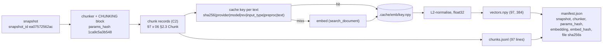

# C3 — Embedding and indexing with metadata: ids, hashes, a content-keyed cache, a manifest, and the rebuild rule

> **What this file is.** The lesson for concept **C3** ([02 card](../02_RAG_MASTER_LEARNING_PLAN.md#c3)). It follows the Parts A–M template of [07](../07_SAMPLE_LESSON.md), at the size of [P4](P4_embeddings_similarity.md) and [P5](P5_vector_search.md), which it builds on and does not repeat.
> **How to use it.** Answers are hidden in collapsible blocks. Write your answer first, then open the block. Lines marked `> 🧭 Coach:` are instructions for the AI tutor; they add to [05 §3](../05_LEARNING_AND_RETENTION_SYSTEM.md#3-coaching-rules-for-the-ai-tutor) and cannot override it.
> **Labels.**
> - **UNVERIFIED**: not checked by running code or reading the primary source.
> - **Toy illustration**: numbers computed on made-up data, never a result about a real system.
> - **Machine-specific**: a timing from one laptop under its load at the time.
>
> Every number in this lesson comes from the local run of 2026-10-08 ([C3_FACTS.md](../sources/verification/C3/C3_FACTS.md): S1–S9 for measurements, S-src for citation checks, LT for the lab test), from a derivation shown in the text, or carries a label. No Groq or Cohere call was made.

## Lesson header

| Field | Value |
|---|---|
| Concept | **C3 Embedding and indexing with metadata**: an index that stores, per chunk, `doc_id, snapshot_id, chunk_id, seq, char_start/char_end` (document offsets), `page_segments`, `text_sha256` and `params_hash`; the three files `vectors.npy` + `chunks.jsonl` + `manifest.json`; a deterministic `params_hash` and chunk ids; embeddings cached by **content** (provider, model id, revision, `input_type`, preprocessing version, text), never by chunk id; Cohere `search_document` vs `search_query`; normalisation at index time; the rule for when the index must be rebuilt. |
| Phase / tier | Phase 2, Core. Priority **E**. Project: **v0** ([06 §3](../06_RAG_PROJECT_AND_EVALUATION_PLAN.md#3-v0-baseline-exact-specification)). |
| Prerequisites | **C2** chunk records ([07](../07_SAMPLE_LESSON.md), D.9 and H.3), **P4** normalisation and `input_type` ([P4 D.3–D.8](P4_embeddings_similarity.md#d3-normalisation-and-the-proof-that-l2-then-ranks-like-cosine)), **P5** vectors and metadata aligned by row ([P5 D.4](P5_vector_search.md#d4-metadata-stored-alongside-the-vectors)). |
| Comes next | **C4** dense retrieval over this index ([C4](C4_dense_retrieval.md)) · **C6** the v0 trace (`index_manifest_hash`) · **I1** the chunk-size grid (one index per configuration) · **D3** regression tests. |
| Learner evidence so far | O1-Q05 (what metadata should a chunk carry?): confidence 3, score 1. Headings and topic were named; doc id, page, offsets, chunk id and parameters were missing, and nothing was said about what breaks ([session log](../progress/session_log.md)). Related open misconception: **MC-003** (index time vs query time), which Part D.6 touches. |
| Time | A: 10 min · book: 15 min · B–D: 45 min · E–G: 20 min · H (lab): 75 min · J–K: 15 min · L: 15 min · M: 5 min. May be split across two days. Part I does not apply. |
| Mastery (C3 → `applied`) | Without notes, you can: (1) list the fields of a chunk record and say what breaks without each; (2) write `params_hash` and show it is deterministic and sensitive to every field; (3) write a content-keyed cache key and say why a chunk id is not one; (4) write and load the three index files, failing closed; (5) decide reuse vs rebuild for a given change. Lab: `coding_independence_0_3 ≥ 2`. |
| Mastery (C3 → `transfer`) | You also pass a fresh novel-scenario item (L.3) and score `debugging_0_3 ≥ 2` in the lab. |
| 02 evidence to produce | "The same inputs give the same `params_hash` and the same chunk IDs; any parameter change produces a different hash": lab CHECK 1 (97/97 ids equal on a rebuild; 7 field changes, 7 new hashes). |

### Source map

| Source | Where | What it contributes |
|---|---|---|
| Book (A) | Ch1 p.5–7/14, p.12/14; Ch7 p.4/11; Ch8 p.4/11; Ch11 p.6/13, p.10/13; Ch13 p.6/13; Ch14 p.9–10/13; Ch15 p.12/12; Ch16 p.4/11; App p.16/23, p.22/23 | Where embedding and storing sit; position and page metadata; which techniques change the index and which only the query. **No** hashing, manifest, cache, re-indexing or `input_type` anywhere in the book (S-src scan). |
| Repo (B) | `helper_functions.py` L18–L74, L223–L245, L338–L357; `simple_rag.ipynb` 10; `local_rag_huggingface_faiss.ipynb` 10, 12, 14, 16; `hierarchical_indices.ipynb` 11, 13; `context_enrichment_window_around_chunk.ipynb` 11, 13, 15, 17, 23, 25; `memorag.ipynb` 22; `reliable_rag.ipynb` 6 | What the repo stores, persists, pins and forgets |
| Library source (read, not run) | `langchain_community` 0.4.1 `vectorstores/faiss.py`; `langchain_cohere` 0.5.1 `embeddings.py` (learner's older venv) | What `save_local`/`load_local` keep; where LangChain sets Cohere's input types |
| Our records | [06 §2.2–§2.4, §3, §5.3](../06_RAG_PROJECT_AND_EVALUATION_PLAN.md#2-architecture) (the interface); [07 D.9, H.3](../07_SAMPLE_LESSON.md); [C2 lab facts](../sources/verification/C2lab/C2LAB_FACTS.md); [O2 report](../progress/O2_smoke_test_2026-10-08.json) | Field names, recipes, Cohere `embed-v4.0` facts |
| Lab verification | [`sources/verification/C3/`](../sources/verification/C3/): `c3_measure.py`, `c3_sources.py`, saved outputs, [`C3_FACTS.md`](../sources/verification/C3/C3_FACTS.md) | Every measured number |

### Contents

[Part A](#part-a--prior-knowledge-recovery) · [B](#part-b--why-c3-exists) · [C](#part-c--intuition-and-analogy) · [D](#part-d--technical-mechanism) · [E](#part-e--connections) · [F](#part-f--worked-example-by-hand) · [G](#part-g--source-connection) · [H](#part-h--implementation-progression) · [I](#part-i--controlled-experiment) · [J](#part-j--failure-and-debugging) · [K](#part-k--engineering-decisions) · [L](#part-l--assessment) · [M](#part-m--retention) · [References](#source-references) · [Verification log](#verification-log)

---

## Part A — Prior knowledge recovery

Answer the five questions **before** reading on: 1–3 sentences each, no notes, no book. Wrong answers are useful; they tell the tutor where to start.

> 🧭 Coach: Ask **one item at a time** (CR-01), in the exact wording below, with its reply template. Record confidence 1–3 before revealing anything (CR-16): O1-Q05 was answered with confidence 3 and scored 1, so watch calibration here. Score with the Recall or Application rubric ([05 §4.2](../05_LEARNING_AND_RETENTION_SYSTEM.md#42-graded-rubrics-04)). These are unscheduled recall items: log them; a score ≤ 1 follows the ≤ 1 row of [05 §5.2](../05_LEARNING_AND_RETENTION_SYSTEM.md#52-spaced-repetition-schedule). Do not correct in detail yet; route with the table after C3-A5. Then send the learner to the "Read in the book" box.

**C3-A1.** Besides the text, what should each stored chunk carry, and why?

*Reply template:* "Each chunk needs ____, ____ and ____, because without them ____."

<details><summary>What a strong answer contains</summary>

- **Where it came from:** `doc_id`, page (`page_segments`), and character offsets (`char_start`, `char_end`) into one frozen text (`snapshot_id`). Without them a citation cannot be checked and a gold span cannot be matched ([07 D.9](../07_SAMPLE_LESSON.md)).
- **Which build made it:** a `chunk_id` and the `params_hash` of the chunking settings. Without them two indexes built differently look the same.
- **Content identity:** `text_sha256`.
- ⚠️ O1-Q05 flag: "headings and topic" only. Those are useful extras (`meta`), not provenance.

</details>

**C3-A2.** You change the chunk overlap from 200 to 100. Can you keep using the vectors you already stored?

*Reply template:* "Yes / No, because ____."

<details><summary>What a strong answer contains</summary>

- **No.** The chunk boundaries move, so the stored vectors describe text that no longer exists as a chunk. The index must be rebuilt (D.6).
- Nuance: a chunk whose text happens to be identical under both settings can reuse its old **vector** through a content-keyed cache, even though its **id** changes (D.4, S8).

</details>

**C3-A3.** Why is a chunk id a bad key for a cache of embeddings?

*Reply template:* "Because the id ____ when the text ____, and ____."

<details><summary>What a strong answer contains</summary>

- The id stays the same when the **model** changes, so a lookup by id returns a vector from the old model.
- With a stale `snapshot_id` the id can also stay the same while the **text** changed ([07 H.3](../07_SAMPLE_LESSON.md), Codex M-04).
- And it changes when nothing that shaped the vector changed: after our page-10 edit **0 of 97** ids survived, but 96 of 97 texts did (S4).
- The key must be the content: `sha256(provider|model_id|revision|input_type|preproc_version|text)` ([06 §2.4](../06_RAG_PROJECT_AND_EVALUATION_PLAN.md#24-configuration-yaml-example)).

</details>

**C3-A4.** With Cohere, chunks and questions use different `input_type` values. Which one goes with which?

*Reply template:* "Chunks get ____; questions get ____."

<details><summary>What a strong answer contains</summary>

- Chunks: `search_document`; questions: `search_query` ([P4 D.8](P4_embeddings_similarity.md#d8-querydocument-asymmetry-input-types-and-prefixes); 06 §2.4).
- C3's addition: the `input_type` is part of the **cache key** and is recorded in the **manifest** (D.3, D.5).

</details>

**C3-A5.** Which of these needs a new index: a new k, a new LLM, a new embedding model, an edited PDF page?

*Reply template:* "Rebuild for ____. Reuse for ____, because ____."

<details><summary>What a strong answer contains</summary>

- **Rebuild:** a new embedding model, an edited page (new snapshot).
- **Reuse:** k and the LLM act at query time; the stored vectors do not depend on them (S7).
- ⚠️ MC-003 flag (index time vs query time): putting k or the prompt on the rebuild side.

</details>

> 🧭 Coach: **Routing.**
>
> | Weak answers (score ≤ 1) | Action |
> |---|---|
> | C3-A1 | Expected (O1-Q05). Teach D.1 with the real record in D.2 before anything else. |
> | C3-A2 or C3-A5 | Teach D.6 first, with the Part F decision table by hand. Note MC-003 if k or the prompt is put on the rebuild side. |
> | C3-A3 | Teach D.3–D.4; lab Task 3's prediction is the check. |
> | C3-A4 | Re-teach P4 D.8 in two lines, then D.3 (the key) and D.5 (the manifest). |
> | All five ≥ 3 with confidence 3 | Offer the fast track: skim B–C, then D.2–D.6, the lab and L (evidence is never skipped, [02 §5](../02_RAG_MASTER_LEARNING_PLAN.md#5-fast-track-rules-from-the-o1-diagnostic) rule 1). |

> 📖 **Read in the book** — do this **after Part A, never before** (Part A must be closed-book). About 15 minutes. Paraphrase each page in one line in your notes.
>
> | Page | What to look for |
> |---|---|
> | Ch1 p.5/14 | Steps 3–4: a cleaning step, then embeddings. Note that cleaning changes the text you will embed (D.3, `preproc_version`). |
> | Ch1 p.6–7/14 | Step 5 and the five-step preparation sketch. Note the order: the sketch cleans **each chunk** after splitting. What would that do to character offsets? |
> | Ch8 p.4/11 | Step 1: tag each chunk with its sequential position. That is our `seq`. Note the requirement: given a number, you must be able to fetch the chunk. |
> | Ch14 p.9–10/13 | "The Role of Metadata": page numbers link summaries to chunks; document plus section ids for many documents. That is why `doc_id` and `page_segments` exist. |
> | Ch7 p.4/11 vs Ch15 p.12/12 | One technique changes only the preparation phase; the other needs no change to the index or the model. Which one forces a rebuild? (D.6) |
> | Ch11 p.10/13 | Preparation-time work vs query-time work when documents change often. This is the cost side of the rebuild rule. |
> | Later, after D.5 | Ch13 p.6/13: document embeddings can be computed once and stored. The index is that store. |

---

## Part B — Why C3 exists

### B.1 Two indexes you cannot tell apart

`hierarchical_indices.ipynb` cell 13 does this: if the folder `../vector_stores/detailed_store` exists, load it; otherwise build and save it. The folder name carries **no** chunk size, model or text version. We replayed that pattern on our data (S7): build with 1000/200, change the config to 500/100, run again. The "load" branch returns the **97** old chunks; the new config would give **201**. No error. Every result after that is about an index nobody asked for.

The repo's persistence is LangChain's `save_local`: a FAISS file plus a pickle of the docstore and the id map. It stores **no embedding-model identity**, and `load_local` uses whatever embedder you pass in (S-src). Across the whole repo no code sets an `input_type`, writes a manifest, or pins a model revision (0 hits each, S-src).

> 🧭 Coach: CR-17. Ask one question: "What would have to be written next to the vectors so that the 500/100 run refuses the old folder?" Expected: the chunk settings (or their hash), and the model id.

### B.2 The cost of rebuilding everything, every time

Embedding our 97 chunks took 1.8–6.3 s on this laptop with an empty cache, and 16–92 ms when every vector came from the cache (S9, machine-specific: the range over several runs, the slower ones while other jobs shared the CPU). The ratio, about 70 to 110 times, is the point. That is small here, but it grows with the corpus, and with Cohere every re-embed is a paid API call. A content-keyed cache makes a rebuild cheap **and** byte-identical (S6). An id-keyed cache makes it cheap and **wrong** (D.4).

---

## Part C — Intuition and analogy

**An index is a labelled freezer.** Each container (vector) holds a meal (chunk). The label says what is inside, which recipe and which oven (model) made it, and from which shopping trip (snapshot). Without labels you can still eat, but you cannot tell last week's soup from today's.

**`params_hash` is the recipe number.** Same recipe, same number, every time. Change one ingredient, new number.

**The cache key is the barcode of the ingredients plus the oven.** If the same ingredients go into the same oven with the same settings, you can reuse the frozen portion, whatever the container's shelf number (chunk id) is now.

**The manifest is the inventory sheet on the door.** Before serving, you check it against tonight's order (the run config). If the recipe or the oven differs, you cook again.

**Where the analogy breaks.** A freezer cannot tell you the meal is wrong; our loader can, because it recomputes hashes and refuses on mismatch (D.5).

> 🧭 Coach: CR-17. Ask one question: "In the analogy, which label changes when you switch embedding model?" Expected: the oven, so the barcode (cache key) changes; the recipe number (`params_hash`) does not.

---

## Part D — Technical mechanism

> 🧭 Coach: CR-17. Teach one subsection per turn, then ask its one question before moving on.

### D.1 The objects involved



- Row *i* of `vectors.npy` ↔ line *i* of `chunks.jsonl` ([P5 D.4](P5_vector_search.md#d4-metadata-stored-alongside-the-vectors)).
- Three identities, three jobs: `snapshot_id` names the text, `params_hash` names the chunking, the cache key names one embedding.

> 🧭 Coach: Ask: "Which of the three identities changes when you switch embedding model?" Expected: only the cache key (and the manifest's embedding block).

### D.2 The chunk record and the id

The records come from C2 unchanged: 97 per-page `recursive_char` chunks, byte-identical to the C2 lab's `chunks.jsonl` (sha256 `d4108b89…`, S1). The first one, text shortened:

```json
{"doc_id": "climate", "snapshot_id": "ea07572562ac", "chunk_id": "climate:ea07572562ac:1ca9c5a3b548:00000",
 "seq": 0, "char_start": 0, "char_end": 949, "page_segments": [{"page": 1, "char_start": 0, "char_end": 949}],
 "text": "Understanding Climate Change \nChapter 1:…", "text_sha256": "5fa92cb2…", "chunker": "recursive_char",
 "params_hash": "1ca9c5a3b548", "meta": {}}
```

- `chunk_id = f"{doc_id}:{snapshot_id}:{params_hash}:{seq:05d}"` ([06 §2.3](../06_RAG_PROJECT_AND_EVALUATION_PLAN.md#23-provider-agnostic-interfaces)). It is **for joins and traces only**.
- Offsets are document offsets: `doc_text[char_start:char_end] == text` for 97/97 (S1).

> 🧭 Coach: Ask: "From this id alone, can you tell which chunk settings built it?" Expected: only their hash; the manifest maps the hash back to the settings.

### D.3 `params_hash`: deterministic and sensitive

Recipe (course-wide, the same as the C2 lab): `sha256(json.dumps(CHUNKING, sort_keys=True).encode("utf-8")).hexdigest()[:12]`, where `CHUNKING` is 06 §2.4's `chunking:` block. For v0 it is `1ca9c5a3b548` (S1). Measured properties (S2):

| Test | Result |
|---|---|
| Same inputs twice | same hash; same ids 97/97 |
| Two fresh Python processes | sha256 recipe equal; built-in `hash()` **different** (it is salted per process) |
| Each of 7 single-field changes | 7 new hashes |
| Same dict, keys in reverse order | equal with `sort_keys=True`; different without |
| `chunk_size` `"1000"` vs `1000` | different: types matter |

**A hash that ignores one field is worse than no hash** (S2). Hash only size and overlap, then build per-page (97 chunks) and cross-page (92 chunks): both get the same hash, **92 chunk ids are shared, and 89 of them name different text.**

> 🧭 Coach: Ask: "Why not use Python's `hash()` for `params_hash`?" Expected: its value changes between processes, so the same config gets a different id tomorrow.

### D.4 The cache key, and why ids cannot be keys

The key: `sha256(provider|model_id|revision|input_type|preproc_version|text)` (06 §2.4; same value as 07 H.3's `embedding_cache_key`, S3). A `"|"` inside a meta field must be refused: otherwise `('a','b|c',…)` and `('a|b','c',…)` give the same key (S3).

Measured on the real corpus (S4):

| Event | Chunk ids kept | Cache |
|---|---|---|
| Rebuild, nothing changed | 97/97 | 97 hits, 0 sent to the model |
| Page 10 edited (+9 characters) | **0/97** (new snapshot) | **96 hits, 1 miss** |
| Switch model L6 → L3, full key | 97/97 | 0 hits, 97 re-embedded |
| Switch model, **text-only key** (bug) | 97/97 | **97/97 hits: the L6 vectors served as L3's**, same shape (97, 384), no error |

With that stale cache, the D-002 evidence chunk falls from rank 3 to rank **16** (S4); [P4 D.5](P4_embeddings_similarity.md#d5-same-model-for-the-query-and-what-scores-look-like) showed the same wrong-model damage at query time.

> 🧭 Coach: Ask: "After the page-10 edit, why did 96 chunks hit the cache although none kept its id?" Expected: their text did not change, and the key follows the text.

### D.5 The three files, normalisation, and failing closed

| File | Content | Our v0 size (S6) |
|---|---|---|
| `vectors.npy` | float32 (N, d), L2-normalised rows; `np.load(..., allow_pickle=False)` | 149,120 bytes = 128 + 97 × 384 × 4 |
| `chunks.jsonl` | one 06 §2.3 record per line, UTF-8, `ensure_ascii=False` | 122,774 bytes |
| `manifest.json` | snapshot, chunker block, `params_hash`, embedding block, `embed_hash`, sha256 and shape of both files | 1,526 bytes |

**Normalise once, at index time.** MiniLM-L6 already returns unit vectors; paraphrase-MiniLM-L3 does not (norms 2.36–3.47, S5). Stored unnormalised, L3's top-4 equalled the normalised top-4 for only **7 of 34** queries (S5). The mechanism is [P4 D.3](P4_embeddings_similarity.md#d3-normalisation-and-the-proof-that-l2-then-ranks-like-cosine); C3's job is to make it a load-time assert.

**Fail closed.** The loader recomputes both file hashes, checks dtype, shape, row count, unit rows and each record's hashes, then compares the manifest with the run config. It refused a `chunks.jsonl` missing one line, a 2000/400 config and an L3 config (S7). With every check it loads in 2–11 ms (S9, machine-specific).

> 🧭 Coach: Ask: "Why load `vectors.npy` with `allow_pickle=False`?" Expected: a pickle can run code; plain arrays need no pickle (LangChain's `load_local` makes you opt in to unpickling, S-src).

### D.6 The rebuild rule

The index is a function of three things: the **snapshot** (text), the **chunker** (`params_hash`), and the **document-side embedding** (provider, model id, revision, documents' `input_type`, `preproc_version`, normalisation). Anything else acts at query time. Our reference `rebuild_reasons` on 16 changes (S7):

| Change | Decision |
|---|---|
| k, LLM model, prompt version, adding a reranker, the **query** `input_type` | reuse |
| chunk size, overlap, scope | rebuild: `chunker` |
| an edited PDF page | rebuild: `snapshot` |
| model, revision, documents' `input_type`, preprocessing, normalisation | rebuild: `embedding` |

- **Rebuild is not re-embed.** After 1000/200 → 2000/400, 12 of 65 new chunks were cache hits (S8); after the page edit, 96 of 97 (S4).
- The query side still matters: C4 must embed questions with the manifest's model and the queries' `input_type` ([C4](C4_dense_retrieval.md)).

> 🧭 Coach: Ask: "Does adding a reranker require a new index?" Expected: no, it reorders candidates at query time (MC-003 check).

### D.7 Reproducible bits: what the cache buys

Encoding the same 97 texts twice with batch size 64 gave bit-identical vectors; batch 64 vs batch 1 gave **0 of 97** bit-identical rows, max difference 1.34e-07 (S4). So "rebuild from scratch" is not guaranteed byte-identical. A rebuild **from the cache** is: all three files came out byte-identical (S6). That is why the manifest compares **settings**, and file hashes protect against tampering, not against harmless float noise.

---

## Part E — Connections

**C2** (records) → **C3** (vectors, files, manifest) → **C4** (top-k over the files; checks the model id) → **C6** (each trace stores `index_manifest_hash` = sha256 of `manifest.json`, 06 §2.5). **P4** gives normalisation and `input_type`; **P5** gives row alignment; **I1** builds one index per chunk configuration, named by `params_hash`; **D3** turns the loader's checks into regression tests.

| Often confused | The difference |
|---|---|
| `chunk_id` vs cache key | The id joins records and traces; the key decides whether a vector may be reused. |
| `params_hash` vs `snapshot_id` | Chunk settings vs extracted text. Both are in the id. |
| `snapshot_id` vs PDF sha256 | The same PDF bytes with a new parser version give a new snapshot ([06 §5.3](../06_RAG_PROJECT_AND_EVALUATION_PLAN.md#53-corpus-freezing)). |
| Rebuild vs re-embed | Rebuild = new files; re-embed = model calls. A content cache makes most rebuilds cheap. |
| Index time vs query time (MC-003) | Chunking, document embedding and normalisation are index time; k, prompt, reranking, LLM are query time. |
| `search_document` vs `search_query` | Stored chunks vs incoming questions; both in their cache keys. |

---

## Part F — Worked example by hand

**Toy illustration** (made-up pages; arithmetic shown). Page 1 has 1,500 characters, page 2 has 900. Fixed windows, size 1000, overlap 200 (stride 800).

**Step 1.** Per-page chunking: list the chunks with their page-relative spans. Then 10 characters are inserted on page 2 at page offset 50. Which chunk **ids** change, and how many **cache misses** follow?

<details><summary>Answer</summary>

Page 1: [0, 1000), [800, 1500). Page 2: [0, 900). Three chunks. The edit changes the snapshot, so **all 3 ids** change. Only page 2's text changed: **1 miss**, 2 hits.

</details>

**Step 2.** Same edit, but windows across pages over `doc_text` = 1,500 + 1 + 900 = 2,401 characters. How many misses now?

<details><summary>Answer</summary>

Windows [0, 1000), [800, 1800), [1600, 2401). The edit sits at document offset 1,500 + 1 + 50 = 1,551, inside windows 2 and 3, and shifts window 3's end to 2,411. **2 misses**, 1 hit. On the real corpus, fixed windows across pages lost **66 of 91** to one 9-character insertion, while the v0 per-page recursive chunker lost 1 of 97 (S4).

</details>

**Step 3.** How many bytes is `vectors.npy` for 97 chunks at 384 dimensions? And with Cohere's 1,536?

<details><summary>Answer</summary>

128 + 97 × 384 × 4 = **149,120** (matches S6). With 1,536: 128 + 97 × 1,536 × 4 = **596,096** (derived; 1,536 from the O2 report).

</details>

> 🧭 Coach: CR-08 probe here, one question: "If `chunk_size` doubles from 1000 to 2000, what happens to the index?" Expected: a new `params_hash` and a full rebuild (0 ids kept); fewer chunks (97 → 65, S8); only a few cache hits (12 of 65); and truncation appears: 32 of 65 chunks exceed MiniLM's 256 tokens (S8). Follow-up on a later turn: "And `vectors.npy`?" Expected: smaller, 99,968 bytes (derived).

---

## Part G — Source connection

### G.1 Book (Source A)

| Cite | Book point (paraphrased) | Our assessment |
|---|---|---|
| Ch1 p.5/14 | A cleaning step fixes extraction artifacts; dirty text gives noisy embeddings | Any cleaning changes the embedded text: a new snapshot (06) or a new `preproc_version` (D.3) |
| Ch1 p.6–7/14 | Vectors go into a store for similarity search; the sketch is load, split, clean each chunk, embed, store | Cleaning **after** splitting breaks `doc_text[char_start:char_end] == text`; the repo does exactly this (G.2) |
| Ch1 p.12/14 | Simple RAG is overkill when the collection never changes | The book assumes updates happen, but never says how to update an index |
| Ch7 p.4/11 | Contextual headers modify only the preparation phase | Preparation changes the embedded text, so: rebuild (`preproc_version`) |
| Ch8 p.4/11 | Tag each chunk with its position; be able to fetch any chunk by that number | Our `seq` and row alignment |
| Ch11 p.6/13, p.10/13 | Generated questions carry a pointer to their parent chunk; preparation-time work must be redone when the collection changes | Metadata as a pointer; the rebuild cost side |
| Ch13 p.6/13 | Document embeddings are precomputed and stored; only the query is embedded live | The index is that store |
| Ch14 p.9–10/13 | Page metadata links two stores; document plus section ids for many documents | `doc_id` + `page_segments` |
| Ch15 p.12/12 | Dartboard needs no change to the index, the model or preparation | A query-time technique: reuse |
| Ch16 p.4/11 | Extracted images are tagged with their source page | Same provenance idea for another modality |
| App p.16/23, p.22/23 | Glossary: embedding; vector database / vector store | No word on what a store must record |

**Not in the book** (whole-book scan, S-src): hashing, manifests, re-indexing, rebuilding, re-embedding, `input_type`, unit length, model revisions, pickling. "Cache" appears once, inside an example user question (Ch18 p.4/12).

### G.2 Repo (Source B): cells verified at `009adba`

| Cell (0-based) / line | What it shows | Lesson |
|---|---|---|
| `helper_functions.py` L48–L74; `simple_rag.ipynb` 10 | `encode_pdf`: PyPDFLoader → split → `replace_t_with_space` **after** splitting (L70) → `OpenAIEmbeddings()` with no model (L73) → `FAISS.from_documents` | Cleaning after chunking; unpinned model; nothing persisted |
| `helper_functions.py` L223–L245 | `read_pdf_to_string` concatenates pages with no separator: page numbers are lost | No page provenance |
| `helper_functions.py` L338–L357 | `get_langchain_embedding_provider`: `OpenAIEmbeddings()` (L354) and `CohereEmbeddings()` (L357), both without a model | `langchain_cohere` 0.5.1 requires `model` (L109), so L357 would raise there (read, not run) |
| `local_rag_huggingface_faiss.ipynb` 10, 14, 16 | Model id pinned (`BAAI/bge-base-en-v1.5`, no revision); `normalize_embeddings: True`; `encode_to_faiss`; `save_local`/`load_local` **commented out** | The best repo example; still no revision or manifest |
| `hierarchical_indices.ipynb` 11, 13 | `chunk_id: i` and page in metadata; "if the folder exists, load it", with `allow_dangerous_deserialization=True` | B.1: the stale-index pattern (97 vs 201, S7) |
| `context_enrichment_window_around_chunk.ipynb` 13, 15 | Every chunk's metadata holds its index **and the whole document text** | Re-implemented on our PDF (400/200): 363 × 72,561 = **26,339,643** characters of metadata, against 122,774 bytes for our `chunks.jsonl` (S6) |
| same notebook, 23 and 25 | The neighbour function defaults to 200/20; cell 25 passes 400/200 by hand | The index does not carry its own parameters; the caller must remember them |
| `memorag.ipynb` 22 | `save_local(path)` / `load_local(path, self.embeddings, …)` | Same persistence, same gaps |
| `reliable_rag.ipynb` 6 | `CohereEmbeddings(model="embed-english-v3.0")` | Through LangChain, `embed_documents` sends `search_document` and `embed_query` sends `search_query` (library L195, L217; read, not run) |

**Corrections to the [04 C3 row](../04_BOOK_TO_CODE_MAPPING.md)** (04 is not edited; see the Verification log):
1. 04 says the embedding model is "never pinned (`helper_functions.py:L352-L354`)". L352–L354 is only the OpenAI branch of `get_langchain_embedding_provider`; `encode_pdf` calls `OpenAIEmbeddings()` directly at **L73**. Model **ids** are pinned in some notebooks (`local_rag_huggingface_faiss.ipynb` cell 10, `reliable_rag.ipynb` cell 6); what is never pinned anywhere is a model **revision** (0 hits, S-src).
2. 04's book pages miss Ch1 p.7/14 (the preparation sketch, cleaning after splitting), Ch7 p.4/11 and Ch15 p.12/12 (index-changing vs query-only techniques) and Ch11 p.10/13 (preparation cost when documents change).
3. 04 lists only `hierarchical_indices.ipynb` cell 13 for persistence. `memorag.ipynb` cell 22 and the runnable script `hierarchical_indices.py` (L94–L101) do the same; `local_rag_huggingface_faiss.ipynb` cell 16, which the 02 card cites, has the save/load lines commented out.
4. 04's experiment ("rebuild twice: identical hash and ids? change one parameter: does the hash change?") is now lab CHECK 1, with the measured result (S2).

**Reading order:** `simple_rag.ipynb` 10 → `helper_functions.py` L48–L74 → `local_rag_huggingface_faiss.ipynb` 10, 14, 16 → `hierarchical_indices.ipynb` 11, 13 → `context_enrichment_window_around_chunk.ipynb` 13, 23, 25. For each, write: what is stored, what is lost, and what would refuse a stale index.

---

## Part H — Implementation progression

### H.1 The lab: [`labs/C3_indexing_lab.ipynb`](../labs/C3_indexing_lab.ipynb) (blank-file first)

A given cell loads Corpus D, recomputes the snapshot id (06 recipe, **see C1**) and provides the v0 chunker (**see C2**; it reproduces the C2 lab's 97 records byte for byte, and compares them with your own C2 output if it finds it). The notebook has **no solution code**; CHECK cells compare fingerprints (LT).

| # | Task | The checks test |
|---|---|---|
| 1 | Predict the ids kept after a scope change; write `params_hash` again from memory | Not built-in `hash()`; key order; 7 field changes → 7 new hashes; the course recipe; ids equal on a rebuild |
| 2 | Predict: may a question reuse a chunk's cached Cohere vector? Write `embedding_cache_key` | Every field changes the key; `"|"` guard; the 06 format |
| 3 | Predict ids changed and misses after the page-10 edit; write `cached_embed` | 97 misses then 97 hits; the edit's misses; a model switch re-embeds all 97; unit rows for L3 |
| 4 | Predict the size of `vectors.npy`; write `embed_hash`, the manifest and `write_index` | `embed_hash` ignores `dim`/`max_seq_length` and changes with the other six fields; the folder `…/<params_hash>/<embed_hash>/`; exactly three files; manifest keys; line *i* = chunk *i*; file hashes; refuses to overwrite a different index |
| 5 | Predict reuse/rebuild for 6 changes; write `rebuild_reasons` | 16 scenarios (fingerprint) |
| 6 | Write `load_index` (fail closed) | Loads the good index; refuses a lost line, unnormalised vectors with an updated hash, another chunker, another model; a k change still loads |
| — | Given (see C4): load through your loader, embed D-002, top-4 | Your files work for the next lesson |
| 7 | The rebuild rule in your words, with a number | Graded by the tutor (Transfer) |
| 8 | Optional, **off** (`RUN_COHERE = False`): 8 chunks × 2 input types through your cache | Learner-run only. Expected dim 1,536 (O2); norms and the query/document difference are **UNVERIFIED** |

API names you may look up: `hashlib.sha256`, `json.dumps(sort_keys=...)`, `np.save`, `np.load(allow_pickle=False)`, `np.linalg.norm`, `pathlib.Path`, `shutil.copytree`. The reference implementation is `sources/verification/C3/c3_measure.py`.

> 🧭 Coach: The reference script is a **solution**. Do not show it before an attempt plus a hint (CR-04). Grade `coding_independence_0_3` on Tasks 1, 3 and 6, and `debugging_0_3` on any failing CHECK the learner fixes. Task 8 costs money: only with the learner's explicit choice; never print `.env` values.

### H.2 Repo reading guide: `hierarchical_indices.ipynb` cells 11 and 13

Answer each before opening.
1. Cell 13 loads the folder if it exists. Which three changes would it silently ignore?
2. Cell 11 sets `chunk_id: i`. Is that id still right after you edit one page?
3. Cell 13 passes `embeddings` to `load_local`. Which model does the loaded store use for queries?
4. Why must cell 13 set `allow_dangerous_deserialization=True`?

<details><summary>Answers</summary>

1. A new chunk size or overlap, a new embedding model, a changed PDF (S7 replayed the first: 97 old chunks loaded instead of 201).
2. It is a position, so it may point to a different chunk; and nothing records which text it was. Ours carries `snapshot_id` and `params_hash`.
3. Whatever the caller passes: the saved files hold no model identity (`save_local` L1147–L1164; read, not run).
4. The docstore is a pickle, and unpickling can run code. Our `.npy` + JSONL need no pickle.

</details>

### H.3 Reusable design (future `ragkit/index.py`; nothing is created now)

- `build_index(records, embedder, cache) -> index_dir`, `load_index(index_dir, run_cfg)`, `rebuild_reasons(manifest, run_cfg)`; `Embedder.embed_documents` uses `search_document`, `embed_query` uses `search_query` ([06 §2.3](../06_RAG_PROJECT_AND_EVALUATION_PLAN.md#23-provider-agnostic-interfaces)).
- Tests (D3): `params_hash` changes for every field; the page-edit miss count; a stale-model cache must miss; the loader refuses each bad case of lab Task 6.

### H.4 Interface: the exact shape of the index (consumed by C4)

**Folder:** `index/<snapshot_id>/<params_hash>/<embed_hash>/`, for v0 `index/ea07572562ac/1ca9c5a3b548/c398eeba043f/`. Git-ignored.
- `embed_hash = sha256(json.dumps(EMBED, sort_keys=True).encode("utf-8")).hexdigest()[:12]`, where `EMBED` is the manifest's `embedding` block **without** the measured `dim` and `max_seq_length`: {`provider`, `model_id`, `revision`, `input_type`, `normalize`, `preproc_version`} (course decision, 2026-10-08).
- Measured (S6): L6 `c398eeba043f`, L3 `ae47e2c1e13f`; changing only `dim` keeps the hash. The L6 and L3 indexes sit side by side under one `params_hash`, and writing L3 into the L6 folder still raises.
- `embed_hash` includes the **queries'** `input_type` (`f9a0a305cd54` when it changes, S6). So such a change gets a new folder even though `rebuild_reasons` says the vectors are reusable; building that folder re-embeds nothing, because the document-side cache keys are unchanged.

**`vectors.npy`**: NumPy `.npy`, dtype float32, shape (N, d) = (97, 384) for MiniLM-L6; every row has L2 norm 1 (± 1e-5); **row *i* ↔ line *i* of `chunks.jsonl`, by position only**. Nothing may assume `seq == i`: `seq` restarts in every document. Load with `allow_pickle=False`.

**`chunks.jsonl`**: UTF-8, `"\n"` line ends, one JSON object per line, written with `json.dumps(record, ensure_ascii=False)`, keys in 06 §2.3 order: `doc_id`, `snapshot_id`, `chunk_id` (`{doc_id}:{snapshot_id}:{params_hash}:{seq:05d}`), `seq`, `char_start`, `char_end` (document offsets), `page_segments` [{`page`, `char_start`, `char_end`}] (page-relative), `text`, `text_sha256`, `chunker`, `params_hash`, `meta`. For v0 this file is byte-identical to the C2 lab's output (sha256 `d4108b89…011b`).

**`manifest.json`** (v0 values; long hashes cut):

```json
{"snapshot_id": "ea07572562ac",
 "docs": [{"doc_id": "climate", "pdf_sha256": "1d58a0fac243…", "doc_text_sha256": "5106772efa77…"}],
 "parser": {"backend": "pymupdf", "version": "1.26.7"},
 "chunker": {"name": "recursive_char", "unit": "chars", "chunk_size": 1000, "chunk_overlap": 200,
             "separators": ["\n\n", "\n", " ", ""], "scope": "per_page"},
 "params_hash": "1ca9c5a3b548",
 "embedding": {"provider": "sentence_transformers", "model_id": "sentence-transformers/all-MiniLM-L6-v2",
               "revision": "1110a243fdf4706b3f48f1d95db1a4f5529b4d41",
               "input_type": {"documents": "none", "queries": "none"}, "preproc_version": "none",
               "normalize": true, "dim": 384, "max_seq_length": 256},
 "embed_hash": "c398eeba043f",
 "library_versions": {"numpy": "2.5.3", "sentence-transformers": "6.1.0", "torch": "2.14.1"},
 "created_utc": "2026-10-08T00:00:00Z",
 "files": {"vectors.npy": {"sha256": "b8ac06997cd3…", "shape": [97, 384], "dtype": "float32"},
           "chunks.jsonl": {"sha256": "d4108b893609…", "lines": 97}}}
```

With Cohere the embedding block becomes `provider: "cohere"`, `model_id: "embed-v4.0"` (from `.env`), `revision: null`, `input_type: {"documents": "search_document", "queries": "search_query"}`, `dim: 1536`, and therefore a different `embed_hash` and folder. A trace's `index_manifest_hash` is the sha256 of the `manifest.json` bytes (S6). Field names not fixed by 06 are interface assumptions (Verification log).

---

## Part I — Controlled experiment

**n/a for C3.** C3 changes no retrieval variable; it makes later experiments possible (one index per configuration in I1, named by `params_hash` and `embed_hash`; a cache so the grid does not re-embed unchanged texts).

---

## Part J — Failure and debugging

For each: write your predicted cause and fix, then open. Each diagnosis says **retrieval** or **generation** (CR-11).

**J1. You changed `chunk_size`, but the results did not change at all.**

<details><summary>Diagnosis</summary>

- **Cause.** The old index was loaded: a folder named without parameters ("if it exists, load it", B.1; 97 old chunks instead of 201, S7). **Kind:** retrieval (the wrong chunks are searched); the experiment is invalid.
- **Fix.** Name folders `index/<snapshot_id>/<params_hash>/<embed_hash>/`; the loader compares the manifest with the run config and refuses.

</details>

**J2. After switching embedding models, quality dropped, with no error.**

<details><summary>Diagnosis</summary>

- **Cause.** A cache keyed by text (or by chunk id) served the old model's vectors: 97/97 stale hits, same shape (S4); the evidence chunk fell from rank 3 to 16. **Kind:** retrieval.
- **Fix.** Model id and revision in the cache key and the manifest; an assert on both at load time.

</details>

**J3. A one-word fix in one PDF page made the whole rebuild slow.**

<details><summary>Diagnosis</summary>

- **Cause.** An id-keyed cache (every id changes with the snapshot), or fixed windows across pages (66 of 91 texts shifted, S4). **Kind:** cost, not quality.
- **Fix.** A content-keyed cache and per-page (or per-document) chunking: 1 miss of 97 (S4).

</details>

**J4. Two runs give different chunk ids for the same config.**

<details><summary>Diagnosis</summary>

- **Cause.** `params_hash` built with Python's `hash()` (salted per process) or `json.dumps` without `sort_keys` (S2). **Kind:** reproducibility; traces and gold joins break.
- **Fix.** sha256 over `json.dumps(cfg, sort_keys=True)`; a test across two processes.

</details>

**J5. Citations point to the right page, but the quoted text is slightly different.**

<details><summary>Diagnosis</summary>

- **Cause.** Text was cleaned after chunking (the repo's `replace_t_with_space` after splitting, L70), so `text` no longer equals `doc_text[char_start:char_end]`. **Kind:** provenance; it breaks span-based gold matching (M1).
- **Fix.** Clean before freezing the snapshot (06 §3.1), or record a `preproc_version` and keep offsets on the raw text.

</details>

> 🧭 Coach: For J1 and J2, ask for the **one-line assert** that would have caught it. It counts as evidence for `debugging_0_3`.

---

## Part K — Engineering decisions

| Question | Decision | Why |
|---|---|---|
| Storage format | `vectors.npy` + `chunks.jsonl` + `manifest.json` | No pickle; diffable; 2–11 ms to load and check (S9) |
| Folder name | `index/<snapshot_id>/<params_hash>/<embed_hash>/` | Text, chunking and embedding each get their own level; configurations never overwrite each other (course decision 2026-10-08) |
| Chunk id | `doc_id:snapshot_id:params_hash:seq` | Deterministic joins; never a cache key |
| Cache key | sha256 of provider, model, revision, `input_type`, preprocessing, text | Content identity (06 §2.4) |
| Normalisation | At index time, asserted at load time | L3 unnormalised: top-4 kept for 7/34 queries (S5) |
| Rebuild | On snapshot, chunker or document-side embedding change; never for query-time settings | D.6 |
| Overwrite | Refuse when the existing manifest differs | Keep v0 runnable (BACKBONE §4) |

**When NOT to build all of this:** a one-off notebook question on a document you will never re-index. Once results are compared across runs, the manifest and the hashes are what make them comparable. **Later:** a vector database replaces `vectors.npy` (D4), but it still needs the manifest, the content cache and the rebuild rule.

---

## Part L — Assessment

One short question per item, with a reply template. Score with [05 §4.2](../05_LEARNING_AND_RETENTION_SYSTEM.md#42-graded-rubrics-04).

> 🧭 Coach: Ask one item at a time, with its template. Never put two questions in one turn. Record confidence first.

### L.1 Recall

**C3-R-01.** What are the three files of the index, and what is in each?
*Template:* "`____` holds ____; `____` holds ____; `____` holds ____."

<details><summary>Criteria for 4</summary>

`vectors.npy`: float32 (N, d), unit rows; `chunks.jsonl`: one chunk record per line, line *i* ↔ row *i*; `manifest.json`: snapshot, chunker block, `params_hash`, embedding settings, `embed_hash`, file hashes. Plus why: the manifest lets the loader refuse a mismatched index.

</details>

**C3-R-02.** What goes into the embedding cache key?
*Template:* "The key hashes ____, and not ____, because ____."

<details><summary>Criteria for 4</summary>

Provider, model id, revision, `input_type`, preprocessing version, text. Not the chunk id: it changes when the text does not (0/97 kept after an edit) and stays when the model changes (S4). Boundary: the `"|"` guard on meta fields.

</details>

**C3-R-03.** Name two changes that force a rebuild and two that do not.
*Template:* "Rebuild: ____, ____. Reuse: ____, ____."

<details><summary>Criteria for 4</summary>

Rebuild: chunk settings, snapshot, model or revision, documents' `input_type`, preprocessing, normalisation. Reuse: k, prompt, LLM, reranker, query `input_type`. Plus: a rebuild can reuse cached vectors for unchanged texts.

</details>

### L.2 Application

**C3-A-01** (CR-08). The overlap doubles from 200 to 400. What happens to `params_hash`, the chunk ids and the cache?
*Template:* "`params_hash` ____; chunk ids ____; the cache ____, because ____."

<details><summary>Criteria for 4</summary>

New `params_hash`, so every chunk id changes (0 kept). Chunks move, so most texts change and miss; any chunk whose text is unchanged (e.g. a page shorter than 1,000 characters, one such page in Corpus D, S8) hits. More overlap means more chunks and a bigger `vectors.npy`. Self-check: rebuild needed, reason `chunker`.

</details>

**C3-A-02** (debugging). This passes on MiniLM-L6. What is wrong?

```python
def cached_embed(texts, spec, encode, cache_dir):
    keys = [hashlib.sha256(t.encode()).hexdigest() for t in texts]
    ...
```

*Template:* "The bug is ____. It passes because ____. It fails when ____."

<details><summary>Criteria for 4</summary>

The key is the text only. It passes because one model is used throughout. A model switch returns the old vectors: 97/97 stale hits, same shape, no error (S4). Fix: the full key; test with a second model (lab CHECK 3).

</details>

**C3-A-03.** `vectors.npy` for 97 chunks at d = 384: how many bytes?
*Template:* "____ + ____ × ____ × ____ = ____."

<details><summary>Criteria for 4</summary>

128 + 97 × 384 × 4 = 149,120 (S6). Self-check: float32 is 4 bytes; ×4 for Cohere's 1,536 dimensions, plus the same header.

</details>

### L.3 Transfer

> 🧭 Coach: C3-T-01 is a practice item. For the scored CR-13 item, make up a fresh scenario (a new document type, update pattern or constraint) that is not in this file, and grade it with the Transfer rubric.

**C3-T-01.** A team indexes 40,000 product manuals. About 200 manuals change each night, and they will move to a new embedding model next quarter. What do you design first?
*Template:* "First I would ____. I expect ____ because ____."

<details><summary>Criteria for 4</summary>

- A content-keyed cache (provider, model, revision, `input_type`, preprocessing, text), with per-document chunking so a changed manual only invalidates its own chunks; per-document snapshot hashes to find what changed.
- Nightly: rebuild only the changed documents' records and vectors; delete their old ids; a manifest per build.
- Model change: a **new** index side by side (new embedding block), never an in-place overwrite; compare on the eval set before switching (retrieval metrics separate from answer metrics).
- Measure: cache hit rate per night and the rebuild time; when not to: if the whole corpus changes nightly, a cache saves little.

</details>

### L.4 When is C3 mastered?

- **`applied` (L3):** C3-R-02 ≥ 3 on two different days, one ≥ 24 h after teaching; two Application items ≥ 3; `coding_independence_0_3 ≥ 2` on lab Tasks 1, 3, 6.
- **`transfer` (L4):** a fresh novel-scenario item ≥ 3; `debugging_0_3 ≥ 2`; a teach-back ≥ 3.

---

## Part M — Retention

### M.1 Flashcards

| # | Front (one question) | Back |
|---|---|---|
| 1 | The three index files? | `vectors.npy`, `chunks.jsonl`, `manifest.json` |
| 2 | Chunk id format? | `doc_id:snapshot_id:params_hash:seq` (5-digit seq) |
| 3 | `params_hash` recipe? | sha256 of `json.dumps(chunking, sort_keys=True)`, first 12 hex |
| 4 | Why not Python's `hash()`? | Salted per process: differs between runs |
| 5 | Cache key fields? | provider, model_id, revision, input_type, preproc_version, text |
| 6 | Is a chunk id a cache key? | No: joins and traces only |
| 7 | Page-10 edit: ids kept, cache misses? | 0/97 ids; 1 miss |
| 8 | Text-only cache key after a model switch? | 97/97 stale hits, no error |
| 9 | Cohere input types? | `search_document` chunks, `search_query` questions |
| 10 | Where is normalisation checked? | At load time: unit rows ± 1e-5 |
| 11 | Rebuild triggers? | snapshot, chunker, document-side embedding |
| 12 | Never a rebuild? | k, prompt, LLM, reranker, query input type |
| 13 | v0 `vectors.npy` size? | 149,120 bytes |

### M.2 Retrieval practice (closed book; log per [05 §5.1](../05_LEARNING_AND_RETENTION_SYSTEM.md#51-active-recall-what-a-review-item-looks-like))

| When | One question | Template |
|---|---|---|
| Day 1 | What is in the manifest? | "The ____, the ____ and the ____." |
| Day 3 | Why did 96 of 97 chunks hit the cache after an edit? | "Because the key follows ____." |
| Day 7 | Does a new reranker need a new index? | "____, because ____." |
| Day 14 | What does `params_hash` protect against? | "Two ____ sharing ____." |

<details><summary>Day-7 answer</summary>

No: a reranker reorders candidates at query time; the stored vectors do not depend on it.

</details>

### M.3 Teach-back prompt ([05 §5.4](../05_LEARNING_AND_RETENTION_SYSTEM.md#54-teach-back-protocol))

"In 3 minutes, explain to a new teammate how our index knows when it is out of date." A 4 needs: the three identities (snapshot, `params_hash`, cache key); the manifest compared with the run config; fail closed; reuse vs rebuild with one example each; one number (0/97 ids but 1 miss after an edit, or 97/97 stale hits with a text-only key).

### M.4 Interleaving links

**P4:** normalisation and `input_type` now live in the manifest. **P5:** row alignment is now a file contract. **C2:** the records arrive byte-identical. **C4:** the query side checks the manifest's model id. **MC-003:** sort settings into index time and query time.

### M.5 Misconception-log entries to add when observed

| Label | Correct model (short) | Root cause | Severity | Check items |
|---|---|---|---|---|
| "Cache embeddings by chunk id" | Key by content plus model settings | id vs content confusion | high | C3-A3, C3-R-02, C3-A-02 |
| "Any config change needs a new index" | Only snapshot, chunker, document-side embedding | index vs query time (MC-003) | medium | C3-A5, C3-R-03 |
| "Same dimension means compatible" | The model id must match | over-generalisation | medium | J2 |
| "Python `hash()` is fine for ids" | Salted per process | API misreading | medium | J4 |

### M.6 Progress-tracker entry (format only; fictional values, per [05 §6.1](../05_LEARNING_AND_RETENTION_SYSTEM.md#61-progressconcept_trackercsv))

```csv
C3,Embedding & indexing with metadata,2,E,exposed,<YYYY-MM-DD>,,,<YYYY-MM-DD +1>,1,,,,,,,na,,1,log:<YYYY-MM-DD>#C3-R-02
```

---

## Source references

**Book (Source A).** Ch1 p.5/14, p.6/14, p.7/14, p.12/14; Ch7 p.4/11; Ch8 p.4/11; Ch11 p.6/13, p.10/13; Ch13 p.6/13; Ch14 p.9/13, p.10/13; Ch15 p.12/12; Ch16 p.4/11; App p.16/23, p.22/23. Checked against the PyMuPDF page text by `c3_sources.py` on 2026-10-08. Paraphrased; no quotation reaches 15 words.

**Repo (Source B)**, `NirDiamant/RAG_Techniques` @ `009adba2be1bef49780ef73b6dd3c18fd24b035b`, cells 0-based: `helper_functions.py` L18, L30, L48–L74, L223–L245, L338–L357; `all_rag_techniques/` `simple_rag.ipynb` 10; `local_rag_huggingface_faiss.ipynb` 10, 12, 14, 16; `hierarchical_indices.ipynb` 11, 13; `context_enrichment_window_around_chunk.ipynb` 11, 13, 15, 17, 23, 25; `memorag.ipynb` 22; `reliable_rag.ipynb` 6; `all_rag_techniques_runnable_scripts/hierarchical_indices.py` L94–L101.

**Library source (read as text, not run, outside the project env):** `langchain_community` 0.4.1 `vectorstores/faiss.py` L1147–L1216; `langchain_cohere` 0.5.1 `embeddings.py` L47, L109, L195, L217 (sha256 in C3_FACTS).

**Our records.** [06 §2.2–§2.5, §3.1, §5.3](../06_RAG_PROJECT_AND_EVALUATION_PLAN.md#2-architecture); [07 D.9, H.3, K](../07_SAMPLE_LESSON.md); [C2LAB_FACTS](../sources/verification/C2lab/C2LAB_FACTS.md) (the v0 `chunks.jsonl`); [O2 report](../progress/O2_smoke_test_2026-10-08.json) (`embed-v4.0`: 1,536 dims, 8,192 context); 06 §6.7 seed D-002 (demo query only).

---

## Verification log

**Environment.** Run on 2026-10-08 with `uv run` from `rag_learning/`: CPython 3.12.8, pymupdf 1.26.7, numpy 2.5.3, sentence-transformers 6.1.0, torch 2.14.1 (CPU), transformers 5.19.0. MiniLM-L6 (`1110a243…`) and paraphrase-MiniLM-L3 (`4ca70771…`) offline from the HF cache. No Groq or Cohere call; `.env` not read; nothing installed. All index and cache files were written to temporary or scratch folders, not the workspace.

| Claim | How verified |
|---|---|
| S1–S8 (records, hashes, cache, edits, normalisation, files, rebuild rule, probe) | **Ran** `c3_measure.py`; a second run gave **identical** S1–S8 output (diffed) |
| S9 timings | **Ran**; machine-specific (cold embed 1.77–6.31 s, all-hits 16–92 ms, load 2.0–11.1 ms across runs; the last two ran while other jobs shared the CPU) |
| The records equal the C2 lab's v0 output | **Ran**: serialised `chunks.jsonl` sha256 equals C2LAB_FACTS's `d4108b89…`; spans equal 07 H.3 `chunk_document` 97/97 |
| Repo cells, helper lines, repo-wide scans, library lines, book pages, book absence scan | **Ran** `c3_sources.py`: ALL PASS (90 checks) |
| The lab | **Ran** with a throwaway solution kept outside the workspace: 7/7 CHECK cells pass; 13 broken or blank variants each fail at least one CHECK, including an `embed_hash` that keeps `dim` (`out_c3_lab_test.txt`) |
| Part F arithmetic | **Derived** in the text |

**Interface alignment (2026-10-08, coordinator decision).** `params_hash` is the sha256 of 06 §2.4's `chunking:` block with `sort_keys=True` (`1ca9c5a3b548` for v0), the same as the C2 lab and C4; chunk ids follow 06 §2.3. 07 H.3's `ChunkerConfig.params_hash()` uses other key names and gives `77bc4c45809b` for the same spans; it is not used.

**Course interface decisions (2026-10-08, coordinator), applied here:**
- **Index folder** = `index/<snapshot_id>/<params_hash>/<embed_hash>/`, with `embed_hash` = sha256 of the sorted-key JSON of {`provider`, `model_id`, `revision`, `input_type`, `normalize`, `preproc_version`}, first 12 hex, recorded in `manifest.json` next to `params_hash`. v0: `c398eeba043f`. The refuse-to-overwrite guard stays. Measured in S6; lab CHECK 4 tests it.
- **Row *i* of `vectors.npy` ↔ line *i* of `chunks.jsonl`**, by position. No C3 code or check assumes `seq == i` (the lab's Task 6 text says so explicitly).

**Interface assumptions** (06 leaves these open; details in [C3_FACTS §2](../sources/verification/C3/C3_FACTS.md#2-interface-assumptions-06-is-the-source-of-truth-these-fill-its-gaps)):
1. `params_hash` covers the chunker only; embedding settings live in the manifest and the cache key.
2. The manifest key names `docs`, `library_versions` and `files` are proposed here; the others come from 06 §2.4, §2.3 and §5.3.
3. `input_type` is `"none"` for models without one; an API model's `revision` is `null` (`"None"` in the cache key).
4. The cache layout `.cache/emb/<key>.npy` (raw vectors) is internal to C3.
5. ~~The folder does not name the embedder~~: resolved by the course decision below (`embed_hash` level).

**Notes for 04** (not edited): see G.2 corrections 1–4.

**Still UNVERIFIED:** Cohere `embed-v4.0` raw norms, the size of the `search_query` vs `search_document` difference, and its stability over time (lab Task 8 measures the first two if the learner runs it); how the repo's unpinned LangChain versions behaved; whether float noise between batch sizes (1.34e-07) ever changes a top-k on our data.
