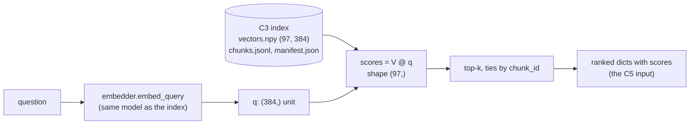

# C4 — Dense retrieval: top-k with scores, the query side, reading score tables, and choosing k

> **What this file is.** The lesson for concept **C4** ([02 card](../02_RAG_MASTER_LEARNING_PLAN.md#c4)). It follows the Parts A–M template of [07](../07_SAMPLE_LESSON.md), at the scale of [P5](P5_vector_search.md).
> **How to use it.** Answers are hidden in collapsible blocks. Write your answer first, then open the block. Lines marked `> 🧭 Coach:` are instructions for the AI tutor; they add to [05 §3](../05_LEARNING_AND_RETENTION_SYSTEM.md#3-coaching-rules-for-the-ai-tutor) and cannot override it.
> **Labels.**
> - **UNVERIFIED**: not checked by running code or reading the primary source.
> - **Toy illustration**: made-up numbers, or a handful of draft items; never a result about a real system.
>
> Every number in this lesson comes from the local run of 2026-10-08 ([C4_FACTS.md](../sources/verification/C4/C4_FACTS.md): S1–S9 for measurements, S-src for citation checks, LT for the lab test), from arithmetic shown in the text, or carries a label. No Groq or Cohere call was made. The 10 seed items are **drafts** (`llm-draft`, [06 §6.7](../06_RAG_PROJECT_AND_EVALUATION_PLAN.md#67-draft-seed-items-for-corpus-d-draft--learner-must-verify)): good for a lesson, never a scored result.

## Lesson header

| Field | Value |
|---|---|
| Concept | **C4 Dense retrieval**: top-k cosine retrieval over the C3 index that **returns scores**; embedding the question with the same model, on the query side; deterministic ties by `chunk_id`; reading score tables (gaps, near ties, near-duplicate distractors); choosing k as a measured trade-off. |
| Phase / tier | Phase 2 (v0 baseline). Priority **E**. |
| Prerequisites | **C3** (the index: `vectors.npy`, `chunks.jsonl`, `manifest.json`) and **P5** (exact top-k, `argpartition`, ties: [P5 D.2–D.3](P5_vector_search.md#d2-exact-k-nn-in-numpy); not repeated here). **P6** for Hit@k ([P6](P6_ir_metrics.md)). |
| Comes next | **C5** consumes the result list (shape at the end of Part H) · **C6** v0 end-to-end · **M2** CE@k on the eval set · **R1/R3** fusion and reranking use the scores and ranks. |
| Open misconceptions | **MC-002** (query-embedding step; "similarity matrix"): D.1, lab Tasks 1, 2b, 7. **MC-005** (one-sided k trade-off): D.6, lab Task 6, L.2 ([log](../progress/misconception_log.md)). |
| Time | A: 10 min · book: 20 min · B–D: 45 min · E–G: 15 min · H (lab): 75 min · J–K: 15 min · L: 15 min · M: 5 min. Two sittings are fine. Part I does not apply. |
| Mastery (C4 → `applied`) | Without notes, you can: (1) say what happens to the question before any score exists (same model, query side); (2) write `retrieve` that returns ranked dicts **with scores** and ties by `chunk_id` (lab CHECK 2a–2c); (3) read a score table and diagnose a distractor that beats the evidence; (4) state both sides of k with numbers; (5) say why a raw score is not a relevance test. Lab: `coding_independence_0_3 ≥ 2`. |
| Mastery (C4 → `transfer`) | You also pass a fresh novel-scenario item (L.3) and score `debugging_0_3 ≥ 2` in the lab. |

> 📖 **Read in the book** — **after Part A, never before** (Part A is closed-book). About 20 minutes. Paraphrase each page in one line.
>
> | Page | What to look for |
> |---|---|
> | Ch1 p.8/14 | Steps 6–7: the question goes through the **same** embedding process as the chunks, and a typical setup keeps the top 2 to 5. Both are claims we test. |
> | Ch1 p.9/14, p.10/14 | The scatter figure (one query, three nearest chunks) and the query sketch: embed, search top-K, fetch the text. Notice: no step shows the scores. |
> | Ch1 p.12/14 | The other side of k: a small fixed k misses evidence spread over several sections. |
> | Ch6 p.1/14 and App p.13/23 | The **asymmetry problem**: short questions and long declarative chunks can land far apart. Keep it for D.1 (`input_type`). |
> | Ch12 p.6/14, p.7/14 | Dense retrieval returns chunks **with** similarity scores, and different retrievers' scores live on different scales. |
> | Ch13 p.2/13 | Similarity is only a rough proxy for relevance: the answer chunk can sit below vaguer ones. |
> | Ch20 p.1/11, p.4/11 | Scores can look reasonable when nothing relevant was found. Keep it for D.5. |
> | Ch22 p.11/19 | **Distracting noise**: similar to the query but wrong. Our D-002 has exactly that (D.4). |
> | App p.22/23, p.20/23 | Glossary: Top-K Retrieval and the Redundancy Problem. |

### Source map

| Source | Where | What it contributes |
|---|---|---|
| Book (A) | Ch1 p.8–10/14, p.12/14; Ch6 p.1/14; Ch11 p.2/13; Ch12 p.6–7/14; Ch13 p.2/13, p.10/13; Ch15 p.1/12; Ch20 p.1/11, p.4/11; Ch22 p.4/19, p.11/19; App p.13/23, p.20/23, p.22/23 | Query embedding, top-K, scores, distractors, why similarity ≠ relevance. No rule for choosing K, no tie rule, no `input_type` (S-src scan). |
| Repo (B) | `simple_rag.ipynb` cells 10, 13, 15; `helper_functions.py` L79/L117, L129–L149, L208–L220; `json_rag.ipynb` cells 21–23; `multi_faceted_filtering.ipynb` cells 10, 12; `dartboard.ipynb` cell 13 | Where scores are dropped, where they are shown, and which side embeds the query |
| Library source (read, not run) | `langchain_core` 1.3.0 `retrievers.py` in the learner's older venv | `get_relevant_documents` no longer exists |
| Lab verification | [`sources/verification/C4/`](../sources/verification/C4/): `c4_measure.py`, `c4_sources.py`, `c4_build_lab.py`, `c4_lab_runner.py`, saved outputs, [`C4_FACTS.md`](../sources/verification/C4/C4_FACTS.md) | Every measured number |
| Source C (external) | #18 SBERT semantic-search guide (symmetric vs asymmetric search); #19 DPR; #52 Cohere Embed API v2 (`input_type`) | D.1 background; not run |

### Contents

[Part A](#part-a--prior-knowledge-recovery) · [B](#part-b--why-c4-exists) · [C](#part-c--intuition-and-analogy) · [D](#part-d--technical-mechanism) · [E](#part-e--connections) · [F](#part-f--worked-example-by-hand) · [G](#part-g--source-connection) · [H](#part-h--implementation-progression) · [I](#part-i--controlled-experiment) · [J](#part-j--failure-and-debugging) · [K](#part-k--engineering-decisions) · [L](#part-l--assessment) · [M](#part-m--retention) · [References](#source-references) · [Verification log](#verification-log)

---

## Part A — Prior knowledge recovery

Answer before reading on: 1–3 sentences each, no notes, no book.

> 🧭 Coach: Ask **one item at a time** (CR-01), in the exact wording below, with its reply template. Record confidence 1–3 before revealing anything (CR-16); the learner is often confident and wrong, so log it. Score with the Recall or Application rubric ([05 §4.2](../05_LEARNING_AND_RETENTION_SYSTEM.md#42-graded-rubrics-04)). Do not correct in detail yet; route with the table after C4-A5. Then send the learner to the "Read in the book" box.

**C4-A1.** A question arrives. What happens to it before any chunk gets a score?

*Reply template:* "The question is ____ by ____, and then ____."

<details><summary>What a strong answer contains</summary>

- It is **embedded by the same model** that embedded the chunks (Ch1 p.8/14), on the **query side** of that model's interface (`embed_query`; Cohere's `input_type="search_query"`, 06 §2.4).
- Then one score per chunk: `scores = V @ q`, shape `(97,)` for our v0 index (S3).
- ⚠️ MC-002 flags: no embedding step; "a similarity matrix".

</details>

**C4-A2.** Retrieval gives chunk A a score of 0.46 and chunk B 0.44. What does that tell you?

*Reply template:* "It tells me ____. It does not tell me ____."

<details><summary>What a strong answer contains</summary>

- A is a little **closer to the question** in this model's space, so A ranks first.
- It does **not** say A contains the answer, or that 0.46 is "high". In D-002, rank 1 (0.4606) is a Kyoto Protocol chunk with no Paris Agreement in it; the evidence is rank 3 (0.4386) (S3).
- Scores are comparable only within one model and one query (D.5).

</details>

**C4-A3.** What do you gain, and what do you pay, when k goes from 4 to 8?

*Reply template:* "I gain ____. I pay ____. I would decide by ____."

<details><summary>What a strong answer contains</summary>

- **Gain:** more chance that all the evidence is in the context (CE@k can only rise).
- **Pay:** about twice the context tokens (×1.89 here, S6), more noise per chunk (P@k falls from 0.375 to 0.188), more distractors for the LLM.
- **Decide by measuring** CE@k against tokens on an eval set, not by feel.
- ⚠️ MC-005 flag: only one side ("more chunks is bad").

</details>

**C4-A4.** Two chunks get exactly the same score. Which one does v0 put first?

*Reply template:* "v0 puts first the one with ____, because ____."

<details><summary>What a strong answer contains</summary>

- The **smaller `chunk_id`** (06 §3.1), so two runs always agree.
- Not "whichever row comes first": row order is an accident of how the index was built (lab CHECK 2c shuffles the rows to test this).

</details>

**C4-A5.** The chunk with the answer is at rank 5, and k = 4. Whose fault is the wrong answer: retrieval's or generation's?

*Reply template:* "It is a ____ failure, because ____."

<details><summary>What a strong answer contains</summary>

- **Retrieval**: the evidence never reached the prompt (CE@4 = 0). The LLM cannot be blamed for text it never saw (CR-11).
- Fixes live in retrieval: k, the query, the chunker, reranking. Not in the prompt.

</details>

> 🧭 Coach: **Routing.**
>
> | Weak answers (score ≤ 1) | Action |
> |---|---|
> | C4-A1 | MC-002 is live. Re-do [P5 Part C](P5_vector_search.md#part-c--intuition-and-analogy) in 5 minutes, then D.1 here, then lab Tasks 1 and 2b first. |
> | C4-A2 | Teach D.3 and D.5 with the D-002 table before anything else. |
> | C4-A3 | MC-005 is live. Teach D.6; do lab Task 6 with its prediction; use the CR-08 probe in Part F. |
> | C4-A4 | Point to [P5 D.3](P5_vector_search.md#d3-ties-and-determinism); then D.2 here (ties by `chunk_id`, not row). |
> | C4-A5 | Teach the retrieval/generation split with J1 and J4 before the lab. |
> | All five ≥ 3 with confidence 3 | Fast track: skim B–C, then D.3–D.6, the lab and L (evidence is never skipped, [02 §5](../02_RAG_MASTER_LEARNING_PLAN.md#5-fast-track-rules-from-the-o1-diagnostic) rule 1). |

---

## Part B — Why C4 exists

### B.1 The repo's baseline throws the scores away

`simple_rag.ipynb` cell 15 calls `retrieve_context_per_question` and prints the chunks with `show_context`. Follow the helper (`helper_functions.py` L129–L149): L143 asks the retriever for documents, and **L147 keeps only `page_content`**. The score and the page are gone. `show_context` (L208–L220) prints "Context 1:", then the text. Its docstring even promises a tuple with URLs, but L149 returns the plain list (S-src).

So the baseline cannot tell you whether rank 1 won by 0.10 or by 0.0001. Nor can it tell you that the evidence sat one place below the cut-off.

> 🧭 Coach: CR-17. Ask one question: "Which line of the helper loses the scores?" Expected: L147, `[doc.page_content for doc in docs]`.

### B.2 What the scores showed on our own index

The v0 index (C3's config) gives D-002 ("In what year was the Paris Agreement adopted?") this top-4 (S3):

| Rank | seq | Page | Score | Holds the year? |
|---|---|---|---|---|
| 1 | 69 | 24 | 0.4606 | No: the Kyoto Protocol paragraph, adopted in 1997 |
| 2 | 68 | 23 | 0.4513 | No: the Paris paragraph **without** the year |
| 3 | **27** | **10** | **0.4386** | **Yes** |
| 4 | 17 | 6 | 0.4385 | No: Paris mentioned, no year |

The evidence is in the top-4, but only 0.0220 below a chunk that offers a **different year**. Ranks 3 and 4 differ by **0.00008**. Without scores you see none of this.

---

## Part C — Intuition and analogy

**Retrieval is a ranked shortlist with marks.** A recruiter scores every CV against the job ad and keeps the best four. The marks matter as much as the names: "four strong candidates" and "one strong, three who barely beat the fifth" are different shortlists.

**The query must be read the way the CVs were read.** If the recruiter marks the CVs with one rubric and the job ad with another, the marks still come out as numbers. Nothing complains; they are just meaningless (D.1, S7).

**A near-duplicate distractor is a CV copied from a strong one with the key line missing.** It scores almost as high, sometimes higher.

**Where the analogy breaks.** A recruiter knows what "qualified" means. A cosine score only measures closeness in the model's space, not whether the chunk answers the question (Ch13 p.2/13; Ch20 p.4/11).

> 🧭 Coach: CR-17. Ask one question: "In the D-002 table, why is rank 1 a dangerous chunk to show the LLM?" Expected: it carries a different treaty's adoption year (1997).

---

## Part D — Technical mechanism

### D.1 The query side (MC-002)



Three rules for the query vector, each measured (S7):
- **Same model.** A query from `paraphrase-MiniLM-L3-v2` against the `all-MiniLM-L6-v2` index has the same shape, `(384,)`, so NumPy raises no error. Yet Hit@4 falls from 8/8 to **3/8**; D-002's rank-1 score from 0.4606 to 0.1858. Guard: compare the embedder's id with `manifest["embedding"]["model_id"]` (lab Task 7).
- **Query side.** MiniLM is symmetric: the question embedded "as a document" differs by at most 1.15e-07. Cohere's API takes `input_type` (`search_query` vs `search_document`; SDK signature, S-src), a response to the asymmetry problem (Ch6 p.1/14). Its effect on our data is **UNVERIFIED** (lab Task 8, off).
- **Normalising q does not change the ranking.** q × 3 gives the same ids, but a rank-1 score of 1.3818. Normalising both sides makes the score a readable cosine.

> 🧭 Coach: CR-17. Ask one question: "Our wrong-model test raised no error. What one-line check would have caught it?" Expected: assert the embedder's model id equals the index manifest's.

### D.2 `retrieve` returns scores, and ties go to `chunk_id`

The top-k itself is P5's `top_k` ([P5 D.2](P5_vector_search.md#d2-exact-k-nn-in-numpy)): `argpartition`, then an explicit sort. C4 adds two things:
1. **Each result carries its score** (a plain Python `float`), its rank, its page and its offsets. The exact shape is at the end of Part H.
2. **Ties are broken by `chunk_id`, not by row.** Our ids look like `climate:ea07572562ac:1ca9c5a3b548:00027` (06 §2.3: doc, snapshot, `params_hash`, seq). Within one document the ids share the prefix and the sequence number is zero-padded, so string order equals `seq` order (S1). Without padding, `"c:10"` sorts before `"c:9"` (toy, S5).

Real exact ties: **0** among the 97 scores of each of the 10 seeds; no duplicate chunk texts (S5). Ties appear when the index holds copies. Lab CHECK 2c duplicates every row and shuffles the rows. Correct order: seqs `[69, 166, 68, 165]`. Breaking ties by row gave `[166, 69, 165, 68]`; `argpartition` alone gave `[166, 69, 68, 165]` (S5).

### D.3 Reading a score table

For each query, look at four things (S3, S4):
- **The gap between rank 1 and rank 2.** D-007: 0.0989, a clear winner. D-002: 0.0093, nearly a tie.
- **The gap at the cut-off (rank k vs k + 1).** D-002: 0.0998, a clean edge. D-008: 0.0006, so rank 5 almost made it.
- **Where the first relevant chunk sits, and its margin below rank 1.** D-001: rank 3, 0.0237 below.
- **The absolute level.** D-008's best score is only 0.2598: the query and the chunks share little vocabulary.

Over the 10 seeds, 28 of the 70 adjacent gaps inside the top-8 are below 0.01 (median 0.01556). Small gaps are the norm, not the exception.

<details><summary>Measured summary, v0 index (S4; draft items, a demo, not an evaluation)</summary>

| qid | First relevant rank | First k with CE = 1 | Rank-1 score | Gap 1–2 | Gap 4–5 |
|---|---|---|---|---|---|
| D-001 | 3 | 3 | 0.4929 | 0.0223 | 0.0894 |
| D-002 | 3 | 3 | 0.4606 | 0.0093 | 0.0998 |
| D-003 | 1 | 1 | 0.6497 | 0.0177 | 0.0137 |
| D-004 | 1 | 1 | 0.4210 | 0.0175 | 0.0120 |
| D-005 | 1 | 1 | 0.4272 | 0.0692 | 0.0065 |
| D-006 | 1 | 1 | 0.5331 | 0.0327 | 0.0237 |
| D-007 | 2 | 3 | 0.7094 | 0.0989 | 0.0053 |
| D-008 | 2 | 2 | 0.2598 | 0.0063 | 0.0006 |
| D-009 (no answer) | — | — | 0.3099 | 0.0301 | 0.0150 |
| D-010 (no answer) | — | — | 0.5196 | 0.0855 | 0.0013 |

</details>

> 🧭 Coach: CR-17. Ask one question: "In D-008, why does a gap of 0.0006 at rank 4 matter?" Expected: the fifth chunk nearly entered the context; a tiny change (another model, a new chunk) can swap them.

### D.4 Near-duplicate distractors

A distractor is a non-relevant chunk ranked above the evidence. Four of the 8 answerable seeds have one (S4):

| qid | Winner (seq, page) | Margin over the evidence | cos(winner, evidence chunk) | Why it wins |
|---|---|---|---|---|
| D-002 | 69, p.24 | +0.0220 | 0.72 | Same sentence pattern: a treaty "adopted in" a year (1997, the Kyoto Protocol) |
| D-001 | 1, p.1 | +0.0237 | 0.59 | Topic match: the introduction on rising global temperatures, without the number |
| D-007 | 69, p.24 | +0.0989 | 0.72 | Names the Kyoto Protocol from the question; not the bridging entity |
| D-008 | 28, p.10 | +0.0063 | 0.51 | Generic policy "targets" text; the rare term Kigali does not pull hard |

The seed's own near-duplicate, the p.23 Paris paragraph without the year (seq 68), is rank 2 for D-002. Mirror image: in D-003 the p.23 chunk is the evidence and the p.10 chunk is the near-duplicate (0.6497 vs 0.6320).

At k = 4, all four still reach CE = 1. So C4 calls them **retrieval ranking** problems, not misses. They become **generation** risks once in the prompt: the book calls this distracting noise (Ch22 p.11/19). Whether our LLM then answers "1997" is **UNVERIFIED** until C5 runs it.

### D.5 What a score cannot tell you

- **Not "relevant".** D-010 has no answer in the document, yet its rank-1 score (0.5196) is higher than that of **5 of the 8** answerable seeds (S4). The book warns that scores can look reasonable when nothing relevant was found (Ch20 p.1/11).
- **Not comparable across models.** The wrong-model rank-1 score was 0.1858 for the same question (S7). Different retrievers use different scales (Ch12 p.7/14). A threshold tuned on MiniLM does not transfer to Cohere.
- **Not a probability.** A cosine of 0.46 is not "46% relevant".

So v0 has **no score threshold**; abstention is the prompt's job (06 §3.3), and a calibrated threshold is v5.0's (06 §3.4).

> 🧭 Coach: CR-17. Ask one question: "Why can't v0 abstain with 'top score below 0.5'?" Expected: it would answer D-010 (0.5196) and drop 5 answerable seeds.

### D.6 Choosing k: both sides, measured (MC-005)

**Toy illustration** (8 draft answerable seeds, 10 seeds for tokens; S6). Context tokens: `o200k_harmony`, chunk text only.

| k | Hit@k | CE@k | P@k | Mean context tokens |
|---|---|---|---|---|
| 1 | 4/8 | 4/8 | 0.500 | 173.7 |
| 2 | 6/8 | 5/8 | 0.500 | 345.8 |
| **4** | **8/8** | **8/8** | 0.375 | **679.0** |
| 8 | 8/8 | 8/8 | 0.188 | 1,284.2 |

- **Recall side:** k = 2 loses complete evidence for D-001, D-002 and D-007. The book makes the same point for questions whose evidence is spread out (Ch1 p.12/14).
- **Cost and noise side:** each doubling of k costs ×1.89 to ×1.99 tokens; k = 8 buys nothing here, and half its chunks are noise.
- **Not a decision.** Eight easy draft items cannot choose k. v0 keeps k = 4 (06 §3.1); k is tuned later on the frozen eval set, with CE@k against tokens (M2, I-experiments).

The book's "top 2 to 5" (Ch1 p.8/14) and its 10–30 rerank pool (Ch13 p.10/13) are starting ranges, not measurements.

> 🧭 Coach: CR-17. Ask one question: "On these seeds, what did k = 8 add over k = 4?" Expected: no extra CE; about ×1.89 tokens.

---

## Part E — Connections

**C3** (index) → **C4** → **C5** (context and citations) → **C6** (v0 trace). **P5** gives `top_k`; **P6** gives Hit@k; **M2** gives CE@k on the eval set; **R1** fuses ranks; **R3** reranks a larger pool; **V3** owns abstention thresholds.

| Often confused | The difference |
|---|---|
| Score vs relevance | A score is closeness in one model's space; relevance is "contains the evidence" (D.5). |
| Similarity matrix vs score vector | One query gives `(97,)`; ten queries give `(10, 97)` (S3). Chunks × chunks is never retrieval (MC-002). |
| Same model vs same dimension | 384 = 384 did not make the L3 model compatible: Hit@4 3/8 (D.1). |
| `embed_query` vs `embed_documents` | Identical for MiniLM; different for asymmetric models such as Cohere (D.1). |
| Hit@k vs CE@k | Hit: some evidence arrived. CE: all of it (06 §7.3). D-007 has Hit@2 = 1 but CE@2 = 0. |
| A retrieval miss vs a distractor | Miss: the evidence is below k. Distractor: the evidence is in, but a lookalike ranks higher. |
| Retrieval k vs top-k sampling | Chunks returned vs next-token choices (P1). Unrelated. |

---

## Part F — Worked example by hand

**Toy illustration** (made-up scores and token counts; re-checked in Python, S-toy in C4_FACTS).

| chunk_id | c:00000 | c:00001 | c:00002 | c:00003 | c:00004 |
|---|---|---|---|---|---|
| Score | 0.41 | 0.58 | 0.58 | 0.62 | 0.30 |
| Tokens | 150 | 170 | 160 | 180 | 120 |

The question needs **two** facts: one is in c:00002, the other in c:00004.

**Step 1.** Rank all five, ties by `chunk_id`.

<details><summary>Answer</summary>

`[c:00003, c:00001, c:00002, c:00000, c:00004]`. c:00001 and c:00002 tie at 0.58; the smaller id goes first.

</details>

**Step 2.** At which rank is the first relevant chunk, and by how much does rank 1 beat it?

<details><summary>Answer</summary>

Rank 3; 0.62 − 0.58 = 0.04. Hit@1 = Hit@2 = 0, Hit@3 = 1.

</details>

**Step 3.** CE@3, CE@5, and the tokens at k = 3 and k = 5?

<details><summary>Answer</summary>

CE@3 = 0 (c:00004 is missing); CE@5 = 1. Tokens: 180 + 170 + 160 = 510; then + 150 + 120 = 780. Complete evidence costs 270 more tokens, of which 150 are noise (c:00000).

</details>

> 🧭 Coach: CR-08 probe here, one question: "If k doubles from 4 to 8 on our v0 seeds, what happens to CE and to tokens?" Expected: CE stays 8/8; tokens ×1.89 (S6). Follow-up on a later turn: "And if k halves to 2?" Expected: CE falls to 5/8; tokens ×0.51.

---

## Part G — Source connection

### G.1 Book (Source A)

| Cite | Book point (paraphrased) | Our assessment |
|---|---|---|
| Ch1 p.8/14 | Embed the question with the same process as the chunks; retrieve the top 2 to 5 | Same model: yes. The query **side** is not mentioned. 2–5 is a range to measure |
| Ch1 p.9–10/14 | Figure and sketch: embed, search top-K, fetch text | No scores in the sketch, like the repo baseline |
| Ch1 p.12/14 | A small fixed k misses scattered evidence | The recall side of MC-005; measured: k = 2 loses CE for 3 of 8 |
| Ch6 p.1/14; App p.13/23 | Questions and chunks differ in shape and can embed far apart | The reason models offer `input_type` (D.1) |
| Ch11 p.2/13 | Sometimes the gap is wide enough that a less relevant chunk scores higher | D-001, D-002, D-007, D-008 (D.4) |
| Ch12 p.6–7/14 | Dense retrieval returns scores; retrievers' scores differ in scale | D.5: compare scores only within one model |
| Ch13 p.2/13 | Similarity is a rough proxy for relevance | D-002's rank 1 |
| Ch13 p.10/13 | Rerank pool K = 10–30, keep N = 3–5 | A later design (R3); not v0 |
| Ch20 p.1/11, p.4/11 | Scores can look fine with nothing relevant; similarity ≠ relevance | D-010: 0.5196 with no answer |
| Ch22 p.4/19, p.11/19 | Precision@K shows noise; distracting noise is the most dangerous kind | P@k in D.6; D-002's 1997 chunk |
| App p.20/23, p.22/23 | Top-K returns the highest scores and is prone to redundancy | Our index has no duplicates (S5); distractors are lookalikes, not copies |

**Not in the book** (whole-book scan, S-src): a rule for choosing K, a tie rule, `input_type` or query prefixes.

### G.2 Repo (Source B): cells verified at `009adba`

| Cell (0-based) / line | What it shows | Lesson |
|---|---|---|
| `simple_rag.ipynb` 10, 13, 15 | FAISS store; `search_kwargs={"k": 2}`; retrieval printed with no score | B.1 |
| `helper_functions.py` L129–L149 | L143 `get_relevant_documents`; L147 keeps only `page_content`; L149 returns a list although the docstring promises a tuple with URLs | B.1 |
| `helper_functions.py` L79, L117 | `encode_from_string` writes a constant `relevance_score = 1.0` into every chunk's metadata | A "score" that measures nothing |
| `helper_functions.py` L208–L220 | `show_context` prints text only | B.1 |
| `json_rag.ipynb` 21, 22, 23 | `IndexFlatL2`; the markdown explains the same model, L2 distance, lower is better; the cell prints `Distance` for 5 neighbours; the query is not normalised | The repo's one clear score printout |
| `multi_faceted_filtering.ipynb` 10, 12 | Our MiniLM model in Chroma; `similarity_search_with_relevance_scores(query, k=10)` printed | The relevance conversion is library-defined (UNVERIFIED here) |
| `dartboard.ipynb` 13 | The query embedded with `embed_documents` | The query-side mistake of D.1 (harmless only for symmetric models) |

Repo-wide (S-src): 9 of 41 notebooks call a score-returning search API; `simple_rag.ipynb` is not one of them. Eight notebooks mention `get_relevant_documents`, which `langchain_core` 1.3.0 no longer defines (read in the older venv; not run).

**Corrections to the [04 C4 row](../04_BOOK_TO_CODE_MAPPING.md)** (04 is not edited):
1. 04 says "lower L2 = better" is never explained. `json_rag.ipynb` cell 22 explains it (L2 distance, lower is better). It is unexplained in `simple_rag`, not in the repo.
2. 04 omits where the baseline loses the scores: `helper_functions.py` L147 (and L143's removed API). The 02 card has L129–L149.
3. 04's book column has only Ch1 p.8/14 and p.10/14. Missing: Ch1 p.12/14 (k too small), Ch6 p.1/14 (asymmetry), Ch12 p.7/14 (score scales), Ch13 p.2/13 and Ch20 p.1/11 (similarity ≠ relevance), Ch22 p.11/19 (distracting noise).
4. 04 does not mention the query side: `dartboard.ipynb` cell 13 embeds the query with `embed_documents`.
5. 04's experiment ("score distributions, answerable vs unanswerable") is shown here as a toy only: on 10 draft seeds, no threshold separates them (D.5). A real study belongs to V3.

---

## Part H — Implementation progression

### H.1 The lab: [`labs/C4_dense_retrieval_lab.ipynb`](../labs/C4_dense_retrieval_lab.ipynb) (blank-file first)

A given cell builds the v0 index (labelled "given, see C3"; it can load your own C3 index files instead). The notebook has **no solution code**; CHECK cells compare fingerprints (LT).

| # | Task | The checks test |
|---|---|---|
| 1 | Predict shapes; embed D-002 on the query side; score every chunk | `q` (384,) unit, from `embed_query`; `scores` (97,) (MC-002) |
| 2 | `retrieve(question, embedder, V, chunks, k=4)` returning ranked dicts with scores | 2a keys, ranks, float scores, order, D-002 ids, JSON-safe, k > N · 2b a spy embedder: `embed_query` only · 2c duplicated, shuffled index: ties by `chunk_id` |
| 3 | Predict D-002's evidence rank; score table for all 10 seeds; `first_rel`, `first_ce` | Fingerprints |
| 4 | Diagnose every seed where a distractor beat the evidence | The four qids, the cosines; the tutor grades the text |
| 5 | Predict; can a top-1 threshold spot "no answer"? | `top1`, `n_below` |
| 6 | Predict; the k sweep (Hit, CE, tokens) and your two-sided k sentence | Fingerprints; the tutor grades the sentence (MC-005) |
| 7 | Predict; the wrong query model, and a `check_compatible` guard | `[3, 3]`; the guard raises |
| 8 | Optional, **off by default**: Cohere with `input_type` right and wrong | No CHECK; results UNVERIFIED until you log a run |
| 9 | The hand-off to C5 in your words | Tutor-graded (Transfer) |

The lab test (LT): a throwaway solution kept outside the workspace passes 10/10 CHECK cells. Broken versions each fail: no tie rule and ties by row (2c), ascending sort (7 CHECKs), the query embedded as a document (2b), scores dropped (6 CHECKs), `np.float32` scores (2a), a chunk × chunk matrix (1).

> 🧭 Coach: The reference script `sources/verification/C4/c4_measure.py` is a **solution**. Do not show it before an attempt plus a hint (CR-04). Grade `coding_independence_0_3` on Tasks 2 and 6, `debugging_0_3` on any failing CHECK the learner fixes. If CHECK 2b fails, ask "Which method of the embedder did your function call?" before anything else (MC-002).

### H.2 Repo reading guide: `simple_rag.ipynb` cell 15 → `helper_functions.py` L129–L149

Answer before opening.
1. After L147, can you still tell which page a context string came from?
2. The retriever was built with k = 2 (cell 13). For D-002 on our v0 index, would k = 2 have included the evidence?
3. L143 calls `get_relevant_documents`. What happens on `langchain-core` 1.x?
4. What would you change so the function returns what C5 needs?

<details><summary>Answers</summary>

1. No: page, offsets and score are all dropped; only text remains.
2. No: the evidence is rank 3 (S3). With k = 2 the context would hold the Kyoto chunk (1997) and the Paris paragraph without the year.
3. `langchain_core` 1.3.0 defines no public `get_relevant_documents` (S-src, read not run), so the call would fail; `invoke` is the current method (UNVERIFIED at runtime).
4. Return ranked records with score, rank, chunk id, page and offsets: the interface below.

</details>

### H.3 Reusable design (future `ragkit/retrieval.py`; nothing is created now)

- `DenseRetriever(index_dir, embedder)`: on load, assert `len(chunks) == V.shape[0]`, float32, unit rows, unique `chunk_id`s, `(doc_id, seq)` strictly increasing within each document (never `seq == i`: `seq` restarts per document in Corpus T), and the embedder matches the manifest (`model_id`, or the stricter `embed_hash`).
- `retrieve(query, k)` → `list[Candidate]` with `source="dense"` (06 §2.3); ranks 1-based; ties by `chunk_id`.
- Unit tests: brute force on tie-heavy arrays (P5), the spy embedder (2b), the shuffled duplicate index (2c), JSON round trip of the result.
- Every trace stores k, the scores, the ranks, the embedder id and the index manifest hash (06 §2.5).

### H.4 The interface: what C4 consumes and what it hands to C5

**Input (from C3, 06 §3.1).** An index directory with `vectors.npy` (float32, shape (N, d), unit rows; row i ↔ line i of `chunks.jsonl`; `seq` restarts per document, so it is **not** the row number), `chunks.jsonl` (one 06 §2.3 Chunk per line: `doc_id`, `snapshot_id`, `chunk_id`, `seq`, `char_start`, `char_end`, `page_segments` [{`page`, `char_start`, `char_end`}], `text`, `text_sha256`, `chunker`, `params_hash`) and `manifest.json`, in the folder `index/<snapshot_id>/<params_hash>/<embed_hash>/` (v0 with MiniLM: `index/ea07572562ac/1ca9c5a3b548/c398eeba043f/`, S1). Plus an embedder with `embed_query(text)` → (d,) unit vector.

**Call.** `retrieve(question: str, embedder, V, chunks, k: int = 4) -> list[dict]`.

**Output (to C5).** A list of `min(k, N)` dicts, ordered by (−score, `chunk_id`):

```python
{"rank": 1,                       # int, 1-based
 "chunk_id": "climate:ea07572562ac:1ca9c5a3b548:00069",   # str, 06 §2.3 format
 "doc_id": "climate",             # str
 "page": 24,                      # int, 1-based: the chunk's first page segment
 "char_start": 51414, "char_end": 52396,                  # int, document offsets
 "score": 0.4606130123138428,     # Python float: cosine of unit vectors
 "text": "Kyoto Protocol\nThe Kyoto Protocol, adopted in 1997, ..."}   # str (cut here)
```

That record is D-002's real rank 1 (S3). The trace form (06 §2.5 `candidates.dense`) is the same dict **without `text`**.

**Interface assumptions** (06 is the source of truth; these fill its gaps):
1. The tie rule compares `chunk_id` strings. Within one document that equals `seq` order (shared prefix, `seq` zero-padded to 5 digits, S1); across documents (Corpus T) it orders by `doc_id` first. Either way it is deterministic and independent of row order.
   **Course-wide ids (decided 2026-10-08, the same as the C2 lab and C3):** `chunk_id = f"{doc_id}:{snapshot_id}:{params_hash}:{seq:05d}"`, with `params_hash = sha256(json.dumps(CHUNKING, sort_keys=True))[:12]` over 06 §2.4's `chunking:` block: `1ca9c5a3b548`. (07's `ChunkerConfig.params_hash()` gives `77bc4c45809b` for the same spans; it is not used for ids.) The 97 records C4 retrieves over are byte-identical to the C2 lab's saved `chunks.jsonl` (sha256 `d4108b89…`, S1).
2. The in-memory result carries `text`, because C5 needs it; the trace drops it.
3. `page` is the first page segment. Per-page chunks have exactly one (97/97, S1).
4. `manifest.json` has at least `snapshot_id`, `embedding.model_id` and `embed_hash` (12 hex of sha256 over `{provider, model_id, revision, input_type, normalize, preproc_version}`, sorted keys; course decision). C4's lab guard checks the model id; `embed_hash` is the stricter check. The MiniLM value `c398eeba043f` was computed here with C3's field values (input types `none`, preprocessing `none`); C3 owns the manifest, so its value is authoritative.
5. `score` is the raw cosine: not a distance, not rescaled to 0–1.
6. k ≥ 1; k > N returns all N chunks.
7. `.env` names the Cohere model `COHERE_EMBED_MODEL`; 06 §2.4 writes `COHERE_EMBED_MODEL_ID`. The lab's Cohere cell reads either.

---

## Part I — Controlled experiment

**n/a for C4.** v0 fixes k = 4 (06 §3.1). The k sweep in D.6 is a toy on 8 draft items, not an experiment. Choosing k is done later, on the frozen eval set, with CE@k against mean context tokens and a pre-registered hypothesis (06 §9).

---

## Part J — Failure and debugging

Write your cause and fix first. Each diagnosis says **retrieval** or **generation** (CR-11).

**J1. The answer gives 1997 for "When was the Paris Agreement adopted?"**

<details><summary>Diagnosis</summary>

- **Cause.** The Kyoto chunk (adopted 1997) ranks first; the evidence is in the top-4 (rank 3). **Kind:** retrieval ranked a distractor first; the wrong answer itself is a **generation** failure (the evidence was present). UNVERIFIED until C5 runs it.
- **Fix.** Check the trace's scores and CE@4 first. If CE = 1, fix the prompt or the context order; if CE = 0, fix retrieval.

</details>

**J2. After switching the embedder, every answer gets worse, and no error appears.**

<details><summary>Diagnosis</summary>

- **Cause.** Queries embedded with the new model, index built with the old one; same dimension, so no shape error (Hit@4 3/8, S7). **Kind:** retrieval.
- **Fix.** `check_compatible`: the embedder id (or its `embed_hash`) must equal the manifest's. Rebuild the index when the model changes (C3); the new index gets its own `<embed_hash>` folder.

</details>

**J3. Cohere retrieval is worse than MiniLM on easy questions.**

<details><summary>Diagnosis</summary>

- **Cause (one candidate).** The query was sent with `input_type="search_document"`, as `dartboard.ipynb` cell 13 does with `embed_documents`. **Kind:** retrieval. The size of the effect is UNVERIFIED for our data.
- **Fix.** `embed_query` uses `search_query`; a spy test like CHECK 2b.

</details>

**J4. A teammate sets "abstain if the top score is below 0.5".**

<details><summary>Diagnosis</summary>

- **Effect.** It would answer D-010 (0.5196, no answer) and abstain on 5 answerable seeds (S4). **Kind:** an answer-policy (generation) decision built on a retrieval number that does not measure relevance.
- **Fix.** No threshold in v0; calibrate one on a labelled dev set in v5.0 (06 §8.4).

</details>

**J5. Two runs return the same chunks in a different order.**

<details><summary>Diagnosis</summary>

- **Cause.** Ties broken by row order or by `argpartition`'s unspecified order (S5). **Kind:** retrieval (rank order changes MRR and the prompt order).
- **Fix.** Sort by (−score, `chunk_id`); test on a shuffled duplicate index (CHECK 2c).

</details>

> 🧭 Coach: For J2 and J5, ask for the **one-line assert** that would have caught it. It counts as evidence for `debugging_0_3`.

---

## Part K — Engineering decisions

| Question | Decision | Why |
|---|---|---|
| Similarity | Exact cosine, `V @ q`, both sides normalised | P5; scores readable as cosines (D.1) |
| Query embedding | `embed_query` of the **index's** model; checked against the manifest | Same dimension is not same model (D.1) |
| k | 4 in v0 (06 §3.1); tuned later on the eval set | Toy sweep: k = 2 loses CE, k = 8 doubles tokens (D.6) |
| Ties | By `chunk_id` string, zero-padded seq | Deterministic across row orders (D.2) |
| Output | Ranked dicts with score, rank, page, offsets, text | C5 needs text and pages; traces need scores (H.4) |
| Score threshold | None in v0 | Scores do not separate answerable from unanswerable (D.5) |
| Duplicates | None found; dedup is v4.0's job | 0 duplicate texts (S5) |

**When NOT to rely on raw dense scores:** across models or providers, as relevance labels, or as a stop rule. Use ranks, CE@k on labelled items, or a calibrated judge instead.

---

## Part L — Assessment

One short question per item, with a reply template. Score with [05 §4.2](../05_LEARNING_AND_RETENTION_SYSTEM.md#42-graded-rubrics-04).

> 🧭 Coach: Ask one item at a time, with its template. Never two questions in one turn. Record confidence first.

### L.1 Recall

**C4-R-01** (MC-002 check item). Before any chunk is scored, what happens to the question?
*Template:* "It is embedded by ____, using ____, so the result is ____."

<details><summary>Criteria for 4</summary>

Same model as the index; the query side (`embed_query`, Cohere `search_query`); a unit vector of shape (d,), then one score per chunk, shape (N,). Boundary: same dimension is not enough (S7).

</details>

**C4-R-02.** Why does v0's `retrieve` return a score with every chunk?
*Template:* "So that ____, and so that ____."

<details><summary>Criteria for 4</summary>

So traces show gaps, near ties and distractors (debugging, D.3); so later stages (fusion, reranking, thresholds in v5) can use them. Boundary: the score is not shown to the LLM and is not a relevance label.

</details>

**C4-R-03.** What is a near-duplicate distractor?
*Template:* "A chunk that ____, which ranks ____ the evidence because ____."

<details><summary>Criteria for 4</summary>

A non-relevant chunk very similar to the evidence chunk or the question (e.g. the p.23 Paris paragraph without the year, cos 0.78 with the evidence chunk, S4), ranking above or close to the evidence. Plus: retrieval sees it; generation may be misled by it.

</details>

### L.2 Application

**C4-A-01** (code; MC-002 check item). Write `retrieve(question, embedder, V, chunks, k)` from a blank cell.
*Template:* "[your code] It returns ____."

<details><summary>Criteria for 4</summary>

Calls `embed_query`; `V @ q`; top-k with an explicit sort by (−score, `chunk_id`); returns the H.4 dicts with float scores. Passes lab CHECK 2a–2c without hints.

</details>

**C4-A-02** (CR-08). On our seeds, what happens to complete evidence and tokens if k doubles from 4 to 8?
*Template:* "CE ____; tokens ____ (about ×__), because ____."

<details><summary>Criteria for 4</summary>

CE stays 8/8; tokens ×1.89 (679.0 → 1,284.2); P@k halves (S6). Both sides named. Boundary: 8 draft items, not a decision.

</details>

**C4-A-03** (by hand). Scores `[0.71, 0.50, 0.50, 0.33]` belong to ids `[c:00007, c:00009, c:00002, c:00001]`. What is the top-2?
*Template:* "[____, ____], because ____."

<details><summary>Criteria for 4</summary>

`[c:00007, c:00002]`: c:00009 and c:00002 tie at 0.50 for the last place; the smaller id wins, although it is the later row.

</details>

**C4-A-04** (debugging). A teammate proposes "abstain when the top score is below 0.5". What happens on our seeds?
*Template:* "It would ____ on D-010 and ____ on ____ answerable seeds, because ____."

<details><summary>Criteria for 4</summary>

It answers D-010 (0.5196) and abstains on 5 answerable seeds (D-001, D-002, D-004, D-005, D-008); scores are not relevance (D.5). Fix: calibrate on a labelled dev set later (V3).

</details>

### L.3 Transfer

> 🧭 Coach: C4-T-01 is a practice item and the MC-005 check item ("choose k for a new corpus with a reason"). For the scored CR-13 item, invent a fresh scenario (new document type, scale or constraint) that is not in this file, and grade it with the Transfer rubric.

**C4-T-01.** A hospital indexes 3,000 drug leaflets. Many leaflets share near-identical safety paragraphs. How would you choose k?
*Template:* "I would measure ____ against ____, expecting ____ because ____."

<details><summary>Criteria for 4</summary>

- Build a small labelled set; sweep k; plot CE@k against mean context tokens; pick the smallest k near the CE plateau.
- Expect near-duplicates to fill the top ranks (same safety text), so CE may need a larger k, or dedup / diversity (Ch15) before raising k.
- Check the query side and the model id; compare scores only within one model.
- Keep retrieval (CE@k) and answer quality (a wrong dose from a distractor) separate.

</details>

### L.4 When is C4 mastered?

- **`applied` (L3):** C4-R-01 ≥ 3 on two days, one ≥ 24 h after teaching; two Application items ≥ 3; `coding_independence_0_3 ≥ 2` on lab Tasks 2 and 6.
- **MC-002 closes** when P5-R-01 and C4-A-01 (or C4-R-01) score ≥ 3 unassisted on different days. **MC-005 closes** when C4-T-01 (or a fresh k-choice item) and P6's application item score ≥ 3 on different days ([log rule](../progress/misconception_log.md)).
- **`transfer` (L4):** a fresh novel-scenario item ≥ 3; `debugging_0_3 ≥ 2`; a teach-back ≥ 3.

---

## Part M — Retention

### M.1 Flashcards

| # | Front (one question) | Back |
|---|---|---|
| 1 | Which model embeds the question? | The index's model, on its query side |
| 2 | Shape of `V @ q` for our v0 index? | (97,) |
| 3 | Does a 384-d query from another model raise an error? | No; Hit@4 fell to 3/8 |
| 4 | Cohere's two `input_type` values for retrieval? | `search_query`, `search_document` |
| 5 | v0 tie rule? | Smaller `chunk_id` first |
| 6 | Why zero-pad `seq` in the id? | So string order equals seq order |
| 7 | D-002's evidence rank on v0? | 3 (rank 1: the Kyoto 1997 chunk) |
| 8 | Is a 0.52 top score "relevant"? | Not necessarily: D-010 has no answer |
| 9 | k 4 → 8 on our seeds? | CE same; tokens ×1.89 |
| 10 | k 4 → 2 on our seeds? | CE 8/8 → 5/8 |
| 11 | Which repo line drops the scores? | `helper_functions.py` L147 |
| 12 | Hit@k vs CE@k? | Some evidence vs all of it |

### M.2 Retrieval practice (closed book; log per [05 §5.1](../05_LEARNING_AND_RETENTION_SYSTEM.md#51-active-recall-what-a-review-item-looks-like))

| When | One question | Template |
|---|---|---|
| Day 1 | What happens to the question before scoring? | "It is ____ by ____." |
| Day 3 | Scores `[0.6, 0.4, 0.4]`, ids `[c:00005, c:00008, c:00003]`, k = 2: which ids? | "[____, ____]" |
| Day 7 | What do you pay when k doubles? | "About ×__ tokens, and ____." |
| Day 14 | Why is a top score of 0.5 not a stop rule? | "Because ____." |

<details><summary>Day-3 answer</summary>

`[c:00005, c:00003]`: the two 0.4 scores tie for the second place; c:00003 is the smaller id.

</details>

### M.3 Teach-back prompt ([05 §5.4](../05_LEARNING_AND_RETENTION_SYSTEM.md#54-teach-back-protocol))

"In 3 minutes, explain how v0 picks its 4 chunks and how you would know if a distractor beat the evidence." A 4 needs: same model and query side; one score per chunk; ties by `chunk_id`; scores kept in the result; one table reading (gap or margin); one measured number (D-002 rank 3, 0.0220 margin, or k = 8 ×1.89 tokens); retrieval vs generation kept apart.

### M.4 Interleaving links

**P5:** `top_k` and ties are reused unchanged. **P6:** Hit@k here; CE@k next in M2. **P7 / C5:** a distractor in the prompt is a generation risk. **C3:** the manifest's model id guards the query side.

### M.5 Misconception-log entries to add when observed

| Label | Correct model (short) | Root cause | Severity | Check items |
|---|---|---|---|---|
| "Same dimension means compatible vectors" | Only the same model (and side) makes scores meaningful | over-generalisation | high | C4-R-01, lab Task 7 |
| "A high score means the chunk is relevant" | A score is closeness, not relevance; D-010 scored 0.52 | wrong mental model | medium | C4-A-04 |
| "Ties go to whichever row comes first" | Ties go to the smaller `chunk_id` | API habit | low | C4-A-03 |

### M.6 Progress-tracker entry (format only; fictional values, per [05 §6.1](../05_LEARNING_AND_RETENTION_SYSTEM.md#61-progressconcept_trackercsv))

```csv
C4,Dense retrieval,2,E,exposed,<YYYY-MM-DD>,,,<YYYY-MM-DD +1>,1,,,,,,,na,MC-002;MC-005,1,log:<YYYY-MM-DD>#C4-R-01
```

---

## Source references

**Book (Source A).** Ch1 p.8/14, p.9/14, p.10/14, p.12/14; Ch6 p.1/14; Ch11 p.2/13; Ch12 p.6/14, p.7/14; Ch13 p.2/13, p.10/13; Ch15 p.1/12; Ch20 p.1/11, p.4/11; Ch22 p.4/19, p.11/19; App p.13/23, p.20/23, p.22/23. Each page opened and checked against its PyMuPDF text by `c4_sources.py` on 2026-10-08 (30 page-phrase checks; 51 checks in the script, all pass). Paraphrased; no quotation reaches 15 words.

**Repo (Source B)**, `NirDiamant/RAG_Techniques` @ `009adba2be1bef49780ef73b6dd3c18fd24b035b`, cells 0-based: `simple_rag.ipynb` 10, 13, 15; `helper_functions.py` L79, L117, L129–L149, L208–L220; `json_rag.ipynb` 21, 22, 23; `multi_faceted_filtering.ipynb` 10, 12; `dartboard.ipynb` 13; the repo-wide score-API scan (S-src); `data/Understanding_Climate_Change.pdf` (sha256 `1d58a0fa…92669`).

**Library source (read as text, not run, outside the project env):** `langchain_core` 1.3.0 `retrievers.py` (no public `get_relevant_documents`; `invoke` present). `cohere` 7.2.0 `ClientV2.embed` signature (installed in the project env; inspected, not called).

**Our records.** [06 §2.3, §2.5, §3.1, §3.3, §6.7, §7.2–§7.3](../06_RAG_PROJECT_AND_EVALUATION_PLAN.md); [07 H.1, H.3](../07_SAMPLE_LESSON.md) (the chunker executed for the index); [P5](P5_vector_search.md) (S3: [64, 26, 16, 63], reproduced in S2); [P1 FACTS](../sources/verification/P1/P1_FACTS.md) (`o200k_harmony`).

**Supplementary (Source C, external; not run):** #18 SBERT semantic-search guide; #19 Karpukhin et al., DPR; #52 Cohere Embed API v2 ([01 §6](../01_SOURCE_INVENTORY.md#6-source-c--supplementary-references-external)).

---

## Verification log

**Environment.** Run on 2026-10-08 with `uv run` from `rag_learning/`: CPython 3.12.8, pymupdf 1.26.7, numpy 2.5.3, sentence-transformers 6.1.0, torch 2.14.1 (CPU), transformers 5.19.0, tiktoken 0.14.0. MiniLM L6 (snapshot `1110a243…`) and paraphrase-MiniLM-L3 (snapshot `4ca70771…`) loaded offline from the HF cache. Nothing installed. No Groq or Cohere call; `.env` values never read.

| Claim | How verified |
|---|---|
| S1–S9 (index, D-002 table, seed summary, distractors, ties, k sweep, query side, broken variants) | **Ran** `c4_measure.py` twice; outputs identical except the temporary folder name |
| The index equals C2's output | **Ran** (S1): spans from 07 H.1/H.3 per page; records serialised in 06 §2.3 field order; `chunks.jsonl` sha256 equal to the C2 lab's saved file; `params_hash` `1ca9c5a3b548` |
| The P5 numbers on the P5 setup | **Ran** (S2): plain 1000/200 windows, 91 chunks, D-002 top-4 [64, 26, 16, 63], same scores to 4 decimals, evidence at rank 2 |
| Why v0 differs from P5 | Different chunker (07 recursive, per page, 97 chunks, vs plain windows across pages, 91): the chunk texts change, so their vectors and ranks change. On v0 the evidence is rank 3, still inside k = 4 |
| Repo cells, helper lines, the score-API scan, the LangChain source | **Ran** `c4_sources.py`: ALL PASS (repo HEAD checked) |
| Book pages | **Ran** `c4_sources.py` (page-phrase checks and an absence scan) |
| The lab | **Ran** with a throwaway solution outside the workspace: 10/10 CHECKs pass; 8 broken or blank variants each fail at least one CHECK (`out_c4_lab_test.txt`) |
| Part F arithmetic | **Derived** in the text; re-checked in Python |

**Notes for 04** (not edited): see G.2 corrections 1–5.

**Still UNVERIFIED:** the size of the Cohere `input_type` effect on our data (lab Task 8, off by default); whether the LLM answers "1997" for D-002 (C5); how LangChain/Chroma converts distances to "relevance scores"; `invoke` at runtime. The 10 seeds are `llm-draft` items: every seed number here is a demo, not a result.
