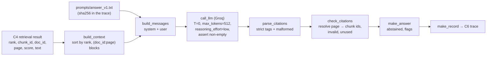
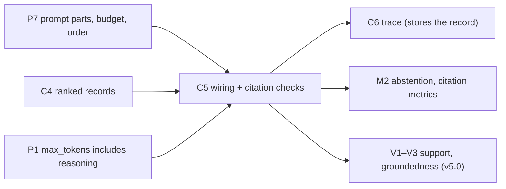

# C5 — Context construction and answer generation with citations: wire it, then check it

> **What this file is.** The lesson for concept **C5** ([02 card](../02_RAG_MASTER_LEARNING_PLAN.md#c5)). It follows the Parts A–M template of [07](../07_SAMPLE_LESSON.md), at a smaller scale. It builds on [P7](P7_grounded_prompting.md), which already teaches the parts of a grounded prompt, the budget, ordering and `build_prompt`. **C5 does not repeat that.** C5 is about *wiring* (C4's records → messages → one configurable Groq call → an answer record) and *checking* (parse the citations, test cited ⊆ retrieved, flag what is missing or malformed, detect abstention).
> **How to use it.** Answers are hidden in collapsible blocks. Write your answer first, then open the block. Lines marked `> 🧭 Coach:` are instructions for the AI tutor; they add to [05 §3](../05_LEARNING_AND_RETENTION_SYSTEM.md#3-coaching-rules-for-the-ai-tutor) and cannot override it.
> **Labels.**
> - **UNVERIFIED**: not checked by running code or reading the primary source.
> - **Assumption:** a stated premise. **Interface assumption (IA-n):** a choice about names or formats that 06 leaves open (listed in H.3).
> - **Toy illustration** / **hand-written toy answer**: an input written by hand, never a model output or a result about a real system.
>
> Every number here comes from the local run of 2026-10-08, re-run on 2026-10-09 for the stop flags ([C5_FACTS.md](../sources/verification/C5/C5_FACTS.md), sections S1–S10 and S-src), from a cited earlier run, from a derivation shown in the text, or carries a label. **No Groq or Cohere call was made for this lesson.** The model call was tested with a fake client.

## Lesson header

| Field | Value |
|---|---|
| Concept | **C5 Context construction and generation with citations**: numbered context blocks labelled `(doc_id:page)` built from C4's retrieval result; the template file `prompts/answer_v1.txt`; one configurable Groq call (`temperature=0`, `max_tokens=512`, `reasoning_effort="low"`, assert non-empty content); parsing citations out of the answer; the sanity check **cited IDs ⊆ retrieved IDs**; diagnosing *cited but not retrieved* and *retrieved but not used*; abstention when the context is not enough. |
| Phase / tier | Phase 2, Core baseline (v0). Priority **E**. Fast track possible ([02 §5](../02_RAG_MASTER_LEARNING_PLAN.md#5-fast-track-rules-from-the-o1-diagnostic)). |
| Prerequisites | **C4** (the retrieval result), **P7** (prompt parts, budget, order), **P1** (`max_tokens` includes reasoning). |
| Comes next | **C6** v0 end-to-end + trace (stores this lesson's record) · **M2** answer metrics · **V1–V3** citation support, groundedness, abstention (v5.0). |
| Open misconceptions | **MC-003** (prompt construction confused with chunk overlap). This lesson holds its C5 check item (C5-A-01). The tracker has `reinforcement_flag = 0` for C5. |
| Time | A: 10 min · book: 20 min · B–D: 40 min · E–G: 20 min · H (lab): 60 min · J–K: 10 min · L: 15 min · M: 5 min. May be split across two days. Part I is not applicable (see Part I). |
| Mastery (C5 → `applied`) | Without notes, you can: (1) turn C4's records into the v0 messages, in rank order, with `(doc_id:page)` headers; (2) write the model call with config-driven parameters and an assert on content; (3) parse citations strictly and report malformed tags; (4) run the subset check and name what it cannot see; (5) classify a citation failure as retrieval or generation. Lab: `coding_independence_0_3 ≥ 2`. |
| Mastery (C5 → `transfer`) | You also pass a fresh novel-scenario item (L.3) and score `debugging_0_3 ≥ 2` in the lab. 02 evidence: the subset check runs on 10 queries (lab Task 9) and every failure is diagnosed. |

### Source map

| Source | Where | What it contributes |
|---|---|---|
| Book (A) | Ch1 p.9/14, p.10/14; Ch3 p.6/14, p.8/14, p.9/14, p.11/14; Ch19 p.8/10; Ch22 p.7/19, p.8/19; Appendix p.5/23, p.21/23 | The *step* "chunks + question go to the model"; source highlighting **after** generation; why "I don't know" can beat a guess; faithfulness separates generation from retrieval. **No citation format, no parser, no subset check.** |
| Repo (B) | `local_rag_huggingface_faiss.ipynb` cells 22, 24, 26, 28; `crag.ipynb` cells 20, 22; `reliable_rag.ipynb` cells 18, 22, 23; `graph_rag_local_attribution.ipynb` cells 9, 17, 19; `simple_rag.ipynb` cells 13–17 | How the repo returns "sources", and the one notebook that parses citations (and drops unknown ones silently) |
| Our plan | [06 §2.5](../06_RAG_PROJECT_AND_EVALUATION_PLAN.md#25-trace-record-schema-one-json-object-per-query-appended-to-resultsjsonl) (trace record), [06 §3.1, §3.3](../06_RAG_PROJECT_AND_EVALUATION_PLAN.md#3-v0-baseline-exact-specification) (v0 spec, template), [06 §7.4](../06_RAG_PROJECT_AND_EVALUATION_PLAN.md#74-generation-metrics) | The names and formats this lesson must produce |
| Lab verification | [`sources/verification/C5/`](../sources/verification/C5/): `c5_measure.py`, `c5_sources.py`, saved outputs, [`C5_FACTS.md`](../sources/verification/C5/C5_FACTS.md) | Every measured number here |
| Source C | #54 Groq docs (model ids change; never hardcode). The installed `groq` 1.7.0 SDK was read (signature and docstrings), not called. The Groq API reference (`reasoning_effort`) was read on 2026-10-09 | Call parameters; who applies the `reasoning_effort` default |

> 📖 **Read in the book** (after Part A, never before; about 20 minutes). Read with one question in mind: *where does the book attach sources to an answer, and who checks them?*
>
> | When | Pages | What to look for |
> |---|---|---|
> | Right after Part A | Ch1 p.9/14 (Step 8) and p.10/14 (steps 5–6) | The whole generation step is one sentence: chunks plus question in, grounded answer out. Nothing about labels, sources or checks |
> | | Ch3 p.6/14 | Even with perfect context, a model can add claims the sources never made. Keep this in mind for D.7 |
> | | Ch3 p.8/14 and p.9/14 | Source highlighting: a **second** model call after generation returns verbatim segments with document IDs, like footnotes. Compare with v0, which asks for citations **inside** the answer |
> | | Ch3 p.11/14 | When "I don't know" is better than a confident wrong answer |
> | After D.5 | Ch19 p.8/10, then Appendix p.5/23 | Ch19 says attribution happens after generation and explainable retrieval explains *why a document was retrieved*. The Appendix credits Ch19 with making each claim cite its source. Which is right? (G.1) |
> | After Part J | Ch22 p.7/19–p.8/19 | Faithfulness: claims checked against the retrieved context; low faithfulness with good context points at the model or the prompt |
>
> After reading, close the book and write three lines: where the book puts citations, what it never specifies, and one page number you will remember.

### Contents

[Part A](#part-a--prior-knowledge-recovery) · [B](#part-b--why-c5-exists) · [C](#part-c--intuition-and-analogy) · [D](#part-d--technical-mechanism) · [E](#part-e--connections) · [F](#part-f--worked-example-by-hand) · [G](#part-g--source-connection) · [H](#part-h--implementation-progression) · [I](#part-i--controlled-experiment-not-applicable) · [J](#part-j--failure-and-debugging) · [K](#part-k--engineering-decisions) · [L](#part-l--assessment) · [M](#part-m--retention) · [References](#source-references) · [Verification log](#verification-log)

---

## Part A — Prior knowledge recovery

Answer the five questions **before** reading on: 1–3 sentences each, no notes. Wrong answers are useful here.

> 🧭 Coach: Ask **one item at a time** (CR-01), in the exact wording below, with its reply template. Record confidence 1–3 before revealing anything (CR-16); the learner often omits it, so ask for it. Score with the Recall rubric ([05 §4.2](../05_LEARNING_AND_RETENTION_SYSTEM.md#42-graded-rubrics-04)). Do not correct in detail yet; route with the table after C5-A5.

**C5-A1.** Retrieval gives you four chunks. What do you do with them before you call the model?
*Reply template:* "1. ____ 2. ____ 3. ____. Confidence: 1–3."

<details><summary>What a strong answer contains</summary>

- Put them in **rank order**; give each a numbered block with a `(doc_id:page)` header and the chunk text **as is**; fill the v0 template (rules, blocks, question, `Answer:`); send system and user messages.
- ⚠️ MC-003 flag: "overlap or merge the chunks so they connect". Nothing is re-chunked at query time (P7 D.1).

</details>

**C5-A2.** The answer cites `[climate:12]`, but page 12 was never retrieved. What does that tell you?
*Reply template:* "The model ____, so this is a ____ problem. Confidence: 1–3."

<details><summary>What a strong answer contains</summary>

- The citation points outside the context: the model invented it or took it from memory. It is a **generation** problem (CR-11): the context could not have supported it.
- Code can catch it with no judge: every cited `doc:page` must match a retrieved chunk (D.5).

</details>

**C5-A3.** The model returns an empty answer. What should your code do?
*Reply template:* "It should ____, because ____. Confidence: 1–3."

<details><summary>What a strong answer contains</summary>

- **Fail loudly**: assert the text is non-empty, record `finish_reason`, and log the item as an error (not skip it). Our own O2 smoke call returned an empty answer at `max_tokens=12`, and the first check still said PASS (P1 B.2).
- Cause to suspect first: the output budget went to reasoning tokens.

</details>

**C5-A4.** The model writes "I can't answer that from these sources." Is that an abstention?
*Reply template:* "Yes / No, because ____. Confidence: 1–3."

<details><summary>What a strong answer contains</summary>

- **No** in v0. Only the fixed sentence counts, matched after normalising case, spaces, quotes and a final full stop (P7 D.7). A paraphrase is logged as an answer with no citation, so it stays visible.
- Why: a fixed sentence makes abstention countable by code ([06 §3.3](../06_RAG_PROJECT_AND_EVALUATION_PLAN.md#33-v0-prompt-template-promptsanswer_v1txt)).

</details>

**C5-A5.** Retrieval returned four chunks; the answer cites only one. Is that a problem?
*Reply template:* "____, because ____. Confidence: 1–3."

<details><summary>What a strong answer contains</summary>

- **Not by itself.** A one-fact question needs one chunk; the others are retrieved but not used (normal). It becomes a symptom when the **unused** chunk holds the evidence and the answer is wrong (J4).

</details>

> 🧭 Coach: **Routing.**
>
> | Weak answers (score ≤ 1) | Action |
> |---|---|
> | C5-A1 | MC-003 may be live. Re-ask P7-R-03 (index vs query time) before D.2. Do lab Task 1 first. |
> | C5-A2 or C5-A5 | Teach D.5 slowly with the Part F worked example before the lab. |
> | C5-A3 | P1 B.2 is not secure. Re-read it with the learner, then D.3. |
> | C5-A4 | Re-teach P7 D.7 (the toy answers C–E), then D.6. |
> | All five ≥ 3 with confidence 3 | Offer the fast track: skim B–C, then D.4–D.7, F, H and L (evidence is never skipped). |
>
> After routing, send the learner to the **Read in the book** box, then continue with Part B.

---

## Part B — Why C5 exists

### B.1 "Sources used" that were never used

`local_rag_huggingface_faiss.ipynb` cell 28 prints the answer and then a list headed "Sources used". The list is built by `RunnableParallel(answer=rag_chain, sources=retriever)`: the retriever simply runs a **second** time beside the chain. So "sources" means *everything retrieved*, not what the answer relied on. The answer prompt (cell 22) never asks for a citation, and the cell has no saved output (S-src). A reader cannot tell which page supports which sentence.

### B.2 A parser that hides its own failures

`graph_rag_local_attribution.ipynb` cell 9 is the only code in the repo that parses citation tags out of an answer (repo-wide scan, S-src). It finds `[N]` tags, keeps those whose key is in its source map, and has **no else branch**: a tag pointing at nothing is dropped without a word. It then sets every citation's confidence to 0.9, and cell 19 prints "sources verified". Nothing was verified (no saved outputs either).

### B.3 Our own empty answer

In session #2 (O2), `gpt-oss-20b` at `max_tokens=12` returned an **empty** answer and the first check still said PASS ([session log](../progress/session_log.md#session-2026-10-08-2--concept-o2-environment-setup)). A pipeline that does not assert on content will store empty answers as if they were results.

> 🧭 Coach: One question: "In B.2, what should the code do when a tag points at nothing?" *Template:* "It should ____ instead of ____." Expected: report it (count it, flag the answer), not drop it.

---

## Part C — Intuition and analogy

**A reading list and a bibliography.** The teacher hands out a **reading list** (the retrieved chunks, each with a page label). The student writes an essay with **footnotes** (citations). The marker does three checks without reading the essay closely:

- Is every footnote **on the reading list**? (cited ⊆ retrieved)
- Is every footnote **written in the house style**? (a malformed tag cannot be checked)
- Which listed books were **never footnoted**? (retrieved but not used: often fine)

And one rule: if the reading list does not cover the question, the student writes one fixed sentence (abstention).

**Where the analogy breaks.** A footnote to a book on the list does not prove that the page says what the sentence claims. The marker would have to read the page. That is *support*, and v0 does not check it (D.7; v5.0 does).

> 🧭 Coach: CR-17 pause. One question: "In the analogy, what plays the role of the reading list?" *Template:* "The ____." Expected: the retrieved chunks, with their `doc:page` labels.

---

## Part D — Technical mechanism

### D.1 Where C5 sits, and what flows through it



Everything here runs at **query time**, once per question. Chunk size and overlap were fixed at index time and are not touched (MC-003, P7 D.1).

### D.2 From C4's records to messages

C4 hands over a list of records: `rank`, `chunk_id`, `doc_id`, `page`, `score`, `text` (IA-1). Three wiring rules:

1. **Sort by `rank`**, never trust list order. A shuffled list must give the same prompt (S4: it does).
2. **The label comes from the record**: header `[i] (doc_id:page)`, then the text unchanged. `i` is for the reader; the citation uses `doc_id:page` (P7 D.6).
3. **The wording comes from a file**, `prompts/answer_v1.txt`, not from a string inside the code. The trace stores the file's sha256, so a one-character edit is visible (S4: one added space changes the hash).

The file is 06 §3.3 with the example blocks replaced by two placeholders, `{sources}` and `{question}` (IA-2). Its system part is identical to P7's `SYSTEM_V0`, and P7's lab chunks give the same **958** tokens through it (S4).

**Measured for D-002** with the lab's four chunks (S4, `o200k_harmony`): system 107, user 695, total **802** tokens; the sources alone are 680. Blocks cost 199, 133, 196 and 152 tokens: the recursive splitter cut these chunks at 657 to 982 characters, not 1,000.

> **Quick check.** "Why sort by rank inside C5 if C4 already returns ranked records?" *Template:* "Because ____ could ____." (Expected: a later stage (reranking, dedup, a bug) could reorder the list; the rank field is the contract.)

### D.3 One configurable call

```python
r = client.chat.completions.create(model=model_id, messages=messages,
                                   temperature=0.0, max_tokens=512, reasoning_effort="low")
text = r.choices[0].message.content or ""
assert text.strip(), f"empty answer (finish_reason={r.choices[0].finish_reason})"
```

- **`model_id` from `.env` (`GROQ_MODEL_ID`)**, never typed into code: Groq retires models (06 §3.1; none of the repo's Llama ids were on our account, O2).
- **`temperature=0`** for repeatable runs (06 §3.1).
- **`max_tokens=512` caps reasoning + visible answer together** for `gpt-oss-20b` (P1 B.2). **`reasoning_effort="low"`** keeps reasoning short. If you leave the field out, the SDK sends nothing (S-src), and Groq's **server** applies its own default for gpt-oss, `medium` (Groq API reference, read 2026-10-09; documented, not measured). So a missing field quietly means more reasoning, not less.
- **Assert on content** and record `finish_reason`, `usage.prompt_tokens`, `usage.completion_tokens` and, when present, `completion_tokens_details.reasoning_tokens` (S-src: optional in groq 1.7.0). A reply can also be non-empty and still stop at the cap (`finish_reason` "length"). The assert passes then, so D.6 flags it.
- The installed SDK marks `max_tokens` as **deprecated** in favour of `max_completion_tokens` (S-src). v0 keeps the 06 name; see K.

> 🧭 Coach: CR-17 pause. One question: "Why is the assert on `text.strip()` and not on `r` being returned?" *Template:* "Because the call can ____ and still ____." Expected: succeed with HTTP 200 and an empty or whitespace reply (O2).

### D.4 Parsing citations: strict, and loud about the rest

A **valid** tag is exactly `[` + an id (letters, digits, `_`, `-`) + `:` + digits + `]`. Everything else that looks like a tag is **malformed**: reported, never repaired in v0.

| Hand-written toy answer ends with | Valid citations | Malformed |
|---|---|---|
| `… 2015 [climate:10].` | `(climate, 10)` | — |
| `… 2015 [climate:10][climate:24].` | `(climate, 10)`, `(climate, 24)` | — |
| `… 2015 [4].` (block number) | — | `[4]` |
| `… 2015 [climate: 10].` (space) | — | `[climate: 10]` |
| `… 2015 (climate:10).` (header copied) | — | `(climate:10)` |
| `… 2015 [climate:10, climate:24].` | — | the whole tag |

Citations are kept **distinct**, in order of first appearance (IA-5). Pages become `int`. Doc ids are case-sensitive: `[Climate:10]` is valid syntax but names no retrieved document (S6, T04).

> **Quick check.** "Why not quietly accept `[climate: 10]` as page 10?" *Template:* "Because then ____ would be hidden, and we could not ____." (Expected: format drift would be hidden; we could not count how often the model breaks rule 1, which is an answer-quality signal.)

### D.5 The subset check: cited ⊆ retrieved

A citation names a **page**; retrieval returned **chunks**. So each citation is **resolved** to the retrieved chunk ids on that `doc_id:page`, in rank order (06 §3.3 design note).

- **Cited but not retrieved:** a citation that resolves to no chunk. The check fails. Toy T02 `[climate:12]` (S6).
- **Retrieved but not used:** a retrieved chunk that no citation resolves to. Information, not a failure. Toy T01 cites only p.10, so the chunks on p.24, p.23 and p.6 are unused (S6).
- **Same page, two chunks:** for D-009, ranks 1 and 4 are both on p.29. `[climate:29]` resolves to **both** ids (S6, T19). A page citation cannot say which chunk was read.

"Cited IDs ⊆ retrieved IDs" therefore means: **every citation resolves to at least one retrieved chunk, and every tag parsed**. The record keeps `citation_subset_ok` for exactly that (IA-5).

> **Quick check.** "If an answer has no citation at all, does the subset check pass?" *Template:* "____, because ____." (Expected: yes; the empty set is a subset of anything. That is why the separate `no_citation` flag exists, D.6.)

### D.6 Abstention and the flags

`make_answer` turns one answer text into the `answer` part of the record (S6, all 19 toy answers in the lab). It also takes the reply's `finish_reason`: `make_record` passes the provider's value, and a hand-written toy answer keeps the default `"stop"`.

| Flag | Rule | Toy example (S6 unless noted) |
|---|---|---|
| `cited_not_retrieved` | a citation resolves to nothing | T02, T03, T04 |
| `malformed_tag` | a tag that is not exactly `[doc_id:page]` | T07–T10 |
| `no_citation` | non-empty, not an abstention, no valid citation | T05; T15 (paraphrased refusal) |
| `uncited_sentence` | some citations, but a sentence without one | T06 |
| `abstention_inside_answer` | the fixed sentence inside a longer answer | T16 |
| `empty` | nothing after `.strip()` | T17 |
| `length_stop` | `finish_reason` is "length": the reply hit the `max_tokens` cap | S5: the cut-off reply below |
| `unexpected_finish_reason` | `finish_reason` is neither "stop" nor "length", including missing (`None`) | S5: `None`, `tool_calls` |

`abstained` is `True` only for the fixed sentence after normalising (T13, T14, T18). For an abstention, every retrieved chunk is "unused", and that is correct. Sentence counting uses a given heuristic splitter: a tag right after the full stop belongs to that sentence (T11).

**Why a cut-off answer needs its own flag** (added 2026-10-09). Here is a hand-written toy reply that stopped at the cap, sent through `FakeGroq` (S5):

```
reply          "The Paris Agreement was adopted in 2015 [climate:10]. It aims to limit warming to"
finish_reason  "length"
flags          ['length_stop', 'uncited_sentence']
subset check   citation_subset_ok = True;  failing_qids → []
```

- **`length_stop`:** the reply is not empty, so the assert passes. Without this flag, the lost last tag shows up only as `uncited_sentence` or `no_citation`. That looks like a citation failure, but it is a budget failure (J3, C5-A-03).
- **`unexpected_finish_reason`:** v0 sends no tools, so "stop" and "length" are the only values we expect. Anything else, or no value at all, means the call did not end the way we assume, and the record should say so.

**For your project:** the subset check still passes this reply, so only the flag shows the cut. C6's v0 report is to count both flags.

### D.7 What the check cannot see

Toy T19 for D-009 (unanswerable): "The IPCC was established in 1988 [climate:29]." Page 29 was retrieved, so the tag resolves (to two chunks), there are no flags, and `citation_subset_ok` is **True** (S6). Yet "1988" occurs nowhere in the PDF, and "IPCC" only on p.1 (S3). The claim came from memory and borrowed a valid label.

The subset check tests **where a citation points**, not **whether the page supports the sentence**. That needs reading the chunk: citation precision and faithfulness ([06 §7.4](../06_RAG_PROJECT_AND_EVALUATION_PLAN.md#74-generation-metrics)), human labels now, a judge at the end (D-10), verification in v5.0. The book makes the same point: even perfect context does not stop unsupported claims (Ch3 p.6/14).

> 🧭 Coach: CR-11. One question: "T19 passes the subset check. Retrieval or generation problem?" *Template:* "____, because ____." Expected: generation. Nothing could be retrieved (the fact is not in the PDF); the model should have abstained.

---

## Part E — Connections



| Often confused | The difference |
|---|---|
| Retrieved vs cited | Retrieved = what C4 returned. Cited = what the answer points at. "Sources used" lists in the repo are usually the first (B.1). |
| Cited ⊆ retrieved vs supported | The first is a set test on labels (code). The second asks whether the page says it (reading). T19 passes one and fails the other. |
| Block number `[2]` vs citation `[climate:10]` | The number is for the reader and changes with order; v0 treats `[2]` as malformed. |
| Page vs chunk | Citations name pages; the trace stores chunk ids. One page can resolve to two chunks. |
| `no_citation` vs `cited_not_retrieved` | Missing evidence trail vs a trail that points outside the context. Only the second fails the subset check. |
| Abstention vs paraphrased refusal | Only the fixed sentence counts. A paraphrase is an uncited answer. |
| Empty answer vs abstention | An empty answer is an **error** (budget or API); an abstention is a deliberate answer. |

---

## Part F — Worked example by hand

**Step 1: resolve.** The D-009 records, in rank order, are on pages 29, 10, 24, 29 (chunk ids end in 00085, 00027, 00069, 00084). Hand-written toy answer: "The IPCC was established in 1988 [climate:29]. It reviews climate science [climate:1]." Write the resolved ids, the invalid citations and the unused ids.

<details><summary>Answer</summary>

- `[climate:29]` → 00085, 00084 (both p.29 chunks, rank order). `[climate:1]` → nothing, so **invalid**: page 1 was not retrieved.
- Unused: 00027, 00069. Subset check: **fails** (one invalid). Flags: `cited_not_retrieved`.
- Self-check: invalid + resolved citations = 2 = number of distinct tags; used + unused ids = 4 = k.

</details>

**Step 2: parse.** Hand-written toy answer: "It was adopted in 2015 [climate:10]. See [2] and (climate:6). Also [climate:10]." Write the distinct citations and the malformed list.

<details><summary>Answer</summary>

Citations: `(climate, 10)` once (the repeat is not listed again). Malformed: `[2]`, `(climate:6)`, in that order. Subset check: **fails** (malformed tags), although the one valid citation resolves.

</details>

> 🧭 Coach: CR-08 probe here: ask C5-A-05 (Part L) now.

---

## Part G — Source connection

### G.1 Book (Source A)

| Cite | Book point (paraphrased) | Our assessment |
|---|---|---|
| Ch1 p.9/14 | Step 8: the retrieved chunks and the question go to the model, which answers from the documents, not from training memory | The goal. No labels, no citation format, no check |
| Ch1 p.10/14 | Algorithm steps 5–6: pass question plus chunks; the answer is grounded in the context | The step only |
| Ch3 p.6/14 | Even with perfect context, a model can add information not in the sources; a separate checker asks whether the answer is faithful | Why the subset check is not enough (D.7) |
| Ch3 p.8/14 | Source highlighting: after generation, a model finds verbatim supporting segments, like footnotes, so users can verify | Citations **after** generation, by a second call |
| Ch3 p.9/14 | Algorithm: return segments with document IDs and source references | IDs come back, but the book never says to check them against the inputs |
| Ch3 p.11/14 | Reliable RAG suits cases where "I don't know" beats a confident wrong answer | The motive for the fixed abstention sentence |
| Ch19 p.8/10 | Attribution works after generation; explainable retrieval explains why each document was retrieved | Separates attribution from retrieval explanations |
| Appendix p.5/23 | Credits Chapter 19 with making each claim cite its source | **Inconsistent with Ch19 itself** (Ch19 never says "cite", S-src). Attribution is Ch3's (Appendix p.21/23 glossary says Chapters 3 and 19). CR-07: read Ch19, not the summary |
| Ch22 p.7/19–p.8/19 | Faithfulness: split the answer into claims, check each against the retrieved context; it isolates generation from retrieval | What v5.0 adds on top of the subset check |

**Not in the book:** an inline citation format, a citation parser, a cited ⊆ retrieved check, malformed tags, the word "abstain" (no hit anywhere, S-src), and reasoning-token budgets. "I don't know" appears only on Ch3 p.11/14 (S-src).

### G.2 Repo (Source B): cells verified at `009adba`

| Cell (0-based) | What it shows | Audit |
|---|---|---|
| `simple_rag.ipynb` 13, 15, 17 | `k: 2`; retrieve and print context; `evaluate_rag` | **Never generates an answer**: no code cell builds or calls a chat model (S-src; DV-01) |
| `local_rag_huggingface_faiss.ipynb` 22, 24 | Context-only prompt with a refusal sentence; blocks tagged `[Page n]` | Labels exist, but the prompt never asks the model to cite them (P7 G.2) |
| `local_rag_huggingface_faiss.ipynb` 26 | `ask()` keeps the text after the last `Answer:` | Output parsing by string split; out-of-scope test question; no saved output |
| `local_rag_huggingface_faiss.ipynb` 28 | `RunnableParallel(answer=rag_chain, sources=retriever)`, prints "Sources used" | "Sources" = a second retrieval, not citations (B.1). No saved output |
| `crag.ipynb` 20, 22 | `generate_response` asks the model to append sources with links; `retrieve_documents` returns text only; the local source is the pair ("Retrieved document", "") | A local "citation" cannot name a chunk or page. Nothing is checked |
| `reliable_rag.ipynb` 18 | Answer prompt "based upon your knowledge" (P7 B.1) | Ungrounded generation |
| `reliable_rag.ipynb` 22, 23 | Highlighting with `PydanticOutputParser` (`id`, `title`, `source`, `segment`), model `mixtral-8x7b-32768`; saved output lists "ID: doc3" | The prompt asks for exact segments; **no code checks** that a segment occurs in a document or that `id` was an input (S-src) |
| `graph_rag_local_attribution.ipynb` 9, 17, 19 | Asks for `[N]` citations; `re.findall`; `set(...)`; `if key in source_map:` with no else; `confidence=0.9`; "sources verified" | The only citation parser in the repo. **Silently drops** unknown tags; order lost by `set`; no support check; Ollama; no saved outputs (B.2) |

**Does any notebook check cited ⊆ retrieved and report violations?** No. The scan for code that parses `[`-tags finds only the graph notebook (S-src), and it filters instead of reporting. `evaluation/evaluation_grouse.ipynb` cell 30 has a citation **rubric for a judge** (M3 territory), not a pipeline check.

**Corrections to the [04 C5 row](../04_BOOK_TO_CODE_MAPPING.md)** (04 is not edited):
1. `local_rag_huggingface_faiss.ipynb` cell 28 is described as "answer + sources". The sources are the **retrieved list from a second retriever call**, not what the answer used; the answer has no citations.
2. `crag.ipynb` cell 20 "cites sources": for the local path, the source is the literal string "Retrieved document" with an empty link (cell 22), and `retrieve_documents` drops all metadata (cell 20). Nothing identifies a page.
3. `helper_functions.py:L162-L205` has **no** citation or source handling (S-src); it belongs to P7 (context-only wording), not to citations.
4. **Missing:** `graph_rag_local_attribution.ipynb` cell 9 (the only citation parser; silent drop) and `reliable_rag.ipynb` cells 22–23 (in the 02 card, not in 04). **Book pages missing:** Ch3 p.6/14, p.11/14, Ch19 p.8/10, and the Appendix p.5/23 inconsistency.
5. Confirmed: Ch1 p.9/14–p.10/14, Ch3 p.8/14–p.9/14, and "`simple_rag.ipynb` never generates".

### G.3 Reading list (in this order)

`local_rag_huggingface_faiss.ipynb` cells 22, 24, 26, 28 → `crag.ipynb` cells 20, 22 → `reliable_rag.ipynb` cells 22–23 → `graph_rag_local_attribution.ipynb` cell 9 (find `generate_attributed_answer`). For each, mark in the margin: what counts as a "source"? Is it an ID the code can check? What happens to a bad one?

---

## Part H — Implementation progression

### H.1 The lab: [`labs/C5_generation_lab.ipynb`](../labs/C5_generation_lab.ipynb) (blank-file first)

Tasks, empty code cells and CHECK cells; **no solution code**. The given setup cell holds **4 fixed retrieved chunks** for D-002 (and the D-009 and k = 8 sets), so the lab does not depend on the C1–C4 labs. They are the v0 chunks (per-page recursive 1,000/200, course chunk ids `climate:ea07572562ac:1ca9c5a3b548:<seq>`) ranked by the local MiniLM fallback: the same top-4 as C4's D-002 result (S3), not the Cohere default and not an evaluation result. The model call is tested with `FakeGroq`; every answer in a CHECK cell is a **hand-written toy answer**.

| # | Task | The checks test |
|---|---|---|
| 1 | Predict, then `build_context`, `build_messages`, `TEMPLATE_SHA256` | Rank order (also from a shuffled list), headers, exact messages, 802 tokens, template hash |
| 2 | `call_llm` against `FakeGroq` | Exact keyword arguments, model id not hardcoded, defaults 0.0/512/"low", assert on empty/None/whitespace replies with `finish_reason` in the message, `reasoning_tokens` may be missing |
| 3 | `parse_citations` | Distinct valid tags, `int` pages, malformed list (block numbers, spaces, `(doc:page)`, two in one bracket) |
| 4 | Predict, then `check_citations` | Resolution to every same-page chunk, invalid reported (not dropped), unused in rank order |
| 5 | `is_abstention`, `make_answer` | All 19 toy answers (S6) |
| 6 | `make_record`, `failing_qids` | The record shape (H.3); an error counts as a failure; a non-empty cut-off reply from `FakeGroq` (`finish_reason` "length") gets `length_stop` and not `unexpected_finish_reason` (added 2026-10-09) |
| 7 | Diagnose six scenarios (CR-11) | Kind and "caught by" labels (S7) |
| 8 | Predict, then measure k = 8 (CR-08) | 1,442 tokens; 7 unused |
| 9 | *Optional:* the 10 seed questions through Groq; save JSONL; print `failing_qids` | **Not run by the author; all outputs UNVERIFIED.** The 02 evidence |

API names you may look up: `sorted(key=...)`, `str.format`, `re.finditer`, `re.fullmatch`, `time.perf_counter`, `hashlib.sha256`, `json.dumps`. The reference implementation is `sources/verification/C5/c5_measure.py`.

> 🧭 Coach: The reference script is a **solution**. Do not show it before an attempt plus a hint (CR-04). Grade `coding_independence_0_3` on Tasks 1–6 and `debugging_0_3` on any failing CHECK the learner fixes. The Task 4 and Task 7 sentences are graded out loud. If Task 9 is run, the learner reads every answer: the subset check cannot judge support.

### H.2 Repo reading guide: `graph_rag_local_attribution.ipynb` cell 9

Answer each before opening.
1. What does the model cite: a page, a document, or a block number?
2. What happens to `[7]` when there are only five context items?
3. Where does the 0.9 confidence come from?

<details><summary>Answers</summary>

1. A block number `[N]`, mapped back through `source_map`.
2. It is dropped: `if key in source_map:` has no else, so the answer keeps a tag that the citation list silently omits.
3. It is a constant in the code, not a measurement.

</details>

### H.3 The answer record (C5's output, consumed by C6)

`make_record` returns the C5 part of one 06 §2.5 trace record. Names follow §2.5; fields marked ➕ are additive C5 fields (IA-3 to IA-8). Values below are types or the S9 example.

```jsonc
{
  "qid": "D-002",
  "question": "In what year was the Paris Agreement adopted?",
  "context": {"chunk_ids": ["climate:ea07572562ac:1ca9c5a3b548:00069", "..."],   // prompt order = rank order
              "context_tokens": 680, "tokenizer": "o200k_harmony", "truncated_chunks": 0},
  "prompt":  {"template_version": "answer_v1", "template_sha256": "739752dc…",      // ➕ template_sha256
              "sha256": "820b2956…", "local_tokens": 802,                            // ➕ local_tokens
              "input_tokens": "int | null (provider-reported usage.prompt_tokens)"},
  "llm":     {"provider": "groq", "model_id": "<GROQ_MODEL_ID>", "temperature": 0.0,
              "max_tokens": 512, "reasoning_effort": "low", "finish_reason": "stop", // last three: IA-6
              "cache_hit": false},
  "answer":  {"text": "str", "abstained": "bool",
              "citations": [{"marker": "[climate:10]", "doc_id": "climate", "page": 10,
                             "resolved_chunk_ids": ["climate:ea07572562ac:1ca9c5a3b548:00027"]}],
              "invalid_citations": ["str"], "malformed_markers": ["str"],            // ➕
              "unused_chunk_ids": ["str"], "uncited_sentences": "int",               // ➕
              "citation_subset_ok": "bool", "flags": ["sorted str"],                 // ➕
              "output_tokens": "int | null", "reasoning_tokens": "int | null"},      // ➕ reasoning_tokens
  "latency_ms": {"llm": "float | null"},
  "errors": ["str"]
}
```

C6 adds the rest of §2.5 (`run_id`, `timestamp_utc`, `config_hash`, `index_manifest_hash`, `query`, `candidates`, other latencies, cost) and writes one line per query to `results.jsonl`.

**Interface assumptions** (06 leaves these open; recorded here, not decided for other lessons):
- **IA-1 C4 → C5 input.** A list of dicts `rank` (1-based), `chunk_id`, `doc_id`, `page` (first page segment, as in §2.5), `score`, `text`; extra keys (C4 also sends `char_start`, `char_end`) are ignored. `chunk_id` is the course format `{doc_id}:{snapshot_id}:{params_hash}:{seq:05d}`, e.g. `climate:ea07572562ac:1ca9c5a3b548:00027` (params_hash over the 06 §2.4 chunking block, as in the C2 lab and C4). If C4 omits `doc_id`, derive it from `chunk_id` before the first `:`. C5 sorts by `rank`.
- **Label → chunk id.** The answer never contains chunk ids. It contains the template's labels `[doc_id:page]` (06 §3.3). `check_citations` maps each label to **every** retrieved chunk with that `(doc_id, page)`, in rank order (`resolved_chunk_ids`); a label that maps to none is cited-but-not-retrieved. The block number `[i]` is display only and is treated as malformed if cited.
- **IA-2 Template file.** `SYSTEM:` line, the 06 §3.3 system text, a blank line, `USER:` line, then `Sources:\n{sources}\n\nQuestion: {question}\nAnswer:`. Split rule as in the lab's `split_template`.
- **IA-3 `prompt.sha256`** = sha256 of `json.dumps(messages, sort_keys=True, ensure_ascii=False)` (the rendered prompt; changes per query). `template_sha256` identifies the file (same for a whole run). `input_tokens` is the provider's count; `local_tokens` is ours (`o200k_harmony`); they differ by template overhead (P1 B.3).
- **IA-4 `context_tokens`** = `o200k_harmony` tokens of the joined source blocks; `truncated_chunks` = 0 in v0 (no budget, 06 §3.4).
- **IA-5 `answer.citations`** = distinct `(doc_id, page)` in first-appearance order, each with `resolved_chunk_ids` (§2.5 names). Per-sentence attachment is v5.0's job. `citation_subset_ok` = no invalid and no malformed.
- **IA-6 `llm`** adds `max_tokens`, `reasoning_effort`, `finish_reason` to §2.5's fields. Since 2026-10-09, 06 §2.5 lists all three too.
- **IA-7 Errors.** An empty reply raises in `call_llm`; the runner still writes a record with `text: ""`, flag `empty` and the message in `errors`. `failing_qids` counts it as a failure. The lab's Task 9 runner has no `finish_reason` to pass in that case, so the record also gets `unexpected_finish_reason`; the error message keeps the real value.
- **IA-8 Latency.** C5 fills only `latency_ms.llm`.

---

## Part I — Controlled experiment (not applicable)

C5 has no planned experiment of its own. The prompt-wording experiment (permissive vs v0 vs no-source-only vs closed book, at fixed retrieval) is pre-registered in [P7 Part I](P7_grounded_prompting.md#part-i--controlled-experiment-planned) and needs this lesson's record to run. 04's idea for C5 (citation format A vs B) would change the v0 template; it waits for v5.0, where citation precision and recall are labelled ([06 §7.4](../06_RAG_PROJECT_AND_EVALUATION_PLAN.md#74-generation-metrics)).

---

## Part J — Failure and debugging

For each symptom, write the cause, the kind (**retrieval**, **generation** or **both**, CR-11) and a fix. Then open the table.

- **J1. Cited but not retrieved.** The answer cites `[climate:12]`; page 12 is not in the top-4.
- **J2. Every tag malformed.** Many answers cite `(climate:10)` or `[1]`.
- **J3. Empty answers, `finish_reason` "length".** Seen after someone lowered `max_tokens`.
- **J4. Evidence retrieved but not used.** D-002: the gold chunk is rank 3 (p.10), the answer cites p.23 and gives a wrong year.
- **J5. Valid citation, false claim.** T19: "1988 [climate:29]", subset check passes.
- **J6. Nothing looks unused.** Two retrieved chunks share a page, the answer cites the page, and both count as used.

<details><summary>Diagnoses</summary>

| | Cause | Kind | Fix |
|---|---|---|---|
| J1 | Invented or remembered label (T02) | Generation | Subset check on every answer; log the rate; never drop silently (B.2) |
| J2 | Model copies the header format or the block number, breaking rule 1 | Generation (format) | Report as malformed; measure the rate; a template change waits for a versioned `answer_v2` (no silent repair) |
| J3 | Reasoning + answer exceed the output cap (P1 B.2). Groq's exact behaviour at the cap is UNVERIFIED | Generation (budget) | Assert content; log `finish_reason` and `reasoning_tokens`; restore 512 or lower `reasoning_effort`. A non-empty cut-off reply gets the `length_stop` flag (D.6) |
| J4 | Evidence present but ignored; possibly position (block 3 of 4, P7 D.6) or a distractor | Generation | Not caught by v0 checks (flags `[]`, S7 e). Label support by hand; test ordering in X3 |
| J5 | Memory answer borrowing a retrieved label (D.7) | Generation | Support check (citation precision, faithfulness): human labels now, v5.0 later |
| J6 | Citation granularity is the page, not the chunk | Neither: a measurement limit | Report "used" as an upper bound; chunk-level citations are a v5.0 design question |

</details>

> 🧭 Coach: For J1 and J3, ask for the **one-line assert or check** that would have caught it. It counts as evidence for `debugging_0_3`.

---

## Part K — Engineering decisions

| Question | Decision | Why |
|---|---|---|
| Template | Versioned file `prompts/answer_v1.txt`; `template_sha256` and rendered-prompt sha256 in every record | Detects silent prompt drift (06 §2.5) |
| Citation unit | `doc_id:page`, resolved to all retrieved chunk ids on that page | Human-checkable; 06 §3.3 |
| Parsing | Strict; malformed tags reported, not repaired | Format errors stay measurable |
| Citations stored | Distinct, first-appearance order | Set test for v0; per-sentence links in v5.0 |
| Subset check | Every citation resolves **and** no malformed tag | One boolean C6 and M2 can count |
| Missing citations | Separate flags (`no_citation`, `uncited_sentence`) | The empty set passes a subset test |
| Abstention | Exact fixed sentence after normalising | Countable without a judge |
| Model call | `GROQ_MODEL_ID` from `.env`; `temperature=0`; `max_tokens=512`; `reasoning_effort="low"` | 06 §3.1; P1 B.2 |
| `max_tokens` vs `max_completion_tokens` | Keep `max_tokens` in v0 (06 name, worked in O2); log the name used; switch only as a recorded config change | SDK 1.7.0 marks `max_tokens` deprecated (S-src) |
| Empty reply | Assert; record as an error; never skip | O2 lesson |
| Cut-off or odd stop | Flag `length_stop` ("length") or `unexpected_finish_reason` (any other value); keep the answer | A cut-off answer otherwise looks like a citation failure (C5-A-03; review 2026-10-09 §3a row 5) |
| Repair loop (regenerate on failure) | **Not in v0** | It would hide the failure rate v5.0 must beat |

**When NOT to use a strict subset check:** when answers may legitimately cite sources outside the retrieved set, e.g. CRAG's web-search fallback (`crag.ipynb` cell 22). Then the "retrieved" set must include those sources with their own IDs, or the check measures nothing.

---

## Part L — Assessment

One short question per item. Each has a reply template. Score with [05 §4.2](../05_LEARNING_AND_RETENTION_SYSTEM.md#42-graded-rubrics-04).

> 🧭 Coach: Ask one item at a time, with its template. Never put two questions in one turn. Record confidence first.

### L.1 Recall

**C5-R-01.** List the steps from C4's records to a checked answer record.
*Template:* "1. ____ 2. ____ 3. ____ 4. ____ 5. ____."

<details><summary>Criteria for 4</summary>

Sort by rank and build `(doc_id:page)` blocks; fill the template file; one Groq call with config parameters and an assert on content; parse citations (valid + malformed); resolve against retrieved (invalid, unused); abstention and flags; record. Plus *why* one step exists and one limit (the subset check cannot see support).

</details>

**C5-R-02.** What does "cited IDs ⊆ retrieved IDs" check, and what does it miss?
*Template:* "It checks that ____. It misses ____."

<details><summary>Criteria for 4</summary>

Every citation resolves to a retrieved chunk and every tag parses. It misses support (a valid label on a false claim, T19), missing citations (empty set passes), and which of two same-page chunks was read. Names v5.0 / citation precision as the fix.

</details>

**C5-R-03.** Why does `call_llm` assert on the reply text?
*Template:* "Because ____ can return ____, as in ____."

<details><summary>Criteria for 4</summary>

A successful call can return empty text when reasoning uses the output cap (`max_tokens` covers both, P1 B.2); O2 got an empty answer at 12 and a check still said PASS. Plus: log `finish_reason`, record as an error, never skip.

</details>

### L.2 Application

**C5-A-01** (MC-003 check item). C4 returns four records whose ranks, in list order, are 3, 1, 4, 2. What are the first two header lines of the user message?
*Template:* "`[1] (____)` then `[2] (____)`, because ____."

<details><summary>Criteria for 4</summary>

The headers of rank 1 and rank 2, each `[i] (doc_id:page)` from the record, because C5 sorts by `rank`. No step merges or overlaps chunks (MC-003). Self-check: four headers, numbered 1–4, one per record.

</details>

**C5-A-02.** Retrieved pages, in rank order, are 29, 10, 24, 29. The answer cites `[climate:24]` and `[climate:3]`. Which ids are invalid, and which chunks are unused?
*Template:* "Invalid: ____. Unused: ____."

<details><summary>Criteria for 4</summary>

Invalid: `[climate:3]`. Unused: both p.29 chunks and the p.10 chunk (3 of 4). Subset check fails. Self-check: one used + three unused = 4.

</details>

**C5-A-03** (CR-08). `max_tokens` halves from 512 to 256. What can happen to the answer, and to the citation check?
*Template:* "The answer may ____, because ____. The check may then show ____."

<details><summary>Criteria for 4</summary>

Reasoning and answer share the halved cap, so the reply may be empty (assert fires, `finish_reason` "length") or cut short, which can drop the final tag and show up as `uncited_sentence` or `no_citation`: a **budget** failure that looks like a citation failure. The `length_stop` flag (D.6) tells the two apart. The input side gains 256 tokens (toy W = 8,192: 7,552 → 7,808, S8), which does not help. Real effect on our model UNVERIFIED until a logged run. Self-check: compare `reasoning_tokens` and `finish_reason` in the records.

</details>

**C5-A-04** (CR-08). k doubles from 4 to 8 for D-002. What happens to the prompt tokens and to "unused" for a one-citation answer?
*Template:* "Tokens go from ____ to about ____; unused goes from ____ to ____."

<details><summary>Criteria for 4</summary>

802 → 1,442 (×1.80, not ×2: rules and question are fixed, S4); unused 3 → 7 (S8). Plus a consequence: more retrieved pages make a remembered or guessed page more likely to pass the subset check, so the check gets weaker as k grows (inference, not measured).

</details>

### L.3 Transfer

> 🧭 Coach: C5-T-01 is a practice item. For the scored CR-13 item, invent a fresh scenario (new domain, citation unit or constraint) that is not in this file, and grade it with the Transfer rubric.

**C5-T-01.** A contracts assistant cites clauses like `[lease_7:4.2]`, and retrieval returns clause-level chunks. What changes in your parser and checker, and how would you know they work?
*Template:* "I would change ____. I would test ____ and measure ____."

<details><summary>Criteria for 4</summary>

- Grammar: the locator is now a dotted clause id, not an int page; update the strict pattern and the malformed rule; resolution matches `(doc, clause)` to chunk metadata (finer than pages, so J6 shrinks).
- Tests: hand-written toy answers for fabricated clauses, wrong document, malformed tags, abstention.
- Measure on labelled answers: invalid-citation rate (deterministic) and citation precision (human). Keep retrieval (was the clause retrieved?) separate from generation (did the answer cite and use it?). When not: if clauses are not in chunk metadata, fix chunking (C2/C3) first.

</details>

### L.4 When is C5 mastered?

- **`applied` (L3):** C5-R-01 or C5-R-02 ≥ 3 on two different days, one ≥ 24 h after teaching; two Application items ≥ 3; `coding_independence_0_3 ≥ 2` on lab Tasks 1–6.
- **MC-003 closes** when two of its check items (P7-R-01/P7-R-03 and C5-A-01) score ≥ 3, unassisted, on different days.
- **`transfer` (L4):** a fresh novel-scenario item ≥ 3; `debugging_0_3 ≥ 2`; the 02 evidence: Task 9 run logged with `failing_qids` printed, and every failing qid diagnosed in writing (CR-11). Do **not** edit the v0 template to make the check pass.

---

## Part M — Retention

### M.1 Flashcards

| # | Front (one question) | Back |
|---|---|---|
| 1 | C5 input record fields? | rank, chunk_id, doc_id, page, score, text |
| 2 | Block header format? | `[i] (doc_id:page)`, rank order |
| 3 | Where does the prompt wording live? | `prompts/answer_v1.txt`; its sha256 is in the record |
| 4 | v0 call parameters? | model from `.env`, T = 0, max_tokens 512, reasoning_effort low |
| 5 | Why assert on content? | Empty replies happen (O2 at max_tokens 12) |
| 6 | Valid tag? | Exactly `[doc_id:page]`, no spaces |
| 7 | Cited ⊆ retrieved means? | Every citation resolves to a retrieved chunk, and no malformed tag |
| 8 | What it misses? | Support (T19), missing citations, which same-page chunk |
| 9 | Retrieved but not used: a failure? | Not by itself; a symptom only if the unused chunk held the evidence |
| 10 | Abstention in v0? | The fixed sentence only, after normalising |

### M.2 Retrieval practice (closed book; log per [05 §5.1](../05_LEARNING_AND_RETENTION_SYSTEM.md#51-active-recall-what-a-review-item-looks-like))

| When | One question | Template |
|---|---|---|
| Day 1 | What does the subset check test? | "That every ____ resolves to ____." |
| Day 3 | An answer has no citation. Does the subset check pass? | "____, because ____." |
| Day 7 | Pages 29, 10, 24, 29; the answer cites `[climate:29]`. How many ids does it resolve to? | "____ ids." |
| Day 14 | Name one failure the subset check cannot see. | "____, for example ____." |

<details><summary>Day-7 answer</summary>Two: both p.29 chunks, in rank order (S6, T19).</details>

### M.3 Teach-back prompt ([05 §5.4](../05_LEARNING_AND_RETENTION_SYSTEM.md#54-teach-back-protocol))

"In 3 minutes, explain to a new teammate how our pipeline turns retrieved chunks into an answer record, and what the citation check can and cannot tell us." A 4 needs: rank order and `doc:page` headers; the template file and its hash; the call parameters and the assert; strict parsing with malformed tags; resolution and unused chunks; the T19 limit; one repo contrast (B.1 or B.2).

### M.4 Interleaving links

**P7:** the template's parts and why `doc:page`. **P1:** reasoning tokens inside `max_tokens`. **C4:** ranks and the same-page pair. **C6:** the record goes into the trace. **M2:** abstention precision/recall from `abstained`.

### M.5 Misconception-log entries to add when observed

| Label | Correct model (short) | Root cause | Severity | Check items |
|---|---|---|---|---|
| "The returned sources are the citations" | Retrieved ≠ cited (B.1) | terminology | medium | C5-R-02, J1 |
| "A valid citation means a supported claim" | The subset check tests labels only (D.7) | over-generalisation | high | C5-R-02, J5 |
| "No citations is fine if the check passes" | The empty set passes; `no_citation` is separate | logic gap | medium | M.2 Day 3 |
| "A successful API call means an answer" | Assert on content (O2) | prerequisite-gap (P1) | medium | C5-R-03, J3 |

### M.6 Progress-tracker entry (format only; fictional values, per [05 §6.1](../05_LEARNING_AND_RETENTION_SYSTEM.md#61-progressconcept_trackercsv))

```csv
C5,Context construction & answer generation with citations,2,E,exposed,<YYYY-MM-DD>,,,<YYYY-MM-DD +1>,1,,,,,,,na,MC-003,0,log:<YYYY-MM-DD>#C5-R-01
```

---

## Source references

**Book (Source A).** Ch1 p.9/14, p.10/14; Ch3 p.6/14, p.8/14, p.9/14, p.11/14; Ch19 p.8/10; Ch22 p.7/19, p.8/19; Appendix p.5/23, p.21/23. Checked against the PyMuPDF page text by `c5_sources.py` on 2026-10-08. Paraphrased; no quotation reaches 15 words.

**Repo (Source B)**, `NirDiamant/RAG_Techniques` @ `009adba2be1bef49780ef73b6dd3c18fd24b035b`, cells 0-based: `all_rag_techniques/` `simple_rag.ipynb` 13, 15, 17 (and all code cells); `local_rag_huggingface_faiss.ipynb` 22, 24, 26, 28; `crag.ipynb` 20, 22; `reliable_rag.ipynb` 18, 22, 23; `graph_rag_local_attribution.ipynb` 0, 9, 17, 19; `evaluation/evaluation_grouse.ipynb` 30; `helper_functions.py:L162-L205`; `data/Understanding_Climate_Change.pdf` (sha256 `1d58a0fa…92669`).

**Our records.** [06 §2.3, §2.5](../06_RAG_PROJECT_AND_EVALUATION_PLAN.md#2-architecture), [§3.1, §3.3, §3.4](../06_RAG_PROJECT_AND_EVALUATION_PLAN.md#3-v0-baseline-exact-specification), [§5.3](../06_RAG_PROJECT_AND_EVALUATION_PLAN.md#53-corpus-freezing), [§6.7](../06_RAG_PROJECT_AND_EVALUATION_PLAN.md#67-draft-seed-items-for-corpus-d-draft--learner-must-verify), [§7.4](../06_RAG_PROJECT_AND_EVALUATION_PLAN.md#74-generation-metrics); [07 H.3](../07_SAMPLE_LESSON.md) (`ChunkerConfig.params_hash`); [session log 2026-10-08 #2](../progress/session_log.md) (O2 empty answer); [P1](P1_llm_fundamentals.md) B.2, B.3; [P7](P7_grounded_prompting.md) D.1, D.6, D.7, Part I.

**Supplementary (Source C).** #54 Groq documentation (model ids change). The installed `groq` 1.7.0 SDK (signature, docstrings, response types) was read on 2026-10-08. On 2026-10-09 the Groq API reference, chat completions, `reasoning_effort` (https://console.groq.com/docs/api-reference) was read for D.3: gpt-oss accepts low, medium or high, and medium is the documented default. The page gives no list of `finish_reason` values; D.6 uses the SDK's types (S-src).

---

## Verification log

**Environment.** Run on 2026-10-08 with `uv run` from `rag_learning/`: CPython 3.12.8, pymupdf 1.26.7, tiktoken 0.14.0 (`o200k_harmony`), numpy 2.5.3, sentence-transformers 6.1.0 (MiniLM from the local cache, offline), groq 1.7.0 (inspected only). Re-run on 2026-10-09 with the same versions, after adding the stop flags. No Groq or Cohere call; `.env` not read.

| Claim | How verified |
|---|---|
| All S1–S10 numbers; `snapshot_id` `ea07572562ac`, the course `params_hash` `1ca9c5a3b548`, the C2 lab's `chunks.jsonl` hash, C4's D-002 top-4 and P7's 958 reproduced | **Ran** `c5_measure.py`; output `out_c5_measure.txt`; a second run was **byte-identical**. The 2026-10-09 re-run changed only S5 (five new lines for the stop flags) |
| Every repo cell, book page and SDK fact cited | **Ran** `c5_sources.py`: ALL PASS, 127 checks (`out_c5_sources.txt`; 125 on 2026-10-08, plus the `reasoning_effort` default and the `finish_reason` values) |
| Lab notebook | **Tested** with a throwaway solution outside the workspace: 8/8 CHECK cells pass; the blank notebook fails all 8; 34/34 broken variants fail at the intended CHECK (`out_c5_lab_test.txt`; 31 on 2026-10-08, plus 3 for the stop flags). Task 9 (Groq) **not run** |
| `reasoning_effort` default `medium` for gpt-oss | **Read** the Groq API reference on 2026-10-09 (documented, not measured) |
| Toy answers T01–T19 | Hand-written; results from the reference functions (S6) |
| 04 C5 row | Cells match; corrections in G.2 |
| Worked examples and Part L arithmetic | **Derived** from S-numbers, shown in the text |

**Still UNVERIFIED:** every real `gpt-oss-20b` answer (lab Task 9, Part L C5-A-03), including how often it writes malformed tags, abstains, or cites unretrieved pages on our seeds; Groq's behaviour at the output cap and whether `max_completion_tokens` behaves identically to `max_tokens`; that the server really runs at `medium` when `reasoning_effort` is omitted; which `finish_reason` values Groq actually returns for v0 calls; whether the provider returns `completion_tokens_details` for this model; the retrieval fixture under the v0 default embedder (Cohere `embed-v4.0`; the fixture uses the local MiniLM fallback), which C3/C4 measure; how often the sentence-splitting heuristic miscounts on real answers; the behaviour of the repo notebooks (none of the cited C5 cells has saved output except `reliable_rag.ipynb` cell 23).
