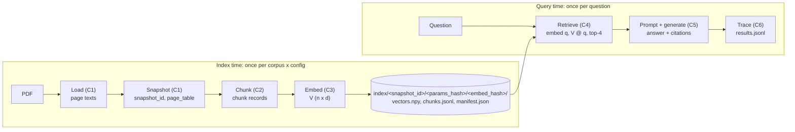
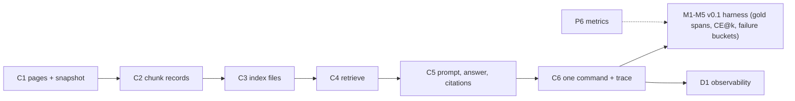

# C6 — Baseline pipeline v0 end to end, with a provenance trace

> **What this file is.** The lesson for concept **C6** ([02 card](../02_RAG_MASTER_LEARNING_PLAN.md#c6)). It follows the Parts A–M template of [07](../07_SAMPLE_LESSON.md) at a smaller scale. C6 adds no new algorithm. It **assembles** your C1–C5 pieces into one command, makes every query leave a full trace, and teaches you to say **which stage** caused a wrong answer.
> **How to use it.** Answers are hidden in collapsible blocks. Write your answer first, then open the block. Lines marked `> 🧭 Coach:` are instructions for the AI tutor; they add to [05 §3](../05_LEARNING_AND_RETENTION_SYSTEM.md#3-coaching-rules-for-the-ai-tutor) and cannot override it.
> **Labels.** **UNVERIFIED**: not checked by running code or reading the primary source. **Assumption:** a stated premise. **Interface assumption:** a gap in 06 that this lesson fills. **TOY**: made-up data or a hand-written answer, never a result.
>
> Every number here comes from the retrieval-only reference run of 2026-10-08 ([C6_FACTS.md](../sources/verification/C6/C6_FACTS.md), sections S1–S11 and S-src), from a derivation shown in the text, or carries a label. **No Groq or Cohere call was made.** The one generated answer shown is a hand-written TOY.

## Lesson header

| Field | Value |
|---|---|
| Concept | **C6 Baseline pipeline v0 + provenance trace**: load → snapshot → chunk → embed → index → retrieve → prompt → generate → log, run as **one command**; a trace record per query; walking one query through every artifact; deciding which stage failed (retrieval vs generation, CR-11); a rebuild that gives the same `params_hash` and chunk ids; failure notes on 10 manual queries (the seed of M5). |
| Phase / tier | Phase 2, Core baseline. Priority **E**. **FT: no** (v0 must be your own code). |
| Prerequisites | **C1–C5** (all of them; this is their integration check), P1, P6, P7. |
| Comes next | **Gate 2→3** and approval gate **B** (BL-1) · **M1–M5** (v0.1 harness) · **D1** (observability starts here, not at v6). |
| Open misconceptions | **MC-002** (missing query embedding), **MC-003** (prompt vs overlap), **MC-005** (k trade-off) from the [log](../progress/misconception_log.md). Part A re-checks all three. |
| Time | A: 15 min · book (all of Ch1): 35 min · B–F: 50 min · G: 25 min · H (lab): 2–3 h, over two days · J–M: 30 min. |
| Mastery (C6 → `applied`) | The Gate 2→3 items ([02 §4](../02_RAG_MASTER_LEARNING_PLAN.md#4-mastery-gates)) **plus** C6-R-01 ≥ 3 on two days and `coding_independence_0_3 ≥ 2` on lab Tasks 2–8. Details in L.4. |
| Mastery (C6 → `transfer`) | A fresh novel-scenario item (L.3) ≥ 3 and `debugging_0_3 ≥ 2` on lab Task 9. |

### Source map

| Source | Where | What it contributes |
|---|---|---|
| Book (A) | **All of Ch1 p.1–14/14**; Appendix p.4–7/23; Ch22 p.8/19, p.13/19, p.14/19; Intro p.7/8 | The two-phase pipeline, step by step. **No trace, no citation, no offsets, no reproducibility** anywhere in Ch1 (S-src) |
| Repo (B) | `simple_rag.ipynb` (all 22 cells); `helper_functions.py:L18-L31`, `L48-L76`, `L129-L149`; `all_rag_techniques_runnable_scripts/simple_rag.py:L18-L61`; `local_rag_huggingface_faiss.ipynb` cells 10–30; `simple_rag_with_llamaindex.ipynb` cells 4, 11, 13, 16 | Three "simple RAG" pipelines to read as **contrasts**, not templates |
| Our plan | [06 §2](../06_RAG_PROJECT_AND_EVALUATION_PLAN.md#2-architecture) (data model, manifest, trace, ids), [06 §3](../06_RAG_PROJECT_AND_EVALUATION_PLAN.md#3-v0-baseline-exact-specification) (v0 spec), [06 §5.3](../06_RAG_PROJECT_AND_EVALUATION_PLAN.md#53-corpus-freezing) (snapshot), [06 §9.1](../06_RAG_PROJECT_AND_EVALUATION_PLAN.md#91-run-registry-layout) (run folder) | The **single source of truth** for every interface below |
| Lab verification | [`sources/verification/C6/`](../sources/verification/C6/): reference run, rebuild comparison, interface checks, TOY traces, source checks, [`C6_FACTS.md`](../sources/verification/C6/C6_FACTS.md) | Every measured number |
| Source C (external) | #38 Lewis et al. 2020 (RAG) ([01 §6](../01_SOURCE_INVENTORY.md#6-source-c--supplementary-references-external)) | Background only; no claim here depends on it |

> 📖 **Read in the book** (after Part A, never before; about 35 minutes). C6 is where you read **all of Chapter 1**, end to end. The Intro says to read Ch1 first because every later chapter assumes it (Intro p.7/8). Read with one question: *for each step, which v0 stage is it, and what does the book **not** record?* Keep a two-column note: "book step" | "v0 stage + artifact".
>
> | Page | What to look for | v0 stage (lesson that builds it) |
> |---|---|---|
> | Ch1 p.1/14 | The problem: a model answering from memory, and the word for made-up facts | Why Generate has rules (P7, C5), and why the trace keeps citations |
> | p.2/14 | The core idea and the closed-book vs open-book picture | The whole pipeline |
> | p.3/14 | "How It Works": **two phases**, one done once per document, one per question | Index time vs query time (lab Task 1) |
> | p.4/14 | Step 1: parse the PDF **page by page**; poor extraction hurts retrieval later. Step 2: split into about 1,000 characters with 200 overlap | **Load** (C1) and **Chunk** (C2) |
> | p.5/14 | Step 3: clean the text, **after** splitting. Step 4: embeddings | v0 cleans **nothing** (offsets stay exact; 06 §3.1). **Embed** (C3) |
> | p.6/14 | End of Step 4 (GPS for meaning); Step 5: store vectors in a vector database (FAISS) | **Index** (C3). v0 stores three files and searches with NumPy |
> | p.7/14 | The library picture, then the **preparation sketch** (five steps; step 3 cleans each chunk) | Compare with v0's offline half: the book has no snapshot, ids or manifest |
> | p.8/14 | Step 6: embed the question with the **exact same process**. Step 7: the nearest chunks, typically 2 to 5 | **Retrieve** (C4); v0 fixes k = 4. MC-002 lives here |
> | p.9/14 | Step 8: pass the chunks and the question to the model; the answer should come from the document | **Generate** (C5, P7) |
> | p.10/14 | The two-row pipeline figure, the **query sketch** (six steps), then "The Role of Chunk Size" begins | v0's online half. Notice: no step logs anything |
> | p.11/14 | Too-large vs just-right chunks; "Where Simple RAG Falls Short" begins | Chunk size is I1's experiment, not C6's |
> | p.12/14 | Questions whose evidence is scattered; limits are "not bugs"; when to use, when it is overkill | Your 10-query failure notes (lab Task 10) |
> | p.13/14 | The trade-offs table (one embedding call, one search, one LLM call) and the claim that answer quality depends **entirely** on retrieval | Latency fields of the trace. Challenge the claim in Part G (CR-07, CR-11) |
> | p.14/14 | The closing list of simple RAG's limits | Why v0 is the **baseline** every later version is compared with |
>
> Then two short extras: Appendix p.6/23 (Layer 1: get the basic pipeline working end to end, do not optimise early) and Ch22 p.13/19 (component-level metrics tell you where to look when an end-to-end score drops). After reading, close the book and write three lines: the stages in order, one thing the book never records, and one page number you will remember.

### Contents

[Part A](#part-a--prior-knowledge-recovery) · [B](#part-b--why-c6-exists) · [C](#part-c--intuition-and-analogy) · [D](#part-d--technical-mechanism) · [E](#part-e--connections) · [F](#part-f--worked-example-by-hand) · [G](#part-g--source-connection) · [H](#part-h--implementation-progression) · [I](#part-i--controlled-experiment) · [J](#part-j--failure-and-debugging) · [K](#part-k--engineering-decisions) · [L](#part-l--assessment) · [M](#part-m--retention) · [References](#source-references) · [Verification log](#verification-log)

---

## Part A — Prior knowledge recovery

C6 is the integration check for C1–C5 and P1–P7. Answer **before** reading on: 1–3 sentences each, no notes.

> 🧭 Coach: Ask **one item at a time** (CR-01), in the exact wording, with its template. Record confidence 1–3 first (CR-16); this learner is often confident and wrong (O1 calibration). Score with the Recall rubric ([05 §4.2](../05_LEARNING_AND_RETENTION_SYSTEM.md#42-graded-rubrics-04)). Do not teach yet; route with the table after C6-A6.

**C6-A1** (C1, C2). You found a chunk that says "adopted in 2015". Which two numbers let you find it again, and in which text?
*Reply template:* "____ and ____, counted in ____."

<details><summary>What a strong answer contains</summary>

- `char_start` and `char_end`, **document** offsets into `doc_text`: the snapshot's pages joined with `"\n"` (06 §2.3). The invariant is `doc_text[char_start:char_end] == text`.
- Bonus: the snapshot is named by `snapshot_id` (`ea07572562ac` for Corpus D), so the offsets mean nothing without it. `page_segments` is the page-relative view used for citations.

</details>

**C6-A2** (C3). You rebuild the index tomorrow from the same PDF and settings. What must come out identical?
*Reply template:* "The ____, the ____ and the ____ must match, because ____."

<details><summary>What a strong answer contains</summary>

- `snapshot_id`, `params_hash` and every `chunk_id` (Gate 2→3); in practice also `chunks.jsonl` and `vectors.npy` byte for byte (S8).
- Why: ids join traces to gold labels and to each other. If they drift, old traces point at the wrong chunks.

</details>

**C6-A3** (C4, P5; MC-002). A question arrives. What happens to it before any chunk gets a score?
*Reply template:* "It is ____ by ____, then ____."

<details><summary>What a strong answer contains</summary>

- It is **embedded by the same model** that embedded the chunks (Ch1 p.8/14), on the query side (Cohere: `input_type="search_query"`), normalised; then `scores = V @ q`, one score per chunk.
- ⚠️ MC-002 flag: no query embedding, or a "similarity matrix" of chunks against chunks.

</details>

**C6-A4** (C5, P7). The answer cites `[climate:12]`, but page 12 was not in the context. Retrieval problem or generation problem?
*Reply template:* "A ____ problem, because ____."

<details><summary>What a strong answer contains</summary>

- **Generation** (citation): the model cited a page it was never shown (C5's "cited but not retrieved"). The check is `resolved_chunk_ids == []`.
- Careful: if the gold evidence was **also** missing from the context, the first failure is retrieval (Part D.5, TOY-7).

</details>

**C6-A5** (P6, CR-11). The gold page is at rank 3 of 4, and the answer is still wrong. Which stage do you suspect first?
*Reply template:* "Not ____, because ____; so ____."

<details><summary>What a strong answer contains</summary>

- Not retrieval: the evidence **was** in the context (Hit@4 = 1). Suspect generation: ignored evidence, a distractor's number, or the prompt. Check by reading the answer against the rank-3 chunk.
- Bonus: Ch22 p.8/19 says the same in metric form (good context, low faithfulness → model or prompt).

</details>

**C6-A6** (P1). Groq returns an empty answer for one question. Which recorded value tells you why?
*Reply template:* "The ____ field, which would show ____."

<details><summary>What a strong answer contains</summary>

- `finish_reason` (and the reasoning-token count): `gpt-oss-20b` spends `max_tokens` on reasoning first (P1 B.2). An empty answer is a **failure**, not a skip, so it must be in the trace (C5 records `finish_reason`).

</details>

> 🧭 Coach: **Routing.**
>
> | Weak answers (score ≤ 1) | Action |
> |---|---|
> | C6-A1 or C6-A2 | Revisit C2 Part H and C3 before lab Task 3. The trace is useless without stable ids. |
> | C6-A3 | MC-002 is live. Do lab Task 5 slowly; ask the learner to say the shapes of `q` and `V @ q` aloud. |
> | C6-A4 or C6-A5 | Teach D.5 (the ladder) **before** D.4. Do lab Task 9 first. |
> | C6-A6 | Re-read P1 B.2 before Task 12 (Groq). |
> | All ≥ 3 with confidence 3 | No fast track (FT: no). Skim B–C; go straight to D.4–D.6 and the lab. |
>
> After routing, send the learner to the **Read in the book** box, then Part B.

---

## Part B — Why C6 exists

### B.1 The repo's "simple RAG" cannot be audited

`simple_rag.ipynb` loads, chunks, embeds and retrieves (cells 10–13), prints two chunks (cell 15), then runs an OpenAI evaluation (cell 17). Its saved output shows **two texts with no page and no score**. The helper that fetches them keeps only `page_content` (`helper_functions.py:L147`), so the page and the score are thrown away. There is **no generation step** at all (04 DV-01). If an answer were wrong, nothing would tell you which stage failed.

**Measured contrast** (S-src). Our v0 reference run's ranks 1–2 for the same question start with the same text as the repo's two saved contexts. v0 can also say where they come from: page 1, chunks 2 and 1, cosine 0.6505 and 0.6319 (S5, R-001).

### B.2 Near-ties you only see with a trace

For D-002 ("In what year was the Paris Agreement adopted?"), the evidence (p.10) is at **rank 3** with 0.438607; rank 4 (p.6, no year) has 0.438527. The gap is **0.00008** (S6). For D-008 the gap between ranks 4 and 5 is 0.0006 (S5). A tiny change (another model, a cleaning step) could reorder these. Without scores in a trace you would never know how close it was.

> 🧭 Coach: One question: "In B.1, if the repo's answer were wrong, which stage would you blame?" Expected: you cannot tell from the notebook, and **that is the failure C6 fixes** (CR-11).

---

## Part C — Intuition and analogy

**A flight data recorder.** After an incident, investigators do not guess. They read a recorder that logged every system's inputs and outputs, then find the **first** reading that went wrong. The trace is v0's recorder: one record per question, with what each stage received and produced. The ids are the serial numbers that let you pull the exact part (chunk, vector row, page) off the shelf.

**Where the analogy breaks.**
- The recorder does not judge. To say "retrieval failed" you also need to know where the answer **should** have come from: a gold span (M1). Without it, the trace shows *what* happened, not *whether* it was right.
- Some failures leave no mark. An answer from memory looks like a good answer (TOY-7, D.5).

> 🧭 Coach: CR-17 pause. One question: "In the analogy, what plays the role of the serial numbers?" Expected: `chunk_id` (and `snapshot_id`, `params_hash` inside it).

---

## Part D — Technical mechanism

### D.1 One command, two halves, three files



- **Course decisions** (06 §2.4): the index folder adds an `embed_hash` level, so a Cohere index and a MiniLM index never share a folder.
- **One command** runs both halves for a list of questions and writes `experiments/E000_v0_baseline/config.json` and `results.jsonl` (06 §9.1). If the index already exists **and its manifest matches** the config, it is loaded, not rebuilt (06 §2.2).
- Row *i* of `vectors.npy` is line *i* of `chunks.jsonl`. That alignment is how a trace finds a chunk's vector. It is **not** `seq`: `seq` restarts in every document, so on a multi-document corpus (T) row ≠ seq.

### D.2 Names that make runs comparable

| Name | Hash of | Changes when | Corpus D value |
|---|---|---|---|
| `snapshot_id` | parser, its version and options, cleaning, page join, each document's text (06 §5.3) | the extracted text changes | `ea07572562ac` |
| `params_hash` | the chunking config: 06 §2.4's `chunking:` block, `sort_keys` JSON (course decision) | any chunking field changes | `1ca9c5a3b548` |
| `chunk_id` | — (a name): `doc_id:snapshot_id:params_hash:seq` | either hash or the position changes | `climate:ea07572562ac:1ca9c5a3b548:00027` |
| `embed_hash` | the embedding block: provider, model id, revision, input type, normalize, preprocessing (06 §2.4) | the embedder or its settings change | `c398eeba043f` (MiniLM fallback) |
| `index_manifest_hash` | the bytes of `manifest.json` | anything in the index changes | `84931e43…` (S4) |
| `config_hash` | the bytes of the run's config file | any run setting changes | per run |
| `prompt.sha256` | the exact chat messages (C5 recipe) | rules, chunks, order or question change | per query |

- Ids are for **joins**, never cache keys; the embedding cache is keyed by the text itself (06 §2.4).
- **CR-08 probe, measured.** Overlap 200 → 100 gives `params_hash` `747bbb59942a`, so all 97 ids change (S7). k 4 → 8 changes **no** index name: k is a query-time setting, so only `config_hash` and the traces change.

### D.3 The trace record (06 §2.5, v0 subset)

| Stage | Fields | Lesson |
|---|---|---|
| Envelope | `trace_version`, `run_id`, `qid`, `timestamp_utc`, `config_hash`, `index_manifest_hash`, `snapshot_id` | C6 |
| Query | `query.original`, `query.transformed` (`method: none` in v0) | C6 |
| Retrieve | `candidates.dense`: `rank`, `chunk_id`, `doc_id`, `page`, `char_start`, `char_end`, `score` | C4 |
| Context | `context.chunk_ids`, `context_tokens`, `tokenizer`, `truncated_chunks` | C5 |
| Prompt | `template_version`, `sha256`, `input_tokens` | C5 |
| Answer | `text`, `abstained`, `citations` (`marker`, `doc_id`, `page`, `resolved_chunk_ids`), `output_tokens` | C5 |
| Ops | `latency_ms` per stage, `cost_usd_estimate`, `llm` (`provider`, `model_id`, `temperature`, `cache_hit`), `errors` | C5, C6 |

- **Measured size:** about 2,030–2,270 bytes per record (a few bytes vary with the latency values); 10 records ≈ 21.3 KB (S5).
- **Not stored:** chunk texts, vectors and the prompt text. They are **resolved** on demand: text from `chunks.jsonl`, vector from the same row of `vectors.npy`, prompt rebuilt from the template and checked against `prompt.sha256`.
- **Never invent a value.** Unknown token counts are `null`. A fake or TOY answer is labelled as such in `llm.provider`.

### D.4 One query through every artifact (D-002, measured)

| Rank | Chunk seq (also its row in `V` here: one document) | Page, page offsets → document offsets | Score |
|---|---|---|---|
| 1 | 69 | p.24 [0, 982) → [51,414, 52,396) | 0.4606 |
| 2 | 68 | p.23 [1,547, 2,204) → [50,756, 51,413) | 0.4513 |
| 3 | **27** | **p.10** [0, 951) → [20,555, 21,506) | 0.4386 |
| 4 | 17 | p.6 [1,566, 2,389) → [13,112, 13,935) | 0.4385 |

1. **Page text → chunk.** Page 10 starts at document offset 20,555 (page table), so its page offsets [0, 951) are document offsets [20,555, 21,506).
2. **Chunk → vector → score.** Row 27 of `V` times the query vector gives 0.438607, equal to the stored score (S6).
3. **Gold.** The draft gold span p.10 [438, 537) is document [20,993, 21,092), inside chunk 27. So retrieval succeeded at rank 3 (CE@4 = 1).
4. **Prompt.** Four blocks `[1] (climate:24)` … `[4] (climate:6)`, 802 tokens locally counted (S5).
5. **Answer (TOY, hand-written).** "The Paris Agreement was adopted in 2015 [climate:10]." The citation resolves to chunk `…:00027`, which is in the context.

> 🧭 Coach: CR-17 pause. One question: "Which artifact proves the citation is not invented?" Template: "The ____ list, because ____." Expected: `resolved_chunk_ids` is non-empty and ⊆ `context.chunk_ids`.

### D.5 Which stage failed? Walk upstream to downstream

Check the artifacts in pipeline order. The **first** one that is broken is the cause; later problems may be its symptoms.

| # | Check | If it fails | Side (CR-11) | M5 bucket |
|---|---|---|---|---|
| 1 | Is the gold quote in the **parsed** page text? | `parse` | retrieval-side | parsing |
| 2 | Does **some chunk** hold the whole quote? | `chunk` | retrieval-side | boundary |
| 3 | Does a **context** chunk hold it? | `retrieve` | retrieval | vocabulary mismatch, exact-term, rank |
| 4 | Does every citation resolve to a context chunk? | `generate:citation` | generation | unsupported claim |
| 5 | Evidence present, but the answer abstained? | `generate:abstain` | generation | (false abstention) |
| 6 | Is every number in the answer in the cited chunks? | `generate:grounding` | generation | unsupported claim |

- Checks 1–3 need a **gold span**; checks 4–6 need only the trace.
- **The trap (TOY-7).** The answer is correct and cites page 1, but page 1 was never retrieved. Check 3 fails first: it is a **retrieval** failure that the model hid by answering from memory (06 §7.1, the "danger zone"). A generation-first ladder would call it a citation problem (S10).
- Checks 4–6 are **cheap toy checks**. Real groundedness checking is v5.0's job.

> **Quick check.** "The quote is in the page text but split across two chunks. Which label?" *Template:* "____, because ____." (Expected: `chunk`, a boundary failure.)

### D.6 Reproducibility: what must match, what must not

- **Must be byte-identical on rebuild** (S8, two processes): `vectors.npy`, `chunks.jsonl`, `manifest.json`, the config, and every trace field except the two below.
- **Must differ:** `timestamp_utc` and `latency_ms`. So "byte-identical traces" is false for whole records (see the 04 correction in G.3).
- **What breaks it:** a clock value in the manifest; Python's `hash()` (it changes per process); unsorted JSON keys in `params_hash` (a different hash, lab variant); a new PyMuPDF version (a new `snapshot_id`, so new ids).
- **Generation is not reproducible this way.** Temperature 0 does not promise identical text across API calls (UNVERIFIED for Groq). That is why retrieval and generation are judged separately, and why LLM answers are cached by content (06 §2.4).

### D.7 What v0 deliberately leaves out (06 §3.4), with two measured facts

- **No cleaning.** On Corpus D the repo's tab replacement would change **0** characters (S1): PyMuPDF's text has no tabs.
- **No truncation at 1,000 characters** with the local model: the longest chunk is 182 MiniLM tokens, under 256 (S3). The Cohere default's numbers are UNVERIFIED until you run it.
- **No BM25, reranking, budget or citation verification.** Each belongs to a later version, so v0 stays the honest baseline.

---

## Part E — Connections



| Often confused | The difference |
|---|---|
| `snapshot_id` vs `params_hash` | The first names the **text**; the second names the **chunking settings**. A chunk id needs both. |
| `params_hash` vs `config_hash` | `params_hash` covers chunking only; `config_hash` covers the whole run (k, model, prompt …). |
| Trace vs log line | A trace is a structured record with ids you can join; a printed line is not. |
| Rank vs block number | Rank is retrieval order; `[i]` is a prompt position. Citations use `doc:page`, not `[i]` (P7). |
| Retrieval failure vs generation failure | Was the evidence in the context? No → retrieval. Yes → generation (CR-11). |
| Reproducible retrieval vs reproducible answers | Retrieval can be byte-identical; API answers need caching to be repeatable. |

---

## Part F — Worked example by hand

**Step 1: offsets.** Page 10 starts at document offset 20,555. A chunk has page segment p.10 [0, 951). A gold span is p.10 [438, 537). Is the gold span inside the chunk? Give both ranges in document offsets.

<details><summary>Answer</summary>

Chunk: [20,555 + 0, 20,555 + 951) = [20,555, 21,506). Gold: [20,993, 21,092). 20,555 ≤ 20,993 and 21,092 ≤ 21,506, so **yes**, wholly inside (S6).

</details>

**Step 2: a citation.** Context pages are 24, 23, 10, 6 (in rank order). The answer says "… in 2015 [climate:12]." What does the citation resolve to, and what is the label?

<details><summary>Answer</summary>

`resolved_chunk_ids = []`: no context chunk is on page 12. The gold page (10) **is** in the context, so checks 1–3 pass and check 4 fails: `generate:citation`.

</details>

**Step 3: the index size.** 97 chunks, 384 dimensions, float32, a 128-byte `.npy` header. How big is `vectors.npy`?

<details><summary>Answer</summary>

128 + 97 × 384 × 4 = 128 + 148,992 = **149,120 bytes**, the measured size (S4).

</details>

> 🧭 Coach: CR-08 probe here: ask C6-A-02 (Part L) now.

---

## Part G — Source connection

### G.1 Book (Source A)

| Cite | Book point (paraphrased) | Our assessment |
|---|---|---|
| Ch1 p.3/14 | Two phases: offline once per document, online per question | Same split as v0 (D.1) |
| Ch1 p.4/14 | Parse page by page; extraction quality limits retrieval; about 1,000/200 characters | v0 Load and Chunk (06 §3.1) |
| Ch1 p.5/14, p.7/14 | Clean **after** splitting ("clean each chunk" in the sketch) | v0 cleans nothing, so offsets stay exact; any cleaning is a new snapshot |
| Ch1 p.6/14 | Store vectors in a vector database such as FAISS | v0: three files and NumPy (exact search at ~100 chunks) |
| Ch1 p.8/14 | Embed the question by the same process; retrieve typically 2–5 | v0: same model, query side; k = 4 |
| Ch1 p.9–10/14 | Pass question and chunks to the model; the query sketch | v0 Generate; the book specifies no prompt, citation or log |
| Ch1 p.13/14 | Low latency: one embedding, one search, one LLM call. Answer quality depends **entirely** on retrieval | The cost list matches v0. The "entirely" claim is too strong: with good retrieval the answer can still be wrong (D-002's rank-3 evidence could be ignored; TOY-6). CR-07: measured on what? CR-11 keeps the two apart |
| App p.4–5/23 | Six symptom families for diagnosing failures | M5's buckets map to them (06 §4.1) |
| App p.6/23, p.7/23 | Layer 1: an end-to-end pipeline first; the common mistake is adding verification before retrieval works | Why C6 comes before every technique |
| Ch22 p.8/19, p.13/19, p.14/19 | Faithfulness isolates generation; component metrics tell you where to look; per-component latency | The trace is what makes component metrics possible |

**Not in Ch1 at all** (S-src, all 14 pages searched): traces, citations, provenance, metadata, scores, offsets, reproducibility.

### G.2 Repo (Source B): `simple_rag.ipynb` vs v0, stage by stage (cells 0-based, verified at `009adba`)

| Stage | Repo | v0 | Why v0 differs |
|---|---|---|---|
| Setup | Cell 3 installs pypdf **and** PyMuPDF 1.26.1; cell 5 needs Colab and an OpenAI key | uv env, PyMuPDF **1.26.7** pinned; Groq/Cohere from `.env` | The snapshot depends on the parser version |
| Load | Cell 10: `PyPDFLoader`, one document per page | PyMuPDF `page.get_text()`, frozen snapshot | One parser everywhere, with a hash |
| Chunk | Cell 10: `RecursiveCharacterTextSplitter` 1000/200 per page, **no start index** | Per-page recursive 1000/200 with document offsets and ids | Offsets and ids are the trace's anchors |
| Clean | Cell 10: tabs → spaces **after** splitting (`helper_functions.py:L18-L31`) | None (0 tabs on Corpus D, S1) | Cleaning would break offsets |
| Embed, store | Cell 10: OpenAI embeddings, in-memory FAISS | Cohere (MiniLM fallback), `vectors.npy` + manifest | No OpenAI key; a persisted, named index |
| Retrieve | Cell 13: `k=2`; cell 15 prints texts only; L147 drops metadata and scores | k = 4, ranks, scores, offsets | Diagnosis needs scores |
| Generate | **None** | Groq, grounded prompt, `[doc:page]` | The G in RAG (04 DV-01) |
| Evaluate / log | Cell 17: `evaluate_rag`, fresh LLM questions each run | Trace per query; frozen eval set later (M1) | Reproducible measurement |

- **Runnable script** `rs/simple_rag.py:L18-L61`: the same retriever in a class (`n_retrieved=2`, L23). It times the whole `encode_pdf` call as "Chunking" (L36–L38) and prints context (L61); nothing is returned or logged.
- **`local_rag_huggingface_faiss.ipynb`** (cells 10–30): the closest full pipeline (bge-base, `TOP_K = 3`, `[Page n]` labels, `RunnableParallel` returning sources in cell 28). But generation is remote (cell 20), and **no cell has a saved output**, so nothing shows it ran at this commit. Cell 30 passes the chain as `retriever` to `evaluate_rag(retriever, num_questions)`, a mismatch found by reading only (not run).
- **`simple_rag_with_llamaindex.ipynb`**: 200/50 **tokens** (cell 4), and the cleaner runs **before** the splitter (cell 13), the opposite order to the book and to `simple_rag`. Cell 16 builds `VectorStoreIndex(nodes)`, so the FAISS store is likely bypassed (04).

### G.3 Corrections to 04 (04 is not edited)

1. **C6 gate check.** 04 says two v0 runs give "a byte-identical retrieval trace". Measured: the **index files** and the trace's retrieval fields are identical, but whole records are not (`timestamp_utc`, `latency_ms` differ). Compare after removing those two fields (S8).
2. **C1 row, "clean before chunking".** The book splits first and cleans second (Ch1 p.4–5/14; the p.7/14 sketch cleans each chunk), and `simple_rag` does the same (`helper_functions.py:L69-L70`). Only the LlamaIndex notebook cleans first.
3. **C6 row, repo.** `local_rag_huggingface_faiss.ipynb` cells 10–28 are right, but the notebook was never executed at this commit (no outputs), and cell 30's evaluation call does not match `evaluate_rag`'s signature (by reading).
4. **C6 row, book.** Only the two sketches (p.7, p.10) are cited. Missing: p.13/14 (the "depends entirely on retrieval" claim to challenge) and App p.6/23 (in the 02 card).

### G.4 Reading list (in this order)

`simple_rag.ipynb` cells 10, 13, 15 (look at the saved output) → `helper_functions.py:L129-L149` → `rs/simple_rag.py:L18-L61` → `local_rag_huggingface_faiss.ipynb` cells 18, 22, 24, 28 → `simple_rag_with_llamaindex.ipynb` cell 13. For each, write in the margin: *what would I need to log to debug this?*

---

## Part H — Implementation progression

### H.1 The lab: [`labs/C6_v0_pipeline.ipynb`](../labs/C6_v0_pipeline.ipynb) (blank-file first)

Tasks, empty cells, prediction cells and CHECK cells; **no solution code**. You bring your **own** C1–C5 functions, under the names those labs used.

| # | Task | The CHECK tests |
|---|---|---|
| 1 | Order the 11 steps of v0 (index vs query time) | Fingerprint of the order |
| 2 | Load + snapshot with your C1 code | 33 raw pages; page table; `snapshot_id` = `ea07572562ac` |
| 3 | Chunk with your C2 code (from memory; predict the count) | Offsets, ids, one segment each, `params_hash` = `1ca9c5a3b548`, deterministic |
| 4 | Embed + write/load the index with your C3 code (predict `vectors.npy` bytes) | Three files under the `embed_hash` folder, manifest hashes, unit rows, line *i* = row *i*, `load_index` refuses another chunker |
| 5 | Retrieve with your C4 code (predict page 10's rank) | Tie rule, scores recomputed; top-4 = reference if your ids match |
| 6 | Prompt, fake answer, citations with your C5 code | v0 messages, prompt hash, citation resolves |
| 7 | `make_trace` + `run_v0` (predict bytes per record); 7b rebuild | Every 06 §2.5 field, joins, hashes, fake labelled fake; byte-identical rebuild |
| 8 | `walk(trace)` for D-002 + written explanation | Rows, offsets, recomputed scores |
| 9 | **Which stage failed?** 7 TOY traces: by hand, then `first_failing_stage` | Labels fingerprint; abstain and grounding unit cases |
| 10 | 10 manual queries → open-coding table (would a reader accept it, Y/N on the Groq run; first problem in your own words; first failing stage; trace evidence), then group and name your notes (seeds M5). A "Y" whose first failing stage is `retrieve` is still a failure (06 §7.1). The given printer counts `length_stop` and `unexpected_finish_reason` over the run | Graded by the coach |
| 11 | One command from a fresh process | Same retrieval as Task 7 |
| 12 | *Optional:* Groq, Cohere, Corpus T. **Not run by the author** | — |

> 🧭 Coach: The reference run is a **solution**; never show it before an attempt plus a hint (CR-04). Grade `coding_independence_0_3` on Tasks 2–8 and `debugging_0_3` on Task 9 and on any failing CHECK the learner fixes. Tasks 3, 7b, 8, 10 and 11 are Gate 2→3 evidence.

### H.2 Stage-interface table (check the other lessons against this)

06 is the source of truth; names follow the C1–C5 labs as built on 2026-10-08.

| Stage | Input | Output | File | Built in |
|---|---|---|---|---|
| Load | PDF path, `doc_id` | pages: `page` (1-based), `text` = `page.get_text()`, `parser` | — | **C1** (`load_pages`) |
| Snapshot | page texts | `doc_text` (join `"\n"`), page table rows, `snapshot_id` | `evaluation/snapshots/D_<sid>.json` + `<sid>/<doc_id>.txt` | **C1** (`build_page_table`, `snapshot_id`) |
| Chunk | `doc_id`, `snapshot_id`, page texts, `PARAMS` (06 §2.4 block) | 06 §2.3 records (`doc_id, snapshot_id, chunk_id, seq, char_start, char_end, page_segments, text, text_sha256, chunker, params_hash, meta`) | `chunks.jsonl` | **C2** lab / [07](../07_SAMPLE_LESSON.md) (`params_hash`, `make_records`) |
| Embed | chunk texts; embedder (`model_id`, `dim`, `embed_documents`, `embed_query`) | `V` float32 (n, d), unit rows; content-keyed cache | `.cache/emb/` | **C3** (`embedding_cache_key`, `cached_embed`), **C4** (embedder) |
| Index | chunks, `V`, manifest | written manifest (+ `embed_hash`, `files` hashes); `load_index` refuses a mismatch; row i = line i | `index/<snapshot_id>/<params_hash>/<embed_hash>/` `vectors.npy`, `chunks.jsonl`, `manifest.json` | **C3** (`embed_hash`, `write_index`, `rebuild_reasons`, `load_index`) |
| Retrieve | question, embedder, `V`, chunks, k = 4 | list of `{rank, chunk_id, doc_id, page, char_start, char_end, score, text}`, ties by `chunk_id` | — | **C4** (`retrieve`) |
| Prompt + generate | question, retrieved | messages (06 §3.3); `llm_result` (`text, finish_reason, input_tokens, output_tokens, reasoning_tokens, latency_ms, params`) | `prompts/answer_v1.txt` | **C5** (`build_messages`, `call_llm`) |
| Citations | answer text, retrieved | `citations` with `resolved_chunk_ids`; `invalid`, `unused` | — | **C5** (`parse_citations`, `check_citations`, `make_answer`) |
| Record | all of the above | C5 part (`context`, `prompt`, `llm`, `answer`) + C6 envelope (`trace_version … snapshot_id`, `query`, `candidates`, `latency_ms`, `cost_usd_estimate`, `errors`) | `experiments/E000_v0_baseline/results.jsonl` + `config.json` | **C5** (`make_record`), **C6** (`make_trace`, `run_v0`) |

**Course interface decisions** (recorded in 06 §2.4, "Interface decisions"; all C1–C6 labs follow them): `params_hash` = 12 hex of `sha256(json.dumps(PARAMS, sort_keys=True))` over 06's `chunking:` block = `1ca9c5a3b548` (07 H.3's `ChunkerConfig` gives `77bc4c45809b` for the same spans, S7); `embed_hash` = 12 hex of `sha256(json.dumps({provider, model_id, revision, input_type, normalize, preproc_version}, sort_keys=True))` = `c398eeba043f` for the MiniLM block (S4); index folder `index/<snapshot_id>/<params_hash>/<embed_hash>/`, so two embedders never share a folder; **row i of `vectors.npy` = line i of `chunks.jsonl`**, and nothing assumes `seq == i` (`seq` restarts per document); `.env` name `COHERE_EMBED_MODEL_ID`.

**Interface assumptions still open** (C6 fills a gap in 06; not decided at course level):
1. **Separators.** 06 lists `""` last; 07's code has a built-in character fallback and **hangs** if given `""` on a long whitespace-free run (S9). Corpus D is unaffected (identical spans), but any chunker that takes 06's list must treat `""` as the fallback, not as a separator.
2. **`prompt.sha256`**: 06 names the field but gives no recipe; C6 adopts C5's `sha256(json.dumps(messages, sort_keys=True, ensure_ascii=False))`.
3. **Provider label.** C5's `make_record` writes `provider: "groq"`; with a fake or TOY answer, C6 must relabel it (lab Task 7 checks it).
4. **Config file**: 06 says `config.yaml`; PyYAML is only a transitive dependency, so the lab writes `config.json`; `config_hash` = sha256 of the file's bytes.
5. **`latency_ms.embed_query`** may be `null`: C4's `retrieve` embeds inside, so the split is not measured.
6. **Trace top level** carries `snapshot_id` (06 §2.5's revision note asks for it; the example omits it). C5's extra fields (`template_sha256`, `finish_reason`, `reasoning_tokens`, `citation_subset_ok`, `flags` …) are additive to 06 §2.5.

### H.3 The one command (06 §10)

Move your functions into `ragkit/` (`loaders.py`, `chunking.py`, `index.py`, `retrieval.py`, `context.py`, `generate.py`, `providers/`, `tracing.py`) plus one entry point. **Interface assumption:** `uv run python -m ragkit.run_v0 --corpus D` (the module name is not fixed by 06). Gate 2→3 asks for it to run **from a clean environment**: a fresh clone, `uv sync --locked`, then the one command, as in O2.

### H.4 Corpus T: open decision

D-02 fixed the **composition** of Corpus T (a mix of 3–4 RAG papers and 2 non-RAG technical papers; 08 Part 4), but the files are **not yet chosen, hashed or frozen** (DEC-3 is unticked in 08 Part 7). So this lesson runs on **Corpus D now**. The Gate 2→3 smoke run on Corpus T waits for DEC-3 (lab Task 12). Expect differences: two-column text, tables and several documents (multi-document `doc_id`s, cross-document distractors).

---

## Part I — Controlled experiment

**n/a for C6.** v0 is the baseline; it has no hypothesis (06 §4.2). Experiments start in Phase 4 against v0, with the v0.1 harness (M1–M5). The two-run comparison in D.6 is a **reproducibility check**, not an experiment.

---

## Part J — Failure and debugging

Write the cause, the side (**retrieval** or **generation**, CR-11, or **neither**: a pipeline bug) and a fix. Then open the table.

- **J1.** After a library upgrade, every chunk id changed, though the PDF and settings did not.
- **J2.** The run used chunk ids from a 2,000-character index with 1,000-character vectors.
- **J3.** A trace's stored score does not match `V[row] @ q` when you recompute it.
- **J4.** For one question the answer is correct, but no context chunk is on the gold page.
- **J5.** All ten answers in `results.jsonl` say `provider: groq`, but `RUN_GROQ` was off.

<details><summary>Diagnoses</summary>

| | Cause | Side | Fix |
|---|---|---|---|
| J1 | A new PyMuPDF version gives new text, so a new `snapshot_id` (06 §5.3) | Neither (a version change, working as designed) | Pin the parser (already pinned); treat it as a new snapshot and a new dataset version |
| J2 | Index loaded without checking the manifest | Neither (pipeline bug that would corrupt every metric) | `load_index` refuses any `snapshot_id`/`params_hash`/model mismatch (lab Task 4) |
| J3 | The query was embedded with another model or without normalising (MC-002), or rows and lines are misaligned | Retrieval (silent) | Same embedder for both sides; assert `len(V) == len(chunks)`; recompute in the walk (Task 8) |
| J4 | The model answered from memory (the danger zone; TOY-7) | **Retrieval**, hidden by generation | Check 3 of the ladder first; closed-book control in v0.1 (06 §7.1) |
| J5 | C5's record hardcodes the provider | Neither (a labelling bug, but it would poison the human pilot) | Relabel in `make_trace` (Task 7 checks it) |

</details>

> 🧭 Coach: For J2 and J5 ask for the **one-line assert** that would have caught it. It counts as evidence for `debugging_0_3`.

---

## Part K — Engineering decisions

| Question | Decision | Why |
|---|---|---|
| Framework? | None: your own functions (FT: no) | Every stage visible and traceable; 06 §3 |
| Search | Exact NumPy cosine, ties by `chunk_id` | ~100 chunks; deterministic (06 §3.1) |
| Index storage | `vectors.npy` + `chunks.jsonl` + `manifest.json`, refused on mismatch | Named, reloadable, checkable (06 §2.2) |
| Trace content | Ids, offsets, scores, hashes; not texts or vectors | 2–2.3 KB per query; texts resolvable from the index (S5) |
| Unknown values | `null`, never a guess; TOY/fake answers labelled | CR-12; a later judge batch must not grade fakes |
| Default run | MiniLM + fake client in the lab; Cohere + Groq for the gate run | No paid calls while building; real providers for evidence |
| Where diagnosis starts | Upstream first (the ladder) | The first broken artifact is the cause |

**When NOT to trace this much:** a throwaway prototype answering one question once. As soon as you compare two versions or debug a wrong answer, you need it.

---

## Part L — Assessment

One short question per item, each with a template. Score with [05 §4.2](../05_LEARNING_AND_RETENTION_SYSTEM.md#42-graded-rubrics-04).

> 🧭 Coach: One item at a time; record confidence first; never two questions in one turn.

### L.1 Recall

**C6-R-01** (02 evidence). Name v0's stages in order, with the artifact each one writes.
*Template:* "Load → ____ (____) → … → Trace (____)."

<details><summary>Criteria for 4</summary>

Load (page texts) → Snapshot (`snapshot_id`, page table) → Chunk (chunk records, `params_hash`, ids) → Embed (`V`) → Index (three files + manifest) → Retrieve (ranked candidates with scores) → Prompt (messages, `prompt.sha256`) → Generate (answer, citations) → Trace (`results.jsonl`). Plus which half is index time, and one field that joins two stages (`chunk_id`).

</details>

**C6-R-02.** What makes a rebuild trustworthy?
*Template:* "The same ____, ____ and ____, and byte-identical ____."

<details><summary>Criteria for 4</summary>

Same `snapshot_id`, `params_hash`, chunk ids; byte-identical `chunks.jsonl` and `vectors.npy` (S8). Plus: timestamps and latency are expected to differ; generation needs caching to repeat.

</details>

### L.2 Application

**C6-A-01** (CR-08). The chunk overlap is halved, from 200 to 100. What changes in the index, and what stays?
*Template:* "____ changes, so ____; ____ stays."

<details><summary>Criteria for 4</summary>

`params_hash` changes (`747bbb59942a`, S7), so every chunk id and the index folder change, and the index must be rebuilt; `snapshot_id` stays (the text did not change). Old traces cannot be joined to the new index. Plus: gold spans survive, because they are character spans, not chunk ids.

</details>

**C6-A-02** (CR-08). k doubles from 4 to 8. Does the index need rebuilding?
*Template:* "____, because k is ____; what changes is ____."

<details><summary>Criteria for 4</summary>

No: k is a query-time setting. `config_hash`, the traces, the context tokens and the prompt hash change; `params_hash` and the index do not. Plus the trade-off (MC-005): recall up, more tokens and more middle positions.

</details>

**C6-A-03** (debugging). TOY-3's answer says the tanks hold 400 litres but leaves out the refill month. Which stage failed, and what proves it?
*Template:* "____, because the quote is ____ but ____."

<details><summary>Criteria for 4</summary>

`chunk`: the quote is in the parsed page, but no chunk holds it whole (cut at 60 characters, no overlap). Retrieval and generation did their best with half a sentence. Fix: overlap or structure-aware chunking (I1/I2), measured.

</details>

### L.3 Transfer

> 🧭 Coach: C6-T-01 is a practice item. For the scored CR-13 item, invent a fresh scenario (another domain, a multi-document corpus, a new constraint) that is not in this file, and grade it with the Transfer rubric.

**C6-T-01.** A legal team's assistant answers from 300 contracts. A lawyer reports one wrong termination date. You have only the final answer. What would you add, and how would you find the failing stage?
*Template:* "I would log ____. Then I would check ____ in this order: ____."

<details><summary>Criteria for 4</summary>

- Log per query: ids with document offsets, scores and ranks, context ids, prompt hash, answer, resolved citations, model id, and a pinned snapshot per contract set.
- Walk the ladder upstream: was the date parsed correctly (scanned PDFs, tables)? Is it whole in a chunk? Was it in the context (and which contract: a cross-document distractor)? Did the answer cite the right contract page? Is the date in the cited chunk?
- Keep retrieval and generation apart; build a small gold set before changing anything. When not to: if only one answer is ever audited, a manual read may be enough.

</details>

### L.4 When is C6 mastered?

- **`applied` (L3):** all five Gate 2→3 items done and logged (lab Tasks 3, 7b, 8, 10, 11, plus the Corpus T smoke run once DEC-3 is done); C6-R-01 ≥ 3 on two days (one ≥ 24 h later); two Application items ≥ 3; `coding_independence_0_3 ≥ 2` on Tasks 2–8.
- **`transfer` (L4):** a fresh novel-scenario item ≥ 3; `debugging_0_3 ≥ 2` on Task 9; a teach-back ≥ 3 (M.3).
- **Blocking:** BL-1 (v0 end to end from a clean environment with full traces) blocks M1–M5 (approval gate B).

---

## Part M — Retention

### M.1 Flashcards

| # | Front (one question) | Back |
|---|---|---|
| 1 | v0's index folder? | `index/<snapshot_id>/<params_hash>/<embed_hash>/` |
| 2 | Three index files? | `vectors.npy`, `chunks.jsonl`, `manifest.json` |
| 3 | Chunk id format? | `doc_id:snapshot_id:params_hash:seq` (5 digits) |
| 4 | Corpus D `params_hash`? | `1ca9c5a3b548` (06 §2.4 block) |
| 5 | Row *i* of `vectors.npy` is? | Line *i* of `chunks.jsonl` (not `seq`) |
| 6 | Trace size per query? | About 2.0–2.3 KB (S5) |
| 7 | Which stage failed? | The first broken artifact, upstream to downstream |
| 8 | Correct answer, gold not retrieved? | Retrieval failure hidden by generation |
| 9 | k doubles: rebuild? | No; query-time setting |
| 10 | What differs between two identical runs? | `timestamp_utc`, `latency_ms` |

### M.2 Retrieval practice (closed book; log per [05 §5.1](../05_LEARNING_AND_RETENTION_SYSTEM.md#51-active-recall-what-a-review-item-looks-like))

| When | One question | Template |
|---|---|---|
| Day 1 | What are v0's stages, in order? | "Load → ____ → … → Trace." |
| Day 3 | What changes if the overlap changes? | "____ changes, so ____." |
| Day 7 | A citation resolves to nothing, but the gold page was retrieved. Which label? | "____, because ____." |
| Day 14 | What must be byte-identical after a rebuild? | "____ and ____." |

### M.3 Teach-back ([05 §5.4](../05_LEARNING_AND_RETENTION_SYSTEM.md#54-teach-back-protocol))

"In 3 minutes, show a new teammate one trace record and explain how you would decide whether a wrong answer was a retrieval or a generation failure." A 4 needs: the stage order; the ids and how they join; one measured number (2.0–2.3 KB, rank 3 at 0.4386, or 149,120 bytes); the ladder; the hidden-retrieval trap (TOY-7).

### M.4 Interleaving links

**C2:** ids depend on chunking settings. **C4:** near-ties (D-002's 0.00008 gap). **P7/C5:** citations by `doc:page`. **M5:** your Task 10 notes become your first open codes; the M5 method groups them into failure modes later.

### M.5 Misconception-log entries to add when observed

| Label | Correct model (short) | Root cause | Severity | Check items |
|---|---|---|---|---|
| "A correct answer means the pipeline worked" | It may come from memory; check the context (TOY-7) | over-generalisation | high | C6-A4, J4 |
| "Any change to settings needs a rebuild" | Only index-time settings (snapshot, chunking, embedding) | conflation | medium | C6-A-02 |
| "Same code, so same trace" | Timestamps and latency differ; API answers can differ | over-generalisation | medium | C6-R-02 |
| "Blame the last stage that looks wrong" | Walk upstream first | method gap | high | C6-A-03, Task 9 |

### M.6 Progress-tracker entry (format only; fictional values, per [05 §6.1](../05_LEARNING_AND_RETENTION_SYSTEM.md#61-progressconcept_trackercsv))

```csv
C6,Baseline pipeline v0 end-to-end + provenance trace,2,E,exposed,<YYYY-MM-DD>,,,<YYYY-MM-DD +1>,1,,,,,,,na,,0,log:<YYYY-MM-DD>#C6-R-01
```

---

## Source references

**Book (Source A).** Ch1 p.1/14–p.14/14 (every page); Appendix p.4/23–p.7/23; Ch22 p.8/19, p.13/19, p.14/19; Intro p.7/8. Checked against the PyMuPDF page text by `c6_sources.py` on 2026-10-08. Paraphrased; no quotation reaches 15 words.

**Repo (Source B)**, `NirDiamant/RAG_Techniques` @ `009adba2be1bef49780ef73b6dd3c18fd24b035b`, cells 0-based: `all_rag_techniques/simple_rag.ipynb` 3, 5, 10, 11, 13, 15, 17 (22 cells read end to end); `helper_functions.py:L18-L31`, `L48-L76`, `L129-L149`, `L208`, `L336-L362`; `all_rag_techniques_runnable_scripts/simple_rag.py:L18-L61`; `local_rag_huggingface_faiss.ipynb` 10, 12, 14, 16, 18, 20, 22, 24, 26, 28, 30; `simple_rag_with_llamaindex.ipynb` 4, 11, 13, 16, 23; `evaluation/evalute_rag.py` (`evaluate_rag` signature); `data/Understanding_Climate_Change.pdf`.

**Our records.** [06 §2–§3](../06_RAG_PROJECT_AND_EVALUATION_PLAN.md#2-architecture), [§5.3](../06_RAG_PROJECT_AND_EVALUATION_PLAN.md#53-corpus-freezing), [§6.7](../06_RAG_PROJECT_AND_EVALUATION_PLAN.md#67-draft-seed-items-for-corpus-d-draft--learner-must-verify), [§7.1](../06_RAG_PROJECT_AND_EVALUATION_PLAN.md#71-retrieval-metrics-vs-generation-metrics-and-why-they-disagree), [§9.1](../06_RAG_PROJECT_AND_EVALUATION_PLAN.md#91-run-registry-layout), [§10](../06_RAG_PROJECT_AND_EVALUATION_PLAN.md#10-implementation-sequence-and-milestones); [02 §4](../02_RAG_MASTER_LEARNING_PLAN.md#4-mastery-gates) Gate 2→3; [08 Part 4](../08_GAP_ANALYSIS_AND_DECISIONS.md#part-4--open-design-decisions) (D-01, D-02) and [Part 7](../08_GAP_ANALYSIS_AND_DECISIONS.md#part-7--implementation-readiness-criteria) (BL-1, DEC-3); the C1–C5 labs and `sources/verification/C2lab/C2LAB_FACTS.md` (interfaces, `chunks.jsonl` sha256).

**Supplementary (Source C, external).** #38 P. Lewis et al., "Retrieval-Augmented Generation for Knowledge-Intensive NLP Tasks", 2020 ([01 §6](../01_SOURCE_INVENTORY.md#6-source-c--supplementary-references-external)). Background only; not read for this lesson.

**Method source for lab Task 10.** AE Ch3, 'Open Coding: Reading and Labeling Traces' (the AI Eval book; read 2026-10-09; paraphrased, never quoted): note the first problem in each trace, judge each one acceptable or not, and group the notes only afterwards.

---

## Verification log

**Environment.** 2026-10-08, `uv run` from `rag_learning/`: CPython 3.12.8, pymupdf 1.26.7, numpy 2.5.3, sentence-transformers 6.1.0 (MiniLM revision `1110a243…`, offline), torch 2.14.1+cpu, tiktoken 0.14.0. No Groq or Cohere call; `.env` not read.

| Claim | How verified |
|---|---|
| S1–S7 (snapshot, 97 chunks, `params_hash`, index sizes, ten top-4 lists, D-002 walk, hash sensitivity) | **Ran** `c6_reference_v0.py`; `out_c6_reference_v0.txt`. `snapshot_id` and page-10 offset equal 06 §5.3; `chunks.jsonl` equals the C2 lab's file byte for byte |
| Rebuild reproducibility (S8) | **Ran** the reference twice in separate processes; `c6_compare_runs.py` ALL PASS |
| 06-vs-07 chunker interface (S9) | **Ran** `c6_interface_checks.py`; the `""` hang shown with a 20 s child-process timeout |
| TOY traces and the ladder (S10) | **Ran** `c6_toy_traces.py`: 7/7 planted labels found; a generation-first ladder fails on TOY-7 |
| Repo cells, helper lines and book pages | **Ran** `c6_sources.py`: 122 PASS; a mutated copy fails exactly its 3 changed checks |
| Lab notebook | **Tested** with a throwaway solution outside the workspace: 12/12 CHECK cells (also 12/12 in a real Jupyter kernel); blank 0/12; 21/21 broken variants fail at the intended CHECK. Re-run 2026-10-09 after the Task 10 changes: same results; the printer's flag count is 0 and 0 with the fake client, and 1 and 1 when a toy client returns "length" and `None` (C6_FACTS S11). Task 12 **not run** |
| 04 corrections (G.3) | From the S8 comparison and the S-src checks |
| Arithmetic in D, F, L | **Derived** from S-numbers, shown in the text |

**Still UNVERIFIED:** any real Groq answer or Cohere ranking for v0 (the D-002 answer is TOY), including how often a real answer stops at "length" (the Task 10 flag counts); Cohere truncation at 1,000 characters; whether temperature 0 repeats Groq answers; the one command from a fresh clone (the learner's gate step); Corpus T (not frozen, DEC-3); whether the learner's own chunker reproduces the 97 ids; `local_rag_huggingface_faiss.ipynb`'s behaviour (never executed at this commit) and its cell-30 mismatch (read, not run); the gold spans themselves (06 §6.7 drafts, learner must verify).
