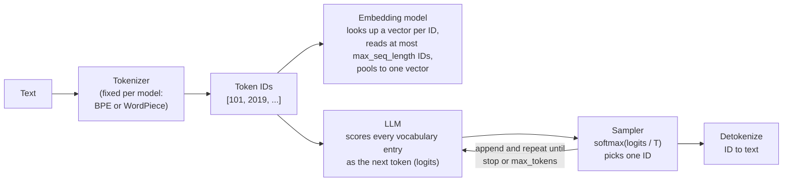
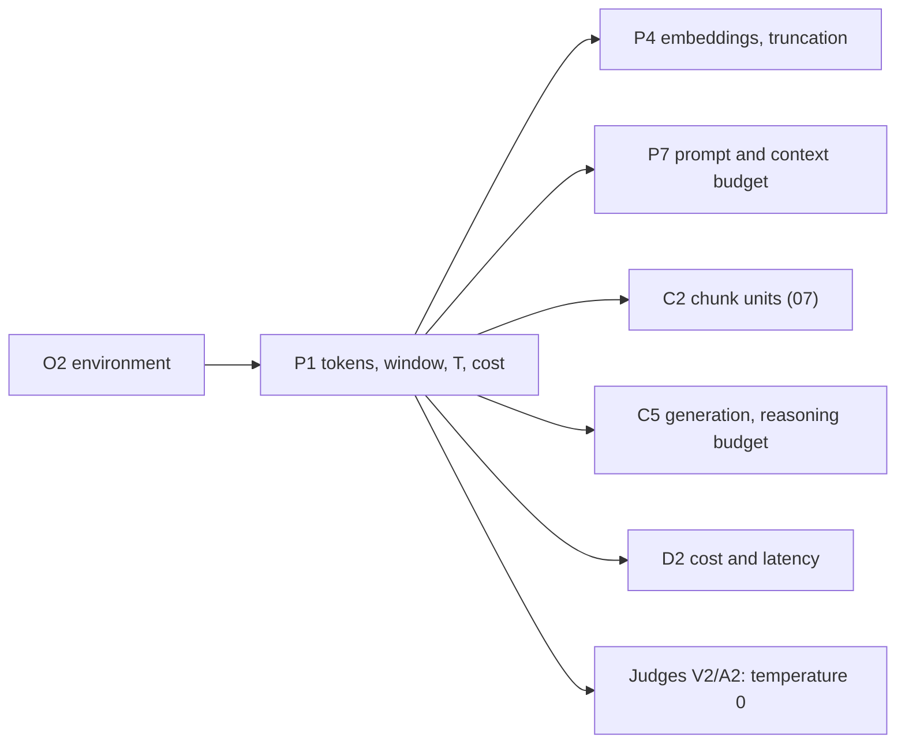

# P1 — LLM fundamentals for RAG: tokens, context windows, temperature and cost

> **What this file is.** The lesson for concept **P1** ([02 card](../02_RAG_MASTER_LEARNING_PLAN.md#p1)). It follows the Parts A–M template of [07](../07_SAMPLE_LESSON.md), at a smaller scale.
> **How to use it.** Answers are hidden in collapsible blocks. Write your answer first, then open the block. Lines marked `> 🧭 Coach:` are instructions for the AI tutor; they add to [05 §3](../05_LEARNING_AND_RETENTION_SYSTEM.md#3-coaching-rules-for-the-ai-tutor) and cannot override it.
> **Labels.**
> - **UNVERIFIED**: not checked by running code or reading the primary source.
> - **Assumption:** a stated premise.
> - **Toy illustration**: numbers computed by code on made-up data, never a result about a real system.
> - **Placeholder price**: a symbol such as `$X per 1M input tokens`. It is never a real price.
>
> Every number in this lesson comes from the local run of 2026-10-08 ([P1_FACTS.md](../sources/verification/P1/P1_FACTS.md), section ids S1–S10 for measurements and S-src for citation checks; S11, a tokenizer-only run, and S-web, web pages read, were added on 2026-10-09), from a logged earlier run (cited), from a derivation shown in the text, or carries a label. No Groq or Cohere call was made for this lesson.

## Lesson header

| Field | Value |
|---|---|
| Concept | **P1 LLM fundamentals for RAG**: tokens and tokenizers, characters vs tokens, embedding truncation (`max_seq_length`), the context window (input, output and reasoning tokens), temperature and sampling (and why judges use 0), cost estimation from token counts. |
| Phase / tier | Phase 1, Prerequisites. Priority **E** (essential). Fast track possible ([02 §5](../02_RAG_MASTER_LEARNING_PLAN.md#5-fast-track-rules-from-the-o1-diagnostic)). |
| Prerequisites | **O2** (environment). No concept prerequisites. |
| Comes next | **P4** embeddings and truncation · **P7** grounded prompts and the context budget · **C2** chunk units ([07 D.5](../07_SAMPLE_LESSON.md#d5-units-characters-tokens-and-tokens)) · **C5** generation with a reasoning model · **D2** cost and latency budgets · judge concepts (V2/A2) for temperature 0. |
| Open misconception | **MC-001** "tokens = characters; tokens are decided by the embeddings" ([log](../progress/misconception_log.md)). This lesson is its remediation. |
| Time | A: 10 min · B–D: 40 min · E–G: 20 min · H (lab): 45 min · J–K: 15 min · L: 15 min · M: 5 min. May be split across two days ([05 §2.4](../05_LEARNING_AND_RETENTION_SYSTEM.md#24-entry-and-exit-rules)). Part I does not apply. |
| Mastery (P1 → `applied`) | Without notes, you can: (1) count tokens for a passage with two real tokenizers and explain the gap; (2) say that the embedder's **own** tokenizer and its `max_seq_length` decide truncation; (3) list everything that counts toward a context window, including reasoning tokens; (4) explain temperature as softmax(logits / T) and state the limit of "temperature 0"; (5) estimate the cost of N queries from token counts and a **dated** price sheet. Lab: `coding_independence_0_3 ≥ 2`. |
| Mastery (P1 → `transfer`) | You also pass a fresh novel-scenario item (Part L.3) and score `debugging_0_3 ≥ 2` in the lab. |

### Source map

| Source | Where | What it contributes |
|---|---|---|
| Book (A) | Ch1 p.12/14, Ch2 p.9/11, Ch4 p.5/15, Ch9 p.9/14, Ch10 p.12/13, Ch12 p.6/14 and p.10/14, Ch22 p.8/19, p.14/19, p.18/19 | Uses "token", "context window" and token cost **without defining them**. Never uses "temperature" for sampling. P1 is **not in the book**. |
| Repo (B) | `proposition_chunking.ipynb` cell 9; `reliable_rag.ipynb` cells 6, 14; `contextual_chunk_headers.ipynb` cell 11; `simple_rag_with_llamaindex.ipynb` cells 4, 13; `document_augmentation.ipynb` cells 4, 6; `simple_rag.ipynb` cell 10; `choose_chunk_size.ipynb` cell 8; `evaluation/define_evaluation_metrics.ipynb` cell 1; `graph_rag.ipynb` cell 12 | Real units, budgets, temperatures and cost counters to read and critique |
| Our logs | [Session 2026-10-08 #2](../progress/session_log.md#session-2026-10-08-2--concept-o2-environment-setup) (the O2 empty-answer finding); [`progress/O2_smoke_test_2026-10-08.json`](../progress/O2_smoke_test_2026-10-08.json) (billed token counts) | The reasoning-token and template-overhead evidence |
| Lab verification | [`sources/verification/P1/`](../sources/verification/P1/): `p1_measure.py`, `p1_sources.py`, `p1_strawberry.py`, saved outputs, [`P1_FACTS.md`](../sources/verification/P1/P1_FACTS.md) | Every measured number in this lesson |
| Source C (external) | #3–#6 in [01 §6](../01_SOURCE_INVENTORY.md#6-source-c--supplementary-references-external) (HF tokenizer course and docs, tiktoken, the tiktoken cookbook) | Further reading only |
| Web pages (external) | Groq API reference (Source C #55) and Groq's OpenAI-compatibility page; Thinking Machines Lab 2025. All read 2026-10-09 and logged in [P1_FACTS S-web](../sources/verification/P1/P1_FACTS.md) | What Groq promises about temperature 0, `seed` and `top_p` (D.6, J5) |

### Contents

[Part A](#part-a--prior-knowledge-recovery) · [B](#part-b--why-p1-exists) · [C](#part-c--intuition-and-analogy) · [D](#part-d--technical-mechanism) · [E](#part-e--connections) · [F](#part-f--worked-example-by-hand) · [G](#part-g--source-connection) · [H](#part-h--implementation-progression) · [I](#part-i--controlled-experiment) · [J](#part-j--failure-and-debugging) · [K](#part-k--engineering-decisions) · [L](#part-l--assessment) · [M](#part-m--retention) · [References](#source-references) · [Verification log](#verification-log)

---

## Part A — Prior knowledge recovery

Answer the six questions **before** reading on: 1–3 sentences each, no notes. Wrong answers are useful here; they tell the tutor where to start.

> 🧭 Coach: Ask **one item at a time** (CR-01), in the exact wording below. Give the reply template if the learner hesitates. Record confidence 1–3 before revealing anything (CR-16). Score with the Recall rubric ([05 §4.2](../05_LEARNING_AND_RETENTION_SYSTEM.md#42-graded-rubrics-04)). These are unscheduled recall items: log them, do not change the schedule, except that a score ≤ 1 follows the ≤ 1 row of [05 §5.2](../05_LEARNING_AND_RETENTION_SYSTEM.md#52-spaced-repetition-schedule). Do not correct in detail yet; route with the table after P1-A6.

**P1-A1.** What is a token, and which part of the system decides how text is cut into tokens?

*Reply template:* "A token is ____. The ____ decides the cut."

<details><summary>What a strong answer contains</summary>

- A token is **one unit of text the model reads**: a whole word, a piece of a word, a punctuation mark or a byte sequence. Each token maps to an integer **ID** in a fixed vocabulary.
- The **tokenizer** decides the cut. It is fixed per model before the model is used (BPE for tiktoken encodings, WordPiece for MiniLM).
- The embedding model does **not** decide the cut. Its first layer only looks up one vector per token ID (D.1).
- Boundary: two models can cut the same sentence differently (12 cl100k tokens vs 14 WordPiece tokens for one sentence, S5).
- ⚠️ MC-001 flag: "decided by the embeddings".

</details>

**P1-A2.** About how many tokens is a 1,000-character English paragraph? Give your reasoning.

*Reply template:* "About ____ tokens, because one token is about ____ characters."

<details><summary>What a strong answer contains</summary>

- **About 150–250 tokens.** English prose runs at roughly 4–6 characters per token, because common words are one token and rarer words split into a few pieces.
- On our climate PDF, the 90 full 1,000-character windows have **157–217 cl100k tokens** (median 180.5) (S4).
- Boundary: code, numbers and non-English text give far fewer characters per token (1.49 for a numbers line, S3), so they cost more tokens.
- ⚠️ MC-001 flag: "1,000 tokens" (the O1-Q01 answer).

</details>

**P1-A3.** An embedding model has a max length of 256 tokens. You give it a 400-token chunk. What happens?

*Reply template:* "The model reads ____. The rest ____. I would notice it by ____."

<details><summary>What a strong answer contains</summary>

- **Silent truncation.** Only the first 256 tokens are encoded; for MiniLM that is `[CLS]` + 254 text tokens + `[SEP]` (S6). There is no error and no warning.
- The last ~146 tokens have **no effect on the vector**. Measured: the 400-token text and its 254-token prefix give cosine **1.000000** (S6).
- The chunk text still holds the tail, so the LLM sees it if the chunk is retrieved; the tail just cannot help the chunk **get** retrieved.
- Count with the **embedder's own tokenizer**, not tiktoken ([07 D.6](../07_SAMPLE_LESSON.md#d6-embedding-truncation-the-hard-ceiling)).

</details>

**P1-A4.** What is a model's context window, and what counts toward it?

*Reply template:* "It is the most tokens ____. It includes ____ and ____."

<details><summary>What a strong answer contains</summary>

- The **maximum number of tokens one call can handle**, input and output together.
- **Input:** system prompt, chat-template tokens added by the provider, instructions, retrieved chunks, the question, any conversation history.
- **Output:** the visible answer **plus reasoning tokens** for a reasoning model such as `gpt-oss-20b`. `max_tokens` caps the output part.
- Evidence from our own log: with `max_tokens=12`, `gpt-oss-20b` returned an **empty** answer because reasoning used the budget (session 2026-10-08 #2).
- Boundary: fitting in the window does not mean the model uses all of it well (P7, MC-004).

</details>

**P1-A5.** What does temperature change, and why would an LLM judge use temperature 0?

*Reply template:* "Temperature changes ____. A judge uses 0 so that ____."

<details><summary>What a strong answer contains</summary>

- Temperature T **rescales the next-token scores (logits) before softmax**: probabilities ∝ exp(logit / T). Low T sharpens the distribution toward the top token; high T flattens it. T → 0 means always pick the top token (greedy).
- A judge uses 0 for **repeatability**: the same input should give the same verdict, so a difference between two system versions is not just dice. It also makes caching valid ([06 §8.6](../06_RAG_PROJECT_AND_EVALUATION_PLAN.md#86-cost-control-and-caching)).
- Limits: on hosted APIs, temperature 0 is **not guaranteed** to be bit-for-bit repeatable (UNVERIFIED; listed as risk RK-17 in [08 Part 5](../08_GAP_ANALYSIS_AND_DECISIONS.md#part-5--technical-risks)). And a repeatable judge can be **repeatably wrong**: temperature 0 says nothing about calibration (MC-006).

</details>

**P1-A6.** How would you estimate the cost of 100 RAG queries before running them?

*Reply template:* "Per query I count ____ input tokens and ____ output tokens, then multiply by ____."

<details><summary>What a strong answer contains</summary>

- **Count input tokens per query** with the generator's tokenizer: instructions + k chunks + question (+ an overhead margin for the chat template).
- **Bound output tokens** by `max_tokens`, which for a reasoning model includes reasoning.
- **Multiply by the current price sheet** (input and output priced separately, per 1M tokens), **dated**, then ×100. Add query-embedding calls and any judge calls.
- Check the estimate against the `usage` fields of a small pilot run.
- ⚠️ Flag: quoting a price from memory. Prices change; look them up ([06 §7.5](../06_RAG_PROJECT_AND_EVALUATION_PLAN.md#75-operational-metrics)).

</details>

> 🧭 Coach: **Routing.**
>
> | Weak answers (score ≤ 1) | Action |
> |---|---|
> | P1-A1 or P1-A2 | MC-001 is still live. Teach D.1–D.3 slowly, and do lab Task 4 ("see the cut") **before** any numbers. |
> | P1-A3 | Teach D.4 with the S6 cosines; link to 07 PK-3 and D.6. Note it for P4. |
> | P1-A4 | Teach D.5 from the O2 log. If the learner mentions "lost in the middle" as minima, note MC-004 for P7. |
> | P1-A5 | Teach D.6. If the learner says "temperature 0 makes the judge correct", note it against MC-006. |
> | P1-A6 | Teach D.7 and Part F; insist on the price-sheet lookup in the lab. |
> | All six ≥ 3 with confidence 3 | Offer the fast track: skim B–C, then D.4, D.5, F, H and L (evidence is never skipped, 02 §5 rule 1). |

---

## Part B — Why P1 exists

### B.1 One name, four units

The repo uses the word "chunk_size" (and "tokens") for different amounts of text. The full table is [07 D.5](../07_SAMPLE_LESSON.md#d5-units-characters-tokens-and-tokens); here are the P1 cases (cells verified, S-src):

| Code | What "size" counts | Cite |
|---|---|---|
| `encode_pdf(path, chunk_size=1000, ...)`, `length_function=len` | **characters** | `simple_rag.ipynb` cell 10 |
| `from_tiktoken_encoder(chunk_size=200, chunk_overlap=50)` | tiktoken tokens (default `gpt2` encoding, per 07 D.5) | `proposition_chunking.ipynb` cell 9 |
| `CHUNK_SIZE = 200` with a comment that LangChain counts the string's length and LlamaIndex counts tokens | LlamaIndex tokens | `simple_rag_with_llamaindex.ipynb` cell 4 (used in cell 13) |
| `split_document(...)`, docstring says "number of tokens" | **regex words** `\b\w+\b` | `document_augmentation.ipynb` cell 6 |

The book does not help: it never defines a token. The only place it says "tokenize" is BM25 splitting text into **words** (Ch12 p.6/14, p.10/14). So "token" means a subword piece in tiktoken and LlamaIndex, a regex word in `document_augmentation`, and a word in the book's BM25.

### B.2 The empty answer (our own O2 run)

In session 2026-10-08 #2, the smoke test asked `openai/gpt-oss-20b` for a short reply with `max_tokens=12`. The reply was **empty**. The model is a reasoning model: it spent its output budget on reasoning before writing any visible text. The first version of the check still marked it PASS ([session log](../progress/session_log.md#session-2026-10-08-2--concept-o2-environment-setup)).

That one bug shows three P1 ideas at once: output tokens include reasoning; `max_tokens` is an output cap, not the context window; and a check must assert on content.

### B.3 The bill does not match your count

The same logged smoke call (`max_tokens=256`, `reasoning_effort="low"`) was billed **78 prompt tokens** and **23 completion tokens** ([report](../progress/O2_smoke_test_2026-10-08.json)). Counted locally, the message is **7** tokens and the visible reply is **4** (S9, `o200k_harmony`). So:
- about 71 prompt tokens came from somewhere other than the text you wrote (inference: the provider's chat template and system header; UNVERIFIED in detail);
- about 19 completion tokens were not in the visible reply (inference: reasoning and format tokens; the report logged no breakdown).

A cost estimate built only from your own text is a **lower bound**.

---

## Part C — Intuition and analogy

**Tokens are bricks from one model's own box.** Each model ships with a fixed box of brick shapes (its vocabulary: 100,277 for cl100k, 30,522 for MiniLM's WordPiece, S2). The **tokenizer** is the person who rebuilds your sentence using only bricks from that box. Common words are one brick; rare words need several small bricks. The **embedding table** is the catalogue that gives each brick number a vector. It never chooses bricks.

**The context window is the table you build on.** The question pile and the answer pile share the same table. A reasoning model also does scratch work on that table before it shows you anything.

**Temperature is how adventurous the picker is.** At 0 the picker always takes the most likely brick. At high temperature, unlikely bricks get picked more often.

**Where the analogy breaks.** Brick shapes are learned from text frequency, and they depend on spaces and case: `" Greenland"` is 1 cl100k token, but `"Greenland"` and `"GREENLAND"` are 2 each (S5).

> 🧭 Coach: CR-17. Stop here and ask one question: "In the analogy, who decides where the sentence is cut: the box, the person, or the catalogue?" Expected: the person (the tokenizer), using only the box (the vocabulary).

---

## Part D — Technical mechanism

### D.1 The objects involved



- **MC-001 fix in one line:** the **tokenizer** cuts; the embedding model only receives IDs.
- An embedding model and an LLM usually have **different tokenizers**. Each budget must be counted with the tokenizer of the model that enforces it.

### D.2 How the two tokenizer families cut

> Predict first: how many cl100k tokens is `Anthropogenic emissions are accelerating deglaciation in Greenland.` (67 characters)? Write a number, then open.

<details><summary>Measured pieces (S5)</summary>

| Tokenizer | Count | Pieces |
|---|---|---|
| tiktoken `cl100k_base` (BPE) | 12 | `Anth` `rop` `ogenic` `·emissions` `·are` `·accelerating` `·deg` `lac` `iation` `·in` `·Greenland` `.` |
| tiktoken `o200k_base` (BPE) | 13 | `Anth` `rop` `ogenic` `·emissions` `·are` `·accelerating` `·de` `gl` `aci` `ation` `·in` `·Greenland` `.` |
| MiniLM WordPiece (uncased) | 16 (14 + `[CLS]`, `[SEP]`) | `[CLS]` `ant` `##hr` `##op` `##ogenic` `emissions` `are` `accelerating` `de` `##gl` `##ac` `##iation` `in` `greenland` `.` `[SEP]` |

`·` marks a leading space, which in BPE belongs to the next token.

</details>

What to notice:
- **BPE** (tiktoken) works on bytes. The space before a word is part of the token. Case and spacing change the count.
- **WordPiece** (MiniLM) lower-cases, splits on spaces and punctuation first, marks word continuations with `##`, and adds `[CLS]`/`[SEP]`.
- Common words stay whole; rare technical words split. That is why the count depends on the text, not only on its length.

### D.3 Characters per token: measured, not assumed

Extraction as in the acceptance suite: PyMuPDF 1.26.7 `page.get_text()`, pages joined with `"\n"`: 33 pages, **72,593** characters (S1). The three windows are **plain fixed character slices** of 1,000 with overlap 200 (the `simple_rag` cell 10 defaults). They are not LangChain's recursive splitter, which is not installed in the project environment.

| Sample (S3) | Chars | cl100k (chars/token) | o200k | MiniLM WordPiece | chars ÷ 4 says |
|---|---|---|---|---|---|
| Whole climate PDF | 72,593 | 13,026 (**5.57**) | 12,840 (5.65) | 11,694 (6.21) | 18,148 (39% too many) |
| Page 1 | 2,424 | 490 (4.95) | 486 (4.99) | 441 (5.50) | 606 |
| Window 0 [0, 1000) | 1,000 | 201 (4.98) | 198 (5.05) | 186 (5.38) | 250 |
| Window 1 [800, 1800) | 1,000 | 196 (5.10) | 193 (5.18) | 171 (5.85) | 250 |
| Window 2 [1600, 2600) | 1,000 | 217 (4.61) | 218 (4.59) | 198 (5.05) | 250 |
| Code snippet (toy) | 142 | 45 (3.16) | 45 (3.16) | 61 (2.33) | 36 (21% too few) |
| Numbers line (toy) | 94 | 63 (**1.49**) | 63 (1.49) | 62 (1.52) | 24 (63% too few) |
| German sentence | 74 | 22 (3.36) | 16 (4.62) | 25 (2.96) | 18 |
| Hindi sentence | 61 | 62 (**0.98**) | 18 (3.39) | 36 (1.69) | 15 (75% too few) |

Across all 91 windows of the PDF, cl100k chars/token ranges **4.61–6.37** (median 5.52); WordPiece 5.05–7.04 (median 6.21) (S4).

Lessons:
1. **chars ÷ 4 is a heuristic.** On this English technical PDF it over-counts by 39%. On numbers and Hindi it under-counts by 63–75%.
2. **The tokenizer matters.** `o200k_base` (larger vocabulary) needs 18 tokens for the Hindi sentence where `cl100k_base` needs 62.
3. **This agrees with 07 D.5** (5.57 cl100k on PyPDFLoader text). WordPiece is 6.21 here vs 6.20 there because PyMuPDF yields 70 more characters for the same 11,694 tokens.

### D.4 Embedding truncation: what MiniLM actually reads

This extends [07 D.6](../07_SAMPLE_LESSON.md#d6-embedding-truncation-the-hard-ceiling) with a run of the real model (S6):

| Check | Result |
|---|---|
| `model.max_seq_length` / runtime `tokenizer.model_max_length` | **256 / 256** (dim 384; modules Transformer → Pooling → Normalize) |
| IDs the model receives for a 400-token passage | shape **(1, 256)**; first ID 101 = `[CLS]`, last 102 = `[SEP]` |
| Warnings or errors from `encode()` on 400- and 502-token texts | **0** (fresh model; warnings and log records captured) |
| cos(400-token text, its first 254 tokens) | **1.000000** (max abs difference 0) |
| cos(400-token text, same 254 tokens + a different 248-token tail) | **1.000000** |
| cos(400-token text, its first 200 tokens) | 0.988245 |
| cos(400-token text, its own tail, tokens 255–400) | 0.350182 |

- **`[CLS]` and `[SEP]` count toward the 256**, so 254 text tokens fit. This settles an UNVERIFIED point in 07 (its Verification log), and sentence-transformers runs at 256, not at the 128 stored in MiniLM's `tokenizer.json`.
- **"Silent" is literal.** The only length message in the run came from calling the tokenizer **directly** to count the whole PDF (`11694 > 256` in the saved stderr). `encode()` said nothing.
- Whatever follows token 254 can be rewritten freely without changing the vector.

### D.5 The context window and its budget

For one call:

```text
system prompt + chat-template overhead + instructions + k × chunk tokens + question + history   (input)
+ reasoning tokens + visible answer tokens                                                        (output, capped by max_tokens)
≤ context window of the model
```

Measured for the v0 prompt ([06 §3.3](../06_RAG_PROJECT_AND_EVALUATION_PLAN.md#3-v0-baseline-exact-specification) template, four sample 1,000-character windows, `o200k_harmony` = the encoding tiktoken maps to `gpt-oss-20b`, S2, S9):

| Part | Tokens |
|---|---|
| System rules (06 §3.3) | 107 |
| Sources: 4 × 1,000 characters with headers | 842 |
| Question (seed item D-001) | 20 |
| Whole user message | 869 |
| **System + user, before template overhead** | **976** |
| Output cap in v0 (06 §3.1) | `max_tokens=512`, reasoning included |

- **Sources are 86% of the input** (842 of 976; derived). k and chunk size drive the budget.
- **The window size of `openai/gpt-oss-20b` on Groq: look it up** (lab Task 8). Do not assume a number.
- **Reasoning eats output.** Budget `max_tokens` for reasoning plus answer, and use `reasoning_effort="low"` (CLAUDE.md decision; B.2).
- **What happens past the window or the cap** depends on the API. Check `finish_reason` and assert the reply is non-empty. The exact Groq behaviour at the window limit is UNVERIFIED here.

### D.6 Temperature and sampling

At each step the LLM gives a score z_i (logit) to every vocabulary entry. The sampler turns scores into probabilities:

```text
p_i = exp(z_i / T) / Σ_j exp(z_j / T)
```

**Toy illustration** (S7; made-up logits z = [2.0, 1.5, 0.5, −1.0] for the next token of a judge verdict):

| T | p(YES) | p(NO) | p(PARTIAL) | p(MAYBE) | Seeded 1,000 draws (YES/NO/PARTIAL/MAYBE) |
|---|---|---|---|---|---|
| 0.25 | 0.879 | 0.119 | 0.002 | 0.000 | — |
| 0.5 | 0.704 | 0.259 | 0.035 | 0.002 | 681 / 282 / 36 / 1 |
| 1.0 | 0.532 | 0.323 | 0.119 | 0.026 | 557 / 301 / 117 / 25 |
| 2.0 | 0.404 | 0.315 | 0.191 | 0.090 | 409 / 322 / 184 / 85 |
| → 0 | 1 | 0 | 0 | 0 | always YES (greedy) |

- **Dividing by a small T** stretches the gaps between scores, so the top token wins more often. A large T shrinks the gaps.
- **Why judges and graders use 0.** The verdict should depend on the input, not on a draw. Our plan fixes temperature 0 for the v0 generator ([06 §3.1](../06_RAG_PROJECT_AND_EVALUATION_PLAN.md#3-v0-baseline-exact-specification)) and the Cohere judge (D-10). The repo does the same for its graders (`reliable_rag.ipynb` cell 14, `choose_chunk_size.ipynb` cell 8).
- **Limits.**
  1. **Groq does not promise repeatable output.** It turns temperature 0 into a tiny positive value (`1e-8`), and its API reference calls `seed` best-effort, with determinism not guaranteed (S-web). Why our own runs might differ is not documented for Groq: the known cause on batched GPU servers (a request's result changes with the other requests in the same batch; Thinking Machines Lab 2025, S-web) has not been shown for Groq's hardware, so it stays UNVERIFIED until M4's repeated-generation subsample measures it (08 RK-17). Note: [06 §8.5](../06_RAG_PROJECT_AND_EVALUATION_PLAN.md#85-judge-variance) measures the **judge's** flip rate, not the generator's.
  2. Repeatable is not correct. Calibration is a separate question (MC-006).
  3. Some checks **need** T > 0. Sampling-based consistency checking draws several answers with different seeds and flags sentences that disagree (Ch22 p.8/19).
- Other sampling knobs exist. Groq's API reference documents `top_p` (nucleus sampling: only the most likely tokens that together hold the top-p share of the probability are kept) and advises changing it or temperature, not both (S-web). It has no `top_k` parameter; a top-k description is not sourced in this course (UNVERIFIED). Neither knob is used in this course; not measured.

### D.7 Cost from token counts

```text
cost per query = (input_tokens × price_in + output_tokens × price_out) / 1,000,000
                 + query-embedding cost (+ judge calls, if any)
cost of N queries = N × cost per query
```

- Prices are **per 1M tokens**, input and output **separately**. Write down the price sheet URL and the date you read it ([06 §7.5](../06_RAG_PROJECT_AND_EVALUATION_PLAN.md#75-operational-metrics) requires a price-table version).
- **Never state a price from memory.** Look up `openai/gpt-oss-20b` on Groq's current price page (lab Task 8).
- The book names the same parts: tokens per query split into input (context) and output (answer), plus embedding cost (Ch22 p.14/19); embedding priced per token (Ch2 p.9/11); judge calls add token cost per test case (Ch22 p.18/19).
- After a pilot, replace estimates with the `usage` fields (`prompt_tokens`, `completion_tokens`) returned by the API. B.3 shows why.

---

## Part E — Connections



| Often confused | The difference |
|---|---|
| `max_seq_length` (embedder) vs context window (LLM) | Different models, different tokenizers. 256 WordPiece tokens for MiniLM; the LLM's window is far larger and is shared by input and output. |
| `max_tokens` vs context window | `max_tokens` caps **output only**, reasoning included (B.2). |
| Model token vs BM25 "token" | BM25 tokenizes into **words** (Ch12 p.6/14); LLMs use subword tokens. |
| Temperature vs retrieval k | T changes sampling at generation. k changes how many chunks enter the prompt. |
| `chunk_size` | Characters, tiktoken tokens, LlamaIndex tokens or regex words, depending on the code path (B.1). |

---

## Part F — Worked example by hand

**Step 1: estimate, then compare.** A 1,000-character chunk of the climate PDF.
- With chars ÷ 4: ____ tokens. With the corpus median of 5.52 chars per cl100k token: ____ tokens.

<details><summary>Answer</summary>

- 1000 / 4 = **250**; 1000 / 5.52 ≈ **181**.
- Measured on window 0: **201** cl100k tokens (S3). Corpus range: 157–217 (S4). The corpus ratio is the better estimate; the real check is to count.

</details>

**Step 2: the v0 budget.** System rules = 107 tokens, question = 20, four sources = 842 (S9). With `max_tokens=512`, what is the most tokens one call can use, before template overhead?

<details><summary>Answer</summary>

976 input + 512 output = **1,488** tokens (derived). Add the provider's template overhead (≈71 in the one logged call, B.3; an inference).

</details>

**Step 3: cost of 100 queries with placeholder prices.** Use `$X per 1M input tokens` and `$Y per 1M output tokens`.

<details><summary>Answer</summary>

- Input: 100 × 976 = **97,600** tokens. Output: at most 100 × 512 = **51,200** tokens (S10).
- Cost ≤ (97,600 × X + 51,200 × Y) / 1,000,000 dollars.
- Toy illustration with the **hypothetical** prices from 06 §7.5 (X = 0.10, Y = 0.20; not Groq prices): 0.00976 + 0.01024 = **$0.0200** (derived).
- In the lab you replace X and Y with today's Groq prices and record the date.

</details>

**Step 4: temperature by hand.** Toy logits [2.0, 1.5, 0.5, −1.0] at T = 1. Compute p(YES).

<details><summary>Answer</summary>

e² = 7.389, e^1.5 = 4.482, e^0.5 = 1.649, e^−1 = 0.368; sum = 13.888. p(YES) = 7.389 / 13.888 = **0.532**, matching S7.

</details>

> 🧭 Coach: CR-08 probe here, one question: "Double k from 4 to 8 with similar chunks. Does the input budget double?" Expected: no. Estimate: 976 + 842 ≈ 1,818 (×1.86, S10, an estimate made by adding four more blocks of the same size). Measured with the real next four windows: **1,799 (×1.84)** ([P7 S2](../sources/verification/P7/P7_FACTS.md)). Either way it does not double, because the rules and question stay fixed. Then ask the learner what it does to cost.

---

## Part G — Source connection

### G.1 Book (Source A)

| Cite | Book point (paraphrased) | Our assessment |
|---|---|---|
| Ch1 p.12/14 | RAG is overkill when the documents fit in the model's context window | Uses "context window" without defining it; D.5 defines it |
| Ch2 p.9/11 | Embedding API calls are charged per token, so large tables cost more to embed | Correct direction; "token" never defined; D.7 |
| Ch4 p.5/15 | Chunks are sized so the LLM can process each one without exceeding its context window | Budget idea, no numbers |
| Ch9 p.9/14 | Variable chunk lengths change how many chunks fit in the window | Same budget idea; measured in D.5 |
| Ch10 p.12/13 | Compression suits systems where the window is limited and every token counts | No counting method given |
| Ch12 p.6/14, p.10/14 | BM25 tokenizes queries and chunks into words | The book's only "tokenize": word tokens, not model tokens |
| Ch22 p.8/19 | Sampling-based consistency checks draw answers with different random seeds | A use for T > 0 (D.6) |
| Ch22 p.14/19 | Cost per query = input tokens (context) + output tokens (answer) + embedding cost | Matches D.7; no price method |
| Ch22 p.18/19 | LLM-as-judge adds token cost per test case | Why our judge runs once, at the end (D-10) |

**Not in the book:** tokenizers, characters per token, `max_seq_length`, reasoning tokens, sampling temperature (all 13 uses of "temperature" are about Earth's climate, S-src).

### G.2 Repo (Source B): cells verified at `009adba`

| Cell (0-based) | What it shows | Lesson |
|---|---|---|
| `proposition_chunking.ipynb` 9 | `from_tiktoken_encoder(chunk_size=200, chunk_overlap=50)` | Size in tiktoken tokens |
| `reliable_rag.ipynb` 6 | `from_tiktoken_encoder(chunk_size=500, chunk_overlap=0)` | Same, 500 |
| `contextual_chunk_headers.ipynb` 11 | `MAX_CONTENT_TOKENS = 4000`; `truncate_content` keeps `tokens[:max_tokens]`; encoder `encoding_for_model('gpt-3.5-turbo')`; model `gpt-4o-mini`; **the same constant is passed as `max_tokens`** to the LLM call; `temperature=0.2`; the truncation note says "~3000 words" | See J2 |
| `simple_rag_with_llamaindex.ipynb` 4, 13 | Comment: LangChain counts string length, LlamaIndex counts tokens; `CHUNK_SIZE = 200` used in `SentenceSplitter` (cell 13) | The repo itself flags the unit clash |
| `document_augmentation.ipynb` 4, 6 | Cell 4: `DOCUMENT_MAX_TOKENS = 4000`, `FRAGMENT_MAX_TOKENS = 128`, and a comment on model context sizes. Cell 6: `split_document` counts `\b\w+\b` matches and calls them tokens | Regex words, not tokens; the context-size comment is unverified |
| `simple_rag.ipynb` 10 | `chunk_size=1000`, `length_function=len` | Characters |
| `choose_chunk_size.ipynb` 8 | Judge `OpenAI(temperature=0, model="gpt-4o")` | Judges at T = 0 |
| `reliable_rag.ipynb` 14 | Relevance grader `ChatGroq(model="llama-3.1-8b-instant", temperature=0)` | Graders at T = 0 |
| `evaluation/define_evaluation_metrics.ipynb` 1 | `ChatOpenAI(temperature=0, model_name="gpt-4o", max_tokens=4000)` | Eval LLM at T = 0 |
| `graph_rag.ipynb` 12 | `get_openai_callback()` prints prompt, completion and total tokens and a USD cost | Provider-side accounting; OpenAI only |

**Corrections to the [04 P1 row](../04_BOOK_TO_CODE_MAPPING.md)** (04 is not edited; noted here and in the Verification log):
1. `contextual_chunk_headers.ipynb` cell 11 is more than "4000-token truncation". The constant also caps the **output** (`max_tokens=MAX_CONTENT_TOKENS`), and the counts use the **gpt-3.5-turbo** encoding (`cl100k_base`) for a **gpt-4o-mini** call, which tiktoken maps to `o200k_base` (S2).
2. `document_augmentation.ipynb`: the "token" constants are in **cell 4**; cell 6 holds the regex splitter. 04 cites only cell 6.
3. The book is not completely silent on cost: Ch22 p.14/19 names input + output tokens per query as the cost metric. 04 lists only Ch10 p.12/13.
4. The other cited cells (`proposition_chunking` 9, `reliable_rag` 6, `simple_rag_with_llamaindex` 4) match 04. `simple_rag.ipynb` cell 10 comes from the 02 card, not the 04 row; it also matches.

### G.3 Reading list (in this order)

`simple_rag.ipynb` cell 10 → `proposition_chunking.ipynb` cell 9 → `simple_rag_with_llamaindex.ipynb` cell 4 → `document_augmentation.ipynb` cells 4 and 6 → `contextual_chunk_headers.ipynb` cell 11. Write the unit of each "size" in the margin before checking B.1 and G.2.

---

## Part H — Implementation progression

### H.1 The lab: [`labs/P1_tokens_lab.ipynb`](../labs/P1_tokens_lab.ipynb) (blank-file first)

The notebook gives the tasks, empty code cells, and CHECK cells with asserts. It has **no solution code**, and the CHECK cells compare fingerprints, so expected answers stay hidden until you predict. Tasks:

| # | Task | The checks test |
|---|---|---|
| 1 | Load the climate PDF with PyMuPDF; join pages with `"\n"` | 33 pages; 72,593 characters |
| 2 | Predict, then count tokens for page 1 and three 1,000-char windows with `cl100k_base` and `o200k_base` | Your counts equal S3 |
| 3 | Count the same with MiniLM's own tokenizer | WordPiece counts equal S3 |
| 4 | See the cut: print the pieces of one sentence under both tokenizers | 12 and 16 pieces; your MC-001 note is filled |
| 5 | chars/token for your own code, number and non-English samples | A ratio table; your numbers line has fewer chars/token than the PDF prose |
| 6 | Truncation: build a 400-token text and its 254-token prefix; embed both | The cosine you get (hidden until you predict); 256 IDs fed to the model |
| 7 | Write `softmax_T`; reproduce the toy table | Matches S7 to 3 decimals |
| 8 | Look up Groq's price and context window for `openai/gpt-oss-20b`; write `estimate_cost`; **predict** 100 queries, then compute | Price, URL and date filled; formula unit test passes |

API names you may look up: `pymupdf.open`, `page.get_text`, `tiktoken.get_encoding`, `Encoding.encode`, `Encoding.decode_single_token_bytes`, `SentenceTransformer`, `.tokenizer`, `.max_seq_length`, `.encode`. The reference implementation is `sources/verification/P1/p1_measure.py`.

> 🧭 Coach: The reference script is a **solution**. Do not show it before an attempt plus a hint (CR-04). Grade `coding_independence_0_3` on Tasks 2, 6 and 7, and `debugging_0_3` on any failing assert the learner fixes.

### H.2 Repo reading guide: `contextual_chunk_headers.ipynb` cell 11

Trace `get_document_title(document_text)` by hand for a 10,000-token document. Answer each question before opening.
1. What does `truncate_content` return?
2. Which message is added to the prompt, and what word count does it claim?
3. Is that claim right on our corpus?
4. Which tokenizer counts, and which model reads?
5. How many output tokens may the title reply use?

<details><summary>Answers</summary>

1. The first 4,000 tokens, decoded back to text, and the number 4,000.
2. The truncation note, which claims about 3,000 words.
3. Close here: 4,000 cl100k tokens of the climate PDF = 21,085 characters = **2,869** words (S8).
4. cl100k (the gpt-3.5-turbo encoding) counts; gpt-4o-mini, which tiktoken maps to o200k, reads (J2).
5. Up to 4,000: the same constant is the output cap.

</details>

### H.3 Reusable design (future `ragkit/`; nothing is created now)

- `count_tokens(text, tokenizer_id) -> int`; the `tokenizer_id` goes into the chunker's `params_hash` (07 D.9).
- A budget check before every LLM call: `input_tokens + max_tokens + overhead_margin <= context_window`, else fail loudly.
- Each trace fills the 06 trace fields `context_tokens`, `tokenizer`, `prompt.input_tokens`, `output_tokens` and `cost_usd_estimate.price_table_version`, taking the token counts from the API's `usage` once available.
- An index-time assert per chunk: `embed_tokens(chunk) <= max_seq_length`, counted with the embedder's tokenizer, including `[CLS]`/`[SEP]`.

---

## Part I — Controlled experiment

**n/a for P1 (prerequisite concept, toy data only).** P1 changes no pipeline variable, so there is nothing to compare on the eval set. Its measurements feed the budgets of C2 and the truncation-rate column of I1.

---

## Part J — Failure and debugging

For each: write your predicted cause and fix, then open. Each diagnosis says whether it is a **retrieval** or a **generation** failure (CR-11).

**J1. The empty answer.** A reasoning model returns `""` and the check passes.

<details><summary>Diagnosis</summary>

- **Cause.** `max_tokens` too small; reasoning used it all (B.2). The check tested the call, not the content.
- **Kind.** Generation.
- **Fix.** `reasoning_effort="low"`, enough `max_tokens`, `assert reply.strip()`, and log `finish_reason`.

</details>

**J2. The wrong ruler.** A budget is counted with `encoding_for_model('gpt-3.5-turbo')` for a `gpt-4o-mini` call (`contextual_chunk_headers.ipynb` cell 11).

<details><summary>Diagnosis</summary>

- **Cause.** tiktoken maps gpt-3.5-turbo to `cl100k_base` and gpt-4o-mini to `o200k_base` (S2). On English the counts are close (13,026 vs 12,840 on the whole PDF); on Hindi they differ 62 vs 18 (S3).
- **Kind.** Generation (budget and cost), not retrieval.
- **Fix.** Count with the encoding of the model that is called; keep a margin.

</details>

**J3. The tail never counted.** Answers that sit late in long chunks are never retrieved. Nothing errors.

<details><summary>Diagnosis</summary>

- **Cause.** Silent truncation past 254 text tokens (D.4).
- **Kind.** Retrieval (CE@k on late-span items; [07 J1](../07_SAMPLE_LESSON.md#part-j--failure-and-debugging)).
- **Fix.** Assert `len(ids) <= max_seq_length` per chunk with the embedder's tokenizer.

</details>

**J4. The bill is higher than the estimate.**

<details><summary>Diagnosis</summary>

- **Cause.** Template overhead and reasoning tokens were left out (B.3: 78 billed vs 7 counted).
- **Kind.** Neither: an operational metric (06 §7.5).
- **Fix.** Pilot 5 queries, read `usage`, and calibrate the overhead before estimating 100.

</details>

**J5. "Temperature 0, but two runs differ."**

<details><summary>Diagnosis</summary>

- **Cause.** Groq does not promise repeatable output: it turns T = 0 into `1e-8`, and its API reference calls `seed` best-effort (S-web; D.6). Why two runs differ is not documented for Groq: the batch effect shown on GPU servers is UNVERIFIED for Groq until M4's repeated-generation subsample measures it (RK-17).
- **Kind.** Generation or judge instrument noise.
- **Fix.** Cache by input hash, store traces, and measure a flip rate before trusting small differences: for the generator, M4's repeated-generation subsample (RK-17); for the judge, 06 §8.5.

</details>

> 🧭 Coach: For J1 and J3, ask for the **one-line assert** that would have caught it. It counts as evidence for `debugging_0_3`.

---

## Part K — Engineering decisions

| Question | Decision | Why |
|---|---|---|
| Which tokenizer for chunk limits at embedding time? | The **embedder's own** (MiniLM WordPiece; Cohere's for `embed-v4.0`) | The cap is enforced in its tokens (D.4) |
| Which tokenizer for prompt budgets? | The **generator's** (`o200k_harmony` for gpt-oss, S2) + an overhead margin | B.3 |
| Which number for cost? | Estimate from counts; then **replace with `usage`** from a pilot | Billed counts include hidden tokens |
| Temperature for generation and judges | 0 (06 §3.1; D-10), with caching and a flip-rate check | Repeatability, not correctness |
| When T > 0 | Sampling-based consistency checks; diverse query rewrites | They need different samples (Ch22 p.8/19) |
| `max_tokens` with gpt-oss | 512 in v0 (06 §3.1), `reasoning_effort="low"`, assert non-empty | B.2 |

**When NOT to count tokens exactly:** a one-off rough sizing where a 40% error does not change the decision. Even then, use the corpus ratio (5.5 here), not 4, and say it is an estimate.

---

## Part L — Assessment

One short question per item. Each has a reply template. Score with [05 §4.2](../05_LEARNING_AND_RETENTION_SYSTEM.md#42-graded-rubrics-04).

> 🧭 Coach: Ask one item at a time, with its template. Never put two questions in one turn. Record confidence first.

### L.1 Recall

**P1-R-01** (MC-001 check item). Which part of the system decides where text is cut into tokens?
*Template:* "The ____ decides. The embedding model only ____."

<details><summary>Criteria for 4</summary>

Tokenizer decides (fixed per model; BPE or WordPiece); the embedding model maps IDs to vectors. Plus one boundary: different models cut the same text differently (S5).

</details>

**P1-R-02.** Name everything that uses up a reasoning model's context window.
*Template:* "Input: ____. Output: ____."

<details><summary>Criteria for 4</summary>

Input: system prompt, template overhead, instructions, chunks, question, history. Output: reasoning + answer, capped by `max_tokens`. Plus the O2 evidence (empty reply at 12).

</details>

**P1-R-03.** What does a low temperature do to the next-token probabilities?
*Template:* "It ____ the distribution, because the scores are ____ by T."

<details><summary>Criteria for 4</summary>

Sharpens toward the top token; logits divided by T before softmax; T → 0 is greedy. Limit: T = 0 is not a guarantee of identical outputs on a hosted API, nor of correctness.

</details>

**P1-R-04.** A 300-token chunk goes into MiniLM. How many of its text tokens shape the vector?
*Template:* "____ tokens, because ____."

<details><summary>Criteria for 4</summary>

254: the cap is 256 including `[CLS]` and `[SEP]` (S6). The rest is dropped silently.

</details>

### L.2 Application

**P1-A-01.** About how many cl100k tokens is a 2,000-character page of the climate PDF?
*Template:* "About ____, because ____ characters per token."

<details><summary>Criteria for 4</summary>

≈ 2000 / 5.52 ≈ 362 (range ≈ 314–434 from the 4.61–6.37 window ratios; derived). Self-check: not 500 (the chars ÷ 4 answer), and give the range.

</details>

**P1-A-02.** Input 1,000 tokens and output 300 tokens per query, at $X and $Y per 1M tokens. What do 100 queries cost?
*Template:* "(____ × X + ____ × Y) / 1,000,000"

<details><summary>Criteria for 4</summary>

(100,000 X + 30,000 Y) / 1,000,000. Self-check: units are per 1M; input and output priced separately.

</details>

**P1-A-03** (CR-08). In the toy, temperature doubles from 1 to 2. Does p(YES) go up or down?
*Template:* "It goes ____, to about ____, because ____."

<details><summary>Criteria for 4</summary>

Down, 0.532 → 0.404 (S7): dividing by a larger T shrinks the gaps between logits. Self-check: the probabilities still sum to 1.

</details>

**P1-A-04** (debugging). This check passes on a reasoning model, but the app shows blank answers. What is wrong?

```python
r = client.chat.completions.create(model=MODEL, messages=msgs, max_tokens=12, temperature=0)
assert r.choices[0].finish_reason is not None
```

*Template:* "The bug is ____. The fix is ____."

<details><summary>Criteria for 4</summary>

`max_tokens=12` leaves no room after reasoning, and the assert never checks the content. Fix: larger `max_tokens`, `reasoning_effort="low"`, `assert (r.choices[0].message.content or "").strip()`.

</details>

### L.3 Transfer

> 🧭 Coach: P1-T-01 is a practice item. For the scored CR-13 item, make up a fresh scenario (new language, domain or model) that is not in this file, and grade it with the Transfer rubric.

**P1-T-01.** A team will index Japanese support tickets and asks you for the chunk size in characters. What do you tell them first?
*Template:* "First I would ____. I expect ____ because ____."

<details><summary>Criteria for 4</summary>

- Measure chars/token on a sample with the **embedder's** tokenizer and the generator's; do not assume 4 or 5.5. Non-Latin scripts can fall near or below 1 char per token in some tokenizers (Hindi: 0.98 in cl100k, S3).
- Check `[UNK]` rate and `max_seq_length` for the chosen embedder; a multilingual model may be needed.
- Trade-off: smaller character chunks vs more vectors and cost.
- Verify by measurement: truncation rate and CE@k on a small labelled set. When not to: if the embedder cannot represent the language, chunk size is not the fix.

</details>

### L.4 When is P1 mastered?

- **`applied` (L3):** P1-R-01 ≥ 3 on two different days, one ≥ 24 h after teaching; two Application items ≥ 3; `coding_independence_0_3 ≥ 2` on lab Tasks 2, 6, 7.
- **MC-001 closes** when two of its check items (P1-R-01; 07 PK-2/PK-3) score ≥ 3, unassisted, on different days ([log rule](../progress/misconception_log.md)).
- **`transfer` (L4):** a fresh novel-scenario item ≥ 3; `debugging_0_3 ≥ 2`; a teach-back ≥ 3.
- **Blocking misconception:** MC-001 open blocks C2 sizing decisions.

---

## Part M — Retention

### M.1 Flashcards

| # | Front (one question) | Back |
|---|---|---|
| 1 | Who cuts text into tokens? | The tokenizer (fixed per model) |
| 2 | Chars per cl100k token, climate PDF? | 5.57 (windows 4.61–6.37) |
| 3 | Chars per token, numbers line? | 1.49 (cl100k) |
| 4 | Is chars ÷ 4 exact? | No: +39% here, −63% on numbers |
| 5 | MiniLM `max_seq_length`? | 256, including `[CLS]` and `[SEP]` |
| 6 | Past the cap? | Dropped silently; cos(400, prefix) = 1.000000 |
| 7 | What does `max_tokens` cap? | Output only, reasoning included |
| 8 | Why was the O2 reply empty? | Reasoning used `max_tokens=12` |
| 9 | Temperature formula? | softmax(logits / T) |
| 10 | Why T = 0 for judges? | Repeatable and cacheable |
| 11 | Limit of T = 0? | Not guaranteed identical: Groq says so (S-web); whether our runs differ is UNVERIFIED. Not calibrated |
| 12 | Cost formula? | (in × price_in + out × price_out) / 1M, per query |
| 13 | Tokenizer for gpt-oss (tiktoken)? | `o200k_harmony` |
| 14 | In "How many r's are in strawberry?", what does gpt-oss read for the word? | Token IDs, not letters. The tokenizer made the cut; it was learned from text statistics before the model was trained, so embeddings never choose it. How many IDs depends on the character before the word (S11): after a space, as here, 1 ID (` strawberry`); with nothing before it, 3 (`st` `raw` `berry`) |

### M.2 Retrieval practice (closed book; log per [05 §5.1](../05_LEARNING_AND_RETENTION_SYSTEM.md#51-active-recall-what-a-review-item-looks-like))

| When | One question | Template |
|---|---|---|
| Day 1 | Which tool decides token boundaries? | "The ____." |
| Day 3 | What counts toward the context window? | "Input ____; output ____." |
| Day 7 | Estimate the cost of 50 queries at 976 input and 512 output tokens with $X and $Y. | "(____ X + ____ Y) / 1,000,000" |
| Day 14 | Why can't you trust chars ÷ 4 for a new corpus? | "Because ____; I would ____." |

<details><summary>Day-7 answer</summary>

(48,800 X + 25,600 Y) / 1,000,000 (derived).

</details>

### M.3 Teach-back prompt ([05 §5.4](../05_LEARNING_AND_RETENTION_SYSTEM.md#54-teach-back-protocol))

"In 3 minutes, explain to a new teammate why our chunk sizes, prompt budgets and cost estimates must each be counted with a specific tokenizer." A 4 needs: tokenizer vs embedder; one measured ratio; the 256 cap with `[CLS]`/`[SEP]`; reasoning tokens in output; one trade-off; one failure mode.

### M.4 Interleaving links

- **C2:** the unit of `chunk_size` in `encode_pdf` (characters).
- **P4:** cosine = dot product of normalized vectors (S6 used it).
- **P7:** order four chunks within a 976-token budget.

### M.5 Misconception-log entries to add when observed

| Label | Correct model (short) | Root cause | Severity | Check items |
|---|---|---|---|---|
| "`max_tokens` is the context window" | Output cap only, reasoning included | terminology | medium | P1-R-02, P1-A-04 |
| "chars ÷ 4 is exact" | Corpus- and tokenizer-specific | over-generalisation | medium | P1-A-01, P1-T-01 |
| "Temperature 0 = deterministic and correct" | Not guaranteed on hosted APIs; not calibrated | over-generalisation | medium | P1-R-03 |
| "Any tokenizer will do for counting" | Count with the model that enforces the limit | unit-confusion | medium | P1-R-04, J2 |

### M.6 Progress-tracker entry (format only; fictional values, per [05 §6.1](../05_LEARNING_AND_RETENTION_SYSTEM.md#61-progressconcept_trackercsv))

```csv
P1,LLM fundamentals for RAG,1,E,exposed,<YYYY-MM-DD>,,,<YYYY-MM-DD +1>,1,,,,,,,na,MC-001,1,log:<YYYY-MM-DD>#P1-R-01
```

---

## Source references

**Book (Source A).** Ch1 p.12/14; Ch2 p.9/11; Ch4 p.5/15; Ch9 p.9/14; Ch10 p.12/13; Ch12 p.6/14, p.10/14; Ch22 p.8/19, p.14/19, p.18/19. Checked against the PyMuPDF page text by `p1_sources.py` on 2026-10-08. Paraphrased; no quotation reaches 15 words.

**Repo (Source B)**, `NirDiamant/RAG_Techniques` @ `009adba2be1bef49780ef73b6dd3c18fd24b035b`, cells 0-based: `all_rag_techniques/` `proposition_chunking.ipynb` 9; `reliable_rag.ipynb` 6, 14; `contextual_chunk_headers.ipynb` 11; `simple_rag_with_llamaindex.ipynb` 4, 13; `document_augmentation.ipynb` 4, 6; `simple_rag.ipynb` 10; `choose_chunk_size.ipynb` 8; `graph_rag.ipynb` 12; `evaluation/define_evaluation_metrics.ipynb` 1; `data/Understanding_Climate_Change.pdf` (sha256 `1d58a0fa…92669`).

**Our records.** [Session log 2026-10-08 #2](../progress/session_log.md#session-2026-10-08-2--concept-o2-environment-setup); [`progress/O2_smoke_test_2026-10-08.json`](../progress/O2_smoke_test_2026-10-08.json); [06 §3](../06_RAG_PROJECT_AND_EVALUATION_PLAN.md#3-v0-baseline-exact-specification), [§7.5](../06_RAG_PROJECT_AND_EVALUATION_PLAN.md#75-operational-metrics), [§8.5](../06_RAG_PROJECT_AND_EVALUATION_PLAN.md#85-judge-variance), [§8.6](../06_RAG_PROJECT_AND_EVALUATION_PLAN.md#86-cost-control-and-caching); 08 D-10 and RK-17.

**Supplementary (Source C, external; not needed for any claim here):** #3 HF LLM Course ch. 6 (tokenizers); #4 Transformers tokenizer summary (BPE, WordPiece, Unigram); #5 `openai/tiktoken`; #6 the tiktoken counting cookbook ([01 §6](../01_SOURCE_INVENTORY.md#6-source-c--supplementary-references-external)). Groq's model and pricing pages are to be read by the learner in lab Task 8.

**Web pages read 2026-10-09 (external; logged in [P1_FACTS S-web](../sources/verification/P1/P1_FACTS.md)), used in D.6 and J5:** Groq API reference, chat completions `temperature`, `seed`, `top_p` (https://console.groq.com/docs/api-reference; Source C #55); Groq OpenAI compatibility, temperature 0 (https://console.groq.com/docs/openai); H. He and Thinking Machines Lab, "Defeating Nondeterminism in LLM Inference" (2025, https://thinkingmachines.ai/blog/defeating-nondeterminism-in-llm-inference/). Paraphrased.

---

## Verification log

**Environment.** Run on 2026-10-08 with `uv run` from `rag_learning/`: CPython 3.12.8, pymupdf 1.26.7, tiktoken 0.14.0, transformers 5.19.0, sentence-transformers 6.1.0, torch 2.14.1 (CPU), numpy 2.5.3, tokenizers 0.23.2. MiniLM loaded offline from the HF cache (snapshot `1110a243…`, the same revision 07 cites). tiktoken encodings `cl100k_base`, `o200k_base`, `o200k_harmony`, `gpt2` all loaded. No Groq or Cohere call; `.env` not read.

| Claim | How verified |
|---|---|
| All S1–S10 numbers (extraction, counts, ratios, pieces, truncation, toy temperature, S8 words, S9 budget, S10 arithmetic) | **Ran** `p1_measure.py`; output saved as `out_p1_measure.txt`; a second run was **byte-identical** |
| `[CLS]`/`[SEP]` count toward 256; runtime cap 256, not 128 | **Ran** (S6: `preprocess` gives 256 IDs, first 101, last 102). Resolves an UNVERIFIED item in 07's Verification log |
| `encode()` is silent past the cap | **Ran** on a fresh model with warnings and log records captured: 0 and 0 |
| Every repo cell and book page cited | **Ran** `p1_sources.py`: ALL PASS (`out_p1_sources.txt`; re-run 2026-10-09, ALL PASS) |
| S11 'strawberry' token counts and pieces (M.1 card 14) | **Ran** `p1_strawberry.py` on 2026-10-09 (tokenizer only); output `out_p1_strawberry.txt`; a second run was byte-identical |
| What Groq documents about temperature 0, `seed` and `top_p`; the batch cause on GPU servers (D.6, J5) | **Read** the pages on 2026-10-09 (S-web); paraphrased, not run |
| 04 P1 row | Cells match, with three corrections (G.2): cell 11's dual use of the constant and the tokenizer mismatch; cell 4 vs 6 in `document_augmentation`; Ch22 p.14/19 missing |
| Reasoning-token finding; 78/23 billed tokens | **Cited** from the session log and the O2 report; not re-run |
| Worked-example arithmetic (F, L, M) | **Derived** from S-numbers, shown in the text |

**Still UNVERIFIED:**
- the composition of the ~71 extra prompt tokens and ~19 extra completion tokens in the O2 call (B.3);
- that temperature 0 actually varies on Groq or Cohere, and why (RK-17; M4's repeated-generation subsample). Groq's "no guarantee" wording is logged (S-web); the batch cause is shown only for GPU servers, not for Groq;
- a description of top-k sampling (no course source; Groq has no `top_k` parameter);
- Groq's behaviour when input exceeds the context window, and its `finish_reason` value at the cap;
- the context window and prices of `openai/gpt-oss-20b` (the learner looks these up);
- the model context sizes in the `document_augmentation.ipynb` cell 4 comment.
