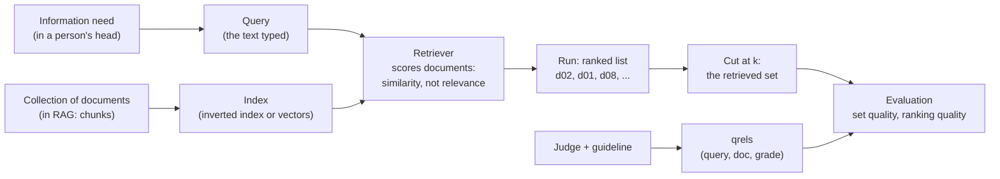

# P2 — Information-retrieval framing: documents, queries, relevance, the inverted index, sets vs rankings

> **What this file is.** The lesson for concept **P2** ([02 card](../02_RAG_MASTER_LEARNING_PLAN.md#p2)). It follows the Parts A–M template of [07](../07_SAMPLE_LESSON.md), at a smaller scale.
> **How to use it.** Answers are hidden in collapsible blocks. Write your answer first, then open the block. Lines marked `> 🧭 Coach:` are instructions for the AI tutor; they add to [05 §3](../05_LEARNING_AND_RETENTION_SYSTEM.md#3-coaching-rules-for-the-ai-tutor) and cannot override it.
> **Labels.**
> - **UNVERIFIED**: not checked by running code or reading the primary source.
> - **Toy illustration**: numbers computed by code on made-up data, never a result about a real system.
> - **Source C (external)**: material that is not in the learner's book or repo.
>
> Every number in this lesson comes from the local run of 2026-10-08 ([P2_FACTS.md](../sources/verification/P2/P2_FACTS.md); sections S1–S11 for measurements, S-src for citation checks), from a derivation shown in the text, or carries a label. The toy collection (10 documents, 5 queries) was written for this lesson: [`p2_toy_corpus.json`](../sources/verification/P2/p2_toy_corpus.json). No Groq or Cohere call was made.

## Lesson header

| Field | Value |
|---|---|
| Concept | **P2 Information-retrieval framing**: collection, document, information need, query; **relevance vs similarity**; relevance judgments (qrels) and a labelling guideline; the **inverted index** and Boolean AND/OR; **set quality vs ranking quality**. |
| Phase / tier | Phase 1, Prerequisites. Priority **E**. Fast track possible ([02 §5](../02_RAG_MASTER_LEARNING_PLAN.md#5-fast-track-rules-from-the-o1-diagnostic)). |
| Prerequisites | **O2** (environment), per [03](../03_RAG_CONCEPT_DEPENDENCY_MAP.md). No concept prerequisites. |
| Comes next | **P3** BM25 (scores over this index) · **P4** embeddings (dense similarity) · **P6** metrics (computed on qrels like these) · **M1** span-level eval set · **R3** reranking · **V2** relevance grading. |
| Related open misconceptions | **MC-002** ("similarity matrix", [log](../progress/misconception_log.md)): D.1 names what a retriever actually scores. **MC-005** (one-sided k): D.5 and the CR-08 probe. P2 opens no MC of its own yet. |
| O1 evidence | O1-Q04 scored **0** (precision@k, recall@k and reciprocal rank not recalled). Confidence-3 answers averaged **1.1 / 4** ([session #1](../progress/session_log.md#session-2026-10-08-1--diagnostic)). Ask for confidence before every reveal. |
| Time | A: 10 min · book reading: 20 min · B–D: 40 min · E–G: 20 min · H (lab): 50 min · J–K: 10 min · L: 15 min · M: 5 min. Part I does not apply. |
| Mastery (P2 → `applied`) | Without notes, you can: (1) define document, query, information need, relevance judgment and run; (2) show with an example why the most similar document need not be relevant; (3) build an inverted index and AND/OR search from a blank file; (4) write relevance labels for 5 queries with a justification for each; (5) say which question set precision/recall answer and which question rank answers. Lab: `coding_independence_0_3 ≥ 2`. |
| Mastery (P2 → `transfer`) | You also pass a fresh novel-scenario item (L.3) and score `debugging_0_3 ≥ 2` in the lab. |

### Source map

| Source | Where | What it contributes |
|---|---|---|
| Book (A) | Ch3 p.1/14; Ch13 p.1–2/13, p.5/13, p.9/13; Ch12 p.2/14, p.3/14, p.5/14, p.6/14; Ch22 p.4–7/19, p.12/19; Ch1 p.8/14, p.10/14, p.12/14; Intro p.1/8; App p.19–20/23, p.22/23 | Closest ≠ relevant; the back-of-book index analogy; set metrics vs ranking metrics; an eval set pairs queries with expected relevant documents |
| Repo (B) | `simple_rag.ipynb` cell 13; `fusion_retrieval.ipynb` cells 14, 17; `reliable_rag.ipynb` cell 14; `evaluation/define_evaluation_metrics.ipynb` cells 3, 9; `evaluation/evaluation_deep_eval.ipynb` cells 6, 11; `data/q_a.json` | How the repo defines "relevant" (loosely, by an LLM) and why it has no qrels and no inverted index |
| Lab verification | [`sources/verification/P2/`](../sources/verification/P2/): `p2_measure.py`, `p2_sources.py`, the toy corpus, saved outputs, [`P2_FACTS.md`](../sources/verification/P2/P2_FACTS.md) | Every number here |
| Source C (external) | #7, #9 in [01 §6](../01_SOURCE_INVENTORY.md#6-source-c--supplementary-references-external) (IIR ch.6, ch.7) | Further reading only |

### Contents

[Read in the book](#read-in-the-book) · [Part A](#part-a--prior-knowledge-recovery) · [B](#part-b--why-p2-exists) · [C](#part-c--intuition-and-analogy) · [D](#part-d--technical-mechanism) · [E](#part-e--connections) · [F](#part-f--worked-example-by-hand) · [G](#part-g--source-connection) · [H](#part-h--implementation-progression) · [I](#part-i--controlled-experiment) · [J](#part-j--failure-and-debugging) · [K](#part-k--engineering-decisions) · [L](#part-l--assessment) · [M](#part-m--retention) · [References](#source-references) · [Verification log](#verification-log)

---

## Read in the book

> 📖 **Do Part A first, closed book. Then read these pages, in this order.** Each read is short. Write one line per page in your own words; do not copy sentences.
>
> | When | Pages | Look for |
> |---|---|---|
> | Right after Part A | **Ch3 p.1/14** | The fourth chunk that scored well but is a footer full of links. Why did it score well? |
> | | **Ch13 p.1–2/13** | The "capital of France" chunks. Which chunk is closest? Which one answers? Find the phrase about similarity being a "rough proxy". |
> | Before D.4 | **Ch12 p.2–3/14** | The two blind spots (meaning without the words; words without the meaning) and the back-of-book index in the cookbook story. That index is an inverted index. |
> | | **Ch12 p.5/14** | BM25 works on words only. Note that the book never says how the words are looked up. |
> | Before D.5 | **Ch22 p.4–7/19** | Precision and recall tell you *what* was retrieved; MRR, MAP and NDCG tell you *how well it was ranked*. Find the sentence that separates the two. |
> | | **Ch1 p.12/14** and **Ch13 p.5/13** | Why 2–3 chunks can miss scattered material; why a reranker first retrieves a bigger candidate set. |
> | During Part G | **Ch22 p.12/19** | An evaluation dataset = queries + expected relevant documents + a reference answer. Those expected documents are relevance judgments. |
> | | **Ch1 p.8/14, p.10/14**; **App p.19–20/23, p.22/23** | "Nearest" is read as "most likely to contain the answer". That is an assumption P2 tests. Glossary: Precision at K, Recall at K, Relevancy Grading, Top-K Retrieval. |
>
> **Not in the book:** the inverted index (the word "inverted" never appears), Boolean AND/OR, the word "qrels", and how to write a labelling guideline (S-src). This lesson fills those gaps.

---

## Part A — Prior knowledge recovery

Answer the five questions **before** reading on: 1–3 sentences each, no notes. Wrong answers are useful; they tell the tutor where to start.

> 🧭 Coach: Ask **one item at a time** (CR-01), in the exact wording below, with its reply template. Record confidence 1–3 before revealing anything (CR-16). Score with the Recall rubric ([05 §4.2](../05_LEARNING_AND_RETENTION_SYSTEM.md#42-graded-rubrics-04)). These are unscheduled recall items: log them; a score ≤ 1 follows the ≤ 1 row of [05 §5.2](../05_LEARNING_AND_RETENTION_SYSTEM.md#52-spaced-repetition-schedule). Do not teach yet; route with the table after P2-A5.

**P2-A1.** A search returns the chunk that is most similar to the question. Is it always the most relevant one?

*Reply template:* "(Yes / No). Similar means ____. Relevant means ____."

<details><summary>What a strong answer contains</summary>

- **No.** Similarity is a **score a function computes** from the query text and the chunk text (shared words, nearby embeddings).
- Relevance is a **judgment about the information need**: does this chunk help answer the question? A person (or a judge standing in for one) decides it.
- Example: a chunk that repeats the question word for word is very similar and answers nothing (Ch13 p.1–2/13; our d02, S6).
- Boundary: similarity is the system's *proxy* for relevance; we measure how good the proxy is with relevance labels.

</details>

**P2-A2.** What is a relevance judgment (a "label"), and who makes it?

*Reply template:* "It is a record of ____, ____ and ____. It is made by ____."

<details><summary>What a strong answer contains</summary>

- A record **(query, document, grade)**, for example `(q1, d01, 2)`. The set of them for a test collection is called **qrels** (query relevance judgments).
- Made by a **human judge** following a written **guideline**, before or apart from the system being tested. An LLM judge can stand in only after it is checked against human labels ([06 §8.4](../06_RAG_PROJECT_AND_EVALUATION_PLAN.md#84-calibration-against-human-labels)).
- Boundary: labels made by the system you are testing measure nothing.

</details>

**P2-A3.** You look up a word in the index at the back of a book. What does that index store?

*Reply template:* "For each ____, it stores ____."

<details><summary>What a strong answer contains</summary>

- For each **word (term)**, the list of **pages (documents)** that contain it. That list is a **postings list**; the whole structure is an **inverted index** (Ch12 p.3/14 uses this picture without the name).
- It is "inverted" because a document stores words, while the index stores, for each word, the documents.
- Use: at query time you read only the postings of the query words instead of scanning every document.

</details>

**P2-A4.** Two systems return the same five chunks for a question, in different orders. Are they equally good?

*Reply template:* "(Yes / No), because ____."

<details><summary>What a strong answer contains</summary>

- **Equal as a set, not equal as a ranking.** Precision and recall of the five are identical; the position of the first relevant chunk is not (Ch22 p.6–7/19).
- Order matters when a later step cuts the list (a smaller k, a reranker shortlist) and when the generator weighs early chunks more (Ch22 p.5/19; P7).
- If all five go into the prompt unchanged, the set is what the generator sees.

</details>

**P2-A5.** For one query, what do precision and recall of the retrieved chunks measure?

*Reply template:* "Precision is ____ ÷ ____. Recall is ____ ÷ ____."

<details><summary>What a strong answer contains</summary>

- **Precision** = relevant retrieved ÷ number retrieved: how much of what you got is useful (noise).
- **Recall** = relevant retrieved ÷ number relevant: how much of the useful material you got (misses) (Ch22 p.4–5/19).
- Both need **relevance labels**. Both ignore order.
- ⚠️ O1-Q04 scored 0 on this; a strong answer here is new evidence.

</details>

> 🧭 Coach: **Routing.**
>
> | Weak answers (score ≤ 1) | Action |
> |---|---|
> | P2-A1 | Teach D.2 with the measured d02 example before anything else. |
> | P2-A2 | Teach D.3; do lab Task 5 slowly and discuss every disagreement. |
> | P2-A3 | Teach D.4 with Part F Step 1 (build three postings lists by hand) before the lab. |
> | P2-A4 or P2-A5 | Teach D.5 with the A/B/C runs; note for P6 that O1-Q04 is still open. |
> | All five ≥ 3 with confidence 3 | Offer the fast track: skim B–C, then D.3, D.5, F, H and L (evidence is never skipped, 02 §5 rule 1). |

---

## Part B — Why P2 exists

### B.1 The book's warning

The book says it twice. In Ch3 p.1/14, similarity search returns the closest chunks by meaning, and one of four retrieved chunks is a footer of navigation links: close, useless. In Ch13 p.1–2/13, three chunks shaped like "The capital of France is …" sit closest to the question, yet none names Paris; the fourth, farther away, holds the answer. The book's summary: embedding similarity is a rough proxy for relevance.

### B.2 We measured it on a toy collection

Ten short documents, five queries (S1). Document d02 is "What is the main cause of climate change? Students often ask this question in class." For q1 ("main cause of climate change"):

| Retriever | Top 3 (score) | Is the top one relevant? |
|---|---|---|
| Word overlap through an inverted index (S5) | d02 (5 of 5 words), d01 (3), d08 (2) | **No** |
| MiniLM cosine over all 10 (S6) | d02 **0.8402**, d01 0.6342, d04 0.5139 | **No** |

Both retrievers put the echo of the question first. The document that answers (d01) is second. Toy illustration: it shows the effect exists, not how often it happens on our corpus.

### B.3 Without labels there is no retrieval number

- O1-Q04 (precision@k, recall@k, reciprocal rank) scored 0, and O1-TR1 described retrieval as a "similarity matrix" (MC-002). Every retrieval metric in P6, M2 and the I-experiments needs one input first: **relevance judgments**.
- The repo never stores them. Its `data/q_a.json` holds 44 items with only `question` and `answer` (S-src); its "ground truth" is an answer, not a list of relevant documents (`define_evaluation_metrics.ipynb` cell 3).

> 🧭 Coach: CR-11 here, one question: "If d02 is ranked first and the answer is still right, is that a retrieval success?" Expected: no. Retrieval failed at rank 1 (d01 at rank 2 may rescue it); the answer quality is a separate measurement.

---

## Part C — Intuition and analogy

**A library with a card catalogue and a reader.**

- The **catalogue** is the inverted index: for each word, the cards point to the books that contain it. It finds books **by their words**, fast, without opening every book.
- The **reader's question** is the information need. The words typed into the catalogue are the **query**, a rough stand-in for it.
- The pile the librarian hands over is a **ranked list**; the top k of it is a **set**.
- Only the reader can say whether a book **helps** (relevance). The catalogue cannot.
- **Set quality:** how much of the pile is useful, and how much of the useful material is in the pile. **Ranking quality:** is a useful book near the top?

**Where the analogy breaks.** A real catalogue has subject headings chosen by people. A word index only matches the exact strings: "rise" does not find "rising" (S3), and "renewable energy" finds nothing in a text about solar panels and wind turbines (S4).

> 🧭 Coach: CR-17. Stop here and ask one question: "In the analogy, who decides relevance: the catalogue, the librarian, or the reader?" Expected: the reader (the person with the information need), using a guideline when we label.

---

## Part D — Technical mechanism

### D.1 The objects and their names



| Term | Meaning here | Toy example |
|---|---|---|
| Document | The unit the system can return. In RAG it is usually a **chunk** | d01 … d10 |
| Information need | What the person wants to know | "What mainly causes climate change?" |
| Query | The text the system receives | q1 `main cause of climate change` |
| Relevance judgment | (query, document, grade), made by a judge under a guideline | (q1, d01, 2) |
| qrels | All judgments for a test collection | 13 listed pairs; unlisted pairs are 0 (S1) |
| Run | The ranked list a system returns for each query | lexical q1: d02, d01, d08 |

**The toy collection** (written for this lesson; [`p2_toy_corpus.json`](../sources/verification/P2/p2_toy_corpus.json), S1):

| Doc | Text |
|---|---|
| d01 | Burning coal, oil and gas releases carbon dioxide, the main cause of recent global warming. |
| d02 | What is the main cause of climate change? Students often ask this question in class. |
| d03 | Greenhouse gases trap heat in the atmosphere like a blanket around the Earth. |
| d04 | Sea levels are rising because warmer ocean water expands and glaciers melt. |
| d05 | Melting ice sheets in Greenland and Antarctica add water to the oceans. |
| d06 | Forests absorb carbon dioxide from the air as trees grow. |
| d07 | Solar panels and wind turbines generate electricity without burning fuel. |
| d08 | Climate change news, climate change videos, climate change quiz: subscribe now! |
| d09 | Cattle and rice paddies release methane, a powerful greenhouse gas. |
| d10 | Heat waves are becoming longer and more frequent in many regions. |

Queries: **q1** `main cause of climate change` · **q2** `why do sea levels rise` · **q3** `renewable energy` · **q4** `where does methane come from` · **q5** `is extreme heat becoming more common`.

- **MC-002 link:** a retriever computes **one score per (query, document) pair** and sorts. It never builds an all-pairs "similarity matrix".

### D.2 Similarity is computed; relevance is judged

| | Similarity | Relevance |
|---|---|---|
| Who produces it | A function: word overlap, BM25, cosine | A judge reading the document against the need |
| Input | Query **text**, document text | Information **need**, document content |
| Cost | Cheap, every query, every document | Expensive; done once for a test set |
| Used for | **Ranking** at query time | **Measuring** the ranking |

Measured traps on the toy collection (S4–S6):

| Trap | Example | What happens |
|---|---|---|
| Echo of the question | d02 for q1 | Rank 1 in both retrievers; grade 0 |
| Keyword stuffing | d08 "Climate change news, climate change videos, …" | Lexical rank 3 for q1 (2 of 5 words) |
| Same word, other topic | d03 "trap **heat**" for q5 | Lexical candidate for q5; grade 0 |
| Vocabulary mismatch | q3 `renewable energy` vs d07 "Solar panels and wind turbines …" | Lexical: no candidate at all. MiniLM: d07 first (0.5804) |
| Partial evidence far away | d09 (methane) for q1 | MiniLM rank **9 of 10** (0.2469); grade 1 |

> 🧭 Coach: CR-17 checkpoint, one question: "MiniLM put d07 first for q3. Does that prove dense retrieval finds relevance?" Expected: no. It found the closest meaning, which happened to be relevant here; the same model put d02 first for q1 (S6). Only labels can tell the two apart.

### D.3 Writing relevance judgments

**The guideline (v1, the scale of [06 §6.4](../06_RAG_PROJECT_AND_EVALUATION_PLAN.md#64-span-level-gold-labelling-procedure) step 6).**

| Grade | Meaning |
|---|---|
| 2 sufficient | The document alone answers the query |
| 1 partial | It gives part of the answer or a necessary piece |
| 0 not relevant | It does not help answer, even if it shares words or the topic |

Binary rule for set metrics: relevant = grade ≥ 1. Under this rule the toy qrels have **8 relevant pairs out of 50** (S7).

Rules that keep labels useful:
1. **Judge the need, not the words.** Read the query as a question someone asked.
2. **Write the reason.** One line per non-zero label and per tempting zero. Reasons expose a vague guideline.
3. **Judge before you look at any system's ranking.** Otherwise you grade the system's opinion.
4. **Disagreement is data.** Ambiguous pairs (is d09 part of "the main cause"?) show where the guideline needs a sentence. Our plan measures self-agreement over time ([06 §6.5](../06_RAG_PROJECT_AND_EVALUATION_PLAN.md#65-self-agreement-check-single-annotator-reliability)).
5. **Choose the unit.** On toy data we label document ids. In the project, gold is **character spans**, never chunk ids, so labels survive re-chunking ([06 §6.4](../06_RAG_PROJECT_AND_EVALUATION_PLAN.md#64-span-level-gold-labelling-procedure); 07 mastery item 5).

Labelling every pair does not scale. Large test collections judge only the documents that some system ranked high (called *pooling* in IR). That is Source C knowledge, not covered by our book or repo (UNVERIFIED here).

> 🧭 Coach: CR-17 checkpoint, one question: "Under guideline v1, what grade does d02 get for q1, and why?" Expected: 0. It repeats the question and gives no answer; sharing words is not helping.

### D.4 The inverted index

**Build** (one pass over the collection):
1. Tokenize each document. Here: lowercase, a token is a run of `a–z` or `0–9`, no stemming, no stopword list (S2).
2. For each distinct term of each document, append the document id to that term's **postings list**.
3. Keep each postings list sorted, each id once.

Toy result (S3): **88 terms**, **114 postings** from 119 tokens; 71 terms occur in one document only. Some postings:

```text
climate -> d02, d08        of     -> d01, d02         the  -> d01, d02, d03, d05, d06
heat    -> d03, d10        rising -> d04              rise -> (none)
methane -> d09             renewable, energy -> (none)
```

**Search** reads only the postings of the query terms:
- **AND** = intersection; **OR** = union.
- **Ranked** = walk the postings and add 1 per hit (or, in P3, a BM25 weight per hit). Documents that share no query term are never touched and never returned.

| Query (S4) | AND | OR | Postings read |
|---|---|---|---|
| q1 `main cause of climate change` | d02 | d01, d02, d08 | 10 |
| q2 `why do sea levels rise` | — | d04 | 2 |
| q3 `renewable energy` | — | — | 0 |
| q4 `where does methane come from` | — | d06, d09 | 2 |
| q5 `is extreme heat becoming more common` | — | d02, d03, d10 | 5 |

AND is too strict (four of five queries return nothing) and its one hit is the echo d02. OR is too loose: q4 pulls in d06 only through the word "from".

> 🧭 Coach: CR-17 checkpoint, one question: "Why does q3 return nothing, even with OR?" Expected: neither query word occurs in any document; an index matches strings, not meaning.

**On the real climate PDF** (91 windows of 1,000 characters, overlap 200, as in P1; S9): 1,868 terms and 8,107 postings. `methane` is in 5 windows; `the` in 80; `and` in all 91. OR for `methane emissions` returns 34 windows (AND: 5). OR for q1's words returns **90 of 91** windows after reading 213 postings: with common query words the index saves nothing over a scan. Long postings for common words are one reason P3 down-weights them (IDF).

**The repo's "BM25 index" is not an inverted index.** `fusion_retrieval.ipynb` cell 14 builds `BM25Okapi(tokenized_docs)`. In `rank_bm25` 0.2.2 that object keeps **one term-count dictionary per document**, and `get_scores` loops over every document for every query term (S10). Cell 17 also fetches all documents from the vector store and scores them all. Correct, but it is a scan; fine for one PDF.

> 🧭 Coach: CR-17 checkpoint, one question: "`rank_bm25` scores every chunk for every query. Is that a bug?" Expected: no. The scores are correct; it is a scan instead of a postings lookup, which only costs time on large collections.

### D.5 Set quality vs ranking quality

A run is a **ranked list**. Cut it at k and you get a **set**. They answer different questions (Ch22 p.6/19):

| Question | Measure (this lesson) | Uses order? |
|---|---|---|
| How much of what I retrieved is relevant? | **set precision** = relevant retrieved ÷ retrieved | No |
| How much of the relevant material did I retrieve? | **set recall** = relevant retrieved ÷ relevant | No |
| How early does the first relevant one appear? | **first relevant rank** (1-based) | Yes |

P6 turns these into Precision@k, Recall@k, Hit@k, MRR and nDCG@k.

**Three hand-made runs for q1** (relevant = d01, d03, d09; S8, toy illustration):

| Run | Top 3 | Precision | Recall | First relevant rank |
|---|---|---|---|---|
| A | d02, d01, d08 | 0.3333 | 0.3333 | 2 |
| B | d01, d08, d02 | 0.3333 | 0.3333 | **1** |
| C | d01, d03, d09 | **1.0** | **1.0** | 1 |

- A vs B: **same set, different ranking.** Set metrics cannot see the difference.
- B vs C: **same first rank, different set.** A rank-only view cannot see this difference.

> 🧭 Coach: CR-17 checkpoint, one question: "Runs A and B have the same precision. Name one situation where B is clearly better." Expected: any cut below k = 3 (k = 1 gives d01 vs d02), a reranker shortlist, or position effects in the prompt.

**Why RAG needs both.** The generator reads the whole retrieved set, so set recall bounds what the answer can use. Ranking decides what survives every cut: a smaller k, a reranker's shortlist (Ch13 p.5/13), and the front of the prompt that generators weight more (Ch22 p.5/19; P7).

**Measured: what k does (S8).**

| | k = 3 | k = 6 |
|---|---|---|
| Lexical (index candidates only), mean set recall over q1–q5 | 0.567 | 0.567 |
| MiniLM (scores all 10), mean set recall | 0.867 | 0.933 |
| MiniLM q1: precision / recall | 0.333 / 0.333 | 0.333 / 0.667 |

The lexical index found only 3 candidates for q1, so a bigger k adds nothing: the **candidate set caps recall**. The dense ranking scores every document, so k = 6 reaches d03; precision stays flat because extra non-relevant documents come too. This is MC-005's trade-off in miniature.

> 🧭 Coach: CR-17 checkpoint, one question: "Why did k = 6 not raise recall for the lexical retriever?" Expected: the index returned only 3 candidates for q1; k cannot add documents that were never candidates.

---

## Part E — Connections

P2 feeds **P3** (BM25 weights on postings), **P4** (dense similarity), **P6** (metrics on qrels) and **C1** (what a document is), per [03](../03_RAG_CONCEPT_DEPENDENCY_MAP.md); through P6 it feeds **M1/M2**, and it frames **R3** (candidate set, then order) and **V2** (an LLM relevance filter).

| Often confused | The difference |
|---|---|
| Similarity vs relevance | A computed score vs a judgment about the need (D.2) |
| Inverted index vs vector index | Term → documents lookup vs nearest vectors; both are "indexes" in the book (Ch12 p.5–6/14) |
| Set metrics vs ranking metrics | Precision/recall ignore order; rank-based measures do not (D.5) |
| Relevance label vs reference answer | Labels say which documents help; a reference answer is the correct reply. The repo has only the second (B.3) |
| Relevance grader (V2) vs qrels | An LLM filter at query time vs fixed human labels for measurement (G.2) |

The toy qrels in [`p2_toy_corpus.json`](../sources/verification/P2/p2_toy_corpus.json) can be reused for P6 hand computations, as the [04 P2 row](../04_BOOK_TO_CODE_MAPPING.md) plans.

---

## Part F — Worked example by hand

**Step 1: postings by hand, then AND and OR.** Use only d01, d02 and d08 (texts in D.1). Write the postings for `main`, `of`, `climate`, `change`. Then give AND and OR for q1 (`main, cause, of, climate, change`).

<details><summary>Answer</summary>

`main` → d01, d02 · `of` → d01, d02 · `climate` → d02, d08 · `change` → d02, d08 (S3). AND: only d02 has all five; OR: d01, d02, d08. Over all 10 documents the answers are the same (S4).

</details>

**Step 2: label q1 against all 10 documents** with guideline v1 (D.3). Write grades and one reason each, then open.

<details><summary>Reference labels (S7)</summary>

| Doc | Grade | Reason |
|---|---|---|
| d01 | 2 | Names the main cause: burning fossil fuels releases carbon dioxide |
| d03 | 1 | The mechanism (greenhouse gases trap heat), not what emits them |
| d09 | 1 | One source of a greenhouse gas: part of the cause, not the main one |
| d02 | 0 | Repeats the question; no answer |
| d08 | 0 | Topic words without content |
| d06 | 0 | A carbon sink, not a cause |
| others | 0 | Off the need |

d03 and d09 are judgment calls. If you graded them 0, write the sentence the guideline would need to settle it.

</details>

**Step 3: set and rank for runs A and B** (D.5). Compute precision, recall and first relevant rank for A = d02, d01, d08 and B = d01, d08, d02.

<details><summary>Answer</summary>

Both: 1 relevant of 3 retrieved, 1 of 3 relevant → precision 1/3, recall 1/3. First relevant rank: A = 2, B = 1 (S8).

</details>

> 🧭 Coach: CR-08 probe here, one question: "For MiniLM on q1, k doubles from 3 to 6. What happens to recall, and to precision?" Expected: recall 0.333 → 0.667 (d03 enters at rank 4); precision stays 0.333 (2 of 6) (S8). Then ask what changes for the lexical retriever (nothing: 3 candidates).

---

## Part G — Source connection

### G.1 Book (Source A)

| Cite | Book point (paraphrased) | Our assessment |
|---|---|---|
| Ch3 p.1/14 | Similarity search returns the closest chunks by meaning; closest is not always relevant (a footer full of links) | The core P2 claim; our d02/d08 reproduce it on toy data |
| Ch13 p.1–2/13 | Near-identical "capital of France" chunks outrank the one that answers; similarity is a rough proxy for relevance | Same claim, inside one retriever |
| Ch13 p.9/13 | Cross-encoders learn from query–document pairs labelled relevant or not | Labelled pairs = relevance judgments, used for training |
| Ch13 p.5/13 | Reranking first retrieves a larger candidate set to raise the chance a relevant chunk is in it | Candidate-set recall, then ranking (D.5) |
| Ch12 p.2–3/14 | Keyword search misses when the meaning is there but the words are not; the back-of-book index tells you which pages mention a word | Our q3 (S4); an inverted index, unnamed |
| Ch12 p.5–6/14 | BM25 works purely with words; one index understands meaning, the other counts words | No lookup structure described |
| Ch22 p.4–5/19 | Precision at K (3 of 5 relevant = 0.6) and recall (3 of 10 = 0.3); context precision accounts for ranking order | Set metrics, with the book's own numbers |
| Ch22 p.6–7/19 | Precision and recall say what was retrieved, not how well it was ranked; same documents, different ranking quality | The set-vs-ranking distinction, stated plainly |
| Ch22 p.12/19 | An evaluation dataset pairs each query with expected relevant documents and a reference answer | qrels in all but name |
| Ch1 p.8/14, p.10/14, p.12/14 | Nearest chunks are taken as most likely to contain the answer; two or three chunks miss scattered material; RAG is overkill if keyword search is enough | An assumption P2 tests; set recall and k |
| Intro p.1/8 | Asks what happens when passages are almost-but-not-quite relevant | Motivation only |
| App p.19–20/23, p.22/23 | Glossary: Precision at K, Recall at K, Relevancy Grading, Top-K Retrieval | Top-K is defined by similarity scores, not relevance |

**Not in the book:** the inverted index, Boolean retrieval, the term "qrels", labelling guidelines and pooling (S-src: "inverted" and "qrel" never appear; "relevance judg…" appears once, App p.9/23, about reranking).

### G.2 Repo (Source B): cells verified at `009adba`

| Cell (0-based) | What it shows | Lesson |
|---|---|---|
| `simple_rag.ipynb` 13 | `as_retriever(search_kwargs={"k": 2})` | The run is cut to a set of 2 |
| `fusion_retrieval.ipynb` 14 | `create_bm25_index`: whitespace `split()`, returns `BM25Okapi`; docstring calls BM25 a ranking function used in information retrieval | Called an index; no inverted index inside (S10) |
| `fusion_retrieval.ipynb` 17 | Fetches all documents (`k=vectorstore.index.ntotal`), scores all, `argsort`, keeps `[:k]` | Exhaustive scoring, then a cut |
| `reliable_rag.ipynb` 14 | Binary LLM grader: a document counts as relevant if it has keywords **or** meaning related to the question; "does not need to be a stringent test" | A lenient, similarity-like definition of relevance |
| `evaluation/define_evaluation_metrics.ipynb` 3 | `ground_truth` is the ground-truth **answer** | A reference answer, not relevance labels |
| `evaluation/define_evaluation_metrics.ipynb` 9 | LLM rubric 0 / 0.33 / 0.66 / 1.0 per doc, then the **average**; 0.33 = "related keywords or concepts"; the chain uses `ratio_of_relevant_docs_prompt`, which is never defined (the prompt is `relevancy_score_prompt`) | Graded, set-level, order ignored; NameError as written |
| `evaluation/evaluation_deep_eval.ipynb` 6, 11 | `ContextualRelevancyMetric`; test cases hold question, expected **answer**, actual answer, retrieved context | Relevance judged by an LLM at eval time; no stored labels |
| `data/q_a.json` | 44 items, keys `question` and `answer` only | No relevant-document labels |

Repo-wide: no "inverted" and no "qrel" in any notebook source cell, `.py` or `.md` file (S-src).

**Corrections to the [04 P2 row](../04_BOOK_TO_CODE_MAPPING.md)** (04 is not edited; also in the Verification log):
1. **Book pages.** 04 cites only Intro p.1/8 and Ch1 p.1–3/14 (motivation). The pages that carry P2 are Ch3 p.1/14 and Ch13 p.1–2/13 (closest ≠ relevant; the 02 card has them), Ch22 p.4–7/19 (set vs ranking), Ch22 p.12/19 (expected relevant documents) and Ch12 p.3/14 (the index analogy).
2. **"Gap" column.** 04 lists relevance labels, qrels and ranking-as-scoring as missing from the book. The inverted index is missing (verified), but Ch22 p.12/19 describes relevance labels without the name, and Ch22 p.6/19 separates set from ranking quality.
3. **"Not in repo."** True for the inverted index and qrels. The repo does define relevance operationally (`reliable_rag.ipynb` cell 14; `define_evaluation_metrics.ipynb` cell 9; `evaluation_deep_eval.ipynb` cell 6), and these cells are worth critiquing in P2.
4. Also noted: the 02 card says the book has "no IR framing"; Ch22 p.4–7/19 and p.12/19 are IR framing. Its Source C pointers (#7, #9: IIR ch.6–7) cover scoring and ranking; the inverted index itself is introduced earlier in IIR (believed to be ch.1–2; not fetched, UNVERIFIED).

### G.3 Reading list (in this order)

`reliable_rag.ipynb` cell 14 → `evaluation/define_evaluation_metrics.ipynb` cell 9 → `evaluation/evaluation_deep_eval.ipynb` cells 6 and 11 → `fusion_retrieval.ipynb` cells 14 and 17. For each, write in the margin: who decides relevance, and is order used?

---

## Part H — Implementation progression

### H.1 The lab: [`labs/P2_ir_framing_lab.ipynb`](../labs/P2_ir_framing_lab.ipynb) (blank-file first)

The notebook gives the toy data, tasks, empty code cells, prediction cells and CHECK cells. It has **no solution code**; CHECK cells compare fingerprints, so expected answers stay hidden until you predict.

| # | Task | The checks test |
|---|---|---|
| 1 | `tokenize(text)` (lowercase, runs of a–z/0–9) | A unit test and all 10 documents |
| 2 | **Predict** the vocabulary size; `build_index(docs)` → term → sorted postings | Sorted, unique postings; the exact index |
| 3 | **Predict** AND for q1; `search_and`, `search_or` using only postings | All 5 queries; empty and unknown queries |
| 4 | `rank_by_overlap` by walking postings | The 5 rankings |
| 5 | **Your qrels** for 5 queries with a reason per label and a tempting 0 per query | Format; then your binary agreement with the reference, and the pairs that differ |
| 6 | **Predict** A vs B; `set_precision`, `set_recall`, `first_relevant_rank` | Edge cases and the A/B/C table |
| 7 | **Predict** (CR-08): k from 3 to 6 on your q1 ranking | Candidates, recall@3, recall@6 |
| 8 | **Predict** df(`the`); your index on the 91 PDF windows | Vocabulary, df(`the`), df(`methane`), OR(`methane emissions`) |

You need only `re` and `collections`. The reference implementation is `sources/verification/P2/p2_measure.py`.

> 🧭 Coach: The reference script is a **solution**. Do not show it before an attempt plus a hint (CR-04). Grade `coding_independence_0_3` on Tasks 2–4 and `debugging_0_3` on any failing CHECK the learner fixes. In Task 5, discuss each disagreement; a defended disagreement can score 4.

### H.2 Repo reading guide: `reliable_rag.ipynb` cell 14

Read the grader's system prompt. Answer each question before opening.
1. What makes a document "relevant" under this prompt?
2. Would d02 (the echo) qualify by that definition? Would d08 (the footer)?
3. Is this a relevance judgment in the P2 sense?
4. Which kind of quality could this filter improve, set or ranking?

<details><summary>Answers</summary>

1. Containing keywords **or** meaning related to the question; the prompt says it need not be strict.
2. By the prompt's wording, yes for both: each contains q1's keywords. Whether the Groq model would actually say yes is **UNVERIFIED** (not run).
3. No. It is an automatic filter at query time with a lenient rule, not a fixed label made under a guideline, so it cannot measure retrieval.
4. Set precision: it removes documents from the set; it does not reorder.

</details>

### H.3 Reusable design (future `ragkit/`; nothing is created now)

- **Toy qrels** (P6 reuse): one row per judged pair, `qid, did, grade, why, judge, guideline_version, date`; unlisted pairs are 0, and the file says so. **Project gold** is span-based `evidence_groups` ([06 §6.1](../06_RAG_PROJECT_AND_EVALUATION_PLAN.md#61-schema-jsonl-one-item-per-line-backbone-5)), with chunk relevance derived from overlap ([06 §7.2](../06_RAG_PROJECT_AND_EVALUATION_PLAN.md#72-relevance-from-spans)).
- **Every trace stores the full ranked list with scores**, not only the final top-k, so set and ranking metrics can both be recomputed later.

---

## Part I — Controlled experiment

**n/a for P2 (prerequisite concept, toy data only).** P2 changes no pipeline variable. Its qrels and definitions feed P6 and M1/M2, which make measurement possible.

---

## Part J — Failure and debugging

For each: write your predicted cause and fix, then open. Each diagnosis says whether it is a **retrieval** or a **generation** failure (CR-11). The measurement failure of LLM "relevance" scores is in H.2 and G.2.

**J1. Top-1 repeats the question.** The first chunk restates the user's question and answers nothing.

<details><summary>Diagnosis</summary>

- **Cause.** Similarity rewards shared wording (d02: rank 1 lexically and with MiniLM, S5–S6).
- **Kind.** Retrieval (ranking).
- **Fix.** Measure first: label it 0 and see the first relevant rank. Candidates: reranking (R3), deduplicating FAQ-like text. Decide by P6 metrics, not by eye.

</details>

**J2. Keyword search returns nothing for a fair question.** `renewable energy` against a corpus about solar and wind.

<details><summary>Diagnosis</summary>

- **Cause.** Vocabulary mismatch; an inverted index only matches strings (q3: 0 postings, S4).
- **Kind.** Retrieval (set recall = 0).
- **Fix.** Dense or hybrid retrieval (P4, R1), query rewriting (Q1). Check with a vocabulary-mismatch slice of the eval set ([06 §6.3](../06_RAG_PROJECT_AND_EVALUATION_PLAN.md#63-creation-protocol)).

</details>

**J3. Recall@3 = 1 but the answer is wrong.**

<details><summary>Diagnosis</summary>

- **Cause.** The evidence was in the set; the generator misused it (or a distractor misled it).
- **Kind.** Generation. Retrieval did its job.
- **Fix.** Look at faithfulness and position (P7, V1); do not change the retriever.

</details>

> 🧭 Coach: For J1 and J2, ask for the **one number** that would have shown the problem (first relevant rank; set recall). It counts as evidence for `debugging_0_3`.

---

## Part K — Engineering decisions

| Question | Decision | Why |
|---|---|---|
| What does "relevant" mean in our eval? | Guideline v1: 2 sufficient, 1 partial, 0 not; binary ≥ 1 | Matches 06 §6.4; one scale from P2 to M2 |
| Who labels? | The learner, under the guideline; the Cohere judge only at the end, after calibration (CLAUDE.md decision; 06 §8.4) | Labels must not come from the system under test |
| Label unit | Toy: document ids. Project: character spans | Spans survive re-chunking (D.3 rule 5) |
| What to log per query | The full ranked list with scores | Both set and ranking metrics need it |
| Which quality to report | Both: a set measure at the k the generator sees, and a rank measure | They disagree (D.5) |
| Inverted index now? | No. Lexical retrieval arrives with BM25 (P3) and hybrid (R1); building an index vs `rank_bm25`'s scan is a later, measured cost decision | One PDF; a scan is fine at this size |

**When NOT to build an inverted index:** a small collection that a scan handles quickly (the repo's choice, S10), or a purely dense system. **When NOT to write graded labels:** when only "any evidence present?" matters; binary labels are enough and quicker to write.

---

## Part L — Assessment

One short question per item, each with a reply template. Score with [05 §4.2](../05_LEARNING_AND_RETENTION_SYSTEM.md#42-graded-rubrics-04).

> 🧭 Coach: Ask one item at a time, with its template. Never put two questions in one turn. Record confidence first.

### L.1 Recall

**P2-R-01.** What is the difference between similarity and relevance?
*Template:* "Similarity is ____ computed by ____. Relevance is ____ decided by ____."

<details><summary>Criteria for 4</summary>

Similarity: a score from a function of query text and document text. Relevance: a judgment of whether the document helps the information need, by a judge under a guideline. Mechanism: systems rank by similarity as a proxy. Boundary: an echo of the question is maximally similar and irrelevant (d02, S6; Ch13 p.1–2/13).

</details>

**P2-R-02.** What does one line of a qrels file contain?
*Template:* "A ____, a ____ and a ____."

<details><summary>Criteria for 4</summary>

Query id, document id, grade (here 0/1/2). Plus: made under a written guideline, ideally with a reason; unlisted pairs are taken as 0. Boundary: in our project the unit is a span, not a chunk id.

</details>

**P2-R-03.** What is an inverted index?
*Template:* "It maps each ____ to ____."

<details><summary>Criteria for 4</summary>

Each term → the sorted list of documents that contain it (postings). Mechanism: queries read only the postings of their terms. Boundary: it matches strings, so synonyms and inflections are missed ("rise" vs "rising", S3).

</details>

**P2-R-04.** Which question does set recall answer, and which does the first relevant rank answer?
*Template:* "Set recall: ____? First relevant rank: ____?"

<details><summary>Criteria for 4</summary>

Recall: how much of the relevant material is in the retrieved set (order ignored). First rank: how early the first relevant document appears. Boundary: runs A and B have equal recall and different ranks (S8).

</details>

### L.2 Application

**P2-A-01** (evidence: from memory). In a blank cell, write `build_index(docs)` for a dict of id → text.
*Template:* "My function returns ____; I tested it on ____."

<details><summary>Criteria for 4</summary>

Tokenizes, adds each document id once per distinct term, returns sorted postings; tested on 2–3 tiny documents with a known answer (self-check). Graded also as `coding_independence_0_3`.

</details>

**P2-A-02.** Label q2 (`why do sea levels rise`) against all 10 toy documents.
*Template:* "Grade 2: ____. Grade 1: ____. A tempting 0: ____, because ____."

<details><summary>Criteria for 4</summary>

d04 = 2 (expansion and glacier melt); d05 = 1 (ice sheets add water); a tempting 0 with a reason (e.g. d10, warming but not sea level). A defended alternative grade for d05 can score 4 if the reason uses the guideline.

</details>

**P2-A-03** (CR-08). For MiniLM on q1, k doubles from 3 to 6. Does set precision go up, down or stay?
*Template:* "It ____, because ____."

<details><summary>Criteria for 4</summary>

Stays at 0.333: one more relevant document (d03) and two more non-relevant ones join (1/3 → 2/6), while recall doubles 0.333 → 0.667 (S8). Self-check: for the lexical retriever nothing changes, because only 3 candidates exist.

</details>

### L.3 Transfer

> 🧭 Coach: P2-T-01 is a practice item. For the scored CR-13 item, make up a fresh scenario (different domain, document type or scale) that is not in this file, and grade it with the Transfer rubric.

**P2-T-01.** A legal team wants to know if their contract search "works". They have 30 typical questions and no labels. What do you build first?
*Template:* "First I would build ____, with ____ per line, judged by ____ under ____."

<details><summary>Criteria for 4</summary>

- qrels for the 30 questions: question id, clause/span id, grade, reason; a written guideline (what counts as answering).
- Judge = a lawyer, blind to the system's ranking; check agreement on a re-labelled sample.
- Unit: clause spans, not search-result ids, so labels survive re-indexing.
- Report a set measure at the k the users see and a rank measure; keep answer quality separate. When not to: if users read only the top result, rank of the first relevant clause matters most.

</details>

### L.4 When is P2 mastered?

- **`applied` (L3):** P2-R-01 ≥ 3 on two different days, one ≥ 24 h after teaching; two Application items ≥ 3; `coding_independence_0_3 ≥ 2` on lab Tasks 2–4; Task 5 labels with reasons logged (02 card evidence).
- **`transfer` (L4):** a fresh novel-scenario item ≥ 3; `debugging_0_3 ≥ 2`; a teach-back ≥ 3.

---

## Part M — Retention

### M.1 Flashcards

| # | Front (one question) | Back |
|---|---|---|
| 1 | Similarity vs relevance? | Computed score vs judged usefulness for the need |
| 2 | One qrels line? | (query, document, grade) |
| 3 | Our grade scale? | 2 sufficient, 1 partial, 0 not; relevant = ≥ 1 |
| 4 | Inverted index? | Term → sorted list of documents (postings) |
| 5 | AND / OR on postings? | Intersection / union |
| 6 | Why did q3 return nothing? | No query word occurs in any document |
| 7 | Top-1 for q1, lexical and MiniLM? | d02, the echo of the question (grade 0) |
| 8 | Set precision? | Relevant retrieved ÷ retrieved |
| 9 | Set recall? | Relevant retrieved ÷ relevant |
| 10 | Runs A vs B? | Same set, different first relevant rank (2 vs 1) |
| 11 | Why didn't k = 6 help the lexical run? | Only 3 candidates: the index caps recall |
| 12 | Does the repo store relevance labels? | No: answers only (`q_a.json`); LLM graders instead |

### M.2 Retrieval practice (closed book; log per [05 §5.1](../05_LEARNING_AND_RETENTION_SYSTEM.md#51-active-recall-what-a-review-item-looks-like))

| When | One question | Template |
|---|---|---|
| Day 1 | What is an inverted index? | "Each ____ maps to ____." |
| Day 3 | Why can the most similar chunk be irrelevant? | "Because similarity ____, while relevance ____." |
| Day 7 | Compute precision, recall and first rank for `d03, d02, d01` on q1. | "P ____, R ____, rank ____." |
| Day 14 | Why must project labels be spans, not chunk ids? | "Because ____." |

<details><summary>Day-7 answer</summary>

Relevant d01, d03, d09: two of three retrieved are relevant → precision 2/3, recall 2/3, first relevant rank 1 (derived).

</details>

### M.3 Teach-back prompt ([05 §5.4](../05_LEARNING_AND_RETENTION_SYSTEM.md#54-teach-back-protocol))

"In 3 minutes, explain to a new teammate why 'the retriever returned the closest chunks' does not mean retrieval worked, and what we need to know whether it did." A 4 needs: similarity vs relevance; qrels and a guideline; one measured example (d02); set vs ranking with A/B; one trade-off (k); one failure mode.

### M.4 Interleaving links

- **P1:** the word "token" means a word here, a subword piece in P1 (Ch12 p.6/14 tokenizes into words).
- **P3:** BM25 replaces "+1 per hit" in `rank_by_overlap` with a weight per hit.
- **P6:** compute Precision@3 and reciprocal rank for runs A, B, C.
- **C2:** why gold must be spans (07 mastery item 5).

### M.5 Misconception-log entries to add when observed

| Label | Correct model (short) | Root cause | Severity | Check items |
|---|---|---|---|---|
| "The most similar chunk is the relevant one" | Similarity is a proxy; relevance is judged | over-generalisation | high | P2-R-01, P2-A1 |
| "Same chunks, same quality" | Equal set metrics, different ranking | terminology | medium | P2-R-04, P2-A4 |
| "The LLM grader's score is the relevance label" | A query-time filter, lenient, not fixed labels | conflation of stages | medium | H.2 |
| "Labels can be chunk ids" | Spans; chunk ids change with chunking | unit-confusion | medium | D.3 rule 5, Day-14 |

### M.6 Progress-tracker entry (format only; fictional values, per [05 §6.1](../05_LEARNING_AND_RETENTION_SYSTEM.md#61-progressconcept_trackercsv))

```csv
P2,Information-retrieval framing,1,E,exposed,<YYYY-MM-DD>,,,<YYYY-MM-DD +1>,1,,,,,,,na,,0,log:<YYYY-MM-DD>#P2-R-01
```

---

## Source references

**Book (Source A).** Intro p.1/8; Ch1 p.8/14, p.10/14, p.12/14; Ch3 p.1/14; Ch12 p.2/14, p.3/14, p.5/14, p.6/14; Ch13 p.1/13, p.2/13, p.5/13, p.9/13; Ch22 p.4/19, p.5/19, p.6/19, p.7/19, p.12/19; App p.19/23, p.20/23, p.22/23. Checked against the PyMuPDF page text by `p2_sources.py` on 2026-10-08. Paraphrased; every quoted phrase is under 15 words.

**Repo (Source B)**, `NirDiamant/RAG_Techniques` @ `009adba2be1bef49780ef73b6dd3c18fd24b035b`, cells 0-based: `all_rag_techniques/simple_rag.ipynb` 13; `all_rag_techniques/fusion_retrieval.ipynb` 14, 17; `all_rag_techniques/reliable_rag.ipynb` 14; `evaluation/define_evaluation_metrics.ipynb` 3, 9; `evaluation/evaluation_deep_eval.ipynb` 6, 11; `data/q_a.json`; `data/Understanding_Climate_Change.pdf` (sha256 `1d58a0fa…92669`). Library: `rank_bm25` 0.2.2 (installed in the project environment).

**Our records.** [Session log 2026-10-08 #1](../progress/session_log.md#session-2026-10-08-1--diagnostic) (O1-Q04, O1-TR1, calibration); [misconception log](../progress/misconception_log.md) (MC-002, MC-005); [06 §6.1, §6.3–§6.5, §7.2, §8.4](../06_RAG_PROJECT_AND_EVALUATION_PLAN.md#6-evaluation-dataset).

**Supplementary (Source C, external; not needed for any claim here):** #7 IIR ch.6 and #9 IIR ch.7 ([01 §6](../01_SOURCE_INVENTORY.md#6-source-c--supplementary-references-external)). The IIR chapters on Boolean retrieval and the inverted index are not in 01's list and were not fetched.

---

## Verification log

**Environment.** Run on 2026-10-08 with `uv run` from `rag_learning/`: CPython 3.12.8, pymupdf 1.26.7, numpy 2.5.3, sentence-transformers 6.1.0, transformers 5.19.0, torch 2.14.1 (CPU), rank-bm25 0.2.2. MiniLM loaded offline from the HF cache. No Groq or Cohere call; `.env` not read.

| Claim | How verified |
|---|---|
| All S1–S11 numbers (toy tokens, index, AND/OR, rankings, MiniLM cosines, qrels, set/rank values, PDF index, rank_bm25 internals, lab fingerprints) | **Ran** `p2_measure.py`; output saved as `out_p2_measure.txt`; a second run was **byte-identical** |
| Postings equal a full scan of the documents (toy and PDF OR results) | **Asserted** inside `p2_measure.py` (S3, S9) |
| `rank_bm25` keeps per-document dictionaries and scans every document | **Ran** (S10): `doc_freqs` is a list of 10 dicts; `get_scores` source loops over `self.doc_freqs` |
| Every repo cell and book page cited; absences ("inverted", "qrel") | **Ran** `p2_sources.py`: ALL PASS (`out_p2_sources.txt`) |
| The lab: every CHECK passes with a correct solution; a broken solution fails | **Ran** the notebook in a Jupyter kernel with a throwaway solution kept outside the workspace: 8/8 pass; a broken solution (one typical mistake per task): 0/8 pass (`out_p2_labtest.txt`) |
| 04 P2 row | Three corrections and one 02-card note (G.2) |
| Worked-example arithmetic (F, L, M) | **Derived** from S7–S8, shown in the text |

**Still UNVERIFIED:**
- whether the `reliable_rag.ipynb` cell 14 grader (Groq `llama-3.1-8b-instant`) would actually mark d02 or d08 relevant (not run; no API calls);
- pooling as used in large IR test collections (Source C, not fetched);
- which IIR chapters introduce the inverted index (believed ch.1–2; not fetched);
- how often similar-but-irrelevant chunks occur on our real corpus (needs M1 labels; the toy shows only that it can happen).
