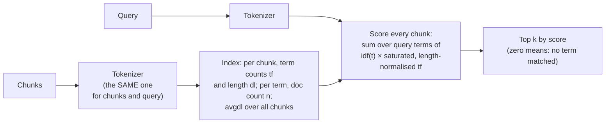
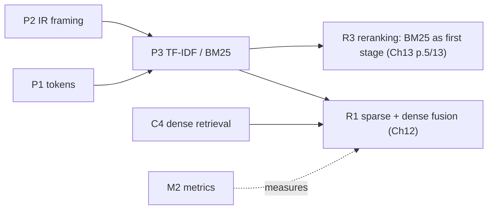

# P3 — Lexical retrieval: TF-IDF and BM25

> **What this file is.** The lesson for concept **P3** ([02 card](../02_RAG_MASTER_LEARNING_PLAN.md#p3)). It follows the Parts A–M template of [07](../07_SAMPLE_LESSON.md), at a smaller scale, like [P1](P1_llm_fundamentals.md).
> **How to use it.** Answers are hidden in collapsible blocks. Write your answer first, then open the block. Lines marked `> 🧭 Coach:` are instructions for the AI tutor; they add to [05 §3](../05_LEARNING_AND_RETENTION_SYSTEM.md#3-coaching-rules-for-the-ai-tutor) and cannot override it.
> **Labels.**
> - **UNVERIFIED**: not checked by running code or reading the primary source.
> - **Toy illustration**: numbers computed by code on made-up data, never a result about a real system.
> - **Demonstration**: a measured run on the real climate PDF with a handful of hand-picked queries. It is **not** an evaluation and supports no "X is better" claim.
>
> Every number in this lesson comes from the local run of 2026-10-08 ([P3_FACTS.md](../sources/verification/P3/P3_FACTS.md), section ids S1–S10 for measurements and S-src for citation checks), from a derivation shown in the text, or carries a label. No Groq or Cohere call was made for this lesson.

## Lesson header

| Field | Value |
|---|---|
| Concept | **P3 Lexical retrieval**: term frequency (tf), inverse document frequency (idf), TF-IDF, the BM25 term score (k1 saturation, b length normalisation), BM25 in NumPy matching `rank_bm25`, tokenization effects (case, punctuation, numbers, stemming), and exact-term matching for acronyms, numbers and identifiers. |
| Phase / tier | Phase 1, Prerequisites. Priority **E** (essential). Fast track possible ([02 §5](../02_RAG_MASTER_LEARNING_PLAN.md#5-fast-track-rules-from-the-o1-diagnostic)). |
| Prerequisites | **P2** (IR framing: query, document, ranking). 03 also draws P1 → P3 (tokens vs words). |
| Comes next | **R1** sparse vs dense vs hybrid (Ch12 fusion) · **C4** dense retrieval (the contrast) · **R3** reranking (BM25 as a first stage, Ch13 p.5/13) · **M2** metrics, to measure any of it. |
| Diagnostic evidence | **O1-Q03** (session 2026-10-08 #1): score 1 at confidence 3. The idea that a rare term embeds poorly was partly there. Exact-term matching, IDF, k1 and b were not stated. No misconception is logged for P3 yet. |
| Time | A: 10 min · book reading: 15 min · B–D: 40 min · E–G: 20 min · H (lab): 60 min · J–K: 15 min · L: 15 min · M: 5 min. May be split across two days. Part I does not apply. |
| Mastery (P3 → `applied`) | Without notes, you can: (1) compute one BM25 term score by hand and match your own code to **1e-6** (lab Tasks 2–3); (2) say what happens to the score as **tf → ∞** and as **b → 0**; (3) explain IDF and the `rank_bm25` epsilon floor; (4) name three tokenization choices and what each breaks. Lab: `coding_independence_0_3 ≥ 2`. |
| Mastery (P3 → `transfer`) | You also pass a fresh novel-scenario item (Part L.3) and score `debugging_0_3 ≥ 2` (lab Task 7). |

### Source map

| Source | Where | What it contributes |
|---|---|---|
| Book (A) | Ch12 p.1–2/14, p.5–6/14, p.8/14, p.10/14, p.14/14; Ch13 p.5/13; Appendix B glossary p.14/23, p.17/23, p.18/23, p.22/23 | The **why** (the BPA exact-term story) and the three factors **in words**. No formula, no k1, no b, no tokenization rules, no TF-IDF. |
| Repo (B) | `fusion_retrieval.ipynb` cells 5, 10, 14, 15, 17, 19; `helper_functions.py` L9, L248–L273; `all_rag_techniques_runnable_scripts/fusion_retrieval.py` L56, L76, L81 (written `runnable_scripts/` below); `fusion_retrieval_with_llamaindex.ipynb` cells 3, 15; `simple_rag.ipynb` cell 3 | A working `BM25Okapi` index built with a plain `split()`, and what that breaks |
| Library | `rank_bm25` 0.2.2 `BM25Okapi`, read from the installed source (S2) | The exact formula this course uses |
| Lab verification | [`sources/verification/P3/`](../sources/verification/P3/): `p3_measure.py`, `p3_sources.py`, saved outputs, [`P3_FACTS.md`](../sources/verification/P3/P3_FACTS.md) | Every measured number in this lesson |
| Source C (external) | #8, #12, #13, #15 in [01 §6](../01_SOURCE_INVENTORY.md#6-source-c--supplementary-references-external) (IIR §6.2.2 tf-idf; IIR ch. 11 and its Okapi BM25 section; Robertson & Zaragoza 2009) | Further reading only; nothing here depends on them |

### Contents

[Part A](#part-a--prior-knowledge-recovery) · [Read in the book](#read-in-the-book-after-part-a) · [B](#part-b--why-p3-exists) · [C](#part-c--intuition-and-analogy) · [D](#part-d--technical-mechanism) · [E](#part-e--connections) · [F](#part-f--worked-example-by-hand) · [G](#part-g--source-connection) · [H](#part-h--implementation-progression) · [I](#part-i--controlled-experiment) · [J](#part-j--failure-and-debugging) · [K](#part-k--engineering-decisions) · [L](#part-l--assessment) · [M](#part-m--retention) · [References](#source-references) · [Verification log](#verification-log)

---

## Part A — Prior knowledge recovery

Answer the five questions **before** reading on (and before opening the book). Use 1–3 sentences each, no notes. Wrong answers are useful: they show the tutor where to start.

> 🧭 Coach: Ask **one item at a time** (CR-01), in the exact wording below. Give the reply template if the learner hesitates. Record confidence 1–3 before revealing anything (CR-16). The O1 pattern is "confident and wrong" (mean 1.1/4 at confidence 3), so say the confidence back to the learner before grading. Score with the Recall rubric ([05 §4.2](../05_LEARNING_AND_RETENTION_SYSTEM.md#42-graded-rubrics-04)). These are unscheduled recall items: log them and do not change the schedule. Do not correct in detail yet; route with the table after P3-A5.

**P3-A1.** A user searches for "IPCC". Why might keyword search find the right chunk when vector search does not?

*Reply template:* "Keyword search matches ____. Vector search might miss it because ____."

<details><summary>What a strong answer contains</summary>

- Keyword search (BM25) matches the **exact token** `ipcc`. If a chunk contains it, the chunk gets a positive score; if not, the score is 0.
- A dense embedding maps the query into a general region of meaning. A rare acronym may land near "climate reports" in general, so chunks **about** the topic can outrank the chunk that **names** it (the book's BPA story, Ch12 p.1/14).
- Boundary: keyword search only works if the **tokenizer** produces the same token on both sides. Under the repo's `split()`, the text holds `(IPCC)`, so the query `IPCC` matches nothing (S9).
- How dense retrieval behaves on our corpus is **not measured here** (that is R1).

</details>

**P3-A2.** What does "inverse document frequency" reward, and why?

*Reply template:* "IDF gives more weight to ____, because ____."

<details><summary>What a strong answer contains</summary>

- It rewards terms that occur in **few documents** (chunks). A match on a rare term says more about relevance than a match on a word found everywhere.
- It is computed from **document frequency** n (how many chunks contain the term), not from how often the term occurs inside one chunk.
- In our toy: `eu` (1 of 6 docs) has idf 1.299; `bpa` (2 of 6) has 0.588 (S3).
- ⚠️ Flag: "IDF counts how often the word appears in the chunk" (that is tf).

</details>

**P3-A3.** A chunk mentions "methane" ten times instead of once. Does its BM25 score for "methane" become ten times larger?

*Reply template:* "The score becomes ____, because ____."

<details><summary>What a strong answer contains</summary>

- **No.** It grows, but it **saturates**. At average chunk length with k1 = 1.5, one mention gives a tf part of 1.0 and ten mentions give 2.174, not 10 (S5).
- The ceiling is **k1 + 1** = 2.5 times the idf.
- k1 controls how fast it saturates. TF-IDF with raw counts does grow linearly (S7).

</details>

**P3-A4.** Two chunks each mention "BPA" once. One is 5 words long, the other 20 words long. Which scores higher, and what controls the gap?

*Reply template:* "The ____ chunk scores higher. The gap is controlled by ____."

<details><summary>What a strong answer contains</summary>

- The **short** chunk scores higher (0.829 vs 0.496 in the measured toy, S5).
- The parameter **b** (0 to 1) controls length normalisation. With b = 0 the two scores are equal (0.588 each).
- Why: one mention in a short chunk is a larger share of what the chunk is about.

</details>

**P3-A5.** The repo builds its BM25 index with `doc.page_content.split()`. Name one thing that can go wrong.

*Reply template:* "With `split()`, the token ____ will not match ____."

<details><summary>What a strong answer contains</summary>

- `split()` cuts only at whitespace. Case and punctuation stay attached, so `(IPCC)`, `emissions.` and `Emissions` are all different tokens from `ipcc` and `emissions`.
- Measured on the climate PDF: the word "emissions" appears as 4 different `split()` tokens (S9). The query `IPCC` matches **no** window, and the query "What does BECCS stand for?" matches **none** of the 91 windows (S9).
- The same `split()` is used on the **query** (cell 17), so the user's case and punctuation matter too.

</details>

> 🧭 Coach: **Routing.**
>
> | Weak answers (score ≤ 1) | Action |
> |---|---|
> | P3-A1 | Teach B.1 with the book's BPA pages first, then S9. |
> | P3-A2 | Teach D.2 and D.3 slowly; do Part F Step 1 before anything else. |
> | P3-A3 or P3-A4 | Teach D.4 with the S5 tables; do lab Task 4 early. |
> | P3-A5 | Teach D.5 and B.2; do lab Tasks 1 and 6 before Task 3. |
> | All five ≥ 3 with confidence 3 | Offer the fast track: skim B–C, then D.3, D.4, F, H and L (evidence is never skipped, 02 §5 rule 1). |

---

## Read in the book (after Part A)

> **When.** Read these pages **after** you finish Part A, never before: Part A tests what you already remember. Then come back and continue with Part B. About 15 minutes.
> **How.** For each page, answer its "look for" question in one line in your notes. Then close the book and say the three BM25 factors out loud.

| Order | Pages | Look for |
|---|---|---|
| 1 | **Ch12 p.1–2/14** | The BPA story: which chunk does the meaning-based search push down, and why? On p.2, find the opposite failure of keyword search. |
| 2 | **Ch12 p.5/14** | The **three factors** BM25 combines. Note the example for each. Note that the book gives **no formula**. |
| 3 | **Ch12 p.6/14** | The figure description (three boxes and how they combine), and the one sentence about how the query is turned into words. |
| 4 | **Ch12 p.10/14** | Step 3 of the algorithm sketch: what the BM25 index stores. Also the examples of queries where exact terms matter. |
| 5 | **Ch12 p.8/14** and **p.14/14** | p.8: the two score scales (why BM25 scores cannot be added to cosine scores). p.14: the one-line BM25 takeaway. |
| 6 | **Appendix B p.14/23, p.17/23, p.18/23, p.22/23** | The glossary entries for BM25, Inverse Document Frequency, Length Normalization and Term Frequency. Say each in your own words. |
| 7 (optional) | **Ch13 p.5/13** | BM25 named as one possible first-stage retriever for a reranker. |

**What the book gets wrong or leaves out** (checked against `rank_bm25` 0.2.2 and our runs):
1. **No formula.** No k1, no b, no IDF formula, and TF-IDF is never mentioned (S-src: no "TF-IDF", "k1", "Okapi" or "saturat" anywhere in the book). Part D fills this gap.
2. **"More mentions score higher"** (Ch12 p.5/14; App p.22/23). True, but the book never says that the gain **saturates**. Five mentions give 1.92 times the tf part of one mention, not 5 times (S5).
3. **"Common words score almost nothing"** (Ch12 p.5/14; App p.17/23). That depends on the library. In `rank_bm25`, a term in **exactly half** the chunks scores 0. A term in **more** than half gets a floor value. That floor can exceed the IDF of a mid-frequency term: on our windows `climate` (77 of 91) gets 0.838 while `emissions` (34 of 91) gets 0.511 (S10).
4. **Length normalisation is described only as a penalty on long chunks** (Ch12 p.5/14; App p.18/23). It also **boosts** chunks shorter than average (D.4). Its strength is a tunable parameter, b.
5. **"Tokenizes the query into individual words"** (Ch12 p.6/14, p.10/14). The book never says how. Case, punctuation, numbers and stemming decide whether an exact term matches at all (D.5, S9).
6. **"Unbounded" scores** (Ch12 p.8/14). The real point holds: BM25 scores have no fixed 0–1 scale. But each query term's contribution is capped at idf × (k1 + 1) (D.4).

> 🧭 Coach: After the reading, ask one question: "Which of the three factors did the book give an example number for?" Expected: term frequency (five mentions vs one). Then move to Part B.

---

## Part B — Why P3 exists

### B.1 Exact terms

The book's motivating case (Ch12 p.1/14): a query for a chemical acronym and a year. The meaning-based search ranks the one chunk that **names** the acronym fourth, behind chunks that discuss related regulation in general. Keyword search finds it because the chunk contains the exact string. The book also shows the opposite failure (p.2/14): a chunk that says the same thing in other words has **no** matching keyword.

So lexical retrieval is not "old search". It is the retriever for **identifiers**: acronyms, product codes, version strings, error codes, section numbers and years. This is the O1-Q12 finding too: you suggested hybrid search for exact version strings, which is R1 built on P3.

> 🧭 Coach: CR-17 check-in. Ask one question: "Name one kind of query in your own work where the exact string matters more than the meaning." Accept any identifier-like example.

### B.2 The repo's BM25 cannot find "IPCC"

**Demonstration** (S9; climate PDF, 91 plain 1,000/200-character windows as in P1). The repo tokenizes both chunks and query with `split()` (`fusion_retrieval.ipynb` cells 14 and 17). The PDF says "Intergovernmental Panel on Climate Change (IPCC)", so the only `split()` token is `(IPCC)`.

| Query | `split()`: windows with score > 0 | rank of the target window | `tok_norm` (lower-case, punctuation stripped): rank |
|---|---|---|---|
| `IPCC` | **0** | not found | **1** |
| `What does BECCS stand for?` | **0** | not found | **1** |
| `methane CH4` | 3 | 3 | **1** |
| `Kyoto Protocol 1997` | 5 | 1 | 1 |
| `limit warming to 1.5 degrees` | 87 | 1 | 1 |

And when every score is 0, the repo code still returns k chunks: `np.argsort(scores)[::-1][:5]` gives windows **[90, 89, 88, 87, 86]**, the last five of the document (S9). Nothing errors. This is a **retrieval** failure (CR-11): the evidence never reaches the prompt.

Two of five queries fail completely under `split()`; two are unaffected. Five hand-picked queries are not an evaluation. They show the mechanism. The measured effect on our eval set belongs to R1/v2.0.

---

## Part C — Intuition and analogy

**BM25 is the index at the back of a book, with three adjustments** (the book's own analogy for keyword search is the cookbook index, Ch12 p.3/14).
- **Rarity (idf):** an entry that lists 2 pages tells you more than an entry that lists every page.
- **Repetition (tf, saturated):** a page that mentions the word 5 times is probably more about it than a page that mentions it once, but the 10th mention adds little.
- **Page length (b):** one mention on a short page counts more than one mention on a page of 40 lines.

**Tokenization is how the index entries are spelled.** If the index lists `(IPCC)` and you look up `IPCC`, the index says "no such entry".

**Where the analogy breaks.** A real book index is curated: someone decided that "CO₂" and "carbon dioxide" share an entry. BM25 knows only the tokens your tokenizer produces. It has no synonyms and no meaning (Ch12 p.2/14).

> 🧭 Coach: CR-17. Stop here and ask one question: "In the analogy, which of the three adjustments would make a word like 'the' almost useless?" Expected: rarity (idf).

---

## Part D — Technical mechanism

### D.1 The pipeline



The index is just counts. There are no vectors and no model (Ch12 p.5/14). Everything depends on the token strings matching exactly.

### D.2 Term frequency, document frequency, TF-IDF

| Symbol | Meaning | Toy example (S3) |
|---|---|---|
| N | number of documents (chunks) | 6 |
| f(t, d) | **term frequency**: count of term t in document d | `bpa` in d0: 2 |
| n(t) | **document frequency**: number of documents that contain t | `bpa`: 2 |
| dl(d) | document length in tokens (repeats counted) | d0: 11 |
| avgdl | mean document length | 60 / 6 = 10.0 |

**TF-IDF** (textbook form, IIR; Source C) weights a term by f × ln(N / n). It rewards rare terms, but it grows **linearly** with f. For `bpa` (N = 6, n = 2) and dl = avgdl (S7, toy illustration):

| f | 1 | 2 | 4 | 8 | 16 |
|---|---|---|---|---|---|
| TF-IDF f × ln 3 | 1.099 | 2.197 | 4.394 | 8.789 | 17.578 |
| BM25 (k1 = 1.5) | 0.588 | 0.840 | 1.069 | 1.237 | 1.344 |

There are many TF-IDF variants. scikit-learn's default `TfidfVectorizer` (1.9.1) uses ln((1 + N) / (1 + n)) + 1 and L2-normalises each vector (S7). Always say which variant you mean.

> 🧭 Coach: CR-17. Ask one question: "In the table, which column keeps growing at the same rate, and why is that a problem for a chunk that repeats a word 16 times?" Expected: TF-IDF; repetition (or keyword stuffing) dominates the score.

### D.3 BM25 exactly as `rank_bm25` 0.2.2 computes it

Read from the installed source (S2): `BM25Okapi(corpus, tokenizer=None, k1=1.5, b=0.75, epsilon=0.25)`.

```text
idf(t)     = ln( (N − n + 0.5) / (n + 0.5) )                          (computed per term)
floor      = epsilon × mean of idf over ALL terms (before flooring)
if idf(t) < 0:  idf(t) = floor                                        (strictly negative only)

score(d,q) = Σ over query tokens t:
             idf(t) × f(t,d) × (k1 + 1) / ( f(t,d) + k1 × (1 − b + b × dl(d)/avgdl) )
```

Four details that matter, all measured (S6):
1. **The IDF goes negative** when a term is in more than half of the documents. The library then replaces it with the floor. In the toy, `climate` (4 of 6) has raw idf −0.588 and becomes 0.272.
2. **Exactly half gives 0.** `plastics` (3 of 6) has idf ln(3.5 / 3.5) = 0, and 0 is not negative, so it stays 0. A term in 3 documents scores **less** than a term in 4. On a **two-document** corpus, every term in one document has idf 0, so **every score is 0**.
3. **The floor itself can be negative.** If most terms are very common, the mean IDF is negative (toy: mean −1.127, floor −0.282), and scores come out negative.
4. **The query is a list, not a set.** `bpa bpa` scores 1.627, exactly twice `bpa` (0.814). An unknown term adds 0. There is no error.

Other libraries (for example Lucene) use a different IDF that never goes negative. That is not checked here (UNVERIFIED). Use the formula of the library you run.

> 🧭 Coach: CR-17. Ask one question: "In a 2-document corpus, what does `rank_bm25` return for any query?" Expected: all zeros (idf = ln(1.5/1.5) = 0 for a term in one of two documents; a term in both is floored).

### D.4 Saturation (k1) and length normalisation (b)

Call the fraction after idf the **tf part**. Measured values (S5):

**tf → ∞ (at dl = avgdl, k1 = 1.5, b = 0.75)**

| f | 1 | 2 | 3 | 5 | 10 | 100 | 1000 |
|---|---|---|---|---|---|---|---|
| tf part | 1.000 | 1.429 | 1.667 | 1.923 | 2.174 | 2.463 | 2.496 |

As f → ∞ the tf part approaches **k1 + 1 = 2.5**. So one term can add at most idf × (k1 + 1) to the score. The library gives the same ratios on a padded synthetic document: score/idf = 2.173913 at f = 10 and 2.496256 at f = 1000 (S5).

> 🧭 Coach: CR-17. Ask one question: "What is the most that one query term can ever add to a chunk's score?" Expected: idf × (k1 + 1), 2.5 × idf at the defaults.

**k1 (how fast saturation happens)**, tf part at dl = avgdl:

| k1 | f = 1 | f = 2 | f = 5 |
|---|---|---|---|
| 0 | 1.000 | 1.000 | 1.000 |
| 0.75 | 1.000 | 1.273 | 1.522 |
| 1.5 | 1.000 | 1.429 | 1.923 |
| 3.0 | 1.000 | 1.600 | 2.500 |

- At dl = avgdl and f = 1, the tf part is exactly 1 for **any** k1: (k1 + 1)/(1 + k1).
- **k1 = 0** means "present or absent" in theory. In `rank_bm25` it also produces **NaN** for every document that lacks the term (0/0; S6). Do not use k1 = 0 with that library.
- A larger k1 lets repetition count for longer before it flattens.

**b (how much length matters)**, tf part for f = 1:

| b | dl = 0.5 × avgdl | dl = avgdl | dl = 2 × avgdl |
|---|---|---|---|
| 0 | 1.000 | 1.000 | 1.000 |
| 0.375 | 1.127 | 1.000 | 0.816 |
| 0.75 | 1.290 | 1.000 | 0.690 |
| 1.0 | 1.429 | 1.000 | 0.625 |

- **b → 0:** length is ignored. A one-mention term scores the same in a 5-token and a 20-token chunk (0.588 each, S5).
- **b = 1:** full normalisation by dl/avgdl.
- Normalisation **raises** short chunks and **lowers** long ones, relative to an average-length chunk.

> 🧭 Coach: CR-17. Ask one question: "With b = 0.75, a term appears once in a chunk four times the average length. Is its tf part above or below 1?" Expected: below (0.426, S5).

### D.5 Tokenization decides what can match

Five tokenizers on the climate PDF (S9). Whole-document vocabulary:

| Tokenizer | Rule | Distinct tokens |
|---|---|---|
| `split` (repo) | whitespace only | 2,630 |
| `lower+split` | lower-case, whitespace | 2,276 |
| `lower+\w+` | lower-case, runs of letters/digits/underscore | 1,767 |
| `norm` (this lesson) | lower-case, `[a-z0-9]+`, keeps `1.5` and `650,000` whole | 1,769 |
| `norm+fold` (**toy**) | `norm`, then strip a final "s" from words longer than 3 letters | 1,617 |

> 🧭 Coach: CR-17. Ask one question before the list below: "Why does the `split` vocabulary have about 860 more entries than `norm`?" Expected: case and attached punctuation create several spellings of one word (2,630 vs 1,769, S9).

What each step fixes and what it breaks (S7, S9):
- **Case.** `Emissions` vs `emissions`. Lower-casing merges them. It can also merge an acronym with an ordinary word (for example a chemical code that is also an English word; not observed in this PDF).
- **Punctuation.** Under `split()`, "emissions" exists as `emissions` (22), `emissions.` (20), `emissions,` (7) and `Emissions` (1). Acronyms in brackets, such as `(IPCC)`, `(BECCS),` and `(CH4),`, never match their bare forms.
- **Numbers.** `\w+` cuts `1.5` into `1` and `5`. scikit-learn's default pattern drops one-character tokens, so `1.5` and `a` vanish entirely from `"Limit warming to 1.5 degrees; …"` (S7). Our `norm` keeps `1.5`.
- **Stemming.** The toy fold makes `emissions` match `emission`, but it also turns `beccs` into `becc`, `this` into `thi` and `gases` into `gase` (S9). Real stemmers (Porter, Snowball) use many more rules. They are not installed here, so their behaviour is UNVERIFIED in this course.

**The rule:** the index and the query must go through the **same** tokenizer. Test the tokenizer on your identifiers before you trust BM25.

> 🧭 Coach: CR-17. Ask one question: "Why does lower-casing the query alone, while the chunks are still `split()`, make things worse?" Expected: the chunk tokens keep their case, so `bpa` no longer matches `BPA` (toy: d0's score drops from 2.125 to 1.289, S8).

---

## Part E — Connections



| Often confused | The difference |
|---|---|
| tf vs df | tf counts **inside one chunk**; df (n) counts **chunks that contain** the term |
| TF-IDF vs BM25 | TF-IDF grows linearly in tf and has no length parameter; BM25 saturates (k1) and normalises length (b) |
| BM25 "token" vs model token (P1) | BM25 tokens are whatever **your** tokenizer outputs (words here); LLM and embedder tokens are subword pieces from a fixed vocabulary |
| Score 0 vs low rank | 0 means **no query token matched**. A positive score with a low rank means something matched, just not strongly |
| BM25 score vs cosine | Different scales: BM25 has no fixed range, cosine lies in [−1, 1] (Ch12 p.8/14). Fusing them needs normalisation (R1) |

---

## Part F — Worked example by hand

**The toy corpus** (toy illustration; made up for P3; the BPA theme follows Ch12 p.1/14). After `tok_norm` (S3):

| Doc | Tokens | dl |
|---|---|---|
| d0 | bpa regulation 2019 the eu limits **bpa** in food contact plastics | 11 |
| d1 | climate policy and plastics a review of chemical safety regulation | 10 |
| d2 | the 2019 bpa ban covers baby bottles bpa bps and bpf are bisphenols | 13 |
| d3 | climate change raises sea levels and flood risks for coastal cities | 11 |
| d4 | greenhouse gas emissions and climate targets under the paris agreement | 10 |
| d5 | plastics manufacturing adds climate emissions | 5 |

**Step 1: count.** For the term `bpa` and document d0, write N, n, f, dl and avgdl.

<details><summary>Answer</summary>

N = 6, n = 2 (d0, d2), f = 2, dl = 11, avgdl = 60 / 6 = **10.0** (S3).

</details>

**Step 2: idf.** Compute ln((N − n + 0.5) / (n + 0.5)).

<details><summary>Answer</summary>

ln(4.5 / 2.5) = ln(1.8) = **0.587787** (S4).

</details>

**Step 3: the length factor.** K = k1 × (1 − b + b × dl / avgdl) with k1 = 1.5, b = 0.75.

<details><summary>Answer</summary>

1.5 × (0.25 + 0.75 × 1.1) = 1.5 × 1.075 = **1.6125** (S4).

</details>

**Step 4: tf part and score.**

<details><summary>Answer</summary>

- tf part = 2 × 2.5 / (2 + 1.6125) = 5 / 3.6125 = **1.384083**.
- Score = 0.587787 × 1.384083 = **0.813546**. `rank_bm25` gives 0.813546; difference 0.0 (S4).

</details>

**Step 5: the whole query.** The query `BPA regulation 2019` tokenizes to `bpa regulation 2019`. d0 also contains `regulation` and `2019` once each (both n = 2), contributing 0.562475 each. What is d0's total?

<details><summary>Answer</summary>

0.813546 + 0.562475 + 0.562475 = **1.938496** (S4). Full ranking: d0 1.938, d2 1.284, d1 0.588, the rest 0. Self-check: d3–d5 contain none of the three tokens, so they must be exactly 0.

</details>

**Step 6: predict before checking.** `bpa` also occurs twice in d2, which is longer (dl = 13). Is its `bpa` score above or below d0's 0.8135?

<details><summary>Answer</summary>

Below: **0.765846** (S4). Same f, same idf, but K grows with dl (1.5 × (0.25 + 0.75 × 1.3) = 1.8375).

</details>

> 🧭 Coach: CR-08 probe here, one question: "If k1 doubles to 3.0, does d0's `bpa` tf part go up or down?" Expected: up; at dl = avgdl and f = 2 it goes 1.429 → 1.600 (S5). Here dl = 1.1 × avgdl, so ask for the direction and the reason, not the number.

---

## Part G — Source connection

### G.1 Book (Source A)

| Cite | Book point (paraphrased) | Our assessment |
|---|---|---|
| Ch12 p.1/14 | Meaning-based search ranks the chunk that names the acronym fourth | The motivating exact-term failure; not measured on our corpus (R1) |
| Ch12 p.2/14 | Keyword search misses a chunk that has the meaning but not the words | The reverse failure; BM25 has no synonyms |
| Ch12 p.5/14 | BM25 uses no embeddings; three factors: frequency, rarity across chunks, length adjustment | Correct in words; no formula, no k1 or b; saturation omitted |
| Ch12 p.6/14 | Figure with three factor boxes; the query is tokenized into words | Tokenization rules are not given (D.5) |
| Ch12 p.8/14 | BM25 scores are on a different, open scale from cosine | Correct point; per-term contribution is capped at idf × (k1 + 1) |
| Ch12 p.10/14 | Index step: tokenize each chunk and build term statistics; exact terms matter for codes, chemical names and citations | Matches D.1 |
| Ch12 p.14/14 | Takeaway: BM25 = tf, idf, length normalisation; no embeddings | Same three factors |
| Ch13 p.5/13 | Any retriever, including BM25, can feed a reranker | Links P3 to R3 |
| App p.14/23, p.17/23, p.18/23, p.22/23 | Glossary: BM25, IDF, Length Normalization, Term Frequency | Same claims as Ch12 p.5/14; same omissions |

**Not in the book:** TF-IDF, k1, b, the IDF formula, the epsilon floor, saturation, stemming, lower-casing and stop words (S-src absence checks).

### G.2 Repo (Source B): cells and lines verified at `009adba`

| Cite (cells 0-based) | What it shows | Lesson |
|---|---|---|
| `fusion_retrieval.ipynb` cell 5 | `from rank_bm25 import BM25Okapi` | The library is `rank_bm25` |
| `fusion_retrieval.ipynb` cell 10 | `RecursiveCharacterTextSplitter`, 1000/200, `length_function=len`, then `replace_t_with_space` | Chunks are character-sized; only tabs are cleaned |
| `fusion_retrieval.ipynb` cell 14 | `create_bm25_index`: `doc.page_content.split()`, `BM25Okapi(tokenized_docs)`. Its comment says the whitespace split could be improved; its docstring calls BM25 an improvement over TF-IDF | No lower-casing, no punctuation handling; default k1, b, epsilon |
| `fusion_retrieval.ipynb` cell 15 | `bm25 = create_bm25_index(cleaned_texts)` | Index built once |
| `fusion_retrieval.ipynb` cell 17 | `bm25.get_scores(query.split())`; min-max with `+ epsilon` (1e-8); `argsort(...)[::-1]` | The **query** side uses `split()` too. If no token matches, all BM25 scores normalise to 0 and the fused ranking silently becomes vector-only (S9) |
| `fusion_retrieval.ipynb` cell 19 | Example query on climate impacts, `k=5, alpha=0.5` | A meaning-type query; not an exact-term test |
| `helper_functions.py` L9, L248–L273 | `bm25_retrieval`: `query.split()` (L262), `np.argsort(bm25_scores)[::-1][:k]` (L268) | Returns k chunks even when every score is 0. **Defined but never called** anywhere in the repo (S-src) |
| `runnable_scripts/fusion_retrieval.py` L56, L76, L81 | Same `split()` on both sides; min-max **without** epsilon | Same formula on our all-zero IPCC scores gives **91 of 91 NaN** (S9, formula replicated, script not run) |
| `fusion_retrieval_with_llamaindex.ipynb` cells 3, 15 | LlamaIndex **legacy** `BM25Retriever.from_defaults(nodes=…, similarity_top_k=2)` | A different BM25 implementation; its tokenizer is UNVERIFIED (LlamaIndex is not installed here) |
| `simple_rag.ipynb` cell 3 | Pins `rank_bm25==0.2.2` | The same version as ours (S1) |

**Corrections to the [04 P3 row](../04_BOOK_TO_CODE_MAPPING.md)** (04 is not edited; noted here and in the Verification log):
1. 04 cites `fusion_retrieval.ipynb` cells 14–15 for the whitespace `split()`. The **query-side** `split()` is in **cell 17** (and `helper_functions.py` L262). A tokenization fix must change both sides.
2. 04's book column lists only Ch12 p.5–6/14. It misses the glossary (App p.14, 17, 18, 22/23; the 02 card has them), Ch12 p.10/14 (the tokenize-and-count step) and Ch12 p.8/14 (the score scale).
3. 04 lists `fusion_retrieval_with_llamaindex.ipynb` cell 15 next to the `split()` cells as if it were the same BM25. It is LlamaIndex's legacy `BM25Retriever` (imported in cell 3), whose tokenizer this lesson did not check.
4. 04 notes "default k1/b". The default **epsilon = 0.25** floor matters as much on real chunks: 18 terms on our windows have negative IDF and are floored (S10).
5. 04's "TF-IDF not in book" is correct (S-src).

### G.3 Reading list (in this order)

`fusion_retrieval.ipynb` cell 14 → cell 17 → `helper_functions.py` L248–L273 → `runnable_scripts/fusion_retrieval.py` L76–L81. For each, write in the margin which tokenizer the chunks get and which one the query gets, before checking G.2.

---

## Part H — Implementation progression

### H.1 The lab: [`labs/P3_bm25_lab.ipynb`](../labs/P3_bm25_lab.ipynb) (blank-file first)

The notebook gives the tasks, empty code cells, prediction cells and CHECK cells with asserts. It has **no solution code**. The CHECK cells compare fingerprints or compare against the library, so expected answers stay hidden until you predict.

| # | Task | The checks test |
|---|---|---|
| 1 | Write `tok_split` and `tok_norm`; predict their token counts on a test sentence | Exact token lists (fingerprinted) |
| 2 | Count N, n, f, dl, avgdl **by eye** from the toy tokens; compute idf, K, tf part and score with `math.log` | Counts right; score matches `rank_bm25` to **1e-6** |
| 3 | `bm25_scores` in NumPy, without `rank_bm25` | Equal to `BM25Okapi` (1e-9) on the toy, 7 edge cases and 200 random corpora; equal to your hand score to 1e-6 |
| 4 | `tf_part`; the saturation table and the b = 0 row; write the tf → ∞ and b → 0 sentences | Values (fingerprinted); your two evidence sentences |
| 5 | CR-08: k1 doubles, b halves; predict the direction first | Before/after values (fingerprinted) |
| 6 | The climate PDF: 91 windows, `split` vs `norm`, five exact-term queries | Target ranks (fingerprinted) |
| 7 | Debugging: `safe_top_k` returns nothing when nothing matched | Empty list on all-zero scores; ties by lower index |

API names you may look up: `re.findall`, `str.lower`, `math.log`, `np.zeros`, `np.log`, `np.where`, `np.argsort(..., kind="stable")`, `rank_bm25.BM25Okapi`, `.get_scores`, `pymupdf.open`, `page.get_text`. The reference implementation is `sources/verification/P3/p3_measure.py` (`bm25_numpy`, `tok_norm`).

> 🧭 Coach: The reference script is a **solution**. Do not show it before an attempt plus a hint (CR-04). Grade `coding_independence_0_3` on Tasks 1, 3 and 6, and `debugging_0_3` on Task 7 and any failing CHECK the learner fixes. The Task 4 sentences are the 02 card evidence: grade them with the Recall rubric.

### H.2 Repo reading guide: `fusion_retrieval.ipynb` cell 17

Trace `fusion_retrieval(vectorstore, bm25, "IPCC", k=5)` by hand. Answer each question before opening.
1. What tokens does BM25 receive for the query?
2. What are the BM25 scores on our 91 windows?
3. What does the min-max line turn them into?
4. Which retriever now decides the top 5?
5. Would `runnable_scripts/fusion_retrieval.py` behave the same?

<details><summary>Answers</summary>

1. `['IPCC']`.
2. All 0: no window contains the token `IPCC` (S9).
3. All 0, because `+ epsilon` prevents 0/0.
4. Only the vector retriever. The BM25 half of the fusion adds nothing, with no warning.
5. No. Without epsilon (L81) the same formula gives NaN for all 91 windows (S9, formula replicated).

</details>

### H.3 Reusable design (future `ragkit/`; nothing is created now)

- One `tokenize(text) -> list[str]` function, **shared** by index and query, with its name and version in the index's `params_hash` (07 D.9).
- A tokenizer unit test with the corpus's own identifiers (acronyms, decimals, version strings) before indexing.
- `top_k` returns only chunks with score > 0, and the trace logs "BM25: no term matched" instead of padding with arbitrary chunks.
- Store `k1`, `b`, `epsilon` and the library version with the index.

---

## Part I — Controlled experiment

**n/a for P3 (prerequisite concept, toy data only).** P3 changes no pipeline variable yet. The comparison of BM25, dense and hybrid retrieval on the eval set is R1 (v2.0). The B.2 table is a demonstration, not an experiment.

---

## Part J — Failure and debugging

For each: write your predicted cause and fix, then open. Each diagnosis says whether it is a **retrieval** or a **generation** failure (CR-11).

**J1. The acronym that never matches.** BM25 returns the last five chunks for `IPCC`.

<details><summary>Diagnosis</summary>

- **Cause.** `split()` keeps the brackets: the index holds `(IPCC)`, the query holds `IPCC`. All scores are 0, and `argsort` still returns k indices ([90, 89, 88, 87, 86], S9).
- **Kind.** Retrieval.
- **Fix.** One tokenizer for both sides that lower-cases and strips punctuation; return only scores > 0.

</details>

**J2. Every score is zero on a tiny test corpus.** A unit test with two documents gets `[0.0, 0.0]`.

<details><summary>Diagnosis</summary>

- **Cause.** With N = 2, a term in one document has idf ln(1.5 / 1.5) = 0 (S6). It is not a bug in your query.
- **Kind.** Test-design (retrieval code is correct).
- **Fix.** Test with at least 3 documents, and include a term in only one of them.

</details>

**J3. Negative scores.** A corpus of near-duplicate chunks gives negative BM25 scores.

<details><summary>Diagnosis</summary>

- **Cause.** Most terms are in most chunks, so the mean IDF is negative and the epsilon floor is negative too (toy: floor −0.282, scores −0.250 and −0.301, S6).
- **Kind.** Retrieval (score scale). Min-max fusion (R1) would hide it.
- **Fix.** De-duplicate chunks; check `average_idf > 0` after indexing; or use a library whose IDF is never negative (UNVERIFIED which one fits).

</details>

**J4. NaN scores after "turning off" tf.** Someone sets `k1=0` to get binary matching.

<details><summary>Diagnosis</summary>

- **Cause.** In `rank_bm25`, a document without the term computes 0 / 0 (S6: NaN for 4 of 6 toy documents).
- **Kind.** Retrieval.
- **Fix.** Use a small positive k1 (for example 0.1) or write the binary score yourself; assert `np.isfinite(scores).all()`.

</details>

**J5. "Common words should score nothing", yet `climate` outranks `emissions`.**

<details><summary>Diagnosis</summary>

- **Cause.** On our windows `climate` is in 77 of 91 (raw idf < 0, floored to 0.838) and `emissions` is in 34 (idf 0.511) (S10). The floor is larger than a genuine positive IDF.
- **Kind.** Retrieval scoring.
- **Fix.** Know your library's IDF. Stop-word removal or a different IDF changes it; measure on the eval set before choosing (R1).

</details>

> 🧭 Coach: For J1 and J4, ask for the **one-line assert** that would have caught it (`assert (scores > 0).any()`, `assert np.isfinite(scores).all()`). It counts as evidence for `debugging_0_3`.

---

## Part K — Engineering decisions

| Question | Decision | Why |
|---|---|---|
| Library | `rank_bm25` 0.2.2 `BM25Okapi` (already installed; the repo uses it) | One formula, read and matched (D.3, S10: NumPy vs library max diff 1.1e-13) |
| Tokenizer | `tok_norm` (lower-case, `[a-z0-9]+`, decimals and thousands kept), the same for index and query | Fixes the measured `split()` misses (B.2) without cutting `1.5` |
| Stemming | Off by default; test it on the eval set before turning it on | The toy fold mangled `beccs` (S9); real stemmers are untested here |
| k1, b | Defaults 1.5 / 0.75 | Nothing on our data justifies a change yet; that would be an R1 experiment |
| No match | Return fewer than k (possibly none) and log it | B.2, J1 |
| k1 = 0 | Never with `rank_bm25` | NaN (J4) |

**When NOT to use BM25 alone:** paraphrase queries where the chunk uses different words (Ch12 p.2/14). BM25 cannot match a synonym. That is why R1 combines it with dense retrieval.

---

## Part L — Assessment

One short question per item. Each has a reply template. Score with [05 §4.2](../05_LEARNING_AND_RETENTION_SYSTEM.md#42-graded-rubrics-04).

> 🧭 Coach: Ask one item at a time, with its template. Never put two questions in one turn. Record confidence first.

### L.1 Recall

**P3-R-01.** What does IDF measure?
*Template:* "IDF is high when ____, because ____."

<details><summary>Criteria for 4</summary>

High when the term occurs in **few documents** (chunks); uses document frequency n, not the in-chunk count; formula ln((N − n + 0.5)/(n + 0.5)) in `rank_bm25`. Boundary: negative above N/2, replaced by the epsilon floor.

</details>

**P3-R-02** (02 card evidence). What happens to a term's BM25 score as its count in a chunk keeps growing?
*Template:* "It approaches ____, because ____."

<details><summary>Criteria for 4</summary>

It rises but saturates toward idf × (k1 + 1) (2.5 × idf at k1 = 1.5); k1 sets how fast. Self-check number: f = 10 gives 2.174 at dl = avgdl (S5). Contrast: TF-IDF grows linearly.

</details>

**P3-R-03** (02 card evidence). What happens to the score when b goes to 0?
*Template:* "With b = 0, the score ____, so ____."

<details><summary>Criteria for 4</summary>

Document length is ignored: K = k1, so a one-mention term scores the same in short and long chunks (0.588 and 0.588 in S5). Mechanism: b weights the dl/avgdl ratio. Boundary: b = 1 gives full normalisation.

</details>

**P3-R-04.** Why does the repo's BM25 not find "IPCC" in the climate PDF?
*Template:* "Because the index holds ____ and the query holds ____."

<details><summary>Criteria for 4</summary>

`split()` keeps punctuation: index token `(IPCC)`, query token `IPCC`, so every score is 0 (S9). Plus: the code still returns k chunks; fix with one shared normalising tokenizer.

</details>

### L.2 Application

**P3-A-01.** In the toy corpus, compute the BM25 score of `eu` in d0 (n = 1, f = 1, dl = 11, avgdl = 10).
*Template:* "idf = ____, tf part = ____, score = ____."

<details><summary>Criteria for 4</summary>

idf = ln(5.5 / 1.5) = 1.299283; K = 1.6125; tf part = 2.5 / 2.6125 = 0.956938; score = **1.243333** (S3, S4). Self-check: `eu` is rarer than `bpa`, so its idf must be larger.

</details>

**P3-A-02** (CR-08). A term occurs twice in a chunk of average length. k1 doubles from 1.5 to 3.0. Does its tf part go up or down?
*Template:* "It goes ____, from ____ to ____, because ____."

<details><summary>Criteria for 4</summary>

Up, 1.429 → 1.600 (S5): a larger k1 delays saturation, so the second mention counts more. Self-check: at f = 1 it would not change (exactly 1 at dl = avgdl).

</details>

**P3-A-03** (CR-08). A term occurs once in a chunk twice the average length. b halves from 0.75 to 0.375. Up or down?
*Template:* "It goes ____, from ____ to ____, because ____."

<details><summary>Criteria for 4</summary>

Up, 0.690 → 0.816 (S5): a smaller b means a smaller length penalty. Self-check: at b = 0 it would be 1.000.

</details>

**P3-A-04** (debugging). This returns five chunks for `ipcc`, but none of them mentions IPCC. What is wrong?

```python
bm25 = BM25Okapi([c.split() for c in chunks])
top = np.argsort(bm25.get_scores("ipcc".split()))[::-1][:5]
```

*Template:* "The bug is ____. The fix is ____."

<details><summary>Criteria for 4</summary>

Chunks keep case and punctuation (`(IPCC)`), the query is lower-case, so all scores are 0; `argsort` still returns 5 indices. Fix: the same normalising tokenizer on both sides, and keep only scores > 0. A 4 adds an assert or a test with the corpus's acronyms.

</details>

### L.3 Transfer

> 🧭 Coach: P3-T-01 is a practice item. For the scored CR-13 item, make up a fresh scenario (new domain, identifier format or language) that is not in this file, and grade it with the Transfer rubric.

**P3-T-01.** A team indexes software release notes. Users search for version strings like `v2.10.3` and error codes like `ERR_CONN_RESET`. Which tokenizer would you start with?
*Template:* "I would tokenize ____, because ____. I would check it by ____."

<details><summary>Criteria for 4</summary>

- Keep both identifier shapes whole, and notice that **neither tokenizer in this lesson does** (S7, measured on one sentence): `lower+\w+` keeps `err_conn_reset` but cuts `v2.10.3` into `v2`, `10`, `3`; our `norm` keeps `v2.10.3` but cuts the error code into `err`, `conn`, `reset`; scikit-learn's default also drops the `3`. So: a custom rule that keeps dots between digits **and** underscores.
- Why it matters: `10` and `3` alone would match every chunk with those numbers.
- Lower-casing is probably safe for error codes, but check for collisions.
- Same tokenizer for index and query; a unit test on real identifiers from the notes.
- Measure: Recall@k on an exact-identifier slice of eval questions, against a `split()` baseline. When not to rely on BM25 alone: paraphrase questions ("why does my connection drop?").

</details>

### L.4 When is P3 mastered?

- **`applied` (L3):** P3-R-02 and P3-R-03 ≥ 3 (the 02 card evidence); P3-R-01 ≥ 3 on two different days, one ≥ 24 h after teaching; two Application items ≥ 3; lab Task 3 passes (hand vs code ≤ 1e-6); `coding_independence_0_3 ≥ 2` on Tasks 1, 3, 6.
- **`transfer` (L4):** a fresh novel-scenario item ≥ 3; `debugging_0_3 ≥ 2` (Task 7); a teach-back ≥ 3.

---

## Part M — Retention

### M.1 Flashcards

| # | Front (one question) | Back |
|---|---|---|
| 1 | Three BM25 factors? | tf (saturated), idf, length normalisation |
| 2 | `rank_bm25` IDF? | ln((N − n + 0.5)/(n + 0.5)) |
| 3 | When is that IDF negative? | Term in more than half of the chunks |
| 4 | What replaces a negative IDF? | epsilon (0.25) × mean IDF |
| 5 | Term in exactly half the chunks? | idf = 0, score 0 |
| 6 | tf part as tf → ∞? | → k1 + 1 (2.5 at defaults) |
| 7 | b → 0? | Length ignored |
| 8 | Defaults k1, b? | 1.5, 0.75 |
| 9 | Toy `bpa` in d0 score? | 0.813546 |
| 10 | Repo tokenizer? | `split()`, both index and query |
| 11 | Why `IPCC` fails under `split()`? | Index holds `(IPCC)` |
| 12 | All-zero scores in repo code? | Still returns k chunks |
| 13 | Two-document corpus? | All scores 0 |
| 14 | TF-IDF vs BM25 in tf? | Linear vs saturating |

### M.2 Retrieval practice (closed book; log per [05 §5.1](../05_LEARNING_AND_RETENTION_SYSTEM.md#51-active-recall-what-a-review-item-looks-like))

| When | One question | Template |
|---|---|---|
| Day 1 | What are the three BM25 factors? | "____, ____ and ____." |
| Day 3 | What does b do? | "b controls ____; at b = 0 ____." |
| Day 7 | Compute the score of `emissions` in d5 (n = 2, f = 1, dl = 5, avgdl = 10). | "idf ____ × tf part ____ = ____" |
| Day 14 | Why can a common word score more than a mid-frequency word in `rank_bm25`? | "Because ____." |

<details><summary>Day-7 answer</summary>

idf 0.587787; K = 1.5 × (0.25 + 0.375) = 0.9375; tf part = 2.5 / 1.9375 = 1.290323; score **0.758434** (S4).

</details>

### M.3 Teach-back prompt ([05 §5.4](../05_LEARNING_AND_RETENTION_SYSTEM.md#54-teach-back-protocol))

"In 3 minutes, explain to a new teammate why the repo's BM25 cannot find `IPCC`, and what BM25 would do once it can." A 4 needs: the tokenizer mismatch; idf for a rare term; saturation; length normalisation; one trade-off (stemming or lower-casing); one failure mode (all-zero returns k).

### M.4 Interleaving links

- **P1:** BM25 tokens are words from your tokenizer; LLM tokens are subwords (P1 Part E).
- **C2:** shorter chunks raise BM25 scores for a single mention (b); chunk size changes avgdl.
- **R1:** BM25 and cosine scores need normalising before fusion (Ch12 p.8/14).

### M.5 Misconception-log entries to add when observed

| Label | Correct model (short) | Root cause | Severity | Check items |
|---|---|---|---|---|
| "More mentions = proportionally higher score" | Saturates toward idf × (k1 + 1) | over-generalisation | medium | P3-R-02, P3-A-02 |
| "IDF counts the word inside the chunk" | IDF uses document frequency | terminology | medium | P3-R-01 |
| "`split()` is good enough for BM25" | Case and punctuation block exact matches | prerequisite-gap (P1) | high (blocks R1) | P3-R-04, P3-A-04 |
| "No match means no results" | `argsort` returns k anyway | over-generalisation | medium | P3-A-04, lab Task 7 |

### M.6 Progress-tracker entry (format only; fictional values, per [05 §6.1](../05_LEARNING_AND_RETENTION_SYSTEM.md#61-progressconcept_trackercsv))

```csv
P3,Lexical retrieval: TF-IDF & BM25,1,E,exposed,<YYYY-MM-DD>,,,<YYYY-MM-DD +1>,1,,,,,,,na,,1,log:<YYYY-MM-DD>#P3-R-02
```

---

## Source references

**Book (Source A).** Ch12 p.1/14, p.2/14, p.3/14, p.5/14, p.6/14, p.8/14, p.10/14, p.14/14; Ch13 p.5/13; Appendix p.14/23, p.17/23, p.18/23, p.22/23. Checked against the PyMuPDF page text by `p3_sources.py` on 2026-10-08 (26 phrase checks, 7 absence checks). Paraphrased; no quotation reaches 15 words.

**Repo (Source B)**, `NirDiamant/RAG_Techniques` @ `009adba2be1bef49780ef73b6dd3c18fd24b035b`, cells 0-based: `all_rag_techniques/fusion_retrieval.ipynb` 5, 10, 14, 15, 17, 19; `fusion_retrieval_with_llamaindex.ipynb` 3, 15; `simple_rag.ipynb` 3; `helper_functions.py` L9, L248–L273 (L262, L265, L268); `all_rag_techniques_runnable_scripts/fusion_retrieval.py` L56, L76, L81; `data/Understanding_Climate_Change.pdf` (sha256 `1d58a0fa…92669`).

**Library.** `rank_bm25` 0.2.2 (`.venv/Lib/site-packages/rank_bm25.py`), class `BM25Okapi`, read with `inspect.getsource` (S2). scikit-learn 1.9.1 `TfidfVectorizer` defaults (S7).

**Supplementary (Source C, external; not needed for any claim here):** #8 IIR §6.2.2 tf-idf weighting; #12 IIR ch. 11 probabilistic IR; #13 IIR, Okapi BM25 (formula, k1, b); #15 Robertson & Zaragoza (2009), "The Probabilistic Relevance Framework: BM25 and Beyond" ([01 §6](../01_SOURCE_INVENTORY.md#6-source-c--supplementary-references-external)).

---

## Verification log

**Environment.** Run on 2026-10-08 with `uv run` from `rag_learning/`: CPython 3.12.8, rank-bm25 0.2.2, numpy 2.5.3, pymupdf 1.26.7, scikit-learn 1.9.1. No Groq or Cohere call; `.env` not read; no network.

| Claim | How verified |
|---|---|
| All S1–S10 numbers (formula facts, toy corpus, hand computation, saturation and b tables, IDF quirks, TF-IDF, tokenization, climate-PDF demonstration, NumPy vs library) | **Ran** `p3_measure.py`; output saved as `out_p3_measure.txt`; a second run was **byte-identical**; stderr empty |
| The hand formula equals `rank_bm25` | **Read** the installed source (S2: 8 source-line checks) and **ran** it: hand vs library 0.0 (S4); NumPy vs library ≤ 1.1e-13 on 91 real windows (S10) |
| Every repo cell, repo line and book page cited | **Ran** `p3_sources.py`: ALL PASS, 67 checks (`out_p3_sources.txt`) |
| `bm25_retrieval` is never called | **Ran** a repo-wide search (`.py`, `.ipynb`, `.md`): one occurrence, the definition |
| The lab | Ran in a Jupyter kernel with a throwaway solution kept outside the workspace: **7/7 CHECK cells pass**. A broken solution (one planted bug per task) fails **7/7**, each at its own task |
| 04 P3 row | Cells match, with four corrections (G.2): query-side `split()` in cell 17; missing book pages; the LlamaIndex BM25 is a different implementation; the epsilon floor |
| `runnable_scripts/fusion_retrieval.py` L81 gives NaN | The **formula** was replicated on our scores; the script itself was not run (it needs OpenAI) |
| Worked-example arithmetic (F, L, M) | Each final value is printed in S4/S5; intermediate steps derived in the text |

**Still UNVERIFIED:**
- how dense retrieval ranks the same exact-term queries on our corpus (R1 will measure it);
- the tokenizer of LlamaIndex's legacy `BM25Retriever` (`fusion_retrieval_with_llamaindex.ipynb` cell 15);
- Porter or Snowball stemming behaviour (not installed); the `fold` rule is a toy;
- other libraries' IDF variants (for example Lucene's non-negative IDF);
- whether any change of k1, b or tokenizer helps on our eval set (R1, v2.0).
