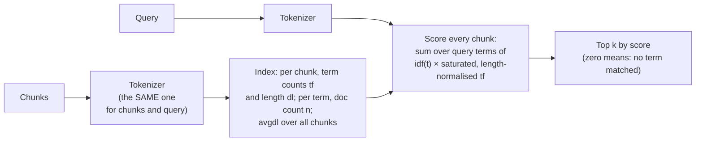
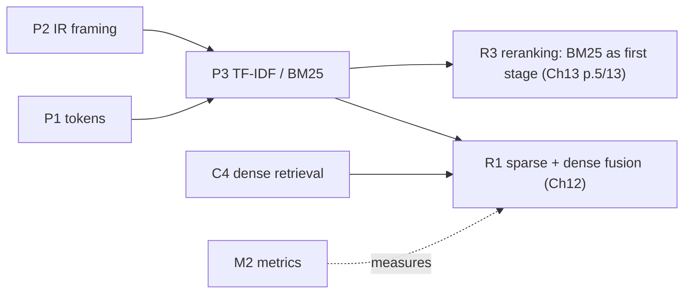

# P3 — Lexical retrieval: TF-IDF and BM25

> **What this file is.** The full lesson for concept **P3** ([02 card](../02_RAG_MASTER_LEARNING_PLAN.md#p3)), Phase 1. It follows the Parts A–M template of [07](../07_SAMPLE_LESSON.md). The short, book-first version is [study/reading/P3_bm25.md](../study/reading/P3_bm25.md). Both depths share one question file, [study/questions/P3_questions.md](../study/questions/P3_questions.md).
> **What this file is not.** How to merge BM25 with dense retrieval (that is [R1](R1_hybrid_fusion.md)), or dense retrieval itself (that is [C4](C4_dense_retrieval.md)).
> **How to use it.** Answers are hidden in collapsible blocks. Write your answer first, then open the block. Lines marked `> 🧭 Coach:` are instructions for the AI tutor; they add to [05 §3](../05_LEARNING_AND_RETENTION_SYSTEM.md#3-coaching-rules-for-the-ai-tutor) and cannot override it.
> **Labels.**
> - **UNVERIFIED**: not checked by running code or reading the primary source.
> - **Toy illustration**: numbers computed by code on made-up data, never a result about a real system.
> - **Demonstration**: a measured run on the real climate PDF with a handful of hand-picked queries. It is **not** an evaluation and supports no "X is better" claim.
> - **Draft-seed observation**: a measurement on the 10 `llm-draft` seed items of [06 §6.7](../06_RAG_PROJECT_AND_EVALUATION_PLAN.md#67-draft-seed-items-for-corpus-d-draft--learner-must-verify). Good for learning, never a scored result.
>
> **Two chunkings of the climate PDF appear, and every number says which one it uses.**
> - **91 windows**: P3's plain 1,000-character slices with 200 characters of overlap (as in P1 and the P3 lab).
> - **97 chunks**: the C-lab index (07's recursive chunker, per page, 1000/200), which R1 measured with BM25 and with dense retrieval.
>
> The two never share a table without a label: their counts differ (for example, `methane CH4` under `split()` is rank 3 on the 91 windows and rank 2 on the 97 chunks).
>
> Every number comes from the local runs in [P3_FACTS.md](../sources/verification/P3/P3_FACTS.md) (S1–S10 of 2026-10-08, K1–K10 of 2026-10-17, S-src for citation checks), from R1's run on the 97 chunks ([R1_FACTS.md](../sources/verification/R1/R1_FACTS.md), cited as "R1 S…"), from a derivation shown in the text, or carries a label. No Groq or Cohere call was made for this lesson.
>
> **Written 2026-10-08; restyled 2026-10-17** in the house style ([WRITING_STYLE.md](../curriculum/WRITING_STYLE.md)), with Parts A and L aligned to the question file. See the Verification log.

## Lesson header

| Field | Value |
|---|---|
| Concept | **P3 Lexical retrieval**: term frequency (tf), document frequency (df), inverse document frequency (idf), TF-IDF, the BM25 term score (k1 saturation, b length normalisation), BM25 in NumPy matching `rank_bm25`, tokenization effects (case, punctuation, numbers, stemming), and exact-term matching for acronyms, numbers and identifiers. |
| Phase / tier | Phase 1, Prerequisites. Priority **E** (essential). Fast track possible ([02 §5](../02_RAG_MASTER_LEARNING_PLAN.md#5-fast-track-rules-from-the-o1-diagnostic)). |
| Prerequisites | **P2** (IR framing: query, document, ranking). 03 also draws P1 → P3 (tokens vs words). |
| Comes next | **R1** sparse vs dense vs hybrid (Ch12 fusion) · **C4** dense retrieval (the contrast) · **R3** reranking (BM25 as a first stage, Ch13 p.5/13) · **M2** metrics, to measure any of it. |
| Diagnostic evidence | **O1-Q03** (session 2026-10-08 #1): score 1 at confidence 3. The idea that a rare term embeds poorly was partly there. Exact-term matching, IDF, k1 and b were not stated. No misconception is logged for P3 yet. |
| Time | A: 10 min · book reading: 15 min · B–D: 50 min · E–G: 20 min · H (lab): 60 min · J–K: 15 min · L: 20 min · M: 5 min. May be split across two days. Part I does not apply. |
| Mastery (P3 → `applied`) | Without notes, you can: (1) compute one BM25 term score by hand and match your own code to **1e-6** (lab Tasks 2–3); (2) say what happens to the score as **tf → ∞** and as **b → 0**; (3) explain IDF and the `rank_bm25` epsilon floor; (4) name three tokenization choices and what each breaks. Lab: `coding_independence_0_3 ≥ 2`. |
| Mastery (P3 → `transfer`) | You also pass a fresh novel-scenario item (Part L.3) and score `debugging_0_3 ≥ 2` (lab Task 7). |

### Source map

| Source | Where | What it contributes |
|---|---|---|
| Book (A) | Ch12 p.1–2/14, p.3/14, p.5–6/14, p.8/14, p.9–10/14, p.12/14, p.14/14; Ch13 p.5/13; Appendix B glossary p.14/23, p.17/23, p.18/23, p.22/23 | The **why** (the BPA exact-term story) and the three factors **in words**. No formula, no k1, no b, no tokenization rules, no TF-IDF |
| Repo (B) | `fusion_retrieval.ipynb` cells 5, 10, 14, 15, 17, 19; `helper_functions.py` L9, L248–L273; `all_rag_techniques_runnable_scripts/fusion_retrieval.py` L56, L76, L81 (written `runnable_scripts/` below); `fusion_retrieval_with_llamaindex.ipynb` cells 3, 15; `simple_rag.ipynb` cell 3 | A working `BM25Okapi` index built with a plain `split()`, and what that breaks |
| Library | `rank_bm25` 0.2.2 `BM25Okapi`, read from the installed source (S2) | The exact formula this course uses |
| Lab verification | [`sources/verification/P3/`](../sources/verification/P3/): `p3_measure.py`, `p3_kit_measure.py`, `p3_sources.py`, `p3_md_check.py`, saved outputs, [`P3_FACTS.md`](../sources/verification/P3/P3_FACTS.md) | Every measured number on the 91 windows and the toys |
| R1 run (2026-10-17) | [`R1_FACTS.md`](../sources/verification/R1/R1_FACTS.md) S1, S4–S6, S8, S11 | Dense and BM25 ranks on the 97 chunks; the repo's fusion transcribed (H.2) |
| Interview repo (MIT) | `ombharatiya/AI-Engineer-Interview-Questions` @ `e080df2`, `04-rag-and-retrieval/questions.md` Q12 | One interview item (L.4), checked against our runs |
| Source C (external) | #8, #12, #13, #15 in [01 §6](../01_SOURCE_INVENTORY.md#6-source-c--supplementary-references-external) (IIR §6.2.2 tf-idf; IIR ch. 11 and its Okapi BM25 section; Robertson & Zaragoza 2009) | Further reading only; nothing here depends on them |

### Contents

[Part A](#part-a--prior-knowledge-recovery) · [Read in the book](#read-in-the-book-after-part-a) · [B](#part-b--why-p3-exists) · [C](#part-c--intuition-and-analogy) · [D](#part-d--technical-mechanism) · [E](#part-e--connections) · [F](#part-f--worked-example-by-hand) · [G](#part-g--source-connection) · [H](#part-h--implementation-progression) · [I](#part-i--controlled-experiment) · [J](#part-j--failure-and-debugging) · [K](#part-k--engineering-decisions) · [L](#part-l--assessment) · [M](#part-m--retention) · [References](#source-references) · [Verification log](#verification-log)

---

## Part A — Prior knowledge recovery

Answer the five questions **before** reading on and before opening the book. They are the `set=pre` items of [P3_questions.md](../study/questions/P3_questions.md), with the same ids and wording; the full model answers, hints and key points are there. Wrong answers are useful: they show where to start.

> 🧭 Coach: Ask **one item at a time** (CR-01), in the exact wording below, with its template. Record confidence 1–3 before revealing anything (CR-16). The O1 pattern is "confident and wrong" (mean 1.1/4 at confidence 3), so say the confidence back before grading. Score with the Recall rubric ([05 §4.2](../05_LEARNING_AND_RETENTION_SYSTEM.md#42-graded-rubrics-04)). These are unscheduled: log them, do not change the schedule. Do not correct in detail yet; route with the table after P3-PRE-05.

**P3-PRE-01.** A user searches for "IPCC": why might keyword search find the right chunk when vector search does not?

*Reply template:* "Keyword search matches ____. Vector search might miss it because ____."

<details><summary>What a strong answer contains</summary>

- Keyword search (BM25) matches the **exact token** `ipcc`. If a chunk contains it, the chunk gets a positive score; if not, the score is 0.
- A dense embedding maps the query into a general region of meaning, so chunks **about** the topic can outrank the chunk that **names** it (the book's BPA story, Ch12 p.1/14). Measured on the 97 chunks: dense rank 3, BM25 rank 1 (R1 S6).
- Boundary: keyword search only works if the **tokenizer** produces the same token on both sides. Under the repo's `split()`, the text holds `(IPCC)`, so the query `IPCC` matches nothing (S9).

</details>

**P3-PRE-02.** What does "inverse document frequency" reward, and why?

*Reply template:* "IDF gives more weight to ____, because ____."

<details><summary>What a strong answer contains</summary>

- It rewards terms that occur in **few documents** (chunks). A match on a rare term says more about relevance than a match on a word found everywhere.
- It is computed from the **document frequency** n (how many chunks contain the term), not from how often the term occurs inside one chunk.
- In our toy: `eu` (1 of 6 docs) has idf 1.299; `bpa` (2 of 6) has 0.588 (S3).
- ⚠️ Flag: "IDF counts how often the word appears in the chunk" (that is tf).

</details>

**P3-PRE-03.** A chunk mentions "methane" ten times instead of once: does its BM25 score for "methane" become ten times larger?

*Reply template:* "The score becomes ____, because ____."

<details><summary>What a strong answer contains</summary>

- **No.** It grows, but it **saturates**. At average chunk length with k1 = 1.5, one mention gives a tf part of 1.0 and ten mentions give 2.174, not 10 (S5).
- The ceiling is **k1 + 1** = 2.5 times the idf.
- k1 controls how fast it saturates. TF-IDF with raw counts does grow linearly (S7).

</details>

**P3-PRE-04.** Two chunks each mention "BPA" once, one 5 words long and one 20 words long: which scores higher, and what controls the gap?

*Reply template:* "The ____ chunk scores higher. The gap is controlled by ____."

<details><summary>What a strong answer contains</summary>

- The **short** chunk scores higher (0.829 vs 0.496 in the measured toy, S5).
- The parameter **b** (0 to 1) controls length normalisation. With b = 0 the two scores are equal (0.588 each).
- Why: one mention in a short chunk is a larger share of what the chunk is about.

</details>

**P3-PRE-05.** The repo builds its BM25 index with `doc.page_content.split()`: name one thing that can go wrong.

*Reply template:* "With `split()`, the token ____ will not match ____."

<details><summary>What a strong answer contains</summary>

- `split()` cuts only at whitespace. Case and punctuation stay attached, so `(IPCC)`, `emissions.` and `Emissions` are all different tokens from `ipcc` and `emissions`.
- Measured on the 91 windows: the word "emissions" appears as 4 different `split()` tokens (S9). The query `IPCC` matches **no** window, and the query "What does BECCS stand for?" matches **none** of the 91 windows (S9).
- The same `split()` is used on the **query** (cell 17), so the user's case and punctuation matter too.

</details>

> 🧭 Coach: **Routing.**
>
> | Weak answers (score ≤ 1) | Action |
> |---|---|
> | P3-PRE-01 | Teach B.1 with the book's BPA pages first, then B.2. |
> | P3-PRE-02 | Teach D.2 and D.3 slowly; do Part F Step 1 before anything else. |
> | P3-PRE-03 or P3-PRE-04 | Teach D.4 with its tables; do lab Task 4 early. |
> | P3-PRE-05 | Teach D.5 and B.2; do lab Tasks 1 and 6 before Task 3. |
> | All five ≥ 3 with confidence 3 | Offer the fast track: skim B–C, then D.3, D.4, F, H and L (evidence is never skipped, 02 §5 rule 1). |

---

## Read in the book (after Part A)

> **When.** Read these pages **after** you finish Part A, never before: Part A tests what you already remember. Then come back and continue with Part B. About 15 minutes.
> **How.** For each page, answer its "look for" question in one line in your notes. Then close the book and say the three BM25 factors out loud.

| Order | Pages | Look for |
|---|---|---|
| 1 | **Ch12 p.1–2/14** | The BPA story: which chunk does the meaning-based search push down, and why? On p.2, find the opposite failure of keyword search. |
| 2 (optional) | **Ch12 p.3/14** | The cookbook index analogy: what does the index catch that the chef misses? |
| 3 | **Ch12 p.5/14** | The **three factors** BM25 combines. Note the example for each. Note that the book gives **no formula**. |
| 4 | **Ch12 p.6/14** | The figure description (three boxes and how they combine), and the one sentence about how the query is turned into words. |
| 5 | **Ch12 p.9–10/14** | Step 3 of the algorithm sketch on p.10: what the BM25 index stores. Also the kinds of queries where exact terms matter (from the end of p.9). |
| 6 | **Ch12 p.8/14** and **p.14/14** | p.8: the two score scales (why BM25 scores cannot be added to cosine scores). p.14: the one-line BM25 takeaway. |
| 7 | **Ch12 p.12/14** | "Overkill when": the one case where the book says BM25 alone is enough. |
| 8 | **Appendix B p.14/23, p.17/23, p.18/23, p.22/23** | The glossary entries for BM25, Inverse Document Frequency, Length Normalization and Term Frequency. Say each in your own words. |
| 9 (optional) | **Ch13 p.5/13** | BM25 named as one possible first-stage retriever for a reranker. |

**What the book gets wrong or leaves out** (checked against `rank_bm25` 0.2.2 and our runs):
1. **No formula.** No k1, no b, no IDF formula, and TF-IDF is never mentioned (S-src: no "TF-IDF", "k1", "Okapi" or "saturat" anywhere in the book). Part D fills this gap.
2. **"More mentions score higher"** (Ch12 p.5/14; App p.22/23). True, but the book never says that the gain **saturates**. Five mentions give 1.92 times the tf part of one mention, not 5 times (S5).
3. **"Common words score almost nothing"** (Ch12 p.5/14; App p.17/23). That depends on the library. In `rank_bm25`, a term in **exactly half** the chunks scores 0. A term in **more** than half gets a floor value. That floor can exceed the IDF of a mid-frequency term: on the 91 windows `climate` (77 of 91) gets 0.838 while `emissions` (34 of 91) gets 0.511 (S10).
4. **Length normalisation is described only as a penalty on long chunks** (Ch12 p.5/14; App p.18/23). It also **boosts** chunks shorter than average (D.4). Its strength is a tunable parameter, b.
5. **"Tokenizes the query into individual words"** (Ch12 p.6/14, p.10/14). The book never says how. Case, punctuation, numbers and stemming decide whether an exact term matches at all (D.5, S9).
6. **"Unbounded" scores** (Ch12 p.8/14). The real point holds: BM25 scores have no fixed 0–1 scale. But each query term's contribution is capped at idf × (k1 + 1) (D.4).

> 🧭 Coach: After the reading, ask one question: "Which of the three factors did the book give an example number for?" Expected: term frequency (five mentions vs one). Then move to Part B.

---

## Part B — Why P3 exists

### B.1 Dense retrieval ranks the named chunk below its topic

**The setup.** The book's motivating case (Ch12 p.1/14): a query for a chemical acronym and a year. The meaning-based search ranks the one chunk that **names** the acronym fourth, behind chunks that discuss related regulation in general. The book also shows the opposite failure (p.2/14): a chunk that says the same thing in other words has **no** matching keyword. On 2026-10-08 this lesson measured BM25 only. R1 then ran P3's five exact-term queries with both retrievers on the **97 chunks** (MiniLM for dense; target = any chunk that contains the string).

**The result** (demonstration, 97 chunks, R1 S6):

| Query | Chunk that names the term | Dense rank | BM25 rank (`tok_norm`) | BM25 rank (repo `split()`) |
|---|---|---|---|---|
| `IPCC` | seq 1, page 1 | 3 | **1** | none |
| `What does BECCS stand for?` | seq 88, page 30 | 4 | **1** | none |
| `methane CH4` | seq 2, page 1 | 4 | **1** | 2 |
| `Kyoto Protocol 1997` | seq 69, page 24 | 1 | 1 | 1 |
| `limit warming to 1.5 degrees` | seq 27 and 68, pages 10 and 23 | 4 | **1** | 1 |

**What this means.** Dense retrieval found every target inside the top 4, but four of the five only at rank 3 or 4, the same pattern as the book's acronym. Three of them sit exactly at v0's cut-off (k = 4, C4 D.6). BM25 with the course tokenizer puts every target first. With the repo's `split()`, two of them match nothing (B.2).

**For your project:** lexical retrieval is not "old search". It is the retriever for **identifiers**: acronyms, product codes, version strings, error codes, section numbers and years. This is the O1-Q12 finding too: you suggested hybrid search for exact version strings, which is R1 built on P3. On this small corpus exact terms land low, not lost; the `exact-term` category of the eval set (06 §6.2) and the v2.0 experiment on a larger corpus (Corpus T) show whether they get lost.

### B.2 The repo's BM25 cannot find "IPCC"

**The setup.** The repo tokenizes both chunks and query with `split()` (`fusion_retrieval.ipynb` cells 14 and 17). The PDF says "Intergovernmental Panel on Climate Change (IPCC)", so the only `split()` token is `(IPCC)`. We ran the same five queries on the **91 windows**, with `split()` and with `tok_norm` (lower-case, punctuation stripped).

**The result** (demonstration, 91 windows, S9):

| Query | `split()`: windows with score > 0 | `split()`: rank of the target window | `tok_norm`: rank |
|---|---|---|---|
| `IPCC` | **0** | not found | **1** |
| `What does BECCS stand for?` | **0** | not found | **1** |
| `methane CH4` | 3 | 3 | **1** |
| `Kyoto Protocol 1997` | 5 | 1 | 1 |
| `limit warming to 1.5 degrees` | 87 | 1 | 1 |

And when every score is 0, the repo code still returns k chunks: `np.argsort(scores)[::-1][:5]` gives windows **[90, 89, 88, 87, 86]**, the last five of the document (S9). Nothing errors.

**What this means.** Two of five queries fail completely under `split()`; two are unaffected. The formula never got a chance: no token of the question equals a token of the text. This is a **retrieval** failure (CR-11): the evidence never reaches the prompt.

**For your project:** the tokenizer is part of the retriever. It is fixed in D.5 and recorded in every BM25 run config (Part K).

### B.3 The honest limit: five hand-picked queries are not an evaluation

**The setup.** B.1 and B.2 use five queries chosen because they contain exact terms. The only labelled numbers we have for BM25 come from R1: the 8 answerable draft seeds, scored on the 97 chunks with k = 4.

**The result** (draft-seed observations, 97 chunks, R1 S4):

```
arm                    Hit@4    CE@4    MRR@10    first relevant rank, D-001 … D-008
dense (v0)             8/8      8/8     0.708     3, 3, 1, 1, 1, 1, 2, 2
BM25 (tok_norm)        8/8      8/8     0.938     1, 1, 1, 1, 1, 2, 1, 1
BM25 (repo split())    8/8      8/8     0.875     1, 2, 1, 1, 1, 2, 1, 1
```

**What this means.** On these eight drafts, BM25 alone already gets the evidence into the top 4 every time, and usually first. The one seed where it does worse than dense, D-006, is a paraphrase (D.7). Eight LLM-drafted questions cannot say how real users phrase things.

**For your project:** *Evals for AI Engineers* recommends keyword search as the first retrieval baseline (AE Ch2, 'Retrieval Fundamentals', paraphrased). v2.0 keeps "BM25 alone" as one of its three arms for exactly this reason (06 §4.2).

---

## Part C — Intuition and analogy

**BM25 is the index at the back of a book, with three adjustments** (the book's own analogy for keyword search is the cookbook index, Ch12 p.3/14).
- **Rarity (idf):** an entry that lists 2 pages tells you more than an entry that lists every page.
- **Repetition (tf, saturated):** a page that mentions the word 5 times is probably more about it than a page that mentions it once, but the 10th mention adds little.
- **Page length (b):** one mention on a short page counts more than one mention on a page of 40 lines.

**Tokenization is how the index entries are spelled.** If the index lists `(IPCC)` and you look up `IPCC`, the index says "no such entry".

**Where the analogy breaks.** A real book index is curated: someone decided that "CO₂" and "carbon dioxide" share an entry. BM25 knows only the tokens your tokenizer produces. It has no synonyms and no meaning (Ch12 p.2/14).

> 🧭 Coach: CR-17. Stop here and ask one question: "In the analogy, which of the three adjustments would make a word like 'the' almost useless?" Expected: rarity (idf).

---

## Part D — Technical mechanism

### D.1 The index is just counts



**The setup.** We read what `BM25Okapi` stores from the installed source (S2), and printed the index statistics of the climate PDF.

**The result** (S2, S10, K1; R1 S1):

```
stored per chunk:   term counts f(t, d), length dl(d) = len(tokens), repeats counted
stored per term:    document count n(t); its idf
stored once:        N, avgdl = total tokens / N, the mean idf (for the floor)
91 windows (tok_norm):   N 91, avgdl 129.67, vocabulary 1,870, mean idf 3.352948, floor 0.838237
97 chunks  (tok_norm):   N 97, avgdl 111.23, vocabulary 1,769
```

**What this means.** There are no vectors and no model (Ch12 p.5/14). Every number is a count of token strings, so everything depends on the token strings matching exactly.

**For your project:** an index is defined by its chunks, its tokenizer, k1, b, epsilon and the library version. Store all of them with it (H.3).

### D.2 Three counts before any formula, and why TF-IDF over-rewards repeats

Learn the three counts in plain words first.
- **How often a word appears inside one chunk:** the *term frequency* (tf), written f(t, d).
- **How many chunks contain the word at least once:** the *document frequency* (df), written n(t). It is counted over the whole collection.
- **A weight that is high when few chunks contain the word:** the *inverse document frequency* (idf).

**The setup.** The six-document toy of Part F (S3), and then the textbook way of combining tf and idf.

**The result** (toy illustration, S3, S7, K4):

| Symbol | Meaning | Toy example (S3) |
|---|---|---|
| N | number of documents (chunks) | 6 |
| f(t, d) | **term frequency**: count of term t in document d | `bpa` in d0: 2 |
| n(t) | **document frequency**: number of documents that contain t | `bpa`: 2; `eu`: 1; `climate`: 4 |
| dl(d) | document length in tokens (repeats counted) | d0: 11 |
| avgdl | mean document length | 60 / 6 = 10.0 |

**TF-IDF** (textbook form, IIR; Source C) weights a term by f × ln(N / n). It rewards rare terms, but it grows **linearly** with f. For `bpa` (N = 6, n = 2) and dl = avgdl:

| f | 1 | 2 | 4 | 8 | 16 |
|---|---|---|---|---|---|
| TF-IDF f × ln 3 | 1.099 | 2.197 | 4.394 | 8.789 | 17.578 |
| BM25 (k1 = 1.5) | 0.588 | 0.840 | 1.069 | 1.237 | 1.344 |

Now a ranking flip. Query `bpa ban`; six documents of 8 tokens each (K4). Document x mentions each word once; document y repeats `bpa` six times and never says `ban`:

```
                    x: bpa ×1, ban ×1     y: bpa ×6
textbook TF-IDF          2.8904              6.5917      ← y wins
BM25 (rank_bm25)         1.8871              1.1756      ← x wins     (tf part at f = 6: 2.000)
```

**What this means.** Read the TF-IDF row of the first table: 16 mentions score 16 times one mention. So a chunk that repeats one query word beats a chunk that matches more of the question, which is what keyword stuffing exploits. BM25 caps the gain from repeats (D.4), so x, which matches both words, wins.

**For your project:** there are many TF-IDF variants. scikit-learn's default `TfidfVectorizer` (1.9.1) uses ln((1 + N) / (1 + n)) + 1 (1.847298 for `bpa`) and L2-normalises each vector (S7). Always say which variant you mean. This course uses BM25.

### D.3 BM25 exactly as `rank_bm25` 0.2.2 computes it

Read from the installed source (S2): `BM25Okapi(corpus, tokenizer=None, k1=1.5, b=0.75, epsilon=0.25)`.

```text
idf(t)     = ln( (N − n + 0.5) / (n + 0.5) )                          (computed per term)
floor      = epsilon × mean of idf over ALL terms (before flooring)
if idf(t) < 0:  idf(t) = floor                                        (strictly negative only)

score(d,q) = Σ over query tokens t:
             idf(t) × f(t,d) × (k1 + 1) / ( f(t,d) + k1 × (1 − b + b × dl(d)/avgdl) )
```

Call the fraction after idf the **tf part**, and K = k1 × (1 − b + b × dl/avgdl).

**The setup.** The four special cases of this implementation, each on a tiny toy (S6, K9). Then the running example of the short reading, "What does BECCS stand for?", taken apart on the 91 windows (K2).

**The result** (toy illustrations, S6 and K9):
1. **The IDF goes negative** when a term is in more than half of the documents. The library then replaces it with the floor. In the toy, `climate` (4 of 6) has raw idf −0.588 and becomes 0.272.
2. **Exactly half gives 0.** `plastics` (3 of 6) has idf ln(3.5 / 3.5) = 0, and 0 is not negative, so it stays 0. A term in 3 documents scores **less** than a term in 4. On a **two-document** corpus, a term in one document has idf ln(1.5 / 1.5) = 0, and a term in both has a negative raw idf, replaced by a floor that is negative too (the mean idf is below 0). So **no score can be above 0**: [0.0, 0.0] for a word in one document, and [−0.080472, −0.080472] for a word they share (K9).
3. **The floor itself can be negative.** If most terms are very common, the mean IDF is negative (toy: mean −1.127, floor −0.282), and scores come out negative (−0.250 and −0.301).
4. **The query is a list, not a set.** `bpa bpa` scores 1.627, exactly twice `bpa` (0.814). An unknown term adds 0. There is no error.

**The result** (demonstration, 91 windows, K2): 80 of 91 windows score above 0.

```
token   df (of 91)   idf used
what        0        not in the index: adds 0         (so are "does" and "stand")
beccs       2        3.577948
for        80        raw −1.945910  →  floor 0.838237

rank 1  window 83 (dl 124, K 1.450805)   beccs f 1: 1.020073 × 3.577948 = 3.649768   for f 3: 1.685088 × 0.838237 = 1.412504   total 5.062271
rank 2  window 82 (dl 123, K 1.442129)   beccs f 1: 1.023697 × 3.577948 = 3.662734   for f 2: 1.452589 × 0.838237 = 1.217614   total 4.880348
rank 3  window 16 (dl 132)               no beccs                                     for f 6: 1.994625 × 0.838237 = 1.671968   total 1.671968
```

**What this means.** Read the BECCS breakdown row by row. The rare word carries the score: about 3.65 for each window that holds it. The floored common word decides the order between the two BECCS windows: window 83 says "for" three times, window 82 twice. And 78 of the 80 windows that score above 0 contain no BECCS at all: they match on "for" only, and the best of them, window 16, earns 1.67. Window 82 even gets a slightly larger `beccs` part than window 83, because it is one token shorter.

**For your project:** use the formula of the library you run. Other libraries (for example Lucene) use a different IDF that never goes negative. That is not checked here (UNVERIFIED). And never write a unit test on two documents (J2).

> 🧭 Coach: CR-17. Ask one question: "In a 2-document corpus, can `rank_bm25` ever return a positive score?" Expected: no. A term in one of two documents has idf ln(1.5/1.5) = 0; a term in both is floored to a negative value (K9: −0.080 for a shared word).

### D.4 Saturation (k1) and length normalisation (b)

Call the fraction after idf the **tf part**, as in D.3. Hold the idf fixed and vary one thing at a time.

#### The tenth mention adds little (k1)

**The setup.** The tf part at dl = avgdl, k1 = 1.5, b = 0.75, for more and more mentions; then the same through `rank_bm25` itself on a padded synthetic document; then four values of k1 (S5).

**The result** (S5):

| f | 1 | 2 | 3 | 5 | 10 | 100 | 1000 |
|---|---|---|---|---|---|---|---|
| tf part | 1.000 | 1.429 | 1.667 | 1.923 | 2.174 | 2.463 | 2.496 |

As f → ∞ the tf part approaches **k1 + 1 = 2.5**. So one term can add at most idf × (k1 + 1) to the score. The library gives the same ratios on a padded synthetic document: score/idf = 2.173913 at f = 10 and 2.496256 at f = 1000 (S5).

| k1 | f = 1 | f = 2 | f = 5 |
|---|---|---|---|
| 0 | 1.000 | 1.000 | 1.000 |
| 0.75 | 1.000 | 1.273 | 1.522 |
| 1.5 | 1.000 | 1.429 | 1.923 |
| 3.0 | 1.000 | 1.600 | 2.500 |

**What this means.**
- At dl = avgdl and f = 1, the tf part is exactly 1 for **any** k1: (k1 + 1)/(1 + k1).
- **k1 = 0** means "present or absent" in theory. In `rank_bm25` it also produces **NaN** for every document that lacks the term (0/0; S6). Do not use k1 = 0 with that library.
- A larger k1 lets repetition count for longer before it flattens.
- On the real windows, window 16's six "for"s reach a tf part of 1.995 of the 2.5 ceiling (K2): the ceiling for "for" is 2.095593.

**For your project:** keep k1 = 1.5. Changing it is an experiment on the eval set, not a tidy-up.

#### Length cuts both ways (b)

**The setup.** One mention (f = 1) in chunks of different lengths, at four values of b (S5); then one mention in a 5-token and a 20-token document of a small made-up corpus (avgdl 14.1667), through the library (S5).

**The result** (S5):

| b | dl = 0.5 × avgdl | dl = avgdl | dl = 2 × avgdl |
|---|---|---|---|
| 0 | 1.000 | 1.000 | 1.000 |
| 0.375 | 1.127 | 1.000 | 0.816 |
| 0.75 | 1.290 | 1.000 | 0.690 |
| 1.0 | 1.429 | 1.000 | 0.625 |

```
library, x once in a 5-token and a 20-token doc:   b = 0.75: short 0.829243, long 0.495899     b = 0: 0.587787 each
b = 0.75, one mention at 4 × avgdl:                tf part 0.426
```

**What this means.** Read the table by column. Normalisation **raises** short chunks and **lowers** long ones, relative to an average-length chunk.
- **b → 0:** length is ignored. A one-mention term scores the same in a 5-token and a 20-token chunk (0.588 each, S5).
- **b = 1:** full normalisation by dl/avgdl.

**For your project:** keep b = 0.75. Chunk size moves avgdl and dl together (M.4, C2), so a new chunker changes BM25 scores even with the same b.

> 🧭 Coach: CR-08 probe (one question): "If k1 halves from 1.5 to 0.75, does the tf part of a term that appears 5 times in an average-length chunk go up or down?" Expected: down, 1.923 → 1.522 (S5): repeats stop counting sooner. Ask for the direction and the mechanism before the number.

### D.5 Tokenization decides what can match

**The setup.** Five tokenizers on the climate PDF (S9), and the same sample sentences under each (S7). The whole-document vocabulary shows how many different strings each one makes.

**The result** (S9, whole document):

| Tokenizer | Rule | Distinct tokens |
|---|---|---|
| `split` (repo) | whitespace only | 2,630 |
| `lower+split` | lower-case, whitespace | 2,276 |
| `lower+\w+` | lower-case, runs of letters/digits/underscore | 1,767 |
| `norm` (this lesson) | lower-case, `[a-z0-9]+`, keeps `1.5` and `650,000` whole | 1,769 |
| `norm+fold` (**toy**) | `norm`, then strip a final "s" from words longer than 3 letters | 1,617 |

`split` has about 860 more entries than `norm` (2,630 against 1,769): case and attached punctuation create several spellings of one word. What each step fixes and what it breaks (S7, S8, S9, K2):
- **Case.** `Emissions` vs `emissions`. Lower-casing merges them. It can also merge an acronym with an ordinary word (for example a chemical code that is also an English word; not observed in this PDF). Lower-casing **only the query**, while the chunks are still `split()`, makes things worse: `bpa` no longer matches `BPA` (toy: d0's score drops from 2.125 to 1.289, S8).
- **Punctuation.** Under `split()`, "emissions" exists as `emissions` (22), `emissions.` (20), `emissions,` (7) and `Emissions` (1). Acronyms in brackets, such as `(IPCC)`, `(BECCS),` and `(CH4),`, never match their bare forms. In the BECCS question even `for?` keeps its question mark, so **not one** query token occurs in any window (K2).
- **Numbers.** `\w+` cuts `1.5` into `1` and `5`. scikit-learn's default pattern drops one-character tokens, so `1.5` and `a` vanish entirely from `"Limit warming to 1.5 degrees; …"` (S7). Our `norm` keeps `1.5`.
- **Stemming.** The toy fold makes `emissions` match `emission`, but it also turns `beccs` into `becc`, `this` into `thi` and `gases` into `gase` (S9). Real stemmers (Porter, Snowball) use many more rules. They are not installed here, so their behaviour is UNVERIFIED in this course.

**What this means.** The tokenizer, not the formula, decides whether an exact term can match at all. And BM25 tokens are whatever **your** tokenizer outputs, here whole words; the LLM's and the embedder's subword tokens are a different thing (P1, MC-001).

**For your project:** the index and the query must go through the **same** tokenizer. Test the tokenizer on your identifiers before you trust BM25.

### D.6 Chunking changes the counts: one mention, two windows

**The setup.** The PDF mentions BECCS once, yet D.3 shows df 2. We looked up where the mention sits, and counted how often the 200-character overlap doubles a document frequency across the whole vocabulary (K2, K8).

**The result** (demonstration, 91 windows):

```
"BECCS" in the text: character 66441 (one occurrence)
window 82 covers 65600 … 66600, window 83 covers 66400 … 67400      → both contain it: df 2
tokens that occur once in the whole text: 799;  counted in 2 windows: 184 (23.0%)
window vocabulary 1,870 vs whole-text vocabulary 1,769:  101 window tokens are word pieces cut at a window edge
```

**What this means.** Overlap copies text, so a word that sits in an overlap is counted in two chunks: its df doubles and its idf drops (for `beccs`, 3.578 instead of 4.100 for a once-only word like `ipcc`). Plain character windows also cut words at their edges, which adds fragments that a question's whole words do not match.

**For your project:** BM25 numbers belong to one chunking. That is why this lesson labels every number "91 windows" or "97 chunks", and why the chunker's `params_hash` goes into every BM25 run config (C3 D.3).

### D.7 A raw BM25 score says nothing about whether an answer exists

**The setup.** A question made only of common words, on the 91 windows (K7), set next to the BECCS question. Then R1's two unanswerable draft seeds on the 97 chunks (R1 S8): questions whose answer is not in the document at all.

**The result**:

```
91 windows:  "What can be done about this?"   81 of 91 windows > 0; rank 1 5.7608, rank 5 4.3718, rank 10 3.6997, rank 40 1.7162
             "What does BECCS stand for?"     rank 1 5.0623 (the true match), rank 3 1.6720
97 chunks:   D-009 (no answer in the document)   best BM25 score 6.9559
             D-010 (no answer in the document)   best BM25 score 13.2576
97 chunks:   D-006 (a paraphrase)   BM25: seq 64 (page 22, contains "panels") 13.6205, the evidence seq 21 9.2298;  dense ranks the evidence 1st
```

**What this means.** A question with no answer can get a higher top score than a question with a perfect match. The score depends on which query words exist in the index, how rare they are and how often they repeat, not on whether a chunk answers the question. And a paraphrase loses to a chunk that happens to share a rare word ("panels", idf 4.1641 on the 97 chunks).

**For your project:** never put a fixed threshold on a raw BM25 score to decide "no relevant chunk". A score is comparable only within one query and one index (C4 D.5). Abstention is decided later, on labelled data.

---

## Part E — Connections



| Often confused | The difference |
|---|---|
| tf vs df | tf counts **inside one chunk**; df (n) counts **chunks that contain** the term |
| TF-IDF vs BM25 | TF-IDF grows linearly in tf and has no length parameter; BM25 saturates (k1) and normalises length (b) |
| BM25 "token" vs model token (P1) | BM25 tokens are whatever **your** tokenizer outputs (words here); LLM and embedder tokens are subword pieces from a fixed vocabulary |
| Score 0 vs low rank | 0 means **no query token matched**. A positive score with a low rank means something matched, just not strongly |
| BM25 score vs cosine | Different scales: BM25 has no fixed range, cosine lies in [−1, 1] (Ch12 p.8/14). Fusing them needs normalisation or ranks (R1) |
| 91 windows vs 97 chunks | Two chunkings of the same PDF; their counts, ranks and scores are not interchangeable (D.6) |
| BM25 alone vs hybrid | BM25 alone is a full retriever and a v2.0 arm; hybrid adds dense retrieval for paraphrases (R1) |

---

## Part F — Worked example by hand

**The toy corpus** (toy illustration; made up for P3; the BPA theme follows Ch12 p.1/14). After `tok_norm` (S3):

| Doc | Tokens | dl |
|---|---|---|
| d0 | bpa regulation 2019 the eu limits **bpa** in food contact plastics | 11 |
| d1 | climate policy and plastics a review of chemical safety regulation | 10 |
| d2 | the 2019 bpa ban covers baby bottles bpa bps and bpf are bisphenols | 13 |
| d3 | climate change raises sea levels and flood risks for coastal cities | 11 |
| d4 | greenhouse gas emissions and climate targets under the paris agreement | 10 |
| d5 | plastics manufacturing adds climate emissions | 5 |

**Step 1: count.** For the term `bpa` and document d0, write N, n, f, dl and avgdl.

<details><summary>Answer</summary>

N = 6, n = 2 (d0, d2), f = 2, dl = 11, avgdl = 60 / 6 = **10.0** (S3).

</details>

**Step 2: idf.** Compute ln((N − n + 0.5) / (n + 0.5)).

<details><summary>Answer</summary>

ln(4.5 / 2.5) = ln(1.8) = **0.587787** (S4).

</details>

**Step 3: the length factor.** K = k1 × (1 − b + b × dl / avgdl) with k1 = 1.5, b = 0.75.

<details><summary>Answer</summary>

1.5 × (0.25 + 0.75 × 1.1) = 1.5 × 1.075 = **1.6125** (S4).

</details>

**Step 4: tf part and score.**

<details><summary>Answer</summary>

- tf part = 2 × 2.5 / (2 + 1.6125) = 5 / 3.6125 = **1.384083**.
- Score = 0.587787 × 1.384083 = **0.813546**. `rank_bm25` gives 0.813546; difference 0.0 (S4).

</details>

**Step 5: the whole query.** The query `BPA regulation 2019` tokenizes to `bpa regulation 2019`. d0 also contains `regulation` and `2019` once each (both n = 2), contributing 0.562475 each. What is d0's total?

<details><summary>Answer</summary>

0.813546 + 0.562475 + 0.562475 = **1.938496** (S4). Full ranking: d0 1.938, d2 1.284, d1 0.588, the rest 0. Self-check: d3–d5 contain none of the three tokens, so they must be exactly 0.

</details>

**Step 6: predict before checking.** `bpa` also occurs twice in d2, which is longer (dl = 13). Is its `bpa` score above or below d0's 0.8135?

<details><summary>Answer</summary>

Below: **0.765846** (S4). Same f, same idf, but K grows with dl (1.5 × (0.25 + 0.75 × 1.3) = 1.8375).

</details>

> 🧭 Coach: CR-08 probe here, one question: "If k1 doubles to 3.0, does d0's `bpa` tf part go up or down?" Expected: up; at dl = avgdl and f = 2 it goes 1.429 → 1.600 (S5). Here dl = 1.1 × avgdl, so ask for the direction and the reason, not the number.

---

## Part G — Source connection

### G.1 Book (Source A)

| Cite | Book point (paraphrased) | Our assessment |
|---|---|---|
| Ch12 p.1/14 | Meaning-based search ranks the chunk that names the acronym fourth | Measured analogue on the 97 chunks: BECCS dense rank 4, IPCC 3, CH4 4 (B.1, R1 S6) |
| Ch12 p.2/14 | Keyword search misses a chunk that has the meaning but not the words | The reverse failure; BM25 has no synonyms (D-006, D.7) |
| Ch12 p.3/14 | The cookbook index catches exact ingredient names | Part C |
| Ch12 p.5/14 | BM25 uses no embeddings; three factors: frequency, rarity across chunks, length adjustment | Correct in words; no formula, no k1 or b; saturation omitted |
| Ch12 p.6/14 | Figure with three factor boxes; the query is tokenized into words | Tokenization rules are not given (D.5) |
| Ch12 p.8/14 | BM25 scores are on a different, open scale from cosine | Correct point; per-term contribution is capped at idf × (k1 + 1) |
| Ch12 p.9–10/14 | Index step: tokenize each chunk and build term statistics; exact terms matter for codes, chemical names and citations | Matches D.1 |
| Ch12 p.12/14 | Overkill: when every query is a keyword lookup, BM25 alone suffices | Plausible; on our draft seeds BM25 alone reached CE@4 8/8 (B.3). Measure it per category (Part K) |
| Ch12 p.14/14 | Takeaway: BM25 = tf, idf, length normalisation; no embeddings | Same three factors |
| Ch13 p.5/13 | Any retriever, including BM25, can feed a reranker | Links P3 to R3 |
| App p.14/23, p.17/23, p.18/23, p.22/23 | Glossary: BM25, IDF, Length Normalization, Term Frequency | Same claims as Ch12 p.5/14; same omissions |

**Not in the book:** TF-IDF, k1, b, the IDF formula, the epsilon floor, saturation, stemming, lower-casing and stop words (S-src absence checks).

### G.2 Repo (Source B): cells and lines verified at `009adba`

| Cite (cells 0-based) | What it shows | Lesson |
|---|---|---|
| `fusion_retrieval.ipynb` cell 5 | `from rank_bm25 import BM25Okapi` | The library is `rank_bm25` |
| `fusion_retrieval.ipynb` cell 10 | `RecursiveCharacterTextSplitter`, 1000/200, `length_function=len`, then `replace_t_with_space` | Chunks are character-sized; only tabs are cleaned |
| `fusion_retrieval.ipynb` cell 14 | `create_bm25_index`: `doc.page_content.split()`, `BM25Okapi(tokenized_docs)`. Its comment says the whitespace split could be improved; its docstring calls BM25 an improvement over TF-IDF | No lower-casing, no punctuation handling; default k1, b, epsilon |
| `fusion_retrieval.ipynb` cell 15 | `bm25 = create_bm25_index(cleaned_texts)` | Index built once |
| `fusion_retrieval.ipynb` cell 17 | `bm25.get_scores(query.split())`; min-max with `+ epsilon` (1e-8); `argsort(...)[::-1]` | The **query** side uses `split()` too. If no token matches, all BM25 scores normalise to 0 and the BM25 half adds nothing. With aligned arrays the fused ranking silently becomes vector-only; the repo's own arrays are not aligned, so it returns the five chunks nearest to the empty string (R1 S11, 97 chunks; H.2) |
| `fusion_retrieval.ipynb` cell 19 | Example query on climate impacts, `k=5, alpha=0.5` | A meaning-type query; not an exact-term test |
| `helper_functions.py` L9, L248–L273 | `bm25_retrieval`: `query.split()` (L262), `np.argsort(bm25_scores)[::-1][:k]` (L268) | Returns k chunks even when every score is 0. **Defined but never called** anywhere in the repo (S-src) |
| `runnable_scripts/fusion_retrieval.py` L56, L76, L81 | Same `split()` on both sides; min-max **without** epsilon | Same formula on our all-zero IPCC scores gives **91 of 91 NaN** on the 91 windows (S9) and 97 of 97 on the 97 chunks (R1 S11); formula replicated, script not run |
| `fusion_retrieval_with_llamaindex.ipynb` cells 3, 15 | LlamaIndex **legacy** `BM25Retriever.from_defaults(nodes=…, similarity_top_k=2)` | A different BM25 implementation; its tokenizer is UNVERIFIED (LlamaIndex is not installed here) |
| `simple_rag.ipynb` cell 3 | Pins `rank_bm25==0.2.2` | The same version as ours (S1) |

### G.3 Corrections to the 02 card, the 04 row and this lesson (02 and 04 are not edited)

1. **04 P3 row, query side.** 04 cites `fusion_retrieval.ipynb` cells 14–15 for the whitespace `split()`. The **query-side** `split()` is in **cell 17** (and `helper_functions.py` L262). A tokenization fix must change both sides.
2. **04 P3 row, book column.** It lists only Ch12 p.5–6/14. It misses the glossary (App p.14, 17, 18, 22/23; the 02 card has them), Ch12 p.9–10/14 (the tokenize-and-count step), Ch12 p.8/14 (the score scale) and Ch12 p.12/14 (when BM25 alone is enough).
3. **04 P3 row, LlamaIndex.** 04 lists `fusion_retrieval_with_llamaindex.ipynb` cell 15 next to the `split()` cells as if it were the same BM25. It is LlamaIndex's legacy `BM25Retriever` (imported in cell 3), whose tokenizer this lesson did not check.
4. **04 P3 row, defaults.** 04 notes "default k1/b". The default **epsilon = 0.25** floor matters as much on real chunks: 18 terms on the 91 windows have negative IDF and are floored (S10). 04's "TF-IDF not in book" is correct (S-src).
5. **02 P3 card, book pages: correct but incomplete.** Ch12 p.5–6/14 and the four glossary pages check out (S-src). Missing: Ch12 p.1–2/14 (the motivating story, which the card's "Failure" line describes), p.8/14, p.9–10/14, p.12/14 and p.14/14.
6. **This lesson, H.2 answer 4** (2026-10-08 version): it said an all-zero BM25 array makes the repo's fusion "vector-only". That is what the formula does with aligned arrays. With the repo's arrays the output is the five chunks nearest to the empty string (R1 S11). Corrected in H.2 and G.2.
7. **This lesson, D.3 detail 2 and the coach note** (2026-10-08 version): "on a two-document corpus every score is 0" holds only when no query word occurs in both documents; a shared word scores −0.080472 (K9). Corrected in D.3 and J2.

### G.4 Reading list (in this order)

`fusion_retrieval.ipynb` cell 14 → cell 17 → `helper_functions.py` L248–L273 → `runnable_scripts/fusion_retrieval.py` L76–L81. For each, write in the margin which tokenizer the chunks get and which one the query gets, before checking G.2.

---

## Part H — Implementation progression

### H.1 The lab: [`labs/P3_bm25_lab.ipynb`](../labs/P3_bm25_lab.ipynb) (blank-file first)

The notebook gives the tasks, empty code cells, prediction cells and CHECK cells with asserts. It has **no solution code**. The CHECK cells compare fingerprints or compare against the library, so expected answers stay hidden until you predict. The lab uses the **91 windows**.

| # | Task | The checks test |
|---|---|---|
| 1 | Write `tok_split` and `tok_norm`; predict their token counts on a test sentence | Exact token lists (fingerprinted) |
| 2 | Count N, n, f, dl, avgdl **by eye** from the toy tokens; compute idf, K, tf part and score with `math.log` | Counts right; score matches `rank_bm25` to **1e-6** |
| 3 | `bm25_scores` in NumPy, without `rank_bm25` | Equal to `BM25Okapi` (1e-9) on the toy, 7 edge cases and 200 random corpora; equal to your hand score to 1e-6 |
| 4 | `tf_part`; the saturation table and the b = 0 row; write the tf → ∞ and b → 0 sentences | Values (fingerprinted); your two evidence sentences |
| 5 | CR-08: k1 doubles, b halves; predict the direction first | Before/after values (fingerprinted) |
| 6 | The climate PDF: 91 windows, `split` vs `norm`, five exact-term queries | Target ranks (fingerprinted) |
| 7 | Debugging: `safe_top_k` returns nothing when nothing matched | Empty list on all-zero scores; ties by lower index |

API names you may look up: `re.findall`, `str.lower`, `math.log`, `np.zeros`, `np.log`, `np.where`, `np.argsort(..., kind="stable")`, `rank_bm25.BM25Okapi`, `.get_scores`, `pymupdf.open`, `page.get_text`. The reference implementation is `sources/verification/P3/p3_measure.py` (`bm25_numpy`, `tok_norm`).

> 🧭 Coach: The reference script is a **solution**. Do not show it before an attempt plus a hint (CR-04). Grade `coding_independence_0_3` on Tasks 1, 3 and 6, and `debugging_0_3` on Task 7 and any failing CHECK the learner fixes. The Task 4 sentences are the 02 card evidence: grade them with the Recall rubric.

### H.2 Repo reading guide: `fusion_retrieval.ipynb` cell 17

Trace `fusion_retrieval(vectorstore, bm25, "IPCC", k=5)` by hand (default `alpha=0.5`). Answer each question before opening.
1. What tokens does BM25 receive for the query?
2. What are the BM25 scores on our 91 windows?
3. What does the min-max line turn them into?
4. Which chunks come back?
5. Would `runnable_scripts/fusion_retrieval.py` behave the same?

<details><summary>Answers</summary>

1. `['IPCC']`.
2. All 0: no window contains the token `IPCC` (S9).
3. All 0, because `+ epsilon` prevents 0/0.
4. The BM25 half adds nothing, with no warning. In a correctly aligned fusion the vector retriever alone would then decide. The repo's fusion is **not** aligned: `all_docs` is sorted by distance to the empty string, while the vector scores are sorted by distance to the query, so after normalising they fall from 1 to 0 by position. With the BM25 half at 0, `argsort` picks positions 0 to 4, and the function returns `all_docs[0:5]`: the five chunks nearest to the **empty string**, whatever the query. Transcribed onto the 97 chunks with MiniLM in place of OpenAI: [89, 50, 48, 49, 81], without the IPCC chunk; an aligned fusion returns the dense top 5 (R1 S11; the notebook itself was not run). This answer corrects the 2026-10-08 version, which said "only the vector retriever" (G.3 item 6).
5. No. Without epsilon (L81) the same formula gives NaN for all 91 windows (S9, formula replicated), and for all 97 chunks (R1 S11).

</details>

### H.3 Reusable design (future `ragkit/`; nothing is created now)

- One `tokenize(text) -> list[str]` function, **shared** by index and query, with its name and version in the index's `params_hash` (07 D.9).
- A tokenizer unit test with the corpus's own identifiers (acronyms, decimals, version strings) before indexing.
- `top_k` returns only chunks with score > 0, and the trace logs "BM25: no term matched" instead of padding with arbitrary chunks.
- Store `k1`, `b`, `epsilon`, the tokenizer and the library version with the index.
- What P3 hands to R1: a list of candidates over the **same chunk ids** as the dense index, each with a 1-based rank, `chunk_id`, `score` and `source="bm25"`, scores > 0 only ([R1 H.4](R1_hybrid_fusion.md#h4-the-interface-what-r1-consumes-and-hands-on)).

---

## Part I — Controlled experiment

**n/a for P3 (prerequisite concept, toy data only).** P3 changes no pipeline variable yet. The comparison of BM25, dense and hybrid retrieval on the eval set is R1 (v2.0), where "BM25 alone" is arm A1 with `tok_norm`, k1 = 1.5, b = 0.75, `rank_bm25` 0.2.2 and scores > 0 only ([R1 I.1](R1_hybrid_fusion.md#i1-question-baseline-hypotheses)). The B.1 and B.2 tables are demonstrations, not experiments.

---

## Part J — Failure and debugging

For each: write your predicted cause and fix, then open. Each diagnosis says whether it is a **retrieval** or a **generation** failure (CR-11).

**J1. The acronym that never matches.** BM25 returns the last five chunks for `IPCC`.

<details><summary>Diagnosis</summary>

- **Cause.** `split()` keeps the brackets: the index holds `(IPCC)`, the query holds `IPCC`. All scores are 0, and `argsort` still returns k indices ([90, 89, 88, 87, 86], S9). Inside the repo's fusion the same zeros give the five chunks nearest to the empty string (H.2).
- **Kind.** Retrieval.
- **Fix.** One tokenizer for both sides that lower-cases and strips punctuation; return only scores > 0.

</details>

**J2. Every score is zero on a tiny test corpus.** A unit test with two documents gets `[0.0, 0.0]`.

<details><summary>Diagnosis</summary>

- **Cause.** With N = 2, a term in one document has idf ln(1.5 / 1.5) = 0 (S6). A term in both documents is floored to a negative value, so with a shared word the scores even turn negative (−0.080472, K9). It is not a bug in your query.
- **Kind.** Test-design (retrieval code is correct).
- **Fix.** Test with at least 3 documents, and include a term in only one of them.

</details>

**J3. Negative scores.** A corpus of near-duplicate chunks gives negative BM25 scores.

<details><summary>Diagnosis</summary>

- **Cause.** Most terms are in most chunks, so the mean IDF is negative and the epsilon floor is negative too (toy: floor −0.282, scores −0.250 and −0.301, S6).
- **Kind.** Retrieval (score scale). Min-max fusion (R1) would hide it.
- **Fix.** De-duplicate chunks; check `average_idf > 0` after indexing; or use a library whose IDF is never negative (UNVERIFIED which one fits).

</details>

**J4. NaN scores after "turning off" tf.** Someone sets `k1=0` to get binary matching.

<details><summary>Diagnosis</summary>

- **Cause.** In `rank_bm25`, a document without the term computes 0 / 0 (S6: NaN for 4 of 6 toy documents).
- **Kind.** Retrieval.
- **Fix.** Use a small positive k1 (for example 0.1) or write the binary score yourself; assert `np.isfinite(scores).all()`.

</details>

**J5. "Common words should score nothing", yet `climate` outranks `emissions`.**

<details><summary>Diagnosis</summary>

- **Cause.** On the 91 windows `climate` is in 77 of 91 (raw idf < 0, floored to 0.838) and `emissions` is in 34 (idf 0.511) (S10). The floor is larger than a genuine positive IDF.
- **Kind.** Retrieval scoring.
- **Fix.** Know your library's IDF. Stop-word removal or a different IDF changes it; measure on the eval set before choosing (R1).

</details>

**J6. A question with no answer gets a confident-looking top score.** Someone sets "BM25 score below 5 means no answer" and it fails both ways.

<details><summary>Diagnosis</summary>

- **Cause.** A raw BM25 score measures token overlap, not answerability: "What can be done about this?" tops at 5.76 on the 91 windows, above the true BECCS match (5.06); unanswerable draft seeds reach 6.96 and 13.26 on the 97 chunks (D.7).
- **Kind.** Retrieval scoring; the abstention decision itself belongs to generation.
- **Fix.** No fixed threshold on raw scores; decide abstention on labelled data.

</details>

> 🧭 Coach: For J1 and J4, ask for the **one-line assert** that would have caught it (`assert (scores > 0).any()`, `assert np.isfinite(scores).all()`). It counts as evidence for `debugging_0_3`.

---

## Part K — Engineering decisions

| Question | Decision | Why |
|---|---|---|
| Library | `rank_bm25` 0.2.2 `BM25Okapi` (already installed; the repo uses it) | One formula, read and matched (D.3, S10: NumPy vs library max diff 1.1e-13) |
| Tokenizer | `tok_norm` (lower-case, `[a-z0-9]+`, decimals and thousands kept), the same for index and query | Fixes the measured `split()` misses (B.2) without cutting `1.5` |
| Stemming | Off by default; test it on the eval set before turning it on | The toy fold mangled `beccs` (S9); real stemmers are untested here |
| k1, b | Defaults 1.5 / 0.75 | Nothing on our data justifies a change yet; that would be an R1 experiment |
| No match | Return fewer than k (possibly none) and log it | B.2, J1 |
| k1 = 0 | Never with `rank_bm25` | NaN (J4) |
| Raw-score threshold | None | A raw score says nothing about answerability (D.7, J6) |

**When NOT to use BM25 alone:**
- **Paraphrase questions**, where the chunk uses different words (Ch12 p.2/14). BM25 cannot match a synonym, and it can promote a chunk that shares one rare word (D-006 on the 97 chunks, D.7). That is why R1 combines it with dense retrieval.
- **Questions with no rare word.** BM25 then ranks by common-word counts, and its score gives no warning (D.7).
- **Identifiers your tokenizer cuts apart**, such as code, formulas or version strings (D.5, P3-T-01). Fix the tokenizer first.
- **Tiny or near-duplicate collections** (J2, J3).

The book's rule (Ch12 p.12/14): BM25 alone is enough when every query is a keyword lookup. Treat that as a hypothesis to check per category, not as a default.

---

## Part L — Assessment

The items are in [study/questions/P3_questions.md](../study/questions/P3_questions.md) with their hints, model answers, key points, "for a 4" points and common wrong answers. The ids and the question wording are the same here. Score with [05 §4.2](../05_LEARNING_AND_RETENTION_SYSTEM.md#42-graded-rubrics-04).

> 🧭 Coach: Ask one item at a time, with its template (CR-01). Record confidence first (CR-16). Use the hint ladder (H1, H2 from the file; H3 exists for P3-A-01, P3-A-04 and P3-A-05 only).

### L.1 Recall

| Id | Question | Criteria for 4 (short) |
|---|---|---|
| P3-R-01 | What does IDF measure? | High when few chunks contain the term; uses df, not the in-chunk count; ln((N − n + 0.5)/(n + 0.5)); negative above N/2, replaced by the epsilon floor |
| P3-R-02 | What happens to a term's BM25 score as its count in a chunk keeps growing? | Saturates toward idf × (k1 + 1); k1 sets the speed; f = 10 gives 2.174; TF-IDF grows linearly |
| P3-R-03 | What happens to the score when b goes to 0? | Length ignored, K = k1; 0.588 and 0.588; b = 1 full normalisation; short chunks raised at the default |
| P3-R-04 | Why does the repo's BM25 not find "IPCC" in the climate PDF? | Index `(IPCC)` vs query `IPCC`; every score 0; k chunks returned anyway; one shared normalising tokenizer, scores > 0 only |

### L.2 Application

| Id | Question | Criteria for 4 (short) |
|---|---|---|
| P3-A-01 | In the toy corpus, compute the BM25 score of `eu` in d0 (N = 6, n = 1, f = 1, dl = 11, avgdl = 10). | idf ln(5.5/1.5) = 1.299283; K 1.6125; tf part 2.5/2.6125 = 0.956938; score 1.243333; self-check: rarer than `bpa`, so a larger idf |
| P3-A-02 | A term occurs twice in a chunk of average length, and k1 doubles from 1.5 to 3.0: does its tf part go up or down? | Up, 1.429 → 1.600; repeats count for longer; self-check: no change at f = 1 |
| P3-A-03 | A term occurs once in a chunk twice the average length, and b halves from 0.75 to 0.375: does its tf part go up or down? | Up, 0.690 → 0.816; smaller length penalty; self-check: 1.000 at b = 0 |
| P3-A-04 | This returns five chunks for `ipcc`, but none of them mentions IPCC: what is wrong? | `(IPCC)` never matches `ipcc`; all 0; `argsort` returns 5 by position; same tokenizer both sides, scores > 0; an assert or tokenizer test |

### L.3 Transfer

> 🧭 Coach: these three are **practice** items. For the scored CR-13 item, make up a fresh scenario (a new domain, identifier format or language) that is not in this file or the question file, and grade it with the Transfer rubric. P3-T-03 is the "when not to use" item.

| Id | Question | Criteria for 4 (short) |
|---|---|---|
| P3-T-01 | A team indexes software release notes, and users search for version strings like `v2.10.3` and error codes like `ERR_CONN_RESET`: which tokenizer would you start with? | Neither `\w+` nor `tok_norm` keeps both whole (S7); a custom rule, same on both sides; a unit test; Recall@k on an identifier slice vs `split()`; not BM25 alone for paraphrases |
| P3-T-02 | Developers search an API index with words like "user id", but the functions are named `getUserId` and `get_user_id`: what does `tok_norm` do with them, and what would you change? | `tok_norm` keeps `getUserId` as one token but splits `get_user_id`; split at underscores and case changes and keep the whole name, on both sides; parts alone tie the exact search (K6); measure natural-word and exact-name queries separately; `delete_user` still wins (intent is not in the tokens) |
| P3-T-03 | A colleague wants BM25 alone for a help desk whose users write "my screen goes dark" while the manual says "the display turns off": would you agree? | No shared token, so not alone; the raw score gives no warning (D.7); BM25 for codes plus dense; per-category CE@k and MRR; BM25 alone only if nearly all queries are lookups |

### L.4 Interview item (MIT repo, checked)

| Id | Question (verbatim from `ombharatiya/AI-Engineer-Interview-Questions` @ e080df2, `04-rag-and-retrieval/questions.md`, Copyright (c) 2026 Om, MIT License) | Criteria for 4 (short) |
|---|---|---|
| P3-R-05 | "What does BM25 actually compute? Walk me through the formula's moving parts." | Sum of idf × saturating tf part; the idf from df; k1 and b; both limits (no synonyms; the tokenizer) with evidence |

**Accuracy check of the repo's answer to Q12** (details in the question file): the three factors, the saturation idea, b = 0 and b = 1, and the two limits are right; its 1-to-2 versus 20-to-21 claim holds (+0.428571 against +0.007752 at the defaults, K5). Its written form drops the (k1 + 1) factor (the ranking is unchanged, the ceiling is not); length enters through K rather than by dividing the score, and short documents are raised as well; and it never says which idf, while `rank_bm25`'s can go negative and is floored.

### L.5 Review item

| Id | Question | Criteria for 4 (short) |
|---|---|---|
| P3-A-05 | In the toy corpus, compute the BM25 score of `emissions` in d5 (N = 6, n = 2, f = 1, dl = 5, avgdl = 10). | idf 0.587787; K 0.9375; tf part 1.290323; score 0.758434; self-check: above the idf, because d5 is shorter than average |

### L.6 When is P3 mastered?

- **`applied` (L3):** P3-R-02 and P3-R-03 ≥ 3 (the 02 card evidence); P3-R-01 ≥ 3 on two different days, one ≥ 24 h after teaching; two Application items ≥ 3; lab Task 3 passes (hand vs code ≤ 1e-6); `coding_independence_0_3 ≥ 2` on Tasks 1, 3, 6.
- **`transfer` (L4):** a fresh novel-scenario item ≥ 3; `debugging_0_3 ≥ 2` (Task 7); a teach-back ≥ 3.

---

## Part M — Retention

### M.1 Flashcards

| # | Front (one question) | Back |
|---|---|---|
| 1 | Three BM25 factors? | tf (saturated), idf, length normalisation |
| 2 | `rank_bm25` IDF? | ln((N − n + 0.5)/(n + 0.5)) |
| 3 | When is that IDF negative? | Term in more than half of the chunks |
| 4 | What replaces a negative IDF? | epsilon (0.25) × mean IDF |
| 5 | Term in exactly half the chunks? | idf = 0, score 0 |
| 6 | tf part as tf → ∞? | → k1 + 1 (2.5 at defaults) |
| 7 | b → 0? | Length ignored |
| 8 | Defaults k1, b? | 1.5, 0.75 |
| 9 | Toy `bpa` in d0 score? | 0.813546 |
| 10 | Repo tokenizer? | `split()`, both index and query |
| 11 | Why `IPCC` fails under `split()`? | Index holds `(IPCC)` |
| 12 | All-zero scores in repo code? | Still returns k chunks |
| 13 | Two-document corpus? | No score above 0 (0, or negative for a shared word) |
| 14 | TF-IDF vs BM25 in tf? | Linear vs saturating |

### M.2 Retrieval practice (closed book; log per [05 §5.1](../05_LEARNING_AND_RETENTION_SYSTEM.md#51-active-recall-what-a-review-item-looks-like))

| When | One question | Template |
|---|---|---|
| Day 1 | What are the three BM25 factors? | "____, ____ and ____." |
| Day 3 | What does b do? | "b controls ____; at b = 0 ____." |
| Day 7 | Compute the score of `emissions` in d5 (n = 2, f = 1, dl = 5, avgdl = 10). This is P3-A-05. | "idf ____ × tf part ____ = ____" |
| Day 14 | Why can a common word score more than a mid-frequency word in `rank_bm25`? | "Because ____." |

<details><summary>Day-7 answer</summary>

idf 0.587787; K = 1.5 × (0.25 + 0.375) = 0.9375; tf part = 2.5 / 1.9375 = 1.290323; score **0.758434** (S4).

</details>

### M.3 Teach-back prompt ([05 §5.4](../05_LEARNING_AND_RETENTION_SYSTEM.md#54-teach-back-protocol))

"In 3 minutes, explain to a new teammate why the repo's BM25 cannot find `IPCC`, and what BM25 would do once it can." A 4 needs: the tokenizer mismatch; idf for a rare term; saturation; length normalisation; one trade-off (stemming or lower-casing); one failure mode (all-zero returns k).

### M.4 Interleaving links

- **P1:** BM25 tokens are words from your tokenizer; LLM tokens are subwords (P1 Part E).
- **C2:** shorter chunks raise BM25 scores for a single mention (b); chunk size changes avgdl, and overlap doubles some document frequencies (D.6).
- **R1:** BM25 and cosine scores need normalising (or ranks) before fusion (Ch12 p.8/14).

### M.5 Misconception-log entries to add when observed

| Label | Correct model (short) | Root cause | Severity | Check items |
|---|---|---|---|---|
| "More mentions = proportionally higher score" | Saturates toward idf × (k1 + 1) | over-generalisation | medium | P3-R-02, P3-A-02 |
| "IDF counts the word inside the chunk" | IDF uses document frequency | terminology | medium | P3-R-01 |
| "`split()` is good enough for BM25" | Case and punctuation block exact matches | prerequisite-gap (P1) | high (blocks R1) | P3-R-04, P3-A-04 |
| "No match means no results" | `argsort` returns k anyway | over-generalisation | medium | P3-A-04, lab Task 7 |
| "A high BM25 score means a good answer exists" | The score measures token overlap; unanswerable questions can score high | over-generalisation | medium | P3-T-03 |

### M.6 Progress-tracker entry (format only; fictional values, per [05 §6.1](../05_LEARNING_AND_RETENTION_SYSTEM.md#61-progressconcept_trackercsv))

```csv
P3,Lexical retrieval: TF-IDF & BM25,1,E,exposed,<YYYY-MM-DD>,,,<YYYY-MM-DD +1>,1,,,,,,,na,,1,log:<YYYY-MM-DD>#P3-R-02
```

---

## Source references

**Book (Source A).** Ch12 p.1/14, p.2/14, p.3/14, p.5/14, p.6/14, p.8/14, p.9/14, p.10/14, p.12/14, p.14/14; Ch13 p.5/13; Appendix p.14/23, p.17/23, p.18/23, p.22/23 (and App p.9/23 in P3-T-02's reread line). Checked against the PyMuPDF page text by `p3_sources.py`: 26 phrase checks and 7 absence checks on 2026-10-08, plus 7 phrase checks (Ch12 p.2, p.3, p.9 and p.12/14; App p.9/23) on 2026-10-17. Paraphrased; no quotation reaches 15 words (the 15-word overlap check over the whole book is in `out_p3_md_check.txt`).

**Repo (Source B)**, `NirDiamant/RAG_Techniques` @ `009adba2be1bef49780ef73b6dd3c18fd24b035b`, cells 0-based: `all_rag_techniques/fusion_retrieval.ipynb` 5, 10, 14, 15, 17, 19; `fusion_retrieval_with_llamaindex.ipynb` 3, 15; `simple_rag.ipynb` 3; `helper_functions.py` L9, L248–L273 (L262, L265, L268); `all_rag_techniques_runnable_scripts/fusion_retrieval.py` L56, L76, L81; `data/Understanding_Climate_Change.pdf` (sha256 `1d58a0fa…92669`).

**Library.** `rank_bm25` 0.2.2 (`.venv/Lib/site-packages/rank_bm25.py`), class `BM25Okapi`, read with `inspect.getsource` (S2). scikit-learn 1.9.1 `TfidfVectorizer` defaults (S7).

**Interview repo (MIT).** `ombharatiya/AI-Engineer-Interview-Questions` @ `e080df282aaf14c128ade55c177a20c38d82df1d`, Copyright (c) 2026 Om, MIT License: `04-rag-and-retrieval/questions.md` Q12.

**Our records.** [R1_FACTS](../sources/verification/R1/R1_FACTS.md) S1, S4, S5, S6, S8, S11 (the 97 chunks); [06 §4.2 (v2.0), §6.7](../06_RAG_PROJECT_AND_EVALUATION_PLAN.md); *Evals for AI Engineers* (Shankar & Husain), AE Ch2, 'Retrieval Fundamentals', paraphrased once in B.3.

**Supplementary (Source C, external; not needed for any claim here):** #8 IIR §6.2.2 tf-idf weighting; #12 IIR ch. 11 probabilistic IR; #13 IIR, Okapi BM25 (formula, k1, b); #15 Robertson & Zaragoza (2009), "The Probabilistic Relevance Framework: BM25 and Beyond" ([01 §6](../01_SOURCE_INVENTORY.md#6-source-c--supplementary-references-external)).

---

## Verification log

**Environment.** Run with `uv run` from `rag_learning/`: CPython 3.12.8, rank-bm25 0.2.2, numpy 2.5.3, pymupdf 1.26.7, scikit-learn 1.9.1. No Groq or Cohere call; `.env` not read; no network.

| Claim | How verified |
|---|---|
| All S1–S10 numbers (formula facts, toy corpus, hand computation, saturation and b tables, IDF quirks, TF-IDF, tokenization, climate-PDF demonstration, NumPy vs library) | **Ran** `p3_measure.py`; output saved as `out_p3_measure.txt`; re-run on 2026-10-17 **byte-identical** to the 2026-10-08 output; stderr empty |
| All K1–K10 numbers (the BECCS walk-through, IPCC, the TF-IDF flip, the AIQ Q12 checks, code identifiers, a common-word query, overlap and fragments, two-document corpora, the steps of P3-A-01 and P3-A-05) | **Ran** `p3_kit_measure.py` (2026-10-17); output `out_p3_kit_measure.txt`; a second run was byte-identical; stderr empty |
| Every 97-chunk number (B.1, B.3, D.7, H.2) | Taken from R1's run, `r1_measure.py` S1, S4, S5, S6, S8, S11 ([R1_FACTS](../sources/verification/R1/R1_FACTS.md)); not re-measured here |
| The hand formula equals `rank_bm25` | **Read** the installed source (S2: 8 source-line checks) and **ran** it: hand vs library 0.0 (S4); NumPy vs library ≤ 1.1e-13 on the 91 windows (S10) |
| Every repo cell, repo line, book page and interview-repo line cited | **Ran** `p3_sources.py`: ALL PASS, 105 checks (67 of 2026-10-08 plus 38 added on 2026-10-17; `out_p3_sources.txt`) |
| `bm25_retrieval` is never called | **Ran** a repo-wide search (`.py`, `.ipynb`, `.md`): one occurrence, the definition |
| The lab | 2026-10-08: ran in a Jupyter kernel with a throwaway solution kept outside the workspace: **7/7 CHECK cells pass**. A broken solution (one planted bug per task) fails **7/7**, each at its own task. The lab was not changed on 2026-10-17 |
| Question file format, Part A and Part L identity, links and anchors, word counts, the short file's snippet, key numbers, 15-word overlap | **Ran** `p3_md_check.py`: ALL PASS, 129 checks (`out_p3_md_check.txt`); it also runs the kit's own `lint_questions` |
| `runnable_scripts/fusion_retrieval.py` L81 gives NaN | The **formula** was replicated on our scores; the script itself was not run (it needs OpenAI) |
| Worked-example arithmetic (F, L, M) | Each final value is printed in S4/S5; intermediate steps derived in the text |

**Revised 2026-10-17** (restyle; no lab change):
- Teaching parts B–K rewritten in the house style: four beats per finding and headings that name the insight. Part B gains B.1 (dense ranks on the 97 chunks, R1 S6) and B.3 (the honest limit, R1 S4). Part D gains the BECCS walk-through (D.3), the TF-IDF flip (D.2), D.6 (overlap and fragments) and D.7 (scores and answerability). Every number of the 2026-10-08 version is kept.
- Part A and Part L now use the question file's ids and wording. Part A ids changed from P3-A1 … P3-A5 to P3-PRE-01 … P3-PRE-05. New items: P3-T-02, P3-T-03, P3-A-05 (review, formerly the M.2 Day-7 practice), P3-R-05 (interview).
- Coach notes cut from 17 to the 11 places where R1 has an equivalent.
- Two corrections (G.3 items 6 and 7): H.2 answer 4 (the repo's fusion returns the five chunks nearest to the empty string, R1 S11), and the two-document claim in D.3 and J2 (K9).
- Every number is labelled "91 windows" or "97 chunks"; no table mixes the two without a label.

**Notes for 02 and 04** (not edited): see G.3.

**Still UNVERIFIED:**
- how dense retrieval ranks the five queries on the **91 windows** (measured only on the 97 chunks, R1 S6);
- the tokenizer of LlamaIndex's legacy `BM25Retriever` (`fusion_retrieval_with_llamaindex.ipynb` cell 15);
- Porter or Snowball stemming behaviour (not installed); the `fold` rule is a toy;
- other libraries' IDF variants (for example Lucene's non-negative IDF);
- the "typical" k1 and b ranges quoted by the interview repo (L.4);
- whether any change of k1, b or tokenizer helps on our eval set (R1, v2.0).
