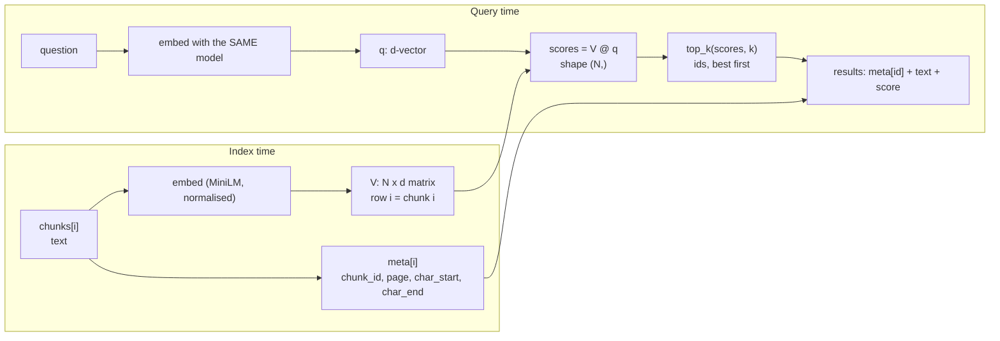

# P5 — Vector search: exact top-k, ties, metadata, hidden defaults, and when ANN is needed

> **What this file is.** The lesson for concept **P5** ([02 card](../02_RAG_MASTER_LEARNING_PLAN.md#p5)). It follows the Parts A–M template of [07](../07_SAMPLE_LESSON.md), at a smaller scale, like [P1](P1_llm_fundamentals.md).
> **How to use it.** Answers are hidden in collapsible blocks. Write your answer first, then open the block. Lines marked `> 🧭 Coach:` are instructions for the AI tutor; they add to [05 §3](../05_LEARNING_AND_RETENTION_SYSTEM.md#3-coaching-rules-for-the-ai-tutor) and cannot override it.
> **Labels.**
> - **UNVERIFIED**: not checked by running code or reading the primary source.
> - **Toy illustration**: numbers computed on made-up data, never a result about a real system.
> - **Machine-specific**: a timing from one laptop under its load at the time; the shape of the curve matters, not the digits.
>
> Every number in this lesson comes from the local run of 2026-10-08 ([P5_FACTS.md](../sources/verification/P5/P5_FACTS.md): S1–S8 for measurements, S-src for citation checks, LT for the lab test), from a derivation shown in the text, or carries a label. No Groq or Cohere call was made. faiss and LangChain were **not** run.

## Lesson header

| Field | Value |
|---|---|
| Concept | **P5 Vector search**: exact k-NN in NumPy (one matrix-vector product, then `argpartition` and a sort), checked against brute force; top-k with ties; metadata stored alongside vectors; the hidden defaults of a vector store (distance, k, filter order); HNSW/IVF trade-offs (recall vs latency vs memory) and when exact search is enough. |
| Phase / tier | Phase 1, Prerequisites. Priority **E**; the ANN internals sub-part (D.7) is **U** (understand only, kept short). |
| Prerequisites | **P4** (embeddings, cosine as a dot product of unit vectors). |
| Comes next | **C3** embedding and indexing with metadata · **C4** retrieval with k (MC-005) · **P6** retrieval metrics (Recall@k needs a correct top-k) · **D4** scale (ANN, discussed only). |
| Open misconceptions | **MC-002** "similarity matrix", no query-embedding step ([log](../progress/misconception_log.md)): this lesson is its main remediation. **MC-005** one-sided k trade-off: D.6 and L. O1-Q06 (NumPy top-k) was **not attempted** ([session #1](../progress/session_log.md)); lab Task 4 is the fix. |
| Time | A: 10 min · book reading: 15 min · B–D: 40 min · E–G: 15 min · H (lab): 60 min · J–K: 15 min · L: 15 min · M: 5 min. May be split across two days. Part I does not apply. |
| Mastery (P5 → `applied`) | Without notes, you can: (1) say what retrieval computes after the query is embedded (one score per chunk, not a matrix); (2) write `top_k` with `argpartition` and a deterministic tie rule, and show it equals a brute-force reference; (3) keep metadata aligned with vector rows and return page-cited results; (4) name the defaults a store decides for you (distance, k, filter order); (5) state with a number why v0 does not need ANN. Lab: `coding_independence_0_3 ≥ 2`. |
| Mastery (P5 → `transfer`) | You also pass a fresh novel-scenario item (L.3) and score `debugging_0_3 ≥ 2` in the lab. |

> 📖 **Read in the book** — do this **after Part A, never before** (Part A must be closed-book). About 15 minutes. Paraphrase each page in one line in your notes.
>
> | Page | What to look for |
> |---|---|
> | Ch1 p.6/14 | Step 5: where the vectors go. Note the two claims: FAISS is called a **database**, and search is fast **with millions** of entries. Keep both for B.2. |
> | Ch1 p.7/14 | The 5-step preparation sketch. Step 5 is what this lesson builds. |
> | Ch1 p.8/14 | Steps 6–7. Two things: the query goes through the **same** embedding process (MC-002), and the usual **top 2 to 5** chunks. |
> | Ch1 p.9/14 | The scatter figure: one query dot, the three nearest chunk dots. That picture is one score per chunk. |
> | Ch1 p.10/14 | The query-processing sketch, steps 2–4: embed, search top-K nearest, then fetch the text. Step 4 is the metadata lookup (D.4). |
> | App p.22/23 | Glossary: **Top-K Retrieval** (note the redundancy warning) and **Vector Database / Vector Store**. |
> | App p.16/23, p.21/23 | Glossary: **FAISS** and **Similarity Search**. Compare their wording with what the repo code actually builds (G.2). |
> | Later, after D.3 | Ch15 p.1/12: the redundancy problem, which is what ties and duplicates look like in practice. |

### Source map

| Source | Where | What it contributes |
|---|---|---|
| Book (A) | Ch1 p.6–10/14, p.13/14; App p.15/23, p.16/23, p.21/23, p.22/23; Ch11 p.6/13; Ch12 p.8/14; Ch13 p.6/13; Ch14 p.7/13; Ch15 p.1/12, p.10/12 | The pipeline position of vector search, top-K, the glossary terms. **No** HNSW, IVF or approximate search anywhere in the book (S-src scan). |
| Repo (B) | `simple_rag.ipynb` cells 10, 13; `helper_functions.py` L4, L48–L74; `simple_csv_rag.ipynb` cells 12, 16; `json_rag.ipynb` cells 17, 21, 23; `dartboard.ipynb` cells 9, 13, 23; `multi_faceted_filtering.ipynb` cells 12, 14 | How the repo builds stores, where k and the distance are set (or not), and how ids lead back to text |
| Library source (read, not run) | `langchain_community` 0.4.1 `vectorstores/faiss.py`, `langchain_core` 1.3.0 `vectorstores/base.py`, in the learner's older venv (not the project env) | The defaults: L2, k = 4, post-filter with `fetch_k = 20` |
| Lab verification | [`sources/verification/P5/`](../sources/verification/P5/): `p5_measure.py`, `p5_sources.py`, saved outputs, [`P5_FACTS.md`](../sources/verification/P5/P5_FACTS.md) | Every measured number |
| Source C (external) | #22 HNSW paper, #23–#25 FAISS papers and docs ([01 §6](../01_SOURCE_INVENTORY.md#6-source-c--supplementary-references-external)) | D.7 only; not run here |

### Contents

[Part A](#part-a--prior-knowledge-recovery) · [B](#part-b--why-p5-exists) · [C](#part-c--intuition-and-analogy) · [D](#part-d--technical-mechanism) · [E](#part-e--connections) · [F](#part-f--worked-example-by-hand) · [G](#part-g--source-connection) · [H](#part-h--implementation-progression) · [I](#part-i--controlled-experiment) · [J](#part-j--failure-and-debugging) · [K](#part-k--engineering-decisions) · [L](#part-l--assessment) · [M](#part-m--retention) · [References](#source-references) · [Verification log](#verification-log)

---

## Part A — Prior knowledge recovery

Answer the five questions **before** reading on: 1–3 sentences each, no notes, no book. Wrong answers are useful; they tell the tutor where to start.

> 🧭 Coach: Ask **one item at a time** (CR-01), in the exact wording below, with its reply template. Record confidence 1–3 before revealing anything (CR-16). Score with the Recall or Application rubric ([05 §4.2](../05_LEARNING_AND_RETENTION_SYSTEM.md#42-graded-rubrics-04)). These are unscheduled recall items: log them; a score ≤ 1 follows the ≤ 1 row of [05 §5.2](../05_LEARNING_AND_RETENTION_SYSTEM.md#52-spaced-repetition-schedule). Do not correct in detail yet; route with the table after P5-A5. Then send the learner to the "Read in the book" box.

**P5-A1.** A user types a question. What happens to it before the system can find the best chunks?

*Reply template:* "First the question is ____. Then the system computes ____ for each ____."

<details><summary>What a strong answer contains</summary>

- The question is **embedded with the same model** (and the same normalisation) used for the chunks (Ch1 p.8/14).
- Then **one score per chunk**: the dot product of the query vector with each chunk vector (cosine, because the vectors have length 1). For our 91 chunks that is 91 numbers, shape `(91,)` (S3).
- The top-k scores win, and their ids are looked up to get text and page.
- ⚠️ MC-002 flags: no embedding step; "a similarity matrix". All-pairs chunk scores would be 91 × 91 = 8,281 numbers; retrieval does not compute them (S3).

</details>

**P5-A2.** What is the trade-off when you choose k?

*Reply template:* "k is ____. Too small: ____. Too large: ____."

<details><summary>What a strong answer contains</summary>

- **Too small:** the evidence may sit at rank k + 1 and is lost (a retrieval failure).
- **Too large:** more noise, more prompt tokens and cost, evidence diluted (a generation risk). Doubling k from 4 to 8 grows the v0 prompt ×1.86 ([P1 S10](../sources/verification/P1/P1_FACTS.md)).
- The right k is **measured** on an eval set (P6, C4), not chosen by feel.
- ⚠️ MC-005 flag: only one side of the trade-off.

</details>

**P5-A3.** You have a NumPy array of one million scores. How would you get the positions of the 4 largest?

*Reply template:* "I would use ____, because ____."

<details><summary>What a strong answer contains</summary>

- `np.argpartition(-scores, 3)[:4]` finds the 4 best **without sorting the whole array**, then sort just those 4 by score. (`np.argsort(-scores)[:4]` is correct but sorts everything: 18.47 ms vs 2.57 ms on 500,000 scores, S8, machine-specific.)
- Boundary: the minus sign (largest first) and ties (equal scores need a rule, D.3).

</details>

**P5-A4.** When you use FAISS, where do the chunk text and page number live?

*Reply template:* "FAISS itself stores ____. The text and page live ____."

<details><summary>What a strong answer contains</summary>

- FAISS is a **library of vector indexes**: it stores vectors and returns row numbers and distances. The book calls it a database (Ch1 p.6/14; App p.16/23); 04 already flags this as DV-04.
- Text and metadata live **next to it**: LangChain keeps a docstore plus an `index_to_docstore_id` map (`simple_csv_rag.ipynb` cell 12; `dartboard.ipynb` cell 13); `json_rag.ipynb` keeps a parallel Python list (cell 17).

</details>

**P5-A5.** When would you need an approximate index such as HNSW instead of scoring every vector?

*Reply template:* "When ____, because ____. The price is ____."

<details><summary>What a strong answer contains</summary>

- When exact search is **too slow or too big for the budget**: many vectors (hundreds of thousands and up on a laptop, S8), high query volume or a tight latency target.
- The price: lower **recall** (it can miss a true top-k item), more memory or build time, and parameters to tune (D.7, UNVERIFIED for our data).
- Our corpus: 91 chunks, 14.4 µs per query (S8). The whole book would be 480 chunks. Exact search is enough.

</details>

> 🧭 Coach: **Routing.**
>
> | Weak answers (score ≤ 1) | Action |
> |---|---|
> | P5-A1 | MC-002 is live. Teach D.1 and D.2 slowly; do lab Task 5 with its shape prediction **before** anything else in the lab. |
> | P5-A2 | Note MC-005. Use the CR-08 probe in Part F and the k row of D.6. |
> | P5-A3 | Expected (O1-Q06). Teach D.2–D.3 with Part F by hand, then lab Tasks 3–4. |
> | P5-A4 | Teach D.4 and G.2 (docstore and id map). |
> | P5-A5 | Teach D.6 first (the numbers), then D.7. |
> | All five ≥ 3 with confidence 3 | Offer the fast track: skim B–C, then D.3–D.6, the lab and L (evidence is never skipped, [02 §5](../02_RAG_MASTER_LEARNING_PLAN.md#5-fast-track-rules-from-the-o1-diagnostic) rule 1). |

---

## Part B — Why P5 exists

### B.1 A store you cannot reproduce

The repo's standard store is built with one call: `FAISS.from_documents(cleaned_texts, embeddings)` (`helper_functions.py` L74; `simple_rag.ipynb` cell 10). That line names **no distance** and **no index type**. The k appears later and differs per notebook: 2 in `simple_rag.ipynb` cell 13; across the repo the literal values are 1, 2, 3, 4, 5 and 10 (S-src). In `simple_csv_rag.ipynb` cell 16 the retriever is `as_retriever()` with **no k at all**. So three decisions that change which chunks the LLM sees are made by library defaults. Reading the library source (D.5): the distance is L2, k is 4, and a metadata filter is applied after fetching 20. If you cannot write those three facts down, you cannot reproduce or explain a retrieval result.

> 🧭 Coach: CR-17. Ask one question: "Which settings did that one-line store setup leave to the library?" Expected: the distance, the default k and the filter order.

### B.2 The book's scale is not our scale

The book presents FAISS as a database that stays fast with millions of entries (Ch1 p.6/14, p.13/14). True for FAISS's design, but not our situation. Our corpus is **91 chunks**; chunking all 25 book PDFs the same way gives **480 chunks** (S8). At that size the whole index is 0.7 MB and an exact search takes about 0.02 ms (S8, synthetic vectors of that count). We need correctness and reproducibility first, not speed.

---

## Part C — Intuition and analogy

**Exact search is a teacher marking every exam.** The query is the answer key. The teacher compares it with every student's paper (every chunk) and writes **one mark per paper**: a single column of marks, not a table of every paper against every other paper (MC-002). Top-k is the podium: the k best marks.

**Ties need a rule announced in advance.** If two papers score the same, "whoever I happened to pick up first" is not a rule. "Lower student number first" is.

**Metadata is the name on each paper.** The mark sheet only has row numbers. If someone removes one paper from the pile but not its name from the list, every mark below it is credited to the wrong student (D.4).

**ANN is a teacher who only marks the papers in the most promising piles.** Much faster with a huge class; sometimes the best paper was in a pile that was never opened.

**Where the analogy breaks.** Marks here are similarities between vectors, and "the best" depends on the distance you choose (D.5).

> 🧭 Coach: CR-17. Stop here and ask one question: "For one query and 91 chunks, how many marks does the teacher write?" Expected: 91, one per chunk (shape `(91,)`), not 91 × 91.

---

## Part D — Technical mechanism

### D.1 The objects involved



- **Row i of `V` and position i of `meta` belong together.** That alignment is the whole "metadata alongside vectors" idea.
- Shapes for our corpus: `V` (91, 384) float32 = 139,776 bytes; `q` (384,); `scores` (91,) (S2, S3).

### D.2 Exact k-NN in NumPy

Three steps, all exact:
1. `scores = V @ q`: one matrix-vector product gives all N scores. With unit vectors, each score is the cosine.
2. `np.argpartition(-scores, k - 1)[:k]`: the k best positions, in **no promised order**. Cost grows with N, but it does not sort the whole array.
3. Order those k by score (highest first), with a tie rule (D.3).

> Predict first: for the D-002 question ("In what year was the Paris Agreement adopted?"), which page will the rank-1 chunk come from? The answer sentence is on p.10. Write a page, then open.

<details><summary>Measured top-5 (S3; a demo query, not an evaluation)</summary>

| Rank | chunk_id | Score | Pages | Starts with |
|---|---|---|---|---|
| 1 | 64 | 0.4623 | 23–24 | "e to 1.5 degrees Celsius. Countries submit nationally deter…" |
| 2 | **26** | 0.4336 | 10 | "…negotiating specific protocols and agreements, such as the Kyoto…" |
| 3 | 16 | 0.3751 | 6 | "…provide additional benefits, such as biodiversity conservat…" |
| 4 | 63 | 0.3366 | 23 | "…uable products, such as synthetic fuels, chemicals…" |
| 5 | 25 | 0.3166 | 9–10 | "Agroforestry…" |

- Chunk **26** is the only chunk that holds the whole evidence span (p.10, characters 438–537), and it is rank **2** (S3). With k = 1 it would be lost; with k = 4 it is in.
- The gap between rank 4 and rank 5 is only 0.0200; over the 33 page-head queries it ranges 0.00170–0.10103 (S3, S4). Small gaps are why ties and float precision matter.

</details>

**Checked against brute force (S4).** A pure-Python reference (float64, full `sorted` with the key (−score, id)) and the NumPy `top_k` returned **identical ordered ids** for 33/33 page-head queries and 200/200 random unit queries, at k = 1, 4 and 10. On the page-head queries the float32 and float64 scores differ by at most 1.00e-07.

### D.3 Ties and determinism

**Toy illustration** (S5): scores `[0.70, 0.90, 0.80, 0.80, 0.80, 0.10]`, k = 2. Position 1 is first; positions 2, 3, 4 tie for second. Our rule (06 §3.1: ties broken by `chunk_id`) gives `[1, 2]`.

**Real ties come from duplicates.** `dartboard.ipynb` cell 9 loads every document **5 times** to imitate a redundant collection. Replaying that on our chunks (5 × 91 = 455 rows), for D-002 (S5):
- the 5 copies of chunk 64 have **bit-identical** scores (0.462341845035553);
- the top-4 holds **1** distinct chunk, the top-10 holds **2**: copies crowd out everything else (the book's redundancy problem, Ch15 p.1/12);
- `argpartition` alone returned rows `[428, 337, 64, 246]` (copies 4, 3, 0, 2): which copies come back is **not specified**. With the tie rule: `[64, 155, 246, 337]`, the same as brute force.

**A passing test is not a guarantee.** NumPy's `argpartition` docstring says the order inside the partition is undefined (S4). In our runs it happened to come back sorted every time (33/33 real queries at k = 4; 100/100 random queries on a 10,000-vector index at each of k = 4, 10 and 50, S4). Code that relies on that is correct by luck. Sort explicitly.

> 🧭 Coach: CR-17. Ask one question: "Why might two runs return different chunk ids at the same scores?" Expected: tied scores plus an unspecified pick order; fix with an explicit tie rule.

### D.4 Metadata stored alongside the vectors

The pattern: keep `V` and `meta` as two aligned sequences and **never change one without the other**. Each result is `meta[id]` plus the score, e.g. rank 1 for D-002: `{'chunk_id': 64, 'page': 23, 'page_end': 24, 'char_start': 51200, 'char_end': 52200, 'score': 0.4623}` (S6).

40 of the 91 chunks cross a page break (S1). That is why `meta` stores `page_end` and character offsets, not just one page (C3 builds on this).

**Misalignment is silent (S6).** Delete row 0 from `V` but not from `meta`. For D-002 the top-4 rows are now 63, 25, 15, 62, and `meta` labels them chunks 63, 25, 15, 62. They really are chunks 64, 26, 16, 63. The second result would be cited as p.9 when the vector came from p.10. No error is raised. Guard: `assert len(V) == len(meta)` at load time, and store `chunk_id` inside each row's record.

**Filter before or after the search?** "Only chunks from page 25 onwards" keeps 23 of 91 chunks (S6).
- **Pre-filter:** give excluded chunks a score of −∞, then take top-k. 35 real queries: **0** came back with fewer than 4 results.
- **Post-filter** (LangChain FAISS with a `filter`: fetch 20, filter, keep k; D.5): **9 of 35** came back short (1 result: 1 query; 2: 4; 3: 4).

The repo does the same post-filtering by hand in `multi_faceted_filtering.ipynb` cell 14, on a top-10 from cell 12.

> 🧭 Coach: CR-17. Ask one question: "Why can a post-filter return fewer than k chunks?" Expected: only the top `fetch_k` are filtered; if few pass, the list is short (9 of 35 queries here).

### D.5 The hidden defaults

Read in the library source (langchain_community 0.4.1, langchain_core 1.3.0, the learner's older venv; **not run**, and the repo pins no version, S-src):

| Decision | Default | Where it is set |
|---|---|---|
| Distance / index | **L2 (Euclidean)**: `FAISS.from_documents` builds `IndexFlatL2` unless told `MAX_INNER_PRODUCT` | `faiss.py` L993, L998–L1001 |
| Normalisation | `normalize_L2=False`: vectors are stored as the embedder returns them | `faiss.py` L213 |
| k | **4** when no k is given | `faiss.py` L626 (`similarity_search`); `as_retriever()` starts with empty `search_kwargs` (`base.py` L973) and passes them on (L1043–L1045) |
| Filter | Post-filter: fetch `fetch_k = 20`, filter, return the first k | `faiss.py` L392, L417, L450 |
| Score → "relevance" | `1 − distance / √2`, which the code comments say assumes the Euclidean norm of **normalised** vectors | `base.py` L385–L388 |

In the repo's own raw FAISS code, **all 8** notebook cells that build an index use `faiss.IndexFlatL2`; there is no `IndexFlatIP`, HNSW or IVF anywhere in the repo (S-src).

> 🧭 Coach: CR-17. Ask one question: "If you never set a distance, which one does LangChain's FAISS store use?" Expected: L2 (Euclidean), through `IndexFlatL2`.

**Does L2 change the answer? Only if the vectors are not unit length.** For unit vectors, ‖q − x‖² = 2 − 2·cos(q, x), so smallest L2 = largest cosine = largest dot product. Measured on our 35 real queries: max deviation from that identity 1.31e-06; top-4 by dot, cosine and L2 identical for **35/35** (S7). MiniLM ends with a `Normalize` module, so even `normalize_embeddings=False` gave norms of exactly 1.000000 (S2).

**Toy illustration** (S7): stretch each chunk vector by a random factor in [0.5, 1.5], as a non-normalising embedder could. Now top-4 by dot = top-4 by cosine for **0/35** queries, L2 = cosine for **1/35**. For D-002: cosine `[64, 26, 16, 63]`, dot `[64, 26, 79, 63]`, L2 `[16, 85, 65, 26]`. Cosine itself is unchanged by the stretching (35/35).

**Score scales differ too** (S7, arithmetic): at cos = 0.8 the L2 distance is 0.6325 but the squared L2 is 0.4000, so `1 − d/√2` gives 0.5528 or 0.7172 depending on which one the index returns. Whether FAISS `IndexFlatL2` returns squared distances is **UNVERIFIED** here (faiss not run). Do not threshold on these "relevance" numbers without checking.

> 🧭 Coach: CR-17. Ask one question: "When do dot product, cosine and L2 rank chunks the same way?" Expected: when every vector has length 1.

### D.6 What exact search costs, and when it stops being enough

**Machine-specific** (i7-11800H laptop, 16 logical CPUs, NumPy 2.5.3 with OpenBLAS; median of repeats; S8). Index vectors are random unit vectors except the first row.

| N vectors | d | Index memory | Median time per query |
|---|---|---|---|
| 91 (our corpus, real MiniLM) | 384 | 0.14 MB | **0.0144 ms** |
| 480 (the whole book, if chunked the same way) | 384 | 0.7 MB | 0.024 ms |
| 1,000 | 384 | 1.5 MB | 0.051 ms |
| 10,000 | 384 | 15.4 MB | 0.187 ms |
| 100,000 | 384 | 153.6 MB | 6.092 ms |
| 200,000 | 384 | 307.2 MB | 11.883 ms |
| 500,000 | 384 | 768.0 MB | 32.189 ms |
| 100,000 | 1,536 (Cohere `embed-v4.0` size) | 614.4 MB | 23.315 ms |

- **Doubling N** (100k → 200k): time ×**1.95**. Exact search is linear in N × d: every vector is read once per query.
- **Doubling k** (4 → 8 at N = 100k): time ×**1.00**. k barely matters to search cost; it matters to the **prompt** (×1.86 tokens, P1 S10). That is the other side of MC-005.
- **Where the time goes** at 500k: the matrix-vector product is 26.36 ms; `top_k` 2.57 ms, against 18.47 ms for a full `argsort` (S8).
- **Batching helps:** 100 queries at once at N = 100k cost 0.538 ms per query, against 6.092 ms one by one (S8).

**When is exact enough?** Assumption: a retrieval budget of 10 ms per query on this laptop. Then, scaling the 100k measurement linearly (derived): about 164,000 vectors at d = 384, or about 43,000 at d = 1,536. Our book-scale index (480 vectors, 0.024 ms) sits about 400 times under that budget. **v0 does not need ANN**; it would add recall loss and parameters for no gain. Memory is the other wall: 1 million × 1,536 × 4 bytes = 6.1 GB (derived).

> 🧭 Coach: CR-17. Ask one question: "Why does v0 not need an ANN index?" Expected: 91 (or 480) vectors take about 0.02 ms per query, far under any budget; ANN would only add recall loss.

### D.7 ANN in brief (U-tier: understand, do not build)

From Source C #22–#25; **not run here, so every property below is UNVERIFIED for our data.**

| Index | Idea | Main knobs | Recall vs exact | Speed | Memory |
|---|---|---|---|---|---|
| Flat (exact) | Score every vector | none | 1 by definition | linear in N | N × d × 4 bytes |
| **IVF** | k-means splits vectors into `nlist` cells; a query scans only the `nprobe` nearest cells | `nlist`, `nprobe` | < 1; rises with `nprobe` | much faster when `nprobe` ≪ `nlist` | about flat, plus centroids; needs training |
| **HNSW** | A layered graph of near neighbours; the query walks greedily toward its nearest nodes | `M` (links per node), `efConstruction`, `efSearch` | < 1; rises with `efSearch` | very fast at large N | more than flat: the graph links |
| PQ (often with IVF) | Compress each vector into short codes | code size | lower | fast | much smaller |

- **How you would decide:** measure **Recall@k of ANN against exact top-k** on your own queries, plus latency and memory. Exact search is the ground truth an ANN index is graded against. That is why it comes first.
- ANN changes **retrieval quality**, never answer quality directly (CR-11).

> 🧭 Coach: CR-17. Ask one question: "What does an ANN index give up for its speed?" Expected: recall against the exact top-k.

---

## Part E — Connections

**P4** (cosine) → **P5** → **C3** (index with metadata), **C4** (choosing k), **P6** (Recall@k needs a correct top-k), Ch15 dartboard (diversity), **D4** (scale, ANN).

| Often confused | The difference |
|---|---|
| "Similarity matrix" vs score vector | One query gives one score per chunk, shape `(N,)`. A batch gives queries × chunks. Chunks × chunks is not retrieval (MC-002). |
| Cosine vs dot vs L2 | Same ranking **only** for unit vectors (D.5). |
| FAISS vs vector database | FAISS is an index library; text, metadata and persistence live elsewhere (DV-04). |
| Exact vs ANN | Exact has recall 1 and is linear in N; ANN trades recall for speed (D.7). |
| Pre-filter vs post-filter | Pre-filter always fills k when enough chunks pass; post-filter can come back short (D.4). |
| Retrieval k vs top-k **sampling** | Retrieval k = chunks returned. Top-k sampling (P1 D.6) limits next-token choices. Unrelated. |

---

## Part F — Worked example by hand

**Toy illustration** (made-up 3-d unit vectors; arithmetic below, re-checked in Python).

Query q = (0.6, 0.8, 0). Chunks: c0 = (1, 0, 0), c1 = (0, 1, 0), c2 = (0.8, 0.6, 0), c3 = (0, 1, 0), c4 = (0, 0.8, 0.6).

**Step 1.** Compute the five dot products, then top-2 with ties broken by the smaller id.

<details><summary>Answer</summary>

Scores: c0 = 0.6, c1 = 0.8, c2 = 0.48 + 0.48 = 0.96, c3 = 0.8, c4 = 0.64. Top-2 = **[2, 1]**: c1 and c3 tie at 0.8, and 1 < 3. Top-3 = [2, 1, 3].

</details>

**Step 2.** Rank by squared L2 distance instead. Same order?

<details><summary>Answer</summary>

‖q − c‖² = 2 − 2·score: 0.8, 0.4, 0.08, 0.4, 0.72. Smallest first: c2, then c1 and c3 tied, then c4, then c0. Same order, because all vectors have length 1.

</details>

**Step 3.** Now stretch c0 to (2, 0, 0). What are its dot product, cosine and L2 distance, and who is rank 1 under each?

<details><summary>Answer</summary>

Dot = 1.2 (rank 1 by dot). Cosine = 1.2 / 2 = 0.6 (rank 5, unchanged). L2 = √((2 − 0.6)² + 0.8²) = √2.6 ≈ 1.612 (the farthest). Three distances, three different answers: this is D.5 in one line.

</details>

> 🧭 Coach: CR-08 probe here, one question: "If the corpus doubles from 100,000 to 200,000 chunks, what happens to exact search time per query?" Expected: about ×2 (measured ×1.95, S8), because every vector is scored once. Follow-up on a later turn: "And if k doubles?" Expected: search time about the same (×1.00), prompt tokens ×1.86 (P1 S10).

---

## Part G — Source connection

### G.1 Book (Source A)

| Cite | Book point (paraphrased) | Our assessment |
|---|---|---|
| Ch1 p.6–7/14 | Step 5: vectors go into a database built for similarity search; FAISS is the popular choice and stays fast with millions of entries | FAISS is an index library (DV-04); at our scale speed is not the issue (B.2) |
| Ch1 p.8–9/14 | Embed the query by the same process; retrieve the nearest chunks, typically the top 2 to 5; the figure shows three | MC-002 fix; one score per chunk; the k range is a starting point to measure |
| Ch1 p.10/14 | Query sketch: search for top-K nearest vectors, then retrieve the matching text | Step 4 is the metadata lookup (D.4) |
| Ch1 p.13/14 | Latency is one embedding call plus one vector search plus one LLM call | Measured: the search part is 0.0144 ms here |
| App p.15/23 | Cosine similarity ranges from −1 to 1, higher is more similar | Matches; Ch12 p.8/14 says the same |
| App p.16/23, p.21/23, p.22/23 | Glossary: FAISS, similarity search ("closest" stored vectors), vector database / vector store | "Closest" hides the distance choice; no k default, no metadata alignment (D.5) |
| App p.22/23 | Top-K retrieval returns the K highest-scoring chunks; simple and fast but prone to redundancy | Ties and duplicates (D.3) |
| Ch11 p.6/13; Ch14 p.7/13 | Entries carry a pointer back to the parent chunk; hierarchical search filters chunks by section identifiers in metadata | The book does use metadata alongside vectors, for parents and filters |
| Ch13 p.6/13 | Vector search is fast because chunk embeddings are precomputed; only the query is embedded at query time | Index time vs query time (D.1) |
| Ch15 p.1/12, p.10/12 | Near-identical chunks fill the top-K; plain top-K is simpler and faster than diversity-aware selection | D.3 measured it: 1 distinct chunk in the top-4 |

**Not in the book:** HNSW, IVF, "approximate nearest", `argpartition` (whole-book scan, S-src). Not found on the pages read: tie handling, the distance default, pre- vs post-filtering.

### G.2 Repo (Source B): cells verified at `009adba`

| Cell (0-based) / line | What it shows | Lesson |
|---|---|---|
| `helper_functions.py` L4, L48–L74 | `encode_pdf` → `OpenAIEmbeddings()` → `FAISS.from_documents(cleaned_texts, embeddings)`; no distance, no index type | B.1, D.5 |
| `simple_rag.ipynb` 10, 13 | Same `encode_pdf`; retriever `search_kwargs={"k": 2}` | k is set far from the store |
| `simple_csv_rag.ipynb` 12 | `faiss.IndexFlatL2(...)` + `InMemoryDocstore()` + `index_to_docstore_id={}` | The id → docstore pattern: metadata lives beside the index |
| `simple_csv_rag.ipynb` 16 | `vector_store.as_retriever()` with no k | Hidden default k = 4 |
| `json_rag.ipynb` 17, 21, 23 | A parallel `corpus_metadata` list (17); `IndexFlatL2` + `index.add` (21); `index.search(query_embedding, NUM_NEIGHBORS)` with 5 (23) | Our D.4 pattern, by hand |
| `dartboard.ipynb` 9 | `documents=documents*5` before `FAISS.from_documents` | Duplicates → ties (D.3) |
| `dartboard.ipynb` 13 | Raw `index.search`; row → `index_to_docstore_id[idx]` → `docstore.search`; the query embedded with `embed_documents` | Metadata lookup by hand |
| `dartboard.ipynb` 23 | Oversample `k = num_results × oversampling_factor`; `reconstruct_batch`; `1 − np.dot(...)` as a cosine distance on an L2 index | Assumes unit vectors (true for OpenAI embeddings per the LangChain comment; UNVERIFIED) |
| `multi_faceted_filtering.ipynb` 12, 14 | Top-10, then `apply_metadata_filter` keeps only `country == "Chile"` | Post-filter can return < k (D.4) |

**Corrections to the [04 P5 row](../04_BOOK_TO_CODE_MAPPING.md)** (04 is not edited; see also the Verification log):
1. 04 cites only Ch1 p.6/14. The top-K pages (Ch1 p.8/14, p.10/14) and the glossary (App p.16/23, p.21/23, p.22/23) are missing; the 02 card has p.16 and p.22.
2. 04 attributes "flat L2 default" to `simple_rag.ipynb` cell 10. The cell only calls `FAISS.from_documents`; the L2 default comes from the LangChain source (D.5), which the repo does not pin. The k for that store is in cell **13** (k = 2), not listed.
3. 04's check "NumPy exact k-NN vs FAISS `IndexFlatIP` on 100 queries; time both" cannot run in the project env (faiss is not installed and is not to be added). It would also test inner product, while the repo's default is `IndexFlatL2`. This lesson verifies against a brute-force reference instead (S4: 233 queries × 3 values of k).
4. 04 lists "metadata storage" as something the book is silent on. Ch11 p.6/13 (parent pointer in metadata) and Ch14 p.7/13 (filter by section identifiers) do use it, though without describing storage.
5. The `json_rag.ipynb` metadata list is in cell **17**; cell 21 only builds the index. `dartboard.ipynb` cells 9, 13, 23 (the 02 card cites 23) are the clearest raw-index examples and are not in 04.

**Reading order:** `simple_rag.ipynb` 10 → 13 → `simple_csv_rag.ipynb` 12, 16 → `json_rag.ipynb` 17, 21, 23 → `dartboard.ipynb` 9, 13, 23. For each, write in the margin: which distance, which k, where the text lives.

---

## Part H — Implementation progression

### H.1 The lab: [`labs/P5_vector_search_lab.ipynb`](../labs/P5_vector_search_lab.ipynb) (blank-file first)

The notebook gives tasks, empty code cells, prediction cells and CHECK cells. It has **no solution code**; the CHECK cells compare fingerprints (LT).

| # | Task | The checks test |
|---|---|---|
| 1 | Plain 1000/200 windows with aligned `meta` (chunk_id, page, char_start, char_end) | 91 chunks; the page list fingerprint |
| 2 | Predict the raw norm; embed with MiniLM | `V` float32 (91, 384), unit rows |
| 3 | `brute_force_top_k` in plain Python | Toy ties, no NumPy sorting used |
| 4 | Predict the toy top-2; `top_k` with `argpartition` and the tie rule | 300 tie-heavy random trials equal brute force |
| 5 | Predict the score shape and the top page; search D-002; build `results` | `scores.shape == (91,)` (MC-002); top-4 ids and pages |
| 5b | Predict distinct chunks; the ×5 duplicated index | Tie rule on real data |
| 6 | Predict; pre-filter vs post-filter on 35 queries | The short-result counts |
| 7 | Predict; dot vs cosine vs L2, unit and toy-stretched | The four counts |
| 8 | Predict three numbers; time N = 91 … 200k, k = 4 vs 8 | Loose bounds: k barely matters, N ×2 ≈ time ×2 |
| 9 | Write the "why v0 needs no ANN" sentence with your numbers | Graded by the tutor (Transfer) |

API names you may look up: `np.argpartition`, `np.lexsort`, `np.flatnonzero`, `np.where`, `np.tile`, `np.linalg.norm`, `SentenceTransformer.encode(normalize_embeddings=...)`, `time.perf_counter`. The reference implementation is `sources/verification/P5/p5_measure.py`.

> 🧭 Coach: The reference script is a **solution**. Do not show it before an attempt plus a hint (CR-04). Grade `coding_independence_0_3` on Tasks 3, 4 and 6, and `debugging_0_3` on any failing CHECK the learner fixes. Task 5's shape assert is the MC-002 check: if it fires, ask "How many scores does one query need?" before anything else.

### H.2 Repo reading guide: `dartboard.ipynb` cells 9, 13 and 23

Answer each question before opening.
1. In cell 13, how does a row number from `index.search` become text?
2. Cell 9 multiplies the documents by 5. What will plain top-k return for a common question?
3. Cell 23 computes `1 − np.dot(...)` on vectors from an `IndexFlatL2` store. What does that silently assume?
4. Cell 13 embeds the query with `embed_documents`, not `embed_query`. When would that matter?

<details><summary>Answers</summary>

1. `index.search` returns distances and row numbers; the row goes through `index_to_docstore_id[idx]` to a docstore id, then `docstore.search(...)` returns the Document.
2. Several copies of the same chunk (measured on our data: 1 distinct chunk in the top-4, D.3).
3. That the vectors have length 1, so the dot product is the cosine. The L2 index does not enforce that.
4. When a model embeds queries and documents differently (some models use a query prefix or a separate input type; UNVERIFIED for the repo's OpenAI model). Then the query would be in the "document" form, a quiet mismatch (MC-002's "same model, same process").

</details>

### H.3 Reusable design (future `ragkit/`; nothing is created now)

- `search(V, meta, q, k, keep=None)`: exact cosine, **pre-filter**, ties by `chunk_id` (06 §3.1); load-time asserts `len(V) == len(meta)`, float32, unit rows, `meta[i]["chunk_id"] == i`.
- A unit test `top_k == brute_force_top_k` on tie-heavy arrays (lab CHECK 4). Each trace stores k, the distance, the filter, ids, scores and the embedder id.
- Any future ANN index (D4) ships with a Recall@k-vs-exact report on the eval queries.

---

## Part I — Controlled experiment

**n/a for P5 (prerequisite concept, toy data only).** P5 changes no pipeline variable on the eval set. Exact search is the v0 baseline that later experiments (k sweeps in C4, ANN in D4) are compared against.

---

## Part J — Failure and debugging

For each: write your predicted cause and fix, then open. Each diagnosis says **retrieval** or **generation** (CR-11).

**J1. "Same query, different order on another machine."**

<details><summary>Diagnosis</summary>

- **Cause.** `argpartition` output used without sorting, or ties left in whatever order the algorithm gives (D.3). **Kind:** retrieval (rank order changes MRR and which chunk leads the prompt).
- **Fix.** Sort by (−score, chunk_id); test against brute force on tie-heavy arrays.

</details>

**J2. All four retrieved chunks say the same thing.**

<details><summary>Diagnosis</summary>

- **Cause.** Duplicate chunks in the index (`dartboard.ipynb` cell 9 does it on purpose): 1 distinct chunk in the top-4 (D.3). **Kind:** retrieval (evidence coverage), which then starves generation.
- **Fix.** Deduplicate at index time (content hash), or diversity-aware selection (Ch15) after measuring.

</details>

**J3. Answers cite the wrong page, but the text is right.**

<details><summary>Diagnosis</summary>

- **Cause.** `V` and `meta` out of alignment (D.4). **Kind:** retrieval provenance; it surfaces as wrong citations in answer metrics and wrong pages in page-level retrieval scoring.
- **Fix.** `assert len(V) == len(meta)`; store `chunk_id` in each record and check `meta[i]["chunk_id"] == i`.

</details>

**J4. A filtered search returns 2 chunks when k = 4.**

<details><summary>Diagnosis</summary>

- **Cause.** Post-filtering: only the top `fetch_k` were filtered (9 of 35 queries came back short, D.4). **Kind:** retrieval.
- **Fix.** Pre-filter (mask, then top-k), or raise `fetch_k` and assert the result length.

</details>

**J5. After switching embedders, a few chunks win almost every query.**

<details><summary>Diagnosis</summary>

- **Cause.** The new model does not normalise, and the store ranks by dot product or L2, so vector length changes the ranking (toy: dot = cosine for 0/35 queries, D.5). **Kind:** retrieval.
- **Fix.** Normalise at index and query time (or rank by cosine); assert row norms ≈ 1.

</details>

> 🧭 Coach: For J1 and J3, ask for the **one-line assert** that would have caught it. It counts as evidence for `debugging_0_3`.

---

## Part K — Engineering decisions

| Question | Decision | Why |
|---|---|---|
| Index for v0 | Exact NumPy search, `V` float32 in memory | 91–480 vectors; ≈ 0.02 ms; recall 1 (D.6) |
| Distance | Cosine = dot product on unit vectors; normalise both sides | All three rankings agree only then (D.5) |
| k | 4 in v0 (06 §3.1), then measured (C4, P6) | Book's 2–5 is a starting range; the repo uses 1–10 |
| Ties | By `chunk_id` | Deterministic, testable (06 §3.1) |
| Filters | Pre-filter | Never returns fewer than k when enough chunks pass (D.4) |
| Verification | `top_k` == brute force in a unit test | Correct by test, not by luck (D.3) |
| ANN | Not in v0. Revisit only when exact search breaks a stated latency or memory budget, and then report Recall@k vs exact | D.6, D.7 |

**When NOT to use exact search:** hundreds of thousands of vectors or more with a tight per-query budget, many concurrent queries, or an index that no longer fits in RAM. Even then, keep exact search as the yardstick for ANN recall.

---

## Part L — Assessment

One short question per item, with a reply template. Score with [05 §4.2](../05_LEARNING_AND_RETENTION_SYSTEM.md#42-graded-rubrics-04).

> 🧭 Coach: Ask one item at a time, with its template. Never put two questions in one turn. Record confidence first.

### L.1 Recall

**P5-R-01** (MC-002 check item). After the question is embedded, what exactly does retrieval compute?
*Template:* "It computes ____, one for each ____, giving an array of shape ____."

<details><summary>Criteria for 4</summary>

The query is embedded with the same model; one score (cosine/dot of unit vectors) per chunk; shape (N,), e.g. (91,). Boundary: not an N × N matrix; a batch of Q queries gives Q × N.

</details>

**P5-R-02.** Which three choices does a vector store make for you if you do not set them?
*Template:* "The ____, the ____ and the ____."

<details><summary>Criteria for 4</summary>

Distance (L2 in LangChain FAISS), k (4), filter order (post-filter, `fetch_k` 20). Plus one consequence: L2 ≠ cosine for non-unit vectors, or post-filter returning fewer than k.

</details>

**P5-R-03.** What does an ANN index give up in exchange for speed?
*Template:* "It gives up ____, and you measure that with ____."

<details><summary>Criteria for 4</summary>

Recall (it may miss true top-k items); measured as Recall@k against exact search on your own queries. Plus a cost: memory (HNSW links) or training (IVF), and knobs to tune.

</details>

### L.2 Application

**P5-A-01** (by hand). Scores `[0.3, 0.9, 0.5, 0.9, 0.1]`, k = 3, ties by smaller id. Which ids, in order?
*Template:* "[____, ____, ____], because ____."

<details><summary>Criteria for 4</summary>

[1, 3, 2]: 1 and 3 tie at 0.9 (1 first), then 2 at 0.5. Self-check: three ids, scores non-increasing.

</details>

**P5-A-02** (CR-08). The corpus doubles from 100,000 to 200,000 chunks. What happens to exact search time per query?
*Template:* "It roughly ____, because ____."

<details><summary>Criteria for 4</summary>

About doubles (measured ×1.95, S8): every vector is scored once, so time is linear in N × d. Self-check: memory doubles too (153.6 → 307.2 MB). Contrast: doubling k changes search time ×1.00.

</details>

**P5-A-03** (debugging). This passes on our data. What is wrong with it?

```python
def top_k(scores, k):
    return np.argpartition(-scores, k - 1)[:k]
```

*Template:* "The bug is ____. It passes because ____. The fix is ____."

<details><summary>Criteria for 4</summary>

No ordering and no tie rule; the docstring says the order is undefined. It passed because, on our arrays, the output happened to come back sorted (33/33, S4). Fix: sort the k by (−score, id); add a brute-force test with ties.

</details>

**P5-A-04.** You filter to "page ≥ 25" after taking the top 20. Why might you get fewer than 4 chunks?
*Template:* "Because ____. I would ____."

<details><summary>Criteria for 4</summary>

Only the top 20 are filtered; if fewer than 4 of them pass, the result is short (9/35 queries, D.4). Pre-filter instead, or raise `fetch_k` and assert the length.

</details>

### L.3 Transfer

> 🧭 Coach: P5-T-01 is a practice item. For the scored CR-13 item, make up a fresh scenario (new data type, scale or constraint) that is not in this file, and grade it with the Transfer rubric.

**P5-T-01.** A support team has 2 million help-desk tickets, embedded at 1,536 dimensions, and needs answers in under 50 ms. What do you recommend first?
*Template:* "First I would ____. I expect ____ because ____."

<details><summary>Criteria for 4</summary>

- Size it: 2M × 1,536 × 4 bytes ≈ 12.3 GB (derived); exact search at ≈ 23 ms per 100k (S8, machine-specific) scales to roughly 0.5 s per query, far over 50 ms. So ANN (HNSW or IVF), or smaller vectors (fewer dimensions, compression), or both.
- Keep an exact-search baseline on a sample to measure ANN Recall@k; choose `efSearch`/`nprobe` by the recall-latency curve.
- Metadata filters (product, date): prefer filtering inside the index or pre-filtering; post-filtering may return too few.
- When not to: if traffic is low and a filter cuts the candidates to a few thousand, exact search on the filtered subset may be enough. Keep retrieval metrics separate from answer metrics.

</details>

### L.4 When is P5 mastered?

- **`applied` (L3):** P5-R-01 ≥ 3 on two different days, one ≥ 24 h after teaching; two Application items ≥ 3; `coding_independence_0_3 ≥ 2` on lab Tasks 3, 4, 6.
- **MC-002 closes** when two of its check items (P5-R-01; the C4 `top_k` code item) score ≥ 3, unassisted, on different days ([log rule](../progress/misconception_log.md)).
- **`transfer` (L4):** a fresh novel-scenario item ≥ 3; `debugging_0_3 ≥ 2`; a teach-back ≥ 3.

---

## Part M — Retention

### M.1 Flashcards

| # | Front (one question) | Back |
|---|---|---|
| 1 | What does one query produce against N chunks? | N scores, shape (N,) |
| 2 | Cosine as code, for unit vectors? | `V @ q` |
| 3 | Which NumPy call finds the top k without a full sort? | `np.argpartition` |
| 4 | Is `argpartition` output ordered? | No (undefined); sort it |
| 5 | v0 tie rule? | Smaller `chunk_id` first |
| 6 | Where do text and page live in a FAISS setup? | A docstore / list aligned by row |
| 7 | LangChain FAISS default distance? | L2 (`IndexFlatL2`) |
| 8 | LangChain default k? | 4 |
| 9 | When do dot, cosine and L2 rank the same? | When all vectors have length 1 |
| 10 | Exact search time vs N? | Linear: N ×2 → time ×1.95 |
| 11 | Exact search time vs k? | About the same (×1.00) |
| 12 | Our corpus size; the whole book? | 91 chunks; 480 chunks |
| 13 | What does ANN trade away? | Recall, measured against exact top-k |

### M.2 Retrieval practice (closed book; log per [05 §5.1](../05_LEARNING_AND_RETENTION_SYSTEM.md#51-active-recall-what-a-review-item-looks-like))

| When | One question | Template |
|---|---|---|
| Day 1 | What does retrieval compute after embedding the query? | "One ____ per ____." |
| Day 3 | Scores `[0.2, 0.7, 0.7, 0.4]`, k = 2: which ids? | "[____, ____]" |
| Day 7 | Why does v0 not need an ANN index? | "Because ____ vectors take ____ ms." |
| Day 14 | When do L2 and cosine rank chunks differently? | "When ____." |

<details><summary>Day-3 answer</summary>

[1, 2]: ids 1 and 2 tie at 0.7; both are in, smaller id first.

</details>

### M.3 Teach-back prompt ([05 §5.4](../05_LEARNING_AND_RETENTION_SYSTEM.md#54-teach-back-protocol))

"In 3 minutes, explain to a new teammate how our system finds the 4 chunks for a question, and why we do not use FAISS's defaults blindly." A 4 needs: same-model query embedding; one score per chunk; argpartition + tie rule; metadata alignment; one measured number (91 chunks, ≈ 0.0144 ms, or ×1.95 for N ×2); one hidden default (L2, k = 4, post-filter).

### M.4 Interleaving links

**P4:** cosine = dot of unit vectors (D.5 follows from it). **P1:** k ×2 grows the prompt ×1.86 while search time stays ×1.00. **C4 / MC-005:** choose k by Recall@k vs context tokens.

### M.5 Misconception-log entries to add when observed

| Label | Correct model (short) | Root cause | Severity | Check items |
|---|---|---|---|---|
| "FAISS is a database that stores my text" | An index library; text and metadata live in a docstore/list | terminology (book DV-04) | medium | P5-A4, P5-R-02 |
| "Cosine, dot and L2 always agree" | Only for unit vectors | over-generalisation | medium | Part F step 3, P5-R-02 |
| "`argpartition` returns the top k in order" | Order undefined; sort explicitly | API misreading | medium | P5-A-03 |
| "Bigger k makes search slower" | Search ×1.00; the prompt grows instead | wrong cost model | low | P5-A-02 |

### M.6 Progress-tracker entry (format only; fictional values, per [05 §6.1](../05_LEARNING_AND_RETENTION_SYSTEM.md#61-progressconcept_trackercsv))

```csv
P5,Vector search,1,E,exposed,<YYYY-MM-DD>,,,<YYYY-MM-DD +1>,1,,,,,,,na,MC-002,1,log:<YYYY-MM-DD>#P5-R-01
```

---

## Source references

**Book (Source A).** Ch1 p.6/14, p.7/14, p.8/14, p.9/14, p.10/14, p.13/14; App p.15/23, p.16/23, p.21/23, p.22/23; Ch11 p.6/13; Ch12 p.8/14; Ch13 p.6/13; Ch14 p.7/13; Ch15 p.1/12, p.10/12. Checked against the PyMuPDF page text by `p5_sources.py` on 2026-10-08. Paraphrased; no quotation reaches 15 words.

**Repo (Source B)**, `NirDiamant/RAG_Techniques` @ `009adba2be1bef49780ef73b6dd3c18fd24b035b`, cells 0-based: `helper_functions.py` L4, L48–L74; `all_rag_techniques/` `simple_rag.ipynb` 10, 13; `simple_csv_rag.ipynb` 12, 16; `json_rag.ipynb` 17, 21, 23; `dartboard.ipynb` 9, 13, 23; `multi_faceted_filtering.ipynb` 12, 14; the eight `IndexFlatL2` cells listed in P5_FACTS S-src; `data/Understanding_Climate_Change.pdf` (sha256 `1d58a0fa…92669`).

**Library source (read as text, not run, outside the project env):** `langchain_community` 0.4.1 `vectorstores/faiss.py` L213–L214, L390–L392, L417, L450, L626, L993–L1001, L1272; `langchain_core` 1.3.0 `vectorstores/base.py` L362, L385–L388, L970–L973, L1043–L1045 (sha256 in P5_FACTS).

**Our records.** [06 §3.1](../06_RAG_PROJECT_AND_EVALUATION_PLAN.md#3-v0-baseline-exact-specification) (v0 retrieval: exact cosine, k = 4, ties by chunk_id); 06 §6.7 draft seeds D-002 and D-008 (demo queries only); [P1_FACTS](../sources/verification/P1/P1_FACTS.md) S10; 08 E-3 (`embed-v4.0` = 1,536 dims, from the O2 report).

**Supplementary (Source C, external; not run):** #22 Malkov & Yashunin, HNSW; #23 Johnson, Douze & Jégou, FAISS; #24 Douze et al., The Faiss library; #25 the Faiss docs and wiki ([01 §6](../01_SOURCE_INVENTORY.md#6-source-c--supplementary-references-external)).

---

## Verification log

**Environment.** Run on 2026-10-08 with `uv run` from `rag_learning/`: CPython 3.12.8, pymupdf 1.26.7, numpy 2.5.3 (OpenBLAS), sentence-transformers 6.1.0, torch 2.14.1 (CPU), transformers 5.19.0. MiniLM loaded offline from the HF cache (snapshot `1110a243…`). No faiss, no LangChain in the project env; nothing installed. No Groq or Cohere call; `.env` not read.

| Claim | How verified |
|---|---|
| S1–S7 numbers (chunks, shapes, top-k, brute-force agreement, ties, filters, distances) | **Ran** `p5_measure.py`; output saved; a second run gave **identical** S1–S7 output |
| S8 timings | **Ran** twice; machine-specific; the saved run is quoted, the second run is in P5_FACTS §2 (same shape, digits differ by up to ~25% at small N) |
| Repo cells, helper lines, the 8 `IndexFlatL2` cells, no IP/HNSW/IVF, the k values | **Ran** `p5_sources.py`: ALL PASS (73 checks) |
| Book pages and the absence of ANN terms | **Ran** `p5_sources.py` (21 page-phrase checks + an absence scan) |
| LangChain defaults (L2, k = 4, `fetch_k` = 20, relevance formula) | **Read** the installed source in the learner's older venv (not run); line checks in `p5_sources.py`. The version the repo used is unknown (no pin) |
| The lab | **Ran** with a throwaway solution kept outside the workspace: 10/10 CHECK cells pass; six broken variants each fail at least one CHECK (`out_p5_lab_test.txt`) |
| Part F arithmetic | **Derived** in the text; re-checked in Python |

**Notes for 04** (not edited): see G.2 corrections 1–5.

**Still UNVERIFIED:** every ANN property in D.7 (not run); whether FAISS `IndexFlatL2` returns squared distances (D.5); the LangChain defaults in the version the repo authors ran; whether Cohere `embed-v4.0` and OpenAI vectors are unit length (check `embed-v4.0` once in C3). The 10 ms budget in D.6 is an **assumption**, not a requirement from 06.
