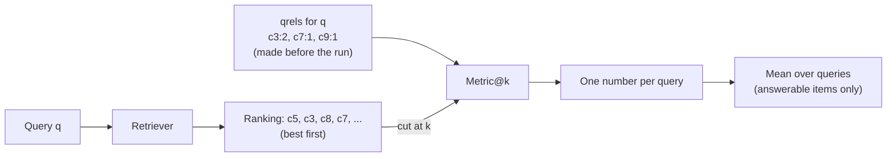

# P6 — Retrieval evaluation basics: qrels, Precision@k, Recall@k, Hit@k, MRR and nDCG@k

> **What this file is.** The lesson for concept **P6** ([02 card](../02_RAG_MASTER_LEARNING_PLAN.md#p6)). It follows the Parts A–M template of [07](../07_SAMPLE_LESSON.md), at a smaller scale.
> **How to use it.** Answers are hidden in collapsible blocks. Write your answer first, then open the block. Lines marked `> 🧭 Coach:` are instructions for the AI tutor; they add to [05 §3](../05_LEARNING_AND_RETENTION_SYSTEM.md#3-coaching-rules-for-the-ai-tutor) and cannot override it.
> **Labels.**
> - **UNVERIFIED**: not checked by running code or reading the primary source.
> - **Toy illustration**: numbers computed by code on made-up data, never a result about a real retriever. **Every metric value in this lesson is a toy illustration.**
> - **DERIVED**: arithmetic shown in the text.
>
> Every number comes from the local run of 2026-10-08 ([P6_FACTS.md](../sources/verification/P6/P6_FACTS.md), sections S1–S11 and S-src), or is DERIVED in the text. No Groq or Cohere call was made for this lesson.

## Lesson header

| Field | Value |
|---|---|
| Concept | **P6 Retrieval evaluation basics**: qrels (relevance judgements, binary and graded); Precision@k, Recall@k, Hit@k; reciprocal rank and MRR; DCG and nDCG@k; the cut-off k; which metric answers which question; why MRR and nDCG can disagree; a preview of CE@k. |
| Phase / tier | Phase 1, Prerequisites. Priority **E**. No fast track (02 card: no prior evidence). |
| Prerequisites | **P2** (documents, queries, relevance, ranking), per [03](../03_RAG_CONCEPT_DEPENDENCY_MAP.md). |
| Comes next | **M1** building the eval set · **M2** the metrics harness (CE@k on spans) · **C4** choosing k (MC-005) · **I1** chunking grid (CE@4 primary, MRR and nDCG@10 guards) · **R3** reranking (MRR@10 primary). |
| Diagnostic evidence | O1-Q04 scored **0**: Precision@k, Recall@k and reciprocal rank were not recalled ([session #1](../progress/session_log.md#session-2026-10-08-1--diagnostic)). P6 has `reinforcement_flag = 1`. MC-005 (one-sided k) lists a P6 application item as a check item ([log](../progress/misconception_log.md)). |
| Time | A: 10 min · book reading: 20 min · B–D: 45 min · E–G: 20 min · H (lab): 60 min · J–K: 15 min · L: 15 min · M: 5 min. May be split across two days. Part I does not apply. |
| Mastery (P6 → `applied`) | Without notes, you can: (1) compute P@k, R@k, Hit@k, RR and nDCG@k by hand for a toy ranking with qrels; (2) write them as pure functions whose unit tests pass and catch real bugs; (3) say which metric answers "any hit?", "all the evidence?", "how early?"; (4) build a ranking where MRR and nDCG disagree and explain why. Lab: hand values equal code values; `coding_independence_0_3 ≥ 2`. |
| Mastery (P6 → `transfer`) | You also pass a fresh novel-scenario item (L.3) and score `debugging_0_3 ≥ 2` (lab Task 5 and any failed CHECK you fixed). |

### Source map

| Source | Where | What it contributes |
|---|---|---|
| Book (A) | Ch22 p.4/19–p.7/19, p.8/19, p.18/19; App p.13/23, p.15/23, p.18/23–p.20/23 (Appendix B glossary) | Verbal definitions, three tiny numeric examples, two figures. **No formulas, no Hit@k, no cut-off rules.** |
| Repo (B) | `local_rag_huggingface_faiss.ipynb` cell 30; `evaluation/evalute_rag.py` L95–L163; `evaluation/*.ipynb` (5 notebooks); `choose_chunk_size.ipynb` cells 8, 10; `HyPE_…ipynb` cell 0 | **No rank metric anywhere** (verified). What the repo measures instead, and why that is not retrieval quality. |
| Our plan | [06 §7.1–§7.3](../06_RAG_PROJECT_AND_EVALUATION_PLAN.md#73-retrieval-metrics-computed-only-over-answerable-items) | The course's names, formulas and conventions (nDCG gain, IDCG, cut-off), and CE@k |
| Lab verification | [`sources/verification/P6/`](../sources/verification/P6/): `p6_metrics.py`, `test_p6_metrics.py`, `p6_measure.py`, `p6_sources.py`, saved outputs, [`P6_FACTS.md`](../sources/verification/P6/P6_FACTS.md) | Every number here |
| Source C (external) | #10, #11 (IIR ch. 8, §8.4), #45 (Järvelin & Kekäläinen 2002), #47 (BEIR) in [01 §6](../01_SOURCE_INVENTORY.md) | Further reading only |

### Contents

[Read in the book](#read-in-the-book) · [Part A](#part-a--prior-knowledge-recovery) · [B](#part-b--why-p6-exists) · [C](#part-c--intuition-and-analogy) · [D](#part-d--technical-mechanism) · [E](#part-e--connections) · [F](#part-f--worked-example-by-hand) · [G](#part-g--source-connection) · [H](#part-h--implementation-progression) · [I](#part-i--controlled-experiment) · [J](#part-j--failure-and-debugging) · [K](#part-k--engineering-decisions) · [L](#part-l--assessment) · [M](#part-m--retention) · [References](#source-references) · [Verification log](#verification-log)

### Read in the book

> **When:** right **after Part A**, before Part B. Never before Part A: Part A must show what you remember cold.
> **How:** about 20 minutes. Read each page once, then close the book and say its main point out loud in one sentence.
>
> | Page | Look for |
> |---|---|
> | **Ch22 p.4/19** | Precision at K and its example (3 relevant of 5 retrieved). What is the denominator? What does the book say precision tells you? |
> | **Ch22 p.5/19** | Recall at K and its example (3 found of 10 relevant). What is the denominator now? Notice the example never says what K is. Then "context precision" (order matters) and the precision-vs-recall figure. |
> | **Ch22 p.6/19** | MRR, MAP and NDCG in words. Is MRR scored per query, then averaged? Which metric handles graded relevance? What three steps does NDCG take? There are no formulas: Part D supplies them. |
> | **Ch22 p.7/19** | The "good vs poor" ranking figure: the same documents in a different order. |
> | **Ch22 p.18/19** | The key-takeaway line on ranking metrics. |
> | **App p.15/23, p.18/23–p.20/23** | Glossary: Context Precision (p.15), MAP (p.18), MRR, NDCG, Precision at K (p.19), Recall at K (p.20). Use them as flashcards: cover the definition and recall it. |
>
> **What the book does not give you** (Part D does): a formula for any metric, Hit@k, what happens when fewer than k results come back, a cut-off for MRR, or which gain nDCG uses.

---

## Part A — Prior knowledge recovery

Answer the six questions **before** reading on: 1–3 sentences each, no notes. Wrong answers are useful; they tell the tutor where to start.

> 🧭 Coach: Ask **one item at a time** (CR-01), in the exact wording below. Give the reply template if the learner hesitates. Record confidence 1–3 before revealing anything (CR-16). Score with the Recall or Application rubric ([05 §4.2](../05_LEARNING_AND_RETENTION_SYSTEM.md#42-graded-rubrics-04)). These are unscheduled recall items: log them; a score ≤ 1 follows the ≤ 1 row of [05 §5.2](../05_LEARNING_AND_RETENTION_SYSTEM.md#52-spaced-repetition-schedule). The learner scored 0 on O1-Q04, so expect low scores; do not teach yet. Route with the table after P6-A6.

**P6-A1.** What is a relevance label (a "qrel")?

*Reply template:* "A relevance label says ____. It is made by ____, before ____."

<details><summary>What a strong answer contains</summary>

- A **qrel** (query relevance judgement) says, for one query and one chunk, **whether** the chunk helps answer the query (binary: 0/1) or **how much** (graded: e.g. 0 = no, 1 = partial, 2 = sufficient).
- It is made by a **person** (or a checked labelling procedure), **before** the system runs, and kept fixed so every version is scored against the same answers.
- Boundary: chunks nobody labelled count as **not relevant**. If the chunker changes, chunk-id labels go stale; 06 labels **spans** instead ([06 §7.2](../06_RAG_PROJECT_AND_EVALUATION_PLAN.md#72-relevance-from-spans)).

</details>

**P6-A2.** A retriever returns 5 chunks and 2 of them are relevant. What is Precision@5?

*Reply template:* "Precision@5 = ____ / ____ = ____. It tells me ____."

<details><summary>What a strong answer contains</summary>

- 2 / 5 = **0.4**. The share of the top 5 that is relevant: how much of the context is **noise**.
- Boundary: the denominator is **k**, even if fewer than k chunks come back (D.2).

</details>

**P6-A3.** Three relevant chunks exist in the whole index. Two of them are in the top 5. What is Recall@5?

*Reply template:* "Recall@5 = ____ / ____ = ____. It tells me ____."

<details><summary>What a strong answer contains</summary>

- 2 / 3 ≈ **0.667**. The share of **all** relevant chunks that made it into the top 5: how much useful material was **missed**.
- ⚠️ Flag: dividing by 5 (that is precision).

</details>

**P6-A4.** The first relevant chunk is at rank 3. What is the reciprocal rank?

*Reply template:* "Reciprocal rank = 1 / ____ = ____. MRR is ____."

<details><summary>What a strong answer contains</summary>

- 1 / 3 ≈ **0.333**. MRR is the **mean of these reciprocal ranks over all test queries**, with 0 for a query whose first relevant chunk is beyond the cut-off.
- Boundary: it only looks at the **first** relevant chunk.

</details>

**P6-A5.** What does nDCG take into account that Precision@k ignores?

*Reply template:* "nDCG also uses ____ and ____."

<details><summary>What a strong answer contains</summary>

- **Position** (a relevant chunk counts less the lower it sits, by 1 / log2(rank + 1)) and **graded relevance** (a sufficient chunk earns more than a partial one).
- It is divided by the best possible score (IDCG), so it lies between 0 and 1.

</details>

**P6-A6.** A question needs two facts. Hit@5 = 1. Is retrieval good enough to answer it?

*Reply template:* "Not necessarily, because ____."

<details><summary>What a strong answer contains</summary>

- **Not necessarily.** Hit@5 = 1 means **at least one** relevant chunk arrived. The second fact may be missing.
- "Did **all** the needed evidence arrive?" is a different question: Recall@k on chunks, or the course's **CE@k** on evidence groups (D.7).
- Link to MC-005: a larger k raises the chance that all evidence arrives, at a cost in noise and tokens.

</details>

> 🧭 Coach: **Routing.**
>
> | Weak answers (score ≤ 1) | Action |
> |---|---|
> | P6-A1 | Check P2 first (D3 rule, [05 §3.3](../05_LEARNING_AND_RETENTION_SYSTEM.md#33-difficulty-adaptation-rules)): one P2 recall item on "relevance". Then teach D.1 slowly. |
> | P6-A2 or P6-A3 | Expected (O1-Q04). Teach D.2 with the Ch22 p.5/19 figure; do Part F step 1 together. |
> | P6-A4 | Teach D.3, including the "1 / mean rank" trap. |
> | P6-A5 | Teach D.4 with the discount table; do Part F step 3 slowly. |
> | P6-A6 | Teach D.5 and D.7; note it against MC-005. |
> | All six ≥ 3 with confidence 3 | Still no fast track (02 card). Skim B–C; do D.4, D.6, F, the lab and L. |
>
> Then send the learner to the **Read in the book** box before Part B.

---

## Part B — Why P6 exists

### B.1 "It looks better" is not a measurement

The upstream repo never computes a rank metric. A repo-wide search of 46 notebooks and 25 `.py` files at `009adba` finds no Recall@k, MRR, nDCG, Precision@k or Hit@k; the only near match is a "Keyword hit rate" that checks words in the generated **answer** (`local_rag_huggingface_faiss.ipynb` cell 30; S-src). Its evaluation script asks an LLM to rate the retrieved text 1–5, on questions the LLM writes afresh each run, and its averaging function is an empty stub (`evaluation/evalute_rag.py` L95–L163).

So "chunk size 400 retrieves better" cannot be checked there. Without fixed labels and a number, two versions cannot be compared.

### B.2 Same chunks, different order

The book's figure on Ch22 p.7/19 shows two lists with the same documents in a different order. Our toy version (S8): two relevant chunks `a` and `b`, five results each.

| Ranking | P@5 | Recall@5 | RR | nDCG@5 |
|---|---|---|---|---|
| good `a b x y z` | 0.4000 | 1.0000 | 1.0000 | 1.0000 |
| poor `x y a z b` | 0.4000 | 1.0000 | 0.3333 | 0.5438 |

Precision and recall cannot tell them apart: they only look at the **set**. RR and nDCG look at the **order**. The generator usually pays most attention to the first chunks, so order matters (the book makes the same point on Ch22 p.5/19).

> 🧭 Coach: CR-17 stop. One question: "Which two metrics in this table see the order?" Expected: RR and nDCG.

---

## Part C — Intuition and analogy

**Searching drawers for the parts of a recipe.** You open drawers in the order a helper suggests (the ranking). A friend has written down, beforehand, which drawers hold something you need (the qrels).

- **Hit@k:** after k drawers, did you find **anything** useful?
- **Precision@k:** of the k drawers you opened, what **share** held something useful?
- **Recall@k:** of **all** the useful drawers in the kitchen, what share have you opened?
- **Reciprocal rank:** how quickly did you find the **first** useful drawer? (1st drawer → 1, 2nd → 1/2, 3rd → 1/3.)
- **nDCG@k:** add up the **value** of what you found (a full ingredient beats a partial one), counting later drawers for less, then compare with the best order the helper could have suggested.

**Where the analogy breaks.** A real recipe may need **two specific ingredients**. Finding many drawers of flour is not the same as having flour **and** eggs. That is what CE@k checks (D.7), and why Recall@k on chunks is not enough.

> 🧭 Coach: CR-17 stop. One question: "In the analogy, which metric only cares about the first useful drawer?" Expected: reciprocal rank.

---

## Part D — Technical mechanism

### D.1 The objects involved



- **qrels:** chunk → grade. 2 = sufficient, 1 = partial, 0 or missing = not relevant. For the binary metrics, grade ≥ 1 counts as relevant.
- **k (cut-off):** only the top k results are scored. Always state k.
- A metric gives **one number per query**; the report is the **mean over queries**. 06 scores answerable items only ([06 §7.3](../06_RAG_PROJECT_AND_EVALUATION_PLAN.md#73-retrieval-metrics-computed-only-over-answerable-items)).

The running example (toy, S2): **Q1** "Which gases trap heat in the atmosphere?", qrels `c3:2, c7:1, c9:1`, ranking `c5 c3 c8 c7 c1 c2 c9 c4 c6 c10`. Relevant chunks sit at ranks **2, 4 and 7**.

> 🧭 Coach: CR-17 stop. One question: "In Q1, which chunk is the most useful, and at what rank does it sit?" Expected: c3 (grade 2), at rank 2.

### D.2 Set metrics at k: Precision, Recall, Hit

Same formulas as 06 §7.3, with rel(c) = 1 when grade ≥ 1:

```text
Precision@k = |{i ≤ k : rel(c_i) = 1}| / k
Recall@k    = |{i ≤ k : rel(c_i) = 1}| / (number of relevant chunks in the qrels)
Hit@k       = 1 if some i ≤ k has rel(c_i) = 1, else 0
```

- **Precision divides by k**, even if fewer than k chunks came back. Three chunks returned, scored at k = 5: P@5 = 0.4000, not 0.6667 (S11; J1).
- **Recall divides by all relevant chunks in the index**, not by the retrieved ones. If there are none, recall is undefined: skip the item (06: answerable items only).
- **Hit@k** is 0/1 per query; its mean over queries is the "hit rate".
- The order inside the top k does not matter to any of the three.

> Predict first: Q1 at k = 5. Write P@5, R@5 and Hit@5, then open.

<details><summary>Measured (S4)</summary>

Top 5 = `c5 c3 c8 c7 c1`; relevant: c3, c7. P@5 = 2/5 = **0.4000**; R@5 = 2/3 = **0.6667**; Hit@5 = **1** (Hit@1 = 0, because c5 is not relevant).

</details>

### D.3 Reciprocal rank and MRR

```text
RR@k(q) = 1 / (rank of the first relevant chunk), or 0 if none is in the top k
MRR@k   = mean of RR@k over the queries
```

The book defines MRR the same way: per query, then averaged over the test queries (Ch22 p.6/19; App p.19/23). It does not state a cut-off; 06 says to state one (e.g. 10).

Toy, three queries (S6): first relevant chunk at ranks 2, 1 and 4.

| | Q1 | Q2 | Q3 | Mean |
|---|---|---|---|---|
| RR@10 | 0.5000 | 1.0000 | 0.2500 | **MRR@10 = 0.5833** |

- **Trap:** 1 / (mean rank) = 1 / 2.3333 = 0.4286. That is **not** the MRR.
- **Cut-off matters:** MRR@3 = 0.5000, because Q3's first hit at rank 4 now counts 0.
- RR ignores everything after the first relevant chunk.

> 🧭 Coach: CR-17 stop. One question: "If Q3's first relevant chunk moved from rank 4 to rank 2, what would MRR@10 become?" Expected: (0.5 + 1 + 0.5) / 3 ≈ 0.667 (DERIVED).

### D.4 DCG and nDCG with graded relevance

06 §7.3 fixes the convention (exponential gain, log2 discount, ideal over **all** relevant chunks):

```text
DCG@k  = Σ_{i=1..k} (2^{g_i} − 1) / log2(i + 1)
IDCG@k = DCG@k of the ideal order of ALL relevant chunks in the qrels, cut at k
nDCG@k = DCG@k / IDCG@k            (undefined if IDCG = 0: skip the item)
```

Gain: grade 0 → 0, 1 → 1, 2 → 3. Discounts (S3):

| rank i | 1 | 2 | 3 | 4 | 5 | 6 | 7 |
|---|---|---|---|---|---|---|---|
| 1 / log2(i + 1) | 1.0000 | 0.6309 | 0.5000 | 0.4307 | 0.3869 | 0.3562 | 0.3333 |

Q1 at k = 5 (S4): DCG = 3 × 0.6309 + 1 × 0.4307 = **2.3235**; IDCG = 3 × 1 + 1 × 0.6309 + 1 × 0.5000 = **4.1309**; nDCG@5 = **0.5625**.

- **The ideal includes c9**, which the retriever placed at rank 7, outside k. That is why nDCG@5 is below 1: something relevant is missing from the top 5.
- **Conventions differ.** With linear gain (gain = grade), Q1 gives **0.5406** instead of 0.5625 (S7). With binary labels the two agree. Always say which gain you use. `sklearn.metrics.ndcg_score` uses the grade itself (linear): it matched our linear-gain code to 1.11e-16 in 66 comparisons, and matched our exponential version when given 2^g − 1 as labels (S7).

> 🧭 Coach: CR-17 stop. One question: "Why is Q1's nDCG@5 not 1, even though the best chunk c3 is at rank 2?" Expected: c3 is not at rank 1, and c9 is missing from the top 5 but is in the ideal.

### D.5 Which metric answers which question, and what k does to each

| Question | Metric | Sees order? | Sees grades? |
|---|---|---|---|
| Did **any** evidence reach the top k? | Hit@k | no | no |
| How much of the top k is **noise**? | Precision@k | no | no |
| What share of **all** relevant chunks arrived? | Recall@k | no | no |
| How **early** is the first relevant chunk? | RR / MRR | first hit only | no |
| How good is the **whole order**, grades included? | nDCG@k | yes | yes |
| Did **all needed evidence** arrive (every fact)? | **CE@k** (06 primary; D.7) | no | no |

**What k does** (Q1, S5):

| k | P@k | R@k | Hit@k | RR@k | nDCG@k |
|---|---|---|---|---|---|
| 1 | 0 | 0 | 0 | 0 | 0 |
| 2 | 0.5000 | 0.3333 | 1 | 0.5 | 0.5213 |
| 5 | 0.4000 | 0.6667 | 1 | 0.5 | 0.5625 |
| 7 | 0.4286 | 1.0000 | 1 | 0.5 | 0.6431 |
| 10 | 0.3000 | 1.0000 | 1 | 0.5 | 0.6431 |

- **Recall@k and Hit@k never go down** as k grows. RR@k never goes down either.
- **Precision@k can go either way.**
- **nDCG@k can also fall:** with two relevant chunks and only one retrieved (at rank 1), nDCG@1 = 1.0000 but nDCG@2 = 0.6131, because the ideal grows (S5, QF).

> 🧭 Coach: CR-17 stop. One question: "Which metrics can never go down when k grows?" Expected: Recall@k, Hit@k and RR@k.

### D.6 Why MRR and nDCG disagree

**Case 1: one early hit vs several slightly later hits** (binary, three relevant chunks d1–d3; S8):

| Ranking | RR | nDCG@5 | Recall@5 |
|---|---|---|---|
| A `d1 n1 n2 n3 n4` | **1.0000** | 0.4693 | 0.3333 |
| B `n1 d1 d2 d3 n2` | 0.5000 | **0.7328** | 1.0000 |

MRR prefers A: it stops at the first hit. nDCG prefers B: it adds up **every** relevant chunk (DCG 1.5616 vs 1.0000, same IDCG 2.1309).

**Case 2: same first-hit position, different grades** (h = sufficient, p = partial; S8): A `p h …` and B `h p …` both have RR = 1. nDCG: 0.7967 vs 1.0000. MRR cannot see grades.

**Which to trust?** It depends on the question. One right chunk per query (a fact lookup): MRR fits. Several useful chunks, some better than others: nDCG fits. That is why 06 reports MRR **and** nDCG as diagnostics, next to CE@k.

> 🧭 Coach: CR-17 stop. One question: "In Case 1, which ranking would you rather give the generator for a question that needs all three facts?" Expected: B; it holds all three. Then note this is CE's question, not MRR's.

### D.7 Preview only: Complete-Evidence@k (CE@k)

This is a **forward link**. CE@k is defined in [06 §7.2–§7.3](../06_RAG_PROJECT_AND_EVALUATION_PLAN.md#72-relevance-from-spans) and taught in **M2**; do not implement it now.

- An item's evidence is a set of **groups** (facts), all needed (AND); each group can be satisfied by alternatives (OR).
- **CE@k = 1** if every group is fully covered by the top k, else 0. It is the course's **primary** retrieval metric. Hit, P, R, MRR and nDCG are diagnostics.

Why chunk-level Recall@k is not enough (toy, simplified to whole chunks, S10): chunks e2 and e3 overlap and **both** hold fact G1; e6 holds fact G2. Ranking `e2 e3 e1 e6 e4`.

| k | Hit | Recall | CE |
|---|---|---|---|
| 3 | 1 | 0.6667 | **0** |
| 4 | 1 | 1.0000 | 1 |

At k = 3, two of three relevant chunks arrived, but both carry the **same** fact. G2 is missing, so the answer cannot be complete. Overlapping chunks inflate Recall and Precision; CE does not count duplicates. 06's own toy shows the same pattern (Hit@3 = 1, CE@3 = 0), and its whole table reproduces exactly (S9).

> 🧭 Coach: CR-17 stop. One question: "At k = 3, Recall is 0.667. Why is CE still 0?" Expected: both found chunks hold the same fact G1; fact G2 is missing.

---

## Part E — Connections

P2 (relevance, ranking) → **P6** → M1 (eval set with span gold) → M2 (harness: CE@k on spans). P6 also feeds C4 (choosing k, MC-005), I1 (CE@4 primary; MRR and nDCG@10 guards) and R3 (MRR@10 primary).

| Often confused | The difference |
|---|---|
| Recall@k vs Group-Recall@k vs CE@k | Recall counts relevant **chunks** found / all relevant chunks. Group-Recall counts **facts** covered. CE asks whether **every** fact is covered (D.7; 06 §7.3). |
| Precision@k vs context precision@k | P@k ignores order. Context precision (book Ch22 p.5/19; 06 §7.3 formula) averages P@i at each relevant rank, so it rewards relevant chunks ranked high. |
| MRR vs MAP | MRR: first hit only. MAP: precision at **every** relevant rank, averaged (Ch22 p.6/19). |
| Hit@k vs the repo's "Keyword hit rate" | Hit@k is retrieval (any relevant chunk in the top k). The repo's number is the share of expected words in the **answer**: answer quality (CR-11). |
| Retrieval metrics vs answer metrics | Retrieval: the ranked list vs qrels. Answer: the text vs a gold answer or the context. Never merged into one claim ([06 §7.1](../06_RAG_PROJECT_AND_EVALUATION_PLAN.md#71-retrieval-metrics-vs-generation-metrics-and-why-they-disagree)). |

---

## Part F — Worked example by hand

Q1 (D.1), k = 5. Ranking `c5 c3 c8 c7 c1 | c2 c9 c4 c6 c10`; qrels c3:2, c7:1, c9:1.

**Step 1: the set metrics.** Count relevant chunks in the top 5, then fill in P@5, R@5, Hit@1, Hit@5.

<details><summary>Answer</summary>

Relevant in the top 5: c3 (rank 2), c7 (rank 4) → 2. P@5 = 2/5 = **0.4**. R@5 = 2/3 = **0.667**. Hit@1 = **0** (c5 is not relevant); Hit@5 = **1**. All equal the code (S4).

</details>

**Step 2: reciprocal rank.** Where is the first relevant chunk?

<details><summary>Answer</summary>

Rank 2 (c3), so RR = 1/2 = **0.5**. MRR over Q1–Q3 = (0.5 + 1 + 0.25) / 3 = **0.5833** (S6).

</details>

**Step 3: nDCG@5.** Use gain 2^g − 1 and the discount table in D.4.

<details><summary>Answer</summary>

- DCG: c3 (grade 2, gain 3) at rank 2 → 3 × 0.6309 = 1.8928; c7 (grade 1, gain 1) at rank 4 → 0.4307. DCG = **2.3235**.
- Ideal order of all relevant chunks: grades 2, 1, 1 → 3 × 1 + 1 × 0.6309 + 1 × 0.5000 = **4.1309**.
- nDCG@5 = 2.3235 / 4.1309 = **0.5625** (S4).
- Self-check: 0 ≤ nDCG ≤ 1; below 1 because c3 is not first and c9 is missing.

</details>

> 🧭 Coach: CR-08 probe here, one question: "k doubles from 5 to 10 for Q1. What happens to Precision and to Recall?" Expected: Precision falls 0.4 → 0.3 (more non-relevant chunks in the denominator); Recall rises 0.667 → 1.0 (c9 at rank 7 is now in); Hit and RR stay; nDCG rises 0.5625 → 0.6431 (S5). Then ask what doubling k costs in prompt tokens (P1 S10).

---

## Part G — Source connection

### G.1 Book (Source A)

| Cite | Book point (paraphrased) | Matches the standard / 06? |
|---|---|---|
| Ch22 p.4/19 | Precision at K: share of the top K that is relevant; 3 of 5 gives 0.6; it measures noise | Yes. Silent on fewer than K results (we divide by K, D.2) |
| Ch22 p.5/19 | Recall at K: share of all relevant documents in the knowledge base that were retrieved; 3 of 10 gives 0.3; it measures what was missed | Yes. The example gives no K |
| Ch22 p.5/19 | "Context precision" accounts for order and penalises relevant documents buried below irrelevant ones | Verbal only; 06 §7.3 gives the formula |
| Ch22 p.6/19 | MRR: per query, 1 over the rank of the first correct result; rank 3 gives 0.33; averaged over test queries | Yes (per query, then averaged). No cut-off and no "0 if none found" rule; 0.33 is 1/3 rounded |
| Ch22 p.6/19 | MAP: precision at every rank where a relevant document appears, averaged, then averaged over queries | **Ambiguous denominator.** Standard AP divides by **all** relevant documents; the wording reads as dividing by those found. Q1 at k = 5: 0.3333 vs 0.5000; ranking QD_A: 0.3333 vs 1.0000 (S11). The second reading is 06's context precision |
| Ch22 p.6/19 | NDCG: graded relevance, a gain per document, a logarithmic discount by rank, normalised by the ideal ranking, range 0 to 1 | Yes in outline. **No formula and no gain function**: linear and exponential gain give different values on graded labels (0.5406 vs 0.5625, S7) |
| Ch22 p.7/19 | Figure: a good ranking puts relevant results on top; a poor one scatters them, with the same documents | Our B.2 table measures it |
| Ch22 p.8/19 | Faithfulness isolates generation quality from retrieval quality | The CR-11 split |
| Ch22 p.18/19 | Ranking metrics go beyond precision and recall by asking whether relevant documents are at the top | Yes |
| App p.15/23, p.18/23–p.20/23 | Glossary entries: Context Precision, MAP, MRR, NDCG, Precision at K, Recall at K | Same wording level as Ch22 |

**Not in the book:** Hit@k, qrels as a term, any formula (no "log2", no "2^"), cut-off rules, and what to do with an item that has no relevant chunk (S-src absence checks).

### G.2 Repo (Source B): what it computes instead (verified at `009adba`)

| Where (cells 0-based) | What it computes | Why it is not a rank metric |
|---|---|---|
| `local_rag_huggingface_faiss.ipynb` cell 30 | "Keyword hit rate": share of expected keywords found in the **answer** (fallback branch) | Answer quality, not retrieval. A fraction of words, not 0/1 Hit@k. The `try` branch calls `evaluate_rag(rag_chain, retriever)`, but the signature is `evaluate_rag(retriever, num_questions=5)` (static read; not run) |
| `evaluation/evalute_rag.py` L95–L163 | An LLM rates the joined top-k text 1–5 for relevance, completeness and conciseness, on LLM-generated questions; `calculate_average_scores` is `pass` | No qrels; order lost by joining; questions change every run; no average |
| `evaluation/define_evaluation_metrics.ipynb` cells 3, 6, 9, 10 | LLM correctness, faithfulness, and a per-doc relevance score (0 / 0.33 / 0.66 / 1) averaged by the LLM | Order-blind. Cell 9 builds its chain from a prompt name that is never defined (static read) |
| `evaluation/evaluation_deep_eval.ipynb` cells 2, 4, 6 | deepeval GEval correctness, Faithfulness, ContextualRelevancy | LLM-judged; no rank |
| `evaluation/end-2-end_rag_evaluation.ipynb` cells 12, 19, 22 | LLM completeness judge, RAGAS faithfulness, thresholds vs human labels | Answer quality |
| `evaluation/evaluation_grouse.ipynb` cells 4, 36 | GroUSE meta-evaluation of judges | Judges the judge |
| `evaluation/open-rag-eval-example.ipynb` cells 7, 8 | UMBRELA: an LLM gives each passage a grade 0–3 | Graded labels like nDCG's, but made by an LLM; what the library aggregates is UNVERIFIED |
| `choose_chunk_size.ipynb` cells 8, 10 | Mean faithfulness and relevancy pass rates (LlamaIndex evaluators) and response time, top-k = 5 | Answer quality |
| `HyPE_…ipynb` cell 0 | Claims a large gain "in retrieval precision" | Quoted from a preprint; not computed in the repo (CR-07: measured on what?) |

### G.3 Corrections to the [04 P6 row](../04_BOOK_TO_CODE_MAPPING.md) (04 is not edited)

1. 04 says the book has "two tiny examples". It has **three**: P@5 = 0.6 (p.4/19), Recall = 0.3 (p.5/19), MRR 1.0 and 0.33 (p.6/19).
2. 04 cites Ch22 p.4/19–p.6/19. The ranking figure is on **p.7/19** (04's own M2 row uses p.4–p.7), and the glossary entries are on **App p.15/23 and p.18/23–p.20/23** (the 02 card lists p.18–20).
3. The repo claim ("no Recall@k/MRR/nDCG anywhere") is **confirmed**. 04 does not mention the answer-level "Keyword hit rate" in `local_rag_huggingface_faiss.ipynb` cell 30, which the 02 card does.

---

## Part H — Implementation progression

### H.1 The lab: [`labs/P6_ir_metrics_lab.ipynb`](../labs/P6_ir_metrics_lab.ipynb) (blank-file first)

The notebook gives the toy data, the tasks, empty code cells and CHECK cells. It has **no solution code**; CHECK cells compare fingerprints, so the expected numbers stay hidden until you have predicted.

| # | Task | The CHECK tests |
|---|---|---|
| 1 | Q1 by hand at k = 5 (paper first), with confidence | Values are filled (graded in Task 6) |
| 2 | `precision_at_k`, `recall_at_k`, `hit_at_k` | k = 1..10 on Q1; a short list; `ValueError` cases |
| 3 | Predict MRR@10; write `reciprocal_rank`, `mean_reciprocal_rank` | RR per query; MRR@10 and MRR@3 |
| 4 | `dcg_at_k`, `ndcg_at_k` (exp and linear gain) | k = 1..10; linear gain; IDCG from all relevant; perfect = 1; agrees with `sklearn.metrics.ndcg_score` |
| 5 | Write ≥ 6 unit tests | Your tests pass, then catch ≥ 4 of 6 deliberately broken versions of your functions |
| 6 | Hand vs code | Your Task 1 values equal your code; corrections need a one-line reason |
| 7 | Build your **own** ranking pair where MRR and nDCG disagree; explain why | MRR prefers A, nDCG prefers B |
| 8 | Predict, then compute, what k 5 → 10 does to each metric (CR-08) | The computed directions |

Pure Python is enough (`math.log2`). The reference implementation is `sources/verification/P6/p6_metrics.py`.

> 🧭 Coach: The reference files are **solutions**. Do not show them before an attempt plus a hint (CR-04). Grade `coding_independence_0_3` on Tasks 2–4 and `debugging_0_3` on Task 5 and any failed CHECK the learner fixes. Log the Task 6 "first try" count and the Task 8 prediction score.

### H.2 Repo reading guide: `evaluation/evalute_rag.py` L95–L163

Read the function once. Answer each question before opening: (1) Where do the test questions come from? (2) Is there a label of which chunk is relevant? (3) Can the score tell rank 1 from rank 4? (4) What does `calculate_average_scores` return?

<details><summary>Answers</summary>

(1) The LLM writes new ones each run (L134). (2) No: the LLM rates the text 1–5 (L117); no qrels. (3) No: the chunks are joined into one string (L145). (4) `None`: its body is `pass` (L163).

</details>

### H.3 Reusable design (future `ragkit/`; nothing is created now)

- Pure functions `(ranking, qrels, k) -> float`; no I/O inside; `ValueError` on bad k, duplicates, and undefined cases.
- The scorer records its conventions with each run: k, MRR cut-off, gain (`exp`), binary threshold (grade ≥ 1), "answerable items only", `scorer_version` ([06 §6.6](../06_RAG_PROJECT_AND_EVALUATION_PLAN.md#66-versioning)).
- Report per query, then the mean, with n. In M2, chunk qrels are replaced by span-based relevance and CE@k.

---

## Part I — Controlled experiment

**n/a for P6 (prerequisite concept, toy data only).** P6 changes no pipeline variable. Its functions become the scorer used by v0.1 (M2) and every later experiment.

---

## Part J — Failure and debugging

For each symptom, write your predicted cause and fix, then open. Each diagnosis says whether the failure is in **retrieval**, in **generation**, or in **the measurement itself** (CR-11).

| # | Symptom |
|---|---|
| J1 | A retriever returns only 3 chunks for Q1; its P@5 is reported as 0.6667. |
| J2 | A ranking that finds only Q1's partial chunk c7 (at rank 1) gets nDCG@5 = 1.0. |
| J3 | A script reports MRR = 0.4286 for Q1–Q3. |
| J4 | Every metric drops to 0 after re-chunking. |
| J5 | A "keyword hit rate" is quoted as retrieval quality. |
| J6 | Hit@4 = 1 on every item, yet many answers are incomplete. |

<details><summary>Diagnoses</summary>

| # | Cause | Kind | Fix |
|---|---|---|---|
| J1 | Precision divided by the 3 returned, not by k. Correct: 0.4000 (S11) | Measurement bug hiding a retrieval problem | Divide by k; unit-test a short list |
| J2 | IDCG built from the **retrieved** chunks only. Correct: 0.2421 (S7) | Measurement bug | IDCG from all relevant chunks in the qrels |
| J3 | 1 / (mean rank) instead of the mean of 1 / rank. Correct: 0.5833 (S6) | Measurement bug | Average the reciprocal ranks; test a hand value |
| J4 | The qrels name **chunk ids** of the old chunker; new chunks are unjudged, so not relevant | Measurement (stale labels) | Label **spans** in document offsets; derive chunk relevance per chunker (06 §7.2) |
| J5 | The number is the share of expected keywords in the **answer** (`local_rag_huggingface_faiss.ipynb` cell 30) | Answer quality, mislabelled; the model may answer from memory | Report Hit@k against qrels for retrieval; keep answer metrics separate |
| J6 | Hit@k needs only one relevant chunk; multi-fact questions miss a fact | Retrieval (insufficient evidence), shown by the wrong metric | Report CE@k next to Hit@k; try a larger k (MC-005) and measure the token cost |

</details>

> 🧭 Coach: For J1–J3, ask for the **one unit test** that would have caught the bug. It counts as `debugging_0_3` evidence.

---

## Part K — Engineering decisions

| Question | Decision | Why |
|---|---|---|
| Primary retrieval metric | **CE@k** (06 §4.1 rule 6) | Sufficiency, not first evidence |
| Diagnostics to report next to it | Hit@k, MRR (cut-off 10), nDCG@10 (06 §7.6; guards in v1.0, primary MRR@10 in v2.1) | First-evidence position and overall order |
| nDCG gain | Exponential, 2^g − 1 (06 §7.3); say so in every table | Linear gain gives different numbers (S7) |
| Binary threshold | Grade ≥ 1 is relevant | Partial chunks still help |
| Precision denominator | k | Short lists must not look better (J1) |
| Items with no relevant chunk | Excluded from retrieval metrics; counted separately (abstention) | Recall and nDCG are undefined |
| One relevant chunk per query | MRR or Hit@k; Recall@k equals Hit@k then | nDCG adds little |
| Many graded chunks per query | nDCG@k | It uses grades and the whole order |

**When NOT to rely on these metrics alone:** when the labels are stale or incomplete (J4), when chunks overlap heavily (redundancy inflates P and R, D.7), or when the claim is about answers (use answer metrics; CR-11).

---

## Part L — Assessment

One short question per item, each with a reply template. Score with [05 §4.2](../05_LEARNING_AND_RETENTION_SYSTEM.md#42-graded-rubrics-04).

> 🧭 Coach: Ask one item at a time, with its template. Never put two questions in one turn. Record confidence first.

### L.1 Recall

**P6-R-01.** What is the denominator of Recall@k?
*Template:* "Recall@k divides by ____."

<details><summary>Criteria for 4</summary>

The number of relevant chunks in the qrels (the whole index), not k and not the retrieved count. Plus a boundary: undefined when there are none; and Recall@k never falls as k grows.

</details>

**P6-R-02.** What does reciprocal rank ignore?
*Template:* "It only looks at ____, so it ignores ____."

<details><summary>Criteria for 4</summary>

Only the rank of the first relevant chunk (1 / rank; 0 beyond the cut-off). It ignores later relevant chunks and grades. MRR is the mean of RR over queries, not 1 / mean rank.

</details>

**P6-R-03.** What are the three steps of nDCG?
*Template:* "Gain from ____, discount by ____, divide by ____."

<details><summary>Criteria for 4</summary>

Gain from the grade (2^g − 1 in our course), discount by log2(rank + 1), divide by the ideal DCG of all relevant chunks. Plus why: it rewards relevant chunks near the top and is comparable across queries (0 to 1).

</details>

**P6-R-04.** Which metric answers "did all the needed evidence arrive?"
*Template:* "____. Hit@k only answers ____."

<details><summary>Criteria for 4</summary>

CE@k on evidence groups (the course's primary metric), or Recall@k on chunks as a weaker proxy (overlapping chunks inflate it, D.7). Hit@k only answers "did any evidence arrive?".

</details>

### L.2 Application

**P6-A-01.** Relevant chunks: `a` and `b` only. Ranking `x y a z b`. What are P@5, Recall@5 and RR?
*Template:* "P@5 = ____, Recall@5 = ____, RR = ____."

<details><summary>Criteria for 4</summary>

0.4, 1.0, 1/3 ≈ 0.333 (S8, "poor"). Self-check: P and R would be identical for `a b x y z`; only RR changes.

</details>

**P6-A-02.** Grades: h = 2, p = 1. Ranking `p h n1 n2 n3`. What is nDCG@5 with gain 2^g − 1?
*Template:* "DCG = ____, IDCG = ____, nDCG = ____."

<details><summary>Criteria for 4</summary>

DCG = 1 × 1 + 3 × 0.6309 = 2.8928; IDCG = 3 × 1 + 1 × 0.6309 = 3.6309; nDCG = **0.7967** (S8). Self-check: below 1 because the better chunk is second; RR is still 1.

</details>

**P6-A-03** (CR-08). For Q1, k doubles from 5 to 10. Does Precision@k go up or down?
*Template:* "It goes ____, from ____ to ____, because ____."

<details><summary>Criteria for 4</summary>

Down, 0.4 → 0.3 (S5): one more relevant chunk (c9) but five more slots. Recall goes up 0.667 → 1.0. Self-check: name the cost of larger k (more tokens, more noise).

</details>

**P6-A-04** (debugging). What is wrong with this function?

```python
def mrr(first_ranks):              # e.g. [2, 1, 4]
    return 1 / (sum(first_ranks) / len(first_ranks))
```

*Template:* "The bug is ____. For [2, 1, 4] it gives ____ instead of ____."

<details><summary>Criteria for 4</summary>

It takes 1 over the mean rank instead of the mean of 1 / rank: 0.4286 instead of 0.5833 (S6). It also has no cut-off and no 0 for "not found". Fix plus a unit test.

</details>

### L.3 Transfer

> 🧭 Coach: P6-T-01 and P6-T-02 are practice items. For the scored CR-13 item, make up a fresh scenario (a new domain, label type or constraint) that is not in this file, and grade it with the Transfer rubric.

**P6-T-01.** A help-desk search has exactly one correct article per question. Which retrieval metric would you report?
*Template:* "I would report ____ at k = ____, because ____."

<details><summary>Criteria for 4</summary>

- MRR (with a stated cut-off) and Hit@k at the k the generator receives. With one relevant item, Recall@k = Hit@k, and nDCG adds little.
- Trade-off: MRR rewards rank 1; Hit@k says whether the article reached the prompt at all.
- Verify on a labelled query set against the current system; report n.
- Keep it separate from answer correctness (CR-11). When not: if questions need several articles, switch to CE@k.

</details>

**P6-T-02.** A colleague reports "context relevance 0.8" from an LLM that rates the joined top 5 (like `evalute_rag.py`). What can this number not tell you?
*Template:* "It cannot tell me ____, because ____."

<details><summary>Criteria for 4</summary>

- Not order (the chunks are joined), not what was **missed** (no qrels, so no recall), and not a stable comparison (new questions each run; an uncalibrated LLM score, MC-006).
- Propose: fixed labelled queries, then Hit@k, MRR, nDCG and CE@k; the LLM score only as a secondary signal.

</details>

### L.4 When is P6 mastered?

- **`applied` (L3):** P6-R-01 ≥ 3 on two different days, one ≥ 24 h after teaching; two Application items ≥ 3; lab Tasks 2–4 with `coding_independence_0_3 ≥ 2`; hand values equal code values (lab Task 6); the Task 7 explanation is correct.
- **`transfer` (L4):** a fresh novel-scenario item ≥ 3; `debugging_0_3 ≥ 2`; a teach-back ≥ 3.
- **Gate:** an E concept needs L3 to advance ([05 §7.2](../05_LEARNING_AND_RETENTION_SYSTEM.md#72-required-level-by-priority-tier)); P6 is the prerequisite of M1 ([03](../03_RAG_CONCEPT_DEPENDENCY_MAP.md)).

---

## Part M — Retention

### M.1 Flashcards

| # | Front (one question) | Back |
|---|---|---|
| 1 | What is a qrel? | A fixed label: query + chunk → grade, made before the run |
| 2 | Precision@k denominator? | k |
| 3 | Recall@k denominator? | All relevant chunks in the qrels |
| 4 | Hit@k? | 1 if any relevant chunk in the top k |
| 5 | Reciprocal rank? | 1 / rank of the first relevant chunk; 0 beyond k |
| 6 | MRR? | Mean of RR over queries (not 1 / mean rank) |
| 7 | nDCG gain in our course? | 2^g − 1 |
| 8 | nDCG discount? | 1 / log2(rank + 1) |
| 9 | IDCG uses? | All relevant chunks, ideal order, cut at k |
| 10 | Which metrics never fall as k grows? | Recall@k, Hit@k, RR@k |
| 11 | Why can MRR and nDCG disagree? | MRR sees the first hit only; nDCG sees all hits and grades |
| 12 | Course primary retrieval metric? | CE@k (all evidence groups covered) |
| 13 | Book page for MRR, MAP, NDCG? | Ch22 p.6/19 |

### M.2 Retrieval practice (closed book; log per [05 §5.1](../05_LEARNING_AND_RETENTION_SYSTEM.md#51-active-recall-what-a-review-item-looks-like))

| When | One question | Template |
|---|---|---|
| Day 1 | What does Recall@k divide by? | "By ____, not by ____." |
| Day 3 | Three queries: first relevant chunk at rank 1, at rank 3, and none in the top 10. What is MRR@10? | "(____ + ____ + ____) / 3 = ____" |
| Day 7 | Build a 3-chunk ranking where MRR = 1 but nDCG < 1. | "Ranking ____, grades ____." |
| Day 14 | Why is CE@k the course's primary metric, not Recall@k? | "Because ____." |

<details><summary>Day-3 answer</summary>

(1 + 1/3 + 0) / 3 ≈ 0.444 (DERIVED).

</details>

### M.3 Teach-back prompt ([05 §5.4](../05_LEARNING_AND_RETENTION_SYSTEM.md#54-teach-back-protocol))

"In 3 minutes, explain to a new teammate how to tell whether a retriever got better." A 4 needs: qrels fixed in advance; one set metric and one rank metric with formulas; one number (e.g. Q1 nDCG@5 = 0.5625); a trade-off (k: recall vs noise and tokens); a failure mode (J2 or J5); retrieval kept apart from answer quality.

### M.4 Interleaving links

**P2:** relevance is a label, not a similarity score. **P1:** doubling k adds prompt tokens (P1 S10) as it raises Recall@k. **C4 / MC-005:** choose k with Recall@k or CE@k against context tokens. **R3:** reranking is judged by MRR@10, with CE@pool as the ceiling (06 v2.1).

### M.5 Misconception-log entries to add when observed

| Label | Correct model (short) | Root cause | Severity | Check items |
|---|---|---|---|---|
| "Recall@k divides by k" | Divides by all relevant chunks | terminology | medium | P6-R-01, P6-A-01 |
| "MRR = 1 / mean rank" | Mean of the reciprocal ranks | over-generalisation | medium | P6-A-04, lab Task 3 |
| "Hit@k = 1 means the answer is supported" | Only first evidence; CE@k for sufficiency | over-generalisation | high (eval design) | P6-A6, P6-R-04 |
| "A keyword hit rate in the answer measures retrieval" | It measures the answer (CR-11) | conflation of stages | medium | J5, P6-T-02 |

### M.6 Progress-tracker entry (format only; fictional values, per [05 §6.1](../05_LEARNING_AND_RETENTION_SYSTEM.md#61-progressconcept_trackercsv))

```csv
P6,Retrieval evaluation basics,1,E,exposed,<YYYY-MM-DD>,,,<YYYY-MM-DD +1>,1,,,,,,,na,,1,log:<YYYY-MM-DD>#P6-R-01
```

---

## Source references

**Book (Source A):** Ch22 p.4/19–p.8/19, p.18/19; Appendix p.13/23, p.15/23, p.18/23–p.20/23. Checked against the PyMuPDF page text by `p6_sources.py` (2026-10-08); the figures on Ch22 p.5/19 and p.7/19 were viewed as images. Paraphrased; no quotation reaches 15 words.
**Repo (Source B):** `NirDiamant/RAG_Techniques` @ `009adba2be1bef49780ef73b6dd3c18fd24b035b`; the cells and lines in G.2 (0-based); repo-wide search of 46 notebooks and 25 `.py` files. Full list: [P6_FACTS S-src](../sources/verification/P6/P6_FACTS.md).
**Our records:** [session log 2026-10-08 #1](../progress/session_log.md#session-2026-10-08-1--diagnostic) (O1-Q04); [misconception log](../progress/misconception_log.md) (MC-005, MC-006); 06 §4.1, §7.1–§7.3, §7.6.
**Supplementary (Source C, external; not needed for any claim):** #10 IIR ch. 8; #11 IIR §8.4; #45 Järvelin & Kekäläinen 2002; #47 BEIR ([01 §6](../01_SOURCE_INVENTORY.md)).

---

## Verification log

**Environment.** Run on 2026-10-08 with `uv run` from `rag_learning/`: CPython 3.12.8, numpy 2.5.3, scikit-learn 1.9.1 (already installed; used only as a cross-check), pymupdf 1.26.7, pytest 9.1.1. Nothing was installed. No Groq or Cohere call; `.env` not read.

| Claim | How verified |
|---|---|
| All metric values (S2–S11); the 06 §7.3 toy table (S9) | **Ran** `p6_measure.py` (`out_p6_measure.txt`); a second run was byte-identical; every 06 value reproduced |
| Hand values = code values; conventions; edge cases | **Ran** `test_p6_metrics.py`: 23 passed. nDCG **cross-checked** with `sklearn.metrics.ndcg_score`: 66 comparisons, max difference 1.11e-16 |
| Repo has no rank metric; every cited cell, line and book page; no formulas or Hit@k in the book | **Ran** `p6_sources.py`: ALL PASS (87 checks; one "hit rate" hit only); two figures viewed as images |
| Lab has no solution code; CHECKs pass for a correct solution and fail for broken ones | **Ran** `p6_lab_runner.py` with throwaway solutions kept outside the workspace: good 8/8 (also 8/8 in a real Jupyter kernel); broken 1/8; empty 0/8; each single bug fails its own task's CHECK |
| 04 P6 row | Repo claim confirmed; three corrections (G.3) |

**Still UNVERIFIED:**
- whether Järvelin & Kekäläinen (2002), cited by 06 for nDCG, used the 2^g − 1 gain or the grade itself (paper not opened);
- what `open_rag_eval` computes internally from UMBRELA labels;
- the runtime behaviour of `local_rag_huggingface_faiss.ipynb` cell 30 and `define_evaluation_metrics.ipynb` cell 9 (static reads; not run, they need an OpenAI key).
