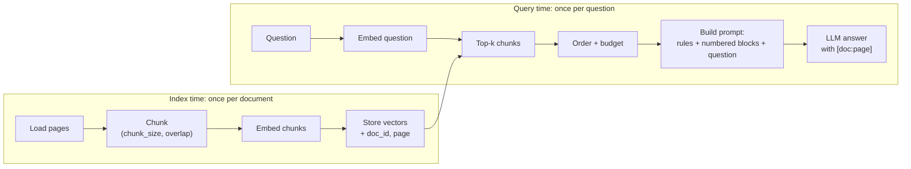
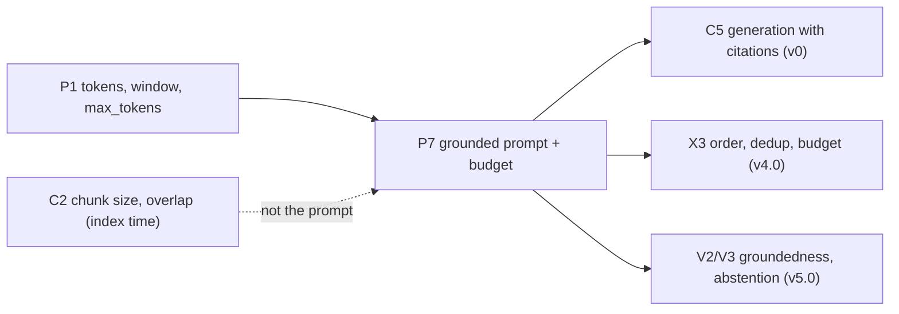

# P7 — Prompting for grounded generation: the prompt's parts, the budget, and where evidence sits

> **What this file is.** The lesson for concept **P7** ([02 card](../02_RAG_MASTER_LEARNING_PLAN.md#p7)). It follows the Parts A–M template of [07](../07_SAMPLE_LESSON.md), at a smaller scale, and builds on [P1](P1_llm_fundamentals.md) (its D.5 measured the v0 prompt at 976 tokens; this lesson reuses that number).
> **How to use it.** Answers are hidden in collapsible blocks. Write your answer first, then open the block. Lines marked `> 🧭 Coach:` are instructions for the AI tutor; they add to [05 §3](../05_LEARNING_AND_RETENTION_SYSTEM.md#3-coaching-rules-for-the-ai-tutor) and cannot override it.
> **Labels.**
> - **UNVERIFIED**: not checked by running code or reading the primary source.
> - **Assumption:** a stated premise.
> - **Toy illustration**: numbers computed by code on made-up or hand-picked inputs, never a result about a real system.
>
> Every number in this lesson comes from the local run of 2026-10-08 ([P7_FACTS.md](../sources/verification/P7/P7_FACTS.md), sections S1–S10 and S-src), from P1's logged run (cited), from a derivation shown in the text, or carries a label. No Groq or Cohere call was made for this lesson.

## Lesson header

| Field | Value |
|---|---|
| Concept | **P7 Prompting for grounded generation**: the parts of a grounded prompt (answer only from the sources; cite `[doc:page]`; a fixed "cannot answer" sentence; no outside knowledge), numbered context blocks, the question, and a token budget with an answer reserve. Also: index time vs query time, "lost in the middle" and what it implies for ordering and k, and the permissive prompt that invites answers from memory. |
| Phase / tier | Phase 1, Prerequisites. Priority **E**. Fast track possible ([02 §5](../02_RAG_MASTER_LEARNING_PLAN.md#5-fast-track-rules-from-the-o1-diagnostic)). |
| Prerequisites | **P1** (tokens, context window, `max_tokens` includes reasoning). |
| Comes next | **C5** generation with citations (v0) · **X3** context assembly (ordering, budget) · **V2/V3** groundedness and abstention · **M2** answer metrics. |
| Open misconceptions | **MC-003** prompt construction confused with chunk overlap (index time vs query time) and **MC-004** "lost in the middle" linked to local/global minima ([log](../progress/misconception_log.md)). This lesson is their remediation. **MC-005** ("more chunks is not good") is touched in D.5–D.6. The tracker has `reinforcement_flag = 1` for P7 (from O1-Q07). |
| Time | A: 10 min · book: 20 min · B–D: 40 min · E–G: 20 min · H (lab): 45 min · J–K: 10 min · L: 15 min · M: 5 min. May be split across two days. Part I is planned, not run. |
| Mastery (P7 → `applied`) | Without notes, you can: (1) write a grounded prompt with all its parts from memory; (2) say that the prompt is built at **query time** and overlap is set at **index time**; (3) compute an input budget with an answer reserve and the k that fits; (4) explain "lost in the middle" and what it implies for order and k; (5) explain one failure the captioning notebook's answer prompt allows, and classify it as retrieval or generation. Lab: `coding_independence_0_3 ≥ 2`. |
| Mastery (P7 → `transfer`) | You also pass a fresh novel-scenario item (L.3) and score `debugging_0_3 ≥ 2` in the lab. |

### Source map

| Source | Where | What it contributes |
|---|---|---|
| Book (A) | Ch1 p.1/14, p.3/14, p.9/14, p.10/14; Ch3 p.5/14, p.6/14, p.8/14, p.11/14; Ch16 p.6/11, p.8/11; Ch22 p.5/19, p.8/19, p.16/19; Appendix p.15/23, p.17/23 | The *step* "pass the question plus chunks to the model", and *why* grounding matters. **No prompt wording, no budget, no "lost in the middle".** One position claim: earlier documents get more weight (Ch22 p.5/19). |
| Repo (B) | `simple_csv_rag.ipynb` cell 16; `local_rag_huggingface_faiss.ipynb` cells 22, 24 (and 18, 20, 26); `helper_functions.py:L162-L205`; `reliable_rag.ipynb` cell 18; `multi_model_rag_with_captioning.ipynb` cells 12, 14, 15, 17, 20 | Five real prompts to audit, two of which say "based upon your knowledge" |
| Our plan | [06 §3.3](../06_RAG_PROJECT_AND_EVALUATION_PLAN.md#33-v0-prompt-template-promptsanswer_v1txt) (the v0 template), [06 §7.1](../06_RAG_PROJECT_AND_EVALUATION_PLAN.md#71-retrieval-metrics-vs-generation-metrics-and-why-they-disagree), [06 §7.4](../06_RAG_PROJECT_AND_EVALUATION_PLAN.md#74-generation-metrics), [06 §6.7](../06_RAG_PROJECT_AND_EVALUATION_PLAN.md#67-draft-seed-items-for-corpus-d-draft--learner-must-verify) (D-001, D-009) | The prompt we will actually use, and how it is measured |
| Lab verification | [`sources/verification/P7/`](../sources/verification/P7/): `p7_measure.py`, `p7_sources.py`, saved outputs, [`P7_FACTS.md`](../sources/verification/P7/P7_FACTS.md) | Every measured number here |
| Source C (external) | #39 Liu et al. 2023, "Lost in the Middle" ([01 §6](../01_SOURCE_INVENTORY.md#6-source-c--supplementary-references-external)) | The position finding (qualitative only) |

> 📖 **Read in the book** (after Part A, never before; about 20 minutes). Read with one question in mind: *what does the book tell the model to do, and what does it leave out?*
>
> | When | Pages | What to look for |
> |---|---|---|
> | Right after Part A | Ch1 p.1/14; Appendix p.17/23 ("Grounding") | The problem (a model answering from memory) and the definition (an answer you can trace back to passages) |
> | | Ch1 p.9/14 (Step 8) and p.10/14 (algorithm steps 5–6) | What is handed to the model: the question plus the chunks. Notice that **no instruction wording** is given |
> | | Ch3 p.5/14 (last line) → p.6/14 | Generation in Reliable RAG is the simple-RAG step with cleaner input; then why a separate hallucination check is still needed |
> | | Ch3 p.8/14 and p.11/14 | Citations added *after* generation, like footnotes; and when "I don't know" beats a confident wrong answer |
> | After D.6 | Ch22 p.5/19 and Appendix p.15/23 | The book's only claim about position: documents that come first get more weight. Compare it with Liu et al. |
> | After D.7 | Ch16 p.6/11 and p.8/11 | The captioning prompt runs during **preparation**; the BLEU question runs at **query time** |
> | After Part J | Ch22 p.8/19 | Low faithfulness with high context relevance points at the model or the prompt, not the retriever |
>
> After reading, close the book and write three lines: what goes into the prompt, what the book never specifies, and one page number you will remember.

### Contents

[Part A](#part-a--prior-knowledge-recovery) · [B](#part-b--why-p7-exists) · [C](#part-c--intuition-and-analogy) · [D](#part-d--technical-mechanism) · [E](#part-e--connections) · [F](#part-f--worked-example-by-hand) · [G](#part-g--source-connection) · [H](#part-h--implementation-progression) · [I](#part-i--controlled-experiment-planned) · [J](#part-j--failure-and-debugging) · [K](#part-k--engineering-decisions) · [L](#part-l--assessment) · [M](#part-m--retention) · [References](#source-references) · [Verification log](#verification-log)

---

## Part A — Prior knowledge recovery

Answer the five questions **before** reading on: 1–3 sentences each, no notes. Wrong answers are useful here.

> 🧭 Coach: Ask **one item at a time** (CR-01), in the exact wording below, with its reply template. Record confidence 1–3 before revealing anything (CR-16). Score with the Recall rubric ([05 §4.2](../05_LEARNING_AND_RETENTION_SYSTEM.md#42-graded-rubrics-04)). In O1, item O1-Q07 scored 1 on exactly these ideas, and the learner is often confident and wrong, so do not skip the confidence step. Do not correct in detail yet; route with the table after P7-A5.

**P7-A1.** You have four retrieved chunks and a question. What do you put into the prompt?
*Reply template:* "First ____. Then ____. Then ____."

<details><summary>What a strong answer contains</summary>

- **Rules** (system): answer only from the sources; cite each fact as `[doc:page]`; if the sources are not enough, say one fixed sentence; no outside knowledge.
- **Numbered context blocks**, each with a `(doc:page)` header, then the chunk text.
- **The question**, after the blocks, then an answer cue.
- All of it inside a **token budget** that leaves room for the answer.
- ⚠️ MC-003 flag: "overlap the chunks so they connect".

</details>

**P7-A2.** Is chunk overlap set at index time or at query time?
*Reply template:* "At ____ time, because ____."

<details><summary>What a strong answer contains</summary>

- **Index time.** Overlap is a chunking setting, applied once per document before any question exists. The prompt is built at **query time**, once per question, from chunks that already exist. Nothing in the prompt can change the overlap.
- ⚠️ MC-003 flag: any answer that adds overlap while building the prompt.

</details>

**P7-A3.** What should the prompt tell the model to do when the chunks do not contain the answer?
*Reply template:* "It should say ____, because ____."

<details><summary>What a strong answer contains</summary>

- Reply with **one fixed sentence**, e.g. v0's "I cannot answer this from the provided documents." ([06 §3.3](../06_RAG_PROJECT_AND_EVALUATION_PLAN.md#33-v0-prompt-template-promptsanswer_v1txt)).
- Why fixed: code detects it by exact match, so abstention is counted without a judge (D.7, S9). Boundary: an instruction is a request, not a guarantee (Ch3 p.6/14). Checking is a later job (V2/V3).

</details>

**P7-A4.** What is "lost in the middle"?
*Reply template:* "Models use evidence at ____ better than evidence in ____."

<details><summary>What a strong answer contains</summary>

- An empirical finding (Liu et al. 2023, Source C #39): language models use information at the **start or end** of a long input more reliably than information in the **middle**, even models built for long inputs.
- Implication: strongest chunks at the edges; no padding with weak chunks. ⚠️ MC-004 flag: anything about local or global minima. Nothing is being optimised when the model reads a prompt.

</details>

**P7-A5.** Four chunks of about 1,000 characters each, plus rules and a question. About how many tokens is the prompt?
*Reply template:* "About ____ tokens, because ____."

<details><summary>What a strong answer contains</summary>

- **About 950–1,000** tokens. P1 measured **976** with `o200k_harmony` (P1 S9); this lesson's lab prompt is **958** (S4). Reasoning: ~180–210 tokens per 1,000-character block (P1 S4; S5 here), plus ~107 for the v0 rules and ~20 for the question.
- ⚠️ MC-001 flag (P1): "4,000 tokens" (counting characters as tokens).

</details>

> 🧭 Coach: **Routing.**
>
> | Weak answers (score ≤ 1) | Action |
> |---|---|
> | P7-A1 or P7-A2 | MC-003 is live. Teach D.1 (the two-phase diagram) **before** D.2. Do lab Task 1 first. |
> | P7-A3 | Teach D.2 and D.7 with the S9 toy answers. |
> | P7-A4 | MC-004 is live. Teach D.6 slowly; ask the learner to draw the U-shape in words. |
> | P7-A5 | P1's D.5 is not secure. Reteach it from P1 before D.3–D.4. |
> | All five ≥ 3 with confidence 3 | Offer the fast track: skim B–C, then D.4, D.6, F, H and L (evidence is never skipped). |
>
> After routing, send the learner to the **Read in the book** box, then continue with Part B.

---

## Part B — Why P7 exists

### B.1 Two repo prompts that say "use your knowledge"

`reliable_rag.ipynb` cell 18 builds the answer step of a pipeline that grades chunks and checks for hallucinations. Its system line tells the model to answer "based upon your knowledge". The retrieved documents are passed, but **nothing tells the model to stay inside them**. `multi_model_rag_with_captioning.ipynb` cell 20 uses the same system text (S-src). So the retrieval stage can be excellent, and the answer can still come from memory.

### B.2 An answer you cannot trace

The captioning notebook asks for the BLEU score of the base Transformer (cell 17). Its retriever returns **one** chunk (k = 1, cell 15). Cell 20 passes only that chunk's text, **without** its `name` metadata, and the saved output states a BLEU number (S-src). The retrieved chunk itself is not saved (cells 17–18 have no output). From the notebook alone, nobody can say whether the number came from the chunk or from the model's memory of a famous paper. There is no citation to check and no refusal path.

**Our own diagnostic.** In O1, item O1-Q07 (score 1) showed both target misconceptions: overlap used to build the prompt (MC-003), and "lost in the middle" linked to minima (MC-004).

> 🧭 Coach: One question: "In B.2, is the untraceable answer a retrieval problem or a generation problem?" Expected: it cannot be classified from the notebook, and **that is the problem**. With a `[doc:page]` citation and a refusal rule, it could be (CR-11).

---

## Part C — Intuition and analogy

**An open-book exam with strict rules.** The book itself uses the open-book picture (Ch1 p.3/14). The examiner hands out four numbered pages and writes three rules on the board: use only these pages; after each sentence write the page you used; if the pages don't say, write "not in the handout".

- The **handout** is the context blocks, its **page numbers** are the `(doc:page)` headers, and the **rules on the board** are the system prompt.
- The **answer sheet has a fixed size**: if the handout is too thick, there is no room to write. That is the answer reserve.
- **Students skim the middle of a thick handout.** That is "lost in the middle".

**Where the analogy breaks.** A student can close their own memory; a model cannot. It has read a great deal during training, so a rule *lowers* the chance of an answer from memory but does not remove it (Ch3 p.6/14: even perfect context does not stop made-up claims). That is why v5.0 adds checking.

> 🧭 Coach: CR-17. Stop here and ask one question: "In the analogy, what plays the role of the page numbers on the handout?" Expected: the `(doc:page)` headers on each context block.

---

## Part D — Technical mechanism

### D.1 Two phases: where the prompt sits (MC-003)



- **Overlap lives on the left.** It is fixed before any question exists.
- **The prompt lives on the right.** It only *arranges* chunks that already exist: which ones (k), in what order, with which labels, inside which budget. A captioning prompt is also index time (Ch16 p.6/11: it runs once during preparation). The **answer** prompt is query time.

> **Quick check.** "You want the model to see more text around each fact. Is that an index-time fix or a query-time fix?" *Template:* "____ time, because ____." (Expected: index time if you change chunk size or overlap; query time if you fetch neighbouring chunks, which is X1. Either way, not inside the prompt wording.)

### D.2 The parts of a grounded prompt

The v0 template ([06 §3.3](../06_RAG_PROJECT_AND_EVALUATION_PLAN.md#33-v0-prompt-template-promptsanswer_v1txt)), part by part:

| Part | v0 wording (short) | Why it is there | What fails without it |
|---|---|---|---|
| 1. Source-only rule | "using ONLY the numbered sources below" | Ties the answer to the context | Answers from memory (B.1) |
| 2. Citation rule | every factual sentence ends with `[doc_id:page]`, copied from the headers | Each claim can be traced and checked by code | Untraceable answers (B.2) |
| 3. Refusal rule | reply exactly "I cannot answer this from the provided documents." | Abstention becomes machine-detectable | The model guesses on unanswerable questions |
| 4. No outside knowledge | "Do not use outside knowledge." | Closes the memory route explicitly | Same as 1 |
| 5. Support rule, length | do not cite a non-supporting source; at most 5 sentences | Fewer decorative citations; shorter answers to check | Citation padding; long answers |
| 6. Numbered blocks | `[1] (climate:3)` + chunk text, blank line between blocks | The reader sees order; the model sees the citable label | No label to cite |
| 7. Question + cue | after the blocks: `Question: ...` then `Answer:` | The task comes after the evidence | — |
| 8. Budget | not text: a limit on 1–7 plus the answer | Room for the answer (D.4) | Truncated or empty answers (P1 B.2) |

> **Quick check.** "Which part makes abstention countable without a judge?" *Template:* "Part ____, because ____." (Expected: part 3, the fixed sentence, matched exactly after normalisation.)

### D.3 Where the tokens go (measured)

The 976-token v0 prompt from P1 (S9 there; reproduced exactly here, S2), split by part (S3, `o200k_harmony`):

| Part | Tokens | Share |
|---|---|---|
| System rules | 107 | 11.0% |
| 4 block headers (`[1] (climate:1)` = 9 tokens each) | 36 | 3.7% |
| 4 chunk texts (1,000 characters each) | 803 | 82.3% |
| Question (D-001) | 20 | 2.0% |
| Scaffolding (`Sources:`, blank lines, `Question:`, `Answer:`) and token-boundary effects | 10 | 1.0% |
| **Total system + user** | **976** | |

- P1 reported "sources = 842 (86%)", which included headers and separators: same prompt, finer split. **The rules are cheap.** The full v0 rules cost 107 tokens. The repo's permissive system line costs 31 (S7). Grounding adds about 76 tokens, under 8% of this prompt (derived).
- **The chunks are the budget.** k and chunk size decide the cost.

### D.4 The budget with an answer reserve

```text
input budget  = context window W − max_tokens (answer, reasoning included) − margin (template overhead)
fixed tokens  = rules + scaffolding + question
k that fits   = how many blocks, in rank order, keep  fixed + Σ blocks ≤ input budget
```

- **max_tokens is reserved first.** For `gpt-oss-20b` it includes reasoning (P1 B.2: an empty answer at 12). v0 uses 512 with `reasoning_effort="low"`.
- **The margin** covers tokens you did not write: one logged call had about 71 extra prompt tokens (P1 B.3); this lesson uses **128** as an **Assumption**. **The real W:** use the value you recorded in the P1 lab (Task 8). It is not stated here (UNVERIFIED).

> 🧭 Coach: CR-17 pause. One question: "Why is `max_tokens` subtracted before any chunk is added?" *Template:* "Because ____ needs room for ____." Expected: the answer, reasoning included, shares the window (P1 B.2).

**Toy illustration** (S6). Fixed part = **133** tokens (v0 rules + scaffolding + D-001). Block sizes from all **97** per-page 1,000/200 windows of the climate PDF (plain slices, S5): median **178**, max **217** tokens with header.

| Toy window W | Input budget (W − 512 − 128) | Blocks that fit, worst case (217 each) | Median case (178 each) |
|---|---|---|---|
| 4,096 | 3,456 | 15 | 18 |
| 8,192 | 7,552 | 34 | 41 |

Without the reserve (W = 4,096, nothing held back), 18 worst-case blocks "fit", and the answer then has no room (S6). Budget with the **worst case**, not the average.

> **Quick check.** "If the window were 6,000 tokens, how many 217-token blocks fit?" *Template:* "____ blocks: (6,000 − ____ − ____ − ____) ÷ 217." (Answer in Part L, P7-A-03.)

### D.5 What if k or chunk size doubles? (CR-08)

Measured on the lab's hand-picked chunks for D-001 (S4; a toy ranked list, **not** retrieval):

| Change | Prompt tokens | Ratio |
|---|---|---|
| k = 4, 1,000-character chunks (baseline) | 958 | — |
| **k doubles** to 8 | 1,744 | ×1.82 |
| **Chunk size doubles** to 2,000 characters (same 4 places) | 1,695 | ×1.77 |
| P1's prompt, first 4 → first 8 document windows (S2) | 976 → 1,799 | ×1.84 |

- **Neither doubles**, because the rules, scaffolding and question stay fixed. P1 estimated about 1,818 for k = 8 by adding 842 again; the real next four windows give 1,799 (S2).
- **Per-page chunking caps chunk size.** Over the whole PDF, per-page 2,000/400 blocks average **241.7** tokens vs **165.5** at 1,000/200, ×1.46, not ×2, because a page is only about 2,200 characters and many 2,000-character windows are page tails (S5; 07 I.3 saw the same effect).
- **MC-005:** more chunks raises the chance the evidence is present (a retrieval gain) but spends budget and pushes evidence toward the middle (a generation risk). The right k is measured, not guessed (C4).

### D.6 Lost in the middle (MC-004)

**The finding** (Liu et al. 2023, Source C #39, TACL; abstract read on arXiv 2026-10-08). The authors gave models many documents (multi-document question answering) or many key-value pairs, and moved the one relevant item to different positions. Performance was often **highest when the relevant item was at the start or the end** of the input, and dropped when it sat **in the middle**, even for models built for long inputs. Plotted against position, accuracy forms a **U shape**. This lesson gives **no numbers** from the paper (none are in our source inventory).

```text
usage of the evidence (qualitative sketch, not data)
 high |█                          █
      | █                       █
      |   █                  █
  low |      █   █   █   █
      +--------------------------------
       start      middle         end     ← position of the relevant chunk in the prompt
```

> 🧭 Coach: CR-17 pause. One question: "In the sketch, where is evidence used least?" *Template:* "In the ____ of the prompt." Then continue.

**What it is not (MC-004).** It has nothing to do with local or global minima. Minima belong to *training* (gradient descent searching for low loss). When the model reads a prompt, nothing is being optimised; the finding is an observation about *how a trained model uses positions*. Why it happens is not settled here (UNVERIFIED).

**What it implies (inferences to test, not results):**
1. **Order:** put the strongest evidence at the edges. `edges_first` puts rank 1 first, rank 2 last, rank 3 second, and so on (S8): for k = 8 the prompt order is `[1, 3, 5, 7, 8, 6, 4, 2]`, so the two weakest ranks sit in the middle.
2. **k:** extra weak chunks push good ones toward the middle and cost tokens. Keep the context lean, and measure (MC-005).
3. **Citations survive reordering** because they use `doc:page`, not the block number (lab Task 4).

**The book's version.** The book's only position claim is that generation prompts give more weight to documents that come **first** (Ch22 p.5/19; Appendix p.15/23). That is the start of the U, without the end. The book gives no source or measurement (CR-07). v0 keeps rank order (rank 1 first); trying edges-first is an X3/v4.0 experiment.

> **Quick check.** "With k = 4 in edges-first order, which ranks sit in the middle two positions?" *Template:* "Ranks ____ and ____." (Expected: 3 and 4; the order is `[1, 3, 4, 2]`, S8.)

### D.7 The permissive prompt and answers from memory

The repo's permissive line, "Answer the question based upon your knowledge" (`reliable_rag.ipynb` cell 18), **invites** the model to answer from its training. On Corpus D this matters a lot, because the climate PDF is general knowledge: a model may know a fact without reading any chunk ([06 §7.1](../06_RAG_PROJECT_AND_EVALUATION_PLAN.md#71-retrieval-metrics-vs-generation-metrics-and-why-they-disagree), the "danger zone"; O1-Q08 found this idea correctly).

The grounded prompt makes ungrounded answers **visible**, using cheap deterministic checks (S9, toy answers written for P7):

| Toy answer | Citations found | Not in the prompt | Exact abstention? |
|---|---|---|---|
| A: "… about 1.2 degrees Celsius … [climate:3]." | `(climate, 3)` | none | no |
| B: "… 1.2 degrees [climate:3]; … below 2 degrees [climate:12]." | `(climate, 3)`, `(climate, 12)` | `(climate, 12)` | no |
| C: "I cannot answer this from the provided documents." | none | none | **yes** |
| D: same sentence, lower case, in quotes, extra spaces, no full stop | none | none | **yes** (after normalising) |
| E: "I can't answer that from these sources." | none | none | **no** (not the fixed sentence) |
| F: a correct fact with **no** citation | none | none | no → flag "uncited" |

Answer F is the danger: correct, but nothing ties it to the context. Under v0 it breaks rule 1 and is visible; under the permissive prompt it is normal.

> **Quick check.** "Why does answer E count as *not* abstaining?" *Template:* "Because ____, so the counter ____."

### D.8 What a prompt cannot do

- **Rules are requests.** Even with perfect context, models can add claims that are not in the sources (Ch3 p.6/14). Checking belongs to v5.0 (groundedness, citation verification).
- **Chunk text is data, not instructions.** A chunk could contain text that looks like an instruction; the book lists prompt injection as a safety test (Ch22 p.16/19). Keeping chunks inside labelled blocks helps the reader see the boundary; it is not a defence (UNVERIFIED for our model).

---

## Part E — Connections



| Often confused | The difference |
|---|---|
| Chunk overlap vs prompt assembly (MC-003) | Overlap is set at index time, once per document. The prompt is assembled at query time, once per question. |
| Block number `[2]` vs citation `[climate:10]` | The number shows order and changes when you reorder. The citation names a page and does not. |
| Rank vs position | Rank is the retriever's score order. Position is where the chunk sits in the prompt. Edges-first separates them. |
| k vs budget | k counts chunks; the budget counts tokens. Equal k can mean very different token counts (S5: 85–217 per block). |
| Faithfulness vs correctness | Faithful = supported by the retrieved context. Correct = matches the gold answer. A permissive prompt can be correct and unfaithful. |
| "Lost in the middle" vs local minima (MC-004) | One is about reading positions at inference; the other is about training. |

---

## Part F — Worked example by hand

**Step 1: write the user message.** Two chunks: `(climate, 3)` with text "Global temperatures have risen by about 1.2 degrees Celsius." and `(climate, 10)` with text "The Paris Agreement was adopted in 2015." Question: "When was the Paris Agreement adopted?" Write the v0 user message on paper.

<details><summary>Answer</summary>

```text
Sources:
[1] (climate:3)
Global temperatures have risen by about 1.2 degrees Celsius.

[2] (climate:10)
The Paris Agreement was adopted in 2015.

Question: When was the Paris Agreement adopted?
Answer:
```

A grounded answer: "The Paris Agreement was adopted in 2015 [climate:10]." Self-check: the citation is `climate:10`, not `[2]`.

</details>

**Step 2: the budget.** Toy window W = 4,096, `max_tokens = 512`, margin 128, fixed part 133, worst-case block 217. How many blocks fit?

<details><summary>Answer</summary>

4,096 − 512 − 128 = **3,456**; 3,456 − 133 = 3,323; 3,323 ÷ 217 = 15.3 → **15** blocks (S6). Check: 15 × 217 = 3,255 ≤ 3,323, and 16 × 217 = 3,472 > 3,323.

</details>

> 🧭 Coach: CR-08 probe here: ask P7-A-02 (Part L) now, then ask what it does to the k that fits.

---

## Part G — Source connection

### G.1 Book (Source A)

| Cite | Book point (paraphrased) | Our assessment |
|---|---|---|
| Ch1 p.1/14 | A model with no access to your documents answers from training patterns and may state facts that are not in your source | The failure P7 targets |
| Ch1 p.9/14 | Step 8: the chunks go to the model with the question, and the answer is grounded in the documents rather than training memory | States the goal; gives **no instruction wording** that would enforce it |
| Ch1 p.10/14 | Algorithm steps 5–6: pass question plus chunks; the model answers from the context | The step only; no order, labels or budget |
| Ch3 p.5/14 → p.6/14 | Heading "Generate an Answer" at the foot of p.5; on p.6 generation equals simple RAG with cleaner input, and even perfect context does not stop unsupported claims | Why D.8 says rules are not guarantees |
| Ch3 p.8/14 | Source highlighting: a separate model call finds verbatim supporting segments, like footnotes | Citations *after* generation; v0 asks for them *in* the answer |
| Ch3 p.11/14 | Reliable RAG suits cases where "I don't know" beats a confident wrong answer | The motive for the refusal rule |
| Ch16 p.6/11, p.8/11 | The captioning prompt runs once during preparation; at query time nothing changes; the BLEU example | MC-003 (index vs query); B.2 |
| Ch22 p.5/19; Appendix p.15/23 | Context precision matters because generation prompts weight documents that come first | The book's only position claim; partial (D.6) |
| Ch22 p.8/19 | Low faithfulness with high context relevance means the model or the prompt is at fault | CR-11 support |

**Not in the book:** any grounded-prompt wording, a citation format inside the answer, a refusal sentence, a token budget or answer reserve, and "lost in the middle" (no hit for the phrase or for "Liu", S-src).

### G.2 Repo (Source B): cells verified at `009adba`

| Cell (0-based) | What it shows | Audit (S7) |
|---|---|---|
| `simple_csv_rag.ipynb` 16 | System prompt "Use the following pieces of retrieved context…; if you don't know, say that you don't know", `{context}` filled by `create_stuff_documents_chain` | Refusal yes; context-only **no**; no citations; no block labels shown |
| `local_rag_huggingface_faiss.ipynb` 22, 24 | Cell 22: answer "using ONLY the context", a fixed refusal sentence, "Do not use any prior knowledge". Cell 24: `format_docs` prefixes each chunk with `[Page n]`. (Cell 18: `k=TOP_K`; cell 20: `max_new_tokens=256`, `temperature=0.1`; cell 26 tests an out-of-scope question) | Context-only, refusal, labelled blocks; **but no citation request**, so the labels are never used |
| `helper_functions.py:L162-L205` | `create_question_answer_from_context_chain`: "based ONLY on the provided context", structured output | Context-only; no refusal, no citations. Never called: no notebook calls it, and `evaluation/evalute_rag.py` imports it without calling it |
| `reliable_rag.ipynb` 18 | System "Answer the question based upon your knowledge"; `<doc1>` blocks with Title and Source; `ChatGroq(llama-3.1-8b-instant, temperature=0)` | **Invites memory**; labelled blocks but no citation request |
| `multi_model_rag_with_captioning.ipynb` 20 | Same permissive system text; `ChatCohere(command-r-plus)`; passes only `docs[0].page_content` (k = 1, cell 15), so the `name` metadata (cell 14) never reaches the model | **Invites memory**; no labels, no refusal, no citations |
| `multi_model_rag_with_captioning.ipynb` 12 | The image-captioning prompt (summarise for retrieval) | Index time (Ch16 p.6/11) |

**Which is "the captioning prompt" of the 02 card?** The card lists cell 20 (the answer prompt of the captioning notebook) as inviting parametric answers, so this lesson reads its evidence line as cell 20. The notebook's literal *captioning* prompt is cell 12, which runs at index time. Lab Task 1 uses that difference for MC-003.

**Corrections to the [04 P7 row](../04_BOOK_TO_CODE_MAPPING.md)** (04 is not edited):
1. **Book pages.** Ch3 p.5/14 holds only the "Generate an Answer" heading; the text is on **p.6/14** (04's p.5–6 range is right; the 02 card's "Ch3 p.5/14" alone is not). Ch1 p.9/14 is right, but the algorithm sketch is on **p.10/14**, which 04 omits.
2. `local_rag_huggingface_faiss.ipynb` cells 22–24: **cell 23 is markdown**; the prompt is cell 22 and the `[Page n]` tags are cell 24. The prompt never asks the model to cite those tags.
3. **Missing:** `multi_model_rag_with_captioning.ipynb` cell 20 (in the 02 card, not in 04), and the book's position claim at **Ch22 p.5/19** and **Appendix p.15/23**. The 02 card's "position effects are not in the book" is too strong: the U-shape is absent, but a first-position claim is there.
4. `simple_csv_rag.ipynb` cell 16 and `reliable_rag.ipynb` cell 18 match 04. `helper_functions.py:L162-L205` "never called by a notebook" is right; `evaluation/evalute_rag.py` also imports it without calling it.

### G.3 Reading list (in this order)

`reliable_rag.ipynb` cell 18 → `multi_model_rag_with_captioning.ipynb` cells 12, 15, 17, 20 → `local_rag_huggingface_faiss.ipynb` cells 22 and 24 → `simple_csv_rag.ipynb` cell 16 → `helper_functions.py:L162-L205`. For each, mark in the margin: context-only? refusal? citations? labels? Then compare with G.2.

---

## Part H — Implementation progression

### H.1 The lab: [`labs/P7_grounded_prompt_lab.ipynb`](../labs/P7_grounded_prompt_lab.ipynb) (blank-file first)

Tasks, empty code cells and CHECK cells; **no solution code**. The checks compare fingerprints or structure, so expected answers stay hidden until you predict.

| # | Task | The checks test |
|---|---|---|
| 1 | Sort 8 steps into index time or query time (MC-003) | All 8 right (fingerprint) |
| 2a | Write the grounding rules **from memory** | Four ideas present: only, `[x:y]` citation, a cannot-answer sentence, no outside knowledge |
| 2b | Predict, then build `build_prompt(question, chunks)` in the v0 format; count its tokens | Headers `[i] (doc:page)` in order, question last, exact v0 string; token count = S4 |
| 3 | `input_budget`, `fit_blocks`; predict, then measure k = 8 and 2,000-character chunks (CR-08) | Unit tests; both counts = S4 |
| 4 | Predict, then write `edges_first` | Order for k = 8 = S8; citation labels survive reordering |
| 5 | `extract_citations`, `invalid_citations`, `is_abstention` | The S9 toy answers |
| 6 | Audit five repo prompts; write one failure the captioning prompt allows | Audit = S7; the written answer is graded by the coach |
| 7 | *Optional:* permissive vs v0 on D-009 with Groq | Asserts a non-empty answer. **Not run by the author; expected behaviour UNVERIFIED** |

API names you may look up: `str.join`, `enumerate`, f-strings, `re.findall`, `tiktoken.get_encoding`. The reference implementation is `sources/verification/P7/p7_measure.py`.

> 🧭 Coach: The reference script is a **solution**. Do not show it before an attempt plus a hint (CR-04). Grade `coding_independence_0_3` on Tasks 2b, 3 and 5, and `debugging_0_3` on any failing CHECK the learner fixes. Task 2a and the Task 6 sentence are the 02 evidence: grade them out loud.

### H.2 Repo reading guide: the captioning notebook end to end

Answer each before opening.
1. Which cells run at index time, and which at query time?
2. How many chunks reach the model?
3. Which metadata reaches the model?

(What failure this allows is assessment item P7-A-04; answer it there.)

<details><summary>Answers</summary>

1. Index time: 9 (extract), 12 (caption), 14 (split), 15 (store). Query time: 17, 18 (retrieve), 20 (answer). Cell 15 also sets k for query time.
2. One (k = 1, and only `docs[0]`).
3. None: only `page_content`; the `name` (page or image file) stays behind.

</details>

### H.3 Reusable design (future `ragkit/`; nothing is created now)

`build_prompt(question, chunks, template_id)` reading a versioned `prompts/answer_v1.txt` (template hash in every trace); a budget check before every call (`fixed + Σ blocks ≤ W − max_tokens − margin`, else drop the lowest rank and log it); an `order` option (`rank` or `edges_first`); post-answer fields `citations`, `invalid_citations`, `uncited_sentences`, `abstained`.

---

## Part I — Controlled experiment (planned)

> **No results are reported here because none have been run.** This is the pre-registration design suggested by the 04 P7 row. It needs v0 (C5) and a frozen eval set (M1), so it runs in **Phase 2/3**, in a run folder laid out as in [06 §9.1](../06_RAG_PROJECT_AND_EVALUATION_PLAN.md#91-run-registry-layout). Fill the blanks and commit them before running.

**Question.** With the **same retrieved context**, does the grounded v0 prompt reduce unsupported claims and raise correct abstention, compared with the repo's permissive prompt? **Items.** 20 from the `dev` split of `D_eval_v1.x`: at least 14 answerable and at least 6 unanswerable (the 06 learning minimum).

| Arm | System rules (only this changes) | Why |
|---|---|---|
| A | Permissive: the `reliable_rag.ipynb` cell 18 line, with v0's numbered blocks | The repo's habit |
| A′ | v0 **minus** rules 1 and 4 (keeps citations and the refusal sentence) | Isolates the source-only rule; A vs B alone changes four rules at once (CR-07) |
| B | v0 (06 §3.3) | Baseline for C5 |
| C | No context (closed book), v0 rules adapted | 06 §7.1 control: what the model knows anyway |

| ID | Hypothesis (fill the margins first) | Primary metric |
|---|---|---|
| H1 | B has fewer unsupported claims than A on answerable items | Faithfulness |
| H2 | B abstains on more unanswerable items than A | Abstention recall |
| H3 (guard) | B's false-abstention rate exceeds A's by at most ____ | False-abstention rate |

**Fixed:** the same top-4 chunk ids per item, frozen from one v0 retrieval run; rank order; block format; model id from `.env`; `temperature=0`; `max_tokens=512`; `reasoning_effort="low"`; comparison keys (`dataset_sha256`, `snapshot_id`, qid set, `scorer_version`). **Logged:** full trace with `usage` and `finish_reason`; an empty answer is a failure, not a skip. **Cached** by hash of (model, rules, user message, params).

**Metrics (generation only; retrieval is held fixed, CR-11):** correctness (normalised exact match on short items); faithfulness and citation precision (**human labels** until the end-of-curriculum judge batch, D-10); invalid-citation and uncited-sentence rates (deterministic, as S9); abstention precision and recall; false-abstention rate ([06 §7.4](../06_RAG_PROJECT_AND_EVALUATION_PLAN.md#74-generation-metrics)). Faithfulness and citation metrics only on non-abstained answers, with `n`.

**Results (empty until run).**

| Arm | n answered | Correctness | Faithfulness | Citation precision | Invalid-citation rate | Abstention P / R (n unanswerable = ) | False-abstention (n answerable = ) |
|---|---|---|---|---|---|---|---|
| A permissive | | | | | | | |
| A′ no source-only rule | | | | | | | |
| B v0 | | | | | | | |
| C closed book | | | | — | — | | |

Paired difference B − A by qid, bootstrap CI (06 §9.3): ____.

**How to read it.** n = 20 is small: only large differences are detectable (06 §9.4), and with about 6 unanswerable items make **no abstention-threshold claim** (06 needs ≥ 15). Correct but unfaithful answers in A are the signature of answers from memory; compare them with arm C. **Ordering** (rank vs edges-first) is a separate experiment: X3/v4.0, at fixed context, on items whose evidence position is known.

---

## Part J — Failure and debugging

For each symptom, write the cause, the kind (**retrieval** or **generation**, CR-11) and a fix. Then open the table.

- **J1. Right answer, no citation.** Retrieval missed the gold page, but the answer is correct and uncited.
- **J2. The citation points at nothing.** The answer cites `[climate:12]`, which was not in the prompt.
- **J3. Empty answers after adding chunks.** k went from 4 to 16 and some answers came back empty.
- **J4. Evidence present, answer wrong.** The gold chunk is rank 5 of 9, mid-prompt, and the answer uses a distractor's number.

<details><summary>Diagnoses</summary>

| | Cause | Kind | Fix |
|---|---|---|---|
| J1 | Answered from memory; the prompt allowed it or the model ignored the rule | Retrieval failure **hidden by** generation (06 §7.1 danger zone) | Source-only + citation rules; flag uncited sentences; compare with a closed-book run |
| J2 | Invented or remembered source (S9, answer B) | Generation | `invalid_citations()` on every answer; log the rate; v5.0 verifies support |
| J3 | No answer reserve: the input took the room reasoning and answer needed (P1 B.2; D.4). Groq's behaviour at the limit is UNVERIFIED | Generation (budget), triggered by a retrieval setting | Budget check before the call; assert non-empty content; log `finish_reason` |
| J4 | Possibly lost in the middle, plus a numeric distractor (D-001 has 1.5 °C and 2 °C distractors on p.10 and p.23) | Generation (the evidence was in the context) | To test: edges-first, smaller k, reranking; measure on items with known evidence position (X3) |

</details>

> 🧭 Coach: For J2 and J3, ask for the **one-line assert or check** that would have caught it. It counts as evidence for `debugging_0_3`.

---

## Part K — Engineering decisions

| Question | Decision | Why |
|---|---|---|
| Prompt template | v0 (06 §3.3), versioned file, hash in the trace; no step-by-step reasoning | Comparable runs; fewer tokens; simpler claim extraction |
| Citation label | `[doc_id:page]`, not the block number | Survives reordering; a human can open the page |
| Refusal | One fixed sentence, exact match after normalising | Countable without a judge (S9) |
| k in v0 | 4 (06 §3.1) | ~958–976 tokens (S4, P1); budget check anyway |
| Answer reserve | `max_tokens = 512` (reasoning included) + margin 128 (Assumption) | P1 B.2, B.3 |
| Budget sizing | Worst-case block, not the mean | Blocks vary 85–217 tokens (S5) |

**When NOT to use a strict source-only prompt:** a casual assistant where general knowledge is welcome (the book's "overkill" cases, Ch3 p.11/14). Even then, keep citations so readers can tell sourced claims from the rest.

---

## Part L — Assessment

One short question per item. Each has a reply template. Score with [05 §4.2](../05_LEARNING_AND_RETENTION_SYSTEM.md#42-graded-rubrics-04).

> 🧭 Coach: Ask one item at a time, with its template. Never put two questions in one turn. Record confidence first.

### L.1 Recall

**P7-R-01** (MC-003 check item; 02 evidence). Write the parts of a grounded prompt, from memory.
*Template:* "Rules: ____. Blocks: ____. Then: ____. Budget: ____."

<details><summary>Criteria for 4</summary>

Rules: only the sources; cite `[doc:page]`; fixed refusal sentence; no outside knowledge. Blocks: numbered, each with a `(doc:page)` header. Then the question and an answer cue. Budget: input ≤ W − max_tokens − margin. Plus *why* one part exists and one limit (rules are not guarantees).

</details>

**P7-R-02** (MC-004 check item). What did Liu et al. find about where evidence sits in a long input?
*Template:* "Evidence at ____ is used best; evidence in ____ is used worst."

<details><summary>Criteria for 4</summary>

Start or end best, middle worst (U shape), even for long-context models. Implication: order and lean k. Limit: our model and corpus are untested; no paper numbers quoted. Not related to minima.

</details>

**P7-R-03** (MC-003 check item). Is the prompt built at index time or at query time?
*Template:* "At ____ time. Overlap is set at ____ time."

<details><summary>Criteria for 4</summary>

Query time (once per question); overlap at index time (once per document). Plus one example of each from the captioning notebook (cell 12 index, cell 20 query).

</details>

### L.2 Application

**P7-A-01** (CR-08). k doubles from 4 to 8. Does the prompt's token count double?
*Template:* "No, about ×____, because ____."

<details><summary>Criteria for 4</summary>

No: 958 → 1,744, ×1.82 (S4); 976 → 1,799 for P1's prompt (S2). The rules, scaffolding and question do not grow. Self-check: 4 extra blocks of ~200 tokens ≈ +800.

</details>

**P7-A-02** (CR-08). Chunk size doubles from 1,000 to 2,000 characters, per page. Does the average block double?
*Template:* "No, about ×____, because ____."

<details><summary>Criteria for 4</summary>

No: 165.5 → 241.7 tokens, ×1.46 (S5). Pages are about 2,200 characters, so many 2,000-character windows are short page tails. Self-check: the maximum went 217 → 410, nearly ×2, so worst-case budgeting changes more than the mean.

</details>

**P7-A-03.** Window 6,000 (toy), `max_tokens` 512, margin 128, fixed part 133, blocks 217 each. How many blocks fit?
*Template:* "____ blocks, because ____."

<details><summary>Criteria for 4</summary>

6,000 − 512 − 128 = 5,360; 5,360 − 133 = 5,227; 5,227 ÷ 217 = 24.1 → **24** (derived). Self-check: 24 × 217 = 5,208 ≤ 5,227; 25 × 217 = 5,425 > 5,227.

</details>

**P7-A-04** (02 evidence; debugging). Name one failure the captioning notebook's answer prompt (cell 20) allows.
*Template:* "If ____, the model can ____, and we cannot tell because ____."

<details><summary>Criteria for 4</summary>

Example: if the one retrieved chunk lacks the BLEU number (or captions a different table), the model can answer from memory, because the prompt says "based upon your knowledge"; we cannot tell because there is no citation, no refusal rule and no source metadata in the prompt. Classified correctly: generation (grounding), possibly hiding a retrieval miss. Plus the fix (v0 rules + `(doc:page)` labels).

</details>

### L.3 Transfer

> 🧭 Coach: P7-T-01 is a practice item. For the scored CR-13 item, invent a fresh scenario (new domain, model or constraint) that is not in this file, and grade it with the Transfer rubric.

**P7-T-01.** A support bot answers from 40 product manuals. Users complain it quotes the wrong model's settings. Retrieval puts the right manual at rank 6 of 12. What do you change in the prompt stage, and how do you check it worked?
*Template:* "I would ____. I would measure ____ against ____."

<details><summary>Criteria for 4</summary>

- Prompt-stage changes: labelled blocks with doc and model name, citation rule, refusal rule, smaller k or edges-first so rank 6 is not buried; budget check.
- Keep retrieval separate: the rank-6 problem is also a ranking problem (reranking, metadata filter), not only a prompt problem.
- Measure faithfulness and citation precision on a labelled set at fixed retrieval vs the current prompt (false-abstention as a guard). When not to: if the evidence is never retrieved, prompt changes cannot help.

</details>

### L.4 When is P7 mastered?

- **`applied` (L3):** P7-R-01 ≥ 3 on two different days, one ≥ 24 h after teaching; two Application items ≥ 3; `coding_independence_0_3 ≥ 2` on lab Tasks 2b, 3 and 5.
- **MC-003 closes** when two of its check items (P7-R-01 or P7-R-03; a C5 application item) score ≥ 3, unassisted, on different days. **MC-004 closes** with P7-R-02 and an X3 ordering item.
- **`transfer` (L4):** a fresh novel-scenario item ≥ 3; `debugging_0_3 ≥ 2`; a teach-back ≥ 3.
- **Blocking:** MC-003 open blocks C5 (v0 citations).

---

## Part M — Retention

### M.1 Flashcards

| # | Front (one question) | Back |
|---|---|---|
| 1 | Four rules of a grounded prompt? | Only sources; cite `[doc:page]`; fixed refusal; no outside knowledge |
| 2 | Prompt built when? | Query time, once per question |
| 3 | Overlap set when? | Index time, once per document |
| 4 | v0 refusal sentence? | "I cannot answer this from the provided documents." |
| 5 | Why cite `doc:page`, not `[2]`? | Survives reordering; a human can open the page |
| 6 | v0 prompt tokens (4 × 1,000 chars)? | 976 (P1); lab prompt 958 |
| 7 | Input budget formula? | W − max_tokens − margin |
| 8 | k 4 → 8: tokens? | ×1.82 (958 → 1,744) |
| 9 | Lost in the middle? | Start/end used best, middle worst (U shape) |
| 10 | The book's position claim? | Earlier documents get more weight (Ch22 p.5/19) |

### M.2 Retrieval practice (closed book; log per [05 §5.1](../05_LEARNING_AND_RETENTION_SYSTEM.md#51-active-recall-what-a-review-item-looks-like))

| When | One question | Template |
|---|---|---|
| Day 1 | What are the parts of a grounded prompt? | "Rules ____; blocks ____; then ____." |
| Day 3 | Is chunk overlap a prompt setting? | "No, it is set at ____ time." |
| Day 7 | Window 8,192 (toy), max_tokens 512, margin 128, fixed 133, blocks 217: how many fit? | "____ blocks." |
| Day 14 | Where should the strongest chunk go, and why? | "At ____, because ____." |

<details><summary>Day-7 answer</summary>7,552 − 133 = 7,419; 7,419 ÷ 217 = 34.2 → 34 blocks (S6).</details>

### M.3 Teach-back prompt ([05 §5.4](../05_LEARNING_AND_RETENTION_SYSTEM.md#54-teach-back-protocol))

"In 3 minutes, explain to a new teammate why our answer prompt has rules, numbered `doc:page` blocks and a budget, and why the repo's 'based upon your knowledge' prompt is risky." A 4 needs: index vs query time; the four rules; one measured number (976 or ×1.82); the answer reserve; lost in the middle; one failure (B.2).

### M.4 Interleaving links

**P1:** `max_tokens` includes reasoning (the reserve). **C2:** overlap vs prompt assembly (the MC-003 pair). **C4:** k as recall vs noise (MC-005). **M2:** faithfulness vs correctness.

### M.5 Misconception-log entries to add when observed

| Label | Correct model (short) | Root cause | Severity | Check items |
|---|---|---|---|---|
| "The prompt instruction makes the answer grounded" | It lowers the risk; checking is still needed (Ch3 p.6/14) | over-generalisation | medium | P7-R-01, J1 |
| "Cite the block number" | Block numbers change with order; cite `doc:page` | design gap | medium | P7-R-01, lab Task 4 |
| "More chunks always help the answer" | Recall up, but budget and middle positions cost (MC-005) | over-generalisation | medium | P7-A-01, J4 |
| "Fill the whole window" | Reserve `max_tokens` + margin first | prerequisite-gap (P1) | medium | P7-A-03, J3 |

### M.6 Progress-tracker entry (format only; fictional values, per [05 §6.1](../05_LEARNING_AND_RETENTION_SYSTEM.md#61-progressconcept_trackercsv))

```csv
P7,Prompting for grounded generation,1,E,exposed,<YYYY-MM-DD>,,,<YYYY-MM-DD +1>,1,,,,,,,na,MC-003;MC-004,1,log:<YYYY-MM-DD>#P7-R-01
```

---

## Source references

**Book (Source A).** Ch1 p.1/14, p.3/14, p.9/14, p.10/14; Ch3 p.5/14, p.6/14, p.8/14, p.11/14; Ch16 p.6/11, p.8/11; Ch22 p.5/19, p.8/19, p.16/19; Appendix p.15/23, p.17/23. Checked against the PyMuPDF page text by `p7_sources.py` on 2026-10-08. Paraphrased; no quotation reaches 15 words.

**Repo (Source B)**, `NirDiamant/RAG_Techniques` @ `009adba2be1bef49780ef73b6dd3c18fd24b035b`, cells 0-based: `all_rag_techniques/` `simple_csv_rag.ipynb` 16; `local_rag_huggingface_faiss.ipynb` 12, 18, 20, 22, 24, 26; `reliable_rag.ipynb` 18, 20; `multi_model_rag_with_captioning.ipynb` 12, 14, 15, 17, 20; `helper_functions.py:L162-L205`; `evaluation/evalute_rag.py` (imports); `data/Understanding_Climate_Change.pdf` (sha256 `1d58a0fa…92669`).

**Our records.** [06 §3.1, §3.3](../06_RAG_PROJECT_AND_EVALUATION_PLAN.md#3-v0-baseline-exact-specification), [§6.7](../06_RAG_PROJECT_AND_EVALUATION_PLAN.md#67-draft-seed-items-for-corpus-d-draft--learner-must-verify), [§7.1](../06_RAG_PROJECT_AND_EVALUATION_PLAN.md#71-retrieval-metrics-vs-generation-metrics-and-why-they-disagree), [§7.4](../06_RAG_PROJECT_AND_EVALUATION_PLAN.md#74-generation-metrics), [§9](../06_RAG_PROJECT_AND_EVALUATION_PLAN.md#9-experiment-protocol); [session log 2026-10-08 #1](../progress/session_log.md) (O1-Q07, O1-Q08); [P1 lesson](P1_llm_fundamentals.md) D.5, B.2, B.3 and [P1_FACTS](../sources/verification/P1/P1_FACTS.md) S9–S10.

**Supplementary (Source C, external).** #39 N. F. Liu et al., "Lost in the Middle: How Language Models Use Long Contexts", 2023, TACL, https://arxiv.org/abs/2307.03172 ([01 §6](../01_SOURCE_INVENTORY.md#6-source-c--supplementary-references-external)). Only the abstract was read (2026-10-08); the figure, numbers and experimental details were not checked.

---

## Verification log

**Environment.** Run on 2026-10-08 with `uv run` from `rag_learning/`: CPython 3.12.8, pymupdf 1.26.7, tiktoken 0.14.0 (`o200k_harmony`, which `tiktoken.encoding_for_model('gpt-oss-20b')` returns). No Groq or Cohere call; `.env` not read.

| Claim | How verified |
|---|---|
| All S1–S10 numbers, including P1's 976 (107 / 20 / 842 / 869) **reproduced exactly** (S2) | **Ran** `p7_measure.py`; output saved as `out_p7_measure.txt`; a second run was **byte-identical**; stderr empty |
| Repo prompt texts in S7 and the lab | **Asserted** inside `p7_measure.py` against the pinned cells; audit table equals a manual reading written before the run |
| Every repo cell and book page cited | **Ran** `p7_sources.py`: ALL PASS (`out_p7_sources.txt`) |
| "Lost in the middle" finding | **Read** the arXiv abstract page (2026-10-08): multi-document QA and key-value retrieval; best at start or end, worse in the middle, also for long-context models. Qualitative only |
| Lab notebook | **Tested** with a throwaway solution outside the workspace: 7/7 CHECK cells pass; 13/13 broken variants fail at the intended CHECK; the blank notebook fails every CHECK. Task 7 (Groq) **not run** |
| 04 P7 row | Cells match, with corrections listed in G.2 (Ch3 p.5 vs p.6; Ch1 p.10 missing; cell 23 is markdown; captioning cell 20 and the book's first-position claim missing) |
| Worked-example arithmetic (F, L, M) | **Derived** from S-numbers, shown in the text |

**Still UNVERIFIED:** Groq's context window for `openai/gpt-oss-20b` (the learner recorded it in P1 lab Task 8) and its behaviour at the limit; template overhead beyond one logged call (the 128 margin is an Assumption); what any model does with the permissive vs v0 prompt on our items (Part I; lab Task 7); whether edges-first helps our model (X3); the cause of the lost-in-the-middle effect and every number in the paper; how `create_stuff_documents_chain` formats `{context}` (`simple_csv_rag.ipynb`) and whether `[Page n]` in `local_rag_huggingface_faiss.ipynb` is 0- or 1-based (library defaults, not run); whether labelled blocks reduce prompt injection (D.8).
