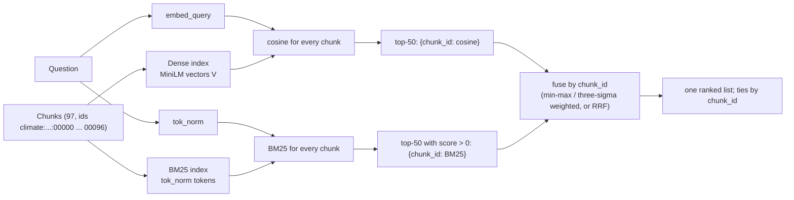
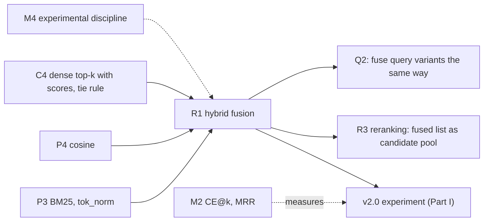

# R1 — Sparse vs dense vs hybrid retrieval; score fusion and Reciprocal Rank Fusion

> **What this file is.** The full lesson for concept **R1** ([02 card](../02_RAG_MASTER_LEARNING_PLAN.md#r1)), Phase 5. It follows the Parts A–M template of [07](../07_SAMPLE_LESSON.md), at the scale of [P3](P3_bm25.md) and [C4](C4_dense_retrieval.md), which it builds on. The short, book-first version is [study/reading/R1_hybrid_fusion.md](../study/reading/R1_hybrid_fusion.md). Both depths share one question file, [study/questions/R1_questions.md](../study/questions/R1_questions.md).
> **What this file is not.** BM25 itself (that is [P3](P3_bm25.md)), dense top-k (that is [C4](C4_dense_retrieval.md)), or the v2.0 run (Part I is its protocol; nothing has been run on the frozen eval set).
> **How to use it.** Answers are hidden in collapsible blocks. Write your answer first, then open the block. Lines marked `> 🧭 Coach:` are instructions for the AI tutor; they add to [05 §3](../05_LEARNING_AND_RETENTION_SYSTEM.md#3-coaching-rules-for-the-ai-tutor) and cannot override it.
> **Labels.**
> - **UNVERIFIED**: not checked by running code or reading the primary source.
> - **Toy illustration**: numbers computed on made-up data, never a result about a real system.
> - **Demonstration**: a hand-picked query on Corpus D, with its target found by string search. It is not an evaluation.
> - **Draft-seed observation**: a measurement on the 10 `llm-draft` seed items of [06 §6.7](../06_RAG_PROJECT_AND_EVALUATION_PLAN.md#67-draft-seed-items-for-corpus-d-draft--learner-must-verify). Good for learning, never a scored result.
>
> **Written ahead of the gates** (learner decision 2026-10-17, for the offline study kit): lessons and questions only. Part I gives the full v2.0 protocol with an **empty** results table.
>
> Every number in this lesson comes from the local run of 2026-10-17 ([R1_FACTS.md](../sources/verification/R1/R1_FACTS.md): S1–S14 for measurements, S-src for citation checks, LT for the lab test), from arithmetic shown in the text, or carries a label. Dense retrieval uses the local MiniLM fallback. No Groq or Cohere call was made.

## Lesson header

| Field | Value |
|---|---|
| Concept | **R1 Sparse vs dense vs hybrid retrieval**: the two blind spots; two indexes over the same chunk ids; why raw scores cannot be added; min-max and three-sigma normalisation; weighted score fusion over aligned ids (and what a missing chunk gets); Reciprocal Rank Fusion (RRF) and its constant k; the consensus rule RRF hides; invariance to rescaling; the repo's misalignment bug and the unit test that catches it; choosing a fusion method from per-category metrics. |
| Phase / tier | Phase 5, Retrieval. Priority **E** (essential). Fast track possible (VAI L23, [02 §5](../02_RAG_MASTER_LEARNING_PLAN.md#5-fast-track-rules-from-the-o1-diagnostic)). |
| Prerequisites | **P3** (BM25, `tok_norm`), **P4** (cosine), **M4** (experimental discipline, for Part I); **C4** (dense top-k with scores, ties by `chunk_id`) is used throughout. |
| Comes next | **v2.0** (the experiment, Part I) · **R3** reranking (a fused list is a natural candidate pool, Ch13 p.5/13) · **R4** MMR · **Q2** (query variants can be fused the same way). |
| Diagnostic evidence | **O1-Q09** (session 2026-10-08 #1): score 2 at confidence 3. You did not know RRF, but your "agreement" intuition gave the order **A, C, B, D**, which is what RRF gives. No formula; min-max fragility not discussed. **O1-Q12**: you suggested hybrid BM25 + vector search for exact version strings, which is the R1 use case. No misconception is logged for R1. |
| Time | A: 10 min · book: 25 min · B–D: 60 min · E–G: 20 min · H (lab): 90 min · I: 15 min (read the protocol) · J–K: 15 min · L: 20 min · M: 5 min. Two or three sittings. |
| Mastery (R1 → `applied`) | Without notes, you can: (1) compute RRF by hand for two lists (R1-A-01); (2) implement min-max, three-sigma and weighted fusion over **aligned** ids, and RRF (lab Tasks 2–3); (3) explain the repo's misalignment bug and write the test that catches it (lab Task 4); (4) run dense, BM25 and fused retrieval on Corpus D (lab Task 5). Lab: `coding_independence_0_3 ≥ 2`. |
| Mastery (R1 → `transfer`) | You also decide a fusion method from per-category numbers (lab Task 9, a fresh CR-13 scenario) and score `debugging_0_3 ≥ 2` (lab Tasks 4 and 6). The technique concept reaches `transfer` only after the v2.0 experiment is `decided` ([05 §4.3](../05_LEARNING_AND_RETENTION_SYSTEM.md#43-scores-required-per-mastery-level)). |

### Source map

| Source | Where | What it contributes |
|---|---|---|
| Book (A) | Ch12 p.1–14/14 (blind spots p.1–2; core idea p.3–4; two indexes p.5–6; normalisation p.7–9; weights p.9–12; when to use p.12–13; takeaways p.14); Ch13 p.5/13; App p.14/23, p.16–17/23, p.19/23, p.21/23 | The **why**, the two normalisers and the weighted sum, all in words. No RRF, no alignment, no clipping, no tie rule (S-src absence checks) |
| Repo (B) | `fusion_retrieval.ipynb` cells 0, 10, 14, 15, 17, 19; `all_rag_techniques_runnable_scripts/fusion_retrieval.py` L40, L56, L61, L75–L86, L100, L135; `fusion_retrieval_with_llamaindex.ipynb` cells 3, 8, 15, 17, 19, 20, 22 | One weighted-fusion implementation with a misalignment bug, and one LlamaIndex configuration that names RRF and rejects it |
| Interview repo (MIT) | `ombharatiya/AI-Engineer-Interview-Questions` @ `e080df2`: `04-rag-and-retrieval/questions.md` Q9, Q24; `12-coding-challenges/17_hybrid_search_and_rerank.py` L131, L241, L245–L247 | Two interview items (Part L.4) and the k = 0 vs k = 60 test lists, checked against our runs |
| Lab verification | [`sources/verification/R1/`](../sources/verification/R1/): `r1_measure.py`, `r1_sources.py`, `r1_build_lab.py`, `r1_lab_runner.py`, `r1_lab_solution.py`, `r1_lab_test.py`, `r1_md_check.py`, saved outputs, [`R1_FACTS.md`](../sources/verification/R1/R1_FACTS.md) | Every measured number |
| Source C (external) | #33 Cormack, Clarke & Büttcher (2009), RRF, k = 60 ([01 §6](../01_SOURCE_INVENTORY.md#6-source-c--supplementary-references-external)) | The RRF formula and the default k. Not re-read for this lesson: the formula is checked by our own code, not by the paper |

### Contents

[Part A](#part-a--prior-knowledge-recovery) · [Read in the book](#read-in-the-book-after-part-a) · [B](#part-b--why-r1-exists) · [C](#part-c--intuition-and-analogy) · [D](#part-d--technical-mechanism) · [E](#part-e--connections) · [F](#part-f--worked-example-by-hand) · [G](#part-g--source-connection) · [H](#part-h--implementation-progression) · [I](#part-i--controlled-experiment-v20) · [J](#part-j--failure-and-debugging) · [K](#part-k--engineering-decisions) · [L](#part-l--assessment) · [M](#part-m--retention) · [References](#source-references) · [Verification log](#verification-log)

---

## Part A — Prior knowledge recovery

Answer the three questions **before** reading on and before opening the book. They are the `set=pre` items of [R1_questions.md](../study/questions/R1_questions.md), with the same ids and wording; the full model answers, hints and key points are there.

> 🧭 Coach: Ask **one item at a time** (CR-01), in the exact wording below, with its template. Record confidence 1–3 before revealing anything (CR-16). The O1 pattern is "confident and wrong" (mean 1.1/4 at confidence 3), so say the confidence back before grading. Score with the Recall or Application rubric ([05 §4.2](../05_LEARNING_AND_RETENTION_SYSTEM.md#42-graded-rubrics-04)). These are unscheduled: log them, do not change the schedule. Route with the table after R1-PRE-03.

**R1-PRE-01.** Why can't you rank chunks by simply adding a BM25 score to a cosine score?

*Reply template:* "Because BM25 scores ____ while cosine scores ____, so the sum ____."

<details><summary>What a strong answer contains</summary>

- Different scales: cosine of unit vectors is bounded (−1 to 1), BM25 is not.
- A plain sum follows the larger scale: on the 10 draft seeds the raw-sum top-4 shares 37 of 40 chunks with the BM25 top-4 (S9).
- A 4 names a fix: normalise each list first, or fuse ranks.

</details>

**R1-PRE-02.** Name one kind of question where keyword search beats dense search, and one where dense search wins.

*Reply template:* "Keyword search wins on ____, because ____. Dense search wins on ____, because ____."

<details><summary>What a strong answer contains</summary>

- Keyword (BM25) wins on exact identifiers: acronyms, codes, names, numbers (rare tokens, high IDF).
- Dense wins on paraphrase: different words, similar meaning.
- A 4 adds a limit, for example the tokenizer must make the same token on both sides (P3).

</details>

**R1-PRE-03.** A chunk is first in the BM25 list but missing from the dense list: should hybrid retrieval still put it near the top?

*Reply template:* "It depends on ____. With weighted fusion it ____; with RRF it ____."

<details><summary>What a strong answer contains</summary>

- It depends on the method. Weighted fusion still gives it (1 − w) × 1.0. RRF gives it 1/61, below every chunk found by both short lists (D.7).
- A 4 says the choice is measured per category, not assumed.

</details>

> 🧭 Coach: **Routing.**
>
> | Weak answers (score ≤ 1) | Action |
> |---|---|
> | R1-PRE-01 | Teach D.2 first, with the S9 raw-sum numbers. |
> | R1-PRE-02 | Teach B.1 and B.2 with the book's pages; if BM25 itself is shaky, do [P3 D.3](P3_bm25.md#d3-bm25-exactly-as-rank_bm25-022-computes-it) first (03: P3 → R1). |
> | R1-PRE-03 | Teach D.5 and D.7 side by side; do lab Task 3 before Task 5. |
> | All three ≥ 3 with confidence 3 | Offer the fast track: skim B–C, then D.5–D.9, F, H and L (evidence is never skipped, 02 §5 rule 1). |

---

## Read in the book (after Part A)

> **When.** Read these pages **after** Part A, never before. About 25 minutes.
> **How.** For each page, answer its "look for" question in one line. Then close the book and say the four steps of fusion out loud.

| Order | Pages | Look for |
|---|---|---|
| 1 | **Ch12 p.1–2/14** | The acronym story: at which rank does meaning-based search put the chunk that names it? On p.2, find the opposite failure. |
| 2 | **Ch12 p.3–4/14** (optional) | The cookbook analogy: the index and the chef. Which one catches what? |
| 3 | **Ch12 p.5–6/14** | Step 1: one set of chunks, indexed **twice**. Note the sentence saying the chunks are identical; D.9 shows what goes wrong when code forgets it. |
| 4 | **Ch12 p.6–7/14** | Step 2: each retriever returns its own top-K list **with scores**. Look at the Venn figure: chunks in both lists and in only one. |
| 5 | **Ch12 p.7–9/14** | Step 3: the two score scales and the two normalisers. Which one does the book call more robust, and why? Then the rule for a chunk that only one retriever returned. |
| 6 | **Ch12 p.9–12/14** | Step 4 and "Choosing the Weights": the 0.6/0.4 example, the 50/50 to 70/30 range, and how the book says weights are tuned. |
| 7 | **Ch12 p.12–14/14** | "When to Use This", the trade-offs table and the key takeaways. List the three "overkill" cases. |
| 8 (optional) | **App p.16–17/23, p.19/23, p.21/23** | The glossary entries for Fusion Retrieval, Min-Max Normalization and Score Normalization. |

**What the book gets wrong or leaves out** (checked against our runs; details in D and G):
1. **No rank-based fusion.** Reciprocal Rank Fusion is never mentioned (S-src: no "reciprocal rank fusion", "RRF" or "rank fusion" anywhere in the book). It is the v2.0 primary arm (D.6).
2. **"The distribution-based form is more robust"** (Ch12 p.8/14). Against a single outlier it is not: the outlier still squeezes the other scores into a narrow band (D.4). And its values can leave 0–1: 24 of 1,000 values on our seed lists (S8).
3. **"After normalising, equal numbers mean the same thing"** (Ch12 p.9/14). A normalised 1.0 only means "best in this list for this query". D-009 has no answer in the document, yet its best dense and BM25 chunks both get 1.0 (D.3).
4. **Missing-chunk rule, without its side effect** (Ch12 p.9/14). Only one retriever's part counts, so a missing chunk gets 0. Min-max also gives the **last** chunk of each list 0, so the last hit counts like no hit (D.3).
5. **No word on alignment, ties or clipping.** The book's sketch (Ch12 p.10/14) assumes every score belongs to one chunk. The repo breaks exactly that (D.9).

> 🧭 Coach: After the reading, ask one question: "Which of the book's two normalisers can produce a value above 1?" Expected: the three-sigma form (D.4). Then move to Part B.

---

## Part B — Why R1 exists

### B.1 Dense retrieval pushes exact terms down

**The setup.** The book's story (Ch12 p.1/14): meaning-based search ranks the one chunk that names a chemical acronym fourth, behind chunks about related regulation. P3 measured BM25 on five exact-term queries but left dense retrieval unmeasured. We ran the same five queries on the **97 v0 chunks** (the C-lab index) with both retrievers. The target is any chunk that contains the string.

**The result** (demonstration, S6):

| Query | Chunk that names the term | Dense rank | BM25 rank (`tok_norm`) | BM25 rank (repo `split()`) |
|---|---|---|---|---|
| `IPCC` | seq 1, page 1 | 3 | **1** | none |
| `What does BECCS stand for?` | seq 88, page 30 | 4 | **1** | none |
| `methane CH4` | seq 2, page 1 | 4 | **1** | 2 |
| `Kyoto Protocol 1997` | seq 69, page 24 | 1 | 1 | 1 |
| `limit warming to 1.5 degrees` | seq 27 and 68, pages 10 and 23 | 4 | **1** | 1 |

**What this means.** Dense retrieval found every target inside the top 4, but four of five only at rank 3 or 4; the three at rank 4 sit exactly at v0's cut-off (k = 4, C4 D.6). BM25 with the course tokenizer puts every target first. With the repo's `split()`, two of them match nothing (P3 B.2).

**For your project:** this closes P3's open item "how dense retrieval ranks the same exact-term queries on our corpus". Exact terms land low, not lost, on this small corpus. The v2.0 `exact-term` bucket is where a larger, harder corpus (Corpus T) would show whether they get lost.

### B.2 BM25 is misled by shared words

**The setup.** The reverse failure (Ch12 p.2/14): a chunk with the right meaning but other words. Draft seed **D-006** asks "What are the advantages of putting solar panels on lakes or reservoirs?" Its evidence (page 8) is about solar farms on water bodies and never says "lakes" or "panels".

**The result** (draft seed, S5):

```
query tokens present (tok_norm; OOV words dropped):
  seq 64, page 22 (solar and wind technology):  are the of solar panels or      ← "panels": idf 4.1641
  seq 21, page 8  (floating solar, EVIDENCE):    are the of solar on
dense:  seq 21 rank 1 (0.5331)   seq 64 rank 2 (0.5004)
BM25:   seq 64 rank 1 (13.6205)  seq 21 rank 2 (9.2298)
fused:  min-max 0.5/0.5  seq 64 first, evidence 2nd
        RRF k = 60       seq 21 and seq 64 tie EXACTLY at 1/61 + 1/62; the smaller chunk_id puts seq 21 first
```

**What this means.** BM25 rewards the chunk that shares a rare word with the question, here "panels", even though that chunk is about a different technology. Min-max fusion follows BM25 and loses a place. RRF keeps the evidence first only because of the tie rule. This is the one seed where any fusion did worse than dense.

**For your project:** v2.0's hypothesis has a guard for exactly this: hybrid must **not lower** CE@4 on `vocabulary-mismatch` items (06 §4.2). D-006 is a ranking loss, not a CE loss (CE@4 = 1 for every arm).

### B.3 The honest limit: on our seeds, dense already reaches CE@4

**The setup.** All seven retrieval arms of S4 on the 8 answerable draft seeds, k = 4.

**The result** (draft-seed observations, S4):

| Arm | Hit@4 | CE@4 | MRR@10 | First relevant rank, D-001…D-008 |
|---|---|---|---|---|
| dense (v0) | 8/8 | 8/8 | 0.708 | 3, 3, 1, 1, 1, 1, 2, 2 |
| BM25 (`tok_norm`) | 8/8 | 8/8 | 0.938 | 1, 1, 1, 1, 1, 2, 1, 1 |
| BM25 (repo `split()`) | 8/8 | 8/8 | 0.875 | 1, 2, 1, 1, 1, 2, 1, 1 |
| RRF k = 60, top-50 lists | 8/8 | 8/8 | **1.000** | 1, 1, 1, 1, 1, 1, 1, 1 |
| min-max 0.5/0.5, top-50 | 8/8 | 8/8 | 0.938 | 1, 1, 1, 1, 1, 2, 1, 1 |
| min-max 0.6/0.4, top-50 | 8/8 | 8/8 | 0.938 | 1, 1, 1, 1, 1, 2, 1, 1 |
| three-sigma 0.6/0.4, top-50 | 8/8 | 8/8 | 0.938 | 1, 1, 1, 1, 1, 2, 1, 1 |

**What this means.** Every arm already has the evidence in the top 4 for every seed. Fusion changes **where** it sits, not **whether** it is there. The gains are in rank: four seeds (D-001, D-002, D-007, D-008) move to rank 1. RRF's perfect MRR includes one exact tie (D-006) and one margin of 0.000008 (D-002). Eight easy draft items cannot tell these methods apart in CE.

**For your project:** this is the book's own overkill case, a small collection where vector search alone already retrieves (Ch12 p.12/14). It is why v2.0 needs the frozen eval set, with 6+ `exact-term` items, and why Corpus T (larger, technical) matters for the decision.

---

## Part C — Intuition and analogy

**Two judges with different marking scales.** One judge (dense) marks every essay out of 1 and rarely gives more than 0.7. The other (BM25) marks out of no fixed maximum and gives 40 to an essay full of the right keywords. To pick winners you cannot add their marks: the second judge decides everything (D.2).
- **Min-max** asks each judge to rescale his own pile so his best essay gets 1 and his worst 0. Fair between judges, but "worst in the pile" now looks the same as "not in the pile" (D.3).
- **Weighted fusion** then trusts one judge a bit more, 0.6 against 0.4 (D.5).
- **RRF** asks each judge only for his **order**. An essay gets a vote from each judge that shrinks slowly with its place. The marks never meet, so neither judge can shout louder (D.6).

The book's own picture is the cookbook: the index at the back finds the exact ingredient, the chef finds the dish you described (Ch12 p.3/14).

**Where the analogy breaks.** Real judges read the same essays. Code can hand the two judges **different piles in different orders** and add marks that belong to different essays. That is the repo's bug (D.9). The analogy also hides that the two "piles" are each judge's top 50, not the whole collection: whatever one judge left out gets nothing from him.

> 🧭 Coach: CR-17. Ask one question: "In the analogy, which method still works if one judge suddenly marks out of 100 instead of out of 1?" Expected: RRF (and min-max, because it rescales each pile; the raw sum does not).

---

## Part D — Technical mechanism

### D.1 The pipeline: two lists over the same chunk ids



Three rules make fusion correct (book Ch12 p.5–6/14 for the first):
1. **The same chunks, indexed twice.** Both lists must rank the same units with the same ids. A BM25 index over whole documents and a vector index over chunks share no ids (R1-T-02).
2. **Every list is a dict keyed by `chunk_id`**, never a positional array. The repo breaks this (D.9).
3. **Each retriever passes on a cut list** (here its top 50, the 06 v2.0 design). BM25 keeps only scores above 0 (P3 K: 0 means no term matched).

On the 10 seeds the union of the two top-50 lists held 63 to 76 of the 97 chunks, and 24 to 37 chunks were in **both** lists (S7). Top-4 lists share less: 27 of 40 top-4 slots over the 10 seeds held a chunk that both retrievers had in their top 4 (S4), the book's Venn picture (Ch12 p.7/14).

### D.2 Why raw scores cannot be added

**The setup.** Add the raw dense and BM25 scores of each chunk in the union of the two top-50 lists (a missing chunk adds 0).

**The result** (draft seeds, S8, S9):

```
best dense score per seed:  0.26 … 0.71        (cosine of unit vectors: bounded, −1 … 1)
best BM25 score per seed:   7.0 … 43.6         (no fixed range: depends on N, df, avgdl, P3)
raw-sum top-4 vs BM25 top-4, 10 seeds:  37 of 40 chunks identical
D-008 raw-sum top-4:  Kigali chunk 9.7153, then seq 0 1.8858, seq 7 1.8730, seq 27 1.8403
```

**What this means.** A raw sum is BM25 alone with a little noise. The book makes the same point with 0.87 against 14.2 (Ch12 p.8/14). The raw sum still reached CE@4 8/8 here, because BM25 alone did.

**For your project:** never add raw scores across retrievers, models or corpora. A raw score is comparable only within one retriever and one query (C4 D.5).

### D.3 Min-max: what 1 and 0 really mean

```
minmax(s) = (s − min) / (max − min)        over ONE list; constant list → 1.0 for every member (course rule)
```

**The setup.** Min-max on the real top-50 lists of the seeds.

**The result** (draft seeds, S5b, S8):

```
D-008 dense list:  0.2598 … 0.0909   → Kigali chunk (0.2535) ≈ 0.9625    rank-1 chunk 1.0000    50th chunk 0.0000
D-008 BM25 list:   9.4618 … 1.2000   → Kigali chunk 1.0000                2nd chunk (1.8858) 0.0830
D-009 (no answer): best dense 0.3099 → 1.0    best BM25 6.9559 → 1.0
D-010 (no answer): best dense 0.5196 → 1.0    best BM25 13.2576 → 1.0
```

**What this means.** Three facts follow from the formula:
- **1.0 means "best in this list for this query"**, not "relevant". Two questions with no answer in the document still produce a 1.0 on both sides. So the book's claim that normalised scores mean the same strength of match (Ch12 p.9/14) does not hold.
- **0 means two things.** The last chunk of a list gets 0, and the book gives a chunk that is missing from a list 0 as well (Ch12 p.9/14). So the 50th chunk dense found counts exactly as if dense had not found it.
- **The cut decides the scale.** Change the list depth and the min moves, so every normalised score moves.

**For your project:** a constant list (every score equal) makes min-max divide by zero. The repo's notebook adds `1e-8`, which turns a constant list into all zeros; the runnable script does not, which gives NaN (P3 S9). The course rule is 1.0 for every member (they are all the list's best), and the lab tests it.

> 🧭 Coach: CR-17. Ask one question: "Under min-max, what is the difference between the last chunk of the dense list and a chunk dense did not return?" Expected: none; both get 0 from dense.

### D.4 The three-sigma range is not more robust

```
three_sigma(s) = (s − (mean − 3·sd)) / (6·sd)     population sd, not clipped; constant list → 0.5
```

This is the book's "distribution-based" normaliser (Ch12 p.8/14) and the formula `fusion_retrieval_with_llamaindex.ipynb` cell 20 describes for `dist_based_score`.

**The setup.** A toy list with one outlier, a three-item toy list, and the real top-50 lists.

**The result** (toy, S3; draft seeds, S8; formula, S13):

```
[1, 2, 3, 4, 100]  min-max      0.000  0.010  0.020  0.030  1.000
                   three-sigma  0.410  0.415  0.419  0.423  0.833     (sample sd: 0.420 … 0.798)
[2, 4, 6]          min-max      0.0    0.5    1.0
                   three-sigma  0.296  0.5    0.704                   (sample sd: 0.333, 0.5, 0.667)
values outside 0 … 1 on the 10 seeds' top-50 lists:   dense 9 of 500,   BM25 15 of 500
D-008 Kigali chunk under three-sigma (BM25 side): 1.6546
largest possible |z| with population sd: (n − 1)/√n  →  n = 10: 2.846   n = 11: 3.015   n = 50: 6.930
two candidates per retriever (llamaindex cells 15, 17: top 2):  any two different scores → 0.6667 and 0.3333
```

**What this means.**
- The outlier still squeezes the other four scores, into a band 0.013 wide instead of 0.030. The three-sigma form is not more robust against it; it just squeezes from both ends.
- With more than 10 items, a value can lie beyond three standard deviations, and then it leaves 0–1. A strong exact-term hit (the Kigali chunk, 1.65) is exactly such a value.
- With only two candidates per retriever, as in the LlamaIndex notebook's configuration, the formula maps **any** two different scores to 0.6667 and 0.3333 (population sd; 0.6179 and 0.3821 with sample sd). The size of the gap is lost. Which sd LlamaIndex uses is **UNVERIFIED** (the library is not installed here).

**For your project:** if a later arm uses three-sigma, record the sd convention and whether values are clipped. Neither is a default to rely on.

### D.5 Weighted fusion over aligned ids

```
fused(d) = Σ over retrievers r of  w_r · norm_r(d)        norm_r(d) = 0 if d is missing from r's list
```

**The setup.** D-008 with min-max at 0.5/0.5 and 0.6/0.4, and three-sigma at 0.6/0.4 (the LlamaIndex weights, cell 19).

**The result** (draft seed, S5b):

| Chunk | Dense rank → min-max | BM25 rank → min-max | min-max 0.5/0.5 | min-max 0.6/0.4 | three-sigma 0.6/0.4 |
|---|---|---|---|---|---|
| seq 69, Kigali (evidence) | 2 → 0.9625 | 1 → 1.0000 | **0.9813** (1st) | **0.9775** (1st) | **1.2266** (1st) |
| seq 28, carbon pricing | 1 → 1.0000 | missing → 0 | 0.5000 (2nd) | 0.6000 (2nd) | not in top 4 |
| seq 58 | 3 → 0.9287 | missing → 0 | 0.4643 (3rd) | 0.5572 (3rd) | not in top 4 |
| seq 12 | 4 → 0.6701 | 18 → 0.0496 | 0.3598 (4th) | 0.4219 (4th) | 0.6377 (2nd) |

**What this means.** The evidence wins under all three, because both retrievers rank it near the top. Below it, the methods disagree: min-max keeps dense's own winners (seq 28, seq 58) even though BM25 never returned them; three-sigma does not. A fused score above 1 is possible under three-sigma.

The weights are the book's main knob (Ch12 p.9–12/14: 0.6/0.4 as an example, 50/50 to 70/30 as typical). On the seeds, every dense weight we tried from 0.0 to 0.7 (0.0, 0.3, 0.5, 0.6, 0.7) gave the same first relevant ranks as BM25 alone (MRR@10 0.938); only 1.0 fell back to the dense ranks (0.708) (S10). Going from 0.5 to 0.7 still changed the ordered top-4 of 5 of 10 seeds.

**For your project:** the weight is a variable to tune on dev and record in the config. The identity test from S10 is the cheapest check of any implementation: weight 1.0 must give exactly the dense top-k and weight 0.0 exactly the BM25 top-k (both true for all 10 seeds here).

### D.6 Reciprocal Rank Fusion

```
RRF(d) = Σ over lists s of  1 / (k + rank_s(d))        ranks start at 1; k = 60; missing → adds nothing
```

RRF comes from Cormack, Clarke and Büttcher (2009; Source C #33), the v2.0 card's primary arm (06 §4.2). It is not in the book.

**The setup.** D-008's two top-50 lists, k = 60.

**The result** (draft seed, S5b):

```
seq 69 (Kigali): dense rank 2, BM25 rank 1   →  1/62 + 1/61 = 0.016129 + 0.016393 = 0.032522   rank 1
seq 56:          dense rank 6, BM25 rank 13  →  1/66 + 1/73                       = 0.028850   rank 2
seq 12:          dense rank 4, BM25 rank 18  →  1/64 + 1/78                       = 0.028446   rank 3
seq 28:          dense rank 1, not in BM25   →  1/61                              = 0.016393   rank 31
contribution of rank 1 vs rank 50: 1/61 = 0.0164 vs 1/110 = 0.0091 (ratio 1.80); at k = 0: 1 vs 1/50 (ratio 50)
```

**What this means.** RRF ignores how far ahead a winner was: BM25's Kigali chunk scores five times the runner-up (9.46 against 1.89), yet counts only as "rank 1". What counts is being high in **both** lists. The constant k sets how fast votes shrink: at k = 60 a first place is worth only 1.8 times a fiftieth place; at k = 0 it is worth 50 times.

Two practical details, both measured:
- **k changes rankings.** On the seeds, k from 60 to 0 or 1 changed the ordered top-4 of 5 of 10 seeds, k = 10 of 3, and k = 120 or 1000 of 1. CE@4 stayed 8/8 and MRR@10 1.000 every time (S10).
- **Exact ties happen.** Two chunks at ranks (1, 2) and (2, 1) get the same float. On D-006 that tie decides whether the evidence is first; the smaller `chunk_id` wins (06 §3.1, the C4 tie rule). Sorting by score alone, as the interview repo's sample code does, leaves the order to insertion order.

> 🧭 Coach: CR-08 probe (one question): "If k_rrf doubles from 60 to 120, does a first place gain or lose weight relative to a tenth place?" Expected: it loses: 1/121 vs 1/130 (ratio 1.07) instead of 1/61 vs 1/70 (1.15); the votes get flatter. Measured on the seeds: 1 of 10 top-4 lists changed.

### D.7 The consensus rule hidden in RRF

**The setup.** Compare the best a chunk in **one** list can get with the worst a chunk in **both** lists can get, for list depth N.

**The result** (arithmetic, S2; draft seeds, S7, S13b):

```
one list, rank 1:          1/61  = 0.016393
both lists, rank 50 each:  2/110 = 0.018182      → both-list chunk wins
both lists, rank 61 each:  2/121 = 0.016529      → still wins
both lists, rank 62 each:  2/122 = 0.016393      → tie: the rule holds for depth ≤ 61
10 seeds, top-50 lists: every chunk in both lists outranked every chunk in one list: 10 of 10
full lists (depth 97):  the rule broke on 1 of 10 seeds
```

**What this means.** With k = 60 and lists of 61 or fewer, RRF first sorts by "found by both", then by rank. A chunk only one retriever found, however confidently, comes after all of them. That is why D-008's dense winner (seq 28) drops to rank 31, while min-max keeps it at rank 2.

**For your project:** this is the behaviour behind the v2.0 hypothesis. It helps when the evidence is in both lists (the Kigali chunk is dense rank 2). It hurts when an exact-term chunk is **missing** from the dense top-50: then RRF cannot lift it above the consensus chunks, but weighted fusion can, with (1 − w) × 1.0. Which case dominates on Corpus T is an empirical question for the `exact-term` bucket. Pre-register the list depth as part of the arm.

### D.8 What each method ignores: rescaling one scorer

**The setup.** A new embedding model or BM25 library can keep the same ranking but change the scale. We changed the dense or BM25 scores of the top-50 lists, without changing their order, and counted how many seeds' ordered top-4 changed.

**The result** (draft seeds, S9):

| Change (order kept) | Raw sum | Min-max 0.5/0.5 | Three-sigma 0.5/0.5 | RRF k = 60 |
|---|---|---|---|---|
| dense × 100 | 8/10 | 0/10 | 0/10 | 0/10 |
| BM25 × 10 | 3/10 | 0/10 | 0/10 | 0/10 |
| dense → exp(10·s) | 10/10 | 4/10 | 5/10 | 0/10 |
| BM25 → √s | 4/10 | 2/10 | 1/10 | 0/10 |

**What this means.** Read the columns from left to right. The raw sum moves under any change. Min-max and three-sigma ignore a straight rescaling (multiplying, as measured; adding a constant also cancels out of both formulas) but not a bent one. RRF ignores every change that keeps each list's order, because it never looks at the numbers. That is the precise sense in which "ranks are invariant": not to a new model or a corpus update, which **reorder** the lists.

**For your project:** if a scorer is upgraded, a weighted-fusion arm must be re-tuned; an RRF arm does not, though its results still change if the ranks change.

### D.9 The repo's misalignment bug, line by line

**The setup.** `fusion_retrieval.ipynb` cell 17. The runnable script `all_rag_techniques_runnable_scripts/fusion_retrieval.py` L75–L86 has the same logic without the epsilon. We transcribed it with NumPy onto our 97 chunks, using MiniLM in place of OpenAI and squared L2 distance as FAISS's flat L2 index returns (the notebook needs an OpenAI key and was not run; FAISS behaviour UNVERIFIED here).

| Line | Code (paraphrased) | Order of the result |
|---|---|---|
| L75 | `all_docs = similarity_search("", k=ntotal)` | by distance to the **empty string** |
| L76 | `bm25_scores = bm25.get_scores(query.split())` | **corpus** order (the order of `cleaned_texts`) |
| L77, L79 | `vector_results = similarity_search_with_score(query, k=n)`; scores taken in that order | by distance to the **query** |
| L80–L81 | min-max on both arrays (cell 17 adds `1e-8`) | unchanged |
| L83 | `combined = alpha * vector + (1 - alpha) * bm25` | position i mixes two different chunks |
| L84–L86 | `argsort`, then `all_docs[i]` | returns a third chunk |

**The result** (S11):

```
first 5 rows: empty-string order [89, 50, 48, 49, 81]   query order (cell-19 query) [31, 7, 38, 30, 1]
normalised vector array: non-increasing by position (a ramp from 1.000 to 0.000)
cell-19 query, top-5:   repo-style rows [50, 28, 89, 48, 29]   aligned rows [1, 30, 37, 7, 0]   overlap 0/5
alpha = 1.0:            1 distinct top-5 over the 10 seeds = [89, 50, 48, 49, 81] = the empty-string order
8 answerable seeds:     repo-style Hit@4 0/8, CE@4 0/8      aligned (same formula, same split()) 8/8, 8/8
repo-style with tok_norm BM25 instead of split():  still 0/8
"IPCC" (every split() BM25 score 0): repo-style returns [89, 50, 48, 49, 81]; aligned returns the dense top-5
```

**What this means.** Because the vector array is already sorted by the query, normalising turns it into a ramp that ignores **which** chunk sits where. The vector half of the sum therefore only says "earlier positions are better". The BM25 half belongs to corpus chunk i. The result is read from the empty-string order. With all the weight on dense, every question gets the same five chunks. One correction follows for P3: [P3 H.2](P3_bm25.md#h2-repo-reading-guide-fusion_retrievalipynb-cell-17) says an all-zero BM25 array makes the fusion "vector-only". That is what the formula does with aligned arrays; with the repo's arrays, the output is the five chunks nearest to the empty string.

**The fix and the test.** Key every score by `chunk_id` (D.1 rule 2). Then one assert catches the bug before any evaluation runs:

```python
def test_fusion_preserves_identity(fuse):
    dense = {"c1": 0.9, "c4": 0.7, "c2": 0.5, "c3": 0.2}       # dense order differs from id order
    bm25 = {"c3": 8.0, "c2": 3.0, "c1": 1.0, "c4": 0.5}
    assert fuse(dense, bm25, alpha=1.0)[:4] == ["c1", "c4", "c2", "c3"]   # all weight on dense → dense order
    assert fuse(dense, bm25, alpha=0.0)[:4] == ["c3", "c2", "c1", "c4"]   # all weight on BM25 → BM25 order
```

The lab test runs this kind of test against a transcription of the repo logic: it fails, as it should (LT, Task 4b).

**For your project:** 06 §10 asks for "a fusion unit test (chunk identity preserved)" before v2.0. This is it.

### D.10 The tokenizer still matters inside the hybrid

**The setup.** RRF k = 60 over top-50 lists, with the BM25 side built on the repo's `split()` or on `tok_norm`.

**The result** (draft seeds, S12): `split()` hybrid MRR@10 0.938 (D-002 at rank 2); `tok_norm` hybrid 1.000. On the demonstration queries, `split()` BM25 matches nothing for `IPCC` and `BECCS` (S6).

**What this means.** Fusion cannot rescue a BM25 side that never matches: an empty BM25 list leaves the dense list alone. P3's tokenizer decision carries straight into v2.0.

**For your project:** record the tokenizer (name and version) in the v2.0 config; it is a hidden variable (06 v2.0 "Cost" line).

---

## Part E — Connections



| Often confused | The difference |
|---|---|
| Sparse vs dense | Sparse: one weight per vocabulary term, mostly zeros (BM25). Dense: a few hundred numbers, all used (MiniLM: 384) |
| Score fusion vs rank fusion | Score fusion normalises and adds the numbers (D.5); rank fusion adds 1/(k + rank) and never reads the numbers (D.6) |
| Min-max vs three-sigma | Min-max pins the best to 1 and the worst to 0; three-sigma uses mean and sd, and its values can leave 0–1 (D.4) |
| k (retrieval) vs k_rrf | k = chunks passed to the prompt (C4); k_rrf = the RRF constant, 60 |
| List depth vs k | Depth = how many candidates each retriever passes to fusion (50 here); k = how many fused chunks go on (4) |
| Missing vs last | Weighted fusion gives both 0 from that list under min-max (D.3); RRF gives the last a small vote and the missing none |
| Hybrid retrieval vs reranking | Hybrid merges two first-stage lists; a reranker re-scores one candidate list with a stronger model (R3) |

**Not covered here:** learned sparse retrieval (for example SPLADE) and per-query adaptive weights (book Ch12 p.12/14). Both are later options, not part of v2.0.

---

## Part F — Worked example by hand

**Toy illustration** (made up; the rankings are those of O1-Q09; every value re-computed in S2–S3).

```
dense (cosine):  A 0.62   B 0.58   C 0.41
BM25:            C 7.9    A 2.1    D 1.8
```

**Step 1: RRF, k = 60.** Give each document 1/(60 + rank) per list and add. (This is R1-A-01, the R1 review item.)

<details><summary>Answer</summary>

```
A = 1/61 + 1/62 = 0.032522      C = 1/63 + 1/61 = 0.032266
B = 1/62        = 0.016129      D = 1/63        = 0.015873
order: A, C, B, D          (A − C = 0.000256; C − B = 0.016137)
```

The same order at k = 0, 1 and 120 (S2).

</details>

**Step 2: min-max each list.**

<details><summary>Answer</summary>

Dense: A 1.0000, B (0.58 − 0.41)/0.21 = 0.8095, C 0.0000. BM25: C 1.0000, A (2.1 − 1.8)/6.1 = 0.0492, D 0.0000.

</details>

**Step 3: weighted sum at 0.5/0.5, then at 0.6/0.4.** A missing document gets 0 from that list.

<details><summary>Answer</summary>

```
0.5/0.5:  A 0.5246   C 0.5000   B 0.4048   D 0.0000    → A, C, B, D   (same as RRF)
0.6/0.4:  A 0.6197   B 0.4857   C 0.4000   D 0.0000    → A, B, C, D
```

A weight change of 0.1 swaps B and C. C is BM25's best but dense's worst, so dense gives it 0: exactly what dense gives D, which it never returned (D.3).

</details>

**Step 4: three-sigma at 0.6/0.4, and the raw sum.**

<details><summary>Answer</summary>

```
three-sigma dense:  A 0.6526   B 0.5793   C 0.2681       BM25: C 0.7355   A 0.3912   D 0.3734
fused 0.6/0.4:      A 0.5480   C 0.4551   B 0.3476   D 0.1493    → A, C, B, D
raw sum:            C 8.31     A 2.72     D 1.80     B 0.58      → C, A, D, B   (BM25 decides)
```

Under three-sigma, the worst of a list no longer gets 0, so D (BM25's last) gets 0.4 × 0.3734 = 0.1493 instead of 0.

</details>

**Step 5: predict before checking (CR-08).** Bend the dense scores with exp(10·s), which keeps their order. Does the min-max 0.6/0.4 order change? Does the RRF order?

<details><summary>Answer</summary>

Min-max: dense B becomes 0.6243 instead of 0.8095, so B = 0.3746 drops below C = 0.4000 → **A, C, B, D** (changed). RRF: unchanged (**A, C, B, D**), because the dense order is the same (S3). Rescaling BM25 by × 10 or √ changes neither here.

</details>

> 🧭 Coach: CR-08 probe here, one question: "If the dense weight goes from 0.6 to 0.3, which document wins?" Expected: C, because BM25's best now carries 0.7 (this is R1-A-02; ask for the direction and the reason first, the numbers second).

---

## Part G — Source connection

### G.1 Book (Source A)

| Cite | Book point (paraphrased) | Our assessment |
|---|---|---|
| Ch12 p.1/14 | Meaning-based search ranks the chunk that names the acronym fourth | Measured analogue: BECCS rank 4, IPCC 3, CH4 4 under dense (B.1) |
| Ch12 p.2/14 | Keyword search misses a chunk with the meaning but not the words | D-006: BM25 rank 2 behind a chunk sharing "panels" (B.2) |
| Ch12 p.3–4/14 | Cookbook index vs chef; complementary blind spots | Part C |
| Ch12 p.5–6/14 | Chunk once, index twice; the chunks are identical | D.1 rule 1; the precondition the repo breaks (D.9) |
| Ch12 p.6–7/14 | Both retrievers return top-K with scores; the lists overlap partly | 27 of 40 top-4 slots shared over 10 seeds (D.1) |
| Ch12 p.7–8/14 | Different scales; BM25 would dominate a sum | Measured: 37/40 (D.2) |
| Ch12 p.8/14 | Two normalisers; the distribution-based one called more robust; min-max distorted by an outlier | Not more robust against an outlier; can leave 0–1 (D.4) |
| Ch12 p.9/14 | Equal normalised numbers mean equal strength; 0.6/0.4; a one-list chunk gets only that retriever's part | First claim does not hold (D.3); the missing rule = 0 (D.5) |
| Ch12 p.10/14 | Ten-step algorithm sketch | Assumes aligned scores; no tie rule |
| Ch12 p.11–12/14 | 50/50 default; 60/40 or 70/30 for general questions; tune on representative queries, or adapt per query | A dev-set variable (D.5, Part I) |
| Ch12 p.12/14 | Optional multi-query expansion | Not part of v2.0 |
| Ch12 p.12–13/14 | Overkill: one query type, a small collection, tight latency; trade-offs table | B.3 is the small-collection case; Part K |
| Ch12 p.14/14 | Takeaways: normalisation is essential; 50/50 to 70/30 | RRF makes normalisation unnecessary (D.6) |
| Ch13 p.5/13 | Any first-stage retriever, including fusion, can feed a reranker | R3 link |
| App p.16–17/23, p.19/23, p.21/23 | Glossary: Fusion Retrieval, Min-Max Normalization, Score Normalization | Same claims as Ch12 |

**Not in the book** (S-src absence checks over every PDF): reciprocal rank fusion or "RRF", Cormack, z-score, misalignment. In chapter 12: no "reciprocal", no alignment, no clipping. "Standard deviation" occurs in chapter 12 only on p.8.

**One more view (Source C, paraphrased).** *Evals for AI Engineers* recommends starting retrieval with keyword search as the first baseline (AE Ch2, 'Retrieval Fundamentals'). Our v0 is dense-first on purpose (06 §3); v2.0 adds BM25 alone as one of its three arms, so the comparison exists.

### G.2 Repo (Source B): cells and lines verified at `009adba`

| Cite (cells 0-based) | What it shows | Lesson |
|---|---|---|
| `fusion_retrieval.ipynb` cell 0 | Markdown: scores normalised to a common scale, combined with `alpha` | The intended design |
| cell 10 | `FAISS.from_documents(cleaned_texts, embeddings)`; 1000/200 chunks | The vector store's index order = `cleaned_texts` order |
| cells 14, 15 | `BM25Okapi([doc.page_content.split() ...])` over the same `cleaned_texts` | BM25's array is in corpus order |
| cell 17 | `similarity_search("", k=ntotal)`; `similarity_search_with_score(query, k=len(all_docs))`; min-max with `+ epsilon`; `alpha * vector + (1 - alpha) * bm25`; `all_docs[i]` | **Three orders mixed** (D.9). No id lookup anywhere in the cell (S-src) |
| cell 19 | Example query on climate impacts, `k=5, alpha=0.5` | The query of the S11 replication |
| `runnable_scripts/fusion_retrieval.py` L75–L86 | The same logic **without** epsilon (L80–L81) | Same bug; plus NaN on an all-equal BM25 array (97/97 for `IPCC`, S11) |
| L40, L56, L100, L135 | Store from `cleaned_texts`; BM25 from the same; `alpha` default 0.5 | Confirms the corpus order |
| `fusion_retrieval_with_llamaindex.ipynb` cell 3 | Legacy `BM25Retriever`; `QueryFusionRetriever`; OpenAI `text-embedding-3-small` | A different stack |
| cell 8 | `faiss.IndexFlatL2` | L2 distances |
| cells 15, 17 | BM25 and vector retrievers with `similarity_top_k=2` | Only 2 candidates each: three-sigma maps any pair to fixed values (D.4) |
| cell 19 | `retriever_weights=[0.6, 0.4]`, `num_queries=1`, `mode='dist_based_score'` | The source of the book's 0.6/0.4 (04 DV-26) |
| cell 20 | Describes four modes; says reciprocal ranking is unsuitable because there is no normalisation | Wrong reason: RRF uses ranks, so it needs no normalisation (D.6). The only place RRF appears in the repo (S-src scan) |
| cell 22 | `retriever.retrieve(query)` | The run; LlamaIndex not installed here, so its fusion code is UNVERIFIED |

### G.3 Corrections to the 02 card, the 04 row and P3 (none of them is edited here)

1. **02 card, book pages: correct but incomplete.** p.1–2, p.5–6, p.7–9 and p.9–12 all check out (S-src). Missing: p.12–13/14 ("When to Use This", overkill cases, trade-offs), p.14/14 (takeaways), p.3–4/14 (the analogy) and the glossary (App p.16–17, 19, 21/23).
2. **04 R1 row and DV-27: three orders, not two.** 04 says the vector and BM25 arrays are in different document orders. True, but the returned documents come from a **third** order (`all_docs`, by distance to the empty string). That is why, with `alpha = 1`, every query returns the same chunks (S11). 04 also calls the effect "likely wrong" (static reading); replicated with MiniLM it is 0/8 Hit@4.
3. **04 Ch12 table, step 6:** "1 − min-max of L2 distance" is right, but it hides that the vector array is sorted by the query before normalising, which makes it a ramp by position (D.9).
4. **P3 H.2, answer 4** ("only the vector retriever decides"): true for the formula with aligned arrays, not for the repo's code, which then returns the five chunks nearest to the empty string (S11).
5. **06 v2.0 design note** (not an error): with top-50 lists and k = 60, the consensus rule of D.7 holds. Pre-register the list depth with the arm.

### G.4 Reading list (in this order)

`fusion_retrieval.ipynb` cell 10 → cells 14–15 → cell 17 → `runnable_scripts/fusion_retrieval.py` L75–L86 → `fusion_retrieval_with_llamaindex.ipynb` cells 15, 17, 19, 20. For each array in cell 17, write in the margin which order it is in, before reading D.9.

---

## Part H — Implementation progression

### H.1 The lab: [`labs/R1_hybrid_fusion_lab.ipynb`](../labs/R1_hybrid_fusion_lab.ipynb) (blank-file first)

Given cells build the C4 index (97 chunks, MiniLM, `chunks.jsonl` sha256 `d4108b89…` asserted), the seeds and the `rel`/`ce` helpers, and P3's `tok_norm`. The notebook has **no solution code**; CHECK cells compare fingerprints read from `out_r1_measure.txt`. No API call.

| # | Task | The checks test |
|---|---|---|
| 1 | RRF by hand on the O1-Q09 lists; predict first | Scores (5 decimals) and order (fingerprinted) |
| 2 | `rrf`, `fused_order` (ties by smaller id) | Agrees with Task 1; missing adds nothing; exact ties; the k = 60 and k = 0 lists |
| 3 | `minmax`, `zscore3`, `weighted_fusion` over **aligned** ids | Toy values and orders; constant lists; weight 1.0 = dense order; dict order does not matter |
| 4a | Reproduce cell 17 on three documents; then the aligned version | The repo's wrong order and the right order (fingerprinted) |
| 4b | `test_fusion_preserves_identity(fuse)` | Passes on your fusion, **fails** on a transcription of the repo logic |
| 5 | BM25, dense, RRF and min-max on Corpus D for all 10 seeds; predict first | D-002 and D-008 top-4s; first relevant ranks per arm; Hit@4/CE@4 |
| 6 | Diagnose D-008 (fusion helps) and D-006 (fusion hurts; the exact tie) | The tie values; the tutor grades the text |
| 7 | CR-08: k_rrf 60 → 0; dense weight 0.5 → 0.7; predict first | Change counts (fingerprinted) |
| 8 | Rescale one scorer: raw sum vs min-max vs RRF; predict first | Six change counts |
| 9 | Decide the v2.0 primary arm and when not to use hybrid | Tutor-graded (Transfer) |

**Lab test (LT, `out_r1_lab_test.txt`).** The reference solution and an alternative solution pass 10/10 CHECK cells. A blank notebook fails 10/10. Each of eight planted bugs fails at its own task: RRF ranks from 0 (Tasks 2, 6, 7); no tie rule (2, and in some runs 3: without a tie rule, tied ids follow Python's set order, which changes from run to run); min-max constant list → 0 (3); missing → 0.5 (3, 5, 7, 8); sample sd (3); positional fusion (3, 4a, 4b, 5, 7, 8); `split()` BM25 (5, 7, 8); a weak identity test that cannot catch the repo bug (4b).

API names you may look up: `rank_bm25.BM25Okapi`, `.get_scores`, `np.argsort`, `np.std`, `sorted(..., key=...)`, `dict.get`, `math.exp`. The reference implementation is `sources/verification/R1/r1_measure.py` (`rrf`, `minmax`, `zscore3`, `weighted`, `order`).

> 🧭 Coach: `r1_measure.py` and `r1_lab_solution.py` are **solutions**. Do not show them before an attempt plus a hint (CR-04). Grade `coding_independence_0_3` on Tasks 2, 3 and 5, and `debugging_0_3` on Task 4 (and any failing CHECK the learner fixes). If CHECK 4b fails on the repo transcription, ask "With alpha = 1.0, what must any fusion return?" before anything else.

### H.2 Repo reading guide: `fusion_retrieval.ipynb` cell 17

Trace `fusion_retrieval(vectorstore, bm25, query, k=5, alpha=1.0)` by hand. Answer each question before opening.
1. In what order are the documents in `all_docs`?
2. In what order are the numbers in `vector_scores` after the normalising line?
3. With `alpha = 1.0`, which positions does `argsort` pick?
4. Which chunks come back, and do they depend on the query?
5. What single change would make the function correct?

<details><summary>Answers</summary>

1. By L2 distance to the embedding of the empty string.
2. By distance to the query, so after `1 − min-max` they fall from 1.0 at position 0 to 0.0 at the end: a ramp.
3. Positions 0, 1, 2, 3, 4.
4. `all_docs[0:5]`, the chunks nearest to the empty string. They do not depend on the query: measured, the same five rows for all 10 seeds (S11).
5. Build both score sets as dicts keyed by document id (or index both arrays by the same document position) and return the document whose scores were summed.

</details>

### H.3 Reusable design (future `ragkit/retrieval.py`; nothing is created now)

- `BM25Retriever(chunks, tokenizer)` and the C4 `DenseRetriever` both return `list[Candidate]` with `source` set and 1-based ranks (06 §2.3); `BM25Retriever` returns only scores > 0.
- `fuse_rrf(lists, k=60, depth=50)` and `fuse_weighted(lists, weights, norm, depth=50)` take `{source: list[Candidate]}` and join on `chunk.chunk_id`; ties by `chunk_id`; the output has `source="fused"`.
- On construction, assert both retrievers index the **same** chunk-id set (D.1 rule 1).
- Unit tests: the identity test (D.9); the rescaling test (D.8: RRF output unchanged under a monotone change of one list); exact ties (D-006 pattern); missing chunks; constant lists; every fused id exists in the chunk catalogue.
- Store `k_rrf`, depth, weights, normaliser and tokenizer in the run config and the trace.

### H.4 The interface: what R1 consumes and hands on

**Input.** The C4 dense result list and a BM25 result list over the **same** chunk ids, each with `rank` (1-based), `chunk_id` and `score` ([C4 H.4](C4_dense_retrieval.md#h4-the-interface-what-c4-consumes-and-what-it-hands-to-c5)).

**Output** (to C5, and to the trace). The fused list: `min(k, |union|)` records ordered by (−fused score, `chunk_id`), each the C4 record plus

```python
{"rank": 1, "chunk_id": "climate:ea07572562ac:1ca9c5a3b548:00069", "score": 0.03252247488101534,   # RRF value (D-008)
 "source": "fused", "ranks_by_source": {"dense": 2, "bm25": 1}}
```

The trace keeps `candidates.dense` and `candidates.bm25` with scores **and** ranks, and `fused[].ranks_by_source` (06 §2.5): it explains why a chunk was promoted. That record is D-008's real fused rank 1 (S5b).

---

## Part I — Controlled experiment (v2.0)

> **No results are reported here because none have been run.** This is the pre-registration design for `experiments/E020_v2.0_hybrid_rrf/` ([06 §9.1](../06_RAG_PROJECT_AND_EVALUATION_PLAN.md#91-run-registry-layout)). It runs after the frozen eval set (M1) and the harness (M2) exist, and once the approval gates (08 Part 7) and the mastery gates (02 §4) allow Phase 5. Write the blanks before running and commit them first.

### I.1 Question, baseline, hypotheses

- **Question:** does adding BM25 and fusing raise **retrieval** quality on exact-term questions without lowering it on paraphrase questions?
- **Baseline:** v0 dense retrieval (06 §3.1: Cohere embed by default, D-03; the local MiniLM fallback as the offline second-model arm), k = 4, ties by `chunk_id`. Also the current champion if it is not v0.
- **Arms** (06 v2.0 card: three arms, plus weighted fusion as a second hybrid arm):

| Arm | Retrieval | Fixed settings to pre-register |
|---|---|---|
| A0 | dense (v0 or champion) | — |
| A1 | BM25 alone | `tok_norm`, k1 = 1.5, b = 0.75, `rank_bm25` 0.2.2; scores > 0 only |
| A2 (primary) | RRF over dense and BM25 top-N lists | k_rrf = 60; depth N = 50; ties by `chunk_id` |
| A3 | weighted min-max fusion of the same top-N lists | dense weight w chosen **on dev** from {0.3, 0.5, 0.7}; constant list → 1.0; missing → 0 |

| ID | Hypothesis | Primary metric | Categories |
|---|---|---|---|
| H1 | A2 raises CE@4 over A0 on exact-term and table/numeric items | **CE@4** | `exact-term`, `table/numeric` |
| H2 (guard) | A2 does not lower CE@4 on vocabulary-mismatch items by more than ____ | **CE@4** | `vocabulary-mismatch` |
| H3 | A3 (best w on dev) differs from A2 in CE@4 by less than ____ overall | **CE@4** | all answerable |
| H4 (diagnostic) | A2 raises MRR@10 over A0 overall | MRR@10 | all answerable |

**Decision rule (pre-registered).** Select on `dev`; confirm once on `test`. The primary comparison is CE@4 on the **pooled H1 slice** (`exact-term` + `table/numeric`, about 10 items in v1.0 of the eval set). Adopt A2 (or A3) as champion only if, on `test`, the paired CE@4 difference over the champion on that slice has a 95% bootstrap CI that excludes 0 ([06 §9.3](../06_RAG_PROJECT_AND_EVALUATION_PLAN.md#93-paired-comparison-with-bootstrap-confidence-intervals)) and H2's guard holds. With about 10 items only a large effect can show (06 §9.4), so a CI that includes 0 is recorded as "inconclusive", and the slice grows in the next dataset version. Every other per-category number is for diagnosis, not decisions.

### I.2 Variables and controls

| Kind | Setting |
|---|---|
| Independent | The arm (A0–A3) |
| Fixed | Comparison keys (`dataset_sha256`, `snapshot_id`, qid set, labels, split, `scorer_version`); chunker and chunk ids; embedder id and revision; k = 4; tie rule; tokenizer; list depth; k_rrf |
| Hidden variables to record | Tokenizer name/version; BM25 library version; whether BM25 lists drop zero scores; normaliser convention |
| Second comparison | Equal context-token budget is **not** needed: every arm passes 4 chunks of the same chunker. Report mean context tokens anyway (06 §9.2) |
| Generation | Not part of the decision. Optional, separate table, human labels until the final judge batch (D-10) |

### I.3 Metrics

| Family | Metrics | Notes |
|---|---|---|
| Retrieval (primary) | **CE@4** | 06 §7.2–§7.3 |
| Retrieval (diagnostic) | MRR@10, Hit@4, Group-Recall@4, rank of first evidence per arm | MRR is where the draft seeds moved (B.3) |
| Fusion diagnostics | chunks in both lists; how often the evidence came from one list only; exact ties in the fused top-k | D.7 and D-006 |
| Ops | BM25 index build time; query latency per arm (p50, p95) | Book Ch12 p.13/14 calls the cost modest; measure it |

### I.4 Results templates (empty until run)

Retrieval, k = 4, `dev` split:

| Arm | CE@4 [95% CI] | Δ CE@4 vs A0 [CI] | MRR@10 | Hit@4 | Mean context tokens |
|---|---|---|---|---|---|
| A0 dense | | — | | | |
| A1 BM25 | | | | | |
| A2 RRF | | | | | |
| A3 weighted (w = ___) | | | | | |

Per category, CE@4 (n stated; diagnosis only):

| Arm | exact-term (n=) | table/numeric (n=) | vocabulary-mismatch (n=) | factual-single-span (n=) | multi-span (n=) |
|---|---|---|---|---|---|
| A0 | | | | | |
| A2 | | | | | |
| A3 | | | | | |

Test confirmation log:

| Round | Date | Arms tried on `dev` | Candidate | Comparison keys | Δ CE@4 on `test` [CI] | Guard met? | Adopted? |
|---|---|---|---|---|---|---|---|
| 1 | | | | | | | |

### I.5 How to interpret the results

- **Read the buckets, not the mean.** H1 can hold while H2 fails (D-006 pattern). Report both.
- **Look at single-list evidence.** If the exact-term evidence is often missing from the dense top-50, A3 may beat A2 (D.7).
- **A draft-seed result is not a prior.** The seeds showed MRR gains and no CE change (B.3); the frozen set decides.
- **Retrieval ≠ answer.** A CE@4 gain does not show that answers improved; check the 2×2 of [06 §7.1](../06_RAG_PROJECT_AND_EVALUATION_PLAN.md#71-retrieval-metrics-vs-generation-metrics-and-why-they-disagree).
- **Write "when not to use"** with the measured cost and the buckets where hybrid did not help.

---

## Part J — Failure and debugging

For each: write your predicted cause and fix, then open. Each diagnosis says **retrieval** or **generation** (CR-11).

**J1. Every question gets the same five chunks when `alpha = 1.0`.**

<details><summary>Diagnosis</summary>

- **Cause.** Scores combined by position across three orders; the vector array is a ramp, so the output is the empty-string order (D.9, S11).
- **Kind.** Retrieval.
- **Fix.** Dicts keyed by `chunk_id`; the identity test.

</details>

**J2. A query with an acronym returns five chunks that never mention it.**

<details><summary>Diagnosis</summary>

- **Cause.** The BM25 side tokenizes with `split()`, so `IPCC` never matches `(IPCC)`: every BM25 score is 0 (P3 S9). In the repo's code the output is then the empty-string order (S11); in an aligned fusion it is the dense top-5.
- **Kind.** Retrieval.
- **Fix.** `tok_norm` on both sides; drop zero BM25 scores; log "BM25: no term matched".

</details>

**J3. The fused order of two chunks flips between two runs.**

<details><summary>Diagnosis</summary>

- **Cause.** An exact RRF tie (ranks (1, 2) and (2, 1), as on D-006) broken by insertion order or a non-stable sort.
- **Kind.** Retrieval (rank order changes MRR and the prompt order).
- **Fix.** Sort by (−score, `chunk_id`); add a test with a deliberate tie.

</details>

**J4. A three-sigma-normalised score of 1.65 breaks a "scores are in 0–1" assert.**

<details><summary>Diagnosis</summary>

- **Cause.** A value more than three standard deviations from the mean, possible once a list has more than 10 items (D.4; D-008's Kigali chunk).
- **Kind.** Retrieval scoring.
- **Fix.** Decide and record: clip at 0 and 1, or drop the assert. Do not treat the value as a probability.

</details>

**J5. After adding BM25, nothing changes at all, even on exact-term questions.**

<details><summary>Diagnosis</summary>

- **Cause (one candidate).** The BM25 index was built over different units (whole documents, other ids), so no BM25 id matches a chunk id and the fusion is dense-only (R1-T-02).
- **Kind.** Retrieval.
- **Fix.** Assert both indexes hold the same chunk-id set; assert every fused id exists in the chunk catalogue.

</details>

**J6. Weighted fusion results drift after a library upgrade, with the same weight.**

<details><summary>Diagnosis</summary>

- **Cause.** The new scorer keeps the order but changes the shape of its scores; min-max fusion is not invariant to that (D.8: 4/10 top-4s changed under a bent dense scale).
- **Kind.** Retrieval.
- **Fix.** Re-tune the weight on dev after any scorer change, or use RRF as the default.

</details>

> 🧭 Coach: For J1, J3 and J5, ask for the **one-line assert** that would have caught it (identity test; tie test; `set(fused) <= set(chunk_ids)`). It counts as evidence for `debugging_0_3`.

---

## Part K — Engineering decisions

| Question | Decision | Why |
|---|---|---|
| Primary fusion | RRF, k_rrf = 60, ties by `chunk_id` | No normalisation; ignores rescaling (D.8); 06 v2.0 card. Evidence: draft seeds only (B.3) |
| Second arm | Weighted min-max, weight tuned on dev | Keeps single-list hits (D.7); uses score gaps RRF drops |
| List depth | 50 per retriever, pre-registered | 06 v2.0 card; with k = 60 it implies the consensus rule (D.7) |
| Normaliser | Min-max; constant list → 1.0; missing → 0 | Book rule, Ch12 p.9/14; three-sigma not default (D.4) |
| Alignment | Every score keyed by `chunk_id`; both indexes over the same chunk ids | D.1, D.9 |
| BM25 | `tok_norm`, defaults, scores > 0 only | P3 K; D.10 |
| Tests | Identity, rescaling, tie, missing, constant list, catalogue membership | H.3; the repo had none (D.9) |
| Trace | Per-source ranks and scores; `ranks_by_source` | 06 §2.5 |

**When NOT to use hybrid retrieval:**
- The question set has **no exact-term needs** (06 v2.0), or dense already reaches the evidence on a labelled set: our draft seeds, CE@4 8/8 for dense (B.3). The book's small-collection case (Ch12 p.12/14).
- The questions are mostly **paraphrases**: BM25 can promote lookalike chunks (D-006, B.2). Watch the `vocabulary-mismatch` guard.
- The **tokenizer fails** on the domain (code, formulas, languages without spaces): BM25 then adds nothing or noise (D.10).
- **Latency** is the binding constraint (Ch12 p.13/14). Measure it before deciding.
- The two indexes would hold **different units**: fix that first (J5).

---

## Part L — Assessment

The items are in [study/questions/R1_questions.md](../study/questions/R1_questions.md) with their hints, model answers, key points, "for a 4" points and common wrong answers. The ids and the question wording are the same here. Score with [05 §4.2](../05_LEARNING_AND_RETENTION_SYSTEM.md#42-graded-rubrics-04).

> 🧭 Coach: Ask one item at a time, with its template (CR-01). Record confidence first (CR-16). Use the hint ladder (H1, H2 from the file; H3 exists for R1-A-01 and R1-A-02 only).

### L.1 Recall

| Id | Question | Criteria for 4 (short) |
|---|---|---|
| R1-R-01 | What does each retriever miss that the other one catches? | Dense: exact terms; BM25: paraphrase; both mechanisms; a tokenizer limit |
| R1-R-02 | Why must BM25 and cosine scores be normalised before a weighted sum? | Scales; the larger decides (37/40); a normalised 1.0 means "best in list", not "relevant" |
| R1-R-03 | What is the Reciprocal Rank Fusion formula, and what does it use instead of scores? | Σ 1/(k + rank), ranks from 1, k = 60; ranks only; loses score gaps; needs a tie rule |
| R1-R-04 | What goes wrong in the repo's `fusion_retrieval` function (`fusion_retrieval.ipynb` cell 17)? | Three orders mixed; 0/8 vs 8/8; the alpha = 1.0 identity test |
| R1-R-05 | After min-max normalisation, what score does the last chunk of each list get, and why does that matter? | 0 = same as missing; 1.0 ≠ relevant; depends on the cut |

### L.2 Application

| Id | Question | Criteria for 4 (short) |
|---|---|---|
| R1-A-01 | Dense ranks [A, B, C] and BM25 ranks [C, A, D]: compute RRF with k = 60 and give the fused order. | A 0.0325, C 0.0323, B 0.0161, D 0.0159 → A, C, B, D; self-check both-list > one-list |
| R1-A-02 | With dense scores A 0.62, B 0.58, C 0.41 and BM25 scores C 7.9, A 2.1, D 1.8, what is the min-max fused order at weights 0.3 dense / 0.7 BM25? | C 0.7000, A 0.3344, B 0.2429, D 0 → C, A, B, D; self-check C = BM25 weight |
| R1-A-03 | For the ranked lists [0, 1, 2, 3, 4] and [4, 1, 3, 2, 0], which document wins RRF at k = 60, and which at k = 0? | 1 at k = 60; 0 at k = 0 (tie with 4, smaller id); mechanism; 5/10 seeds changed |
| R1-A-04 | This fusion returns the same five chunks for every question when `alpha = 1.0`: what is the bug, and what one test would have caught it? | Positional mixing; ramp → `all_docs[:5]`; fix by id; identity test |

### L.3 Transfer

> 🧭 Coach: these three are **practice** items. For the scored CR-13 item, make up a fresh scenario (a new domain, unit or constraint) that is not in this file or the question file, and grade it with the Transfer rubric. R1-T-01 is the "when not to use" item; R1-T-03 is the compare-designs item (CR-09).

| Id | Question | Criteria for 4 (short) |
|---|---|---|
| R1-T-01 | A support team searches a 25-page FAQ where every question is a plain "how do I …" sentence and nobody types codes or product names: would you add BM25 hybrid retrieval? | Probably not; D-006 risk; measure dense vs hybrid per category; what would change the answer |
| R1-T-02 | BM25 indexes whole documents, the vector index holds chunks, and RRF fuses the two lists by chunk id: what goes wrong? | Ids never match; silent dense-only; same chunk ids; catalogue test |
| R1-T-03 | Your BM25 library will be replaced next quarter and you have 300 labelled questions: would you choose RRF or tuned weighted score fusion? | RRF default (rescaling 0/10); weighted as a dev-tuned arm; CE@4 per category; when not |

### L.4 Interview items (MIT repo, checked)

| Id | Question (verbatim from `ombharatiya/AI-Engineer-Interview-Questions` @ e080df2, `04-rag-and-retrieval/questions.md`, Copyright (c) 2026 Om, MIT License) | Criteria for 4 (short) |
|---|---|---|
| R1-R-06 | "How does reciprocal rank fusion work, and why fuse by rank instead of by score?" | Formula; scales; loses magnitude; ranks are invariant to rescaling, **not** to a new model or corpus; tie rule |
| R1-A-06 | "If a doc appears in the dense list only, what's its ceiling in the fused ranking?" | 1/61 vs 2/110; the rule holds for depth ≤ 61; D-008 rank 31 |

**Accuracy check of the repo's answer to Q24** (details in the question file): the formula, the 1/61 ≈ 0.016 and 1/110 ≈ 0.009 values and the scale argument are right. "Ranks are invariant to all of that" overstates it (D.8). "Famously insensitive" k is not a measurement; here k 60 → 0 changed 5/10 top-4 lists. Its sample code has no tie rule.

### L.5 When is R1 mastered?

- **`applied` (L3):** R1-R-03 ≥ 3 on two different days, one ≥ 24 h after teaching; two Application items ≥ 3 (one must be R1-A-01 or R1-A-04); lab Tasks 2, 3 and 5 pass with `coding_independence_0_3 ≥ 2`.
- **`transfer` (L4):** a fresh novel-scenario item ≥ 3; `debugging_0_3 ≥ 2` (Task 4); a teach-back ≥ 3; the v2.0 experiment `decided` (technique concept, 05 §4.3).

---

## Part M — Retention

### M.1 Flashcards

| # | Front (one question) | Back |
|---|---|---|
| 1 | Dense retrieval's blind spot? | Exact terms (acronyms, codes, numbers) |
| 2 | BM25's blind spot? | Paraphrase (no shared token) |
| 3 | RRF formula? | Σ 1/(k + rank), ranks from 1 |
| 4 | Default k_rrf? | 60 |
| 5 | Rank 1 at k = 60 is worth? | 1/61 ≈ 0.0164 |
| 6 | Min-max of the last item of a list? | 0, the same as missing |
| 7 | Can three-sigma values exceed 1? | Yes, beyond 3 sd (lists > 10 items) |
| 8 | Which fusion ignores rescaling a scorer? | RRF (rank-only) |
| 9 | A one-list chunk under RRF, top-50 lists? | Below every both-list chunk |
| 10 | The repo's fusion bug? | Three orders mixed by position |
| 11 | Its smoking gun? | alpha = 1.0 → same 5 chunks for every query |
| 12 | The test that catches it? | alpha = 1.0 must return the dense ranking |
| 13 | Book's weight range? | 50/50 to 70/30 (Ch12 p.11/14, p.14/14) |
| 14 | Does the book cover RRF? | No |

### M.2 Retrieval practice (closed book; log per [05 §5.1](../05_LEARNING_AND_RETENTION_SYSTEM.md#51-active-recall-what-a-review-item-looks-like))

| When | One question | Template |
|---|---|---|
| Day 1 | What does RRF add up? | "1 / (____ + ____) for each ____." |
| Day 3 | Under min-max, what does the last chunk of a list get? | "____, which equals ____." |
| Day 7 | Dense [X, Y], BM25 [Y, Z]: compute RRF at k = 60. | "X ____, Y ____, Z ____ → ____" |
| Day 14 | Why can't RRF lift an exact-term chunk that dense missed entirely? | "Because ____." |

<details><summary>Day-7 answer</summary>

Y = 1/62 + 1/61 = 0.032522; X = 1/61 = 0.016393; Z = 1/62 = 0.016129 → Y, X, Z.

</details>

### M.3 Teach-back prompt ([05 §5.4](../05_LEARNING_AND_RETENTION_SYSTEM.md#54-teach-back-protocol))

"In 3 minutes, explain to a teammate why the repo's fusion returns the same chunks for every question, and how you would fuse two retrievers correctly." A 4 needs: the two blind spots; same chunk ids; why raw scores cannot be added; min-max and its 0; RRF and its consensus rule; the identity test; one measured number (0/8 vs 8/8, or rank 31); retrieval vs generation kept apart.

### M.4 Interleaving links

- **P3:** BM25 needs `tok_norm` on both sides; `split()` empties the BM25 list (D.10).
- **C4:** ties by `chunk_id` decide D-006; scores are comparable only within one retriever (C4 D.5).
- **M2 / M4:** CE@4 per category and the paired bootstrap decide v2.0 (Part I).
- **R3:** the fused top-N is a candidate pool for a reranker (Ch13 p.5/13).

### M.5 Misconception-log entries to add when observed

| Label | Correct model (short) | Root cause | Severity | Check items |
|---|---|---|---|---|
| "Add the two scores" | Different scales; normalise or use ranks | prerequisite-gap (P3, P4) | medium | R1-PRE-01, R1-R-02 |
| "Normalised 1.0 means relevant" | 1.0 = best in this list for this query | over-generalisation | medium | R1-R-05 |
| "RRF needs normalised scores" | RRF reads only ranks | terminology | low | R1-R-03, R1-R-06 |
| "Fusion only needs arrays of the same length" | Fusion needs the same ids, joined by id | wrong mental model | high (silent failure) | R1-R-04, R1-A-04, R1-T-02 |
| "Hybrid is always better" | Measure per category; it can lower paraphrase ranks | over-generalisation | medium | R1-T-01 |

### M.6 Progress-tracker entry (format only; fictional values, per [05 §6.1](../05_LEARNING_AND_RETENTION_SYSTEM.md#61-progressconcept_trackercsv))

```csv
R1,Sparse vs dense vs hybrid; fusion,5,E,exposed,<YYYY-MM-DD>,,,<YYYY-MM-DD +1>,1,,,,,,,not_planned,,0,log:<YYYY-MM-DD>#R1-A-01
```

---

## Source references

**Book (Source A).** Ch12 p.1/14 to p.14/14 (every page); Ch13 p.5/13; Appendix p.14/23, p.16/23, p.17/23, p.19/23, p.21/23. Checked against the PyMuPDF page text by `r1_sources.py` on 2026-10-17 (47 page-phrase checks, 11 absence checks). Paraphrased; no quotation reaches 15 words (the 15-word overlap check over the whole book is in `out_r1_md_check.txt`).

**Repo (Source B)**, `NirDiamant/RAG_Techniques` @ `009adba2be1bef49780ef73b6dd3c18fd24b035b`, cells 0-based: `all_rag_techniques/fusion_retrieval.ipynb` 0, 10, 14, 15, 17, 19; `all_rag_techniques_runnable_scripts/fusion_retrieval.py` L40, L56, L61, L75–L86, L100, L135; `all_rag_techniques/fusion_retrieval_with_llamaindex.ipynb` 3, 8, 15, 17, 19, 20, 22; the repo-wide RRF scan; `data/Understanding_Climate_Change.pdf` (sha256 `1d58a0fa…92669`).

**Interview repo (MIT).** `ombharatiya/AI-Engineer-Interview-Questions` @ `e080df282aaf14c128ade55c177a20c38d82df1d`, Copyright (c) 2026 Om, MIT License: `04-rag-and-retrieval/questions.md` (Q9, Q24 and its follow-ups); `12-coding-challenges/17_hybrid_search_and_rerank.py` L131, L241, L245–L247.

**Libraries.** `rank_bm25` 0.2.2 `BM25Okapi` (defaults k1 = 1.5, b = 0.75, epsilon = 0.25; as read in P3 S2). sentence-transformers 6.1.0 with `all-MiniLM-L6-v2`. LlamaIndex, LangChain and FAISS are **not installed**; their behaviour is UNVERIFIED here.

**Our records.** [06 §2.3, §2.5, §3.1, §4.2 (v2.0), §6.7, §7.2–§7.3, §9](../06_RAG_PROJECT_AND_EVALUATION_PLAN.md); [P3](P3_bm25.md) (S9, H.2); [C4](C4_dense_retrieval.md) (the index; S4 first-relevant fingerprint `a8aa456e76ccea3b` and D-002 top-4 fingerprint `78ebfed94d0021da`, both reproduced by R1 S4/S14); the O1 bank item Q9 and the session log of 2026-10-08.

**Supplementary (Source C).** #33 Cormack, Clarke & Büttcher (2009), "Reciprocal Rank Fusion outperforms Condorcet and individual rank learning methods" ([01 §6](../01_SOURCE_INVENTORY.md#6-source-c--supplementary-references-external)); not re-read. *Evals for AI Engineers* (Shankar & Husain), AE Ch2, 'Retrieval Fundamentals', paraphrased once in G.1.

---

## Verification log

**Environment.** Run on 2026-10-17 with `uv run` from `rag_learning/`: CPython 3.12.8, pymupdf 1.26.7, numpy 2.5.3, rank-bm25 0.2.2, sentence-transformers 6.1.0, torch 2.14.1 (CPU), transformers 5.19.0. MiniLM L6 loaded offline from the HF cache. No Groq or Cohere call; `.env` not read; no network.

| Claim | How verified |
|---|---|
| S1–S14 (index, toy RRF and normalisation, seeds, walk-through, demonstrations, consensus rule, normalisation ranges, rescaling, k and weight sweeps, the repo bug, tokenizer, list depth, lab fingerprints) | **Ran** `r1_measure.py`; output `out_r1_measure.txt`; a second run was byte-identical (`out_r1_measure_run2.txt`) |
| The index equals the C2/C3/C4 index | **Ran** (S1): `chunks.jsonl` sha256 `d4108b89…` = the C2 lab's file; the dense first-relevant ranks and the D-002 top-4 reproduce C4's fingerprints |
| Every repo cell and line, book page, interview-repo line and course-file claim | **Ran** `r1_sources.py`: ALL PASS (`out_r1_sources.txt`) |
| The repo's bug | The logic of cell 17 / L75–L86 **transcribed** with NumPy and MiniLM; the notebook and script themselves were **not run** (they need OpenAI) |
| The lab | **Ran** `r1_lab_test.py`: the solution (and an alternative) pass 10/10 CHECK cells; blank and eight broken variants each fail at their own task (`out_r1_lab_test.txt`) |
| Question file format, links, anchors, word counts, 15-word overlap | **Ran** `r1_md_check.py` (`out_r1_md_check.txt`), which also runs the kit's own `lint_questions` |
| Worked-example arithmetic (F, L, M) | Each value printed in S2–S3, S5b; intermediate steps derived in the text |

**Notes for 02, 04 and P3** (not edited): see G.3.

**Still UNVERIFIED:**
- how LangChain's FAISS store orders `similarity_search("")` and whether OpenAI accepts an empty string (the repo's L75; our replication uses MiniLM and squared L2);
- LlamaIndex's `dist_based_score` implementation (its sd convention, clipping, how it sums duplicates);
- the Cormack et al. (2009) paper itself (only the formula is used, and it is checked by our own code);
- every effect on the frozen eval set and on Corpus T (Part I, not run): the draft seeds are `llm-draft` items, and every seed number here is an observation, not a result.
